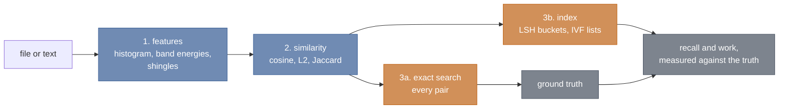
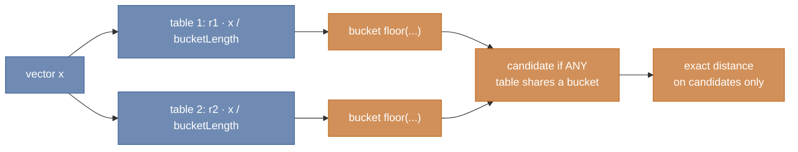
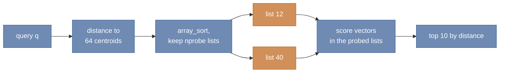

# Chapter 37: Similarity search: vectors, LSH and IVF

A shop has a library of product images and sound clips. Some files are copies of other files. A copy can be larger, moved a few pixels, brighter or with noise. A sound can have a different sample rate. A marketplace has listings that sellers post again with small changes.

In both cases, the question is the same: which items are almost the same as this item?

**Similarity search has three parts: a feature vector, a measure of similarity, and a search method. An exact search compares every pair, and its cost is quadratic. An index (LSH or IVF) compares fewer pairs, and it misses some answers. Thus, you can measure an index with only two numbers: the recall against an exact search, and the work that it saves. Spark lets you build each part from DataFrame functions and measure the two numbers.**

The data is the SparkTutor sample data. `media_library` has 43 image files and 40 WAV clips in families of near-copies, and `labels.csv` gives the family of each file. `listings.jsonl` has 424 marketplace listings with reposts. The IVF part uses 20,000 synthetic vectors.

The scripts are in [`code/ch37`](https://github.com/lisancao/spark-masterclass/tree/main/code/ch37). They ran on `pyspark==4.3.0` in local mode. Each number comes from `code/ch37/output/vectors.txt` or `indexes.txt`.



## Step 1: Features: a color histogram for each image

A feature vector must put similar items near each other. For images, a simple feature is a **color histogram**: the fraction of pixels in each cell of a color grid. With four levels for each of red, green and blue, the histogram has 4 × 4 × 4 = 64 values. A larger copy or a moved copy of an image has almost the same histogram.

The `image` source decodes each file into a struct with the pixel bytes in `image.data` and the channel count in `image.nChannels`. A pandas UDF calculates the histogram with NumPy:

```python
def color_histogram(data, channels, bins=4):
    """Fractions of pixels in each of bins**3 (red, green, blue) cells. The image source stores B, G, R(, A)."""
    px = np.frombuffer(data, dtype=np.uint8).reshape(-1, channels)
    b = g = r = px[:, 0]
    if channels > 1:
        b, g, r = px[:, 0], px[:, 1], px[:, 2]
    step = 256 // bins
    cell = (r // step).astype(int) * bins * bins + (g // step).astype(int) * bins + (b // step).astype(int)
    return (np.bincount(cell, minlength=bins ** 3) / len(cell)).astype(np.float32)

images = (raw.where("image.nChannels > 0")
          .select(F.col("_metadata.file_name").alias("file"),
                  histogram("image.data", "image.nChannels").alias("features")))
```

```text
== images: 43 files, 1 the image source could not decode, channels: [-1, 1, 3, 4]
  nearest image is in the same family for 41 of 42 images
  misses: [('plant_green_bright.png', 'banana_yellow_noisy.png', 0.877)]
```

Some details of the image source are important:

- **The channel order is B, G, R**, not R, G, B. A function that reads the bytes in the wrong order puts red pixels in blue cells.
- **Gray images have one channel, and RGBA images have four.** The function handles each case. It ignores the alpha channel.
- **A file that the source cannot decode** has `nChannels` equal to -1. The `where` removes it.
- **The histogram uses fractions, not counts.** Thus, a large copy and a small copy of an image get the same vector.

With the exact search of Step 4, the nearest image is in the same family for 41 of 42 images. The one miss shows what a histogram cannot see. A brighter copy of the green plant moves pixels into lighter cells, and those cells are near the cells of a yellow banana. A histogram has hard cell edges and no information about shape. It is also not a fingerprint. To find byte-identical copies, use `sha2(content, 256)` on the file bytes.

## Step 2: Features need units

For audio, the script calculates the share of energy in 16 frequency bands from 0 to 2,000 Hz with a fast Fourier transform. The library has some clips at 8,000 samples per second and other clips at 4,000. The script makes the bands in two ways:

```python
    if by_position:                       # the mistake: bin i means a different frequency at each rate
        band = (np.arange(len(power)) * bands // len(power)).astype(int)
    else:
        band = (np.fft.rfftfreq(len(x), d=1.0 / rate) / (top_hz / bands)).astype(int)
```

```text
== audio: features need units
  bands by FFT bin position: nearest clip in the same family for 28 of 40 clips
  bands in hertz           : nearest clip in the same family for 40 of 40 clips
```

If the bands come from the position of the FFT bin, bin 100 is a different frequency at each sample rate. Thus, the same sound at two rates gets two different vectors, and only 28 of 40 clips find their family. If the bands are in hertz, all 40 clips find their family. Each value in a feature vector must mean the same thing in all rows.

The same rule applies when you put columns of different units into one vector. The script adds the file size in bytes to the 64 histogram values. Then it scales the result:

```text
== one column in other units dominates a distance
  std of file size in bytes: 585.0 | largest histogram value: 0.752
  histogram + raw bytes  nearest in the same family: 32 of 42
  after StandardScaler   nearest in the same family: 40 of 42
```

A histogram value is at most 1, but the file size changes by hundreds of bytes. Thus, the size column sets all the distances, and only 32 of 42 images find their family. `StandardScaler` divides each column by its standard deviation (`withStd=True` and `withMean=False` are the defaults). After the scaler, 40 of 42 images find their family. `MinMaxScaler` and `Normalizer` are the other common choices. `VectorAssembler` joins columns into one vector.

The `handleInvalid` parameter of `VectorAssembler` controls what occurs with a NULL value. Its values are `error`, `skip` and `keep`. `VectorSizeHint` gives the size of a vector column for streaming queries.

## Step 3: The vector functions, and the types they accept

The script keeps each vector as `array<float>`, not as the MLlib `VectorUDT` type. The reason is the SQL vector functions. Spark 4.2 added them, and **new in 4.3**, PySpark has a Python wrapper for each function:

```python
probe = spark.createDataFrame([([3.0, 4.0], [4.0, 3.0])], "a array<float>, b array<float>")
print("  ", probe.select(F.vector_norm("a").alias("norm"), F.vector_inner_product("a", "b").alias("dot"),
                         F.round(F.vector_cosine_similarity("a", "b"), 4).alias("cos"),
                         F.vector_l2_distance("a", "b").alias("l2")).first())
```

```text
   Row(norm=5.0, dot=24.0, cos=0.9599999785423279, l2=1.4142135381698608)
  vector_norm on array<double>: AnalysisException [DATATYPE_MISMATCH.UNEXPECTED_INPUT_TYPE] Cannot resolve "vector_norm(a, 2.0)" d
  vector_inner_product, lengths 2 and 3: SparkRuntimeException [VECTOR_DIMENSION_MISMATCH] Vectors passed to `vector_inner_product` must have t
  float values near 3e30: Row(norm=4.9999999241216036e+30, cos=1.0)
  vector_avg over the images: 64 values
```

The rules for these functions are:

- **The input type is `array<float>`.** An `array<double>` gives `DATATYPE_MISMATCH` at analysis. Spark does not cast it for you. Use `vector_to_array(col, "float32")` to convert an MLlib vector, and `array_to_vector` to convert in the other direction.
- **The two vectors must have the same length.** A mismatch gives `VECTOR_DIMENSION_MISMATCH` when the query runs, not at analysis.
- **Large values do not overflow in 4.3.** In 4.2, the functions calculated the squares in single precision, and values near 3e30 gave wrong results (NaN, infinity or NULL). SPARK-58544 fixed this in 4.3.0. The script shows the correct norm of 5e30 and a cosine of 1.0.
- **`vector_avg` and `vector_sum` are aggregates.** They return one vector with the same length as the input.

For unit vectors, the L2 distance and the cosine give the same order, because `d² = 2 − 2 cos`. The script checks this on one pair:

```text
  cos 0.998409  l2 0.056415  l2^2 0.003183  2-2cos 0.003183
```

`F.vector_normalize` makes unit vectors. After that, you can use the function that is easier for the next step.

## Step 4: Exact search is a cross join

The exact search compares each file with every other file and keeps the best match for each file:

```python
def exact(df, k=1):
    """Every file against every other file, cosine on unit vectors, best k per file (ties by name)."""
    a = df.select("file", F.col("unit").alias("a"))
    b = df.select(F.col("file").alias("other"), F.col("unit").alias("b"))
    w = Window.partitionBy("file").orderBy(F.desc("cosine"), "other")
    return (a.crossJoin(b).where("file != other")
            .select("file", "other", F.vector_cosine_similarity("a", "b").alias("cosine"))
            .withColumn("rank", F.row_number().over(w)).where(f"rank <= {k}"))
```

```text
== exact search is a cross join
  operators: ['BroadcastNestedLoopJoin', 'WindowGroupLimit', 'Window', 'vector_cosine_similarity']
```

The plan has a `BroadcastNestedLoopJoin`: Spark broadcasts one side and compares each row with each row of the other side. `WindowGroupLimit` keeps only the best rows for each file before the window sorts them. The tie-break on `other` makes the result the same in each run. Without it, two files with an equal cosine can change places.

For 42 images, this is 1,722 ordered pairs, and it takes no time. But the number of pairs grows with the square of the number of items. A million items give about 10^12 pairs. The exact search is still necessary, because it is the **ground truth** that measures each index.

## Step 5: NEAREST BY: the top K in SQL

Spark SQL has a join clause for the top K matches. The syntax is `{APPROX | EXACT} NEAREST k BY {DISTANCE | SIMILARITY} expression`:

```python
top3 = spark.sql("""
  SELECT q.file, c.file AS other, round(vector_cosine_similarity(q.unit, c.unit), 3) AS cosine
  FROM (SELECT * FROM img WHERE file IN ('banana_yellow_original.png', 'plant_green_original.png')) q
  JOIN (SELECT * FROM img) c
    EXACT NEAREST 3 BY SIMILARITY
      CASE WHEN q.file = c.file THEN -2 ELSE vector_cosine_similarity(q.unit, c.unit) END
""")
```

```text
+--------------------------+------------------------+------+
|file                      |other                   |cosine|
+--------------------------+------------------------+------+
|banana_yellow_original.png|banana_yellow_bright.png|1.0   |
|banana_yellow_original.png|banana_yellow_large.png |1.0   |
|banana_yellow_original.png|banana_yellow_moved.png |1.0   |
|plant_green_original.png  |plant_green_large.png   |1.0   |
|plant_green_original.png  |plant_green_moved.png   |1.0   |
|plant_green_original.png  |plant_green_noisy.png   |0.995 |
+--------------------------+------------------------+------+

  plan operators: ['BroadcastNestedLoopJoin', 'SortAggregate', 'Generate', 'max_by']
  +- Generate inline(__nearest_matches__#9447), [file#131, unit#141], false, [file#9165, unit#9167]
  +- SortAggregate(key=[__qid#9445], functions=[first(file#131, false), first(unit#141, false), max_by(named_str
  +- SortAggregate(key=[__qid#9445], functions=[partial_first(file#131, false), partial_first(unit#141, false), 
  APPROX and EXACT give the same physical operators: True
```

The `CASE` expression gives the query file itself a score of -2, so it is never in its own top 3. The plan shows how Spark runs the clause. The optimizer rule `RewriteNearestByJoin` changes the join into four parts:

1. It gives each left row a unique id (`__qid`).
2. It cross-joins the left side with the right side (`BroadcastNestedLoopJoin`).
3. It groups by `__qid` and keeps the best K right rows with `max_by(struct, expr, k)` (`min_by` for `DISTANCE`).
4. It changes the array of matches back into rows with `inline` (the `Generate` operator).

Thus, `NEAREST BY` is an exact search with a shorter syntax. It is not an index. In 4.3.0, `APPROX` gives the same physical operators as `EXACT`. The `APPROX` keyword lets a later version use an index, but this version does not. Use `NEAREST BY` to write the ground truth in SQL. Do not expect it to save work.

## Step 6: MLlib's random-projection LSH

**Locality-sensitive hashing** (LSH) puts near vectors in the same bucket with a high probability. `BucketedRandomProjectionLSH` projects each vector onto a random direction `r` and calculates `floor(r · x / bucketLength)`. Two near vectors give near projections, so they usually fall in the same bucket. Each hash table is one random direction. A pair is a candidate if it shares a bucket in any table (OR-amplification).



The script measures two numbers:

- **Recall at 1** is the share of images for which LSH finds a neighbor as good as the exact best.
- **Work** is the number of candidate pairs as a share of all pairs.


```python
    m = BucketedRandomProjectionLSH(inputCol="vec", outputCol="h", bucketLength=bl,
                                    numHashTables=tables, seed=42).fit(vec)
    h = m.transform(vec).cache()
    c = (m.approxSimilarityJoin(h, h, 2.0).where("datasetA.file != datasetB.file")
```

```text
  42 images, 1722 ordered pairs for exact search
  bucketLength tables  candidates  work   recall@1
  0.05         1             408  23.7%    0.905
  0.05         4             852  49.5%    0.976
  0.2          1            1128  65.5%    0.976
  0.2          4            1604  93.1%    1.000
  0.5          1            1128  65.5%    0.976
  0.5          4            1682  97.7%    1.000
  1.0          4            1682  97.7%    1.000
```

The table shows the trade between recall and work:

- **Narrow buckets give less work and lower recall.** With `bucketLength=0.05` and one table, LSH compares 23.7% of the pairs and finds the best neighbor for 90.5% of the images.
- **More tables increase recall.** With four tables at the same width, recall is 97.6% for 49.5% of the work. Four tables at 0.05 are better than one table at 0.2: the same recall for less work.
- **Wide buckets save nothing.** At 0.5 and four tables, LSH compares 97.7% of the pairs. That is almost an exact search, with the cost of the hashes added.

The threshold of 2.0 in `approxSimilarityJoin` keeps all candidates, because no two unit vectors are further apart than 2. The join keeps pairs with a distance strictly less than the threshold.

Some behavior of the MLlib API is important:

- **The `hashes` column is `array<vector>`**, one vector of length 1 for each table.
- **`approxNearestNeighbors` can include the key itself** if the key is in the data. For `checker_original.png`, the five results included the file itself.
- **Set `bucketLength` and `seed` explicitly.** The parameter has no default. In 4.2.0, a model without `bucketLength` failed at `transform`. In 4.3.0, `fit` and `transform` ran without it, and `isSet` and `hasDefault` both returned `False`. The value that the model used is not clear. The part notes record this behavior as an open problem.

## Step 7: MinHash with bands, from DataFrame functions

Chapter 36 used `MinHashLSH` on word sets. For reposted listings, character 5-grams (shingles) work better, because a seller often changes a few words and makes typing errors. The script makes the shingles with higher-order functions and hashes each shingle to a number below `P = 2^31 − 1`:

```python
text = F.trim(F.regexp_replace(F.lower("description"), r"[^a-z0-9]+", " "))
grams = F.when(F.length(text) < SHINGLE, F.array(text)).otherwise(
    F.transform(F.sequence(F.lit(1), F.length(text) - SHINGLE + 1), lambda i: F.substring(text, i, SHINGLE)))
sh = listings.select("listing_id", F.transform(F.array_distinct(grams),
                                                lambda s: F.pmod(F.xxhash64(s), F.lit(P))).alias("h")).cache()
```

```text
== 424 listings, 89,676 pairs
  sequence(1, 0) = [1, 0]  (counts down, which is why short text needs its own branch)
```

`sequence(1, 0)` counts down and returns `[1, 0]`, not an empty array. Thus, text shorter than five characters needs its own branch. Without the branch, it gets substrings that are not shingles.

The exact Jaccard similarity of all 89,676 pairs is the ground truth. Most pairs share almost nothing:

```text
+------+-----+
|j from|count|
+------+-----+
|   0.0|70475|
|   0.1|13164|
|   0.2| 2689|
|   0.3| 1408|
|   0.4|  796|
|   0.5|  548|
|   0.6|  161|
|   0.7|  113|
|   0.8|  150|
|   0.9|  107|
|   1.0|   65|
+------+-----+

  inverted index on shingles: 1,674,500 join rows for 87,566 distinct pairs
```

An inverted index (a join on equal shingles) is worse than the exact search here. Listings share boilerplate text ("pick up only", "cash only"), so almost every pair shares a shingle. The join makes 1,674,500 rows for 87,566 distinct pairs.

A MinHash signature is K minimum values. For each pair of coefficients `(a, b)`, the value is `min((a · x + b) mod P)` over the shingle hashes `x`. The script calculates all 100 values in one expression, with no UDF:

```python
coeffs = F.array(*[F.struct(F.lit(x).cast("bigint").alias("a"), F.lit(y).cast("bigint").alias("b"))
                   for x, y in params])
sig = sh.withColumn("sig", F.transform(coeffs, lambda c: F.array_min(
    F.transform("h", lambda x: (c["a"] * x + c["b"]) % P)))).cache()
```

```text
  operators above the cached shingles: ['InMemoryTableScan', 'InMemoryRelation', '*'] | Exchange: False | Python: False
  BIGINT overflow under ANSI: [ARITHMETIC_OVERFLOW]
  estimate error over 87,566 pairs with J > 0, K=100:
    J in [0.0, 0.3): mean |error| 0.0164   theory sd at J=0.15: 0.0357   pairs 84,218
    J in [0.3, 0.6): mean |error| 0.0354   theory sd at J=0.45: 0.0497   pairs 2,752
    J in [0.6, 0.9): mean |error| 0.0337   theory sd at J=0.75: 0.0433   pairs 424
    J in [0.9, 1.0): mean |error| 0.0132   theory sd at J=0.95: 0.0218   pairs 172
```

The signature needs no shuffle and no Python worker. Each signature comes from one row. 

The choice of `P` is important. `a` and `x` are both below 2^31, so `a · x + b` is below 2^62 and fits in a `BIGINT`. With a larger prime such as 2^61 − 1, the product overflows. Under ANSI mode (the default), the query fails with `ARITHMETIC_OVERFLOW`.

Do not use `try_multiply` or turn ANSI mode off to fix this. Those changes give NULL or wrong values, and thus a wrong signature. MLlib's `MinHashLSH` uses a similar method with the prime 2,038,074,743 (`HASH_PRIME` in `MinHashLSH.scala`).

The fraction of equal values in two signatures estimates the Jaccard similarity. The theory gives a standard deviation of `sqrt(J(1 − J) / K)`. The measured mean errors are below that value in each range.

**Banding** makes candidates from signatures. The script cuts each signature into `b` bands of `r` values and hashes each band with `xxhash64`. Two listings are a candidate pair if they have the same hash in any band. A pair with similarity `s` becomes a candidate with probability `1 − (1 − s^r)^b`. This curve has an S shape, with its steepest part near `(1/b)^(1/r)`.

```python
    bands = sig.select("listing_id", F.posexplode(F.transform(
        F.sequence(F.lit(0), F.lit(b_ - 1)), lambda i: F.xxhash64(F.slice("sig", i * r_ + 1, r_))))
        .alias("band", "bucket"))
    x, y = bands.alias("x"), bands.alias("y")
    cands = (x.join(y, (F.col("x.band") == F.col("y.band")) & (F.col("x.bucket") == F.col("y.bucket"))
                    & (F.col("x.listing_id") < F.col("y.listing_id")))
             .select(F.col("x.listing_id").alias("x"), F.col("y.listing_id").alias("y")).distinct())
```

```text
== banding: 435 pairs with J >= 0.7
   b   r  threshold  P(cand | J=0.7)  candidates  of all pairs  recall
  100   1      0.010           1.0000      82,593       92.10%  1.000
   50   2      0.141           1.0000      18,862       21.03%  1.000
   25   4      0.447           0.9990       2,244        2.50%  1.000
     band join plan: ['BroadcastHashJoin', 'Generate']
     after exact verification: 435 pairs, precision 1.0 by construction
   20   5      0.549           0.9748       1,431        1.60%  1.000
   10  10      0.794           0.2491         414        0.46%  0.830

== MLlib MinHashLSH (OR-amplification only)
  numHashTables=5   candidates  26,292 (29.3% of pairs), recall 1.000
  numHashTables=25  candidates  71,889 (80.2% of pairs), recall 1.000
```

<figure markdown>
  <video autoplay loop muted playsinline controls width="1280" height="720" poster="../../media/clips/ch37-banding.webp">
    <source src="../../media/clips/ch37-banding.mp4" type="video/mp4">
  </video>
  <figcaption><code>indexes.py</code> builds MinHash bands from DataFrame functions and measures candidates and recall for each choice of bands and rows.</figcaption>
</figure>

The goal is all pairs with a similarity of 0.7 or more (435 pairs):

- **25 bands of 4** find all 435 pairs and compare only 2.5% of the pairs. The prediction for a pair at 0.7 was 0.999.
- **100 bands of 1** is OR-amplification only. It finds all pairs, but it compares 92.1% of the pairs.
- **10 bands of 10** move the threshold to 0.794. The prediction at 0.7 is 0.249, and the measured recall drops to 0.830.

The rule is: choose the largest `r` for which the prediction at your threshold is still near 1. Then do a check of each candidate with the exact Jaccard similarity. This check makes the precision 1.0.

MLlib's `MinHashLSH` cannot make bands of more than one value. The comment in `LSH.scala` says: "This LSH class implements OR-amplification". With 5 tables, it compares 29.3% of the pairs. With 25 tables, it compares 80.2%. The 25 bands of 4 above compare 2.5%. For near-duplicate text at a high threshold, build the bands yourself.

## Step 8: An IVF index over dense vectors

Embeddings from a model are dense vectors, and LSH works less well on them. An **inverted file index** (IVF) clusters the vectors with k-means. Each cluster is a list. A query compares itself with the centroids, and then it searches only the `nprobe` nearest lists.



The script makes 20,000 unit vectors of 32 values around 40 clusters with very different sizes. It fits `KMeans` with 64 centroids. Then it gives each vector the list of its nearest centroid, with higher-order functions:

```python
cent = F.array(*[F.array(*[F.lit(x) for x in c]) for c in C])
d = F.transform(cent, lambda c: sqdist(F.col("v"), c))
index = vectors.withColumn("list", F.array_position(d, F.array_min(d)) - 1).cache()
```

```text
== IVF
  createDataFrame with a numpy array: [FIELD_DATA_TYPE_UNACCEPTABLE_WITH_NAME]
  KMeans k=64 on 20,000 vectors of 32 values, 20 iterations
  list sizes: largest [610, 597, 581, 576, 559], smallest [19, 18, 16], mean 312
  nprobe  vectors scored  of brute force  recall@10
       1          79,820            2.0%      0.424
       2         157,827            3.9%      0.591
       4         308,524            7.7%      0.765
       8         588,344           14.7%      0.913
      16       1,004,910           25.1%      0.988
      64       4,000,000          100.0%      1.000
  NEAREST 10 BY DISTANCE: 4,000,000 distances, recall@10 1.000
  plan: ['BroadcastNestedLoopJoin', 'SortAggregate', 'Generate']
```

<figure markdown>
  <video autoplay loop muted playsinline controls width="1280" height="720" poster="../../media/clips/ch37-ivf.webp">
    <source src="../../media/clips/ch37-ivf.mp4" type="video/mp4">
  </video>
  <figcaption>The IVF search for each value of <code>nprobe</code>: the share of vectors scored, and the recall against the exact top 10.</figcaption>
</figure>

`createDataFrame` does not accept a NumPy array as a value for `array<double>`. Convert each row with `tolist()` first. `array_position` is 1-based, so the code subtracts 1 to get a list number from 0.

The recall curve is the result to use. With 8 of 64 lists, the search finds 91.3% of the true 10 nearest vectors and scores 14.7% of the vectors. With 16 lists, recall is 98.8% for 25.1% of the work. With all 64 lists, the search is exact. This is a good test of the code: a full probe must give a recall of 1.0.

The work is more than `nprobe / nlist`. At `nprobe=8`, the share is 8/64 = 12.5%, but the search scored 14.7% of the vectors. The lists have different sizes (from 16 to 610 vectors), and a query usually falls in a dense area, so it probes the large lists. Large lists also make tasks of different sizes. You can split a large list into smaller lists.

The last line is the same top 10 with `NEAREST 10 BY DISTANCE`. It scored all 4,000,000 pairs and found every true neighbor. It is the exact search of Step 5 again, with the same plan.

## The whole chapter, on one page

- **Features need units and scale.** Bands in hertz, not by bin position. Fractions, not counts. `StandardScaler` before you add columns of other units.
- **Keep vectors as `array<float>`** for the SQL vector functions. In 4.3, they have Python wrappers, and SPARK-58544 fixed the float overflow of 4.2.
- **Exact search is a cross join**, and `NEAREST BY` in 4.3.0 is the same exact search (`APPROX` included). Use it as ground truth.
- **Measure an index with recall and work.** More tables or bands increase recall. Wider buckets increase work.
- **Bands of several values** (AND inside a band, OR across bands) gave all pairs for 2.5% of the work. MLlib's LSH is OR only.
- **IVF searches the nearest lists.** Recall rises with `nprobe`, and uneven lists make the work larger than `nprobe / nlist`.

```python
from pyspark.sql import Window, functions as F
from pyspark.ml.feature import BucketedRandomProjectionLSH
from pyspark.ml.functions import array_to_vector

vecs = features.withColumn("unit", F.vector_normalize("features"))      # array<float>
a = vecs.select("file", F.col("unit").alias("a"))
b = vecs.select(F.col("file").alias("other"), F.col("unit").alias("b"))
best = Window.partitionBy("file").orderBy(F.desc("cos"), "other")
truth = (a.crossJoin(b).where("file != other")
         .select("file", "other", F.vector_cosine_similarity("a", "b").alias("cos"))
         .withColumn("r", F.row_number().over(best)).where("r = 1"))

v = vecs.withColumn("vec", array_to_vector("unit"))
lsh = BucketedRandomProjectionLSH(inputCol="vec", outputCol="h", bucketLength=0.05,
                                  numHashTables=4, seed=42).fit(v)
cands = lsh.approxSimilarityJoin(lsh.transform(v), lsh.transform(v), 2.0)   # compare with truth
```

## Further reading

- [Locality-sensitive hashing in MLlib](https://spark.apache.org/docs/4.3.0/ml-features.html#locality-sensitive-hashing).
- [Vector functions in the SQL reference](https://spark.apache.org/docs/4.3.0/api/sql/index.html#vector_cosine_similarity).
- Leskovec, Rajaraman and Ullman, *Mining of Massive Datasets*, chapter 3, for the theory of MinHash and banding.
- [SPARK-58544](https://issues.apache.org/jira/browse/SPARK-58544), the fix for float overflow in the vector functions.
