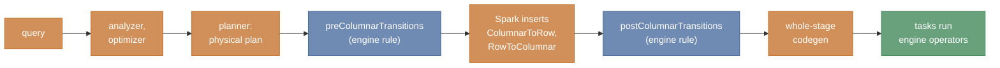
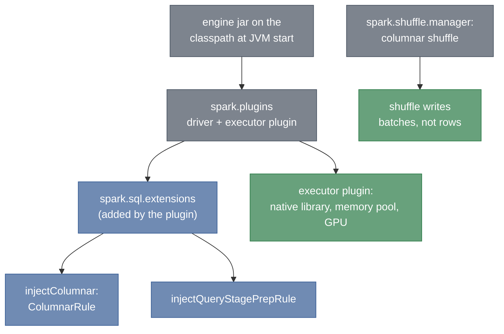
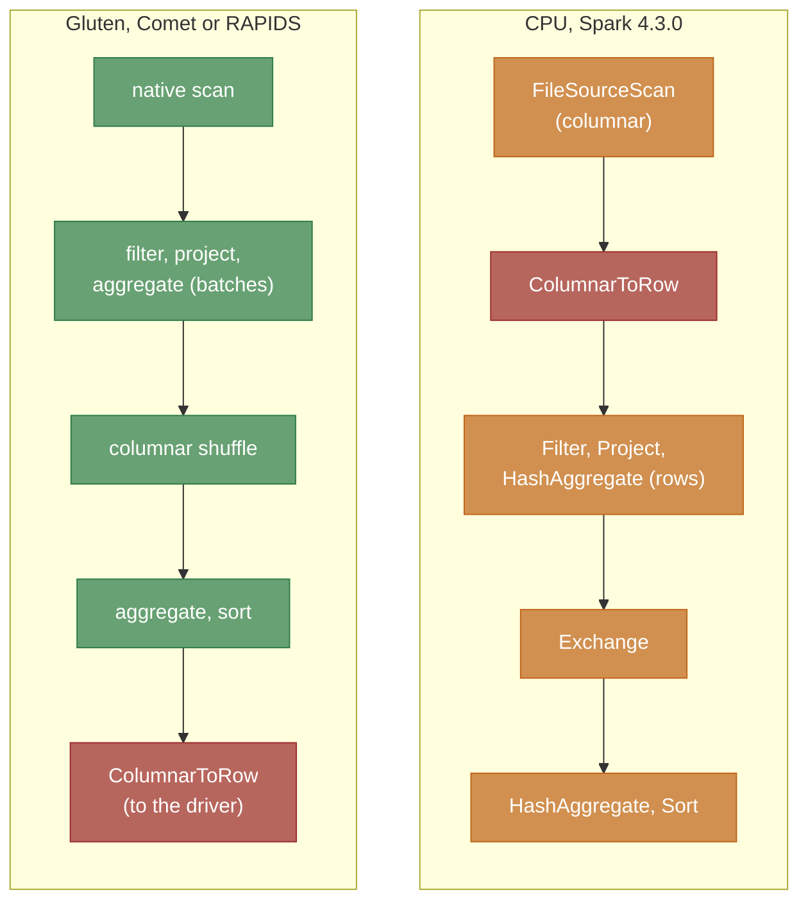
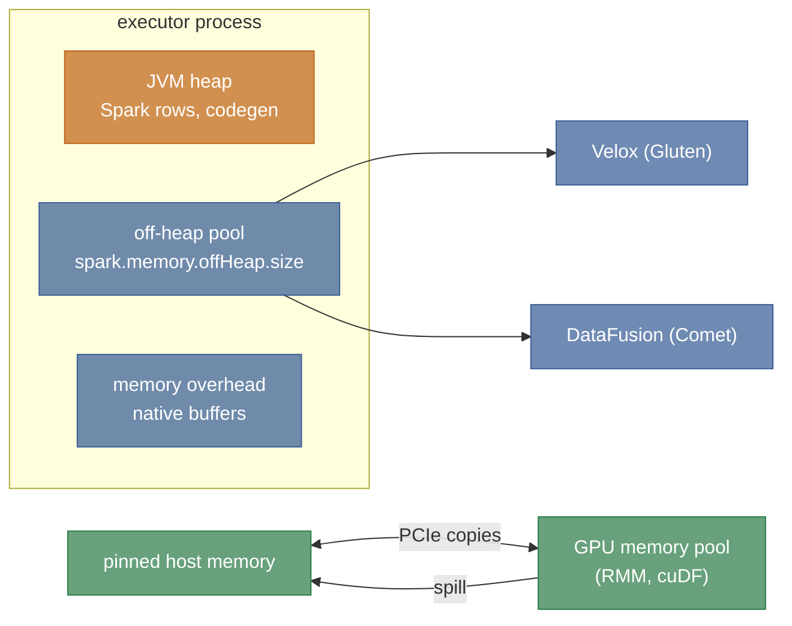

# Chapter 38: Acceleration: Gluten and Velox, RAPIDS and cuDF, Comet

The engine that runs a Spark query is Java code. Spark plans the query, and then it generates Java code for each stage. That code runs on rows in the JVM (whole-stage code generation). This engine is general and stable. But it is not the fastest method to scan Parquet, filter columns and add numbers.

Some projects replace the engine below the planner. Apache Gluten sends the work to Velox, a C++ library from Meta. Apache DataFusion Comet sends it to DataFusion, a Rust library. The NVIDIA RAPIDS Accelerator for Apache Spark sends it to cuDF, which runs on a GPU. Apache Auron sends it to its own engine, also built on DataFusion. Each project says that it makes queries faster with no change to the code.

**An accelerator is a jar and some configs, not a replacement for Spark. The jar adds rules to the planner, and the rules replace each operator that the engine can run with a columnar operator of its own. Spark then puts a transition at each border between the new operators and the JVM operators that remain. Thus, the result depends on how much of the plan the engine takes, and how many transitions remain. You can read these two facts in the physical plan before you measure anything. On Spark 4.3.0, none of these engines start yet.**

This chapter shows each part of that statement on the same taxi queries. First, it shows the hooks that Spark gives and what one config line adds to a session. Then it shows which Spark versions each engine supports, and the plans on Velox, DataFusion and a GPU. Last, it shows what falls back to the JVM, where each engine keeps its memory, and how long the queries take.

All the code is in [`code/ch38`](https://github.com/lisancao/spark-masterclass/tree/main/code/ch38), and each number comes from `code/ch38/output/`. [Chapter 32](ch32-query-plans.md) shows how to read a physical plan. This chapter uses that skill on plans that have operators from other engines.

!!! note "Spark versions in this chapter"
    The book uses Spark 4.3.0. On 22 November 2026, no release of Gluten, Comet, the RAPIDS Accelerator or Auron supports Spark 4.3.0. Step 3 shows the errors and their causes in the 4.3.0 source. Thus, each engine runs here on the newest Spark that its newest release supports, and each output block says which version ran:

    - Gluten 1.7.0 runs on Spark 4.1.1.
    - Comet 1.2.0 and the RAPIDS Accelerator 26.10.0 run on Spark 4.2.0.
    - The CPU baseline runs on Spark 4.3.0, and also on 4.1.1 and 4.2.0, so that each engine has a baseline on its own Spark version.

## What changes, and what does not

An accelerator works on the physical plan only. The parser, the analyzer and the optimizer do the same work as before. The logical plan is the same. AQE, the scheduler, tasks and the shuffle service are the same. The engine changes only the operators that tasks run.



## Step 1: The columnar hooks in Spark 4.3.0

Spark already has two forms of data inside a plan. Most operators work on rows (`InternalRow`). Some operators work on batches of columns (`ColumnarBatch`). Each `SparkPlan` node says which forms it can give, with `supportsColumnar` and `supportsRowBased`.

Plain Spark 4.3.0 already uses columns in a small number of locations. `columnar_43.py` runs the `hourly` query with no engine. Then it prints each operator and its `supportsColumnar` value:

```python
spark = start("cpu", **OFFLOAD_FRIENDLY, **{
    "spark.sql.cache.serializer":
        "org.apache.spark.sql.execution.columnar.ArrowCachedBatchSerializer"})
...
hourly = queries(spark)["hourly"]
show("hourly, from Parquet:", hourly)
```

```text
Spark 4.3.0, no engine
  spark.plugins                  = (not set)
  spark.sql.extensions           = (not set)
  spark.shuffle.manager          = (not set)
  spark.memory.offHeap.enabled   = (not set)
hourly, from Parquet:
  operator                                 supportsColumnar
    SortExec                               False
          ShuffleExchangeExec              False
              HashAggregateExec            False
                    ShuffleExchangeExec    False
                        HashAggregateExec  False
                          ProjectExec      False
                            FilterExec     False
                              ColumnarToRowExec False
                                  FileSourceScanExec True
an aggregate over a cached DataFrame (ArrowCachedBatchSerializer):
  operator                                 supportsColumnar
    HashAggregateExec                      False
          ShuffleExchangeExec              False
              HashAggregateExec            False
                  InMemoryTableScanExec    True
```

The Parquet scan gives columnar batches, because the vectorized reader decodes Parquet into column vectors. The `FilterExec` above it works on rows. Thus, Spark put a `ColumnarToRowExec` between them. This operator is a **transition**. It reads each batch and gives the rows one at a time to the next operator.

The second plan reads from a cache. The cache uses `ArrowCachedBatchSerializer`, which is new in Spark 4.3, so `InMemoryTableScanExec` also gives columnar batches. But there is no transition above it. `InMemoryTableScanExec` also says `supportsRowBased = true`. Spark adds a transition only above an operator that gives columns and cannot give rows, so here it asks the scan for rows.

The rule that puts these transitions into the plan is `ApplyColumnarRulesAndInsertTransitions`, in `sql/core/.../execution/Columnar.scala`. It is also the hook for engines. Its `apply` method in 4.3.0 is short:

```scala
def apply(plan: SparkPlan): SparkPlan = {
  var preInsertPlan: SparkPlan = plan
  columnarRules.foreach(r => preInsertPlan = r.preColumnarTransitions(preInsertPlan))
  var postInsertPlan = insertTransitions(preInsertPlan, outputsColumnar)
  columnarRules.reverse.foreach(r => postInsertPlan = r.postColumnarTransitions(postInsertPlan))
  postInsertPlan
}
```

A `ColumnarRule` has two methods: `preColumnarTransitions` and `postColumnarTransitions`. The sequence is:

1. Each engine rule gets the physical plan before Spark adds transitions. Here, the engine replaces the operators that it can run. Each new operator says `supportsColumnar = true`.
2. Spark walks the plan. Where a row operator reads from a columnar operator, Spark adds `ColumnarToRowExec`. Where a columnar operator reads from a row operator, Spark adds `RowToColumnarExec`.
3. Each engine rule gets the plan again, in the opposite sequence. Here, the engine can replace Spark's generic transitions with its own faster versions, or add operators that change the size of batches.

An engine adds its `ColumnarRule` through `SparkSessionExtensions.injectColumnar`. It can also add rules that run before AQE makes each query stage (`injectQueryStagePrepRule`). Spark calls `ApplyColumnarRulesAndInsertTransitions` in two locations: in `QueryExecution` for the first plan, and in `AdaptiveSparkPlanExec` for each new query stage. Thus, an engine sees the plan again each time that AQE changes it.

## Step 2: One config line, and what it adds

For each engine, the chapter code is a dictionary of configs in `engines.py`. There is no other change to the query code:

```python
ENGINES = {
    "cpu": {},
    # Apache Gluten 1.7.0 with the Velox backend, built for Spark 4.1.1.
    "gluten": {
        **jar_conf(GLUTEN_JAR),
        "spark.plugins": "org.apache.gluten.GlutenPlugin",
        "spark.shuffle.manager": "org.apache.spark.shuffle.sort.ColumnarShuffleManager",
        "spark.memory.offHeap.enabled": "true",
        "spark.memory.offHeap.size": "8g",
    },
    # Apache DataFusion Comet 1.2.0, built for Spark 4.2.
    "comet": {
        **jar_conf(COMET_JAR),
        "spark.plugins": "org.apache.spark.CometPlugin",
        "spark.shuffle.manager":
            "org.apache.spark.sql.comet.execution.shuffle.CometShuffleManager",
        "spark.comet.explain.fallback.enabled": "true",
        "spark.memory.offHeap.enabled": "true",
        "spark.memory.offHeap.size": "8g",
    },
    # NVIDIA RAPIDS Accelerator 26.10.0 (cuDF, CUDA 13), Spark 4.2.0 shim.
    "rapids": {
        **jar_conf(RAPIDS_JAR),
        "spark.plugins": "com.nvidia.spark.SQLPlugin",
        "spark.rapids.sql.concurrentGpuTasks": "2",
        "spark.rapids.sql.explain": "NOT_ON_GPU",
    },
}
```

`jar_conf` puts the jar on the driver and executor classpaths. The jar must be there when the JVM starts, because the plugin class loads at that time. In a notebook, you cannot add an engine to a session that already runs.

The important line is `spark.plugins`. A Spark plugin (`org.apache.spark.api.plugin.SparkPlugin`) has a driver part and an executor part. Spark starts the two parts when the `SparkContext` and each executor start. Each engine uses its plugin to make more changes. `inject.py` starts each engine and prints what the session has after the start:

```python
spark = start(engine, **OFFLOAD_FRIENDLY)
jss = spark._jsparkSession
state = jss.sessionState()
...
rules = [short(r.getClass().getName()) for r in seq(state.columnarRules())]
prep = [short(r.getClass().getName())
        for r in seq(jss.extensions().buildQueryStagePrepRules(jss))]
```

```text
gluten on Spark 4.1.1
  spark.plugins          = org.apache.gluten.GlutenPlugin
  spark.sql.extensions   = org.apache.gluten.extension.GlutenSessionExtensions
  spark.shuffle.manager  = org.apache.spark.shuffle.sort.ColumnarShuffleManager
  spark.memory.offHeap   = true, 8g
  columnar rules         = InjectorControl$Disabler$DisablerOps$$anon$5
  query stage prep rules = (none)
comet on Spark 4.2.0
  spark.plugins          = org.apache.spark.CometPlugin
  spark.sql.extensions   = org.apache.comet.CometSparkSessionExtensions
  spark.shuffle.manager  = org.apache.spark.sql.comet.execution.shuffle.CometShuffleManager
  spark.memory.offHeap   = true, 8g
  columnar rules         = CometSparkSessionExtensions$CometColumnar
  query stage prep rules = CometRule
rapids on Spark 4.2.0
  spark.plugins          = com.nvidia.spark.SQLPlugin
  spark.sql.extensions   = com.nvidia.spark.rapids.SQLExecPlugin,com.nvidia.spark.udf.Plugin,com.nvidia.spark.DFUDFPlugin,com.nvidia.spark.rapids.optimizer.SQLOptimizerPlugin
  spark.shuffle.manager  = com.nvidia.spark.rapids.spark420.RapidsShuffleManager
  spark.memory.offHeap   = false, 0
  columnar rules         = ColumnarOverrideRules
  query stage prep rules = GpuQueryStagePrepOverrides, OptimizeSkewedBHJJoinRule
auron on Spark 4.2.0
  spark.plugins          = (not set)
  spark.sql.extensions   = org.apache.spark.sql.auron.AuronSparkSessionExtension
  spark.shuffle.manager  = org.apache.spark.sql.execution.auron.shuffle.AuronShuffleManager
  spark.memory.offHeap   = false, 0
  columnar rules         = AuronColumnarOverrides
  query stage prep rules = (none)
```

The chapter code did not set `spark.sql.extensions` for Gluten, Comet or the RAPIDS Accelerator. Each plugin added its own session extensions at start. The extensions then added a columnar rule to the session. Gluten puts its rule inside a wrapper class (`InjectorControl`), so the printed name is the name of an anonymous inner class. Comet and the RAPIDS Accelerator also added query-stage rules, so that they see each query stage that AQE makes.

Auron is different. It has no plugin class, so the chapter code sets `spark.sql.extensions` for it (Step 8). The result is the same: one columnar rule, `AuronColumnarOverrides`.

The RAPIDS plugin also set `spark.shuffle.manager`. The chapter code did not set it. The plugin chose `RapidsShuffleManager` from its `spark420` shim, which is the shim for the Spark version that it found. Gluten, Comet and Auron need you to set the shuffle manager yourself.



## Step 3: Which Spark versions each engine supports

Each engine compiles against Spark's internal classes: `SparkPlan`, `FileSourceScanExec`, the shuffle classes and the SQL configs. These classes are not a public API, and they change in each minor release. Thus, each engine release has one build (a **shim**) for each Spark version that it supports. The table gives the newest release of each engine on 22 November 2026:

| Engine | Newest release | Spark versions that it supports | Spark 4.3.0 |
|---|---|---|---|
| Apache Gluten (Velox backend) | 1.7.0 | 3.3, 3.4, 3.5, 4.0, 4.1 (the 4.1 binary is built on 4.1.1) | No |
| Apache DataFusion Comet | 1.2.0 | 3.5.9, 4.0.4, 4.1.3, 4.2.0 | No |
| NVIDIA RAPIDS Accelerator | 26.10.0 | 3.5.0 to 3.5.9, 4.0.0 to 4.0.4, 4.1.1 to 4.1.3, 4.2.0 (Scala 2.13 jar) | No |
| Apache Auron | 9.0.0 (source release only) | 3.0 to 3.5, 4.0, 4.1, 4.2 | No |

The coordinates are:

- Gluten: `apache-gluten-1.7.0-bin-spark-4.1.tar.gz` from `downloads.apache.org/gluten/1.7.0/`. The tarball contains `gluten-velox-bundle-spark4.1_2.13-linux_amd64-1.7.0.jar`. Its `gluten-build-info.properties` says `spark_version=4.1.1`.
- Comet: `org.apache.datafusion:comet-spark-spark4.2_2.13:1.2.0` on Maven Central. No `comet-spark-spark4.3` artifact exists.
- RAPIDS Accelerator: `com.nvidia:rapids-4-spark_2.13:26.10.0` with the classifier `cuda13`. The jar without a classifier is for CUDA 12.
- Auron: `apache-auron-9.0.0-source.tgz` from `downloads.apache.org/auron/auron-9.0.0/`. There is no binary on Maven Central, so you must compile it.

`blocked_43.py` tries the three binary releases on Spark 4.3.0, and also the Auron jar that Step 8 compiles for Spark 4.2. Each engine needs its own JVM, so the script starts one child process for each try:

```text
Spark 4.3.0, newest release of each engine:
Gluten 1.7.0 (bin-spark-4.1)
  FAILS AT START: java.lang.NoSuchMethodError:
    'org.apache.spark.internal.config.ConfigEntry
    org.apache.spark.sql.internal.StaticSQLConf$.UI_RETAINED_EXECUTIONS()'
RAPIDS 26.10.0 (cuda13)
  FAILS AT START: java.lang.IllegalArgumentException: This RAPIDS Plugin build does not
    support Spark build 4.3.0. Supported Spark versions: 3.5.0 {buildver=350}, 3.5.1
    {buildver=351}, 3.5.2 {buildver=352}, 3.5.3 {buildver=353}, 3.5.4 {buildver=354},
    3.5.5 {buildver=355}, 3.5.6 {buildver=356}, 3.5.7 {buildver=357}, 3.5.8
    {buildver=358}, 3.5.9 {buildver=359}, 4.0.0 {buildver=400}, 4.0.0-databricks17.3
    {buildver=400db173}, 4.0.1 {buildver=401}, 4.0.2 {buildver=402}, 4.0.3
    {buildver=403}, 4.0.4 {buildver=404}, 4.1.1 {buildver=411}, 4.1.2 {buildver=412},
    4.1.3 {buildver=413}, 4.2.0 {buildver=420}. Consult the Release documentation at
    https://nvidia.github.io/cudf-spark/docs/download.html
Comet 1.2.0 (spark4.2)
  FAILS AT START: java.lang.IllegalArgumentException: spark.shuffle.manager must be a
    BlockingShuffleManager, but
    org.apache.spark.sql.comet.execution.shuffle.CometShuffleManager is not. A blocking
    manager serves regular, materialized shuffles and resolves blocks by id; configure a
    pipelined manager via spark.shuffle.manager.incremental instead.
Auron 9.0.0 (compiled for spark-4.2)
  FAILS AT START: java.lang.IllegalArgumentException: spark.shuffle.manager must be a
    BlockingShuffleManager, but
    org.apache.spark.sql.execution.auron.shuffle.AuronShuffleManager is not. A blocking
    manager serves regular, materialized shuffles and resolves blocks by id; configure a
    pipelined manager via spark.shuffle.manager.incremental instead.
Comet 1.2.0, no CometShuffleManager
  STARTS on 4.3.0: hourly ran with 0 engine operators, 8 Spark operators, first row (0,
    1487816, 28.88)
  log: CometSparkSessionExtensions: Comet extension is disabled because
    spark.shuffle.manager is not set to
    org.apache.spark.sql.comet.execution.shuffle.CometShuffleManager or
    org.apache.spark.sql.comet.execution.shuffle.CometCelebornShuffleManager. Comet
    provides limited benefit without its shuffle manager. Set
    spark.comet.shuffle.enabled=false to keep Comet enabled with Spark's default shuffle
    manager.
Comet 1.2.0, spark.comet.shuffle.enabled=false (not a supported setup)
  FAILS AT QUERY: java.lang.NoSuchMethodError:
    'org.apache.spark.sql.execution.FileSourceScanExec org.apache.spark.sql.execution.Fi
    leSourceScanExec.copy(org.apache.spark.sql.execution.datasources.HadoopFsRelation,
    scala.Option, scala.collection.immutable.Seq, org.apache.spark.sql.types.StructType,
    scala.collection.immutable.Seq, scala.Option, scala.Option,
    scala.collection.immutable.Seq, scala.Option, boolean)'
```

<figure markdown>
  <video autoplay loop muted playsinline controls width="1280" height="720" poster="../../media/clips/ch38-blocked.webp">
    <source src="../../media/clips/ch38-blocked.mp4" type="video/mp4">
  </video>
  <figcaption>Spark 4.3.0 with the newest RAPIDS and Gluten jars. The RAPIDS Accelerator stops at its version check. Gluten stops on a method that changed in 4.3.0.</figcaption>
</figure>

There are four different failures, and each one has a cause in the 4.3.0 source:

- **The RAPIDS Accelerator does a version check.** It reads the Spark version at start and looks for a shim. There is no `buildver=430`, so it stops with a clear message. This failure is the best of the four, because it occurs before any query runs.
- **Gluten stops with `NoSuchMethodError` on `StaticSQLConf.UI_RETAINED_EXECUTIONS()`.** In 4.3.0, Spark defines some configs in text files (SPARK-56460). The config `spark.sql.ui.retainedExecutions` is now made by `buildConfFromConfigFile`, which returns a `ProtoBackedConfigEntry`. The Gluten build used 4.1, where the method returns `ConfigEntry`. The JVM looks for the method by its full signature, so it does not find it.
- **Comet and Auron stop at start, because of their shuffle managers.** In 4.3.0, `spark.shuffle.manager` must be a `BlockingShuffleManager`. This trait is new in 4.3.0 (SPARK-58185), and it separates the regular shuffle from the pipelined shuffle that Real-time Mode uses. The Comet and Auron builds are older than the trait, so `SparkEnv.initializeShuffleManager` refuses `CometShuffleManager` and `AuronShuffleManager`. The same check applies to each shuffle manager that is not part of Spark, for example Gluten's `ColumnarShuffleManager`.
- **Comet without its shuffle manager starts, but it does nothing.** Comet disables itself and writes a log message. If you then set `spark.comet.shuffle.enabled=false`, Comet tries to change a scan and stops with `NoSuchMethodError` on `FileSourceScanExec.copy`. In 4.3.0, `FileSourceScanExec` has a new constructor parameter, `markedForSingleTaskExecution`, for Project Feather (SPARK-57851, [Chapter 37](ch37-project-feather.md)). The `copy` method of a case class changes with its constructor.

!!! note "New in 4.3: changes that engines must follow"
    Three changes in Spark 4.3.0 stop the engine releases in this chapter:

    - `spark.shuffle.manager` must extend `BlockingShuffleManager` (SPARK-58185).
    - Some SQL configs come from text files and have the type `ProtoBackedConfigEntry` (SPARK-56460).
    - `FileSourceScanExec` has the parameter `markedForSingleTaskExecution` (SPARK-57851).

    Spark 4.3.0 also adds `ArrowCachedBatchSerializer`, which Step 1 uses. It keeps cached data as Arrow batches, so a cache scan can give columnar batches.

These are not bugs in Spark. Spark does not promise a stable API for these classes. But the result is clear: each engine needs a new release, compiled against 4.3.0, before it can run on 4.3.0.

!!! warning "Use the shim for your exact Spark version"
    Do not use an engine jar that is built for a different Spark minor version. The JVM loads classes by name and signature, so the failure can occur late, in the middle of a query, and not at start. Look for the engine's version check or build information, and compare it with `spark.version`.

## Step 4: The same query on Velox, DataFusion and a GPU

`plans.py` runs each taxi query, and then it walks the executed plan. It marks each operator by where it ran: `E` for the engine, `S` for Spark's JVM code, `T` for a transition and `.` for glue. Glue is a node that only connects other nodes: a stage wrapper, a shuffle reader or a batch resizer. The walk goes into AQE query stages, so it shows the plan that ran, not the first plan.

The queries read twelve months of yellow-taxi trips (July 2025 to June 2026, 12 Parquet files). There are three queries:

- `hourly`: [Chapter 5](ch05-how-spark-runs.md)'s query over a year. It has a scan, a filter, a two-phase hash aggregate and a sort.
- `boroughs`: a broadcast hash join to the zone lookup CSV, then an aggregate.
- `routes`: an aggregate on pairs of pickup and drop-off zones, which has many more groups than `hourly`, then a top-N.

On Spark 4.3.0 with no engine, `hourly` has the shape from [Chapter 5](ch05-how-spark-runs.md):

```text
cpu on Spark 4.3.0, offload-friendly settings
hourly: 0 engine operators, 8 Spark operators, 1 transitions
  . WholeStageCodegenExec
  S   SortExec
  .     InputAdapter
  .       AQEShuffleReadExec
  S         ShuffleExchangeExec
  .           WholeStageCodegenExec
  S             HashAggregateExec
  .               InputAdapter
  .                 AQEShuffleReadExec
  S                   ShuffleExchangeExec
  .                     WholeStageCodegenExec
  S                       HashAggregateExec
  S                         ProjectExec
  S                           FilterExec
  T                             ColumnarToRowExec
  .                               InputAdapter
  S                                 FileSourceScanExec
```

With Gluten 1.7.0 on Spark 4.1.1, the same query has a different operator in each position:

```text
gluten on Spark 4.1.1, offload-friendly settings
hourly: 10 engine operators, 0 Spark operators, 1 transitions
  T VeloxColumnarToRowExec
  .   WholeStageTransformer
  E     SortExecTransformer
  .       InputIteratorTransformer
  .         ColumnarInputAdapter
  .           AQEShuffleReadExec
  E             ColumnarShuffleExchangeExec
  .               VeloxResizeBatchesExec
  .                 WholeStageTransformer
  E                   ProjectExecTransformer
  E                     RegularHashAggregateExecTransformer
  .                       InputIteratorTransformer
  .                         ColumnarInputAdapter
  .                           AQEShuffleReadExec
  E                             ColumnarShuffleExchangeExec
  .                               VeloxResizeBatchesExec
  .                                 WholeStageTransformer
  E                                   ProjectExecTransformer
  E                                     FlushableHashAggregateExecTransformer
  E                                       ProjectExecTransformer
  E                                         FilterExecTransformer
  E                                           FileSourceScanExecTransformer
```

With Comet 1.2.0 on Spark 4.2.0:

```text
comet on Spark 4.2.0, offload-friendly settings
hourly: 8 engine operators, 0 Spark operators, 1 transitions
  . WholeStageCodegenExec
  T   CometColumnarToRowExec
  .     InputAdapter
  E       CometSortExec
  .         AQEShuffleReadExec
  E           CometShuffleExchangeExec
  E             CometHashAggregateExec
  .               AQEShuffleReadExec
  E                 CometShuffleExchangeExec
  E                   CometHashAggregateExec
  E                     CometProjectExec
  E                       CometFilterExec
  E                         CometNativeScanExec
```

With the RAPIDS Accelerator 26.10.0 on Spark 4.2.0, on the GPU:

```text
rapids on Spark 4.2.0, offload-friendly settings
hourly: 8 engine operators, 0 Spark operators, 1 transitions
  T GpuColumnarToRowExec
  E   GpuSortExec
  .     GpuShuffleCoalesceExec
  .       GpuCustomShuffleReaderExec
  E         GpuShuffleExchangeExec
  E           GpuHashAggregateExec
  .             GpuShuffleCoalesceExec
  .               GpuCustomShuffleReaderExec
  E                 GpuShuffleExchangeExec
  E                   GpuHashAggregateExec
  E                     GpuProjectExec
  .                       GpuCoalesceBatches
  E                         GpuFilterExec
  E                           GpuFileSourceScanExec
```

<figure markdown>
  <video autoplay loop muted playsinline controls width="1280" height="720" poster="../../media/clips/ch38-gpu.webp">
    <source src="../../media/clips/ch38-gpu.mp4" type="video/mp4">
  </video>
  <figcaption>The <code>hourly</code> query with the RAPIDS Accelerator 26.10.0 on Spark 4.2.0 and an RTX 5070 Ti. Each operator has a <code>Gpu</code> name, and the only transition is at the top.</figcaption>
</figure>

The figure puts the five plans of `hourly` side by side. It also has the Auron plan from Step 8:

<figure markdown>
  
  
  <figcaption markdown="span">The operators that ran for `hourly`, from `plans-*.txt`, without the glue nodes. Each engine replaces all the operators of the CPU plan. Each plan has at most one transition.</figcaption>
</figure>

The three plans have the same shape as the CPU plan. Each engine replaced each operator with its own version. In each plan, there is only one transition, at the top. The result must go to the driver as rows, so the last operator changes the batches into rows.

The names tell you what each engine does:

- **Gluten** puts consecutive operators into a `WholeStageTransformer`. This node does the work of whole-stage code generation for Gluten. Gluten sends the operators inside it to Velox as one Substrait plan, and Velox runs them as one pipeline. The partial aggregate is a `FlushableHashAggregateExecTransformer`. Its name shows that it can flush its partial groups early. The final aggregate (`RegularHashAggregateExecTransformer`) merges them after the shuffle.
- **Comet** gives each operator a `Comet` name. Comet changes consecutive native operators into one DataFusion plan and runs it in Rust. The scan is `CometNativeScanExec`, so DataFusion reads the Parquet file, and not Spark's reader.
- **The RAPIDS Accelerator** gives each operator a `Gpu` name. `GpuCoalesceBatches` and `GpuShuffleCoalesceExec` make larger batches. Each GPU operation has a fixed cost to start, and a large batch divides that cost over more rows.



<figure markdown>
  <video autoplay loop muted playsinline controls width="1280" height="720" poster="../../media/clips/ch38-anim-transitions.webp">
    <source src="../../media/clips/ch38-anim-transitions.mp4" type="video/mp4">
  </video>
  <figcaption markdown="span">Animation: the batches of the `hourly` query on the CPU and on Gluten. On the CPU, the batches become rows above the scan. On Gluten, they become rows only at the top. The operator counts come from `plans-cpu.txt` and `plans-gluten.txt`. The animation shows fewer operators than the plans, and its time scale is schematic.</figcaption>
</figure>

## Step 5: What falls back to the JVM, and how to see it

An engine replaces an operator only if it can run the operator and each expression in it. It must also support each data type of the input and the output. If it cannot, the operator stays in the JVM. This is a **fallback**. A fallback is not an error. The query gives the same result, but the plan now has a border, and each border costs a transition.

The timed runs in this chapter use two configs for each engine, the CPU baseline too:

```python
OFFLOAD_FRIENDLY = {
    "spark.sql.ansi.enabled": "false",                     # Gluten 1.7.0 falls back under ANSI
    "spark.sql.parquet.inferTimestampNTZ.enabled": "false",  # read pickup times as TIMESTAMP
}
```

These values are not the Spark defaults. ANSI mode is on by default since Spark 4.0. The taxi files store the pickup time as a timestamp without a time zone, so Spark reads it as `TIMESTAMP_NTZ` by default. With the defaults, the plans change.

### Gluten

With the Spark defaults, Gluten takes no operator:

```text
gluten on Spark 4.1.1, default settings
hourly: 0 engine operators, 8 Spark operators, 1 transitions
  . WholeStageCodegenExec
  S   SortExec
  .     InputAdapter
  .       AQEShuffleReadExec
  S         ShuffleExchangeExec
  .           WholeStageCodegenExec
  S             HashAggregateExec
  .               InputAdapter
  .                 AQEShuffleReadExec
  S                   ShuffleExchangeExec
  .                     WholeStageCodegenExec
  S                       HashAggregateExec
  S                         ProjectExec
  S                           FilterExec
  T                             ColumnarToRowExec
  .                               InputAdapter
  S                                 FileSourceScanExec
```

Gluten writes the reason for each fallback in the log, in lines that start with `Validation failed for plan`. `run_plans.sh` counts these lines:

```text
     10 Validation failed for plan: HashAggregate, due to: does not support ansi mode
     10 Validation failed for plan: Filter, due to: does not support ansi mode
     10 Validation failed for plan: Exchange, due to: does not support ansi mode
      9 Validation failed for plan: Project, due to: does not support ansi mode
      6 Validation failed for plan: Scan parquet , due to: does not support ansi mode
      4 Validation failed for plan: Scan csv , due to: does not support ansi mode
      4 Validation failed for plan: BroadcastExchange, due to: does not support ansi mode
      3 Validation failed for plan: BroadcastHashJoin, due to: does not support ansi mode
      2 Validation failed for plan: Sort, due to: does not support ansi mode
```

Each operator fails validation for one reason: Gluten 1.7.0 does not support ANSI mode.

With ANSI off, but with `TIMESTAMP_NTZ` still on, Gluten takes the aggregates, the shuffles and the sort. The filter and the scan stay in the JVM, because they read the `TIMESTAMP_NTZ` column. The header of the output says "default settings", because the script starts from the defaults and changes only `spark.sql.ansi.enabled`:

```text
gluten on Spark 4.1.1, default settings
hourly: 8 engine operators, 2 Spark operators, 3 transitions
  T VeloxColumnarToRowExec
  .   WholeStageTransformer
  E     SortExecTransformer
  .       InputIteratorTransformer
  .         ColumnarInputAdapter
  .           AQEShuffleReadExec
  E             ColumnarShuffleExchangeExec
  .               VeloxResizeBatchesExec
  .                 WholeStageTransformer
  E                   ProjectExecTransformer
  E                     RegularHashAggregateExecTransformer
  .                       InputIteratorTransformer
  .                         ColumnarInputAdapter
  .                           AQEShuffleReadExec
  E                             ColumnarShuffleExchangeExec
  .                               VeloxResizeBatchesExec
  .                                 WholeStageTransformer
  E                                   ProjectExecTransformer
  E                                     FlushableHashAggregateExecTransformer
  E                                       ProjectExecTransformer
  .                                         InputIteratorTransformer
  .                                           ColumnarInputAdapter
  T                                             RowToVeloxColumnarExec
  .                                               WholeStageCodegenExec
  S                                                 FilterExec
  T                                                   ColumnarToRowExec
  .                                                     InputAdapter
  S                                                       FileSourceScanExec
```

```text
      3 Validation failed for plan: Scan parquet , due to: 
      2 Validation failed for plan: Filter, due to: 
      1 Validation failed for plan: Filter, due to: Filter has TimestampNTZType in input/output schema
```

This plan has three transitions. The Parquet scan gives batches. `ColumnarToRowExec` changes them into rows for the JVM filter. Then `RowToVeloxColumnarExec` changes the rows back into Velox batches for the aggregate. The data goes from columns to rows and back to columns, before the engine does any useful work.

<figure markdown>
  <video autoplay loop muted playsinline controls width="1280" height="720" poster="../../media/clips/ch38-fallback.webp">
    <source src="../../media/clips/ch38-fallback.mp4" type="video/mp4">
  </video>
  <figcaption>Gluten 1.7.0 on Spark 4.1.1. With the Spark defaults, Gluten takes no operator of <code>hourly</code>. With ANSI off and the pickup time read as <code>TIMESTAMP</code>, it takes ten operators.</figcaption>
</figure>

### Comet

Comet takes all of `hourly`, also with the Spark defaults. But in `boroughs`, the join and the aggregates stay in the JVM:

```text
comet on Spark 4.2.0, default settings
boroughs: 5 engine operators, 8 Spark operators, 2 transitions
  . WholeStageCodegenExec
  T   CometColumnarToRowExec
  .     InputAdapter
  E       CometSortExec
  .         AQEShuffleReadExec
  E           CometShuffleExchangeExec
  .             WholeStageCodegenExec
  S               HashAggregateExec
  .                 InputAdapter
  .                   AQEShuffleReadExec
  S                     ShuffleExchangeExec
  .                       WholeStageCodegenExec
  S                         HashAggregateExec
  S                           ProjectExec
  S                             BroadcastHashJoinExec
  T                               CometColumnarToRowExec
  .                                 InputAdapter
  E                                   CometProjectExec
  E                                     CometFilterExec
  E                                       CometNativeScanExec
  .                               InputAdapter
  S                                 BroadcastExchangeExec
  .                                   WholeStageCodegenExec
  S                                     FilterExec
  .                                       InputAdapter
  S                                         FileSourceScanExec
```

With `spark.comet.explain.fallback.enabled=true`, Comet writes a reason for each fallback, and a summary for each plan:

```text
HashAggregate [COMET: Comet aggregate that merges intermediate buffers requires a Comet child aggregate when the intermediate buffer formats are incompatible with Spark. Incompatible aggregate function(s): count]
Scan csv  [COMET: Unsupported file format CSV]
Comet accelerated 8 out of 15 eligible operators (53%). Final plan contains 0 transitions between Spark and Comet. Accelerated expressions: 5 native, 0 codegen dispatch.
Comet accelerated 5 out of 13 eligible operators (38%). Final plan contains 0 transitions between Spark and Comet. Accelerated expressions: 5 native, 0 codegen dispatch.
Comet accelerated 0 out of 3 eligible operators (0%). Final plan contains 0 transitions between Spark and Comet. Accelerated expressions: 0 native, 0 codegen dispatch.
Comet accelerated 3 out of 10 eligible operators (30%). Final plan contains 0 transitions between Spark and Comet. Accelerated expressions: 4 native, 0 codegen dispatch.
Comet accelerated 6 out of 14 eligible operators (42%). Final plan contains 1 transitions between Spark and Comet. Accelerated expressions: 5 native, 0 codegen dispatch.
Comet accelerated 4 out of 12 eligible operators (33%). Final plan contains 1 transitions between Spark and Comet. Accelerated expressions: 5 native, 0 codegen dispatch.
```

The first cause is the zone lookup. It is a CSV file, and Comet 1.2.0 does not read CSV by default. Thus, the build side of the join is a Spark scan, and the join stays in Spark. The second cause follows from the first. The final aggregate cannot merge the partial results of a JVM aggregate, because the two engines keep `count` in different formats. Thus, one operator that the engine cannot run makes the operators above it fall back too.

Comet has a CSV reader that is off by default (`spark.comet.convert.csv.enabled`). With it on, the full join comes into Comet. The CSV scan is still a Spark scan, and `CometSparkToColumnarExec` changes its rows into Comet batches:

```text
comet on Spark 4.2.0, offload-friendly settings
boroughs: 12 engine operators, 1 Spark operators, 2 transitions
  . WholeStageCodegenExec
  T   CometColumnarToRowExec
  .     InputAdapter
  E       CometSortExec
  .         AQEShuffleReadExec
  E           CometShuffleExchangeExec
  E             CometHashAggregateExec
  .               AQEShuffleReadExec
  E                 CometShuffleExchangeExec
  E                   CometHashAggregateExec
  E                     CometProjectExec
  E                       CometBroadcastHashJoinExec
  E                         CometProjectExec
  E                           CometFilterExec
  E                             CometNativeScanExec
  E                         CometBroadcastExchangeExec
  E                           CometFilterExec
  T                             CometSparkToColumnarExec
  S                               FileSourceScanExec
```

### The RAPIDS Accelerator

With `spark.rapids.sql.explain=NOT_ON_GPU`, the RAPIDS Accelerator writes a tree for each operator that stays on the CPU. Each line starts with `!` for a part that cannot run on the GPU, and with `@` for an expression that can. These are the first lines for `hourly` with the Spark defaults:

```text
          !Exec <ProjectExec> cannot run on GPU because not all expressions can be replaced; unsupported data types in input: TimestampNTZType [tpep_pickup_datetime]
            @Expression <AttributeReference> total_amount could run on GPU
            @Expression <Alias> hour(tpep_pickup_datetime, Some(UTC)) AS _groupingexpression could run on GPU
              !Expression <Hour> hour(tpep_pickup_datetime, Some(UTC)) cannot run on GPU because input expression AttributeReference tpep_pickup_datetime (TimestampNTZType is not supported)
```

The cause is `TIMESTAMP_NTZ`. The RAPIDS Accelerator 26.10.0 does not read it from Parquet. Thus, the scan, the filter and the project stay on the CPU, and the plan has three transitions:

```text
rapids on Spark 4.2.0, default settings
hourly: 5 engine operators, 3 Spark operators, 3 transitions
  T GpuColumnarToRowExec
  E   GpuSortExec
  .     GpuShuffleCoalesceExec
  .       GpuCustomShuffleReaderExec
  E         GpuShuffleExchangeExec
  E           GpuHashAggregateExec
  .             GpuShuffleCoalesceExec
  .               GpuCustomShuffleReaderExec
  E                 GpuShuffleExchangeExec
  E                   GpuHashAggregateExec
  T                     GpuRowToColumnarExec
  .                       WholeStageCodegenExec
  S                         ProjectExec
  S                           FilterExec
  T                             ColumnarToRowExec
  .                               InputAdapter
  S                                 FileSourceScanExec
```

`GpuRowToColumnarExec` is the costly one. It changes JVM rows into columns in host memory, and then it copies them to the GPU.

### A Python UDF

A Python UDF runs in a Python process, so no engine can run its code. The `udf` query puts plain Python on the fare column:

```python
def fare_band(fare):                     # plain Python: no engine can run this natively
    if fare is None or fare <= 0:
        return "invalid"
    return "under $10" if fare < 10 else "$10 to $30" if fare < 30 else "over $30"
```

Each engine does something different with it. Gluten:

```text
gluten on Spark 4.1.1, offload-friendly settings
udf: 10 engine operators, 1 Spark operators, 3 transitions
  T VeloxColumnarToRowExec
  .   WholeStageTransformer
  E     SortExecTransformer
  .       InputIteratorTransformer
  .         ColumnarInputAdapter
  .           AQEShuffleReadExec
  E             ColumnarShuffleExchangeExec
  .               VeloxResizeBatchesExec
  .                 WholeStageTransformer
  E                   RegularHashAggregateExecTransformer
  .                     InputIteratorTransformer
  .                       ColumnarInputAdapter
  .                         AQEShuffleReadExec
  E                           ColumnarShuffleExchangeExec
  .                             VeloxResizeBatchesExec
  .                               WholeStageTransformer
  E                                 ProjectExecTransformer
  E                                   FlushableHashAggregateExecTransformer
  E                                     ProjectExecTransformer
  .                                       InputIteratorTransformer
  .                                         ColumnarInputAdapter
  T                                           RowToVeloxColumnarExec
  S                                             BatchEvalPythonExec
  T                                               VeloxColumnarToRowExec
  .                                                 WholeStageTransformer
  E                                                   ProjectExecTransformer
  E                                                     FilterExecTransformer
  E                                                       FileSourceScanExecTransformer
```

Gluten on Spark 4.1.1 ran the UDF as `BatchEvalPythonExec`, in the JVM. Velox gives batches, so Gluten added `VeloxColumnarToRowExec` below the UDF and `RowToVeloxColumnarExec` above it. The plan has three transitions, and two of them are in the middle of a stage.

The RAPIDS Accelerator has its own operator for Python UDFs:

```text
rapids on Spark 4.2.0, offload-friendly settings
udf: 10 engine operators, 0 Spark operators, 1 transitions
  T GpuColumnarToRowExec
  E   GpuSortExec
  .     GpuShuffleCoalesceExec
  .       GpuCustomShuffleReaderExec
  E         GpuShuffleExchangeExec
  E           GpuHashAggregateExec
  .             GpuShuffleCoalesceExec
  .               GpuCustomShuffleReaderExec
  E                 GpuShuffleExchangeExec
  E                   GpuHashAggregateExec
  E                     GpuProjectExec
  .                       GpuCoalesceBatches
  E                         GpuArrowEvalPythonExec
  E                           GpuProjectExec
  .                             GpuCoalesceBatches
  E                               GpuFilterExec
  E                                 GpuFileSourceScanExec
```

`GpuArrowEvalPythonExec` sends GPU batches to the Python workers as Arrow data, and it puts the result back on the GPU. There is no transition around the UDF, but the data still goes from GPU memory to host memory and back.

Auron ran the scan, the filter and the project natively, below a JVM `ArrowEvalPythonExec`:

```text
auron on Spark 4.2.0, offload-friendly settings
udf: 5 engine operators, 6 Spark operators, 1 transitions
  E NativeSortExec
  T   ConvertToNativeExec
  .     AQEShuffleReadExec
  S       ShuffleExchangeExec
  .         WholeStageCodegenExec
  S           HashAggregateExec
  .             InputAdapter
  .               AQEShuffleReadExec
  S                 ShuffleExchangeExec
  .                   WholeStageCodegenExec
  S                     HashAggregateExec
  S                       ProjectExec
  .                         InputAdapter
  S                           ArrowEvalPythonExec
  E                             NativeProjectExec$1
  E                               NativeFilterExec
  E                                 NativeRenameColumnsExec$1
  E                                   NativeParquetScanExec
```

Comet on Spark 4.2.0 gave no result. After 300 seconds, `plans.py` cancelled the job and printed the planned operators:

```text
comet on Spark 4.2.0, offload-friendly settings
udf: NO RESULT after 300 s (jobs cancelled), the planned operators:
  E CometSortExec
  E   CometShuffleExchangeExec
  S     HashAggregateExec
  S       ShuffleExchangeExec
  .         WholeStageCodegenExec
  S           HashAggregateExec
  S             ProjectExec
  .               InputAdapter
  S                 ArrowEvalPythonExec
  E                   CometProjectExec
  E                     CometFilterExec
  E                       CometNativeScanExec
```

In this plan, `ArrowEvalPythonExec` reads directly from `CometProjectExec`, with no transition between them. Spark 4.2.0 added this path. If the child operator gives columnar batches, `ArrowEvalPythonExec` reads the batches directly and does not change them into rows first. The config is `spark.sql.execution.arrow.pythonUDF.columnarInput.enabled`, and it is `true` by default. `repro_comet_udf.py` runs one UDF over a Comet scan with this config on and off:

```text
Spark 4.2.0, Comet 1.2.0, one Python UDF over a Comet Parquet scan
columnarInput.enabled=true: NO RESULT after 120 s
  +- ArrowEvalPython [<lambda>(x#3L)#4L], [pythonUDF0#10L], 101
columnarInput.enabled=false: sum = 3999997
  +- ArrowEvalPython [<lambda>(x#3L)#4L], [pythonUDF0#10L], 101
```

With the config off, Spark puts `CometColumnarToRowExec` below the UDF, and the query completes:

```text
comet on Spark 4.2.0, offload-friendly settings
udf: 5 engine operators, 5 Spark operators, 2 transitions
  . WholeStageCodegenExec
  T   CometColumnarToRowExec
  .     InputAdapter
  E       CometSortExec
  .         AQEShuffleReadExec
  E           CometShuffleExchangeExec
  .             WholeStageCodegenExec
  S               HashAggregateExec
  .                 InputAdapter
  .                   AQEShuffleReadExec
  S                     ShuffleExchangeExec
  .                       WholeStageCodegenExec
  S                         HashAggregateExec
  S                           ProjectExec
  .                             InputAdapter
  S                               ArrowEvalPythonExec
  .                                 WholeStageCodegenExec
  T                                   CometColumnarToRowExec
  .                                     InputAdapter
  E                                       CometProjectExec
  E                                         CometFilterExec
  E                                           CometNativeScanExec
```

The chapter does not say which project has the bug. The Spark code expects Arrow vectors or the vectors of Spark's own readers, and Comet gives its own vector classes. The case is in the open findings of the chapter notes. If you use Comet 1.2.0 on Spark 4.2.0 with Python UDFs, set `spark.sql.execution.arrow.pythonUDF.columnarInput.enabled=false`.

!!! warning "Make sure that the query completes"
    Do not compare an engine with the CPU only by the plan or by the time. Make sure that the query completes. Then compare the rows. The Comet UDF plan above looks correct, but the query does not complete.

## Step 6: Where each engine keeps its memory

The JVM engine keeps its data in the heap, and Spark's memory manager gives execution memory to each task. A native engine cannot use the heap for its data. Velox and DataFusion allocate memory outside the JVM, and cuDF allocates memory on the GPU. Each engine has a different model:

- **Gluten** needs Spark's off-heap memory. Without `spark.memory.offHeap.enabled`, the plugin refuses to start (see the output below). Velox takes its memory from this off-heap budget, so `spark.memory.offHeap.size` limits the native work of each executor. Spark counts this use as off-heap execution memory: in pass 2 of Step 7, the peak was 440 MiB. This chapter did not measure how Gluten divides the budget among tasks.
- **Comet** also uses Spark's off-heap pool. Its default pool (`fair_unified`) divides the pool among tasks. The Comet documentation says that the pool counts only the memory that operators reserve. Batch buffers and allocator overhead are not counted, so they must fit in `spark.executor.memoryOverhead`.
- **The RAPIDS Accelerator** keeps its data in GPU memory. It reserves a large part of the GPU memory as one pool, through RMM (the RAPIDS Memory Manager). It uses pinned host memory for fast copies to and from the GPU. When the GPU pool is full, it spills batches to host memory, and then to disk. `spark.rapids.sql.concurrentGpuTasks` sets how many tasks can use the GPU at the same time. The other tasks wait, also if CPU cores are free.

`memory.py` shows two of these facts from outside the JVM:

```text
Gluten without off-heap memory:
  org.apache.gluten.exception.GlutenException: Must set 'spark.memory.offHeap.enabled' to true and set 'spark.memory.offHeap.size' to be greater than 1MB
GPU memory, total 16303 MiB
  before the session            412 MiB used
  after the first GPU task    15181 MiB used
  after the routes query      15265 MiB used
  after spark.stop()            727 MiB used
```

The first result is from Gluten. Without off-heap memory, Gluten does not start, and its message gives the two configs that it needs.

The second result is from the RAPIDS Accelerator on the RTX 5070 Ti. Before the session, other processes used 412 MiB of the 16,303 MiB on the card. After the first GPU task, which only added 1 to one number, the use was 15,181 MiB. The `routes` query then added only 84 MiB more. The pool holds almost all the memory of the GPU while the session runs, and `spark.stop()` gives it back.

Thus, with the default settings, a second application on the same GPU can get only the memory that remains. This chapter did not run two applications on one GPU. But Step 7 shows the opposite case: a different program held 5.5 GB of the GPU, and the pool was smaller.

Auron has a different model again. It does not use Spark's off-heap pool. It sets `spark.memory.offHeap.enabled=false` in its documentation, and its native memory manager uses a fraction (`spark.auron.memoryFraction`, default 0.6) of the executor memory overhead.



## Step 7: The measurements

`bench.py` times the three taxi queries on one engine. Each engine runs on its own Spark version, so `run_bench.sh` also times the CPU on 4.1.1 and 4.2.0. Each engine has a baseline on the same Spark version. Each run reads the full year: 47,475,748 rows in 12 Parquet files, about 830 MB. The session is `local[16]` with a 12 GB driver. Gluten and Comet get 8 GB of off-heap memory, and Auron gets 8 GB of memory overhead.

The core of the script is short:

```python
for name in queries(spark):
    # A new DataFrame for each run. A second collect() of the same DataFrame reuses its
    # shuffle files and skips every stage but the last, so it would time almost nothing.
    for _ in range(WARMUP):
        rows = queries(spark)[name].collect()
    times = []
    for _ in range(RUNS):
        df = queries(spark)[name]
        t0 = time.perf_counter()
        rows = df.collect()
        times.append(time.perf_counter() - t0)
    fingerprint = hashlib.sha1(repr([tuple(r) for r in rows]).encode()).hexdigest()[:10]
```

!!! warning "Use a new DataFrame for each timed run"
    Do not call `collect()` on the same DataFrame in a loop to time a query. If you do, the second run and each run after it skip most of the work, and the times are too short.

The first version of `bench.py` made this mistake, and its results were too fast. `reuse.py` shows the cause:

```text
Spark 4.3.0, the boroughs query

  first collect()             stages run  5, skipped  4, input rows  47,476,013
  same DataFrame again        stages run  1, skipped  2, input rows           0
  new DataFrame, same query   stages run  5, skipped  4, input rows  47,476,013
```

A DataFrame keeps its executed plan. When you run it again, Spark finds the shuffle files of the first run and skips the stages that wrote them. The second `collect()` read no input rows. A new DataFrame with the same query gets a new plan and reads all the data again.

Each locked run did one warmup run and five timed runs of each query, and kept the median. The bench ran two times (two passes), one engine at a time under the bench lock. The lock stops other timed runs, but other jobs (films and scripts) ran on the machine at the same time. Also, a different program used about 5.5 GB of the GPU memory during the second pass. `bench_table.py` puts the two passes side by side:

```text
47,475,748 rows; each cell: median of pass 1 / median of pass 2, in seconds
(5 timed runs after 1 warmup run in each pass); x = speed-up against the CPU on the same Spark, pass 1/pass 2

engine spark                   hourly                boroughs                  routes
cpu    4.3.0      1.01/0.60               1.22/0.75               0.95/0.62          
cpu    4.2.0      1.30/0.42               1.93/0.69               1.79/0.53          
comet  4.2.0       0.85/0.33 1.5/1.3x      1.12/0.81 1.7/0.9x      0.58/0.36 3.1/1.5x
rapids 4.2.0       0.74/0.66 1.8/0.6x     0.90/0.80 2.1/0.9x!      0.89/0.70 2.0/0.8x
auron  4.2.0       1.02/0.78 1.3/0.5x      0.62/0.52 3.1/1.3x      0.40/0.33 4.5/1.6x
cpu    4.1.1      0.54/0.45               0.74/0.68               0.57/0.51          
gluten 4.1.1       0.47/0.51 1.2/0.9x      0.62/0.68 1.2/1.0x      0.34/0.40 1.6/1.3x

! = the rows differ from the CPU rows on the same Spark version (see compare-*.txt)

peak memory in pass 2 (MiB)
engine spark   JVM RSS  JVM heap  off-heap exec  GPU pool
cpu    4.3.0      6849      4602              0         0
cpu    4.2.0      6984      3906              0         0
comet  4.2.0      2939      1553            243         0
rapids 4.2.0      2578       885              0      9356
auron  4.2.0      3220       750              0         0
cpu    4.1.1      6437      3217              0         0
gluten 4.1.1      1809       583            440         0
```

<figure markdown>
  
  
  <figcaption markdown="span">The speed-ups from `bench_table.txt`. The open circle is pass 1, and the full circle is pass 2. A long line shows a large difference between the two passes.</figcaption>
</figure>

Read the table in this sequence:

1. **Compare the two passes of the CPU first.** On Spark 4.2.0, `hourly` took 1.30 seconds in pass 1 and 0.42 seconds in pass 2. This difference comes from the load of the machine, not from Spark. It is larger than most of the differences between engines.
2. **Then look for the results that are the same in the two passes.** In the two passes, `routes` was faster on each of the three native CPU engines. The speed-ups were 3.1x and 1.5x for Comet, 4.5x and 1.6x for Auron, and 1.6x and 1.3x for Gluten. Auron was also faster on `boroughs` in the two passes. These are the only speed-ups that the noise does not explain.
3. **The GPU was not faster in pass 2.** The RAPIDS Accelerator took 0.66 seconds for `hourly`, and the CPU took 0.42 seconds. Each query here takes less than a second. A GPU adds two costs that do not change with the work. One is the copy of each batch to the GPU and back. The other is the start of each operation. On a query of this size, these costs are a large part of the time.
4. **The rows are the same, with one exception.** The `!` on the RAPIDS `boroughs` result is a difference in one `DOUBLE` value, not a wrong answer. `compare_rows.py` prints the two results:

```text
cpu on Spark 4.2.0, boroughs:
           Bronx          401355      12157837.0           0.192
        Brooklyn         1836951      50023594.0           0.543
             EWR            6471        584744.0          10.818
       Manhattan        40709887     681852836.0           2.506
             N/A           22548       1975019.0           8.672
          Queens         4431719     204972992.0           7.038
   Staten Island            4679        156761.0           1.197
         Unknown           62118       1415140.0           4.149
rapids on Spark 4.2.0, boroughs:
           Bronx          401355      12157837.0           0.192
        Brooklyn         1836951      50023594.0           0.543
             EWR            6471        584744.0          10.818
       Manhattan        40709887     681852836.0  2.5060000000000002
             N/A           22548       1975019.0           8.672
          Queens         4431719     204972992.0           7.038
   Staten Island            4679        156761.0           1.197
         Unknown           62118       1415140.0           4.149
```

The CPU gives `2.506` for the average tip in Manhattan, and the GPU gives `2.5060000000000002`. The two values are the nearest doubles to two slightly different results of `round`. If your tests compare `DOUBLE` values exactly, they will find differences like this one.

The memory columns show where each engine keeps its data. With the CPU, the peak of the JVM heap was 3,217 to 4,602 MiB. With each engine, the peak of the heap was 1,553 MiB or less, because the engine keeps its batches outside the heap. Spark counted 440 MiB of off-heap execution memory for Gluten and 243 MiB for Comet. Auron does not use Spark's off-heap pool, so its column shows 0. The RSS (the memory of the whole process, also native memory) was lower too.

<figure markdown>
  
  
  <figcaption markdown="span">The peak memory in pass 2 from `bench_table.txt`. Each engine keeps a smaller JVM heap than the CPU baseline on the same Spark version.</figcaption>
</figure>

But the JVM heap grows only when it must. These numbers show where the data was, not the minimum memory that each engine needs. The GPU pool of the RAPIDS Accelerator was 9,356 MiB in pass 2, because the other program used part of the GPU.

The result for this chapter is clear, but it is not the result in the projects' own benchmarks. A year of taxi trips is small for a 16-thread machine, and each query took less than two seconds on the CPU. The engines show their advantage on larger scans, wider rows and more expensive expressions. There, the work of each operator is larger than the fixed costs. This chapter did not measure those cases. Before you choose an engine, measure your own jobs with the procedure in the next section.

## Step 8: Apache Auron and the ClickHouse backend

Apache Auron is a native engine that changes a Spark physical plan into a DataFusion plan. Like Comet, it uses DataFusion and Arrow in Rust, but it has its own operators and its own shuffle. Version 9.0.0 is a source release only, with no binary on Maven Central. `setup.sh` compiles it for Spark 4.2 in the project's own Docker build, which took about 20 minutes on the machine that ran this chapter. The `ubuntu24` builder image installs JDK 8, but the Spark 4.2 build needs JDK 17, so `setup.sh` changes the image before the build. The result is `auron-spark-4.2_2.13-release-linux-x86_64-9.0.0.jar`.

Auron has no plugin class. You set its session extension yourself:

```python
    "auron": {
        **jar_conf(AURON_JAR),
        "spark.auron.enable": "true",
        "spark.sql.extensions": "org.apache.spark.sql.auron.AuronSparkSessionExtension",
        "spark.shuffle.manager":
            "org.apache.spark.sql.execution.auron.shuffle.AuronShuffleManager",
        "spark.memory.offHeap.enabled": "false",
        "spark.executor.memoryOverhead": "8g",       # native memory = overhead x 0.6
        "spark.driver.memoryOverhead": "8g",         # local mode: the driver is the executor
        "spark.auron.native.log.level": "warn",
    },
```

On Spark 4.2.0, Auron took each operator of `hourly`:

```text
auron on Spark 4.2.0, offload-friendly settings
hourly: 10 engine operators, 0 Spark operators, 0 transitions
  E NativeSortExec
  .   ForceNativeExecutionWrapper
  .     AQEShuffleReadExec
  E       NativeShuffleExchangeExec
  E         NativeProjectExec$1
  E           NativeAggExec
  .             ForceNativeExecutionWrapper
  .               AQEShuffleReadExec
  E                 NativeShuffleExchangeExec
  E                   NativeAggExec
  E                     NativeProjectExec$1
  E                       NativeFilterExec
  E                         NativeRenameColumnsExec$1
  E                           NativeParquetScanExec
```

This plan has no transition. Auron's operators give rows to Spark, so Spark does not see a border between columns and rows. Auron changes the data inside its own operators. `ForceNativeExecutionWrapper` is a node of Auron that only connects two native stages. With the Spark defaults, Auron falls back on `TIMESTAMP_NTZ`, the same as the GPU:

```text
      2 Falling back exec: ProjectExec: Data type conversion not implemented TimestampNTZType
      2 Falling back exec: HashAggregateExec: assertion failed: partial AggregateExec is not native
      2 Falling back exec: FilterExec: Data type conversion not implemented TimestampNTZType
      2 Falling back exec: FileSourceScanExec: Unsupported data type: timestamp_ntz
      1 Falling back exec: FileSourceScanExec: Cannot convert FileSourceScanExec (CSV scan)
```

On Spark 4.3.0, the Auron jar fails at start, with the same `BlockingShuffleManager` check as Comet (see the output in Step 3).

The ClickHouse backend of Gluten uses the same `GlutenPlugin` and the same Substrait plans as the Velox backend. The native library is ClickHouse, compiled as a library (`libch.so`), and you give its path with `spark.gluten.sql.columnar.libpath`. The Gluten 1.7.0 binary for Spark 4.1 contains only the Velox bundle. Thus, you must compile the ClickHouse backend from source. This chapter did not compile it or run it, and it does not say which Spark versions the ClickHouse backend of 1.7.0 supports.

## How to choose

Each engine helps only when two conditions are true. The plan must be mostly engine operators, and the time must go to work that the engine does better: scans, filters, aggregates, joins and shuffles. Use this sequence before you add an engine to a cluster:

1. Find an engine release with a shim for your exact Spark version. If there is none, stay on the JVM engine. On Spark 4.3.0, this is the result today.
2. Start a session with the engine on a copy of a real job.
3. Run the job with the engine's fallback report on: `spark.comet.explain.fallback.enabled=true`, `spark.rapids.sql.explain=NOT_ON_GPU`, or the Gluten log at `WARN`.
4. Count the engine operators, the Spark operators and the transitions in the executed plan. `plans.py` does this count for the taxi queries.
5. If a transition is in the middle of a stage, find the operator or the data type that caused it. Change the query or the config, if you can.
6. Compare the results with the CPU results, row by row or with a hash.
7. Time the job on the CPU and on the engine, on the same Spark version, with medians over a number of runs.

Some facts help you choose between the engines:

- **Gluten with Velox** took almost all of each plan here, but only with ANSI off. It needs off-heap memory and its own shuffle manager.
- **Comet** took the full `hourly` plan with the Spark defaults, ANSI on and `TIMESTAMP_NTZ` too. It needs off-heap memory and its own shuffle manager. Its fallback report gives a percentage for each plan.
- **The RAPIDS Accelerator** needs an NVIDIA GPU, and it puts a large part of the GPU memory into one pool. It sets its own shuffle manager, and its version check stops it at start on a Spark version that it does not support.
- **Auron** is a source release only, so you must compile it for your Spark version.

## The whole chapter, on one page

- **An engine is a jar and configs.** `spark.plugins` loads the plugin. The plugin adds session extensions, and the extensions add a `ColumnarRule` and query-stage rules. The parser, the optimizer, AQE and the scheduler do not change.
- **The engine works on the physical plan.** Its rule replaces each operator that it can run with a columnar operator. Then `ApplyColumnarRulesAndInsertTransitions` adds `ColumnarToRow` and `RowToColumnar` at each border.
- **No engine release supports Spark 4.3.0 yet.** RAPIDS 26.10.0 refuses 4.3.0 at its version check. Gluten 1.7.0 and Comet 1.2.0 fail on changed internal classes: configs from text files, the new `BlockingShuffleManager` and the new `FileSourceScanExec` parameter.
- **Read the plan before you time it.** Count the engine operators, the Spark operators and the transitions. One transition at the top is the good case.
- **Fallbacks come from configs and data types, not only from functions.** ANSI mode stopped Gluten completely. `TIMESTAMP_NTZ` stopped the GPU scan. A CSV file on the build side kept a Comet join in the JVM.
- **Memory moves out of the heap.** Gluten and Comet use Spark's off-heap pool. The RAPIDS Accelerator reserves most of the GPU memory as one pool.
- **Measure on the same Spark version.** Compare each engine with the CPU on its own Spark version, with medians after a warmup, and check that the rows are the same.

The method in this chapter works for the next engine release too. When a release for Spark 4.3 comes out, run `blocked_43.py` again, then `plans.py`, then `bench.py`.

## Further reading

- [Apache Gluten](https://gluten.apache.org/), with the Velox and ClickHouse backends and the configuration guide.
- [Apache DataFusion Comet user guide](https://datafusion.apache.org/comet/user-guide/latest/), with the Spark version page and the memory tuning page.
- [RAPIDS Accelerator for Apache Spark](https://nvidia.github.io/cudf-spark/), with the download page that lists the supported Spark and CUDA versions.
- [Apache Auron](https://auron.apache.org/), the DataFusion-based engine. The 9.0.0 source release is in `downloads.apache.org/auron/`.
- `sql/core/src/main/scala/org/apache/spark/sql/execution/Columnar.scala` in the Spark 4.3.0 source, the code of `ColumnarRule` and `ApplyColumnarRulesAndInsertTransitions`.
