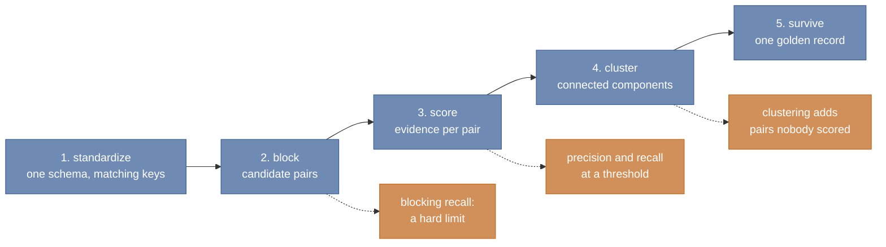
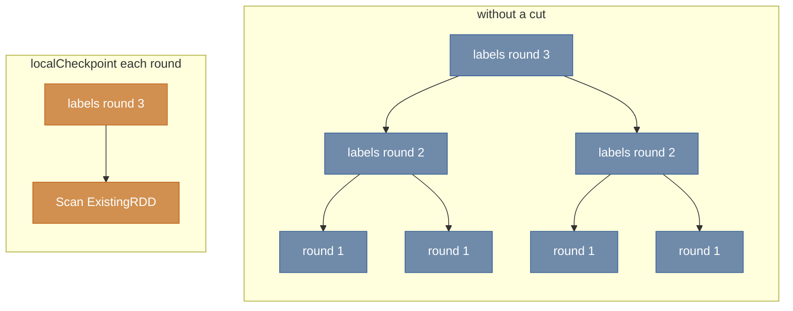
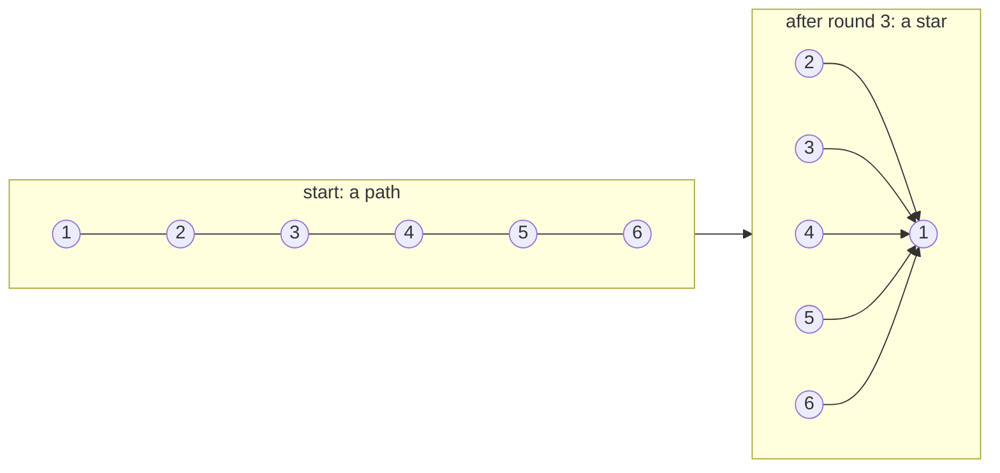

# Chapter 38: Entity resolution and connected components

A company keeps customers in three systems: a CRM, a web shop and a support desk. Each system has its own typos, formats and gaps. "Dev García" in the CRM is "Dev Garca" in the support desk. "Chen, Mei" in the shop is "MEI CHEN" in support. Before anyone can count customers, a job must decide which records are the same person. This is **entity resolution**.

**Entity resolution is a pipeline of five steps: standardize, block, score, cluster and survive. Each step has a measurable error, and the errors add up. Blocking sets a hard limit on recall. Clustering makes one wrong match into many wrong pairs.

The cluster step is also an iterative job. An iterative job builds a larger plan in each round, and the plan can stop the driver. `localCheckpoint()` cuts the plan in each round.**

The data is the SparkTutor sample: `crm.csv`, `shop.csv` and `support.jsonl` in [`code/data/messy/entities`](https://github.com/lisancao/spark-masterclass/tree/main/code/data/messy/entities). `truth.csv` is the answer key, so each step has a precision and a recall. The scripts are [`code/ch38/resolve.py`](https://github.com/lisancao/spark-masterclass/tree/main/code/ch38) and `components.py`. They ran on `pyspark==4.3.0` in local mode. The plan measurements use `df._jdf`, so they run in Classic only.



## Step 1: One schema, and why dropDuplicates is not enough

Each source has different column names and formats. The shop writes some names as "Last, First". The support desk has no city. The script maps each source to one schema and joins them with `unionByName`:

```python
parts = F.split("name", ",")
shop = (spark.read.option("header", True).csv(str(ENT / "shop.csv"))
        .select(F.lit("shop").alias("source"), F.col("customer_no").alias("record_id"),
                F.when(F.col("name").contains(","), F.concat_ws(" ", F.trim(parts[1]), F.trim(parts[0])))
                .otherwise(F.col("name")).alias("name"),
                "email", "phone", "city", F.to_date("last_order").alias("updated_at")))
records = crm.unionByName(shop).unionByName(support).cache()
```

```text
== 139 records: crm 55, shop 44, support 40
   answer key: 62 people, 105 true pairs, 9,591 pairs in all
   dropDuplicates(): 139 rows, on (name, email, phone): 137 rows
```

The 139 records describe 62 people. Thus, 105 pairs of records are the same person, of 9,591 possible pairs. `dropDuplicates()` removes no rows, because no two records are exactly equal. With a subset of columns, it removes two rows. But it keeps an arbitrary row from each group. If you must choose which row survives, use `row_number()` over a window with an explicit order.

The global id is `source:record_id`. The raw values stay in the table. Each later step adds columns and does not change the raw values.

## Step 2: Matching keys

A matching key is a normalized form of a value. Two records that refer to the same person must get the same key, even if their raw values are different:

```python
nick = F.create_map(*[F.lit(x) for kv in NICKNAMES.items() for x in kv])
raw_tokens = F.split(F.regexp_replace(F.lower(unaccent("name")), "[^a-z ]", ""), " +")
tokens = F.transform(F.filter(raw_tokens, lambda t: t != ""), lambda t: F.coalesce(F.element_at(nick, t), t))
email = F.nullif(F.lower(F.trim("email")), F.lit(""))
local, domain = F.split(email, "@")[0], F.split(email, "@")[1]
norm = (records.withColumn("id", F.concat_ws(":", "source", "record_id"))
        .withColumn("tokens", F.array_sort(tokens))
        .withColumn("email_key", F.when(domain == "gmail.com", F.concat(
            F.regexp_replace(F.split(local, "\\+")[0], "\\.", ""), F.lit("@gmail.com"))).otherwise(email))
        .withColumn("phone_key", F.nullif(F.right(F.regexp_replace("phone", "[^0-9]", ""), F.lit(10)), F.lit("")))
        .withColumn("city_key", F.lower(unaccent("city")))).cache()
```

```text
+-------------+----------+-------------+-------------------+----------+
|id           |name      |tokens       |email_key          |phone_key |
+-------------+----------+-------------+-------------------+----------+
|crm:CRM-0001 |dev García|[dev, garcia]|dev.garcia@mail.com|9025556970|
|shop:10001   |Dev García|[dev, garcia]|dev.garcia@mail.com|9025556970|
|support:S-001|Dev Garca |[dev, garca] |dev.garcia@mail.com|9025556970|
+-------------+----------+-------------+-------------------+----------+
```

Each key handles one kind of difference:

- **Name tokens.** The name goes to lower case, and a pandas UDF removes accents with `unicodedata`. "Đ" is a separate letter in Unicode, not "D" with a mark, so the UDF maps it by hand. Spark 4.3 has no built-in function that removes accents. The key sorts the tokens, so "Chen Mei" and "Mei Chen" get the same key.
- **Nicknames.** A map from nickname to formal name changes "bob" to "robert". `element_at` returns NULL for a key that is not in the map, also under ANSI mode. `coalesce` then keeps the original token.
- **E-mail.** The key is in lower case, with no spaces. For `gmail.com` only, the key also removes dots and anything after "+" in the local part, because Gmail delivers these forms to the same mailbox. Other providers do not, so the rule applies only to that domain. An empty string becomes NULL with `nullif`.
- **Phone.** The key keeps the digits only, and then the last ten digits with `F.right`. Thus, "+1 403 555 0492" and "403.555.0492" get the same key.

The script also checks some built-in string functions:

```text
   element_at(map, missing key) under ANSI: None | soundex('Đặng') = Đặng | soundex('Dang') = D520
   levenshtein('garcia', 'garccia') = 1 | with threshold 0: -1
   jaro_winkler('martha', 'marhta') = 0.9611, name_similarity(['an','nguyen','van'], ['an','nguyen']) = 0.8333
```

`soundex` returns its input unchanged if the first letter is not ASCII. Thus, it is necessary to remove accents before `soundex`. `levenshtein` counts character edits, and its third argument is a threshold: above it, the result is -1.

Spark has no Jaro-Winkler function, so the script has one in a Python UDF. Jaro-Winkler gives a bonus for a common prefix, because typos are less frequent at the start of a name. The name similarity matches each token with its most similar token in the other name. It keeps the lower of the two directions, so an extra middle name costs a little.

## Step 3: Blocking, and the limit that it sets on recall

To score all 9,591 pairs is possible here, but not for a million records. **Blocking** makes candidate pairs only from records that share a key. The script uses three passes and joins their results:

```python
def pairs_on(keyed):
    k = keyed.where(F.col("bk").isNotNull())
    return (k.alias("a").join(k.alias("b"), "bk").where(F.col("a.id") < F.col("b.id"))
            .select(F.col("a.id").alias("l"), F.col("b.id").alias("r")))
```

```text
== blocking: candidates and blocking recall
   email                  75 pairs, finds  75 of 105 true pairs
   phone                  78 pairs, finds  70 of 105 true pairs
   soundex of a token    880 pairs, finds 105 of 105 true pairs
   all three passes      882 pairs (9.2% of all), finds 105 of 105
   largest soundex blocks:
     C500   20 records  ['chen', 'chne', 'coen', 'cohen', 'cohn']
     G620   17 records  ['garca', 'garcai', 'garccia', 'garcia']
     S530   13 records  ['smith']
```

The three passes give 882 candidates, which is 9.2% of all pairs, and they contain all 105 true pairs. The `isNotNull` filter is necessary. Without it, all records with no e-mail become one block, and their pairs are not evidence of anything.

**Blocking recall is a hard limit.** The scoring step sees only candidate pairs.

If blocking misses a true pair, no threshold can find it again. The e-mail pass alone finds 75 of the 105 pairs. A pipeline with only that pass has a recall of 0.714 at best.

Blocks also have different sizes. The `C500` block joins "Chen" and "Cohen", and it has 20 records. A block of `n` records gives `n(n − 1)/2` pairs, so a large block costs much more than a small one. On real data, one frequent surname can make one block with millions of pairs, and one task gets all of them. Compound keys (soundex plus city) or a limit on block size keep the blocks small.

## Step 4: Scoring: a missing value is not a disagreement

Each candidate pair gets a score. The first version of the score treats a missing value as a disagreement:

```python
naive = (0.5 * F.col("name_sim") + 0.3 * F.coalesce(same("email_key").cast("double"), F.lit(0.0))
         + 0.2 * F.coalesce(same("phone_key").cast("double"), F.lit(0.0)))
```

The second version adds evidence. Equal keys add to the score, and different keys subtract from it. A missing key adds nothing:

```python
def evidence(key, agree, disagree):
    l, r = F.col(f"l_{key}"), F.col(f"r_{key}")
    return F.when(l.isNull() | r.isNull(), 0.0).when(l == r, agree).otherwise(-disagree)
```

```text
== scoring: a missing value is not a disagreement
   weighted sum, missing = 0 (threshold 0.6): precision 1.000 recall 0.876
   evidence, missing neutral (threshold 0.9): precision 0.991 recall 1.000
   threshold sweep on the evidence score:
     >= 0.7   156 matches  precision 0.673  recall 1.000
     >= 0.8   115 matches  precision 0.913  recall 1.000
     >= 0.9   106 matches  precision 0.991  recall 1.000
     >= 1.0   102 matches  precision 0.990  recall 0.962
     >= 1.1    96 matches  precision 1.000  recall 0.914
     >= 1.3    89 matches  precision 1.000  recall 0.848
   false match: 'Mei Chen' (shop:10042) and 'MEI CHEN' (support:S-037), score 1.000
```

The weighted sum misses 12% of the true pairs. Those pairs have a support record with no e-mail or phone. A missing e-mail adds 0 to the weighted sum, the same as a different e-mail. The evidence score treats "unknown" and "different" as different things, and recall goes to 1.0.

The threshold sweep shows the usual trade. A lower threshold finds all pairs and more false matches. A higher threshold removes false matches and loses true pairs.

At 0.9, the score has one false match: two records for "Mei Chen". The answer key says they are two different people with the same name. The two records share a name and nothing else. They have no e-mail or phone that disagrees. With this data, no rule can separate them. A real system needs more evidence, such as an address or a date of birth.

The weights here come from judgment. A model can learn them from labelled pairs. The Fellegi-Sunter model and a `LogisticRegression` from [Chapter 35](ch35-mllib-mlflow.md) are the usual choices.

## Step 5: Clustering with label propagation

A match is a pair. An entity is a group. If A matches B and B matches C, then A, B and C are one entity, even if nobody scored A against C. The entities are the **connected components** of the graph of matches.

**Label propagation** finds them with joins. Each record starts with its own id as its label. In each round, each record takes the smallest label of itself and its neighbors. When a round changes no label, each component has one label: its smallest id.

```python
offer = (both.join(labels.withColumnRenamed("id", "src"), "src")
         .groupBy(F.col("dst").alias("id")).agg(F.min("label").alias("offer")))
new = labels.join(offer, "id", "left").select(
    "id", F.least("label", F.coalesce("offer", "label")).alias("label"))
if cut:
    new = new.localCheckpoint()
```

The script runs this loop two times: without a cut, and with `localCheckpoint()` in each round. After each round, it reads the size of the analyzed plan from `df._jdf.queryExecution()`:

```text
== label propagation without a cut
     round 1: changed  77, analyzed plan   359 lines,   54 leaves, count() 0.95 s
     round 2: changed   1, analyzed plan  1045 lines,  156 leaves, count() 3.90 s
     round 3: changed   2, analyzed plan  2417 lines,  360 leaves, count() 10.27 s
     round 4: changed   0, analyzed plan  5161 lines,  768 leaves, count() 28.83 s

== label propagation with localCheckpoint() each round
     round 1: changed  77, analyzed plan     1 lines,    1 leaves, count() 0.18 s
     round 2: changed   1, analyzed plan     1 lines,    1 leaves, count() 0.18 s
     round 3: changed   2, analyzed plan     1 lines,    1 leaves, count() 0.11 s
     round 4: changed   0, analyzed plan     1 lines,    1 leaves, count() 0.08 s
   61 entities after 4 rounds (the answer key has 62)
```

<figure markdown>
  <video autoplay loop muted playsinline controls width="1280" height="720" poster="../../media/clips/ch38-plan-growth.webp">
    <source src="../../media/clips/ch38-plan-growth.mp4" type="video/mp4">
  </video>
  <figcaption>Label propagation without a cut, then with <code>localCheckpoint()</code>. Without a cut, the plan and the time of each round grow. With the cut, the plan has one line.</figcaption>
</figure>

Without a cut, the plan grows in each round. The DataFrame of round `n` contains the DataFrame of round `n − 1` two times. One copy is in the join for the offers, and one is in the left join. Thus, the plan almost doubles in each round (359, 1,045, 2,417 and 5,161 lines).

Each action must analyze and optimize the whole plan again, so each round takes longer than the round before it. These times are single runs on a machine that other jobs also used, but the growth is clear. On a graph that needs 20 rounds, the plan becomes too large for the driver.

`localCheckpoint()` computes the DataFrame, keeps the result in the executors' block storage, and returns a new DataFrame whose plan is a scan of that result. The plan has one line in each round, and the time stays flat.



## Step 6: Clustering makes errors larger

Clustering adds pairs that the scoring step never saw. The script counts the pairs that the clusters imply:

```text
   pairs implied by the clusters: 114, precision 0.921, recall 1.000
   pairs the matcher called directly: 0.991 precision
   largest cluster: 6 records, people in it per the key: ['E057', 'E058']
```

The matcher called one wrong pair, and it had a precision of 0.991. After clustering, the precision is 0.921. The wrong pair joined two people with three records each into one cluster of six. That cluster implies 15 pairs, and 9 of them are wrong (3 × 3). One wrong edge gave nine wrong pairs.

Thus, measure precision after clustering, not only after scoring. One bad edge can join two large clusters. Thus, use a higher threshold for edges. Or examine each cluster above a size limit before you accept it.

## Step 7: Survivorship: one golden record for each entity

Each entity needs one value for each column. Survivorship rules choose that value:

```python
latest = lambda c: F.max_by(c, F.when(c.isNotNull(), F.col("updated_at")))
gold = rows.groupBy("label").agg(
    F.mode(F.array_join("tokens", " "), deterministic=True).alias("name_key"),
    latest(F.col("email_key")).alias("email"),
    F.mode("phone_key", deterministic=True).alias("phone"),
    latest(F.col("city")).alias("city"),
    F.array_sort(F.collect_set("source")).alias("sources"),
    F.count("*").alias("records"))
```

```text
+------------+------------+-----------------------+----------+---------+--------------------+-------+
|label       |name_key    |email                  |phone     |city     |sources             |records|
+------------+------------+-----------------------+----------+---------+--------------------+-------+
|crm:CRM-0049|chen mei    |meichen@gmail.com      |9025555398|Toronto  |[crm, shop, support]|6      |
|crm:CRM-0013|okafor priya|priya.okafor@example.ca|4035554693|Montréal |[crm, shop, support]|4      |
|crm:CRM-0043|chen ivan   |ivanchen@gmail.com     |4035554965|Vancouver|[crm, shop, support]|4      |
|crm:CRM-0001|dev garcia  |dev.garcia@mail.com    |9025556970|Halifax  |[crm, shop, support]|3      |
+------------+------------+-----------------------+----------+---------+--------------------+-------+
   max_by(x, NULL ordering) ignores the row: a
```

The rules use these functions:

- **`mode(..., deterministic=True)`** returns the most frequent value. With `deterministic=True`, a tie gives the smallest value, so the result is the same in each run. A typo in one record loses the vote.
- **`max_by(value, ordering)`** returns the value of the row with the largest ordering. `max_by` ignores a row whose ordering is NULL. The script uses this. It sets the ordering to NULL when the value is NULL. Thus, `latest` returns the most recent value that is not NULL.
- **`array_sort(collect_set(...))`** gives a sorted list of sources. `collect_set` alone returns the values in an arbitrary order.

The first row is the cluster of six from Step 6. It shows the problem in the golden record. Two people became one customer.

The `label` is the smallest record id in the cluster. This id is not stable. If a new record with a smaller id joins the cluster, the label changes.

A production system keeps a separate table that maps clusters to entity ids. It gives each new cluster the id that most of its records had before. It also records merges and splits. A Delta or Iceberg `MERGE` keeps that table up to date.

## Step 8: Label propagation is slow on long paths

Label propagation needs as many rounds as the longest shortest path in a component (its diameter). A label moves one edge in each round. For entity resolution, components are small, so four rounds are enough. For other graphs, such as listings that link to other listings, a component can be a long chain.

The **large-star and small-star** algorithm (Kiveris and others, SoCC 2014) needs far fewer rounds. Each operation changes the edges, not the labels:

- **Large-star:** for each node `u`, find `m(u)`, the smallest of `u` and its neighbors. Connect each neighbor that is larger than `u` to `m(u)`.
- **Small-star:** point each edge from its larger end to its smaller end. For each node `u`, find `m(u)`, the smallest of its smaller neighbors. Connect `u` and each of its smaller neighbors to `m(u)`.

When neither operation changes the edges, each component is a star around its smallest node. The script shows the edges after each round on a path of six nodes:

```text
== large-star and small-star on a path of 6 nodes
     after round 1: [(2, 1), (3, 1), (4, 2), (5, 3), (6, 4)]
     after round 2: [(2, 1), (3, 1), (4, 1), (5, 1), (6, 2)]
     after round 3: [(2, 1), (3, 1), (4, 1), (5, 1), (6, 1)]
   converged after 3 rounds: every node points at node 1
```



Each operation is a window function and a `distinct`. The window finds `m(u)` with `min("v").over(Window.partitionBy("u"))`. An `explode` of a two-element array makes both directions of each edge, so each operation reads its input only one time:

```python
def large_star(e):
    both = e.select(F.explode(F.array(F.struct(F.col("src").alias("u"), F.col("dst").alias("v")),
                                      F.struct(F.col("dst").alias("u"), F.col("src").alias("v")))).alias("x")
                    ).select("x.u", "x.v")
    m = F.least(F.min("v").over(Window.partitionBy("u")), F.col("u"))
    return both.withColumn("m", m).where("v > u").select(F.col("v").alias("src"), F.col("m").alias("dst")).distinct()
```

The script compares the two algorithms on paths and on a random graph. It also compares the result on the random graph with a union-find on the driver:

```text
== rounds and time: label propagation against large-star / small-star
   graph                 propagation          stars
   path of 50             50 rounds   20.5 s     6 rounds   2.8 s
   path of 200           200 rounds   69.8 s     8 rounds   5.5 s
   random, 5,000 nodes    16 rounds    7.1 s     4 rounds   2.3 s
   random graph: 2,753 nodes in 1 components, same as a driver union-find: True
   large_star plan (one exchange for the window, one for distinct): 3 exchanges
```

Label propagation needs 200 rounds for a path of 200 nodes. Large-star and small-star need 8 rounds. The number of rounds of the star algorithm grows about with the logarithm of the path length. The times are single runs on a shared machine, so use them only to compare the two columns. The plan of one large-star round over the clean edges has three exchanges. They are for the `distinct` of the edge cleanup, the window and the last `distinct`.

GraphX has a `ConnectedComponents` algorithm, which is label propagation with Pregel, but GraphX has no Python API. GraphFrames is a separate package. This chapter did not test a GraphFrames release against Spark 4.3.

## Step 9: Four ways to keep the result of a round

An iterative loop must keep each round's result somewhere. `components.py` runs six rounds of the star algorithm on a path of 64 nodes in four ways and measures the plan after each round:

```text
   nothing:
     round  leaves  optimized plan lines  count() s
         1       1                    16       0.64
         2       1                    28       0.80
         3       1                    40       0.94
         4       1                    52       1.19
         5       1                    64       1.74
   cache:
     round  leaves  optimized plan lines  count() s
         1       1                    54       0.08
         2       1                   163       0.13
         3       1                   381       0.16
         4       1                   817       0.13
         5       1                  1689       0.20
         6       1                  3433       0.23
   localCheckpoint:
     round  leaves  optimized plan lines  count() s
         1       1                     1       0.12
   ...
   checkpoint:
     round  leaves  optimized plan lines  count() s
         1       1                     1       0.09
   ...
```

<figure markdown>
  <video autoplay loop muted playsinline controls width="1280" height="720" poster="../../media/clips/ch38-cache-plan.webp">
    <source src="../../media/clips/ch38-cache-plan.mp4" type="video/mp4">
  </video>
  <figcaption>The same loop with nothing, <code>cache()</code>, <code>localCheckpoint()</code> and <code>checkpoint()</code>. The plan of the cached loop doubles in each round.</figcaption>
</figure>

The results are different for each method:

- **Nothing.** The star operations read their input one time, so the plan grows by a constant in each round (12 lines). But each action computes all earlier rounds again, and the time grows.
- **`cache()`.** The data does not get computed again, so `count()` stays fast. But the optimized plan doubles in each round (54 to 3,433 lines). `cache()` does not cut the plan. A cached DataFrame appears in the plan as an `InMemoryRelation`, and an `InMemoryRelation` prints the plan that it came from, which contains the earlier `InMemoryRelation`. Spark makes this string for each action (the SQL tab of the UI shows it). After enough rounds, the string alone fills the driver memory.
- **`localCheckpoint()`.** The plan is one scan in each round. The data stays in the executors' block storage. If an executor stops, Spark cannot compute the lost blocks again, and the job fails.
- **`checkpoint()`.** The plan is one scan in each round. The data goes to files in the checkpoint directory, so it survives the loss of an executor. It is slower because it writes files, and it needs `spark.sparkContext.setCheckpointDir(...)`. Here, it wrote 7 part files.

```text
== what each cut leaves in the plan
   localCheckpoint(): *(1) Scan ExistingRDD[src#10866L,dst#10867L]
   checkpoint():      *(1) Scan ExistingRDD[src#10868L,dst#10869L]
```

On Spark Connect, there is no `sparkContext`. `spark.checkpoint.dir` is a static configuration, and a change at runtime fails:

```text
   spark.conf.set('spark.checkpoint.dir') at runtime: [CANNOT_MODIFY_CONFIG]
```

Set it when the server starts. `localCheckpoint()` needs no directory, and it works on Connect.

Use `localCheckpoint()` for short loops on a stable cluster. Use `checkpoint()` every few rounds for long jobs where executors can stop. Do not depend on `cache()` alone in a loop.

## The whole chapter, on one page

- **Standardize into one schema** with `unionByName`. Keep raw values. Build matching keys for names, e-mails and phones.
- **Block with several passes**, and filter NULL keys. Blocking recall is the limit for the whole pipeline. Here, three passes kept all 105 true pairs in 9.2% of the pairs.
- **Score with evidence**, where a missing value adds nothing. Recall went from 0.876 to 1.0.
- **Clustering makes errors larger.** One wrong edge took precision from 0.991 to 0.921. Measure after clustering.
- **Cut the plan in iterative jobs.** Without a cut, the plan doubled in each round. `cache()` does not cut it. `localCheckpoint()` and `checkpoint()` do.
- **Use large-star and small-star for long components.** 8 rounds against 200 for a path of 200 nodes.
- **Survive with `mode(deterministic=True)` and `max_by`**, and keep entity ids in their own table.

```python
labels = ids.select("id", F.col("id").alias("label")).localCheckpoint()
while True:
    offer = (both.join(labels.withColumnRenamed("id", "src"), "src")
             .groupBy(F.col("dst").alias("id")).agg(F.min("label").alias("offer")))
    new = (labels.join(offer, "id", "left")
           .select("id", F.least("label", F.coalesce("offer", "label")).alias("label"))
           .localCheckpoint())                       # cut the plan every round
    changed = new.join(labels.withColumnRenamed("label", "old"), "id").where("label != old").count()
    labels = new
    if changed == 0:
        break
```

## Further reading

- Kiveris, Lattanzi, Mirrokni, Rastogi and Vassilvitskii, "Connected Components in MapReduce and Beyond", SoCC 2014.
- [`DataFrame.localCheckpoint`](https://spark.apache.org/docs/4.3.0/api/python/reference/pyspark.sql/api/pyspark.sql.DataFrame.localCheckpoint.html) and [`DataFrame.checkpoint`](https://spark.apache.org/docs/4.3.0/api/python/reference/pyspark.sql/api/pyspark.sql.DataFrame.checkpoint.html).
- [String functions](https://spark.apache.org/docs/4.3.0/api/sql/index.html#soundex): `soundex`, `levenshtein`, `max_by`, `mode`.
