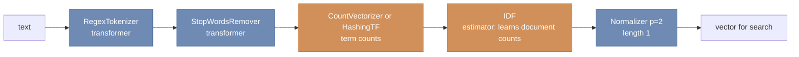
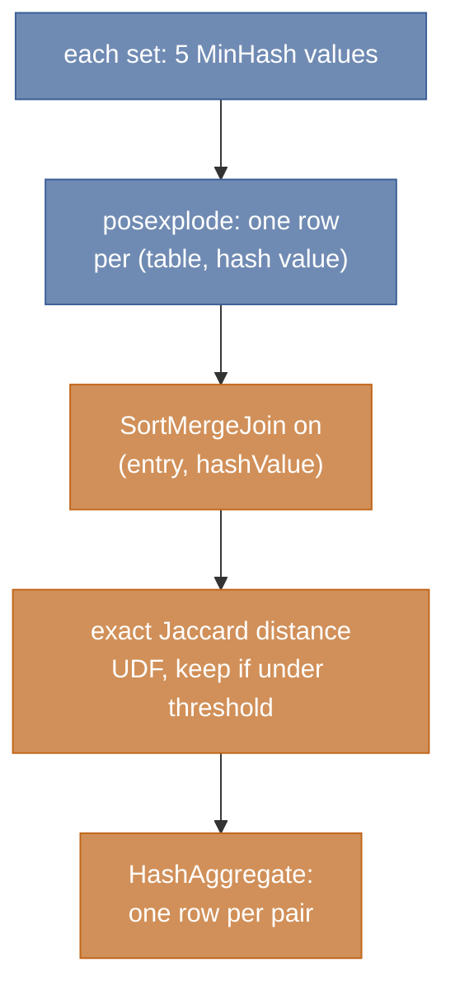
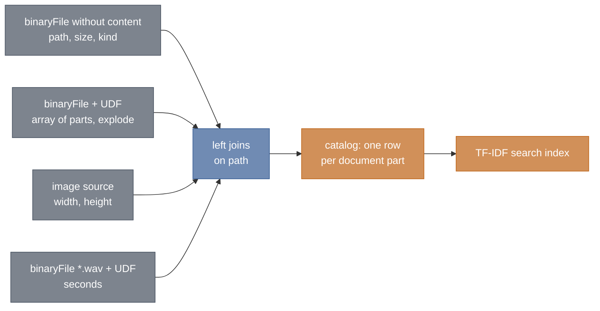

# Chapter 38: Text analytics without an LLM

A support team has four policy pages, a few hundred tickets and a folder of e-mails. They want two things. First, they want to find the policy page that answers a ticket. Second, they want to find the messages that are almost the same as other messages. Many teams send this work to a large language model. But for these two tasks, a model is slow, expensive and difficult to test.

**Search and near-duplicate detection need only tokens, counts and hashes. Spark MLlib has each part as a separate stage. Each stage makes one decision that changes the result. The decisions are the tokens, the weight of each word, the vector for the words, and the comparison of two vectors. If you can see each decision, you can test it.**

This chapter builds a TF-IDF search index and a MinHash index for near-duplicates. Then it builds one catalog of mixed documents (PDF pages, e-mails, logs and text files) and puts the search index on top of it. The data is the SparkTutor sample data in [`code/data/messy`](https://github.com/lisancao/spark-masterclass/tree/main/code/data/messy): four policy pages, four e-mails, 160 labelled tickets and 240 tickets in an inbox. The scripts are in [`code/ch38`](https://github.com/lisancao/spark-masterclass/tree/main/code/ch38). They ran on `pyspark==4.3.0` in local mode, and each output block comes from `code/ch38/output/`.

## Step 1: Read the text, and count words without MLlib

The `text` source reads one row for each line. For documents, you usually want one row for each file. The `wholetext=True` keyword gives that:

```python
docs = (spark.read.text(str(MESSY / "docs" / "*.md"), wholetext=True)
        .select(F.col("_metadata.file_name").alias("doc"), F.col("value").alias("text")))
```

```text
== read: 28 rows as lines, 4 rows with wholetext=True
```

Built-in functions can already count words. `split` with a regular expression cuts the text, and `explode` makes one row for each word:

```python
words = docs.select("doc", F.explode(F.split(F.lower("text"), r"[^a-z]+")).alias("word"))
words.filter(F.length("word") > 3).groupBy("word").count().orderBy(F.desc("count"), "word").show(4)
```

```text
+---------+-----+
|     word|count|
+---------+-----+
| shipping|    7|
|customers|    6|
|     days|    6|
|   policy|    4|
+---------+-----+
```

The function `sentences()` cuts text into sentences and each sentence into words. It returns an array of arrays, so `size(sentences(text))` counts the sentences. Each policy page has six sentences.

These counts show the problem with raw counts. "policy" occurs in all four documents. Thus, it tells you nothing about which document a query is about. The next steps fix this with weights.

## Step 2: Tokenizers and stop words

MLlib uses the same vocabulary for text as for all other features. A **transformer** changes one DataFrame into another DataFrame. An **estimator** learns from a DataFrame and returns a transformer (a model). A `Pipeline` is a list of stages, and `Pipeline.fit()` returns a `PipelineModel`. [Chapter 37](ch37-mllib-mlflow.md) explains this model in detail.

The first stage cuts text into tokens. MLlib has two tokenizers, and they give different results on the same sentence:

```python
one = spark.createDataFrame([("Hello, order 1000 has a problem. Please help.",)], "text string")
print("Tokenizer:        ", Tokenizer(inputCol="text", outputCol="t").transform(one).first().t)
rt = RegexTokenizer(inputCol="text", outputCol="t", pattern=r"\W+")
print("RegexTokenizer:   ", rt.transform(one).first().t)
```

```text
Tokenizer:         ['hello,', 'order', '1000', 'has', 'a', 'problem.', 'please', 'help.']
RegexTokenizer:    ['hello', 'order', '1000', 'has', 'a', 'problem', 'please', 'help']
+ StopWordsRemover: ['hello', 'order', '1000', 'problem', 'please', 'help']
minTokenLength=4:   ['hello', 'order', '1000', 'problem', 'please', 'help']
gaps=False, \d+:   ['1000']
default stop words: 181 English words
```

`Tokenizer` changes the text to lower case and cuts it at white space only. Thus, `problem.` with its period is a different token from `problem`. A query for "problem" does not find it.

`RegexTokenizer` cuts at each match of `pattern`, and it also changes the text to lower case (`toLowercase=True` is the default). With `gaps=False`, the pattern matches the tokens, not the gaps between them. `minTokenLength` removes short tokens.

`StopWordsRemover` removes frequent words such as "has" and "a". Its default list for English has 181 words. You can give your own list with `stopWords`, and `caseSensitive` controls the comparison.

MLlib has no stemmer. "returned" and "return" stay different tokens. Step 5 shows the effect of this on a query.

## Step 3: TF-IDF, and the formula that MLlib uses

TF-IDF gives a word a high weight if it occurs frequently in one document and in few other documents. The **term frequency** (TF) is the count of a word in a document. The **inverse document frequency** (IDF) decreases the weight of a word that occurs in many documents. The pipeline has four stages:



```python
stages = [RegexTokenizer(inputCol="text", outputCol="tokens", pattern=r"[^a-zA-Z]+"),
          StopWordsRemover(inputCol="tokens", outputCol="words")]
cv = CountVectorizer(inputCol="words", outputCol="tf")
idf_pipe = Pipeline(stages=stages + [cv, IDF(inputCol="tf", outputCol="tfidf")]).fit(docs)
vocab, idf = idf_pipe.stages[2].vocabulary, idf_pipe.stages[3].idf
```

The script reads the IDF weights from the fitted model and compares each weight with a calculation by hand:

```text
  policy     in 4 of 4 docs   IDF 0.0000   log((N+1)/(df+1)) = 0.0000
  shipping   in 1 of 4 docs   IDF 0.9163   log((N+1)/(df+1)) = 0.9163
  batteries  in 1 of 4 docs   IDF 0.9163   log((N+1)/(df+1)) = 0.9163
  days       in 2 of 4 docs   IDF 0.5108   log((N+1)/(df+1)) = 0.5108
```

MLlib calculates IDF as `log((N + 1) / (df + 1))`, where `N` is the number of documents and `df` is the number of documents that contain the word. The values agree to four decimal places. A word that occurs in every document gets the weight 0. Thus, "policy" has no effect on a score. This is correct for this corpus, but it can be a surprise.

If you add one page to a corpus, the weights of all words change. Thus, you must fit the IDF stage again when the corpus changes.

## Step 4: HashingTF or CountVectorizer

The stage that counts terms must put each word in a position (a slot) of a vector. MLlib has two methods.

- `CountVectorizer` is an estimator. It learns a vocabulary from the data and gives each word its own slot. The fitted model has a `vocabulary` attribute, so you can find the word for each slot.
- `HashingTF` is a transformer. It calculates a hash of each word, and the hash modulo `numFeatures` is the slot. It needs no fit and no vocabulary. But two words can get the same slot, and you cannot find the word from the slot.

The script counts how many of the 127 distinct words in the tickets share a slot, for different values of `numFeatures`:

```text
  127 distinct words in 400 tickets; slots used by HashingTF:
    numFeatures 2^6  =      64:  59 slots,  68 words share a slot
    numFeatures 2^8  =     256: 100 slots,  27 words share a slot
    numFeatures 2^10 =    1024: 119 slots,   8 words share a slot
    numFeatures 2^12 =    4096: 125 slots,   2 words share a slot
    numFeatures 2^18 =  262144: 127 slots,   0 words share a slot
```

The default is 2^18 slots. With that value, no words share a slot here. Even at 4,096 slots, two words share a slot. A collision adds the counts of two words together, and a query for one word then also finds the other word. For a small vocabulary that does not change, use `CountVectorizer`. For a vocabulary that grows, or for a stream where you cannot fit first, use `HashingTF` with enough slots.

## Step 5: Search the policies

A search index stores one TF-IDF vector for each document. A `Normalizer` with `p=2` scales each vector to length 1. For two vectors of length 1, the dot product is the cosine similarity. The query goes through the same fitted pipeline as the documents. Then each document gets a score:

```python
index = Pipeline(stages=stages + [HashingTF(inputCol="words", outputCol="tf", numFeatures=1 << 12),
                                  IDF(inputCol="tf", outputCol="tfidf"),
                                  Normalizer(inputCol="tfidf", outputCol="vec", p=2.0)]).fit(docs)
indexed = index.transform(docs)
dot_udf = F.udf(lambda a, b: float(a.dot(b)), "double")
for q in queries:
    qv = index.transform(spark.createDataFrame([(q,)], "text string")).select(F.col("vec").alias("q"))
    ranked = indexed.crossJoin(qv).select("doc", dot_udf("vec", "q").alias("score")).orderBy(F.desc("score"), "doc")
```

```text
  how long does express shipping take          best shipping.md  0.3265   others [0.0, 0.0, 0.0]
  can I return an unopened item for a refund   best returns.md   0.2243   others [0.0, 0.0, 0.0]
  battery warranty                             best warranty.md  0.2009   others [0.0, 0.0, 0.0]
  returned items refunded                      best returns.md   0.1197   others [0.0, 0.0, 0.0]
  pizza                                        best privacy.md   0.0000   others [0.0, 0.0, 0.0]
```

Each query finds the correct page, and the other pages get 0. Read the scores with care:

- **"returned items refunded"** gets a lower score than "can I return an unopened item for a refund". MLlib has no stemmer, so "returned" does not match "return". The match comes from "items" only.
- **"pizza"** matches no page. All scores are 0, and the sort by name puts `privacy.md` first. A search must treat a best score of 0 as "no result".
- **Scores are comparable only within one query.** A score of 0.33 for one query and 0.12 for another query do not tell you that the first answer is better.

## Step 6: Many queries at once, and the vector functions of 4.3

A real job scores many queries. The script scores each of the 240 inbox tickets against each of the 160 labelled tickets. Then it keeps the label of the nearest labelled ticket. This is 38,400 scores. The script calculates the same score in two ways:

```python
as_float = lambda c: vector_to_array(c, "float32")
ways = {"Python UDF a.dot(b)": dot_udf("qv", "vec"),
        "F.vector_inner_product": F.vector_inner_product(as_float("qv"), as_float("vec"))}
```

```text
  Python UDF a.dot(b)      240 queries x 160 = 38,400 scores, median 1.28 s, nearest label right for 223/240
     plan has: ['ArrowEvalPython', 'BroadcastNestedLoopJoin']
  F.vector_inner_product   240 queries x 160 = 38,400 scores, median 1.17 s, nearest label right for 223/240
     plan has: ['BroadcastNestedLoopJoin', 'vector_inner_product']
  inbox tickets with no words at all: 12 (their vector is all zeros, every score is 0)
```

<figure markdown>
  <video autoplay loop muted playsinline controls width="1280" height="720" poster="../../media/clips/ch38-search.webp">
    <source src="../../media/clips/ch38-search.mp4" type="video/mp4">
  </video>
  <figcaption><code>text_search.py</code> runs the policy queries, then scores 240 inbox tickets against 160 labelled tickets with a Python UDF and with <code>vector_inner_product</code>.</figcaption>
</figure>

The two methods give the same answer. The nearest labelled ticket has the correct label for 223 of the 240 tickets. That is a strong baseline for a method that does not learn weights from labels.

The plans show the difference. The UDF adds an `ArrowEvalPython` operator, so each pair of vectors goes to a Python worker and back. `vector_inner_product` is a built-in SQL function that runs in the JVM.

The SQL functions came in Spark 4.2. **New in 4.3:** PySpark has Python wrappers for them (`F.vector_inner_product`, `F.vector_cosine_similarity`, `F.vector_l2_distance`, `F.vector_norm`, `F.vector_normalize`, `F.vector_avg`, `F.vector_sum`). In 4.2, you had to call them with `F.call_function`. The functions take `array<float>`, not the MLlib vector type. Thus, `vector_to_array(col, "float32")` converts the MLlib vector first. [Chapter 39](ch39-similarity-search.md) gives the rules for these functions.

The times in this output come from a machine that other jobs also used, so they are not a measurement. The book quotes no speed result here. The plan difference is the important part: one plan has a Python boundary and the other plan does not.

Both plans use `BroadcastNestedLoopJoin`, because a cross join compares each query with each document. For many more documents, this is too slow, and you need an index. Step 7 and Chapter 39 show indexes.

## Step 7: Near-duplicates with MinHashLSH

A near-duplicate is a message with almost the same words as another message. The usual measure is the **Jaccard similarity** of the two sets of words: the size of the intersection divided by the size of the union. The **Jaccard distance** is 1 minus that value.

The sample has four e-mails from one template and three chat messages:

```text
+--------+------------------------------------------------+
|id      |text                                            |
+--------+------------------------------------------------+
|chat_0  |Where is my order 1042? It has not arrived yet. |
|chat_1  |Where is my order 1042?? It has not arrived yet!|
|chat_2  |Do you ship express to Vietnam?                 |
|ticket_0|Hello, order 1000 has a problem. Please help.   |
|ticket_1|Hello, order 1001 has a problem. Please help.   |
|ticket_2|Hello, order 1002 has a problem. Please help.   |
|ticket_3|Hello, order 1003 has a problem. Please help.   |
+--------+------------------------------------------------+
```

To compare every pair is quadratic. **MinHash** makes a short signature for each set. For a random hash function, the smallest hash value of two sets is the same with a probability equal to their Jaccard similarity. `MinHashLSH` puts sets with an equal signature value into the same bucket. Only sets that share a bucket become candidate pairs. Then Spark calculates the exact distance for each candidate.

```python
tok = RegexTokenizer(inputCol="text", outputCol="tokens", pattern=r"\W+")
tf = HashingTF(inputCol="tokens", outputCol="features", numFeatures=1 << 10, binary=True)
features = tf.transform(tok.transform(messages))
model = MinHashLSH(inputCol="features", outputCol="hashes", numHashTables=5, seed=7).fit(features)
pairs = (model.approxSimilarityJoin(features, features, threshold)
         .filter("datasetA.id < datasetB.id"))
```

```text
hashes of ticket_0: [13517508, 234222607, 97229004, 173401306, 447678187]
threshold 0.1: 1 pairs [('chat_0', 'chat_1', 0.0)]
threshold 0.3: 7 pairs [('chat_0', 'chat_1', 0.0), ('ticket_0', 'ticket_1', 0.2222), ('ticket_0', 'ticket_2', 0.2222), ('ticket_0', 'ticket_3', 0.2222), ('ticket_1', 'ticket_2', 0.2222), ('ticket_1', 'ticket_3', 0.2222), ('ticket_2', 'ticket_3', 0.2222)]
4 nearest to chat_0: [('chat_1', 0.0), ('chat_0', 0.0), ('ticket_2', 0.875), ('ticket_1', 0.875)]
ticket_0 vs ticket_1 by hand: 1 - 7/9 = 0.2222
```

These results show three important points:

- **`HashingTF(binary=True)`** makes a set, not a count. MinHash works on sets, so the count of a word has no effect.
- **The distance is exact, but the candidates are approximate.** The distance of `ticket_0` and `ticket_1` is 0.2222, the same as the calculation by hand (7 shared words of 9). LSH chose which pairs to compare. It did not estimate the distance.
- **The threshold sets what "duplicate" means.** At 0.1, only the two chat messages match, because their only differences are punctuation. At 0.3, the four template e-mails also match each other. For templated text, a loose threshold finds the template, not the duplicate. Choose the threshold on labelled pairs from your own data.

`approxNearestNeighbors` finds the nearest sets to one key. The result includes the key itself at distance 0. Remove it if you want other messages only.

The plan of the similarity join shows how LSH becomes an equi-join:

```text
+- HashAggregate(keys=[datasetA#510, datasetB#521], functions=[])
   +- Exchange hashpartitioning(datasetA#510, datasetB#521, 200), ENSURE_REQUIREMENTS, [plan_id=2441]
      +- HashAggregate(keys=[datasetA#510, datasetB#521], functions=[])
         +- Project [datasetA#510, datasetB#521]
            +- SortMergeJoin [entry#511, hashValue#512], [entry#522, hashValue#523], Inner, (UDF(datasetA#510.features, datasetB#521.features) < 0.3)
               :- Sort [entry#511 ASC NULLS FIRST, hashValue#512 ASC NULLS FIRST], false, 0
               :  +- Exchange hashpartitioning(entry#511, hashValue#512, 200), ENSURE_REQUIREMENTS, [plan_id=2433]
               :     +- Project [struct(id, id#1, text, text#2, tokens, tokens#22, features, features#28, hashes, hashes#506) AS datasetA#510, entry#5
               :        +- Filter isnotnull(hashValue#512)
               :           +- Generate posexplode(hashes#506), [id#1, text#2, tokens#22, features#28, hashes#506], false, [entry#511, hashValue#512]
```



`posexplode` makes one row for each hash table and hash value. The `SortMergeJoin` joins rows with the same table number (`entry`) and the same value.

A pair that matches in two tables appears two times, so the `HashAggregate` at the top removes the duplicate pairs. Each MLlib hash table holds one hash value. Thus, a pair is a candidate if any one value matches. This is OR-amplification only. [Chapter 39](ch39-similarity-search.md) shows why bands of several values give much fewer candidates.

## Step 8: Three traps

**A set with no tokens.** Twelve inbox tickets have no letters at all. Their vector has no non-zero entry, and MinHash cannot calculate a minimum over an empty set:

```text
inbox tickets with no tokens: 12 of 240
MinHash over them -> An error occurred while calling o357.collectToPython.
   cause: Must have at least 1 non zero entry.. SQ
```

The error stops the whole job. Remove empty sets before the MinHash stage, for example with `where(F.size("tokens") > 0)`, and keep them as a separate group.

**The name of the distance column.** In Classic, `distCol` sets the name of the distance column:

```text
approxSimilarityJoin(..., distCol='jaccard').columns -> ['datasetA', 'datasetB', 'jaccard']
```

The SparkTutor lesson recorded that Spark Connect in 4.2.0 ignored this argument and always used `distCol`. The same script ran over Connect in 4.3.0 for this chapter, and the result is in Step 9.

**Word order.** A set of words does not keep order. Two sentences with the same words in a different order have distance 0. Word 2-grams from `NGram` keep some of the order:

```text
  word set      distance p-q: 0.0000
  word 2-grams  distance p-q: 0.5000
```

Use n-grams (shingles) when order changes what the text says. Chapter 39 uses character 5-grams for the same reason.

## Step 9: The same code over Spark Connect

MLlib runs over Spark Connect since Spark 4.0. The script `near_duplicates.py` ran without changes against a Connect server (`SPARK_REMOTE=sc://localhost:10270`). Its output is in `code/ch38/output/near_duplicates_connect.txt`. Most lines are the same as in Classic:

```text
session: pyspark.sql.connect.session
threshold 0.1: 1 pairs [('chat_0', 'chat_1', 0.0)]
4 nearest to chat_0: [('chat_0', 0.0), ('chat_1', 0.0), ('ticket_2', 0.875), ('ticket_0', 0.875)]
MinHash over them -> [FAILED_EXECUTE_UDF] User defined function [...]
   cause: Must have at least 1 non zero entry.. SQ
approxSimilarityJoin(..., distCol='jaccard').columns -> ['datasetA', 'datasetB', 'distCol']
```

Three lines are different:

- **The `distCol` argument has no effect over Connect in 4.3.0.** The column is still `distCol`. The SparkTutor lesson recorded the same behavior in 4.2.0. Thus, code that must run in the two modes must not depend on the argument. Rename the column after the join with `withColumnRenamed("distCol", ...)`. The part notes record this as an open problem.
- **Ties come back in a different order.** `chat_0` and `chat_1` both have distance 0 from `chat_0`, and `ticket_0` and `ticket_2` both have 0.875. Sort on a second column if the order of ties is important.
- **The error has a different wrapper.** Classic shows the Py4J call (`o357.collectToPython`). Connect shows the error class `FAILED_EXECUTE_UDF`. The cause is the same.

The plan over Connect used a `BroadcastHashJoin` instead of a `SortMergeJoin`. The chat messages came from the client as a local relation, so the server knew their size and broadcast them.

After the script printed its last line, the Python process did not stop, and it was necessary to stop it by its process ID. The cause is not known, and the part notes record it.

## Step 10: A catalog of mixed documents as the input

The support team has more than policy pages. They have PDF invoices, e-mails, logs, JSON events, XML and images. The SparkTutor capstone builds one catalog with **one row for each part of a document**. A PDF page, an e-mail message and a whole text file are each one part. The catalog has one wide table with these columns: `path`, `file_name`, `kind`, `part`, `size`, `width`, `height`, `seconds`, `title` and `text`. A column that does not apply to a kind is NULL.



`catalog.py` builds the catalog from four reads, joined on the path:

```python
inventory = (spark.read.format("binaryFile").option("recursiveFileLookup", "true").load(INPUT)
             .select(F.col("_metadata.file_path").alias("path"),
                     F.col("_metadata.file_name").alias("file_name"),
                     F.col("length").alias("size"))
             .withColumn("kind", kind()))
parts = (spark.read.format("binaryFile").option("recursiveFileLookup", "true").load(INPUT)
         .select(F.col("_metadata.file_path").alias("path"), "content")
         .withColumn("kind", kind())
         .filter(F.col("kind").isin("pdf", "email", "text", "log", "json", "xml"))
         .select("path", F.explode(split_parts("kind", "content")).alias("p"))
         .select("path", "p.part", "p.title", "p.text"))
```

```text
27 parts from 26 files

+-----+-----+-----+
| kind|files|parts|
+-----+-----+-----+
|audio|    3|    3|
|email|    4|    4|
|image|    5|    5|
| json|    3|    3|
|  log|    2|    2|
|  pdf|    2|    3|
| text|    6|    6|
|  xml|    1|    1|
+-----+-----+-----+
```

The 26 files give 27 parts, because one PDF has two pages. Some details of the catalog are important:

- **The inventory reads no bytes.** The query does not select `content`, so the `binaryFile` scan reads only metadata. The plan shows `FileScan binaryFile [path#1366,length#1368L]` with no `content` column.
- **The UDF returns an array of structs.** `split_parts` returns one struct for each part. Then `explode` makes one row for each part. A UDF that must give a variable number of rows can work in this way.
- **Join on `_metadata.file_path`, not on `path`.** The `binaryFile` source and the `image` source write the `path` column in different forms (`file:/` and `file:///`). `_metadata.file_path` has the same form in all sources.
- **Text needs a second character set.** `notes_latin1.txt` is not UTF-8. The UDF tries UTF-8 first and then Latin-1. The output is `Café crème, résumé: déjà vu.`
- **The image source sets NULL for a file it cannot decode.** `corrupt.png` has a row in the catalog, but its `width` is NULL.

The catalog is now the input of the search index from Step 5. Each part with text is one document:

```text
search index over 19 parts with text
  invoice total            [('invoice_1002.pdf', 1, 0.685), ('invoice_1001.pdf', 1, 0.634), ('access.log', 0, 0.0)]
  thank you for shopping   [('invoice_1001.pdf', 2, 1.0), ('access.log', 0, 0.003), ('app.log', 0, 0.0)]
  order problem            [('ticket_1.eml', 0, 0.369), ('ticket_2.eml', 0, 0.369), ('ticket_0.eml', 0, 0.343)]
```

The fourth query in the list finds page 2 of `invoice_1001.pdf`, not the whole file. This is the reason for the grain of one row for each part. A search result must point to the part that contains the answer.

The SparkTutor capstone also built this catalog as a Declarative Pipeline with a custom Python data source. In 4.2.0, that pipeline failed because of a protocol problem between the Connect client and Python data source accumulators. This chapter builds the catalog as a batch script only. Part VI shows Declarative Pipelines, and Part IX shows Python data sources.

## The whole chapter, on one page

- **Read documents with `wholetext=True`** to get one row for each file. Use `_metadata.file_name` and `_metadata.file_path` to identify the file.
- **Choose the tokenizer.** `Tokenizer` keeps punctuation on tokens. `RegexTokenizer` with `\W+` or `[^a-zA-Z]+` does not. MLlib has no stemmer.
- **IDF is `log((N + 1) / (df + 1))`.** A word in every document gets weight 0. Fit the IDF stage again when the corpus changes.
- **`CountVectorizer` keeps a vocabulary. `HashingTF` does not**, and it can put two words in one slot. The default of 2^18 slots gave no collisions for 127 words.
- **Normalize to length 1, and the dot product is the cosine.** In 4.3, `F.vector_inner_product` calculates it in the JVM, with no Python UDF.
- **MinHashLSH finds candidate pairs, and then it calculates the exact distance.** Remove empty sets first. Choose the threshold on labelled pairs.
- **One row for each document part** is the correct grain for a catalog that a search index reads.

```python
tok = RegexTokenizer(inputCol="text", outputCol="tokens", pattern=r"[^a-zA-Z]+")
sw = StopWordsRemover(inputCol="tokens", outputCol="words")
index = Pipeline(stages=[tok, sw, HashingTF(inputCol="words", outputCol="tf", numFeatures=1 << 12),
                         IDF(inputCol="tf", outputCol="tfidf"),
                         Normalizer(inputCol="tfidf", outputCol="vec")]).fit(docs)
as_float = lambda c: vector_to_array(c, "float32")
q = index.transform(spark.createDataFrame([("battery warranty",)], "text string")).select(as_float("vec").alias("q"))
(index.transform(docs).crossJoin(q)
 .select("doc", F.vector_inner_product(as_float("vec"), "q").alias("score"))
 .orderBy(F.desc("score")).show())

features = HashingTF(inputCol="tokens", outputCol="features", binary=True).transform(
    tok.transform(messages)).where(F.size("tokens") > 0)
lsh = MinHashLSH(inputCol="features", outputCol="hashes", numHashTables=5, seed=7).fit(features)
lsh.approxSimilarityJoin(features, features, 0.3).filter("datasetA.id < datasetB.id").show()
```

## Further reading

- [Feature extraction in MLlib](https://spark.apache.org/docs/4.3.0/ml-features.html): TF-IDF, `CountVectorizer`, the tokenizers, `StopWordsRemover`, `NGram` and `MinHashLSH`.
- [Vector functions in the SQL reference](https://spark.apache.org/docs/4.3.0/api/sql/index.html#vector_inner_product).
- [Binary file data source](https://spark.apache.org/docs/4.3.0/sql-data-sources-binaryFile.html) and the [image data source](https://spark.apache.org/docs/4.3.0/ml-datasource.html).
