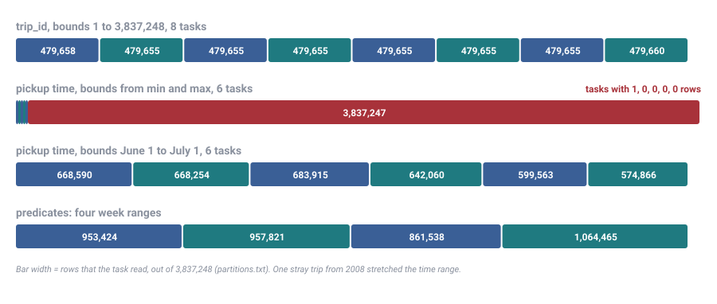
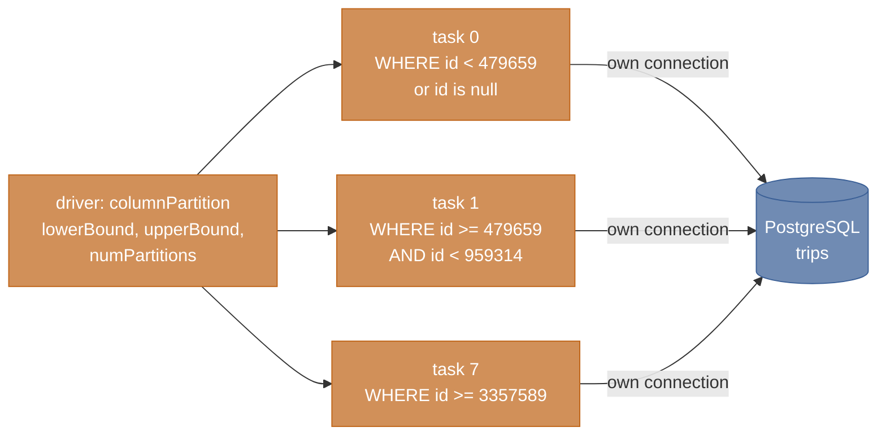
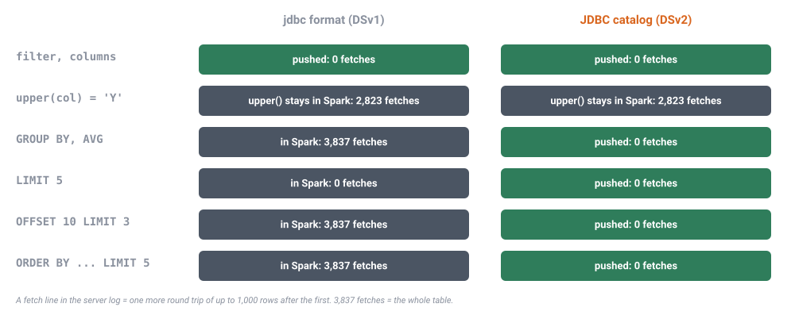
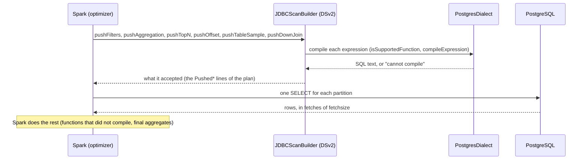
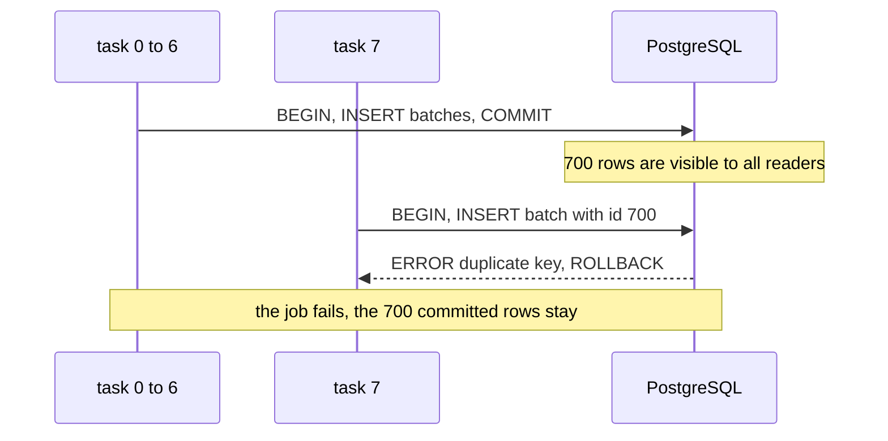
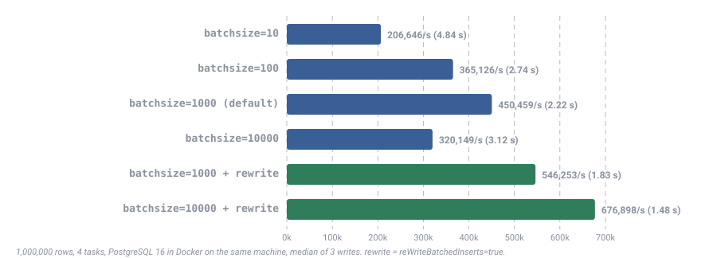

# Chapter 39: Databases over JDBC: partitioned reads, pushdown and writes

Much of the data of a Spark job is in a relational database: orders in PostgreSQL, customers in MySQL, finance in Oracle or SQL Server. Spark reads and writes these databases with its JDBC data source. The source is easy to start with. One call with a URL and a table name gives you a DataFrame. The defaults also cause most problems. One task reads the whole table, and the database does none of the work that it does well.

**A JDBC read is a set of SQL queries that Spark writes for you. The partition options decide how many queries run at the same time and which rows each one gets. The pushdown rules decide how much work the database does before the rows travel. To make a JDBC job fast and safe, look at the SQL that the database receives, not only at the Spark plan.**

This chapter runs every option against PostgreSQL 16 in Docker, with the server log set to record each statement. Each step shows the Spark plan and the SQL that PostgreSQL received. [Chapter 80](ch80-python-data-sources-apis-databases.md) compares the JDBC key ranges with a Python data source. This chapter goes deeper into the JDBC source itself.

The code is in [`code/ch39/`](https://github.com/lisancao/spark-masterclass/tree/main/code/ch39). The scripts run on `pyspark==4.3.0` in local mode, with the PostgreSQL JDBC driver `org.postgresql:postgresql:42.7.11` from Maven Central. Each output block below comes from a file in `code/ch39/output/`.

!!! note "New in 4.3"
    These JDBC changes are in Spark 4.3.0. Each one comes from the source or the documentation at `v4.3.0`:

    - The read option `preferTimestampNanos` maps a driver `TIMESTAMP` with 7 to 9 digits of fractional seconds to a nanosecond timestamp type (SPARK-57460). It works only when the preview configuration `spark.sql.timestampNanosTypes.enabled` is `true`.
    - `JdbcDialects.getBuiltInDialect(name)` returns a built-in dialect by name (`@Since("4.3.0")`).

    Spark 4.2 deprecated the Derby JDBC data source (SQL migration guide). The PostgreSQL dialect uses a fetch size of 1000 when you do not set `fetchsize` (Step 4). This default is in the 4.2.0 source and in 4.3.0, but not in the documentation.

## Step 1: PostgreSQL in Docker, and the taxi month in it

`code/ch39/pg.sh up` starts PostgreSQL 16 on port 15515. The script sets `log_statement` to `all`, so the server log has each statement that each connection sends. The helper `Log` in `code/ch39/jdbc.py` writes a marker into the log before and after a block of Spark code. Then it returns the statements between the two markers.

`load.py` writes the taxi month with the JDBC writer. During the load, the server logs only DDL, so the log shows the `CREATE TABLE` that Spark generated:

```python
trips = spark.read.parquet(str(TRIPS))
trips = trips.toDF(*[c.lower() for c in trips.columns])     # (1)!
trips.repartition(8).write.jdbc(URL, "trips", mode="overwrite", properties=PROPS)
```

1. Spark puts each column name in double quotes. PostgreSQL keeps the case of a quoted name, so `"VendorID"` must always have quotes in SQL. Lowercase names avoid that.

```text
== the DDL that Spark sent (server log)
  CREATE TABLE trips ("vendorid" INTEGER , "tpep_pickup_datetime" TIMESTAMP , "tpep_dropoff_datetime" TIMESTAMP , "passenger_count" BIGINT , "trip_distance" FLOAT8 , "ratecodeid" BIGINT , "store_and_fwd_flag" TEXT , "pulocationid" INTEGER , "dolocationid" INTEGER , "payment_type" BIGINT , "fare_amount" FLOAT8 , "extra" FLOAT8 , "mta_tax" FLOAT8 , "tip_amount" FLOAT8 , "tolls_amount" FLOAT8 , "improv
  CREATE TABLE zones ("locationid" INTEGER , "borough" TEXT , "zone" TEXT , "service_zone" TEXT )

loaded 3,837,248 trips with 8 tasks in 17.0 s (batchsize 1000, not a benchmark)

== the table in PostgreSQL (psql \d trips, first columns)
                                           Table "public.trips"
        Column         |            Type             | Collation | Nullable |           Default
-----------------------+-----------------------------+-----------+----------+------------------------------
 vendorid              | integer                     |           |          |
 tpep_pickup_datetime  | timestamp without time zone |           |          |
 tpep_dropoff_datetime | timestamp without time zone |           |          |
 passenger_count       | bigint                      |           |          |
 trip_distance         | double precision            |           |          |
 ratecodeid            | bigint                      |           |          |
 store_and_fwd_flag    | text                        |           |          |
 pulocationid          | integer                     |           |          |
 dolocationid          | integer                     |           |          |
  trips  | min |   max   | first_day  |  last_day
---------+-----+---------+------------+------------
 3837248 |   1 | 3837248 | 2008-12-31 | 2026-06-30
(1 row)
```

Spark mapped each Spark type to a PostgreSQL type through the PostgreSQL dialect: `int` to `INTEGER`, `bigint` to `BIGINT`, `double` to `FLOAT8`, `string` to `TEXT`. The taxi timestamps are `TIMESTAMP_NTZ` in Parquet, so they became `TIMESTAMP` without a time zone. Then `load.py` added the key `trip_id` with psql, and an index on the pickup time.

The pickup times go from 2008-12-31 to 2026-06-30. The month is June 2026, but the data has some wrong timestamps. Step 3 shows what one wrong timestamp does to a partitioned read.

## Step 2: The options, from the source

The JDBC source reads its options in `JDBCOptions.scala`. At `v4.3.0`, the file defines these options. The default and the scope come from the same file and from the JDBC page of the documentation:

| Option | Default | Scope | What it does |
|---|---|---|---|
| `url` | none | read, write | The JDBC URL. It selects the driver and the dialect |
| `dbtable` | none | read, write | A table, or a subquery in parentheses with an alias |
| `query` | none | read | A `SELECT` that Spark wraps as a subquery (Step 6) |
| `prepareQuery` | none | read | A prefix in front of the generated query, such as a `WITH` clause (Step 6) |
| `driver` | from the URL | read, write | The class name of the JDBC driver |
| `partitionColumn`, `lowerBound`, `upperBound` | none | read | A numeric, date or timestamp column, and the range that Spark cuts into strides (Step 3) |
| `numPartitions` | none | read, write | The number of read tasks, and the maximum number of write connections |
| `queryTimeout` | `0` (no limit) | read, write | Seconds that the driver waits for a statement |
| `fetchsize` | `0` (the driver's default) | read | Rows for each round trip of a cursor (Step 4) |
| `batchsize` | `1000` | write | Rows for each `executeBatch` call (Step 9) |
| `isolationLevel` | `READ_UNCOMMITTED` | write | The transaction isolation of each write task (Step 8) |
| `sessionInitStatement` | none | read | SQL that runs on each new read connection (Step 6) |
| `truncate`, `cascadeTruncate` | `false`, dialect | write | `TRUNCATE` in place of `DROP TABLE` for overwrite (Step 8) |
| `createTableOptions`, `createTableColumnTypes` | none | write | Text after `CREATE TABLE`, and database types for some columns (Step 8) |
| `customSchema` | none | read | Spark types for some columns of the read (Step 6) |
| `pushDownPredicate`, `pushDownAggregate`, `pushDownLimit`, `pushDownOffset`, `pushDownTableSample` | `true` | read | Turn one kind of pushdown off (Step 5) |
| `pushDownJoin` | `true` | read | Allow join pushdown for the JDBC catalog (Step 5). It is in the source, not in the documentation |
| `keytab`, `principal`, `refreshKrb5Config` | none, none, `false` | read, write | Kerberos for the database connection |
| `connectionProvider` | none | read, write | The name of a `JdbcConnectionProvider` to use |
| `preferTimestampNTZ` | `false` | read | Read `TIMESTAMP WITHOUT TIME ZONE` as `TIMESTAMP_NTZ` |
| `preferTimestampNanos` | `false` | read | New in 4.3.0 (see the note above) |
| `hint` | none | read | A hint comment `/*+ ... */` in the query, for MySQL, Oracle and Databricks only (Step 6) |
| `tableComment` | empty | write | A comment for a table that the writer creates. It is in the source, not in the documentation |

Each other option goes to the driver as a connection property, for example `user`, `password` and `sslmode`.

## Step 3: Partitioned reads: one query for each task

`partitions.py` reads the table five ways. For each read, it prints the scan of the plan, the rows that each task read, and the SQL that PostgreSQL received:

```text
== no partition options
  plan: Scan JDBCRelation(trips) [numPartitions=1] [trip_id#21L,tpep_pickup_datetime#1] PushedFilters: [], ReadSchema: struct<trip_id:bigint,tpep_pickup_datet
  tasks: 1, rows per task: [3837248]
  SQL: SELECT "trip_id","tpep_pickup_datetime" FROM trips
  cursor fetches (execute fetch from ...): 3837

== partitionColumn=trip_id, lowerBound=1, upperBound=3837248, numPartitions=8
  plan: Scan JDBCRelation(trips) [numPartitions=8] [trip_id#43L] PushedFilters: [], ReadSchema: struct<trip_id:bigint>
  tasks: 8, rows per task: [479658, 479655, 479655, 479655, 479655, 479655, 479655, 479660]
  SQL: SELECT "trip_id" FROM trips  WHERE "trip_id" >= 959314 AND "trip_id" < 1438969
  SQL: SELECT "trip_id" FROM trips  WHERE "trip_id" >= 1438969 AND "trip_id" < 1918624
  SQL: SELECT "trip_id" FROM trips  WHERE "trip_id" >= 479659 AND "trip_id" < 959314
  SQL: SELECT "trip_id" FROM trips  WHERE "trip_id" < 479659 or "trip_id" is null
  SQL: SELECT "trip_id" FROM trips  WHERE "trip_id" >= 1918624 AND "trip_id" < 2398279
  SQL: SELECT "trip_id" FROM trips  WHERE "trip_id" >= 2398279 AND "trip_id" < 2877934
  SQL: SELECT "trip_id" FROM trips  WHERE "trip_id" >= 2877934 AND "trip_id" < 3357589
  SQL: SELECT "trip_id" FROM trips  WHERE "trip_id" >= 3357589
  cursor fetches (execute fetch from ...): 3832

== the pickup times in the table: min 2008-12-31 23:03:25, max 2026-06-30 23:59:59

== partitionColumn=tpep_pickup_datetime, bounds from min and max
  plan: Scan JDBCRelation(trips) [numPartitions=6] [trip_id#119L] PushedFilters: [], ReadSchema: struct<trip_id:bigint>
  tasks: 6, rows per task: [1, 0, 0, 0, 0, 3837247]
  SQL: SELECT "trip_id" FROM trips  WHERE "tpep_pickup_datetime" >= '2014-11-01 00:02:16.333334' AND "tpep_pickup_datetime" < '2017-10-01 00:01:42'
  SQL: SELECT "trip_id" FROM trips  WHERE "tpep_pickup_datetime" >= '2017-10-01 00:01:42' AND "tpep_pickup_datetime" < '2020-08-31 00:01:07.666666'
  SQL: SELECT "trip_id" FROM trips  WHERE "tpep_pickup_datetime" >= '2011-12-01 23:02:50.666668' AND "tpep_pickup_datetime" < '2014-11-01 00:02:16.333334'
  SQL: SELECT "trip_id" FROM trips  WHERE "tpep_pickup_datetime" < '2011-12-01 23:02:50.666668' or "tpep_pickup_datetime" is null
  SQL: SELECT "trip_id" FROM trips  WHERE "tpep_pickup_datetime" >= '2020-08-31 00:01:07.666666' AND "tpep_pickup_datetime" < '2023-08-01 00:00:33.333332'
  SQL: SELECT "trip_id" FROM trips  WHERE "tpep_pickup_datetime" >= '2023-08-01 00:00:33.333332'
  cursor fetches (execute fetch from ...): 3837

== partitionColumn=tpep_pickup_datetime, bounds 2026-06-01 to 2026-07-01
  plan: Scan JDBCRelation(trips) [numPartitions=6] [trip_id#141L] PushedFilters: [], ReadSchema: struct<trip_id:bigint>
  tasks: 6, rows per task: [668590, 668254, 683915, 642060, 599563, 574866]
  SQL: SELECT "trip_id" FROM trips  WHERE "tpep_pickup_datetime" >= '2026-06-06 00:00:00' AND "tpep_pickup_datetime" < '2026-06-11 00:00:00'
  SQL: SELECT "trip_id" FROM trips  WHERE "tpep_pickup_datetime" >= '2026-06-11 00:00:00' AND "tpep_pickup_datetime" < '2026-06-16 00:00:00'
  SQL: SELECT "trip_id" FROM trips  WHERE "tpep_pickup_datetime" >= '2026-06-16 00:00:00' AND "tpep_pickup_datetime" < '2026-06-21 00:00:00'
  SQL: SELECT "trip_id" FROM trips  WHERE "tpep_pickup_datetime" < '2026-06-06 00:00:00' or "tpep_pickup_datetime" is null
  SQL: SELECT "trip_id" FROM trips  WHERE "tpep_pickup_datetime" >= '2026-06-21 00:00:00' AND "tpep_pickup_datetime" < '2026-06-26 00:00:00'
  SQL: SELECT "trip_id" FROM trips  WHERE "tpep_pickup_datetime" >= '2026-06-26 00:00:00'
  cursor fetches (execute fetch from ...): 3834

== predicates: four week ranges that you write
  plan: Scan JDBCRelation(trips) [numPartitions=4] [trip_id#163L] PushedFilters: [], ReadSchema: struct<trip_id:bigint>
  tasks: 4, rows per task: [953424, 957821, 861538, 1064465]
  SQL: SELECT "trip_id" FROM trips  WHERE tpep_pickup_datetime >= '2026-06-08' AND tpep_pickup_datetime < '2026-06-15'
  SQL: SELECT "trip_id" FROM trips  WHERE tpep_pickup_datetime >= '2026-06-15' AND tpep_pickup_datetime < '2026-06-22'
  SQL: SELECT "trip_id" FROM trips  WHERE tpep_pickup_datetime >= '2026-06-22' OR tpep_pickup_datetime IS NULL
  SQL: SELECT "trip_id" FROM trips  WHERE tpep_pickup_datetime < '2026-06-08'
  cursor fetches (execute fetch from ...): 3835

== bounds 1 to 4 with numPartitions=8 gives 3 partitions

== query together with partitionColumn
  requirement failed: Options 'query' and 'partitionColumn' can not be specified together. Please define the query using `dbtable` option instead and make sure to qualify the partition columns using the supplied subquery alias to re
```

<figure markdown>
  
  <figcaption>The rows that each task read, from <code>partitions.txt</code>. The bounds from <code>min</code> and <code>max</code> put all June rows in one task, because one trip from 2008 made each stride almost three years wide.</figcaption>
</figure>

These are the rules that the output shows:

- **With no partition options, one task reads the table with one query.** The 3,837,248 rows come through one connection, whatever the size of the cluster.
- **`JDBCRelation.columnPartition` cuts the range into equal strides.** For `trip_id` from 1 to 3,837,248 with 8 tasks, each stride is 479,655 keys. The keys are dense, so each task read about 480,000 rows.
- **The first range has no lower end, and the last range has no upper end.** The first query also takes the `NULL` keys (`or "trip_id" is null`). Thus, the bounds are not a filter. Rows outside the bounds go to the first or the last task.
- **A timestamp column works, but a stray value breaks it.** With the bounds from `min` and `max`, one task read 1 row, four tasks read nothing, and one task read 3,837,247 rows. With the bounds of the month, the six tasks read between 574,866 and 683,915 rows.
- **`predicates` gives one task for each `WHERE` clause that you write.** Use it when equal strides do not fit the data, for example one week for each task. Make sure that the clauses do not overlap. Together, they must cover all rows, and also the `NULL` keys.
- **Spark makes fewer partitions if the range is too small.** Bounds 1 to 4 with `numPartitions=8` gave 3 partitions.
- **`query` and `partitionColumn` do not go together.** For a partitioned subquery, use `dbtable` with a subquery in parentheses.



Each task opens its own connection. Thus, `numPartitions` is also the number of connections that the job opens at the same time. A job with 64 tasks against a database with `max_connections=100` can block other users of that database. Set `numPartitions` for the database, not only for the cluster.

<figure markdown>
  <video autoplay loop muted playsinline width="1280" height="720" poster="../../media/clips/ch39-anim-ranges.webp">
    <source src="../../media/clips/ch39-anim-ranges.mp4" type="video/mp4">
  </video>
  <figcaption>An animation of the two plans on the pickup time. The strides are equal in time, not in rows. The row counts come from <code>partitions.txt</code>, and the timing is schematic.</figcaption>
</figure>

## Step 4: `fetchsize`: rows for each round trip

The `cursor fetches` lines in Step 3 count the `execute fetch from` lines in the server log. Each one is one round trip that returned the next 1,000 rows from an open cursor. The script set no `fetchsize`. If the option is not set, the PostgreSQL dialect uses 1000 (`PostgresDialect.getFetchSize` at `v4.3.0`). 

The dialect also turns off auto-commit, because the PostgreSQL driver uses a cursor only inside a transaction. A comment in the source gives the reason for the default. With a fetch size of 0, the driver "fetches all rows into memory", "which can cause executor OOM".

`fetch.py` reads all 3,837,248 rows and all columns in one task, with four values of `fetchsize`. Each value runs in a new JVM. Before the measured read, the script resets the peak of each heap pool (`MemoryPoolMXBean.resetPeakUsage`). After the read, it reads the peak of the G1 old generation, where long-lived objects go. It ran under the book's benchmark lock:

```text
one task reads all 3,837,248 rows of trips (22 columns) and drops them (noop sink)
driver memory 6g, local[4], G1; time of the second read; peak of the G1 old generation

     fetchsize  seconds  old gen peak MiB
             0     9.21             2,592
           100    11.80                73
1000 (default)     7.34                73
         10000     8.86                73
```

The time differs little, because PostgreSQL runs on the same machine. The memory differs a lot:

- **With `fetchsize=0`, the old generation of the heap reached 2,592 MiB.** The driver kept all 3,837,248 rows in memory before Spark got the first row.
- **With 100, 1000 or 10000 rows for each fetch, it stayed at 73 MiB.** The driver kept only one batch at a time.
- **A fetch size of 100 was the slowest read in this run (11.80 s).** It needs ten times more round trips than the default. On a network with more latency than this machine, that cost grows.

!!! caution
    Do not set `fetchsize=0` for a large table on PostgreSQL. The driver then keeps the full result of each query in the memory of the executor. A large partition can stop the executor with an out-of-memory error.

## Step 5: Pushdown: DSv1 against DSv2

Spark has two ways to read a JDBC table, and they push different work into the database:

- **The `jdbc` format** (`spark.read.jdbc`, `spark.read.format("jdbc")`) makes a `JDBCRelation`. This is a DSv1 relation (`PrunedFilteredScan`). It can push only column pruning and filters.
- **A JDBC catalog** (`JDBCTableCatalog`, Step 10) makes a DSv2 table. Its `JDBCScanBuilder` can also push aggregates, `LIMIT`, `OFFSET`, top-N (`ORDER BY` with `LIMIT`), `TABLESAMPLE` and joins.

`show_sql.py` runs one aggregate through the two paths:

```text
== spark.read.jdbc(...)       (DSv1)
   postgres> SELECT "payment_type","fare_amount" FROM trips
   rows sent to Spark: about 3,837,000 (3837 fetches of 1000)

== spark.table('pg.public.trips') (DSv2)
   postgres> SELECT "payment_type",AVG("fare_amount") FROM "public"."trips" GROUP BY "payment_typ
   rows sent to Spark: 6
```

<figure markdown>
  <video autoplay loop muted playsinline controls width="1280" height="720" poster="../../media/clips/ch39-pushdown.webp">
    <source src="../../media/clips/ch39-pushdown.mp4" type="video/mp4">
  </video>
  <figcaption><code>show_sql.py</code>: the same <code>GROUP BY</code> through the <code>jdbc</code> format and through the JDBC catalog, and the SQL that PostgreSQL received.</figcaption>
</figure>

`pushdown.py` runs more queries through the two paths. For each query, it prints the `Pushed*` lines of the plan, the SQL that PostgreSQL received, and the number of cursor fetches. A fetch is up to 1,000 rows, so the fetches show how many rows travelled to Spark:

```text
== filter and column pruning
-- jdbc format (DSv1)
   PushedFilters: [*IsNotNull(fare_amount), *IsNotNull(payment_type), *GreaterThan(fare_amount,300.0), *EqualTo(payment_type,1)]
   SQL:   SELECT "trip_id","fare_amount" FROM trips WHERE ("fare_amount" IS NOT NULL) AND ("payment_type" IS NOT NULL) AND ("fare_amount" > 300.0) AND ("payment_type" = 1)
   cursor fetches of 1000 rows: 0, rows in the result: 287

-- JDBC catalog (DSv2)
   PushedFilters: [fare_amount IS NOT NULL, payment_type IS NOT NULL, fare_amount > 300.0, payment_type = 1]
   SQL:   SELECT "fare_amount","trip_id" FROM "public"."trips" WHERE ("fare_amount" IS NOT NULL) AND ("payment_type" IS NOT NULL) AND ("fare_amount" > 300.0) AND ("payment_type" = 1)
   cursor fetches of 1000 rows: 0, rows in the result: 287

== a filter with a function (upper)
-- jdbc format (DSv1)
   PushedFilters: [*IsNotNull(store_and_fwd_flag)]
   SQL:   SELECT "trip_id","store_and_fwd_flag" FROM trips WHERE ("store_and_fwd_flag" IS NOT NULL)
   cursor fetches of 1000 rows: 2823, rows in the result: 4541

-- JDBC catalog (DSv2)
   PushedFilters: [store_and_fwd_flag IS NOT NULL]
   SQL:   SELECT "store_and_fwd_flag","trip_id" FROM "public"."trips" WHERE ("store_and_fwd_flag" IS NOT NULL)
   cursor fetches of 1000 rows: 2823, rows in the result: 4541

== aggregate: average fare by payment type
-- jdbc format (DSv1)
   SQL:   SELECT "payment_type","fare_amount" FROM trips
   cursor fetches of 1000 rows: 3837, rows in the result: 6

-- JDBC catalog (DSv2)
   PushedAggregates: [COUNT(*), AVG(fare_amount)]
   PushedGroupByExpressions: [payment_type]
   SQL:   SELECT "payment_type",COUNT(*),AVG("fare_amount") FROM "public"."trips" GROUP BY "payment_type"
   cursor fetches of 1000 rows: 0, rows in the result: 6

== limit
-- jdbc format (DSv1)
   SQL:   SELECT "trip_id","fare_amount" FROM trips
   cursor fetches of 1000 rows: 0, rows in the result: 5

-- JDBC catalog (DSv2)
   PushedLimit: LIMIT 5
   SQL:   SELECT "fare_amount","trip_id" FROM "public"."trips" LIMIT 5
   cursor fetches of 1000 rows: 0, rows in the result: 5

== offset and limit
-- jdbc format (DSv1)
   SQL:   SELECT "trip_id" FROM trips
   cursor fetches of 1000 rows: 3837, rows in the result: 3

-- JDBC catalog (DSv2)
   PushedOffset: OFFSET 10
   PushedTopN: ORDER BY [trip_id ASC NULLS FIRST] LIMIT 13
   SQL:   SELECT "trip_id" FROM "public"."trips" ORDER BY "trip_id" ASC NULLS FIRST LIMIT 3 OFFSET 10
   cursor fetches of 1000 rows: 0, rows in the result: 3

== top-N: the five highest fares
-- jdbc format (DSv1)
   SQL:   SELECT "trip_id","fare_amount" FROM trips
   cursor fetches of 1000 rows: 3837, rows in the result: 5

-- JDBC catalog (DSv2)
   PushedTopN: ORDER BY [fare_amount DESC NULLS LAST] LIMIT 5
   SQL:   SELECT "fare_amount","trip_id" FROM "public"."trips" ORDER BY "fare_amount" DESC NULLS LAST LIMIT 5
   cursor fetches of 1000 rows: 0, rows in the result: 5

== TABLESAMPLE (SQL)
-- JDBC catalog (DSv2)
   PushedSample: BERNOULLI SAMPLE (0.01) false SEED(5795039031906651214)
   SQL:   SELECT "trip_id" FROM "public"."trips" TABLESAMPLE BERNOULLI (0.01) REPEATABLE (5795039031906651214)
   cursor fetches of 1000 rows: 0, rows in the result: 389

== join of trips and zones
-- spark.sql.optimizer.datasourceV2JoinPushdown=false (the default)
   PushedFilters: [fare_amount IS NOT NULL, fare_amount > 200.0, pulocationid IS NOT NULL]
   PushedFilters: [locationid IS NOT NULL]
   SQL:   SELECT "locationid","borough" FROM "public"."zones" WHERE ("locationid" IS NOT NULL)
   SQL:   SELECT "pulocationid" FROM "public"."trips" WHERE ("fare_amount" IS NOT NULL) AND ("fare_amount" > 200.0) AND ("pulocationid" IS NOT NULL)
   cursor fetches of 1000 rows: 1, rows in the result: 8

-- spark.sql.optimizer.datasourceV2JoinPushdown=true
   PushedAggregates: [COUNT(*)]
   PushedFilters: [pulocationid = locationid]
   PushedGroupByExpressions: [borough]
   PushedJoins:
   PushedFilters: [fare_amount IS NOT NULL, fare_amount > 200.0, pulocationid IS NOT NULL]
   PushedFilters: [locationid IS NOT NULL]
   SQL:   SELECT "borough",COUNT(*) FROM (SELECT "pulocationid","locationid","borough" FROM ( SELECT "pulocationid","locationid","borough" FROM (SELECT "pulocationid" FROM "public"."trips" WHERE ("fare_amount" IS NOT NULL) AND ("fare_amount" > 200.0) AND ("pulocationid" IS NOT NULL) ) join_subquery_0 INNER JOIN (SELECT "locationid","borough" FROM "public"."zones" WHERE ("locationid" IS NOT NULL) ) join_subquery_1 ON "pulocationid" = "locationid" ) join_subquery_2) SPARK_GEN_SUBQ_0 GROUP BY "borough"
   cursor fetches of 1000 rows: 0, rows in the result: 8

== turn a pushdown off
-- catalog pg_noagg with pushDownAggregate=false
   SQL:   SELECT "payment_type" FROM "public"."trips"
   cursor fetches of 1000 rows: 3837, rows in the result: 6

-- jdbc format with pushDownPredicate=false
   PushedFilters: [IsNotNull(fare_amount), GreaterThan(fare_amount,300.0)]
   SQL:   SELECT "trip_id","fare_amount" FROM trips
   cursor fetches of 1000 rows: 3837, rows in the result: 537
```

The fetches show the cost of each path:

- **Filters and columns:** both paths pushed them. The 287 rows came back with the query, with no extra fetch.
- **A function:** neither path pushed `upper(...)`. Both sent each row with a flag, 2,823 fetches, and Spark did the filter.
- **The aggregate:** the `jdbc` format sent all 3,837,248 rows (3,837 fetches), and Spark computed the averages. The catalog sent one `GROUP BY`, and six rows came back.
- **`LIMIT`:** the `jdbc` format did not push it, but Spark stopped after the first batch. The catalog sent `LIMIT 5`.
- **`OFFSET` and top-N:** the `jdbc` format read the whole table and sorted it in Spark. The catalog sent `ORDER BY ... LIMIT ... OFFSET`, and only the result came back.
- **`TABLESAMPLE`:** the catalog sent `TABLESAMPLE BERNOULLI` with a `REPEATABLE` seed. Only the catalog path has SQL table samples.
- **The join:** by default, Spark sent two queries, one for each table, and joined the rows itself. With `spark.sql.optimizer.datasourceV2JoinPushdown=true`, the catalog sent one query with `INNER JOIN` and `GROUP BY`.
- **The off switches:** `pushDownAggregate=false` on a catalog and `pushDownPredicate=false` on the `jdbc` format made Spark read the whole table again. Use them only when the database computes a function differently from Spark.

<figure markdown>
  
  <figcaption>The operations that each read path pushed into PostgreSQL, and the cursor fetches of each query (<code>pushdown.txt</code>).</figcaption>
</figure>



The dialect decides which functions it can compile. For PostgreSQL, `isSupportedFunction` accepts some aggregates and two string functions (`PostgresDialect.scala` at `v4.3.0`). The aggregates are `MAX`, `MIN`, `SUM`, `COUNT`, `AVG` and the variance, covariance and regression aggregates. The string functions are `RPAD` and `LPAD`. Thus, `upper(store_and_fwd_flag) = 'Y'` stayed in Spark on both paths.

Join pushdown needs two things. Both tables must come from the same JDBC catalog with the same options, and the internal configuration `spark.sql.optimizer.datasourceV2JoinPushdown` must be `true`. Its default is `false` (`SQLConf.scala` at `v4.3.0`, "version 4.1.0"). In 4.3.0, the MySQL, PostgreSQL, Oracle, SQL Server and H2 dialects support it (`supportsJoin`). Because the configuration is internal, test the results before you depend on it.

## Step 6: Read options around the query

`options.py` shows the options that change the SQL around the query, or the types of the result:

```text
== sessionInitStatement runs before the read, on each connection
   postgres> BEGIN
   postgres> BEGIN
   postgres> SET work_mem = '64MB'
   postgres> SET work_mem = '64MB'
   postgres> SELECT "trip_id" FROM trips  WHERE (("fare_amount" IS NOT NULL) AND ("fare_amount" > 400.0)) AND ("trip_id" >= 1918624)
   postgres> SELECT "trip_id" FROM trips  WHERE (("fare_amount" IS NOT NULL) AND ("fare_amount" > 400.0)) AND ("trip_id" < 1918624 or "trip_id" is null)
   postgres> COMMIT
   postgres> COMMIT
   rows: 202

== query: Spark wraps your SELECT as a subquery
   postgres> BEGIN
   postgres> SELECT "payment_type","n" FROM (SELECT payment_type, count(*) AS n FROM trips GROUP BY payment_type) SPARK_GEN_SUBQ_0  WHERE ("n" IS NOT NULL) AND ("n" > 1000)
   postgres> COMMIT
   rows: [(0, 1013500), (1, 2432871), (2, 357804), (3, 11205), (4, 21866)]

== prepareQuery and query: a WITH clause in front of the subquery
   postgres> BEGIN
   postgres> WITH big AS (SELECT * FROM trips WHERE total_amount > 500) SELECT "n" FROM (SELECT count(*) AS n FROM big) SPARK_GEN_SUBQ_22
   postgres> COMMIT
   rows: [114]

== queryTimeout=1 on a query that takes 3 seconds
   org.postgresql.util.PSQLException: ERROR: canceling statement due to user request

== customSchema: read the fare as DECIMAL(10,2) and the id as STRING
   locationid: string, borough: string, zone: string, service_zone: string
   fare_amount: decimal(10,2)

== hint on PostgreSQL
   [HINT_UNSUPPORTED_FOR_JDBC_DIALECT] The option `hint` is not supported for PostgresDialect in JDBC data source. Supported dialects are `MySQLDialect`, `OracleDialect` and `Databric

== the dialect for each URL (JdbcDialects.get)
   jdbc:postgresql://db/x       PostgresDialect
   jdbc:mysql://db/x            MySQLDialect
   jdbc:sqlserver://db          MsSqlServerDialect
   jdbc:oracle:thin:@db         OracleDialect
   jdbc:derby:memory:x          DerbyDialect
   jdbc:h2:mem:x                H2Dialect
   jdbc:databricks://host       DatabricksDialect
   jdbc:snowflake://acct        SnowflakeDialect
   jdbc:sqlite:x.db             NoopDialect$
   jdbc:duckdb:                 NoopDialect$

== JdbcDialects.getBuiltInDialect with a name that does not exist (new in 4.3.0)
   [UNSUPPORTED_BUILT_IN_JDBC_DIALECT] `sqlite` is not a supported built-in JDBC dialect. Supported dialects are: databricks, db2, derby, h2, mysql, oracle, postgresql, snowflake, sqlserver, teradata. SQLSTATE: 22023
```

The output shows what each option does:

- **`sessionInitStatement`** ran once on each read connection, before the query. The two tasks each ran `SET work_mem = '64MB'`. Use it for session parameters of the database, such as a time zone, a search path or a timeout. It is a read option only (Step 8 shows a write).
- **`query`** became a subquery with the alias `SPARK_GEN_SUBQ_0`, and Spark put its filter `n > 1000` outside the subquery.
- **`prepareQuery`** went in front of the generated `SELECT`. That is how you use a `WITH` clause, which cannot go inside a subquery on some databases.
- **`queryTimeout`** made the driver cancel the statement after one second. The task failed with the error of the database.
- **`customSchema`** changed the Spark types of the result. It does not change what the driver returns for each value. [Chapter 80](ch80-python-data-sources-apis-databases.md) shows a driver that returned wrong values with no error.
- **`hint`** is for MySQL, Oracle and Databricks only. On PostgreSQL, the read fails with `HINT_UNSUPPORTED_FOR_JDBC_DIALECT`.

## Step 7: Dialects

A dialect is the part of Spark that knows one database. `JdbcDialects.get(url)` selects it from the URL. Spark 4.3.0 registers ten dialects through `ServiceLoader` (`META-INF/services/org.apache.spark.sql.jdbc.JdbcDialect` at `v4.3.0`). The output of Step 6 shows the dialect for some URLs. A URL with no built-in dialect gets `NoopDialect`, which uses the generic JDBC types and pushes only simple filters.

A dialect controls these parts of the source:

| Dialect method | What it controls | PostgreSQL in 4.3.0 |
|---|---|---|
| `getCatalystType`, `getJDBCType` | The mapping between database types and Spark types | `TEXT` for strings, arrays as `type[]` |
| `quoteIdentifier` | Quotes around names | Double quotes |
| `compileExpression`, `isSupportedFunction` | Which expressions push down | Aggregates, `RPAD`, `LPAD` |
| `supportsLimit`, `supportsOffset`, `compileTableSample`, `supportsJoin` | Which clauses push down | All of them |
| `getFetchSize`, `beforeFetch` | The cursor | 1000 rows, auto-commit off |
| `getTruncateQuery`, `isCascadingTruncateTable` | `TRUNCATE` for overwrite | `TRUNCATE TABLE ONLY ...` |
| `supportsHint` | The `hint` option | No |

To support a new database, write a class that extends `JdbcDialect` in Scala or Java. Then call `JdbcDialects.registerDialect` on the driver, or list the class in a `META-INF/services` file in your jar. There is no Python API for dialects.

## Step 8: The write path

The JDBC writer runs one `INSERT` statement with parameters in each task, and it sends the rows in batches of `batchsize`. `writes.py` writes six rows of `zones` with different options and prints the statements from the server log. The read of the six rows through the catalog adds a `BEGIN`, a `SELECT` and a `COMMIT` to each block, on its own connection.

```text
== mode=overwrite (the default way: DROP and CREATE)
   SELECT 1 FROM zone_copy WHERE 1=0
   DROP TABLE zone_copy
   CREATE TABLE zone_copy ("locationid" INTEGER , "borough" TEXT , "zone" TEXT )
   BEGIN
   SELECT "locationid","borough","zone" FROM "public"."zones"  WHERE ("locationid" IS NOT NULL) AND ("locationid" <= 6)
   SET SESSION CHARACTERISTICS AS TRANSACTION ISOLATION LEVEL READ UNCOMMITTED
   COMMIT
   BEGIN
   INSERT INTO zone_copy ("locationid","borough","zone") VALUES ($1,$2,$3)
   INSERT INTO zone_copy ("locationid","borough","zone") VALUES ($1,$2,$3)
   COMMIT
   SELECT * FROM zone_copy WHERE 1=0
   ... (6 INSERT executions in all)

== mode=overwrite, truncate=true
   SELECT 1 FROM zone_copy WHERE 1=0
   TRUNCATE TABLE ONLY zone_copy
   SELECT * FROM zone_copy WHERE 1=0
   BEGIN
   SELECT "locationid","borough","zone" FROM "public"."zones"  WHERE ("locationid" IS NOT NULL) AND ("locationid" <= 6)
   SET SESSION CHARACTERISTICS AS TRANSACTION ISOLATION LEVEL READ UNCOMMITTED
   COMMIT
   BEGIN
   INSERT INTO zone_copy ("locationid","borough","zone") VALUES ($1,$2,$3)
   INSERT INTO zone_copy ("locationid","borough","zone") VALUES ($1,$2,$3)
   COMMIT
   SELECT * FROM zone_copy WHERE 1=0
   ... (6 INSERT executions in all)

== mode=overwrite, truncate=true, cascadeTruncate=true
   SELECT 1 FROM zone_copy WHERE 1=0
   TRUNCATE TABLE ONLY zone_copy CASCADE
   SELECT * FROM zone_copy WHERE 1=0
   BEGIN
   SELECT "locationid","borough","zone" FROM "public"."zones"  WHERE ("locationid" IS NOT NULL) AND ("locationid" <= 6)
   SET SESSION CHARACTERISTICS AS TRANSACTION ISOLATION LEVEL READ UNCOMMITTED
   COMMIT
   BEGIN
   INSERT INTO zone_copy ("locationid","borough","zone") VALUES ($1,$2,$3)
   INSERT INTO zone_copy ("locationid","borough","zone") VALUES ($1,$2,$3)
   COMMIT
   SELECT * FROM zone_copy WHERE 1=0
   ... (6 INSERT executions in all)

== createTableColumnTypes and createTableOptions
   CREATE TABLE zone_copy ("locationid" INTEGER , "borough" VARCHAR(20) , "zone" VARCHAR(60) ) WITH (fillfactor = 70)
   BEGIN
   SELECT "locationid","borough","zone" FROM "public"."zones"  WHERE ("locationid" IS NOT NULL) AND ("locationid" <= 6)
   SET SESSION CHARACTERISTICS AS TRANSACTION ISOLATION LEVEL READ UNCOMMITTED
   COMMIT
   BEGIN
   INSERT INTO zone_copy ("locationid","borough","zone") VALUES ($1,$2,$3)
   INSERT INTO zone_copy ("locationid","borough","zone") VALUES ($1,$2,$3)
   COMMIT
   SELECT * FROM zone_copy WHERE 1=0
   ... (6 INSERT executions in all)

== mode=append, batchsize=4, isolationLevel=READ_COMMITTED
   SELECT 1 FROM zone_copy WHERE 1=0
   SELECT * FROM zone_copy WHERE 1=0
   BEGIN
   SELECT "locationid","borough","zone" FROM "public"."zones"  WHERE ("locationid" IS NOT NULL) AND ("locationid" <= 6)
   SET SESSION CHARACTERISTICS AS TRANSACTION ISOLATION LEVEL READ COMMITTED
   BEGIN
   INSERT INTO zone_copy ("locationid","borough","zone") VALUES ($1,$2,$3)
   INSERT INTO zone_copy ("locationid","borough","zone") VALUES ($1,$2,$3)
   COMMIT
   COMMIT
   SELECT * FROM zone_copy WHERE 1=0
   ... (6 INSERT executions in all)

== mode=append, isolationLevel=NONE (no transaction)
   SELECT 1 FROM zone_copy WHERE 1=0
   SELECT * FROM zone_copy WHERE 1=0
   BEGIN
   SELECT "locationid","borough","zone" FROM "public"."zones"  WHERE ("locationid" IS NOT NULL) AND ("locationid" <= 6)
   COMMIT
   INSERT INTO zone_copy ("locationid","borough","zone") VALUES ($1,$2,$3)
   INSERT INTO zone_copy ("locationid","borough","zone") VALUES ($1,$2,$3)
   SELECT * FROM zone_copy WHERE 1=0
   ... (6 INSERT executions in all)

== sessionInitStatement on a write (a read option)
   SELECT 1 FROM zone_copy WHERE 1=0
   SELECT * FROM zone_copy WHERE 1=0
   BEGIN
   SELECT "locationid","borough","zone" FROM "public"."zones"  WHERE ("locationid" IS NOT NULL) AND ("locationid" <= 6)
   SET SESSION CHARACTERISTICS AS TRANSACTION ISOLATION LEVEL READ UNCOMMITTED
   COMMIT
   BEGIN
   INSERT INTO zone_copy ("locationid","borough","zone") VALUES ($1,$2,$3)
   INSERT INTO zone_copy ("locationid","borough","zone") VALUES ($1,$2,$3)
   COMMIT
   SELECT * FROM zone_copy WHERE 1=0
   ... (6 INSERT executions in all)

== mode=errorifexists on a table that exists
   Table or view 'zone_copy' already exists. SaveMode: ErrorIfExists.
```

The save modes and options do these things:

| Mode or option | What the server received |
|---|---|
| `mode="overwrite"` | `DROP TABLE` and `CREATE TABLE`, then the inserts. Indexes, grants and keys on the old table are lost |
| `truncate=true` | `TRUNCATE TABLE ONLY zone_copy`. The table and its indexes stay |
| `cascadeTruncate=true` | `TRUNCATE TABLE ONLY zone_copy CASCADE`, which also truncates tables with a foreign key to it |
| `createTableColumnTypes` | `VARCHAR(20)` and `VARCHAR(60)` in place of `TEXT` |
| `createTableOptions` | `WITH (fillfactor = 70)` after the column list |
| `isolationLevel` | `SET SESSION CHARACTERISTICS AS TRANSACTION ISOLATION LEVEL ...`, then `BEGIN` and `COMMIT` around the inserts of the task. PostgreSQL runs the default `READ UNCOMMITTED` as `READ COMMITTED` |
| `isolationLevel=NONE` | No `BEGIN` and no `COMMIT`. Each statement commits by itself |
| `sessionInitStatement` | Nothing. It is a read option |
| `mode="append"` | Inserts into the table that exists |
| `mode="errorifexists"` | An error if the table exists |

The documentation of `truncate` at `v4.3.0` says that `PostgresDialect` does not support it. The server log shows that Spark 4.3.0 sent `TRUNCATE TABLE ONLY` to PostgreSQL. The source agrees: `PostgresDialect.isCascadingTruncateTable` returns `Some(false)`, and `getTruncateQuery` adds `ONLY`.

A write is not one transaction. Each task commits its own transaction. `writes.py` appends 800 rows in 8 tasks to a table that already has the key 700, which task 7 also writes:

```text
== append 800 rows in 8 tasks to a table that has id 700 (in task 7)
   the job failed: Task 7 in stage 7.0 failed 1 times: duplicate key value violates unique constraint "keyed_pkey"
   rows in keyed after the failed job, by task range:
    task | count
   ------+-------
       0 |   100
       1 |   100
       2 |   100
       3 |   100
       4 |   100
       5 |   100
       6 |   100
       7 |     1
   (8 rows)
```

The job failed, but tasks 0 to 6 committed their 700 rows before the failure. Only the one row from before the job is in the range of task 7. Spark does not remove the committed rows. If you run the job again, it fails on the first duplicate key, not only on key 700.



Thus, write so that a second run gives the same result:

- **Overwrite a staging table, then move the rows in one statement.** The next part of this step does that.
- **Append only rows that have a new key, and let the database reject duplicates** with a unique key and `ON CONFLICT DO NOTHING` in the move statement.
- **Write to a new table for each run,** and change a view to point to it when the job ends.

### An upsert through a staging table

Spark has no upsert mode for JDBC. `writes.py` writes an aggregate to a staging table and then runs one `INSERT ... ON CONFLICT ... DO UPDATE` statement on one connection from the driver:

```python
agg.write.jdbc(URL, "fares_stage", mode="overwrite", properties=PROPS)
conn = spark._jvm.java.sql.DriverManager.getConnection(URL, PROPS["user"], PROPS["password"])  # (1)!
try:
    n = conn.createStatement().executeUpdate(
        "INSERT INTO fares SELECT * FROM fares_stage ON CONFLICT (payment_type) "
        "DO UPDATE SET avg_fare = EXCLUDED.avg_fare, n = EXCLUDED.n")
finally:
    conn.close()
```

1. `spark._jvm` works only in a classic session. With Spark Connect, run the statement with a Python driver such as `psycopg`, or as a task of your orchestrator.

```text
== upsert through a staging table
   SELECT 1 FROM fares_stage WHERE 1=0
   DROP TABLE fares_stage
   CREATE TABLE fares_stage ("payment_type" BIGINT , "avg_fare" FLOAT8 , "n" BIGINT NOT NULL)
   SELECT "payment_type",AVG("fare_amount"),COUNT(*) FROM "public"."trips" WHERE 1=0 GROUP BY "payment_type"
   BEGIN
   SELECT "payment_type",AVG("fare_amount"),COUNT(*) FROM "public"."trips"   GROUP BY "payment_type"
   SET SESSION CHARACTERISTICS AS TRANSACTION ISOLATION LEVEL READ UNCOMMITTED
   COMMIT
   BEGIN
   INSERT INTO fares_stage ("payment_type","avg_fare","n") VALUES ($1,$2,$3)
   INSERT INTO fares_stage ("payment_type","avg_fare","n") VALUES ($1,$2,$3)
   COMMIT
   SELECT * FROM fares_stage WHERE 1=0
   INSERT INTO fares SELECT * FROM fares_stage ON CONFLICT (payment_type) DO UPDATE SET avg_fare = EXCLUDED.avg_fare, n = EXCLUDED.n
   ... (6 INSERT executions in all)
   rows inserted or updated: 6
    payment_type |      avg_fare      |    n
   --------------+--------------------+---------
               0 | 26.216517020239827 | 1013500
               1 |  19.82245494315191 | 2432871
               2 | 20.306480559188447 |  357804
               3 | 10.770689870593417 |   11205
               4 |  3.987851916216927 |   21866
               5 |                  0 |       2
              99 |                 -1 |      -1
   (7 rows)


== MERGE INTO a table of the JDBC catalog
   [UNSUPPORTED_FEATURE.TABLE_OPERATION] The feature is not supported: Table `pg`.`public`.`fares` does not support MERGE INTO TABLE. Please check the current catalog and namespace to make sure the quali
```

The `INSERT ... ON CONFLICT` statement ran in PostgreSQL, in one transaction. It updated the row 1, added the rows 0 and 2 to 5, and kept the row 99, which the aggregate does not have. `MERGE INTO` in Spark SQL does not work on a table of the JDBC catalog, because `JDBCTable` does not support row-level operations.

## Step 9: `batchsize` and the driver's batch rewrite

`batch.py` writes 1,000,000 taxi rows in 4 tasks with different values of `batchsize`. It also uses the PostgreSQL driver property `reWriteBatchedInserts=true`, which changes a batch of single-row `INSERT` statements into multi-row `INSERT` statements. The server logged no statements during the runs. It ran under the book's benchmark lock:

```text
1,000,000 rows, 4 tasks, local[4], PostgreSQL 16 in Docker; median of 3 writes

setting                                         median s    rows/s   runs
batchsize=10                                        4.84   206,646   4.84 4.94 3.85
batchsize=100                                       2.74   365,126   3.02 2.74 2.41
batchsize=1000 (default)                            2.22   450,459   2.56 2.12 2.22
batchsize=10000                                     3.12   320,149   2.65 3.55 3.12
batchsize=1000, reWriteBatchedInserts=true          1.83   546,253   1.83 1.95 1.63
batchsize=10000, reWriteBatchedInserts=true         1.48   676,898   1.48 1.49 1.34

rows in batch_test: 1000000
```

The JDBC writer adds each row to a `PreparedStatement` batch and calls `executeBatch` after `batchsize` rows, in one transaction for each task. The results have three parts:

- **Small batches are slow.** With `batchsize=10`, the write took 4.84 s, more than two times the default. Each batch is one round trip.
- **Above the default, a larger batch did not help on this machine.** `batchsize=10000` was slower than 1000 in this run, and the three runs of one configuration vary by up to 0.9 s. PostgreSQL is local, so a round trip costs little.
- **The driver's rewrite helps.** With `reWriteBatchedInserts=true`, the PostgreSQL driver sends multi-row `INSERT` statements. With `batchsize=10000`, the write took 1.48 s against 2.22 s for the default.

These numbers come from a database on the same machine. Over a network, each round trip costs more, so small batches cost more than here. The property `reWriteBatchedInserts` is specific to the PostgreSQL driver. Other drivers have their own properties (for example `rewriteBatchedStatements` for MySQL Connector/J). The JDBC source passes them through as connection properties.

<figure markdown>
  
  <figcaption>Rows per second for each configuration, from <code>batch.txt</code>. The median of three writes of 1,000,000 rows after a warm-up.</figcaption>
</figure>

<figure markdown>
  <video autoplay loop muted playsinline controls width="1280" height="720" poster="../../media/clips/ch39-append.webp">
    <source src="../../media/clips/ch39-append.mp4" type="video/mp4">
  </video>
  <figcaption>Eight tasks append to a table with a unique key. Task 7 fails, and the rows of tasks 0 to 6 stay committed.</figcaption>
</figure>

## Step 10: JDBC catalogs

A JDBC catalog makes the schemas of a database into Spark namespaces, and its tables into Spark tables. It is also the only path to the DSv2 pushdowns of Step 5. `jdbc.py` configures a catalog named `pg`:

```python
CATALOG = {
    "spark.sql.catalog.pg": "org.apache.spark.sql.execution.datasources.v2.jdbc.JDBCTableCatalog",
    "spark.sql.catalog.pg.url": URL,
    "spark.sql.catalog.pg.user": PROPS["user"],
    "spark.sql.catalog.pg.password": PROPS["password"],
    "spark.sql.catalog.pg.driver": PROPS["driver"],
}
```

Each JDBC option of Step 2 can go after the catalog name, for example `spark.sql.catalog.pg.fetchsize` or `spark.sql.catalog.pg.pushDownAggregate`. Step 5 configured a second catalog, `pg_noagg`, at runtime with `spark.conf.set`, because Spark loads a catalog when a query first uses it. `catalog.py` runs Spark SQL statements and prints the statements that PostgreSQL received for each one:

```text
spark-sql> SHOW NAMESPACES IN pg
  information_schema
  pg_catalog
  public

spark-sql> SHOW TABLES IN pg.public
  public | fares | False
  public | fares_stage | False
  public | keyed | False
  public | trips | False
  public | zone_copy | False
  public | zones | False

spark-sql> DESCRIBE TABLE pg.public.trips
  vendorid | int | None
  tpep_pickup_datetime | timestamp | None
  tpep_dropoff_datetime | timestamp | None
  passenger_count | bigint | None
  trip_distance | double | None
  ratecodeid | bigint | None
  ... (22 rows)
  postgres> SELECT * FROM "public"."trips" WHERE 1=0

spark-sql> CREATE NAMESPACE pg.reports
  postgres> CREATE SCHEMA "reports"

spark-sql> CREATE TABLE pg.reports.daily (day DATE, trips BIGINT, revenue DOUBLE)
  postgres> CREATE TABLE "reports"."daily" ("day" DATE , "trips" BIGINT , "revenue" FLOAT8 )

spark-sql> INSERT INTO pg.reports.daily SELECT to_date(tpep_pickup_datetime) AS day, count(*), round(sum(total_amount), 2) FROM pg.public.trips WHERE tpep_pickup_datetime >= '2026-06-01' AND tpep_pickup_datetime < '2026-06-04' GROUP BY 1
  postgres> SELECT * FROM "public"."trips" WHERE 1=0
  postgres> SELECT * FROM "reports"."daily" WHERE 1=0
  postgres> SELECT CAST("tpep_pickup_datetime" AS date),COUNT(*),SUM("total_amount") FROM "public"."trips" WHERE 1=0 GROUP BY CAST("tpep_pickup_datetime" AS date)
  postgres> SELECT CAST("tpep_pickup_datetime" AS date),COUNT(*),SUM("total_amount") FROM "public"."trips" WHERE 1=0 GROUP BY CAST("tpep_pickup_datetime" AS date)
  postgres> SELECT CAST("tpep_pickup_datetime" AS date),COUNT(*),SUM("total_amount") FROM "public"."trips"  WHERE ("tpep_pickup_datetime" IS NOT NULL) AND ("tpep_pickup_datetime" >= '2026-06-01 00:00:00.0') AND (
  postgres> INSERT INTO "reports"."daily" ("day","trips","revenue") VALUES ($1,$2,$3)
  postgres> INSERT INTO "reports"."daily" ("day","trips","revenue") VALUES ($1,$2,$3)
  postgres> INSERT INTO "reports"."daily" ("day","trips","revenue") VALUES ($1,$2,$3)

spark-sql> SELECT * FROM pg.reports.daily ORDER BY day
  2026-06-01 | 111546 | 3480153.25
  2026-06-02 | 126260 | 3848786.9
  2026-06-03 | 140184 | 4279253.92
  postgres> SELECT * FROM "reports"."daily" WHERE 1=0
  postgres> SELECT "day","trips","revenue" FROM "reports"."daily"
  postgres> SELECT "day","trips","revenue" FROM "reports"."daily"

spark-sql> ALTER TABLE pg.reports.daily ADD COLUMN note STRING
  postgres> SELECT * FROM "reports"."daily" WHERE 1=0
  postgres> ALTER TABLE "reports"."daily" ADD COLUMN "note" TEXT
  postgres> SELECT * FROM "reports"."daily" WHERE 1=0

spark-sql> SHOW CREATE TABLE pg.reports.daily
  CREATE TABLE pg.reports.daily (
  day DATE,
  trips BIGINT,
  revenue DOUBLE,
  note STRING COLLATE UTF8_BINARY)

  postgres> SELECT * FROM "reports"."daily" WHERE 1=0

spark-sql> DROP TABLE pg.reports.daily
  postgres> SELECT 1 FROM "reports"."daily" WHERE 1=0
  postgres> DROP TABLE "reports"."daily"

spark-sql> DROP NAMESPACE pg.reports
  postgres> DROP SCHEMA "reports"
```

<figure markdown>
  <video autoplay loop muted playsinline controls width="1280" height="720" poster="../../media/clips/ch39-catalog.webp">
    <source src="../../media/clips/ch39-catalog.mp4" type="video/mp4">
  </video>
  <figcaption><code>catalog.py</code>: Spark SQL statements on the <code>pg</code> catalog, and the PostgreSQL statements that they became.</figcaption>
</figure>

The catalog maps each Spark statement to one database statement:

| Spark SQL | PostgreSQL |
|---|---|
| `SHOW NAMESPACES IN pg` | the schemas, from the driver metadata |
| `CREATE NAMESPACE pg.reports` | `CREATE SCHEMA "reports"` |
| `CREATE TABLE pg.reports.daily (...)` | `CREATE TABLE "reports"."daily" (...)` with dialect types |
| `INSERT INTO pg.reports.daily SELECT ...` | the pushed aggregate as one `SELECT`, then batched `INSERT` statements |
| `ALTER TABLE ... ADD COLUMN note STRING` | `ALTER TABLE "reports"."daily" ADD COLUMN "note" TEXT` |
| `DROP TABLE`, `DROP NAMESPACE` | `DROP TABLE`, `DROP SCHEMA` |

The `INSERT ... SELECT` shows the value of the catalog. The aggregate of three days ran in PostgreSQL as one `GROUP BY` query, and Spark inserted only the three rows that came back.

## The whole chapter, on one page

- **A JDBC read is SQL that Spark writes.** Turn on the statement log in a test database and read what it receives.
- **With no partition options, one task reads the whole table.** `partitionColumn`, `lowerBound`, `upperBound` and `numPartitions` cut the range into equal strides. The bounds are not a filter.
- **Equal strides need evenly spread keys.** One stray timestamp put 3,837,247 of 3,837,248 rows in one task. Use bounds that fit the data, or `predicates`.
- **Each task is one connection.** Set `numPartitions` for the database.
- **PostgreSQL reads with a cursor of 1000 rows by default.** `fetchsize=0` keeps a full result in memory.
- **The `jdbc` format pushes only filters and columns.** A JDBC catalog also pushes aggregates, `LIMIT`, `OFFSET`, top-N, `TABLESAMPLE` and, with an internal configuration, joins.
- **The dialect decides which expressions compile.** For PostgreSQL, the aggregates do, and `upper` does not.
- **Each write task is its own transaction.** A failed job leaves the rows of the tasks that committed. Write through a staging table for an upsert or a repeatable load.
- **`truncate=true` keeps the table and its indexes.** It works on PostgreSQL in 4.3.0, although the documentation says it does not.
- **A JDBC catalog maps namespaces to schemas and Spark DDL to database DDL.** It has no `MERGE INTO`.

To run the chapter on your machine:

```bash
cd code
ch39/pg.sh up
export BOOK_DATA=$HOME/spark-masterclass/data SPARK_UI_PORT=4155
uv run python ch39/load.py
uv run python ch39/partitions.py
uv run python ch39/fetch.py
uv run python ch39/pushdown.py
uv run python ch39/show_sql.py
uv run python ch39/options.py
uv run python ch39/writes.py
uv run python ch39/batch.py
uv run python ch39/catalog.py
ch39/pg.sh down
```

## Further reading

- [JDBC To Other Databases](https://spark.apache.org/docs/4.3.0/sql-data-sources-jdbc.html), the Spark 4.3.0 page with each option.
- `sql/core/src/main/scala/org/apache/spark/sql/execution/datasources/jdbc/` and `sql/core/src/main/scala/org/apache/spark/sql/jdbc/` at `v4.3.0`, the source of the options, the relation, the scan builder and the dialects.
- [The PostgreSQL JDBC driver documentation for queries with a cursor](https://jdbc.postgresql.org/documentation/query/#getting-results-based-on-a-cursor), the reason for auto-commit off.
- [Chapter 80](ch80-python-data-sources-apis-databases.md), JDBC key ranges against a Python data source with quantile ranges.
