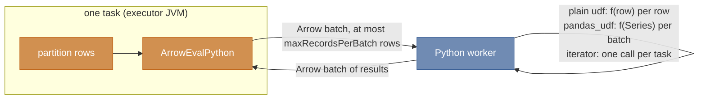
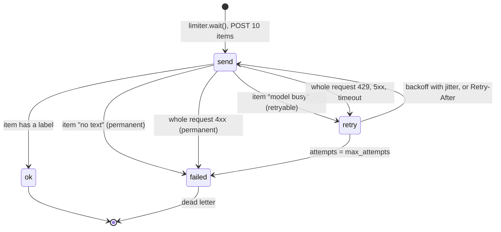

# Chapter 40: Calling models and services from Spark

A support team wants a label on each ticket: shipping, returns, warranty or privacy. Sometimes the model is a small Python object that the job can load. Sometimes it is a service behind an HTTP API, with a rate limit, a size limit and failures. In both cases, Spark runs the code in many tasks at the same time, and Spark can run the same rows more than one time.

**Spark decides how often your Python code runs, not you. A UDF can run once per row, once per batch or once per partition. It can run again for the same rows when a plan uses its result two times, and again when a task fails. For a local model, this sets the cost. For a remote service, it sets the number of requests and the bill.**

**Thus, a production job counts its requests and batches them. It limits its rate across all tasks, retries only the failures that can heal, and writes each result one time.**

The data is the SparkTutor support tickets: 160 labelled tickets in `train.csv` and 240 messy tickets in an inbox, with an answer key. The service is a small HTTP server in [`code/ch40/service.py`](https://github.com/lisancao/spark-masterclass/tree/main/code/ch40). It runs in the driver process on 127.0.0.1, and it fails on purpose. The scripts are `inference.py` and `calling.py`. They ran on `pyspark==4.3.0` in local mode. The model run counts come from marker files that the Python workers write, and the request counts come from counters in the service.

## Step 1: A model in Python, and a plain UDF

The first model is a multinomial naive Bayes classifier in plain Python. The driver trains it from the 160 labelled tickets with `collect()`, because 160 rows fit in the driver:

```text
== model trained on the driver from 160 labelled tickets, 8,384 bytes pickled, labels ['privacy', 'returns', 'shipping', 'warranty']
   inbox: 240 tickets in 4 partitions
```

A plain `@udf` takes the model in its closure. Spark pickles the function with the model and sends it to each task:

```python
@F.udf("string")
def label_row(text):
    mark("row", 1)
    return predict_one(model, text)
```

```text
== plain @udf
   plan: ['+- ArrowEvalPython [label_row(text#25)#206], [pythonUDF0#238', '+- ArrowEvalPython [label_row(text#25)#206], [pythonUDF0#238']
   calls of the function: 240 (one per row)
   useArrow=False plan: ['+- BatchEvalPython [<lambda>(text#25)#269], [pythonUDF0#301]']
```

The function ran 240 times, once for each row. The plan shows `ArrowEvalPython`, because `spark.sql.execution.pythonUDF.arrow.enabled` is on by default in 4.3 (Chapter 1 shows this operator). The executor sends the rows to the Python worker in Arrow batches. But a plain UDF still calls your function one row at a time. With `useArrow=False`, the operator is `BatchEvalPython`, which sends pickled rows.

A closure is a good way to send a small model. Spark broadcasts a closure that is larger than `spark.broadcast.UDFCompressionThreshold` (1 MiB by default). For a large model, load it from a file in each task, as the next steps do.

## Step 2: pandas UDFs: one call per batch

A scalar pandas UDF receives a `pandas.Series` for each Arrow batch and returns a Series of the same length:

```python
@F.pandas_udf("string")
def label_batch(text: pd.Series) -> pd.Series:
    mark("batch", len(text))
    return text.map(lambda t: predict_one(model, t))
```

```text
== pandas_udf, maxRecordsPerBatch=10000: 4 calls for 240 rows
== pandas_udf, maxRecordsPerBatch=25: 12 calls for 240 rows
   plan: ['+- ArrowEvalPython [label_batch(text#25)#443], [pythonUDF0#4']
   maxBytesPerBatch default: 67108864b
```

With the default batch size of 10,000 rows, each of the four partitions is one batch, so the function ran four times. With `spark.sql.execution.arrow.maxRecordsPerBatch=25`, each partition of about 60 rows gave three batches (25, 25 and the rest), so 12 calls. `spark.sql.execution.arrow.maxBytesPerBatch` (64 MiB by default) also limits a batch. Use a smaller batch for a model that needs much memory for each row, such as an image model.



## Step 3: Load the model once per task

A pandas UDF with a closure still pickles the model into each task. For a model that is in a file, the **iterator form** loads it once for each task and then reads all batches:

```python
@F.pandas_udf("string")
def label_iter(batches: Iterator[pd.Series]) -> Iterator[pd.Series]:
    m = pickle.loads(MODEL_FILE.read_bytes())   # once per task, not once per batch
    mark("load")
    for text in batches:
        yield text.map(lambda t: predict_one(m, t))
```

```text
== iterator pandas_udf, batches of 25: model loaded 4 times for 4 partitions
```

With batches of 25 rows, the function received 12 batches but loaded the model only four times: once for each partition. The type hints `Iterator[pd.Series] -> Iterator[pd.Series]` select this form.

A global variable in the script is not a cache. Each task can run in a new Python worker, and the worker unpickles the function again. For a model that several queries use, `pyspark.ml.functions.predict_batch_udf` keeps a cache of models in each Python worker process:

```text
== predict_batch_udf over two queries: model loaded 7 times
```

Two queries of four tasks each loaded the model seven times. The cache keeps models in each Python worker process. Here, only one task found the model in a cache. A possible cause is that most tasks ran in a new worker process. This cause is not verified. Worker reuse (`spark.python.worker.reuse`, on by default) lets a later task use the worker of an earlier task.

## Step 4: mapInPandas: any number of rows, columns by name

`mapInPandas` gives your function an iterator of pandas DataFrames for each partition, and your function yields DataFrames. The output can have a different number of rows and different columns:

```python
def label_partition(batches):
    m = pickle.loads(MODEL_FILE.read_bytes())
    mark("load")
    for pdf in batches:
        yield pd.DataFrame({"ticket_id": pdf["ticket_id"], "label": pdf["text"].map(lambda t: predict_one(m, t)),
                            "confidence_bucket": "n/a"})

scored = inbox.mapInPandas(label_partition, "ticket_id string, label string, confidence_bucket string")
```

```text
== mapInPandas: model loaded 4 times; plan: ['+- MapInPandas label_partition(ticket_id', 'MapInPandas label_partition(ticket_id#23']
   wrong column name: RESULT_COLUMN_NAMES_MISMATCH
   accuracy on the inbox against inbox_labels.csv: 0.925
```

Spark matches the output columns to the schema by name. A DataFrame with a column `id` instead of `ticket_id` fails with `RESULT_COLUMN_NAMES_MISMATCH`. The naive Bayes model labels 92.5% of the inbox correctly.

Use these rules to choose:

| Tool | Calls | Rows out | Use it for |
|---|---|---|---|
| `@udf` | one per row | one per row | simple logic, small models |
| `@pandas_udf` (Series to Series) | one per batch | one per row | vectorized models |
| `@pandas_udf` (iterator) | one per task | one per row | a model that is expensive to load |
| `mapInPandas` | one per task | any | a client per partition, extra columns |
| `predict_batch_udf` | one per batch, model cached per worker | one per row | the same model in many queries |

## Step 5: How many times does the model run?

The model runs as many times as the plan calls it. `inference.py` counts the rows that go into the model for different actions on the same DataFrame:

```python
base = inbox.select("ticket_id", label_batch("text").alias("label"))
```

```text
== how many times the model runs on 240 rows
   collect()                    rows into the model: 240
   count()                      rows into the model: 0
   limit(3).collect()           rows into the model: 3
   filter on the label          rows into the model: 468
   asNondeterministic + filter  rows into the model: 240
   filter plan: ['+- ArrowEvalPython [label_batch(text#25)#701], [pythonUDF0#1062], 200', '+- ArrowEvalPython [label_batch(text#25)#701], [pythonUDF0#1061], 200']
   cache(), count(), then filter: 240 rows, then 0 rows
```

<figure markdown>
  <video autoplay loop muted playsinline controls width="1280" height="720" poster="../../media/clips/ch40-runs.webp">
    <source src="../../media/clips/ch40-runs.mp4" type="video/mp4">
  </video>
  <figcaption>The same labelled DataFrame under different actions. A filter on the label runs the model two times, and <code>count()</code> does not run it.</figcaption>
</figure>

Each line has a cause in the optimizer:

- **`count()` runs the model 0 times.** The count does not need the label, so column pruning removes the UDF.
- **`limit(3)` runs it for 3 rows.** The limit goes down into the plan before the UDF.
- **A filter on the label runs it for 468 rows.** The optimizer pushes the filter below the projection. The filter needs the label, so the plan has two `ArrowEvalPython` operators. One is for the filter (240 rows). The other is for the output (the 228 rows that pass).
- **`asNondeterministic()`** tells the optimizer that two calls can give different results. Then it does not copy the UDF, and the model runs 240 times.
- **`cache()`** stores the result. The `count()` that fills the cache runs the model for all 240 rows, and the filter after it runs the model 0 times.

For a local model, the copies cost time. For a paid service, each copy is another bill. Task retries and speculative execution also run a partition again. Thus, a UDF that calls a service must give the same result when it runs two times, and it must not write anything itself.

## Step 6: A service that misbehaves

The service in `service.py` copies the failures of real model services:

- More than 16 requests in one second, from all clients together, get HTTP 429 with a `Retry-After` header.
- More than 20 items in one request get HTTP 413.
- An item with no letters gets a permanent error ("no text").
- About one item in seven gets "model busy" the first time. That error is retryable.
- About one request in five gets its answer after 1 second, longer than the client timeout of 0.5 seconds. A retry with the same `Idempotency-Key` gets the stored answer, and the model does not run again.

Each ticket gets a content key, `sha2(coalesce(text, ''), 256)`. Two tickets with the same text get the same key, so the job sends each text one time:

```text
== 240 tickets, 232 distinct texts (content key = sha2 of the text)
```

## Step 7: One request per row

The first version calls the service from a plain UDF, one request for each row:

```python
@F.udf("string")
def classify_one(key, text):
    try:
        r = ServiceClient(url).classify([{"key": key, "text": text}], "kw-1", idempotency_key("kw-1", [key]))[0]
        return r.get("label") or "error: " + r["error"]
    except (RetryableError, PermanentError) as e:
        return "error: " + str(e)
```

```text
== a UDF that calls the service once per row
   3.1 s, rows with an error: 224 of 232
   service saw: 232 requests, status {200: 16, 429: 216}, largest request 1 items, model runs 14 for 14 distinct texts
```

The job made 232 requests, and 216 of them got HTTP 429. Only 14 texts got a label. The UDF opens a new connection for each row, and 16 tasks send requests at the same time with no limit. This is the most common way to break a model service from Spark.

## Step 8: A client per partition, batches, a rate limit and retries

The second version uses `mapInPandas`. It creates one client and one rate limiter inside the function, so each task has its own. It sends 10 items in each request. It retries the failures that can heal, with exponential backoff:

```python
def make_caller(url, batch=10, rate=2.0, max_attempts=4, version="kw-1"):
    def call(batches):
        client, limiter = ServiceClient(url), RateLimiter(rate)
        try:
            for pdf in batches:
                texts = dict(zip(pdf["key"], pdf["text"]))
                attempts, out, pending = Counter(), {}, list(texts)
                while pending:
                    chunk, pending = pending[:batch], pending[batch:]
                    for k in chunk:
                        attempts[k] += 1
                    limiter.wait()
                    try:
                        results = client.classify([{"key": k, "text": texts[k]} for k in chunk], version,
                                                  idempotency_key(version, chunk))
                    except RetryableError as e:
                        again = [k for k in chunk if attempts[k] < max_attempts]
                        out.update({k: (None, "failed", str(e)) for k in chunk if k not in again})
                        if again:
                            time.sleep(e.retry_after or backoff_seconds(max(attempts[k] for k in again)))
                            pending = again + pending
                        continue
```

```text
== mapInPandas: a client per partition, 10 items a request, 2 requests a second per task
   5.4 s for 232 texts
   service saw: 34 requests, status {200: 34}, largest request 10 items, model runs 228 for 228 distinct texts
   status and attempts:
+------+--------+-------+-----+
|status|attempts|error  |count|
+------+--------+-------+-----+
|failed|1       |no text|2    |
|failed|2       |no text|2    |
|ok    |1       |NULL   |167  |
|ok    |2       |NULL   |45   |
|ok    |3       |NULL   |16   |
+------+--------+-------+-----+

   texts the model ran on more than once: 0 (slow answers were retried with the same Idempotency-Key)
```

<figure markdown>
  <video autoplay loop muted playsinline controls width="1280" height="720" poster="../../media/clips/ch40-requests.webp">
    <source src="../../media/clips/ch40-requests.mp4" type="video/mp4">
  </video>
  <figcaption>One request per row against a client per partition: 232 requests with 216 rejections, then 34 requests with none.</figcaption>
</figure>

The job made 34 requests and got no 429. All 228 texts with words got a label. The four texts with no words are permanent failures, and the job did not retry them after the error. The `attempts` column counts the tries for each text. 61 texts needed a second or third try, because of "model busy" errors and timeouts.



The parts of the design are:

- **One client for each partition.** The function creates `ServiceClient` inside `call`, so each task opens one keep-alive connection. Spark pickles a client in the closure, and a connection does not survive that.
- **Batches.** 10 items in each request, under the limit of 20.
- **A rate limit in each task.** A token bucket allows 2 requests a second.
- **Retry only what can heal.** HTTP 429, 5xx, a timeout and "model busy" are retryable. HTTP 413, other 4xx and "no text" are permanent.
- **Exponential backoff with full jitter.** The wait before try `n` is a random time between 0 and `0.05 · 2^n` seconds, at most 2 seconds. Random waits stop all tasks from a retry at the same moment. If the service sends `Retry-After`, the client waits that long.
- **A limit on tries.** After 4 tries, the item fails and goes to the dead letters.
- **An idempotency key.** The key is a hash of the model version and the sorted item keys. A retry of the same request sends the same key. After a timeout, the client does not know if the service ran the model. With the key, the service returns its stored answer, and the model ran 0 extra times. Do not make the key from a random UUID or from the number of the try.

## Step 9: The rate limit is per task

The limiter runs in each task. Thus, the total rate is the rate of each task times the number of tasks that run at the same time:

```text
== the client limit is per task: total rate = per-task rate x concurrent tasks
    4 partitions x 2.0 req/s:   5.7 s,  35 requests, 429 responses   0
   16 partitions x 2.0 req/s:   4.8 s,  78 requests, 429 responses  51
   16 partitions x 0.5 req/s:   6.2 s,  45 requests, 429 responses   0
```

With 4 partitions at 2 requests a second, the total is at most 8 a second, and the service accepted all requests. With 16 partitions, the total is 32 a second, which is above the limit of 16. The service sent 51 rejections, and the job made 78 requests instead of 35. With 16 partitions at 0.5 a second, the total is 8 again, and there were no rejections.

Set the rate of each task to the budget of the service divided by the number of concurrent tasks. Fix the number of tasks with `repartition(n)` before `mapInPandas`, so the division stays correct. The times are single runs on a shared machine.

## Step 10: Write once, then split

A job writes the labels to a cache and the failures to a dead-letter table. The obvious code writes the result two times, with two filters:

```text
== write once, then split
   two filtered writes of the same result: 63 requests
   one staging write, then two writes from the files: 34 requests
```

Each write is a separate action, and each action runs the plan again, with the `mapInPandas` calls. The two writes made 63 requests. The second write made fewer requests than the first write, because the service kept the answers of the first write.

The fix is to write the result one time to a staging location, and then read the files for the two filtered writes. That version made 34 requests. A `cache()` is not enough here. Spark can remove cached blocks under memory pressure, and then it runs the calls again. A file is a fact.

Do not write to a table from inside `mapInPandas`. If a task fails and Spark runs it again, the write occurs two times.

## Step 11: The next run sends only new work

The cache and the dead letters store the content key and the model version. The next run sends only the texts that have no result for the current model version. A left anti join finds them:

```python
done = (spark.read.parquet(str(WORK / "cache")).unionByName(spark.read.parquet(str(WORK / "dead_letters")))
        .where("model_version = 'kw-1'").select("key"))
todo = everything.select("key", "text").dropDuplicates(["key"]).join(done, "key", "left_anti")
```

```text
== the next run: a left anti join against the cache and the dead letters
   245 tickets, 4 texts to send
   requests for the second run: 3
   plan of the new-work query: ['BroadcastHashJoin', 'LeftAnti']
```

Five new tickets arrived, and two of them have the same text. Thus, the job sends 4 texts. The 4 texts fit in one request, but the run made 3 requests because of retries. The permanent failures in the dead letters are not sent again. If the model version changes, `done` is empty for the new version, and the job sends all texts again.

Keep the model version next to the key, not in the key. Then one table holds the results of all versions, and a query can compare them.

## Step 12: Validate structured answers

A language model often returns JSON as text. The text can be wrong in many ways. VARIANT functions check it without a failure:

```python
v = F.try_parse_json("answer")
checked = answers.select("key", F.try_variant_get(v, "$.label", "string").alias("label"),
                         F.try_variant_get(v, "$.confidence", "double").alias("confidence"),
                         F.when(v.isNull(), "not json")
                         .when(~F.try_variant_get(v, "$.label", "string").isin("shipping", "returns", "warranty",
                                                                               "privacy", "other"), "unknown label")
                         .when(F.try_variant_get(v, "$.confidence", "double").isNull(), "no confidence")
                         .alias("problem"))
```

```text
+---+--------+----------+-------------+
|key|label   |confidence|problem      |
+---+--------+----------+-------------+
|a  |shipping|0.92      |NULL         |
|b  |refunds |NULL      |unknown label|
|c  |NULL    |NULL      |not json     |
|d  |warranty|NULL      |no confidence|
+---+--------+----------+-------------+
```

`try_parse_json` returns NULL for text that is not JSON (answer `c` has words before the JSON). `try_variant_get` returns NULL for a missing field or a wrong type ("high" is not a double). A row with a problem goes to the dead letters with its reason, or back to the model with a repair prompt. The share of answers with a problem is a measure of the model, and you can track it in MLflow ([Chapter 35](ch35-mllib-mlflow.md)).

## The whole chapter, on one page

- **Count how often your code runs.** A plain UDF runs once per row, a pandas UDF once per batch, the iterator form loads once per task.
- **The optimizer can copy a UDF** (a filter on its output) or remove it (`count()`). Use `asNondeterministic()` or a staging write when the count matters.
- **Use `mapInPandas` with one client per partition**, batches, a rate limit and retries with backoff and jitter. 34 requests replaced 232 here.
- **The total rate is the rate per task times the concurrent tasks.** Fix the number of tasks with `repartition`.
- **Make retries safe with an idempotency key** from the model version and the item keys.
- **Write the result once to staging**, then split it. Never write from inside `mapInPandas`.
- **Send only new work** with a left anti join on content key and model version.
- **Validate model answers** with `try_parse_json` and `try_variant_get`.

```python
keyed = tickets.withColumn("key", F.sha2(F.coalesce("text", F.lit("")), 256))
done = spark.read.parquet("results").where("model_version = 'kw-1'").select("key")
todo = keyed.select("key", "text").dropDuplicates(["key"]).join(done, "key", "left_anti")
(todo.repartition(4)                                   # 4 tasks x 2 req/s = 8 req/s in total
     .mapInPandas(make_caller(url, batch=10, rate=2.0), RESULT)
     .write.mode("append").parquet("staging/run=2026-11-22"))
staged = spark.read.parquet("staging/run=2026-11-22")
staged.where("status = 'ok'").write.mode("append").parquet("results")
staged.where("status != 'ok'").write.mode("append").parquet("dead_letters")
```

## Further reading

- [pandas UDFs and the Arrow settings](https://spark.apache.org/docs/4.3.0/api/python/user_guide/sql/arrow_pandas.html).
- [`predict_batch_udf`](https://spark.apache.org/docs/4.3.0/api/python/reference/api/pyspark.ml.functions.predict_batch_udf.html).
- "Exponential Backoff And Jitter", AWS Architecture Blog, for the full jitter formula.
- [VARIANT functions](https://spark.apache.org/docs/4.3.0/api/sql/index.html#try_variant_get).
