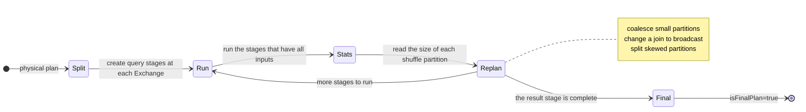

# Chapter 40: Reading query plans: Catalyst and AQE

A slow Spark query almost never has a slow line of code. It has a plan with a bad shape. For example, a scan reads all columns, or a filter does not go into the scan. A join can move both tables, or a shuffle can make 200 tasks for 31 rows. Spark shows you the plan before it runs a query and again after it runs the query. This chapter teaches you to read both plans.

**A Spark plan is a record of decisions. The Catalyst optimizer makes the static decisions before the query starts, from estimates. Adaptive query execution (AQE) makes the dynamic decisions during the run, from real sizes. When you read a plan, you can see which decisions Spark made, which estimate caused each decision, and which decisions AQE changed.**

The scripts for this chapter are in [`code/ch40`](https://github.com/lisancao/spark-masterclass/tree/main/code/ch40). Each output block in the chapter comes from `code/ch40/output/`. The data is the June 2026 yellow-taxi file from [Chapter 5](ch05-how-spark-runs.md) (3,837,248 rows) and the zone lookup file (265 rows). All runs use Spark 4.3.0 in `local[*]` mode on 16 cores, with the session time zone set to UTC.

Earlier chapters show only some plans. The first physical plan is in [Chapter 5](ch05-how-spark-runs.md), which reads it from the bottom to the top. A comparison of a DataFrame plan and a SQL plan is in [Chapter 7](ch07-quick-start.md). This chapter goes into each part of the plan. It also gives the one full explanation of AQE in this book. The chapters on joins, partitions and Python refer back to it.

## The path from your code to tasks

Spark changes a query through four plans before it runs any task:

```mermaid
flowchart LR
  classDef you fill:#3a5f96,fill-opacity:0.72,stroke:#3a5f96,color:#ffffff
  classDef cat fill:#6b4a9b,fill-opacity:0.72,stroke:#6b4a9b,color:#ffffff
  classDef run fill:#c0661a,fill-opacity:0.72,stroke:#c0661a,color:#ffffff
  code["DataFrame or SQL"]:::you --> parsed["parsed plan<br/>(unresolved)"]:::cat
  parsed -->|"analyzer:<br/>names, types"| analyzed["analyzed plan"]:::cat
  analyzed -->|"optimizer:<br/>rewrite rules"| optimized["optimized plan"]:::cat
  optimized -->|"planner:<br/>strategies"| physical["physical plan"]:::run
  physical -->|"AQE: one query stage<br/>at a time"| final["final plan<br/>(after the run)"]:::run
  final -.->|"real sizes"| physical
```



- The **parsed plan** is your query as a tree. Spark has not yet looked up the columns or the functions.
- The **analyzer** finds each column and function. It gives each column a unique ID such as `fare_amount#10`. It adds casts where types do not agree.
- The **optimizer** applies rewrite rules. The rules do not change the result. They change the cost of the query.
- The **planner** selects a physical operator for each logical operator. For a join, it can select a `BroadcastHashJoin` or a `SortMergeJoin`. Then it adds an `Exchange` where an operator needs a different partition layout.
- **AQE** runs the physical plan one query stage at a time. After each stage, it looks at the real output sizes and plans the other stages again.

The first four steps occur on the driver before Spark starts a job. The last step occurs while the jobs run. This difference is the key to the whole chapter. The Catalyst optimizer must work from estimates. AQE works from facts.

## Step 1: Five ways to explain a query

`DataFrame.explain(mode)` prints a plan and runs nothing. If you give an incorrect mode, the error message lists the five modes:

```text
IllegalArgumentException: Unknown explain mode: bogus. Accepted explain modes are 'simple', 'extended', 'codegen', 'cost', 'formatted'.
```

| Mode | What it shows |
|---|---|
| `simple` (the default) | the physical plan |
| `extended` | the parsed, analyzed and optimized logical plans, then the physical plan |
| `formatted` | a short tree with numbered nodes, then the details of each node |
| `cost` | the optimized logical plan with a size estimate on each node, then the physical plan |
| `codegen` | the Java code that Spark generates for each whole-stage codegen subtree |

`explain_modes.py` uses one query for all five modes. The query counts the June trips with one passenger in each pickup zone and calculates the average fare:

```python
q = (trips
     .where((F.col("tpep_pickup_datetime") >= MONTH_START) &
            (F.col("tpep_pickup_datetime") < MONTH_END) &
            (F.col("passenger_count") == 1))
     .groupBy("PULocationID")
     .agg(F.count("*").alias("trips"), F.avg("fare_amount").alias("avg_fare")))
```

The `extended` mode shows the four plans. The relation lines are long, so this book cuts them:

```text
== Parsed Logical Plan ==
'Aggregate ['PULocationID], ['PULocationID, 'count(*) AS trips#22, 'avg('fare_amount) AS avg_fare#23]
+- Filter (((tpep_pickup_datetime#1 >= cast(2026-06-01 as timestamp_ntz)) AND (tpep_pickup_datetime#1 < cast(2026-07-01 as timestamp_ntz))) AND (passenger_count#3L = cast(1 as bigint)))
   +- Relation [VendorID#0,tpep_pickup_datetime#1,tpep_dropoff_datetime#2,passenger_count#3L,...

== Analyzed Logical Plan ==
PULocationID: int, trips: bigint, avg_fare: double
Aggregate [PULocationID#7], [PULocationID#7, count(1) AS trips#22L, avg(fare_amount#10) AS avg_fare#23]
+- Filter (((tpep_pickup_datetime#1 >= cast(2026-06-01 as timestamp_ntz)) AND (tpep_pickup_datetime#1 < cast(2026-07-01 as timestamp_ntz))) AND (passenger_count#3L = cast(1 as bigint)))
   +- Relation [VendorID#0,tpep_pickup_datetime#1,tpep_dropoff_datetime#2,passenger_count#3L,...

== Optimized Logical Plan ==
Aggregate [PULocationID#7], [PULocationID#7, count(1) AS trips#22L, avg(fare_amount#10) AS avg_fare#23]
+- Project [PULocationID#7, fare_amount#10]
   +- Filter ((isnotnull(tpep_pickup_datetime#1) AND isnotnull(passenger_count#3L)) AND (((tpep_pickup_datetime#1 >= 2026-06-01 00:00:00) AND (tpep_pickup_datetime#1 < 2026-07-01 00:00:00)) AND (passenger_count#3L = 1)))
      +- Relation [VendorID#0,tpep_pickup_datetime#1,tpep_dropoff_datetime#2,passenger_count#3L,...
```

Read the four plans in sequence. Each plan shows the work of one phase:

- **Parsed.** A quote mark in front of a name, as in `'Aggregate` and `'avg('fare_amount)`, means "not resolved". Spark does not yet know if the column exists. The DataFrame API resolves the Filter early. Thus only the Aggregate has quote marks here.
- **Analyzed.** Each name has an ID (`PULocationID#7`) and the plan has an output schema (`PULocationID: int, trips: bigint, avg_fare: double`). The suffix `L` in `trips#22L` means that the column is a `bigint`. The analyzer wrote `cast(1 as bigint)` because `passenger_count` is a `bigint` and the literal `1` is an `int`.
- **Optimized.** Three rules changed the plan. The rule `ConstantFolding` replaced each `cast(...)` of a literal with the value. The rule `InferFiltersFromConstraints` added `isnotnull(...)` for each column that the filter compares, because a comparison with NULL is never true. The rule `ColumnPruning` added a `Project` with only the two columns that the aggregate needs.

The `formatted` mode prints the same physical plan in two parts. The first part is a tree with numbers. The second part gives the details of each numbered node:

```text
== Physical Plan ==
AdaptiveSparkPlan (7)
+- HashAggregate (6)
   +- Exchange (5)
      +- HashAggregate (4)
         +- Project (3)
            +- Filter (2)
               +- Scan parquet  (1)


(1) Scan parquet 
Output [4]: [tpep_pickup_datetime#1, passenger_count#3L, PULocationID#7, fare_amount#10]
Batched: true
Location: InMemoryFileIndex [file:~/spark-masterclass/data/nyc-taxi/yellow]
PushedFilters: [IsNotNull(tpep_pickup_datetime), IsNotNull(passenger_count), GreaterThanOrEqual(tpep_pickup_datetime,2026-06-01T00:00), LessThan(tpep_pickup_datetime,2026-07-01T00:00), EqualTo(passenger_count,1)]
ReadSchema: struct<tpep_pickup_datetime:timestamp_ntz,passenger_count:bigint,PULocationID:int,fare_amount:double>
...
(4) HashAggregate
Input [2]: [PULocationID#7, fare_amount#10]
Keys [1]: [PULocationID#7]
Functions [2]: [partial_count(1), partial_avg(fare_amount#10)]
Aggregate Attributes [3]: [count#47L, sum#48, count#49L]
Results [4]: [PULocationID#7, count#50L, sum#51, count#52L]

(5) Exchange
Input [4]: [PULocationID#7, count#50L, sum#51, count#52L]
Arguments: hashpartitioning(PULocationID#7, 200), ENSURE_REQUIREMENTS, [plan_id=15]
```

Use `formatted` when a plan is wide. The `simple` mode puts all of a node on one line, and a scan line can have more than 600 characters. The details of node 4 also show how a partial average works. Each task keeps a `count` for `count(*)`, and a `sum` and a `count` for `avg`. The final `HashAggregate` adds the partial values. Then it divides the sum by the count.

The `cost` mode adds a `Statistics(sizeInBytes=...)` estimate to each logical node:

```text
== Optimized Logical Plan ==
Aggregate [PULocationID#7], [...], Statistics(sizeInBytes=9.3 MiB)
+- Project [PULocationID#7, fare_amount#10], Statistics(sizeInBytes=6.6 MiB)
   +- Filter ((isnotnull(tpep_pickup_datetime#1) AND ...), Statistics(sizeInBytes=62.4 MiB)
      +- Relation [VendorID#0,...] parquet, Statistics(sizeInBytes=62.4 MiB)
```

<figure markdown>
  
  
  <figcaption>The <code>cost</code> estimates from <code>explain_modes.txt</code>. The <code>Filter</code> keeps the 62.4 MiB of the file. The <code>Aggregate</code> estimate (9.3 MiB) is larger than the <code>Project</code> estimate (6.6 MiB) below it.</figcaption>
</figure>

These numbers are guesses. The `Relation` estimate is the file size on disk (65,465,637 bytes is 62.4 MiB). The `Filter` has the same estimate as its input, because Spark does not know the selectivity of a filter without table statistics. The `Project` estimate scales the input size by the ratio of the row widths. The estimate for the `Aggregate` is larger than the estimate for its input, which is clearly not true.

Spark uses these numbers to select join strategies, so a bad estimate can cause a bad join. Step 6 shows an example.

## Step 2: What the optimizer did, rule by rule

The optimizer is a set of rules in batches. Each rule finds a pattern in the plan and replaces it. Most rules do nothing to most queries. Each query keeps a `QueryPlanningTracker` that records each rule that ran, the number of runs, and the number of runs that changed the plan. `optimizer.py` reads the tracker for a query that joins the trips to the zones:

```python
q = (trips.join(zones, trips.PULocationID == zones.LocationID)
     .where((F.col("Borough") == "Queens") & (F.col("PULocationID") < 140))
     .select("Zone", (F.col("fare_amount") * (F.lit(1) + F.lit(0.5) - F.lit(0.5))).alias("fare"))
     .groupBy("Zone").agg(F.round(F.sum("fare")).alias("fares")))
```

The filter is after the join in the code. The arithmetic `1 + 0.5 - 0.5` is there to give the optimizer some work. The analyzed and optimized plans:

```text
== Analyzed Logical Plan ==
Aggregate [Zone#40], [Zone#40, round(sum(fare#44), 0) AS fares#45]
+- Project [Zone#40, (fare_amount#10 * ((cast(1 as double) + 0.5) - 0.5)) AS fare#44]
   +- Filter ((Borough#39 = Queens) AND (PULocationID#7 < 140))
      +- Join Inner, (PULocationID#7 = LocationID#38)
         :- Relation [VendorID#0,tpep_pickup_datetime#1,tpep_dropoff_datetime#2,passenger_count#3L,trip_distance#4,RatecodeID#5L,store_and_fwd_flag#6, ...
         +- Relation [LocationID#38,Borough#39,Zone#40,service_zone#41] csv
== Optimized Logical Plan ==
Aggregate [Zone#40], [Zone#40, round(sum(fare#44), 0) AS fares#45]
+- Project [Zone#40, (fare_amount#10 * 1.0) AS fare#44]
   +- Join Inner, (PULocationID#7 = LocationID#38)
      :- Project [PULocationID#7, fare_amount#10]
      :  +- Filter (isnotnull(PULocationID#7) AND (PULocationID#7 < 140))
      :     +- Relation [VendorID#0,tpep_pickup_datetime#1,tpep_dropoff_datetime#2,passenger_count#3L,trip_distance#4,RatecodeID#5L,store_and_fwd_flag ...
      +- Project [LocationID#38, Zone#40]
         +- Filter ((isnotnull(Borough#39) AND (Borough#39 = Queens)) AND ((LocationID#38 < 140) AND isnotnull(LocationID#38)))
            +- Relation [LocationID#38,Borough#39,Zone#40,service_zone#41] csv
```

And the rules that changed it:

```text
272 rules ran; 9 of them changed the plan:

  rule                                              runs  changed
  Analyzer$ResolveFunctions                            2        1
  Analyzer$ResolveReferences                           2        1
  ColumnPruning                                        6        1
  ConstantFolding                                      5        1
  EnsureRequirements                                   2        1
  InferFiltersFromConstraints                          1        1
  InsertAdaptiveSparkPlan                              1        1
  PushDownPredicates                                   6        2
  RemoveRedundantProjects                              2        1
```

The figure shows the analyzed plan and the optimized plan side by side. The colours show which rule made each change:

<figure markdown>
  
  
  <figcaption>The plans from <code>optimizer.txt</code>. The filter moves below the join and splits into two parts. Each side gets a <code>Project</code> with only the columns that the query uses.</figcaption>
</figure>

Match each rule to a change in the plan:

- `PushDownPredicates` moved the filter below the join. It split the filter into two parts. `Borough = Queens` went to the zones side and `PULocationID < 140` went to the trips side.
- `InferFiltersFromConstraints` copied the condition across the join. The join condition says that `PULocationID = LocationID`, so `PULocationID < 140` also means `LocationID < 140`. The zones side now has `LocationID < 140`, but you did not write that filter. The rule also added `isnotnull` on the two join keys. An inner join never matches a NULL key.
- `ColumnPruning` added a `Project` on each side, so that the scans read 2 of 19 trip columns and 3 of 4 zone columns.
- `ConstantFolding` changed `(cast(1 as double) + 0.5) - 0.5` to `1.0`. It did not remove the multiplication by `1.0`. No rule in 4.3.0 removes it.
- `EnsureRequirements`, `InsertAdaptiveSparkPlan` and `RemoveRedundantProjects` are physical rules. Since Spark 4.3 (SPARK-57212), the tracker also records the physical preparation rules and the AQE rules.

Of the 272 rules that ran, 9 changed the plan. The tracker also gives the time of each phase: `analysis 20 ms, optimization 113 ms, planning 91 ms` for this query, in a new JVM. The tracker is a Classic API (`df._jdf.queryExecution().tracker()`). On Spark Connect, compare the analyzed and optimized plans from `explain("extended")` instead. To see each rule and its change in the log, set `spark.sql.planChangeLog.level` to `WARN`.

<figure markdown>
  <video autoplay loop muted playsinline controls width="1280" height="720" poster="../../media/clips/ch40-rules.webp">
    <source src="../../media/clips/ch40-rules.mp4" type="video/mp4">
  </video>
  <figcaption><code>optimizer.py</code> reads the <code>QueryPlanningTracker</code> of one query. Of the 272 rules that ran, 9 changed the plan.</figcaption>
</figure>

## Step 3: The scan node

Most of the cost of a query starts at the scan. `file_scan.py` writes the same 20,000 trips twice, as Parquet and as JSON, with nested columns. Then it queries one nested field from each file:

```python
nested = trips.select(
    F.struct(F.col("PULocationID").alias("zone"), F.col("tpep_pickup_datetime").alias("ts")).alias("pickup"),
    F.struct(F.col("fare_amount").alias("amount"), F.col("tip_amount").alias("tip"),
             F.col("payment_type").alias("payment")).alias("fare"),
    "trip_distance")
...
q = df.where(F.col("fare.tip") > 10).select("fare.tip")
```

The script prints each field of the `FileScan` node on a separate line:

```text
parquet: where fare.tip > 10, select fare.tip
  FileScan parquet [fare#30]
    Batched: true
    DataFilters: [isnotnull(fare#30.tip), (fare#30.tip > 10.0)]
    Format: Parquet
    Location: InMemoryFileIndex(1 paths)[file:/tmp/masterclass-ch40/nested_parquet]
    PartitionFilters: []
    PushedFilters: [IsNotNull(fare.tip), GreaterThan(fare.tip,10.0)]
    ReadSchema: struct<fare:struct<tip:double>>

json: where fare.tip > 10, select fare.tip
  FileScan json [fare#44]
    Batched: false
    DataFilters: [isnotnull(fare#44.tip), (fare#44.tip > 10.0)]
    Format: JSON
    Location: InMemoryFileIndex(1 paths)[file:/tmp/masterclass-ch40/nested_json]
    PartitionFilters: []
    PushedFilters: []
    ReadSchema: struct<fare:struct<amount:double,payment:bigint,tip:double>>
```

| Field | What it tells you |
|---|---|
| `[fare#30]` and `ReadSchema` | the columns that the scan reads. Spark does not read the other columns. |
| `Batched` | `true` if the reader gives columnar batches. Parquet and ORC do this. JSON and CSV give rows. |
| `DataFilters` | the filters on data columns, as Catalyst expressions |
| `PartitionFilters` | the filters on partition folders, for example `day=2026-06-02`. These remove files before Spark opens them. [Chapter 42](ch42-partitions-caching-memory.md) shows them. |
| `PushedFilters` | the filters that Spark gives to the reader, as data source filters |
| `Location` | the file index. Spark lists the files when you create the DataFrame. |

The two formats get the same query and the same `DataFilters`, but they do different work:

- **Parquet reads one leaf of the struct.** The read schema is `struct<fare:struct<tip:double>>`. Spark calls this nested schema pruning. Parquet keeps each leaf field in a separate column, so the reader can skip `fare.amount` and `fare.payment`. The reader also gets the pushed filter `GreaterThan(fare.tip,10.0)`. With this filter, it can skip a row group if the statistics show no tip above 10. [Chapter 45](ch45-parquet-inside.md) shows how.
- **JSON reads the whole struct and pushes nothing.** The JSON reader must parse each line of text to find `fare.tip`, so it reads all fields of `fare`. JSON filter pushdown (`spark.sql.json.filterPushdown.enabled`, default `true` since 3.1) does exist, but it only stops the parser early on a top-level field. It does not skip any bytes.

A pushed filter is a hint, not a guarantee. A reader can skip a row group if the statistics show that no row matches. But a row group that passes still contains rows that do not match. For this reason, the `Filter` node stays above the scan:

```text
  *(1) Filter (isnotnull(trip_distance#52) AND (trip_distance#52 > 30.0))
  +- *(1) ColumnarToRow
     +- FileScan parquet [pickup#50,fare#51,trip_distance#52] Batched: true, DataFilters: [isnotnull(trip_distance#52), (trip_distance#52 > 30.0)], Format: Parquet, Location: InMemoryFileIndex(1 paths)[file:/tmp/masterclass-ch40/nested_parquet], PartitionFilters: [], PushedFilters: [IsNotNull(trip_distance), GreaterThan(trip_distance,30.0)], ReadSchema: struct<pickup:struct<zone:int,ts:timestamp_ntz>,fare:struct<amount:double,tip:double,payment:bigi...
```

`ColumnarToRow` is the point where the columnar batches from Parquet become rows for the operators above. Spark 4.3 keeps most operators row-based. Only the scan and some special operators (for example the Arrow operators in [Chapter 43](ch43-python-udfs-arrow.md)) work on columns.

### Pruning can change which query runs

Column pruning is almost always good. But it can change the query that the reader gets. This example reads a JSON file that has one bad line. The DataFrame keeps the good rows and removes the column for corrupt records:

```python
raw.write_text('{"id": 1, "amount": 12.5}\n{"id": 2, "amount": 7.0}\n{"id": 3, "amou\n')
events = (spark.read.schema("id long, amount double, _corrupt_record string")
          .json(str(raw)))
good = events.where(F.col("_corrupt_record").isNull()).drop("_corrupt_record")
```

`collect()` works, but `count()` fails:

```text
good rows: [(1, 12.5), (2, 7.0)]
good.count() -> AnalysisException: [UNSUPPORTED_FEATURE.QUERY_ONLY_CORRUPT_RECORD_COLUMN] The feature is not supported: Queries from raw JSON/CSV/XML files are disallowed when the
The plan count() runs:
  AdaptiveSparkPlan isFinalPlan=false
  +- HashAggregate(keys=[], functions=[count(1)])
     +- Exchange SinglePartition, ENSURE_REQUIREMENTS, [plan_id=244]
        +- HashAggregate(keys=[], functions=[partial_count(1)])
           +- Project
              +- Filter isnull(_corrupt_record#56)
                 +- FileScan json [_corrupt_record#56] Batched: false, DataFilters: [isnull(_corrupt_record#56)], Format: 
good.where(id IS NOT NULL).count(): 2
```

The plan explains the error. A count needs no columns, so column pruning removed `id` and `amount`. Only the column in the filter stayed. The JSON reader fills `_corrupt_record` only when it parses the other columns, so Spark refuses a scan that reads only that column. A filter on a real column keeps that column in the scan, and the count works. A `cache()` before the filter also works, because a cache stores all columns.

## Step 4: Whole-stage code generation

The physical plan in Step 1 has no `*(n)` marks. Run the query, print the plan again, and the marks appear:

```text
AdaptiveSparkPlan isFinalPlan=true
+- == Final Plan ==
   ResultQueryStage 1
   +- *(2) HashAggregate(keys=[PULocationID#7], functions=[count(1), avg(fare_amount#10)])
      +- AQEShuffleRead coalesced
         +- ShuffleQueryStage 0
            +- Exchange hashpartitioning(PULocationID#7, 200), ENSURE_REQUIREMENTS, [plan_id=39]
               +- *(1) HashAggregate(keys=[PULocationID#7], functions=[partial_count(1), partial_avg(fare_amount#10)])
                  +- *(1) Project [PULocationID#7, fare_amount#10]
                     +- *(1) Filter ((((isnotnull(tpep_pickup_datetime#1) AND isnotnull(passenger_count#3L)) AND ...
                        +- *(1) ColumnarToRow
                           +- FileScan parquet [tpep_pickup_datetime#1,passenger_count#3L,PULocationID#7,fare_amount#10] ...
```

A star and a number mark the operators that Spark fused into one generated Java function. All operators with `*(1)` are one loop. The loop reads a row from the batch and applies the filter. Then it projects two columns and updates a hash map. No virtual function call occurs between the operators. The `Exchange` is not in a codegen stage, because a shuffle writes data out of the task.

<figure markdown>
  
  
  <figcaption>The final plan after <code>collect()</code>. The operators of stage 1 are one generated Java loop. The <code>Exchange</code> is the boundary between the two stages.</figcaption>
</figure>

Before the run, `explain("codegen")` says `Found 0 WholeStageCodegen subtrees.` This is because AQE does code generation for each query stage when it creates the stage. After the run, the same call prints the code:

```text
Found 2 WholeStageCodegen subtrees.
== Subtree 1 / 2 (maxMethodCodeSize:482; maxConstantPoolSize:341(0.52% used); numInnerClasses:1) ==
*(1) HashAggregate(keys=[PULocationID#7], functions=[partial_count(1), partial_avg(fare_amount#10)], output=[PULocationID#7, count#50L, sum#51, count#52L])
+- *(1) Project [PULocationID#7, fare_amount#10]
...
/* 251 */   protected void processNext() throws java.io.IOException {
/* 252 */     if (!hashAgg_initAgg_0) {
/* 253 */       hashAgg_initAgg_0 = true;
...
/* 260 */       hashAgg_doAggregateWithKeys_0(partitionIndex);
/* 261 */       ((org.apache.spark.sql.execution.metric.SQLMetric) references[13] /* aggTime */).add((System.nanoTime() - wholestagecodegen_beforeAgg_0) / 1000000);
...
/* 265 */     while ( hashAgg_fastHashMapIter_0.next()) {
```

The code for subtree 1 has 585 lines.

The header gives one useful number. `maxMethodCodeSize` is the bytecode size of the largest generated method. The internal configuration `spark.sql.codegen.hugeMethodLimit` has a default of 65535 bytes. If a method is larger, Spark turns off whole-stage codegen for that subtree. Then it uses the slower operators that do not generate code.

The documentation of this configuration gives a second limit: the HotSpot JIT compiler does not compile a method above 8000 bytes. Very wide rows and very long `CASE` expressions make large methods.

## Step 5: Joins in a plan

A join gives the planner its most important choice. The two strategies that you see most often:

- A **sort-merge join** (`SortMergeJoin`) shuffles both sides by the join key and sorts each side. Then it reads the two sides together. It has two `Exchange` nodes and two `Sort` nodes. It can join two very large tables, because it can spill to disk.
- A **broadcast hash join** (`BroadcastHashJoin`) sends a copy of the small side to each task (`BroadcastExchange`) and builds a hash table from it. The large side does not move. `BuildRight` or `BuildLeft` tells you which side Spark built into the hash table.

The planner selects a broadcast join when the estimated size of one side is below `spark.sql.autoBroadcastJoinThreshold` (10 MB by default). In Step 2, the zones side came from a 12 KB CSV file, so the plan had a broadcast join:

```text
            +- BroadcastHashJoin [PULocationID#7], [LocationID#38], Inner, BuildRight, false, false
               :- Filter (isnotnull(PULocationID#7) AND (PULocationID#7 < 140))
               :  +- FileScan parquet [PULocationID#7,fare_amount#10] Batched: true, DataFilters: [isnotnull(PULocationID#7), (PULocationID#7 < 140)], ...
               +- BroadcastExchange HashedRelationBroadcastMode(List(cast(input[0, int, true] as bigint)),false), [plan_id=54]
```

For a left outer join, Spark can build only the right side, because each row of the left side must stay in the result. If the planner cannot know that a side is small, add a hint. Use `F.broadcast(df)`, or `/*+ BROADCAST(t) */` in SQL. [Chapter 11](ch11-joins.md) is about joins and gives the strategies in full. This chapter looks only at how a join appears in a plan and how AQE changes it.

## Step 6: Adaptive query execution

The Catalyst optimizer makes its decisions before any data moves. It knows the file sizes and nothing more.

AQE (`spark.sql.adaptive.enabled`, on by default since Spark 3.2) fixes this problem. AQE cuts the physical plan at each `Exchange` into **query stages**. It runs the stages that have all their inputs, and it collects the real size of each shuffle partition. Then it optimizes the other parts of the plan again with those sizes. It does this again until the last stage is complete:



AQE wraps a plan only if the plan has an `Exchange`, a subquery, or an operator that needs a specific input distribution. An aggregate and a global sort are examples of these operators (see `InsertAdaptiveSparkPlan.shouldApplyAQE`). If a plan only scans, filters and projects, AQE has nothing to change. Thus, the plan has no `AdaptiveSparkPlan` node. [Chapter 46](ch46-project-feather.md) shows a plan that has an `AdaptiveSparkPlan` node but no `Exchange`. AQE does three things that you will see in plans. `aqe.py` makes each of them occur on the taxi data.

### Coalesce: 200 partitions become 1

A `groupBy` on pickup zone plans a shuffle into `spark.sql.shuffle.partitions` partitions (200 by default). The final plan shows what AQE did:

```text
258 rows; 2 jobs; stage 1: 16 tasks, stage 3: 1 tasks
AdaptiveSparkPlan isFinalPlan=true
+- == Final Plan ==
   ResultQueryStage 1
      +- AQEShuffleRead coalesced
         +- ShuffleQueryStage 0
            +- Exchange hashpartitioning(PULocationID#7, 200), ENSURE_REQUIREMENTS, [plan_id=27]
+- == Initial Plan ==
   +- Exchange hashpartitioning(PULocationID#7, 200), ENSURE_REQUIREMENTS, [plan_id=11]
```

`ShuffleQueryStage 0` is the scan and the partial aggregate, which ran in 16 tasks. Its shuffle wrote the partial counts into 200 partitions. Most of these partitions are almost empty. `AQEShuffleRead coalesced` means that AQE read partitions that are next to each other as one read. Each read is near the target size (`spark.sql.adaptive.advisoryPartitionSizeInBytes`, 64 MB). For this small quantity of data, the result is one task.

`ResultQueryStage 1` is the final aggregate in that one task. The `== Initial Plan ==` part stays in the output for comparison.

<figure markdown>
  <video autoplay loop muted playsinline controls width="1280" height="720" poster="../../media/clips/ch40-anim-coalesce.webp">
    <source src="../../media/clips/ch40-anim-coalesce.mp4" type="video/mp4">
  </video>
  <figcaption>Animation: the shuffle of the <code>groupBy</code> writes 200 partitions. After the map stage, AQE merges partitions that are next to each other into one read, and the next stage runs 1 task. The task counts come from <code>aqe.txt</code>. The partition sizes are schematic.</figcaption>
</figure>

AQE only merges partitions. It never splits a normal partition into more partitions. If you set `spark.sql.shuffle.partitions` too low for a large shuffle, AQE cannot help. For this reason, keep this value high enough for the largest stage, and let AQE reduce it.

The default of `spark.sql.adaptive.coalescePartitions.parallelismFirst` is `true`. With this value, AQE ignores the advisory size and keeps enough partitions for all cores. It still obeys `minPartitionSize` (1 MB). On a shared cluster, set it to `false`. Then AQE makes fewer partitions of the correct size.

### Join conversion: two refusals and a success

The second query joins all trips to the trips with a fare above $500. The static estimates for both sides are above 10 MB, so the planner selects a sort-merge join:

```text
estimated size of the left side: sizeInBytes=13.3 MiB
estimated size of the right side: sizeInBytes=14.6 MiB
```

At run time the right side has 86 rows. AQE can see this after the shuffle of the right side. It can then change the join to a broadcast join. The script runs the same join four times. It changes two things: the key of the `groupBy` after the join, and the configuration `spark.sql.adaptive.nonEmptyPartitionRatioForBroadcastJoin`:

```python
def joined_by(key):
    return (all_trips.join(big_fares, "PULocationID")
            .groupBy(key)
            .agg(F.count("*").alias("n"), F.max("fare_amount").alias("max_fare"), ...))
```

With the default ratio of 0.2, AQE keeps the sort-merge join for both keys:

```text
-- grouped by DOLocationID, nonEmptyPartitionRatioForBroadcastJoin=0.2; before the run:
            +- SortMergeJoin [PULocationID#7], [PULocationID#118], Inner
261 rows; 4 jobs; stage 9: 16 tasks, stage 10: 16 tasks, stage 13: 21 tasks, stage 17: 1 tasks
after the run:
+- == Final Plan ==
      +- AQEShuffleRead coalesced
            +- Exchange hashpartitioning(DOLocationID#8, 200), ENSURE_REQUIREMENTS, [plan_id=433]
                     +- *(5) SortMergeJoin [PULocationID#7], [PULocationID#118], Inner
                        :  +- AQEShuffleRead coalesced
```

The reason is in the AQE rule `DemoteBroadcastHashJoin`. The rule looks at the shuffle output of each side. If fewer than 20% of the partitions contain data, the rule adds a `NO_BROADCAST_HASH` hint to that side. The idea is that a sort-merge join can skip the empty partitions quickly, and a broadcast join cannot. The 86 rows are in 31 pickup zones, so 31 of 200 partitions or fewer have data:

```text
the right side at run time: 86 rows in 31 pickup zones, so at most 31 of 200 shuffle partitions hold data
```

31 of 200 is 0.155. This is below 0.2, so the rule stopped the conversion. Set the ratio to `0.0`, and AQE changes the join:

```text
-- grouped by DOLocationID, nonEmptyPartitionRatioForBroadcastJoin=0.0; before the run:
            +- SortMergeJoin [PULocationID#7], [PULocationID#202], Inner
261 rows; 5 jobs; stage 18: 16 tasks, stage 19: 16 tasks, stage 21: 1 tasks, stage 23: 16 tasks, stage 26: 1 tasks
after the run:
+- == Final Plan ==
      +- AQEShuffleRead coalesced
            +- Exchange hashpartitioning(DOLocationID#8, 200), ENSURE_REQUIREMENTS, [plan_id=682]
                     +- *(3) BroadcastHashJoin [PULocationID#7], [PULocationID#202], Inner, BuildRight, false, false
                        :- AQEShuffleRead local
                        :     +- Exchange hashpartitioning(PULocationID#7, 200), ENSURE_REQUIREMENTS, [plan_id=546]
                        +- BroadcastQueryStage 2
                           +- BroadcastExchange HashedRelationBroadcastMode(List(cast(input[2, int, false] as bigint))...
                              +- AQEShuffleRead local
                                    +- Exchange hashpartitioning(PULocationID#202, 200), ENSURE_REQUIREMENTS, [plan_id...
```

<figure markdown>
  <video autoplay loop muted playsinline controls width="1280" height="720" poster="../../media/clips/ch40-aqe-join.webp">
    <source src="../../media/clips/ch40-aqe-join.mp4" type="video/mp4">
  </video>
  <figcaption><code>aqe.py</code>: the same join with the default ratio and with the ratio at 0.0. AQE changes the sort-merge join to a broadcast join only in the second run.</figcaption>
</figure>

The script runs the join four times. This table shows the result of each run, from `aqe.txt`:

| `groupBy` key | Ratio | Join after the run | Jobs | Read of the left side |
|---|---|---|---|---|
| `PULocationID` | 0.2 | `SortMergeJoin` | 3 | `coalesced` |
| `DOLocationID` | 0.2 | `SortMergeJoin` | 4 | `coalesced` |
| `DOLocationID` | 0.0 | `BroadcastHashJoin` | 5 | `local` |
| `PULocationID` | 0.0 | `BroadcastHashJoin` | 4 | `coalesced` |

Note three things in this final plan:

- **Both shuffles ran before the change.** AQE can only see the size of a side after it shuffles that side. Thus the broadcast join from AQE costs more than a broadcast join from the planner. If you know that a side is small, use a `broadcast` hint.
- **`AQEShuffleRead local`** means that each task reads the shuffle files of one map task, not one reduce partition. The join no longer needs hash partitions. A local read prevents the network transfer of a normal shuffle read. The number of jobs went from 4 to 5, because the broadcast is a separate job.
- **The left read stays `coalesced` when the layout matters.** Look at the run with the `groupBy` on the join key `PULocationID` and the ratio at 0.0. AQE also uses a broadcast join there, but it reads the left side as `AQEShuffleRead coalesced`. That read keeps the hash partitions on `PULocationID`. Thus the aggregate after the join needs no new shuffle. AQE selects the read that does not add an `Exchange`.

### Skew: split the big partitions

The third AQE feature is the skew join. Pickup zones are very uneven. The median zone has 576 trips in June. The largest zone has 177,610:

```text
  largest zones: 237: 177,610 trips, 161: 161,198 trips, 236: 157,113 trips (median zone: 576)
```

In a sort-merge join on pickup zone, the task for zone 237 gets about 300 times the data of the median zone. AQE finds a partition that is larger than `skewedPartitionFactor` (5) times the median partition and also larger than `skewedPartitionThresholdInBytes` (256 MB). It splits that partition into several tasks. Each of these tasks also reads the partition of the other side that has the same keys. The June data is much smaller than 256 MB, so the script makes the thresholds smaller and turns off broadcast joins:

```python
spark.conf.set("spark.sql.autoBroadcastJoinThreshold", "-1")
spark.conf.set("spark.sql.adaptive.advisoryPartitionSizeInBytes", "256KB")
spark.conf.set("spark.sql.adaptive.skewJoin.skewedPartitionThresholdInBytes", "512KB")
skewed = trips.select("PULocationID", "fare_amount").join(zones, trips.PULocationID == zones.LocationID)
```

```text
rows: 3837248
== Physical Plan ==
+- == Final Plan ==
   +- *(5) SortMergeJoin(skew=true) [PULocationID#7], [LocationID#366], Inner
      :  +- AQEShuffleRead coalesced and skewed
         +- AQEShuffleRead coalesced
+- == Initial Plan ==
   SortMergeJoin [PULocationID#7], [LocationID#366], Inner
  stage 36:  16 tasks, shuffle write  25,525,510 B, shuffle read           0 B
  stage 37:   1 tasks, shuffle write      24,698 B, shuffle read           0 B
  stage 40:  87 tasks, shuffle write           0 B, shuffle read  25,559,486 B
```

`SortMergeJoin(skew=true)` and `AQEShuffleRead coalesced and skewed` show that AQE split some partitions of the trips side. The join stage ran 87 tasks. The split tasks of a large zone read parts of the same shuffle partition. Each split task reads the full partition of the zones side for those keys.

<figure markdown>
  <video autoplay loop muted playsinline controls width="1280" height="720" poster="../../media/clips/ch40-skew.webp">
    <source src="../../media/clips/ch40-skew.mp4" type="video/mp4">
  </video>
  <figcaption><code>aqe.py skew</code>: a sort-merge join on pickup zone. AQE splits the partitions of the busiest zones, and the join stage runs more tasks.</figcaption>
</figure>

The skew join has limits. The rule `OptimizeSkewedJoin` matches a join only when each side is a `Sort` directly on a shuffle query stage. When one side is the result of an aggregate on the same key, the join reuses the partitions of the aggregate. Then the pattern does not match, and AQE does not split anything. The skew join also does not help a skewed `groupBy`. For a skewed aggregate, see the salt technique in [Chapter 43](ch43-python-udfs-arrow.md).

## Step 7: Which actions show the final plan

`explain()` after an action shows the final plan only if the action ran the plan of that DataFrame. Many actions run a different plan. `aqe.py` builds a new DataFrame for each action, runs the action, and then examines the plan:

```text
  count            isFinalPlan=false
  show             isFinalPlan=false
  take             isFinalPlan=false
  first            isFinalPlan=false
  collect          isFinalPlan=true
  toPandas         isFinalPlan=true
  toArrow          isFinalPlan=true
  toLocalIterator  isFinalPlan=true
```

`count()` puts an aggregate on top of the plan. `show()`, `take()` and `first()` put a limit on top. Each of these is a new query with its own AQE run, so the plan of the original DataFrame stays at `isFinalPlan=false`. To see what AQE did, use `collect()` or `toArrow()` on a small result. You can also open the query in the **SQL / DataFrame** tab of the Spark UI. The UI shows the final plan of each query that ran, with the metrics of each node.

## Step 8: The AQE settings

All AQE settings are SQL settings, so you can change them in a session with `spark.conf.set`. These are the values on a new 4.3.0 session:

```text
  spark.sql.adaptive.enabled                                           true
  spark.sql.adaptive.coalescePartitions.enabled                        true
  spark.sql.adaptive.coalescePartitions.parallelismFirst               true
  spark.sql.adaptive.coalescePartitions.minPartitionSize               1048576b
  spark.sql.adaptive.coalescePartitions.maxReducerPartitionsPerTask    2147483647
  spark.sql.adaptive.advisoryPartitionSizeInBytes                      67108864b
  spark.sql.adaptive.autoBroadcastJoinThreshold                        None
  spark.sql.adaptive.localShuffleReader.enabled                        true
  spark.sql.adaptive.skewJoin.enabled                                  true
  spark.sql.adaptive.skewJoin.skewedPartitionFactor                    5.0
  spark.sql.adaptive.skewJoin.skewedPartitionThresholdInBytes          268435456b
  spark.sql.adaptive.maxShuffledHashJoinLocalMapThreshold              0b
  spark.sql.adaptive.convertSortMergeJoinToShuffledHashJoin.enabled    true
  spark.sql.adaptive.optimizer.excludedRules                           None
```

| Setting | What it controls |
|---|---|
| `coalescePartitions.enabled` | the merge of small shuffle partitions |
| `advisoryPartitionSizeInBytes` | the target size for merges and for skew splits |
| `coalescePartitions.parallelismFirst` | if `true`, keep at least one partition for each core, and ignore the target size |
| `coalescePartitions.maxReducerPartitionsPerTask` | **New in 4.3** (SPARK-58004). The maximum number of original partitions that one coalesced task can read. The default keeps the old behavior. |
| `autoBroadcastJoinThreshold` | the broadcast limit at run time. `None` means that it uses `spark.sql.autoBroadcastJoinThreshold`. |
| `nonEmptyPartitionRatioForBroadcastJoin` | below this ratio of partitions with data, AQE does not change a join to a broadcast join (0.2, see Step 6) |
| `localShuffleReader.enabled` | the local read after a change to a broadcast join |
| `skewJoin.*` | when a partition is skewed, and if AQE splits it |
| `convertSortMergeJoinToShuffledHashJoin.enabled` | **New in 4.3** (SPARK-58084). A physical AQE rule that can change a sort-merge join to a shuffled hash join. It has an effect only if you also set `maxShuffledHashJoinLocalMapThreshold` above 0. |
| `optimizer.excludedRules` | AQE optimizer rules to turn off, for example `org.apache.spark.sql.execution.adaptive.DemoteBroadcastHashJoin` |

## The whole chapter, on one page

```python
from pyspark.sql import functions as F
spark.conf.set("spark.sql.session.timeZone", "UTC")
trips = spark.read.parquet("data/nyc-taxi/yellow")

q = trips.where(F.col("passenger_count") == 1).groupBy("PULocationID").count()
q.explain("extended")      # parsed, analyzed, optimized, physical
q.explain("formatted")     # numbered nodes, one field per line
q.explain("cost")          # size estimates: guesses from file sizes
rows = q.collect()         # collect/toArrow/toPandas run this plan; count/show do not
q.explain()                # isFinalPlan=true: query stages, AQEShuffleRead, *(n) codegen

# What the optimizer changed (Classic only):
qe = q._jdf.queryExecution()
it = qe.tracker().rules().iterator()
while it.hasNext():
    t = it.next()
    if t._2().numEffectiveInvocations():
        print(t._1())

# Make AQE decisions visible on small data:
spark.conf.set("spark.sql.adaptive.nonEmptyPartitionRatioForBroadcastJoin", "0.0")
spark.conf.set("spark.sql.adaptive.skewJoin.skewedPartitionThresholdInBytes", "512KB")
```

- **Read the four plans in sequence.** The parsed plan shows your query. The analyzed plan adds IDs, types and casts. The optimized plan shows the rewrites. The physical plan shows the operators and the shuffles.
- **The scan line tells you what Spark reads.** `ReadSchema` gives the columns. `PushedFilters` gives the filters that let the reader skip data. Parquet prunes nested fields and pushes filters into them. JSON does neither.
- **Static decisions come from estimates**, and `explain("cost")` shows them. A filter does not reduce an estimate without table statistics.
- **AQE changes the plan at each shuffle.** It coalesces partitions, changes joins to broadcast joins, and splits skewed partitions. Each change has conditions. The final plan shows which changes occurred.
- **Print the plan after `collect()`**, or use the SQL tab, to see the final plan.

## Further reading

- [The AQE section of the performance guide](https://spark.apache.org/docs/4.3.0/sql-performance-tuning.html#adaptive-query-execution) lists all AQE settings.
- [`DataFrame.explain`](https://spark.apache.org/docs/4.3.0/api/python/reference/pyspark.sql/api/pyspark.sql.DataFrame.explain.html), the five modes.
- The AQE source in 4.3.0: `sql/core/src/main/scala/org/apache/spark/sql/execution/adaptive/`, in particular `AdaptiveSparkPlanExec.scala` and `DemoteBroadcastHashJoin.scala`.
- The optimizer batches in `sql/catalyst/src/main/scala/org/apache/spark/sql/catalyst/optimizer/Optimizer.scala`.
