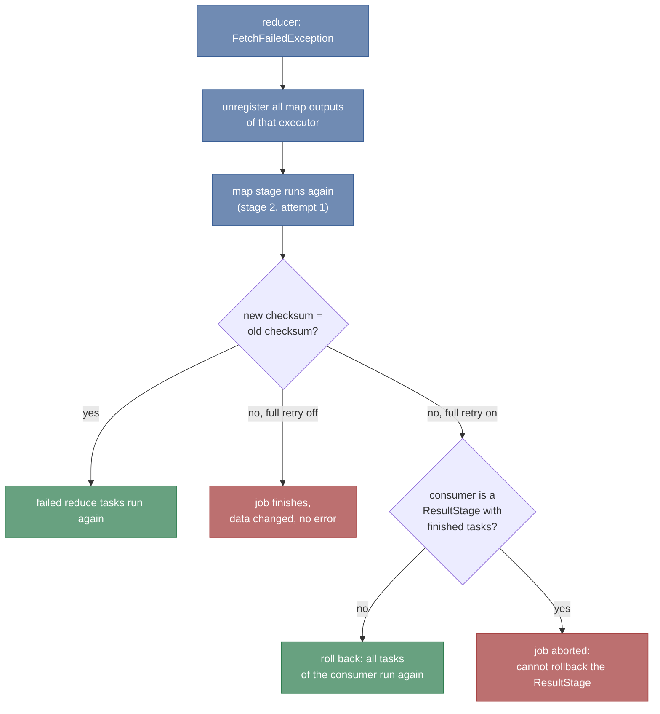
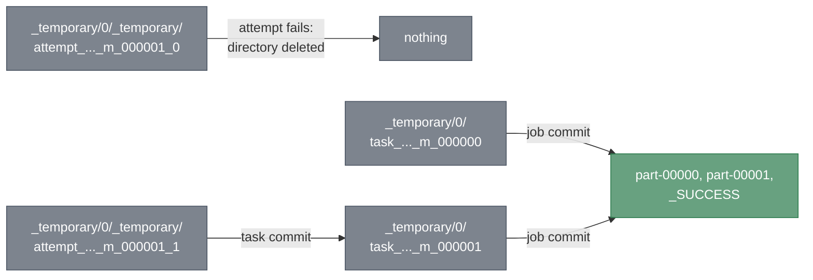
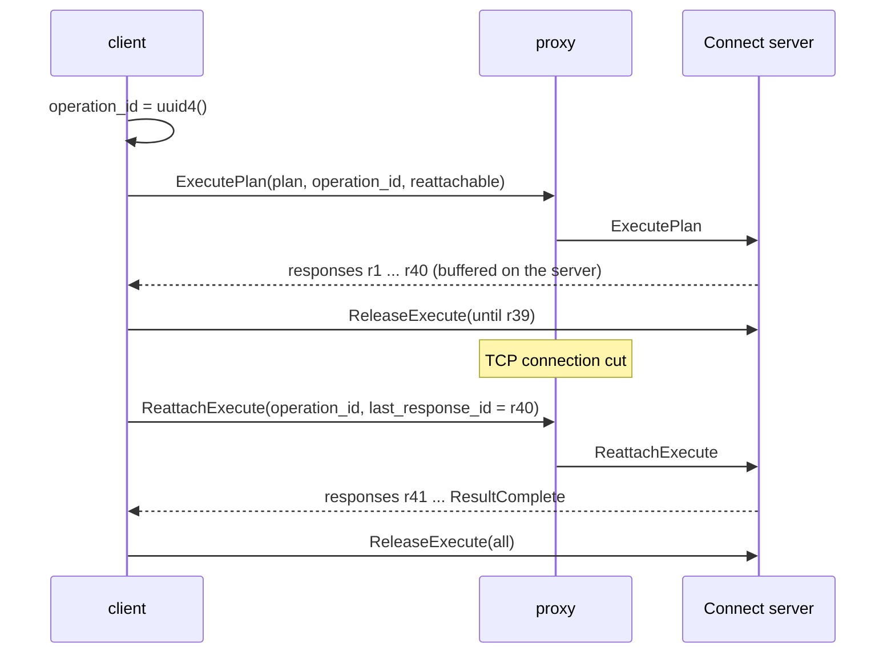

# Chapter 41: Determinism, retries and fault injection

A Spark job does not run your code one time. The scheduler retries a failed task. It recomputes a stage when shuffle files are lost. It can start a speculative copy of a slow task.

Each action on a DataFrame without a cache computes the full plan again. Spark Connect analyzes the plan again for each action. A client can also lose its connection in the middle of a result. Each time, your Python code runs again, or the client must continue the same operation. If the code is deterministic and its effects are idempotent, you see no difference. If not, you get duplicate rows, ids that change between runs, and sometimes a job that Spark refuses to finish.

**Spark recovers from failures because it runs the same work again. Thus a job is correct under failure only if each re-execution gives the same data. Each external effect must also occur one time only. You can examine both conditions on one machine. `local[N,F]` gives task retries, and a deleted shuffle file gives a stage retry. A proxy that cuts a TCP connection shows how a Spark Connect operation ID prevents a second execution.**

The code for this chapter is in [`code/ch41`](https://github.com/lisancao/spark-masterclass/tree/main/code/ch41). Each output block below comes from `code/ch41/output/`, from runs on pyspark 4.3.0 with OpenJDK 17 on a 16-core Linux machine. Source paths are relative to the Spark 4.3.0 source tree. The scheduler classes are in `core/src/main/scala/org/apache/spark/scheduler/`.

## When Spark runs your code again

The table lists each cause of re-execution and the place in the 4.3.0 source that controls it.

| Cause | What runs again | Where it is in 4.3.0 |
|---|---|---|
| A task failure (an exception, a lost executor) | That task, up to `spark.task.maxFailures` attempts (default 4) | `TaskSetManager.handleFailedTask` |
| A fetch failure (lost shuffle files) | The lost map outputs of the parent stage, then the failed stage, up to `spark.stage.maxConsecutiveAttempts` (default 4) | `DAGScheduler.handleTaskCompletion`, case `FetchFailed` |
| An indeterminate rollback | All tasks of the stages that read the changed shuffle | `DAGScheduler.rollbackSucceedingStages` |
| Speculation (`spark.speculation`, default `false`) | A second copy of a slow task, at the same time as the first | `TaskSetManager.checkSpeculatableTasks` |
| Many actions on one DataFrame without a cache | The full plan, one time for each action | Each action submits its own job |
| A lost or evicted cache block | The partitions that rebuild the block | `RDD.getOrCompute` |
| Spark Connect | Analysis, and with it seeds and timestamps, for each action | The server plans each request again |
| A streaming replay | A full micro-batch, with the same batch id | `MicroBatchExecution` |
| A broken Connect result stream | Nothing on the server, if the client reattaches to the same operation | `ExecutePlanResponseReattachableIterator` |

Two facts in this table are easy to forget. First, a retried task runs all of its stage again, not only the line that failed. Python UDFs and side effects from earlier in the stage run again too. Second, accumulators give a different count for each row of the table, as Step 6 shows.

Adaptive query execution (AQE) is not in the table. AQE plans the part of a query that did not run yet, between stages, and it uses the shuffle output of the stages that finished. Re-execution of finished work comes only from the causes in the table.

## Step 1: Local mode hides retries

`attempts.py` runs a UDF that fails on the first attempt of partition 1. The UDF writes each call to a file named for its partition and attempt number. The script runs the same query under three masters:

```python
def flaky(x, r):
    ctx = TaskContext.get()
    v = random.random()                          # Python's own generator
    with open(f"{log}/p{ctx.partitionId()}_a{ctx.attemptNumber()}.txt", "a") as f:
        f.write(f"{x} {v} {r}\n")
    if ctx.partitionId() == 1 and ctx.attemptNumber() == 0 and x == 150:
        raise RuntimeError("injected failure on the first attempt")
    return v

df = (spark.range(0, 400, numPartitions=4)
      .select("id", F.rand(7).alias("r"))        # Spark's generator, seed 7
      .withColumn("py", F.udf(flaky, DoubleType())("id", "r")))
```

```text
local[4]: failed, PythonException
  attempt files: p0_a0 p1_a0 p2_a0 p3_a0
local[4] spark.task.maxFailures=4: failed, PythonException
  attempt files: p0_a0 p1_a0 p2_a0 p3_a0
local[4,2]: 400 rows
  attempt files: p0_a0 p1_a0 p1_a1 p2_a0 p3_a0

Row 120 lives in partition 1, so it ran in both attempts:
  attempt 0: random.random() = 0.487818   rand(7) = 0.611899
  attempt 1: random.random() = 0.563658   rand(7) = 0.611899

spark.task.maxFailures as the scheduler sees it: 2
```

<figure markdown>
  <video autoplay loop muted playsinline controls width="1280" height="720" poster="../../media/clips/ch41-attempts.webp">
    <source src="../../media/clips/ch41-attempts.mp4" type="video/mp4">
  </video>
  <figcaption><code>attempts.py</code>: the same failure under <code>local[4]</code> and <code>local[4,2]</code>, and the values that a retry gives again.</figcaption>
</figure>

Under `local[4]`, one failure stops the job, and `spark.task.maxFailures=4` has no effect.

The cause is in `SparkContext.createTaskScheduler` (`core/src/main/scala/org/apache/spark/SparkContext.scala`). For `local` and `local[N]`, it creates the scheduler with `MAX_LOCAL_TASK_FAILURES = 1`. The master `local[N,F]` matches `LOCAL_N_FAILURES_REGEX` and gives F attempts to each task. The scheduler reports 2 for `local[4,2]`, and partition 1 has two attempt files. A test suite that never uses `local[N,F]` never sees a retry.

Speculation does not occur in local mode at all. `TaskSchedulerImpl.start` starts the speculation check only when `!isLocal && conf.get(SPECULATION_ENABLED)`. To study speculation, you need a cluster. To protect a job from speculation, apply the rest of this chapter. A speculative copy is a second attempt that runs at the same time as the first.

## Step 2: Nondeterminism that survives a retry, and nondeterminism that does not

The last lines of the output above contain the most useful fact in this chapter. `rand(7)` gave row 120 the same value in both attempts. Python's `random.random()` gave two different values.

Spark's random expressions use the `Nondeterministic` trait (`sql/catalyst/src/main/scala/org/apache/spark/sql/catalyst/expressions/Expression.scala`). The method `initialize(partitionIndex)` seeds the generator with the expression's seed plus the partition index. `rand`, `randn`, `uuid`, `shuffle` and `random` all work like this. With the same seed, the same partition and the same input order, a retried task makes the same values. If you do not give a seed, the analyzer rule `ResolveRandomSeed` selects one at analysis time and writes it into the plan.

Thus `rand()` repeats in one query, for one partitioning. It does not repeat in a different query, or when the rows arrive in a different order. Python code has no such guarantee. `random`, `uuid.uuid4()`, `time.time()`, `datetime.now()` and a call to a service all give a retry a different result. Spark removes one old cause for you: `SparkContext` sets `PYTHONHASHSEED` to `0` for Python workers, unless you set it (`python/pyspark/core/context.py`, line 296). Thus iteration over a `set` of strings has the same order in each worker.

`monotonically_increasing_id()` is a different trap. Its value contains the partition index and the position of the row in the partition. Step 7 shows that the value changes when the input splits in a different way. For ids that must stay the same across runs, calculate them from the content of the row, for example `F.sha2(F.concat_ws("|", key columns), 256)` or `F.xxhash64(...)`.

## Step 3: How Catalyst treats a nondeterministic expression

Each Catalyst expression has a `deterministic` flag. A Python UDF is deterministic until you call `asNondeterministic()` on it. The optimizer uses the flag to decide which rewrites are safe. For example, `PushPredicateThroughNonJoin` pushes a filter below a projection only if the projection is deterministic. A nondeterministic expression gives different results when it runs on fewer rows. The flag thus changes how often your UDF runs:

```python
det = F.udf(plus_one, "long")
nondet = F.udf(plus_one, "long").asNondeterministic()
base = spark.range(0, 1000, numPartitions=4)
for name, u in [("deterministic", det), ("asNondeterministic", nondet)]:
    calls.value = 0
    q = base.withColumn("y", u("id")).where("id < 10")
    q.collect()
    print(f"{name}: {calls.value} UDF calls for 10 rows")
    print(q._jdf.queryExecution().optimizedPlan().toString())
```

```text
deterministic: 10 UDF calls for 10 rows
Project [id#0L, pythonUDF0#3L AS y#2L]
+- ArrowEvalPython [plus_one(id#0L)#1L], [pythonUDF0#3L], 101
   +- Filter (id#0L < 10)
      +- Range (0, 1000, step=1, splits=Some(4))

asNondeterministic: 1000 UDF calls for 10 rows
Project [id#0L, pythonUDF0#6L AS y#5L]
+- Filter (id#0L < 10)
   +- ArrowEvalPython [plus_one(id#0L)#4L], [pythonUDF0#6L], 101
      +- Range (0, 1000, step=1, splits=Some(4))
```

A nondeterministic UDF is honest and expensive. The filter stays above it, so the UDF runs on all 1000 rows. Mark a UDF nondeterministic when its result really changes (it reads a clock, it samples, it calls a service). Do not mark it only "to be safe". The optimizer then stops many rewrites, and Spark refuses the expression in some positions. A nondeterministic expression in a join condition fails at analysis:

```text
INVALID_NON_DETERMINISTIC_EXPRESSIONS | [INVALID_NON_DETERMINISTIC_EXPRESSIONS] The operator expects a deterministic expression, but the actual expression is "((id = j) AND (rand(1) > 0.5))"
```

The flag is a promise to the optimizer and nothing more. A UDF that calls `random.random()` and keeps the default flag gets the optimizations of a pure function. Spark cannot know that a retry changed its output, until the shuffle checksums in Step 5 see the change.

**New in 4.3: UDF transpilation.** Spark 4.3 can rewrite a simple Python UDF as a Catalyst expression (`spark.sql.experimental.optimizer.transpilePyUDFs`, default `false`, which also needs ANSI mode). A transpiled UDF has no Python worker, so it also has no side effects. `nondeterminism.py` tests which UDFs the rewrite accepts:

```text
transpile=false add_one           useArrow=None  evalType=101  Python in plan: True   files: 0
transpile=false add_one           useArrow=False evalType=100  Python in plan: True   files: 0
transpile=false plus_one_and_mark useArrow=False evalType=100  Python in plan: True   files: 100
transpile=true  add_one           useArrow=None  evalType=101  Python in plan: True   files: 0
transpile=true  add_one           useArrow=False evalType=100  Python in plan: False  files: 0
transpile=true  plus_one_and_mark useArrow=False evalType=100  Python in plan: True   files: 100
```

Three facts come from these rows:

- The transpiler accepted `add_one` (`return x + 1`) only with `useArrow=False`. In `python/pyspark/sql/udf.py`, transpilation applies only to `PythonEvalType.SQL_BATCHED_UDF` (100). A plain `@udf` in 4.3 is an Arrow UDF (101) because `spark.sql.execution.pythonUDF.arrow.enabled` is `true` by default. Thus the flag alone does not change a default UDF.
- The transpiler refused `plus_one_and_mark`, which writes a file for each call. The UDF stayed in Python, and the 100 side-effect files show that it ran for each row.
- The source also refuses a nondeterministic UDF: "A nondeterministic UDF must not be transpiled".

Two smaller traps come from the same script. First, a UDF object pickles its function and the globals that it reads one time, when it first makes a column:

```text
CFG changed from 1 to 2 between df1 and df2: df1 = 1  df2 = 1  a new udf object = 2
```

Make such objects first, give values as columns or literals, or make the UDF inside the function that uses it. Second, the SparkTutor lesson for this chapter found that `F.udf(f, "double")` at module level fails before a session exists. The DDL string needs a parser, and the parser needs a session. Give a `DataType` such as `DoubleType()` to UDFs that you define at import time. `fragile_job.py` uses `DoubleType()` for this reason.

## Step 4: Determinism levels in the DAG

The scheduler knows nothing about expressions. It works with RDDs, and each RDD reports `outputDeterministicLevel` (`core/src/main/scala/org/apache/spark/rdd/RDD.scala`). There are three levels:

- `DETERMINATE`: the same data in the same order for each computation.
- `UNORDERED`: the same data, but the order can change. Each shuffle read has at least this level, because the fetched blocks arrive in a random order.
- `INDETERMINATE`: the data itself can change.

`getOutputDeterministicLevel` calculates the level from the parents. The important case is an order-sensitive function on `UNORDERED` input, which gives `INDETERMINATE`. A round-robin repartition is the usual example. It sends row k to partition k mod n, so a different input order sends rows to different partitions. In Classic mode, you can read the level of the final RDD of a plan:

```python
def level(df):
    return df._jdf.queryExecution().toRdd().outputDeterministicLevel().toString()
```

```text
range                                      DETERMINATE
groupBy                                    UNORDERED
hash repartition after groupBy             UNORDERED
round-robin repartition after groupBy      UNORDERED
sample after groupBy                       UNORDERED
round-robin, sortBeforeRepartition=false   INDETERMINATE
```

A round-robin `repartition(n)` is safe by default. `ShuffleExchangeExec` sorts each input partition before it assigns the rows (`spark.sql.execution.sortBeforeRepartition`, internal, default `true`, added for SPARK-23207). The RDD becomes order-sensitive only when you turn that sort off. The level also tells nothing about Python. A UDF that calls `random.random()` before a shuffle leaves the map stage `DETERMINATE` for the scheduler.

## Step 5: A lost shuffle, three ways

Sometimes a reducer cannot read a map output. For example, the executor that wrote it stopped, or a process deleted the files on its disk. The task then fails with a `FetchFailedException`. Spark does not count this as a task failure. `DAGScheduler` marks the map output as lost, submits the map stage again, and then submits the failed stage again.

You can cause a fetch failure on one machine. Run a job, delete the shuffle files of one map task from `spark.local.dir`, and run the same DataFrame again. The second `collect()` uses the old shuffle, so the scheduler skips the map stage. Then the reducers do not find a file:

```python
def lost_shuffle(udf_kind, full_retry):
    local = tempfile.mkdtemp(prefix="ch41-local-")
    spark = fresh("local[4]", **{
        "spark.local.dir": local,
        "spark.sql.adaptive.enabled": "false",
        "spark.sql.shuffle.orderIndependentChecksum.enableFullRetryOnMismatch": full_retry})

    def bucket(x):
        return random.randint(0, 3) if udf_kind == "random" else x % 4

    df = (spark.range(0, 4000, numPartitions=4)
          .withColumn("b", F.udf(bucket, "int")("id"))
          .repartition(4, "b")
          .groupBy("b").agg(F.count("*").alias("n")))
    first = sorted((r.b, r.n) for r in df.collect())
    victim = sorted(glob.glob(f"{local}/**/shuffle_*_0_0.data", recursive=True))[0]
    for f in glob.glob(victim.replace(".data", ".*")):
        os.remove(f)                                       # map task 0's output is gone
    second = sorted((r.b, r.n) for r in df.collect())
```

```text
modulo  fullRetry=true  same result: True   rows: 4000
                        first  [(0, 1000), (1, 1000), (2, 1000), (3, 1000)]
                        second [(0, 1000), (1, 1000), (2, 1000), (3, 1000)]
                        stage 2 attempt 1: COMPLETE 4 task(s) ran
                        stage 3 attempt 0: FAILED   4 task(s) ran
                        stage 3 attempt 1: COMPLETE 2 task(s) ran
random  fullRetry=false same result: False  rows: 4000
                        first  [(0, 974), (1, 978), (2, 1047), (3, 1001)]
                        second [(0, 1039), (1, 977), (2, 1023), (3, 961)]
                        stage 2 attempt 1: COMPLETE 4 task(s) ran
                        stage 3 attempt 0: FAILED   4 task(s) ran
                        stage 3 attempt 1: COMPLETE 2 task(s) ran
random  fullRetry=true  FAILED:
    Job aborted due to stage failure: A shuffle map stage with indeterminate output was
    failed and retried. However, Spark cannot rollback the ResultStage 3 to re-process
    the input data, and has to fail this job. Please eliminate the indeterminacy by
    checkpointing the RDD before repartition and try again.
                        stage 2 attempt 1: FAILED   4 task(s) ran
                        stage 3 attempt 0: FAILED   4 task(s) ran
```

<figure markdown>
  <video autoplay loop muted playsinline controls width="1280" height="720" poster="../../media/clips/ch41-shuffle.webp">
    <source src="../../media/clips/ch41-shuffle.mp4" type="video/mp4">
  </video>
  <figcaption><code>lost_shuffle.py</code>: a deleted map output with a deterministic UDF, then with a random UDF, with the check off and on.</figcaption>
</figure>

The stage records come from the monitoring REST API.

In each case, attempt 0 of result stage 3 failed with the fetch failure. Then the map stage ran again as stage 2, attempt 1. All four map tasks ran again, not only map task 0. The reason is in `DAGScheduler.unregisterOutputsOnFetchFailedExecutor`. A fetch failure removes all shuffle outputs of the executor that wrote the lost block. In local mode, one executor (the driver) wrote all four outputs.

- **A deterministic UDF.** The recomputed map tasks wrote the same data. The result is the same, and you cannot see the retry in the result.
- **A random UDF, with full retry off.** The job finished with different counts and no error. Each answer is a valid random assignment to buckets. But nothing told you that a recomputation occurred and changed the data under the result. If some reducers read the old map output and others read the new output, rows are lost or duplicated. SPARK-23207 and SPARK-51756 describe this failure.
- **A random UDF, with the defaults.** Spark found the change and stopped the job.

The protection comes from an order-independent checksum. Since Spark 4.1 (SPARK-51756), each SQL shuffle map task calculates a checksum for each reduce partition (`spark.sql.shuffle.orderIndependentChecksum.enabled`). The checksum does not change when the row order changes. The task sends the checksum with its map status.

When a recomputed map task reports a different checksum, `MapOutputTracker.registerMapOutput` records a mismatch. The stage becomes `isRuntimeIndeterminate`, and `DAGScheduler` rolls back each stage that read the output, so that all of their tasks run again (`spark.sql.shuffle.orderIndependentChecksum.enableFullRetryOnMismatch`). Both settings have the default `true` in 4.3.0 (`SQLConf.scala`, lines 1211 to 1232).

Spark can roll back a `ShuffleMapStage`. It cannot roll back a `ResultStage` that finished some partitions, because those results can already be in your driver or in an output file. In this run, attempt 0 of stage 3 completed two of its four tasks before the failure. Thus `filterAndAbortUnrollbackableStages` stopped the job with the message above.



The error message tells you to checkpoint before the shuffle. That is the general fix, because a reliably checkpointed RDD is `DETERMINATE` (`isReliablyCheckpointed` in `RDD.outputDeterministicLevel`). The better fix is to send no values to a shuffle that change when Spark computes them again.

## Step 6: Accumulators, actions and observe()

Accumulators look like the natural way to count things from tasks. `counting.py` measures them against two causes of re-execution. Each task fails one time, half way through its rows, under `local[4,3]`:

```python
def counted(x):
    calls.add(1)
    if TaskContext.get().attemptNumber() == 0 and x % 100 == 50:
        raise RuntimeError("injected")                 # every task fails once, half way through
    return x

df.agg(F.sum("v")).first()
df.write.mode("overwrite").parquet(out)

obs = Observation("m")
observed = df.observe(obs, F.count(F.lit(1)).alias("rows"), F.sum("v").alias("total"))
observed.write.mode("overwrite").parquet(out)
```

```text
one action, every task retried once: 400
after a second action:               800
observe() on the write: {'rows': 400, 'total': 79800}  accumulator: 400
part files: 4  rows read back: 400
CollectMetrics in the plan: True
cached: two actions, UDF calls: 400
```

The failed attempts called the UDF 51 times each, but the driver dropped their accumulator updates. The driver merges the updates of a task only when the task succeeds. Failed tasks report only the internal metrics that set `countFailedValues`. Thus a retry does not count two times. A second action does, because it is a second successful computation. A stage that runs again after a fetch failure also counts again.

`DataFrame.observe` (an `Observation` in Python) calculates named aggregates as a side output of the query that writes the data. The plan has a `CollectMetrics` operator for it. The values come from successful tasks only, and you get them when the action finishes. The observation counts the rows that the job wrote, one time. Use it for row counts and sums that you report or compare with a limit.

A `cache()` is the other answer to two actions. The last line shows that the UDF ran 400 times for two actions on a cached DataFrame. But a lost or evicted cache block makes Spark compute the plan again for those partitions. A cache makes repeated actions cheaper. It does not make them deterministic.

## Step 7: Ids and samples that move with the partitioning

`writes.py` reads the book's taxi file with two values of `spark.sql.files.maxPartitionBytes`. Then it takes one trip, the first trip after noon on 15 June, and prints two ids for it:

```python
for split in ("128m", "8m"):
    spark = fresh("local[4]", **{"spark.sql.files.maxPartitionBytes": split})
    trips = spark.read.parquet(str(TRIPS))
    keyed = trips.select("VendorID", "tpep_pickup_datetime", "PULocationID", "DOLocationID",
                         "total_amount")
    row = (keyed.withColumn("mid", F.monotonically_increasing_id())
           .withColumn("content_id", F.xxhash64(*keyed.columns))
           ...
```

```text
maxPartitionBytes=128m scan tasks= 4  sample rows= 3772  one trip: mid=  8590304387  xxhash64=588205441998661716
maxPartitionBytes=8m   scan tasks= 8  sample rows= 3883  one trip: mid= 25770173571  xxhash64=588205441998661716
```

The file is the same, but the scan has 4 tasks in one run and 8 in the other. The same trip gets a different `monotonically_increasing_id()`, because that id contains the partition index. `sample(fraction=0.001, seed=7)` keeps a different number of rows, because the seed applies to each partition. The `xxhash64` of the content is the same in both runs. Other changes move these values too: more input files, a different `spark.sql.shuffle.partitions`, or AQE with or without coalescing.

The same script shows a trap in the Python signature of `sample`:

```text
sample(fraction=0.001, seed=7)  seed in the plan: 7
sample(0.001, 7)                seed in the plan: 7
sample(0.001, seed=7)           seed in the plan: 4149081280734837886
```

When the first positional argument is a float, `DataFrame._preapare_args_for_sample` (`python/pyspark/sql/dataframe.py`, line 2187) reads the seed from the second positional argument. Spark thus ignores the keyword `seed`, and the plan gets a random seed. Give both values as keywords, `sample(fraction=..., seed=...)`, or both as positional arguments. The part notes record this as an open issue.

## Step 8: Writes that survive a retry but not a rerun

A retried task is safe for Spark's file writers because of the commit protocol. The default is `SQLHadoopMapReduceCommitProtocol` over Hadoop's `FileOutputCommitter`. `SparkHadoopUtil` sets algorithm version 1, unless you set `spark.hadoop.mapreduce.fileoutputcommitter.algorithm.version`. Each task attempt writes in its own directory. A task commit moves the attempt directory to a task directory.

Only the job commit moves files into the output folder. `writes.py` makes this visible. A UDF lists the output folder from inside each task, and partition 1 fails one time:

```text
p0_a0: what the task saw under the output folder while it ran
   _temporary/0/_temporary/attempt_<job>_0000_m_000000_0/.part-00000-<uuid>-c000.snappy.parquet.crc
   _temporary/0/_temporary/attempt_<job>_0000_m_000000_0/part-00000-<uuid>-c000.snappy.parquet

p1_a0: what the task saw under the output folder while it ran
   _temporary/0/_temporary/attempt_<job>_0000_m_000000_0/.part-00000-<uuid>-c000.snappy.parquet.crc
   _temporary/0/_temporary/attempt_<job>_0000_m_000000_0/part-00000-<uuid>-c000.snappy.parquet

p1_a1: what the task saw under the output folder while it ran
   _temporary/0/task_<job>_0000_m_000000/part-00000-<uuid>-c000.snappy.parquet

after the job commit: ['_SUCCESS', 'part-00000-<uuid>-c000.snappy.parquet', 'part-00001-<uuid>-c000.snappy.parquet']
```

While attempt 0 of partition 1 ran, task 0 wrote in its attempt directory. When attempt 1 ran, task 0 completed its task commit, and its file was in a task directory. The failed attempt left no file in the output. After the job commit, the folder has `_SUCCESS` and one file for each partition.



The commit protocol does not protect against a **rerun**. Suppose that the job succeeded, a later step failed, and an orchestrator ran the full job again. Then the save mode decides the result:

```text
append    run twice: 20 rows (10 expected)
overwrite run twice: 10 rows (10 expected)
partitionOverwriteMode=static  after re-running 2026-06-02: {'2026-06-02': 5}
partitionOverwriteMode=dynamic after re-running 2026-06-02: {'2026-06-01': 5, '2026-06-02': 5}
```

- `append` adds a second copy of all rows.
- `overwrite` replaces the output. This is idempotent for a job that writes all of the output.
- For partitioned output, a run often writes only some partitions (one day, one source). With `partitionBy(...)` and `spark.sql.sources.partitionOverwriteMode=dynamic`, `overwrite` replaces only the partitions in the new data. The default is `static`, and then `overwrite` deleted the 2026-06-01 partition.
- Table formats make the replacement explicit, for example Delta's `replaceWhere` or a `MERGE` with a key from the content. Chapter 29 covers them.

Side effects that are not files need the same discipline: an email, a payment, a row sent to another system. Inside a task, they occur again with each retry, each recomputed stage, each speculative copy and each extra action. Give each effect a stable key (the content id, the batch id). Then do the effect one time on the driver after the commit, or make the receiver ignore a key that it saw before.

## Step 9: Spark Connect analyzes each action again

A Classic DataFrame holds a `QueryExecution`. Spark analyzes it one time and keeps the optimized plan. In that plan, `current_timestamp()` is a literal, and the random seeds do not change. A Spark Connect DataFrame is an unresolved plan on the client. Each action sends the plan to the server, which analyzes and optimizes it from the start. `connect_determinism.py` runs two actions, 1.1 seconds apart, on the same DataFrame in each mode:

```python
sql_df = spark.sql("SELECT rand() AS r, uuid() AS u, current_timestamp() AS t")
seeded = spark.sql("SELECT rand(42) AS r, uuid() AS u, current_timestamp() AS t")
api_df = spark.range(1).select(F.rand().alias("r"), F.uuid().alias("u"),
                               F.current_timestamp().alias("t"))
```

```text
classic  spark.sql           same rand: True   same uuid: True   same timestamp: True 
classic  spark.sql rand(42)  same rand: True   same uuid: True   same timestamp: True 
classic  DataFrame API       same rand: True   same uuid: True   same timestamp: True 
connect  spark.sql           same rand: False  same uuid: False  same timestamp: False
connect  spark.sql rand(42)  same rand: True   same uuid: False  same timestamp: False
connect  DataFrame API       same rand: True   same uuid: True   same timestamp: False

the client-side seed in the plan sent for F.rand(): 4578929883635751434
```

There are two surprises:

- In Classic, `current_timestamp()` stayed the same across two actions more than one second apart. Spark used the optimized plan again, with the timestamp in it. A new DataFrame gets a new time.
- In Connect, the DataFrame API gave the same `rand` and `uuid` in both actions, but SQL text did not. The Python client makes the seed itself when you call `F.rand()` or `F.uuid()` without a seed (`python/pyspark/sql/connect/functions/builtin.py`, lines 425 and 4651, `lit(py_random.randint(0, sys.maxsize))`). The last output line shows that seed in the plan that the client sends. The server analyzes SQL text again for each action, and `ResolveRandomSeed` selects a new seed each time.

For pipelines on Connect, this has a direct result. A DataFrame made with `spark.sql("... rand() ...")` gives a different sample to each action. Write the seed into the SQL (`rand(42)`), or write the result to a table before you use it two times.

## Step 10: Connect operation IDs and reattachable execution

A Connect client receives a result as a stream of `ExecutePlanResponse` messages over gRPC. The stream can break: a load balancer restarts, a NAT entry expires, or a network link drops packets. Spark Connect has an answer for this since 3.5, called reattachable execution. The key part is the operation ID. Spark 4.3 makes it visible at both ends (SPARK-58547 on the client, SPARK-57941 in the REST API), as [Chapter 4](ch04-spark-connect.md) showed.

The mechanism is in `python/pyspark/sql/connect/client/reattach.py`:

- The client makes a UUID for the operation before it sends `ExecutePlan`, and it marks the request as reattachable.
- The server buffers the responses that it sent (`spark.connect.execute.reattachable.observerRetryBufferSize`, default 10m) until the client releases them with `ReleaseExecute`.
- If the stream ends without a `ResultComplete` message, the client sends `ReattachExecute`. The request contains the operation ID and the ID of the last response that the client received. The server continues after that response.
- The server also ends each stream on purpose after `senderMaxStreamDuration` (default 2m) or `senderMaxStreamSize` (default 1g). This keeps each gRPC stream short, and the client reattaches.

`reattach.py` reads 3.8 million rows through `flaky_proxy.py`, a TCP proxy between the client and the server. The proxy can cut all of its connections one time, after a given number of bytes. The script counts each RPC that the client sends, and reads the server's record of the operation from the REST API. The server runs with `senderMaxStreamSize=16m`, so one result needs several streams:

```bash
ch41/server.sh start --conf spark.connect.execute.reattachable.senderMaxStreamSize=16m
```

```python
with SparkSession.builder.remote(f"sc://localhost:{PORT + 1}").getOrCreate() as spark:
    calls = count_rpcs(spark)
    ...
    proxy.cut_after(30_000_000)
    df = big_query(spark)
    pdf = df.toPandas()
    op = df.executionInfo.operation_id
```

```text
1. no fault: 3,837,248 rows, operation 6d4b85e7
   rpcs: ExecutePlan 1  ReattachExecute 3  ReleaseExecute 392
   server: state=CLOSED jobIds=['27', '28'] executionTime=438 ms
2. connection cut at 30 MB: 3,837,248 rows, operation c37f366d, cuts 1
   rpcs: ExecutePlan 1  ReattachExecute 4  ReleaseExecute 397
   server: state=CLOSED jobIds=['29', '30'] executionTime=490 ms
3. not reattachable, cut at 30 MB: UnknownException INVALID_HANDLE.OPERATION_ABANDONED
   rpcs: ExecutePlan 2, operation 1a412a02
4. ExecutePlan #1 with operation c4e6ee16: ok, 3 arrow batch(es)
4. ExecutePlan #2 with operation c4e6ee16: INVALID_HANDLE.OPERATION_ABANDONED
```

<figure markdown>
  <video autoplay loop muted playsinline controls width="1280" height="720" poster="../../media/clips/ch41-reattach.webp">
    <source src="../../media/clips/ch41-reattach.mp4" type="video/mp4">
  </video>
  <figcaption><code>reattach.py</code>: a result of 3.8 million rows through a proxy that cuts the TCP connection, with and without reattachable execution.</figcaption>
</figure>

Each case teaches a different point:

1. **No fault.** One `ExecutePlan` and three `ReattachExecute` calls read the full result. The server ended each stream after 16 MB, and the client continued the same operation each time. The many `ReleaseExecute` calls let the server free its buffer as the client reads.
2. **A cut connection.** The proxy cut the TCP connection after 30 MB. The client reattached one more time and received all 3,837,248 rows. The server record shows two job IDs, the same number as the run without a fault. The query did not run again.
3. **No reattachable execution.** `spark.client.disable_reattachable_execute()` removes the reattach option. After the cut, the client's retry policy sent `ExecutePlan` again, with the same operation ID. The server refused it with `INVALID_HANDLE.OPERATION_ABANDONED`. The operation ID prevented a second execution, but the client got an error and no result.
4. **The same ID two times.** This case uses the client's internal request builder, because the public API always makes a new ID. The second `ExecutePlan` with an ID that completed before failed with `INVALID_HANDLE.OPERATION_ABANDONED`.

The server code explains cases 3 and 4. `SparkConnectExecutionManager.createExecuteHolder` refuses an operation ID that is active (`OPERATION_ALREADY_EXISTS`). It also refuses an ID in the tombstones of abandoned operations, or one that the session recorded before (`OPERATION_ABANDONED`). The source comment gives the purpose: "Prevents double execution when client retries on a lost response."



The operation ID thus gives Connect two properties that the scheduler gives to tasks. A client can continue a result without a second execution. A client that sends a request again cannot run it two times by accident. Reattachable execution does not make your query deterministic. If the server restarts, the operation is lost, and a new `ExecutePlan` analyzes the plan again, with all of the effects in Step 9.

## Step 11: Make a fragile job correct

The SparkTutor exercise for this chapter has a batch job that turns checkout events into a charges table. The job makes one row for each `pay` event, with a `charge_id` and the amount that a payment service converts to USD. It also writes an audit sample, posts a ledger with one entry for each charge, and reports metrics. The events are SparkTutor's sample data, copied to `code/ch41/data/checkout_events/`.

`fragile_job.py` runs two versions of the job. Each version runs one time clean (`local[2]`). Then it runs under chaos in a new session, with these settings:

- `local[4,4]`, input splits of 700 bytes, 7 shuffle partitions and AQE off.
- A payment service that fails the first attempt of each task.

 The chaos run runs the job two times, as an orchestrator does after a crash.

The fragile version has four faults:

```python
.withColumn("charge_id", F.expr("substr(uuid(), 1, 16)"))       # new every query
.withColumn("amount_usd", to_usd("event_id", "user", "amount"))   # posts from inside a task
revenue = charges.agg(F.round(F.sum("amount_usd"), 2)).first()[0]       # a second action
charges.write.mode("append").parquet(f"{out}/charges")                  # a rerun duplicates
spark.read.parquet(f"{out}/charges").sample(fraction=0.5, seed=42) ...  # moves with partitions
```

The correct version changes each one:

```python
.withColumn("charge_id", F.sha2(F.concat_ws("|", "event_id", "user"), 256).substr(1, 16))
.withColumn("amount_usd", to_usd("amount"))                  # converts, nothing else
obs = Observation("charges")
charges = charges.observe(obs, F.count(F.lit(1)).alias("charges"),
                          F.round(F.sum("amount_usd"), 2).alias("revenue_usd"))
charges.write.mode("overwrite").parquet(f"{out}/charges")   # one action, replaces
spark.read.parquet(f"{out}/charges").where(F.pmod(F.xxhash64("charge_id"), F.lit(2)) == 0) ...
post_ledger(spark, f"{out}/charges", ledger)   # on the driver, keyed by charge_id, one os.replace
```

```text
fragile_job:
  chaos run: 16 tasks retried
  charges  clean  6 rows, chaos 12 rows, identical: False
  audit    clean  1 rows, chaos  6 rows, identical: False
  ledger   clean 12 rows, chaos 24 rows, identical: False
  metrics  clean {'charges': 12, 'revenue_usd': 162.69}
           chaos {'charges': 12, 'revenue_usd': 162.69}
correct_job:
  chaos run: 8 tasks retried
  charges  clean  6 rows, chaos  6 rows, identical: True
  audit    clean  2 rows, chaos  2 rows, identical: True
  ledger   clean  6 rows, chaos  6 rows, identical: True
  metrics  clean {'charges': 6, 'revenue_usd': 162.69}
           chaos {'charges': 6, 'revenue_usd': 162.69}
```

<figure markdown>
  <video autoplay loop muted playsinline controls width="1280" height="720" poster="../../media/clips/ch41-fragile.webp">
    <source src="../../media/clips/ch41-fragile.mp4" type="video/mp4">
  </video>
  <figcaption><code>fragile_job.py</code>: the fragile job and the correct job, each run clean and then under chaos.</figcaption>
</figure>

The fragile job is wrong even in the clean run. Its ledger has 12 entries for 6 charges, and its metrics report 12 charges, because the second action ran the UDF again. Under chaos, the rerun appended a second copy of the charges and posted the ledger again. The correct job gives the same charges, audit sample, ledger and metrics in both runs, after 8 retried tasks.

## A fault injection toolkit

The table collects each technique from this chapter:

| To cause | Do | Examine |
|---|---|---|
| Task retries | Use the master `local[N,F]`. Fail when `TaskContext.get().attemptNumber() == 0`. | The attempt numbers in a file that the task writes |
| A fetch failure and a stage retry | Set `spark.local.dir` to a temporary folder. Run an action, delete `shuffle_<shuffle>_<map>_0.*`, and run an action on the same DataFrame. | The stage attempts in the REST API |
| An indeterminate map stage | Put a Python UDF with `random` before a shuffle, then do the step above. | The abort message, or a changed result with full retry off |
| A rerun | Call the job function two times. | Duplicate rows with `append` |
| A different partitioning | Change `spark.sql.files.maxPartitionBytes`, `openCostInBytes`, `spark.sql.shuffle.partitions`, or AQE. | Changes in `monotonically_increasing_id()` and `sample()` |
| A broken Connect stream | Put a TCP proxy between the client and the server, and cut its connections. | The `ReattachExecute` count, and `jobIds` in `/connect/operations` |
| A short Connect stream | Start the server with a small `spark.connect.execute.reattachable.senderMaxStreamSize`. | The `ReattachExecute` count |
| A crash flag that executors can see | Create and remove a file at an absolute path from the driver. | Python workers in local mode share the local disk with the driver |

A test harness that uses these techniques compares a clean run with a chaos run and requires the same results. Step 11 is such a harness.

## The whole chapter, on one page

- **Spark runs code again** for task failures, fetch failures, indeterminate rollbacks and speculation. Each action on a DataFrame without a cache, a lost cache block and a streaming replay also run code again. Spark Connect also analyzes each action again.
- **`local[N]` never retries a task.** `local[N,F]` gives F attempts. Speculation never runs in local mode.
- **`rand(seed)`, `uuid()` and similar expressions repeat on a retry.** Python randomness, clocks and services do not. `monotonically_increasing_id()` and `sample()` change with the partitioning. Calculate ids that must survive a rerun from the content.
- **The deterministic flag is a promise to the optimizer.** `asNondeterministic()` keeps filters above the UDF. 4.3's UDF transpilation applies only to `useArrow=False` UDFs, and it refuses UDFs with side effects.
- **RDDs report a determinism level.** In 4.3, SQL shuffles calculate an order-independent checksum. A recomputed map task with different output rolls back all consumer stages, or stops the job if a result stage finished some partitions.
- **Accumulators drop the updates of failed tasks**, but second actions and recomputed stages count again. `observe()` counts what the job wrote, one time.
- **Commit protocols make one job atomic, not a rerun idempotent.** Use overwrite semantics, give each external effect a key, and do the effect after the commit.
- **A Connect operation ID names one execution.** The client uses it to reattach after a broken stream, and the server uses it to refuse a second execution.

The next chapter looks at the code that all of these retries run. That code must first get to the executors.

## Further reading

- [Spark configuration, the scheduler settings](https://spark.apache.org/docs/4.3.0/configuration.html#scheduling), with `spark.task.maxFailures`, `spark.stage.maxConsecutiveAttempts` and the speculation settings.
- [SPARK-51756](https://issues.apache.org/jira/browse/SPARK-51756), the order-independent shuffle checksum.
- [SPARK-23207](https://issues.apache.org/jira/browse/SPARK-23207), the round-robin repartition problem and the sort that fixes it.
- [Spark Connect overview](https://spark.apache.org/docs/4.3.0/spark-connect-overview.html), and the `ReattachExecute` and `ReleaseExecute` messages in [`base.proto`](https://github.com/apache/spark/blob/v4.3.0/sql/connect/common/src/main/protobuf/spark/connect/base.proto).
