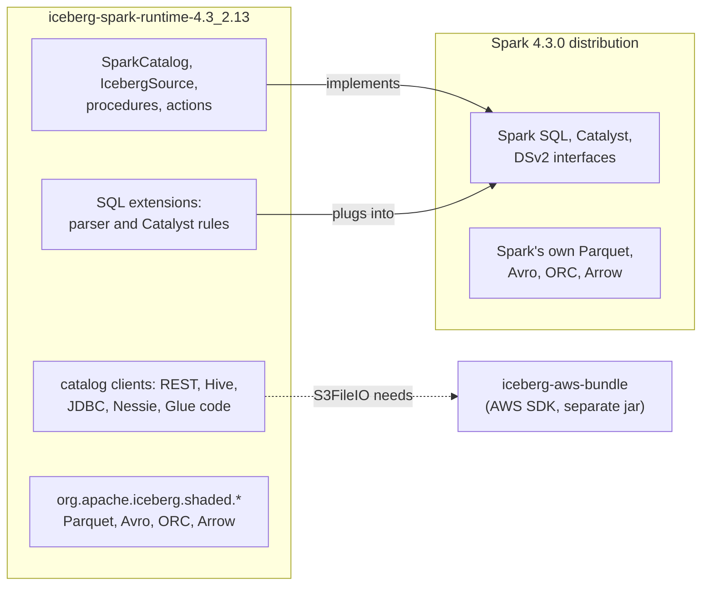
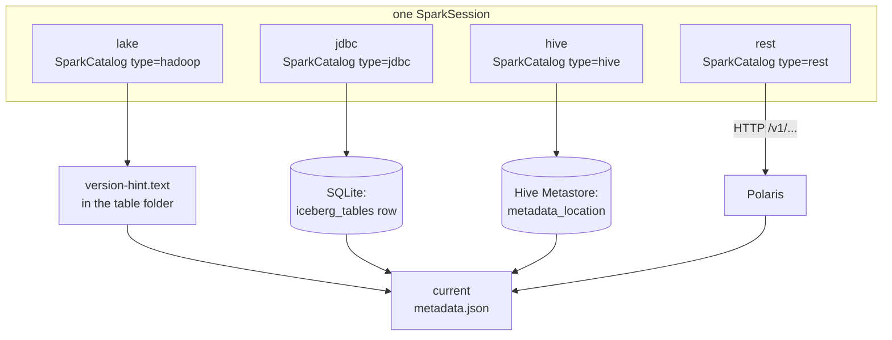
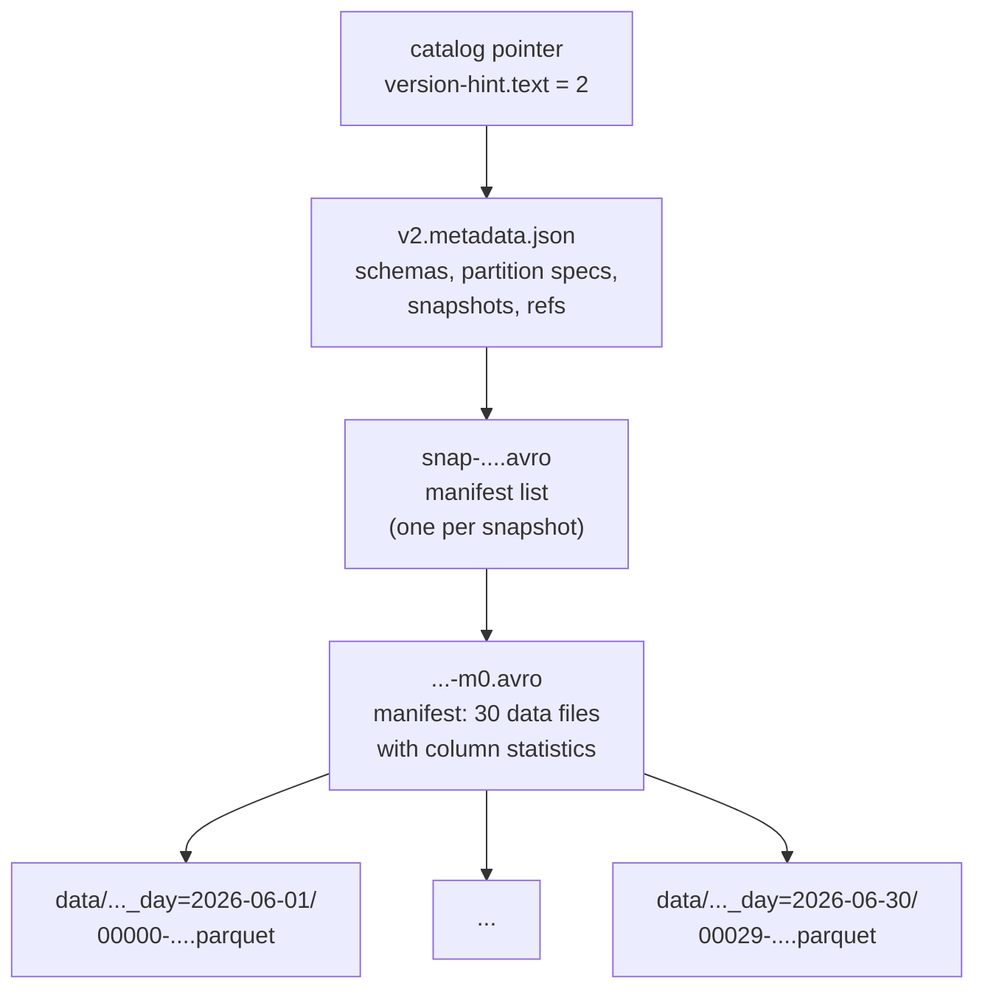
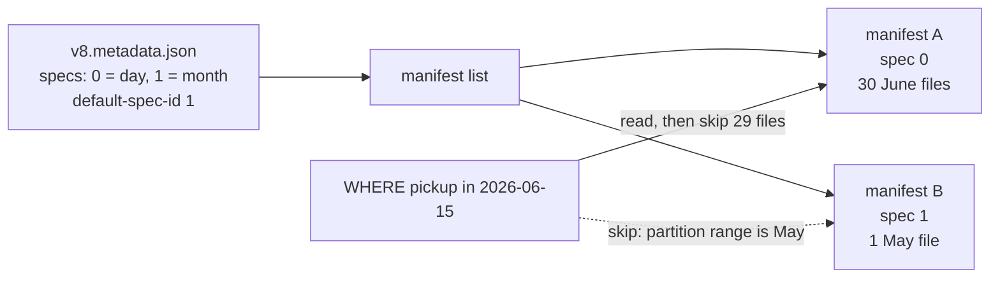
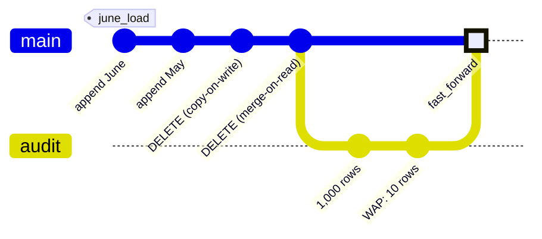
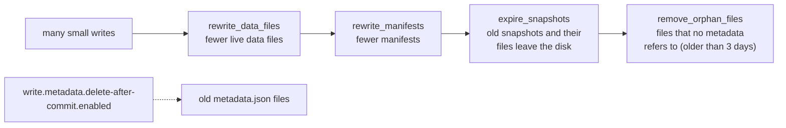

# Chapter 45: Apache Iceberg with Spark: the runtime and catalog management

[Chapter 44](ch44-tables-delta-iceberg.md) compares Delta and Iceberg tables, with `MERGE` and time travel. This chapter goes deeper into Iceberg only. It starts with the jar that puts Iceberg into Spark, and it continues with the catalogs that find each table. Then it does each table operation and examines the files that the operation writes.

**An Iceberg table is a tree of metadata files and data files, with one pointer at the top. The catalog keeps the pointer, and the runtime jar is the code that reads and writes the tree inside Spark. Each change to a table writes new files and then moves the pointer in one atomic step. If you know where the pointer is and what each file in the tree contains, you can explain each Iceberg feature in this chapter.**

The code is in [`code/ch45/`](https://github.com/lisancao/spark-masterclass/tree/main/code/ch45). The scripts run on `pyspark==4.3.0` in local mode. Two of them need the catalog servers in Docker, which `code/ch45/catalogs.sh up` starts. Each output block below comes from a file in `code/ch45/output/`.

!!! warning "No released Iceberg supports Spark 4.3"
    On 2026-11-22, the newest Iceberg release is 1.12.0. It has runtime jars for Spark 3.5, 4.0 and 4.1 only. This chapter uses a runtime that we built from an open pull request, [apache/iceberg#18749](https://github.com/apache/iceberg/pull/18749) ("Spark: Initial support for 4.3.0", commit `b1eab64`). This build did not go through a release vote.

    Do not use it in production. When a release for Spark 4.3 is available, use that release.

## Step 1: Find the runtime that matches your Spark

Spark loads Iceberg from one jar, `iceberg-spark-runtime`. The name of the artifact contains three versions:

```text
org.apache.iceberg:iceberg-spark-runtime-4.1_2.13:1.12.0
                                         |   |    |
                    Spark minor version -+   |    +- Iceberg version
                           Scala version ----+
```

The Spark minor version in the name must be the same as the Spark minor version of your cluster. Iceberg does not use a public client API of Spark. Iceberg implements the DataSource V2 (DSv2) catalog, scan and write interfaces, and it adds rules to the Catalyst parser and analyzer. These interfaces can change between minor releases of Spark. Thus, the Iceberg repository keeps one source folder for each Spark minor version, and the build makes one jar for each folder.

Maven Central has these runtimes for Iceberg 1.12.0: `3.5_2.12`, `3.5_2.13`, `4.0_2.13` and `4.1_2.13`. There is no `4.2_2.13` and no `4.3_2.13` artifact. The Iceberg source tree has a `spark/v4.2` folder, but the release script publishes only 3.5, 4.0 and 4.1.

The first thing that most users try is the jar for the nearest Spark version. `code/ch45/wrong_jar.py` loads the 1.12.0 jar for Spark 4.1 into Spark 4.3.0 and creates a table:

```python
OFFICIAL = "org.apache.iceberg:iceberg-spark-runtime-4.1_2.13:1.12.0"   # from Maven Central
spark = session("ch45-wrong-jar", **{
    "spark.jars.packages": OFFICIAL,
    "spark.sql.extensions": "org.apache.iceberg.spark.extensions.IcebergSparkSessionExtensions",
    "spark.sql.catalog.lake": "org.apache.iceberg.spark.SparkCatalog",
    "spark.sql.catalog.lake.type": "hadoop",
    "spark.sql.catalog.lake.warehouse": f"file://{WORK}/wrong-jar",
})
spark.sql("CREATE TABLE lake.db.t (id BIGINT) USING iceberg")
```

```text
Spark 4.3.0, runtime org.apache.iceberg:iceberg-spark-runtime-4.1_2.13:1.12.0
CREATE TABLE failed:
  java.lang.IncompatibleClassChangeError:
    class org.apache.iceberg.spark.source.SparkView can not implement org.apache.spark.sql.connector.catalog.View,
    because it is not an interface
```

<figure markdown>
  <video autoplay loop muted playsinline controls width="1280" height="720" poster="../../media/clips/ch45-jar.webp">
    <source src="../../media/clips/ch45-jar.mp4" type="video/mp4">
  </video>
  <figcaption>The released runtime for Spark 4.1 fails on Spark 4.3.0 at the first statement. The build of pull request #18749 runs a query.</figcaption>
</figure>

The error does not name a Spark version or an Iceberg version. In Spark 4.1, `org.apache.spark.sql.connector.catalog.View` is an interface, and Iceberg's `SparkView` implements it. In Spark 4.2 and later, `View` is a class. The JVM does not load a class that implements a class, so the first statement fails before Spark creates a table. Linkage errors include `NoSuchMethodError`, `IncompatibleClassChangeError` and `AbstractMethodError`. If an Iceberg catalog fails with one of them, first compare the Spark version in the jar name with the Spark version of the cluster.

For this chapter, we built the runtime from the branch of pull request #18749 (a local clone at commit `b1eab64`). The jar is `iceberg-spark-runtime-4.3_2.13-b1eab64.jar`. `code/ch45/runtime.py` opens the jar as a zip file and counts its classes by package:

```text
iceberg-spark-runtime-4.3_2.13-b1eab64.jar: 36,334,077 bytes, 18,836 classes

  12,587  org.apache.iceberg.shaded.*  (Parquet, Avro, ORC, Arrow, ...)
   3,194  org.apache.iceberg.*  (Iceberg itself)
   1,103  org.apache.iceberg.relocated.*  (Guava)
     762  org.projectnessie.*  (Nessie client)
     732  org.locationtech.jts.*  (geometry, not relocated)
     269  other
     189  org.apache.spark.*  (extension rules)
       0  software.amazon.*  (AWS SDK)
      57  org.apache.iceberg.aws.*  (S3FileIO, GlueCatalog)

shaded org.apache libraries: apache.parquet 4,500, apache.hc 1,434, apache.orc 1,400, apache.arrow 971, apache.datasketches 493

META-INF/services/org.apache.spark.sql.sources.DataSourceRegister:
  org.apache.iceberg.spark.source.IcebergSource
```

Most of the jar is not Iceberg. The runtime is a shaded jar.

It contains private copies of Parquet, Avro, ORC, Arrow and other libraries, which the build moves into the package `org.apache.iceberg.shaded`. Spark has its own Parquet and Arrow at the versions that each Spark release selects. With the shaded copies, the two Parquet libraries are in the same JVM, and they cannot conflict. The jar has the code for the cloud catalogs and file systems (`org.apache.iceberg.aws`, `S3FileIO`, `GlueCatalog`), but it has no AWS SDK class. The SDKs are in separate artifacts, for example `iceberg-aws-bundle`. If you use S3, add that bundle to the classpath.

The extension rules are in Spark's package namespace (`org.apache.spark.*`), because they use parts of Spark that are not public. This is the second reason that the jar must match the Spark minor version. The file `META-INF/services/org.apache.spark.sql.sources.DataSourceRegister` registers `IcebergSource`. This registration is why `spark.read.format("iceberg")` works.

```text
iceberg-build.properties:
  git.branch = pr-18749
  git.closest.tag.name = apache-iceberg-1.12.0
  git.commit.id.abbrev = b1eab64
  git.commit.message.short = Spark\: Initial support for 4.3.0
  git.build.version = unspecified

Spark 4.3.0
SELECT lake.system.iceberg_version(): unspecified
```

The jar records the commit that it came from. The build of a pull request branch has no release version. Thus, `system.iceberg_version()` returns `unspecified`. The released 1.12.0 jar for Spark 4.1 is larger:

```text
for comparison, iceberg-spark-runtime-4.1_2.13-1.12.0.jar: 48,309,426 bytes, 24,164 classes
  1.12.0 for 4.1   org.eclipse.collections.*: 5,480   software.amazon.*: 0
  b1eab64 for 4.3  org.eclipse.collections.*:     0   software.amazon.*: 0
```

The difference is Eclipse Collections, which comes in through Arrow and which the build does not relocate. The `main` branch that #18749 starts from does not include it. These counts change with each dependency upgrade. Thus, examine the jar that you use, not these numbers.



## Step 2: Configure a catalog, and decide about the SQL extensions

Spark finds a table through a catalog. A catalog is a class that you name in the configuration `spark.sql.catalog.<name>`. All the other keys under that prefix go to the catalog as options. The chapter's helper `ice_session` in `code/ch45/ice.py` makes these settings for each catalog. For a Hadoop catalog called `lake`, the settings are:

```python
spark.sql.catalog.lake            = org.apache.iceberg.spark.SparkCatalog
spark.sql.catalog.lake.type       = hadoop
spark.sql.catalog.lake.warehouse  = file://$WORK/hadoop
spark.sql.extensions              = org.apache.iceberg.spark.extensions.IcebergSparkSessionExtensions
spark.jars                        = .../iceberg-spark-runtime-4.3_2.13-b1eab64.jar
```

`SparkCatalog` is Iceberg's implementation of Spark's catalog interfaces. It holds Iceberg tables only. The option `type` selects the Iceberg catalog behind it (`hadoop`, `jdbc`, `hive`, `rest`, and others). Step 3 compares these types. You can configure as many catalogs as you need, each with its own name.

The configuration `spark.sql.extensions` is different. It adds Iceberg's SQL parser and Catalyst rules to the session. Many quick starts set it without a reason. Each Spark release does more of this work itself, so the list of statements that need the extensions becomes shorter. `code/ch45/extensions.py` runs the same statements in two processes, one with the extensions and one without them. The catalog is a JDBC catalog, because a Hadoop catalog does not support views:

```text
Spark 4.3.0, runtime b1eab64, JDBC catalog

statement                                  extensions on        extensions off
CREATE TABLE                               works                works
INSERT                                     works                works
UPDATE                                     works                works
DELETE                                     works                works
MERGE                                      works                works
VERSION AS OF (time travel)                works                works
SELECT ... FROM t@v<id> (new in 4.3)       works                works
spark.read.table('t@v<id>') (new in 4.3)   PARSE_SYNTAX_ERROR   works
CALL a procedure                           works                works
CREATE VIEW                                works                works
SELECT from the view                       works                works
COMMENT ON COLUMN ... IS NULL              works                works
ALTER TABLE ... CREATE BRANCH              works                PARSE_SYNTAX_ERROR
ALTER TABLE ... CREATE TAG                 works                PARSE_SYNTAX_ERROR
ALTER TABLE ... ADD PARTITION FIELD        works                PARSE_SYNTAX_ERROR
ALTER TABLE ... WRITE ORDERED BY           works                PARSE_SYNTAX_ERROR
ALTER TABLE ... SET IDENTIFIER FIELDS      works                PARSE_SYNTAX_ERROR
```

On Spark 4.3.0, these statements work without the extensions:

- Row-level DML (`UPDATE`, `DELETE`, `MERGE`). Spark has its own DSv2 row-level operations.
- `CALL`. Spark 4.0 added `CALL` and the `ProcedureCatalog` interface to Spark itself.
- Iceberg views. Spark 4.2 added view support for DSv2 catalogs ([SPARK-52729](https://issues.apache.org/jira/browse/SPARK-52729)). The output above shows that the view became an Iceberg view file:

```text
  c.db.v is an Iceberg view: jdbc/db/v/metadata/00000-c24378e2-ae35-4ebc-bc7b-b0b1ccb99068.gz.metadata.json
```

The statements that still need the extensions are Iceberg's own DDL: branches and tags, partition fields, write order and identifier fields. Spark has no syntax for these Iceberg ideas.

One row shows a problem in the other direction. **New in 4.3**, a table name can have a time-travel suffix: `t@v<snapshot id>` or `t@<yyyyMMddHHmmssSSS>` ([SPARK-57421](https://issues.apache.org/jira/browse/SPARK-57421), [SPARK-58012](https://issues.apache.org/jira/browse/SPARK-58012)). In SQL, the suffix works in both columns.

In `spark.read.table("t@v...")`, it works only without the extensions. Spark 4.3 parses the name of `spark.read.table` with a new parser method, `parseTemporalTableIdentifier`. Iceberg's extension parser in build `b1eab64` does not override that method. Thus, Spark uses the default implementation in `ParserInterface`, and that implementation does not accept the `@` suffix.

The notes of this chapter record this problem as an open issue for the Iceberg pull request. It is not a Spark bug.

!!! note "Recommendation"
    Set `spark.sql.extensions` on Spark 4.3. You need it for branches, tags and partition evolution, which this chapter uses. If you use `spark.read.table` with the `@` suffix, use `option("versionAsOf", ...)` until Iceberg overrides the new parser method.

## Step 3: Four catalog types, and where each one keeps the pointer

Each Iceberg table has a current metadata file. The catalog stores the location of that file. A commit writes a new metadata file. Then it asks the catalog to change the location, if the location is still the one that the writer read. This compare-and-swap is the atomic step of each Iceberg commit. The catalog types are different only in where they keep this pointer and how they do the swap.

`code/ch45/catalogs.py` configures four catalogs in one session, with these types:

| Name | Type | Pointer store | Server |
|---|---|---|---|
| `lake` | `hadoop` | a file `version-hint.text` in the table folder | none |
| `jdbc` | `jdbc` | a row in a database table (SQLite here) | none |
| `hive` | `hive` | a table parameter in the Hive Metastore | `apache/hive:3.1.3` in Docker |
| `rest` | `rest` | the REST catalog server (Apache Polaris here) | `apache/polaris:1.9.0` in Docker |

The REST catalog uses these options. The `credential` and `scope` options get an OAuth token from Polaris, and `warehouse` selects the Polaris catalog `taxi` that `catalogs.sh` creates:

```python
spark.sql.catalog.rest           = org.apache.iceberg.spark.SparkCatalog
spark.sql.catalog.rest.type      = rest
spark.sql.catalog.rest.uri       = http://localhost:18181/api/catalog
spark.sql.catalog.rest.warehouse = taxi
spark.sql.catalog.rest.credential = root:s3cr3t
spark.sql.catalog.rest.scope     = PRINCIPAL_ROLE:ALL
```

The script creates the same table, the taxi zone lookup, in each catalog:

```python
for name in CATALOGS:
    spark.sql(f"CREATE NAMESPACE IF NOT EXISTS {name}.nyc")
    spark.sql(f"CREATE TABLE {name}.nyc.zones USING iceberg AS SELECT * FROM zones_csv")
```

```text
== One table in each catalog
lake  (hadoop) 265 rows  file://$WORK/hadoop/nyc/zones
jdbc  (jdbc  ) 265 rows  file://$WORK/jdbc/nyc/zones
hive  (hive  ) 265 rows  file:$WORK/hive/nyc.db/zones
rest  (rest  ) 265 rows  file://$WORK/polaris/nyc/zones

SHOW CATALOGS: hive, jdbc, lake, rest, spark_catalog
```

Then the script reads the pointer directly from each store: the file, the SQLite row, the Hive Metastore table parameters and the REST API:

```text
== Where each catalog keeps the pointer to the current metadata file
lake: the file $WORK/hadoop/nyc/zones/metadata/version-hint.text contains '1'
      so the current metadata file is ['v1.metadata.json']
jdbc: a row in the SQLite table iceberg_tables:
      ('jdbc', 'nyc', 'zones', 'file:$WORK/jdbc/nyc/zones/metadata/00000-2e93644e-e718-4387-a9d4-f66d3dd834db.metadata.json')
hive: table parameters in the Hive Metastore:
      metadata_location = file:$WORK/hive/nyc.db/zones/metadata/00000-e1f34a3d-0d08-4ce0-95fd-35d2dbfa700e.metadata.json
      other keys: current-schema, current-snapshot-id, current-snapshot-summary, current-snapshot-timestamp-ms, format-version, snapshot-count, transient_lastDdlTime, uuid, write.parquet.compression-codec
rest: GET /v1/config?warehouse=taxi -> prefix 'taxi', 39 endpoints
      GET /v1/taxi/namespaces/nyc/tables/zones -> metadata-location:
      file:$WORK/polaris/nyc/zones/metadata/00000-e82d2505-2451-4e0e-b2d2-a98c1796c11d.metadata.json
```

<figure markdown>
  <video autoplay loop muted playsinline controls width="1280" height="720" poster="../../media/clips/ch45-catalogs.webp">
    <source src="../../media/clips/ch45-catalogs.mp4" type="video/mp4">
  </video>
  <figcaption><code>catalogs.py</code> runs against Spark 4.3.0, a Hive Metastore and Apache Polaris in Docker. Four catalogs in one session keep the same pointer in four different stores.</figcaption>
</figure>

The Hadoop catalog is different from the other three. Its file names are `v1.metadata.json`, `v2.metadata.json`, and so on, and `version-hint.text` contains the current number. 

The commit depends on an atomic rename in the file system. Local disks and HDFS have an atomic rename, but object stores such as S3 do not. Thus, a Hadoop catalog is safe only on HDFS or a local disk. The JDBC, Hive and REST catalogs use a database transaction, a metastore lock or a server to do the swap. Their metadata files have names like `00000-<uuid>.metadata.json`.

The REST catalog moves the most logic out of Spark. The client only sends HTTP requests to the endpoints in the Iceberg REST specification. The server decides how to store the pointer, and it can also give credentials, apply access control and serve other engines. This is why most new deployments use a REST catalog (Polaris, Unity Catalog, Lakekeeper, Gravitino, AWS Glue and others).



Because each catalog has its own name, one query can read from several catalogs. The script joins the Hive table with the JDBC table and writes the result to the REST catalog:

```python
spark.sql("CREATE OR REPLACE TABLE rest.nyc.zones_by_borough USING iceberg AS "
          "SELECT h.Borough, count(*) AS zones FROM hive.nyc.zones h "
          "JOIN jdbc.nyc.zones j ON h.LocationID = j.LocationID GROUP BY h.Borough")
```

```text
== One query over three catalogs
+-------------+-----+
|      Borough|zones|
+-------------+-----+
|    Manhattan|   69|
|       Queens|   69|
|     Brooklyn|   61|
|        Bronx|   43|
|Staten Island|   20|
|      Unknown|    1|
|          EWR|    1|
|          N/A|    1|
+-------------+-----+
```

## Step 4: Namespaces, and what DROP TABLE leaves on disk

A namespace groups tables in a catalog. In Spark SQL, `CREATE NAMESPACE` and `CREATE DATABASE` are the same statement. The four catalog types do not support the same namespace operations:

```text
== Namespaces
lake  ALTER NAMESPACE ... SET PROPERTIES: Cannot set namespace properties nyc : setProperties is not supported
jdbc  ALTER NAMESPACE ... SET PROPERTIES: works
hive  ALTER NAMESPACE ... SET PROPERTIES: works
rest  ALTER NAMESPACE ... SET PROPERTIES: works
DESCRIBE NAMESPACE EXTENDED rest.nyc:
  Catalog Name         rest
  Namespace Name       nyc
  Location             file://$WORK/polaris/nyc/
  Properties           ((team,data-eng))
lake  nested namespace nyc.raw: created, ['nyc.raw']
jdbc  nested namespace nyc.raw: created, ['nyc.raw']
hive  nested namespace nyc.raw: Cannot support multi part namespace in Hive Metastore: nyc.raw
rest  nested namespace nyc.raw: created, ['nyc.raw']
```

The results are:

- The Hadoop catalog keeps a namespace as a folder. It has no place for namespace properties.
- The Hive Metastore has one level of databases. Thus, the `hive` catalog cannot make the nested namespace `nyc.raw`.
- The JDBC and REST catalogs support properties and nested namespaces. Polaris also gives each namespace a location.

`DROP TABLE` also behaves differently. The script drops one table with `DROP TABLE` and another table with `DROP TABLE ... PURGE` in each catalog, and it counts the files in the table folder before and after:

```text
== DROP TABLE and DROP TABLE ... PURGE, and what stays on disk
lake  DROP TABLE:         5 files before, 0 after
lake  DROP TABLE ... PURGE: 5 files before, 0 after
jdbc  DROP TABLE:         4 files before, 4 after
jdbc  DROP TABLE ... PURGE: 4 files before, 0 after
hive  DROP TABLE:         4 files before, 4 after
hive  DROP TABLE ... PURGE: 4 files before, 0 after
rest  DROP TABLE:         4 files before, 4 after
rest  DROP TABLE ... PURGE: 4 files before, 0 after
```

Without `PURGE`, the JDBC, Hive and REST catalogs remove only the catalog entry. The files stay on disk. The Hadoop catalog deletes the table folder in both cases, because the folder is the table. In Iceberg's source, `HadoopCatalog.dropTable` calls `fs.delete(tablePath, true)` after the `purge` check. Do not use `DROP TABLE` on a Hadoop catalog table if you want to keep the files.

## Step 5: SparkCatalog or SparkSessionCatalog

Spark always has one catalog called `spark_catalog`, the session catalog. Table names without a catalog name go to it. It holds Spark's own tables (Parquet, CSV, and Hive tables). `SparkCatalog` cannot replace it, because `SparkCatalog` holds Iceberg tables only.

`SparkSessionCatalog` is the other Iceberg class. It wraps Spark's session catalog. For each table name, it first asks the Iceberg catalog, and if the Iceberg catalog does not have the table, it asks Spark's catalog. `code/ch45/session_catalog.py` puts it on top of the Hive Metastore:

```python
"spark.sql.catalogImplementation": "hive",
"spark.hadoop.hive.metastore.uris": "thrift://localhost:19083",
"spark.sql.catalog.spark_catalog": "org.apache.iceberg.spark.SparkSessionCatalog",
"spark.sql.catalog.spark_catalog.type": "hive",
"spark.sql.catalog.spark_catalog.uri": "thrift://localhost:19083",
```

Then it creates three tables in one database, without a catalog name:

```python
spark.sql("CREATE TABLE zones_parquet USING parquet AS SELECT * FROM zones_csv")
spark.sql("CREATE TABLE zones_iceberg USING iceberg AS SELECT * FROM zones_csv")
spark.sql("CREATE TABLE zones_default AS SELECT * FROM zones_csv")      # no USING clause
```

```text
SHOW TABLES IN spark_catalog.shared:
  zones_default  Provider=parquet  265 rows  Location=file:$WORK/hive/shared.db/zones_default
  zones_iceberg  Provider=iceberg  265 rows  Location=file:$WORK/hive/shared.db/zones_iceberg
  zones_parquet  Provider=parquet  265 rows  Location=file:$WORK/hive/shared.db/zones_parquet

The same Iceberg table through the Iceberg catalog `hive`, on the same metastore:
  SELECT count(*) FROM hive.shared.zones_iceberg -> 265
  hive.shared.zones_parquet -> [TABLE_OR_VIEW_NOT_FOUND] The table or view `hive`.`shared`.`zones_par

system procedures through spark_catalog:
```

The results are:

- One catalog name holds Parquet tables and Iceberg tables.
- `SparkSessionCatalog` sends `CREATE TABLE` to Iceberg only if the provider is `iceberg` or empty. A table with no `USING` clause became Parquet, because Spark gives it the provider from `spark.sql.sources.default` (`parquet`) before the catalog sees it. The options `parquet-enabled`, `avro-enabled` and `orc-enabled` make `SparkSessionCatalog` create those providers as Iceberg tables.
- The Iceberg catalog `hive` on the same metastore sees the Iceberg table only.
- `CALL spark_catalog.system.<procedure>` works on the Iceberg tables.

Use `SparkSessionCatalog` when you move a Hive warehouse to Iceberg one table at a time, and old jobs use names without a catalog. In all other cases, use `SparkCatalog` with its own name. A separate name makes it clear which catalog owns each table.

Without `SparkSessionCatalog`, Spark's own session catalog can see an Iceberg table that the `hive` catalog wrote, because the table is in the same metastore. But Spark cannot read it. `catalogs.py` shows this:

```text
spark_catalog.nyc.zones: java.lang.RuntimeException: Failed to instantiate org.apache.hadoop.mapred.FileInputFormat
```

## Step 6: CREATE TABLE and INSERT, file by file

From here, the chapter uses one table, `lake.nyc.trips`, in the Hadoop catalog. The Hadoop catalog keeps numbered metadata files, so each commit is easy to see on disk. The tree of files is the same in all catalogs. `code/ch45/tables.py` creates the table with a partition transform:

```python
spark.sql("""
    CREATE TABLE lake.nyc.trips (
        VendorID INT, tpep_pickup_datetime TIMESTAMP_NTZ, tpep_dropoff_datetime TIMESTAMP_NTZ,
        passenger_count BIGINT, trip_distance DOUBLE, PULocationID INT, DOLocationID INT,
        payment_type BIGINT, fare_amount DOUBLE, tip_amount DOUBLE, total_amount DOUBLE)
    USING iceberg
    PARTITIONED BY (days(tpep_pickup_datetime))""")
```

```text
== CREATE TABLE
     1,474  metadata/v1.metadata.json
         1  metadata/version-hint.text

v1.metadata.json: format-version 2, current-snapshot-id -1, snapshots 0
  schema: 1:VendorID:int, 2:tpep_pickup_datetime:timestamp, 3:tpep_dropoff_datetime:timestamp, 4:passenger_count:long ...
  partition spec: [{"spec-id": 0, "fields": [{"name": "tpep_pickup_datetime_day", "transform": "day", "source-id": 2, "field-id": 1000}]}]
```

An empty table is one metadata file. The file contains the schema, with an ID for each column, the partition spec, and no snapshot. `current-snapshot-id -1` means that the table has no data. Then the script inserts the June 2026 trips:

```text
== INSERT the June trips
rows: 3,837,231
data/: 30 folders, tpep_pickup_datetime_day=2026-06-01 ... tpep_pickup_datetime_day=2026-06-30
data files: 30
metadata/:
    12,528  d832db5d-918c-4caa-a1d0-4e22c0085dfa-m0.avro
     4,499  snap-7473603703071391542-1-d832db5d-918c-4caa-a1d0-4e22c0085dfa.avro
     1,474  v1.metadata.json
     2,696  v2.metadata.json
         1  version-hint.text

v2.metadata.json: current-snapshot-id 7473603703071391542
  manifest-list: snap-7473603703071391542-1-d832db5d-918c-4caa-a1d0-4e22c0085dfa.avro
  summary: {'operation': 'append', 'added-data-files': '30', 'added-records': '3837231', 'total-files-size': '57989583'}
```

One `INSERT` wrote these files:

1. 30 Parquet data files, one in each day folder, because the partition spec puts each day in its own partition.
2. One manifest (`...-m0.avro`). A manifest is an Avro file that lists data files. For each file, it keeps the partition value, the row count and the minimum and maximum value of each column.
3. One manifest list (`snap-<id>-....avro`). It lists the manifests of one snapshot, with the range of partition values in each manifest.
4. A new metadata file, `v2.metadata.json`, with a new snapshot that points to the manifest list.
5. Then the commit changed `version-hint.text` to `2`.

Before step 5, no reader can see the new files. After step 5, all readers see all the new files. This is the atomic commit.

<figure markdown>
  <video autoplay loop muted playsinline controls width="1280" height="720" poster="../../media/clips/ch45-anim-snapshot-commit.webp">
    <source src="../../media/clips/ch45-anim-snapshot-commit.mp4" type="video/mp4">
  </video>
  <figcaption markdown="span">Animation: the INSERT of the June trips. The writer adds the data files, the manifest, the manifest list and `v2.metadata.json`. Then one change of `version-hint.text` makes all of them visible. The files, the sizes and the row count come from `tables.txt`. The time scale is schematic.</figcaption>
</figure>

<figure markdown>
  <video autoplay loop muted playsinline controls width="1280" height="720" poster="../../media/clips/ch45-commit.webp">
    <source src="../../media/clips/ch45-commit.mp4" type="video/mp4">
  </video>
  <figcaption><code>tables.py</code> inserts the June trips into an empty Iceberg table. One commit adds data files, a manifest, a manifest list and the next metadata file.</figcaption>
</figure>



## Step 7: Hidden partitioning

The partition spec of the table is `days(tpep_pickup_datetime)`, but the table has no day column. The partition value is a function of a column that the table already has. Queries filter on the timestamp, and Iceberg converts the filter to a filter on the partition values. The query does not have to know the partition layout:

```python
one_day = spark.sql("""
    SELECT count(*) AS trips, round(avg(total_amount), 2) AS avg_total FROM lake.nyc.trips
    WHERE tpep_pickup_datetime >= '2026-06-15' AND tpep_pickup_datetime < '2026-06-16'""")
```

```text
BatchScan lake.nyc.trips[tpep_pickup_datetime#87, total_amount#96] IcebergScan(table=lake.nyc.trips, schemaId=0, snapshotId=7473603703071391542, branch=null, filters=tpep_pickup_datetime IS NOT NULL, tpep_pickup_datetime >= 1781481600000000, tpep_pickup_datetime < 1781568000000000, runtimeFilters=, groupedBy=) RuntimeFilters: []
{'trips': 109514, 'avg_total': 31.1}
  number of skipped data files: 29
  total data manifests: 1
  number of output rows: 109,514
  total data file size (bytes): 1703561
  number of scanned data manifests: 1
  number of result data files: 1
```

The `IcebergScan` node got the filter on the timestamp, in microseconds. The scan metrics come from the REST API of the Spark UI. Iceberg read one manifest and used the partition values in it to skip 29 of the 30 data files. Spark did not list a folder. All the file selection came from metadata.

With Hive-style partitioning, you must add a `pickup_date` column, fill it correctly on each write, and remember to filter on it in each query. If a query has a filter on the timestamp only, it reads all partitions. Iceberg removes these three possible errors. The transforms are `years`, `months`, `days`, `hours`, `bucket(N, col)`, `truncate(W, col)` and the identity transform (a plain column).

## Step 8: Schema evolution without a rewrite

`code/ch45/evolve.py` changes the schema four times and reads the current metadata file after each change:

```text
== Schema evolution
v3.metadata.json  current-schema-id 1  <-  ADD COLUMN tip_pct DOUBLE AFTER tip_amount
v4.metadata.json  current-schema-id 2  <-  RENAME COLUMN fare_amount TO fare
v5.metadata.json  current-schema-id 3  <-  ALTER COLUMN PULocationID TYPE BIGINT
v6.metadata.json  current-schema-id 4  <-  DROP COLUMN payment_type

data files before: 30, after: 30, same files: True
```

Each `ALTER TABLE` wrote one new metadata file with a new schema ID. No data file changed. This works because Iceberg identifies a column by its field ID, not by its name or position. The Parquet files store the field ID of each column:

```text
v6.metadata.json keeps 5 schemas. Field IDs in the current one:
  1:VendorID:int, 2:tpep_pickup_datetime:timestamp, 3:tpep_dropoff_datetime:timestamp, 4:passenger_count:long, 5:trip_distance:double, 6:PULocationID:long, 7:DOLocationID:int, 9:fare:double, 10:tip_amount:double, 12:tip_pct:double, 11:total_amount:double

an old Parquet file still says (name, field_id):
  fare_amount:9, PULocationID:6, payment_type:8
  PULocationID physical type in the file: int32
```

<figure markdown>
  
  
  <figcaption markdown="span">The columns that the four `ALTER TABLE` statements change, by field ID, from `evolve.txt`. Each statement writes a new schema. The data files stay the same.</figcaption>
</figure>

The results are:

- **Rename.** The file still calls field 9 `fare_amount`. The table schema calls it `fare`. Iceberg reads field 9 and gives it the new name.
- **Type change.** `PULocationID` is `int32` in the old files and `long` in the table. Iceberg allows only safe promotions, such as `int` to `long`, `float` to `double`, and a wider decimal.
- **Add.** The new column `tip_pct` has a new ID, 12. No old file has field 12, so old rows read `NULL`. `AFTER tip_amount` changes only the column order in the schema.
- **Drop.** Field 8 is not in the current schema. The old files still contain it, but Iceberg does not read it. A new column with the name `payment_type` gets a new ID, so old values never come back by mistake.

```text
+--------------------+----+-------+------------+
|tpep_pickup_datetime|fare|tip_pct|PULocationID|
+--------------------+----+-------+------------+
| 2026-06-28 00:47:46|17.0|   NULL|         140|
| 2026-06-28 00:36:53|12.1|   NULL|         148|
+--------------------+----+-------+------------+
```

## Step 9: Partition evolution

The daily partitions make small files: about 2 MB for each day of June. For new data, the script changes the spec to monthly partitions, and then it appends May:

```python
spark.sql("ALTER TABLE lake.nyc.trips REPLACE PARTITION FIELD tpep_pickup_datetime_day "
          "WITH months(tpep_pickup_datetime)")
may.writeTo("lake.nyc.trips").append()
```

```text
== Partition evolution: daily partitions for June, monthly from now on
  spec 0: day(2) as tpep_pickup_datetime_day
  spec 1: month(2) as tpep_pickup_datetime_month
  default-spec-id 1

files per partition spec (lake.nyc.trips.files):
+-------+-----+-------+
|spec_id|files|   rows|
+-------+-----+-------+
|      0|   30|3837231|
|      1|    1|4090822|
+-------+-----+-------+

data/ folders: ['tpep_pickup_datetime_day=2026-06-29', 'tpep_pickup_datetime_day=2026-06-30', 'tpep_pickup_datetime_month=2026-05']
```

The table now has two partition specs. The June files keep spec 0, and the May file uses spec 1. Iceberg did not rewrite the old files. Each manifest records its spec ID, so a query plans each manifest with its own spec. The script runs the same filter on a day in each layout:

```text
== One query, two layouts
2026-05-15: 155,772 trips | manifests: scanned 1, skipped 1 | data files: read 1, skipped 0
2026-06-15: 109,514 trips | manifests: scanned 1, skipped 1 | data files: read 1, skipped 29
```

<figure markdown>
  
  
  <figcaption markdown="span">The same filter on one day in each partition layout, from `evolve.txt`. The daily layout lets Iceberg skip 29 files. The monthly layout has one file for the month.</figcaption>
</figure>

The manifest list holds the range of partition values of each manifest. Thus, each query skipped the manifest of the other month without a read of it. In June, the daily spec let Iceberg skip 29 files. In May, the monthly spec has one file for the full month, so Iceberg read that file and filtered its rows. To change old data to the new spec, use `rewrite_data_files` (Step 13).



## Step 10: Snapshots, time travel and row-level deletes

Each commit that changes data makes a snapshot. The metadata table `snapshots` lists them. `code/ch45/snapshots.py` starts with the two appends from Steps 6 and 9:

```text
== The snapshots so far
+-------------------+-------------------+---------+---------+---------+-----------+----------+
|snapshot_id        |parent_id          |operation|add_files|del_files|add_deletes|total_rows|
+-------------------+-------------------+---------+---------+---------+-----------+----------+
|7473603703071391542|NULL               |append   |30       |NULL     |NULL       |3837231   |
|8859340330844265139|7473603703071391542|append   |1        |NULL     |NULL       |7928053   |
+-------------------+-------------------+---------+---------+---------+-----------+----------+
```

A snapshot is complete. It points to a manifest list, which points to all the live data files of that version. Thus, to read an old version, Iceberg reads an old manifest list. Spark has four ways to ask for a snapshot:

```python
spark.sql(f"SELECT count(*) FROM {T} VERSION AS OF {first}")
spark.sql(f"SELECT count(*) FROM {T} TIMESTAMP AS OF '{t_between}'")
spark.read.option("versionAsOf", first).table(T)
spark.sql(f"SELECT count(*) FROM {T}@v{first}")          # new in Spark 4.3
```

```text
== Time travel
now:                 7928053
VERSION AS OF first:  3837231
TIMESTAMP AS OF '2026-11-22 10:06:58.391': 3837231
option versionAsOf:  3837231
option snapshot-id:  Time travel option `snapshot-id` is no longer supported, use Spark built-in `versionAsOf` instead
the old schema too:  ['fare_amount', 'tip_amount']

new in 4.3, the @ suffix on a table name (spark.sql.timeTravel.atSyntax.enabled):
  lake.nyc.trips@v7473603703071391542: 3837231
  lake.nyc.trips@20261122100658391: 3837231
```

The results are:

- An old snapshot also has its old schema. The column is `fare_amount` again, because snapshot 1 is older than the rename.
- Iceberg 1.12.0 rejects its old read option `snapshot-id` (the SparkTutor lesson on data lakes used it). Use Spark's `versionAsOf` and `timestampAsOf`.
- **New in 4.3:** the `@v<id>` and `@<yyyyMMddHHmmssSSS>` suffixes work on Iceberg tables in SQL. The configuration `spark.sql.timeTravel.atSyntax.enabled` (default `true`) controls them. Step 2 shows the gap in `spark.read.table` with the extensions.

```text
new in 4.3, a write with a time-travel option fails at analysis:
  [UNSUPPORTED_FEATURE.TIME_TRAVEL] The feature is not supported: Time travel on the relation: `lake`.`nyc`.`trips`. SQLSTATE: 0A000
```

**New in 4.3**, Spark rejects a time-travel option on a write target ([SPARK-58389](https://issues.apache.org/jira/browse/SPARK-58389)). You cannot write to an old version. To go back, use a rollback (Step 11).

Row-level deletes have two modes in Iceberg. The table property `write.delete.mode` selects the mode, and the default is `copy-on-write`. The script deletes the rows with a negative fare in copy-on-write mode. Then it changes the property to `merge-on-read` and deletes the trips longer than 500 miles:

```python
spark.sql(f"DELETE FROM {T} WHERE fare < 0")
spark.sql(f"ALTER TABLE {T} SET TBLPROPERTIES ('write.delete.mode' = 'merge-on-read')")
spark.sql(f"DELETE FROM {T} WHERE trip_distance > 500")
```

```text
rows with fare < 0: 27,877
== DELETE, merge-on-read
+-------------------+-------------------+---------+---------+---------+-----------+----------+
|snapshot_id        |parent_id          |operation|add_files|del_files|add_deletes|total_rows|
+-------------------+-------------------+---------+---------+---------+-----------+----------+
|7473603703071391542|NULL               |append   |30       |NULL     |NULL       |3837231   |
|8859340330844265139|7473603703071391542|append   |1        |NULL     |NULL       |7928053   |
|1128128334830425747|8859340330844265139|overwrite|2        |31       |NULL       |7900176   |
|7649525153882691763|1128128334830425747|delete   |NULL     |NULL     |2          |7900176   |
+-------------------+-------------------+---------+---------+---------+-----------+----------+

+-------+-----------+-----+-------+
|content|file_format|files|records|
+-------+-----------+-----+-------+
|      1|    PARQUET|    2|    131|
+-------+-----------+-----+-------+
```

The two snapshots show the difference:

- **Copy-on-write** (`overwrite`) rewrote each data file that had a negative fare. All 31 files had one, so the snapshot removed 31 files and added 2. The new files use the current spec (monthly), so June became one file.
- **Merge-on-read** (`delete`) wrote 2 position delete files (content `1`). They list the file path and row position of the 131 deleted rows. The data files did not change. Each read applies the delete files.

Copy-on-write makes writes slow and reads fast. Merge-on-read makes writes fast and reads slower, until a compaction applies the deletes. The `total_rows` of the merge-on-read snapshot did not go down, because the summary counts the rows in the data files. The `count(*)` in the next output is 131 rows smaller.

## Step 11: Branches, tags, write-audit-publish and rollback

A snapshot has no name. Its ID is a random number, and `expire_snapshots` can remove it. A tag is a name for one snapshot. A branch is a name for a line of snapshots that can get new commits. `main` is a branch. These statements need the SQL extensions:

```python
spark.sql(f"ALTER TABLE {T} CREATE TAG june_load AS OF VERSION {first} RETAIN 365 DAYS")
spark.sql(f"ALTER TABLE {T} CREATE BRANCH audit")
spark.sql(f"INSERT INTO {T}.branch_audit SELECT * FROM {T} WHERE tpep_pickup_datetime "
          f">= '2026-06-30' LIMIT 1000")
```

```text
== Tags and branches
main:               7900045
branch audit:       7901045
tag june_load:      3837231
VERSION AS OF 'audit': 7901045
+---------+------+-------------------+-----------------------+
|     name|  type|        snapshot_id|max_reference_age_in_ms|
+---------+------+-------------------+-----------------------+
|    audit|BRANCH|5129464804490041901|                   NULL|
|june_load|   TAG|7473603703071391542|            31536000000|
|     main|BRANCH|7649525153882691763|                   NULL|
+---------+------+-------------------+-----------------------+
```

The 1,000 rows went to the branch only. `main` did not change. The suffix `.branch_<name>` writes to a branch, and `.branch_<name>` or `.tag_<name>` reads one. `VERSION AS OF` also accepts a branch name or a tag name. The metadata table `refs` lists the names. The tag has a maximum age of 365 days, in milliseconds.

Write-audit-publish (WAP) uses a branch to test data before readers see it. With `write.wap.enabled` on the table, the session configuration `spark.wap.branch` sends plain `INSERT` statements to the branch. A job can write, then run its checks on the branch, and then publish. The procedure `fast_forward` moves `main` to the head of the branch:

```python
spark.sql(f"ALTER TABLE {T} SET TBLPROPERTIES ('write.wap.enabled' = 'true')")
spark.conf.set("spark.wap.branch", "audit")
spark.sql(f"INSERT INTO {T} SELECT * FROM {T}.branch_audit LIMIT 10")
spark.conf.unset("spark.wap.branch")
spark.sql(f"CALL lake.system.fast_forward('nyc.trips', 'main', 'audit')")
```

```text
== Write-audit-publish: spark.wap.branch sends plain INSERTs to the branch
main: 7900045  audit: 7901055
+--------------+-------------------+-------------------+
|branch_updated|previous_ref       |updated_ref        |
+--------------+-------------------+-------------------+
|main          |7649525153882691763|3188232435712484744|
+--------------+-------------------+-------------------+

main after fast_forward: 7901055
```

The publish is a change of one pointer. No data file moved. A rollback is the same type of change. `rollback_to_snapshot` sets `main` to an older snapshot:

```text
== Roll back main to the second snapshot
+--------------------+-------------------+
|previous_snapshot_id|current_snapshot_id|
+--------------------+-------------------+
| 3188232435712484744|8859340330844265139|
+--------------------+-------------------+

main: 7928053
+-------------------+-------------------+
|        snapshot_id|is_current_ancestor|
+-------------------+-------------------+
|7473603703071391542|               true|
|8859340330844265139|               true|
|1128128334830425747|              false|
|7649525153882691763|              false|
|3188232435712484744|              false|
|8859340330844265139|               true|
+-------------------+-------------------+

+--------------+
|metadata_files|
+--------------+
|            18|
+--------------+
```

After the rollback, `main` has the two appends again (7,928,053 rows). The deletes and the WAP rows are gone from `main`. The metadata table `history` keeps the full sequence. The snapshots that are not ancestors of the current snapshot show `false`. The snapshots and their files are still on disk, so you can go forward again with `set_current_snapshot`. 

Each change in this chapter also wrote one metadata file, and there are 18 of them now. Step 13 removes the old files.



The diagram shows the commits before the rollback. The script created `audit` after the two deletes, so the head of `main` is an ancestor of the head of `audit`. Thus, `fast_forward` could move `main` to the head of `audit` (`updated_ref`). Then `rollback_to_snapshot` set `main` back to "append May".

## Step 12: Metadata tables

Each Iceberg table has metadata tables. Their names are the table name with a suffix. They read the metadata files, not the data files. `code/ch45/maintenance.py` starts with a count of rows in each one:

```text
== Metadata tables: the table describes itself
  lake.nyc.trips.snapshots                 6 rows
  lake.nyc.trips.history                   6 rows
  lake.nyc.trips.refs                      3 rows
  lake.nyc.trips.metadata_log_entries     18 rows
  lake.nyc.trips.manifests                 2 rows
  lake.nyc.trips.files                    31 rows
  lake.nyc.trips.entries                  31 rows
  lake.nyc.trips.partitions               31 rows
  lake.nyc.trips.all_data_files           35 rows
  lake.nyc.trips.all_manifests            15 rows
```

| Table | One row for each |
|---|---|
| `snapshots` | snapshot: ID, parent, operation, summary |
| `history` | change of the current snapshot of `main` |
| `refs` | branch or tag |
| `metadata_log_entries` | metadata file of the table |
| `manifests` | manifest of the current snapshot |
| `files` | live data file or delete file, with its statistics |
| `entries` | manifest entry, with its status (added, existing, deleted) |
| `partitions` | partition, with its row count and file count |
| `all_data_files`, `all_manifests` | file of any snapshot that is still in the metadata |

The tables `all_data_files` (35 rows) and `files` (31 rows) are different because old snapshots still refer to files that `main` does not use. The manifests of the current snapshot show the two specs from Step 9:

```text
+--------------------------------------------+-------------------+----+-----+--------+
|manifest                                    |added_snapshot_id  |spec|added|existing|
+--------------------------------------------+-------------------+----+-----+--------+
|14eee6bd-3d6c-470f-a7dd-c271418a9cdf-m0.avro|8859340330844265139|1   |1    |0       |
|d832db5d-918c-4caa-a1d0-4e22c0085dfa-m0.avro|7473603703071391542|0   |30   |0       |
+--------------------------------------------+-------------------+----+-----+--------+
```

```text
+------------------+------------+----------+
|partition         |record_count|file_count|
+------------------+------------+----------+
|{2026-06-01, NULL}|111546      |1         |
|{2026-06-02, NULL}|126260      |1         |
|{2026-06-03, NULL}|140184      |1         |
+------------------+------------+----------+
```

The `partitions` table has a struct with one field for each partition field of all specs. A June file has a day value and no month value.

## Step 13: Maintenance procedures, and the files they remove

Iceberg never changes a file. It only adds files. A table that gets frequent small writes collects small data files, many manifests and many metadata files, and old snapshots keep deleted files on disk. The maintenance procedures fix this. Spark runs each one with `CALL <catalog>.system.<procedure>`. The script starts with eight small inserts, and after each step, it counts the files on disk and in the metadata:

```text
== Small files: eight small INSERTs
before                         disk:  37 data,  33 metadata | live data files  31, manifests  2, snapshots  6
after 8 INSERTs                disk:  45 data,  57 metadata | live data files  39, manifests 10, snapshots 14
+-------+-----+-------+-------+
|spec_id|files|   rows|avg_mib|
+-------+-----+-------+-------+
|      0|   30|3837231|   1.84|
|      1|    9|4091644|   6.93|
```

Eight inserts made eight more data files, eight more manifests and eight more snapshots. The disk already had 6 more data files than the live table, from the deletes and the branch in Steps 10 and 11.

<figure markdown>
  <video autoplay loop muted playsinline controls width="1280" height="720" poster="../../media/clips/ch45-maintenance.webp">
    <source src="../../media/clips/ch45-maintenance.mp4" type="video/mp4">
  </video>
  <figcaption><code>maintenance.py</code> runs each maintenance procedure in sequence. The live table becomes small first, and the files on disk go away only after <code>expire_snapshots</code>.</figcaption>
</figure>

### rewrite_data_files

`rewrite_data_files` compacts small files. With no options, it uses the bin-pack strategy. It selects files that are smaller than 75% of the target size, `write.target-file-size-bytes` (default 512 MB), in groups of at least 5 files (`min-input-files`). It writes the new files with the current partition spec.

```text
CALL lake.system.rewrite_data_files(table => 'nyc.trips')
  rewritten_data_files_count=38, added_data_files_count=2, rewritten_bytes_count=58040428, failed_data_files_count=0, removed_delete_files_count=0
+-------+-----+-------+-------+
|spec_id|files|   rows|avg_mib|
+-------+-----+-------+-------+
|      1|    3|7928875|  39.27|
+-------+-----+-------+-------+

after rewrite_data_files       disk:  47 data,  69 metadata | live data files   3, manifests 11, snapshots 15
```

The live table went from 39 files to 3. The 30 daily June files and the 8 small files became monthly files in spec 1. The May partition had one file only, so the procedure did not select it. But the disk now has 2 more data files than before. The rewrite is a new snapshot, and the old snapshots still refer to the old files. A rewrite never makes the disk smaller.

### rewrite_manifests

```text
== rewrite_manifests
CALL lake.system.rewrite_manifests('nyc.trips')
  rewritten_manifests_count=10, added_manifests_count=1
after rewrite_manifests        disk:  47 data,  72 metadata | live data files   3, manifests  2, snapshots 16
```

`rewrite_manifests` groups the entries of many small manifests into fewer manifests, sorted by partition. After this, query plans read fewer manifest files. The target size of a manifest is `commit.manifest.target-size-bytes` (default 8 MB).

### expire_snapshots

`expire_snapshots` removes snapshots from the metadata, and then it deletes each file that no snapshot in the metadata refers to. The defaults keep snapshots that are newer than 5 days (`history.expire.max-snapshot-age-ms`) and at least one snapshot. The script gives `older_than` as the current time, so only the newest snapshot is safe:

```text
== expire_snapshots: the branch and the tag keep their snapshots
+---------+------+-------------------+
|     name|  type|        snapshot_id|
+---------+------+-------------------+
|    audit|BRANCH|3188232435712484744|
|june_load|   TAG|7473603703071391542|
|     main|BRANCH|  42414824466651792|
+---------+------+-------------------+

CALL lake.system.expire_snapshots(table => 'nyc.trips', older_than => TIMESTAMP '2026-11-22 10:08:36.660627', retain_last => 1)
  deleted_data_files_count=8, deleted_position_delete_files_count=0, deleted_equality_delete_files_count=0, deleted_manifest_files_count=20, deleted_manifest_lists_count=13, deleted_statistics_files_count=0
after expire_snapshots         disk:  39 data,  40 metadata | live data files   3, manifests  2, snapshots  3
CALL lake.system.expire_snapshots(table => 'nyc.trips', older_than => current_timestamp(), retain_last => 1)
  deleted_data_files_count=34, deleted_position_delete_files_count=2, deleted_equality_delete_files_count=0, deleted_manifest_files_count=5, deleted_manifest_lists_count=2, deleted_statistics_files_count=0
after DROP BRANCH/TAG, expire  disk:   3 data,  36 metadata | live data files   3, manifests  2, snapshots  1
```

The first run kept 3 snapshots: the head of `main`, the head of the branch `audit` and the snapshot of the tag `june_load`. A branch or a tag protects its snapshot from expiry, and the files of that snapshot stay on disk. After the script dropped the branch and the tag, the second run removed them. The disk now has 3 data files, the same as the live table. Time travel to an expired snapshot fails:

```text
time travel to an expired snapshot:
  Cannot find snapshot with ID 7473603703071391542
```

!!! caution
    `expire_snapshots` removes the history that time travel and rollback use. Keep the expiry age longer than the longest time that you must go back. Use tags for versions that you must keep.

### Old metadata files

`expire_snapshots` does not remove old metadata files. By default, Iceberg keeps the last 100 of them in the metadata log and never deletes them. Two table properties change this:

```text
== Old metadata.json files: a table property removes them at commit
metadata.json files: 32
after one commit with previous-versions-max = 5: 6
```

With `write.metadata.delete-after-commit.enabled` set to `true`, each commit deletes the metadata files that are older than the last `write.metadata.previous-versions-max` versions.

### remove_orphan_files

An orphan file is a file in the table location that no metadata refers to. A failed job or a crash during a write can leave one. The script copies a data file to a new name, to make an orphan:

```text
== remove_orphan_files: a file that no metadata refers to
CALL lake.system.remove_orphan_files(table => 'nyc.trips', dry_run => true)
older_than => now:
  Cannot remove orphan files with an interval less than 24 hours.
  Executing this procedure with a short interval may corrupt the table if other operations are happening at the same time.
```

The procedure did not find the new file. By default, it deletes only files that are older than 3 days. A write that is in progress has files that are not in the metadata yet. Thus, a short interval can delete the files of a job that has not committed. The procedure refuses an `older_than` value of less than 24 hours. The script changes the modification time of the file to four days in the past:

```text
the same file, with its modification time set four days back:
CALL lake.system.remove_orphan_files(table => 'nyc.trips', dry_run => true)
  orphan_file_location=file:$WORK/hadoop/nyc/trips/data/left-by-a-failed-job.parquet
after remove_orphan_files      disk:   3 data,  10 metadata | live data files   3, manifests  2, snapshots  1

rows now: 7,928,875
```

The dry run found the file, and the real run deleted it. The table still has all its rows.

<figure markdown>
  
  
  <figcaption markdown="span">The file counts after each step of `maintenance.py`, from `maintenance.txt`. The live table becomes small after `rewrite_data_files`. The disk becomes small only after `expire_snapshots`.</figcaption>
</figure>

!!! warning
    Do not run `remove_orphan_files` with a short interval while other jobs write to the table. It can delete the data files of a write that has not committed, and the table then refers to files that are not on disk.

The procedures have a usual order: `rewrite_data_files`, then `rewrite_manifests`, then `expire_snapshots`, and `remove_orphan_files` occasionally. The table properties `history.expire.max-snapshot-age-ms` and `history.expire.min-snapshots-to-keep` give the defaults that `expire_snapshots` uses when you do not give arguments.



## The whole chapter, on one page

- **Match the runtime to Spark.** `iceberg-spark-runtime-<Spark minor>_<Scala>:<Iceberg version>`. On 2026-11-22, no Iceberg release supports Spark 4.2 or 4.3. The 1.12.0 jar for 4.1 fails on Spark 4.3.0 with `IncompatibleClassChangeError`. This chapter used a build of apache/iceberg#18749 (`b1eab64`), which is not a release.
- **The jar contains shaded libraries.** It has private copies of Parquet, Avro, ORC and Arrow, and catalog code for each cloud, but no cloud SDK. Add `iceberg-aws-bundle` (or the GCP or Azure bundle) for object stores.
- **The extensions are for Iceberg DDL.** On Spark 4.3, DML, `CALL` and views work without them. Branches, tags, partition fields, write order and identifier fields need them. With them, `spark.read.table("t@v...")` fails in build `b1eab64`.
- **A catalog keeps one pointer for each table.** Hadoop: a file. JDBC: a row. Hive: a table parameter. REST: a server. Configure as many as you need, each with its own name, and join across them.
- **`SparkCatalog` holds Iceberg tables. `SparkSessionCatalog` wraps `spark_catalog`** and holds Iceberg tables and Spark tables under one name, for a migration.
- **A commit adds files and moves the pointer:** data files, a manifest, a manifest list, a metadata file.
- **Hidden partitioning and evolution use metadata only.** Partition transforms use columns that the table already has. Field IDs make rename, drop and type promotion safe without a rewrite. Each manifest keeps its own partition spec.
- **Snapshots give time travel, and refs give names.** `VERSION AS OF`, `TIMESTAMP AS OF`, `versionAsOf`, and (new in 4.3) `t@v<id>`. Tags, branches, WAP with `spark.wap.branch`, `fast_forward`, `rollback_to_snapshot`.
- **Maintenance:** `rewrite_data_files`, `rewrite_manifests`, `expire_snapshots`, the metadata-file properties, and `remove_orphan_files` with its 3-day default.

To run the chapter from `code/`:

```bash
export BOOK_DATA=$HOME/spark-masterclass/data
code/ch45/catalogs.sh up                    # Hive Metastore and Polaris in Docker
uv run python ch45/wrong_jar.py             # the 4.1 jar on Spark 4.3.0
uv run python ch45/runtime.py               # what is in the runtime jar
uv run python ch45/extensions.py            # with and without the SQL extensions
uv run python ch45/catalogs.py              # four catalogs in one session
uv run python ch45/session_catalog.py       # SparkSessionCatalog on the metastore
uv run python ch45/tables.py                # CREATE TABLE, INSERT, hidden partitioning
uv run python ch45/evolve.py                # schema and partition evolution
uv run python ch45/snapshots.py             # time travel, deletes, branches, tags
uv run python ch45/maintenance.py           # metadata tables and maintenance
code/ch45/catalogs.sh down
```
