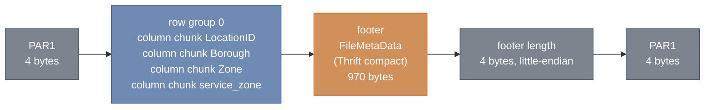
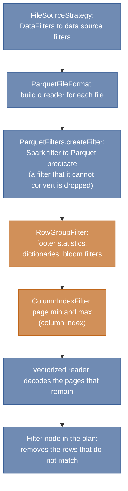

# Chapter 45: Parquet and ORC from the inside

Most Spark data lives in Parquet files, and most Spark performance advice is about Parquet in disguise. ORC, the columnar format from the Hive project, follows the same ideas with different names. "Sort before you write" and "do not write small files" are two examples. "Use `TIMESTAMP_MICROS`" and "partition pruning is not the same as row group skipping" are two more. Each of these rules follows from a few bytes at the end of each file. This chapter reads those bytes, first in Parquet and then in ORC.

**A Parquet file is a sequence of column chunks with a footer that describes them. The footer holds the schema, and for each row group and each column, the encodings, the offsets and the minimum and maximum values. Spark gives its filters to the Parquet reader. The reader skips data with the footer statistics, the dictionaries, the bloom filters and the page indexes. Each of these mechanisms works only if the layout of the data lets it. The writer decides that layout, so a fast read is a decision that you make at write time.**

ORC files have the same parts and follow the same rules. The writer also decides two more things: the columns that it encrypts, and the calendar of old dates.

The scripts are in [`code/ch45`](https://github.com/lisancao/spark-masterclass/tree/main/code/ch45), and each output block comes from `code/ch45/output/`. `thrift_compact.py` is a reader for the Thrift compact protocol, adapted from SparkTutor. `orc.py` (Steps 9 to 11) and `crypto_rebase.py` (Steps 12 and 13) are the scripts for ORC, encryption and old dates. All runs use Spark 4.3.0 in `local[*]` mode on 16 cores. Spark 4.3.0 writes Parquet with parquet-mr (parquet-java) 1.17.0, and ORC with ORC 2.3.0.

## Step 1: The bytes at the two ends of a file

`footer.py` writes the 265-row zone lookup table as one Parquet file and prints its first and last bytes:

```text
part-00000-5096bf40-...: 5,956 bytes, 265 rows, columns ['LocationID', 'Borough', 'Zone', 'service_zone']

the first 16 bytes:
  00000000  50 41 52 31 15 00 15 d6 10 15 de 10 15 e8 f7 f1  PAR1............

the last 32 bytes:
  00001724  31 30 62 34 37 37 61 31 29 19 4c 1c 00 00 1c 00  10b477a1).L.....
  00001734  00 1c 00 00 1c 00 00 00 ca 03 00 00 50 41 52 31  ............PAR1

last 4 bytes b'PAR1'; the 4 bytes before them, little-endian: footer length 970
footer starts at byte 4,978; column data is bytes 4 to 4,977
```



<figure markdown>
  <video autoplay loop muted playsinline controls width="1280" height="720" poster="../../media/clips/ch45-footer.webp">
    <source src="../../media/clips/ch45-footer.mp4" type="video/mp4">
  </video>
  <figcaption><code>footer.py</code> prints the two ends of a Parquet file and decodes the footer with a small Thrift reader.</figcaption>
</figure>

A Parquet file starts and ends with the magic bytes `PAR1` (`50 41 52 31`). The 4 bytes before the last `PAR1` are the length of the footer, as a little-endian integer: `ca 03 00 00` is 0x03ca, which is 970. A reader opens a file at the end. It reads the last 8 bytes, then the footer, and only then the column data that it needs.

<figure markdown>
  
  
  <figcaption markdown="span">The zones file to scale, from the offsets in `footer.txt`. The `Zone` column has no dictionary. `Borough` and `service_zone` have a small dictionary page and a small data page each.</figcaption>
</figure>

This design has two results. A reader can find any column without a scan of the file. And each file costs at least one extra read for the footer. That read is the fixed cost of a file, and it is why many small files are slow ([Chapter 42](ch42-partitions-caching-memory.md), Step 2).

The bytes after the first `PAR1` are already a Thrift structure: the header of the first data page. `15 00` is field 1 (`type`) with the value 0, which is `DATA_PAGE`. `15 d6 10` is field 2 (`uncompressed_page_size`), and `15 de 10` is field 3 (`compressed_page_size`). Step 3 decodes these headers.

## Step 2: The footer, decoded by hand

The footer is a `FileMetaData` struct in the Thrift compact protocol. Each field starts with a byte that holds the difference from the last field ID (high 4 bits) and the type (low 4 bits). Integers are zigzag varints. Strings have a varint length. Lists have a byte with the size and the element type. `thrift_compact.py` decodes this in about 80 lines into dicts of `{field_id: value}`:

```python
def struct(self):
    fields, last = {}, 0
    while True:
        h = self.byte()
        if h == 0:                       # STOP
            return fields
        delta, t = h >> 4, h & 0x0F
        fid = last + delta if delta else self.zigzag()
        fields[fid] = self.value(t)
        last = fid
```

The field IDs come from `parquet.thrift` in the parquet-format project. `footer.py` prints the fields of the zones file:

```text
FileMetaData, decoded by hand (field id: meaning):
  1 version: 1   3 num_rows: 265   6 created_by: parquet-mr version 1.17.0 (build fac0c746532e133beb928a7f6a7e57b510b477a1)
  2 schema:
      spark_schema  group       , 4 children
      LocationID    INT32       optional
      Borough       BYTE_ARRAY  optional
      Zone          BYTE_ARRAY  optional
      service_zone  BYTE_ARRAY  optional
  4 row_groups[0]: num_rows 265, total_byte_size 6,825
      LocationID   INT32      SNAPPY  RLE,PLAIN,BIT_PACKED         1,097 B  min 1                max 265
      Borough      BYTE_ARRAY SNAPPY  PLAIN_DICTIONARY,RLE,BIT_PACKED   246 B  min Bronx            max Unknown
      Zone         BYTE_ARRAY SNAPPY  RLE,PLAIN,BIT_PACKED         3,238 B  min Allerton/Pelham  max Yorkville West
      service_zone BYTE_ARRAY SNAPPY  PLAIN_DICTIONARY,RLE,BIT_PACKED   198 B  min Airports         max Yellow Zone
  5 key_value_metadata keys: ['org.apache.spark.sql.parquet.row.metadata', 'org.apache.spark.version'] | org.apache.spark.version: 4.3.0
    org.apache.spark.sql.parquet.row.metadata: {"name": "LocationID", "type": "integer", "nullable": true, "metadata": {}}
```

The footer answers these questions without a read of any data:

- **The schema.** `spark_schema` is a group with four children. Each leaf has a physical type: `INT32` for `LocationID` and `BYTE_ARRAY` for the strings. All four columns are `optional`, because CSV columns are nullable.
- **The row groups.** This file has one row group of 265 rows.
- **For each column chunk**: the codec (`SNAPPY`, the Spark default), the encodings, the compressed size, and the minimum and maximum values. `Borough` and `service_zone` use `PLAIN_DICTIONARY`, because they have few distinct values. `Zone` has 260 distinct values in 265 rows, so a dictionary would not make it smaller, and the writer used `PLAIN`.
- **Key-value metadata.** Spark writes its own schema as JSON in `org.apache.spark.sql.parquet.row.metadata`, and its version in `org.apache.spark.version`. When Spark reads the file back, it uses this JSON to restore Spark types that Parquet does not have.
- **`created_by`** names the writer: `parquet-mr version 1.17.0`.

The same footer through PyArrow agrees, and the June trips file shows a footer from a different writer:

```text
the same footer through pyarrow:
  rows 265, row groups 1, created_by parquet-mr version 1.17.0 (build fac0c746532e133beb928a7f6a7e57b510b477a1)
  LocationID: SNAPPY, ('RLE', 'PLAIN', 'BIT_PACKED'), stats min 1 max 265

the June trips file (written by another program):
  created_by parquet-cpp-arrow version 21.0.0; 3,837,248 rows; 4 row groups; rows per group [1048576, 1048576, 1048576, 691520]
  footer 12,333 bytes; compression ZSTD
```

The TLC wrote the June file with Arrow's C++ writer, with ZSTD compression and row groups of 1,048,576 rows. Its footer is 12,333 bytes, for 4 row groups of 20 columns. These four row groups are why only four of sixteen tasks did work in [Chapter 5](ch05-how-spark-runs.md).

## Step 3: Pages, dictionaries and encodings

A column chunk is a sequence of pages. Each page has a Thrift `PageHeader`, and then the encoded values. `page_headers()` starts at the offset that the footer gives for each chunk, and reads one header after the other:

```text
the pages of each column chunk (PageHeader structs, read from the chunk offsets):
  LocationID   data_page_offset     4, dictionary_page_offset  None: DATA_PAGE PLAIN 265 values 1071 B
  Borough      data_page_offset  1207, dictionary_page_offset  1101: DICTIONARY_PAGE PLAIN_DICTIONARY 8 values 85 B; DATA_PAGE PLAIN_DICTIONARY 265 values 114 B
  Zone         data_page_offset  1347, dictionary_page_offset  None: DATA_PAGE PLAIN 265 values 3212 B
  service_zone data_page_offset  4658, dictionary_page_offset  4585: DICTIONARY_PAGE PLAIN_DICTIONARY 5 values 54 B; DATA_PAGE PLAIN_DICTIONARY 265 values 99 B
```

`Borough` has two pages. The dictionary page holds the 8 distinct names (85 bytes). The data page holds 265 small integer indexes into that dictionary (114 bytes), encoded as runs and bit-packed groups. `Zone` has one data page of 3,212 bytes with the 265 strings in full.

A dictionary has a size limit (1 MiB for each column chunk in parquet-mr). A column can have too many distinct values for the dictionary. Then the writer stops the dictionary in the middle of the chunk, and it writes the rest of the pages as `PLAIN`. Then the chunk has both forms. `skipping.py` writes 200,000 events with the v1 and the v2 page formats (`parquet.writer.version`):

```text
=== the v1 and v2 page formats
  v1: 6.46 MB
    id          10 pages  DATA_PAGE PLAIN
    user_id     10 pages  DATA_PAGE PLAIN
    event       11 pages  DATA_PAGE PLAIN_DICTIONARY, DICTIONARY_PAGE PLAIN_DICTIONARY
    session_id  10 pages  DATA_PAGE PLAIN
    ts          11 pages  DATA_PAGE PLAIN, DATA_PAGE PLAIN_DICTIONARY, DICTIONARY_PAGE PLAIN_DICTIONARY
    amount      11 pages  DATA_PAGE PLAIN_DICTIONARY, DICTIONARY_PAGE PLAIN_DICTIONARY
  v2: 4.82 MB
    id          10 pages  DATA_PAGE_V2 DELTA_BINARY_PACKED
    user_id     10 pages  DATA_PAGE_V2 DELTA_BINARY_PACKED
    event       11 pages  DATA_PAGE_V2 RLE_DICTIONARY, DICTIONARY_PAGE PLAIN
    session_id  10 pages  DATA_PAGE_V2 DELTA_BYTE_ARRAY
    ts          11 pages  DATA_PAGE_V2 PLAIN, DATA_PAGE_V2 RLE_DICTIONARY, DICTIONARY_PAGE PLAIN
    amount      11 pages  DATA_PAGE_V2 RLE_DICTIONARY, DICTIONARY_PAGE PLAIN
```

- The `ts` column shows the fallback: a dictionary page, data pages with `PLAIN_DICTIONARY`, and then `PLAIN` pages after the dictionary became full.
- The v2 format uses newer encodings. `DELTA_BINARY_PACKED` stores the differences between sorted integers (`id`, `user_id`). `DELTA_BYTE_ARRAY` stores the shared prefix of each string once (`session_id`). The file became 25% smaller.
- Spark reads v2 pages with its vectorized reader. The default of `parquet.writer.version` is still `v1`. Make sure that all the tools that read your files support v2 before you change it.

## Step 4: How a filter skips data

Spark gives filters to the Parquet reader as `PushedFilters` ([Chapter 40](ch40-query-plans.md), Step 3). The path of a filter from the plan to the bytes, in the 4.3.0 source:



The reader skips whole row groups or whole pages. It never removes single rows. The rows that it returns go to the `Filter` node above the scan, which tests each row. Thus, the best measure of skipping is the number of rows that the scan returned. The SQL tab records it as the `number of output rows` metric of the scan node, and `skipping.py` reads it from the REST API.

The test data is 2,000,000 events of 20,000 users. Only 100 users have the rare `refund` event. Each event has a random `session_id`, and a timestamp that grows by 0.432 s for each row. The script writes it in four layouts and runs four queries on each:

```python
LAYOUTS = [
    ("A: as generated, 8 files", events, {}),
    ("B: sorted by user_id, 8 files", events.repartitionByRange(8, "user_id").sortWithinPartitions("user_id"), {}),
    ("C: B + 1 MB row groups", ..., {"parquet.block.size": 1024 * 1024}),
    ("D: C + bloom filter on session_id", ..., {"parquet.block.size": 1024 * 1024,
         "parquet.bloom.filter.enabled#session_id": "true",
         "parquet.bloom.filter.expected.ndv#session_id": "20000"}),
]
```

```text
layout                               files row groups     MB
A: as generated, 8 files                 8          8   64.2
B: sorted by user_id, 8 files            8          8   52.1
C: B + 1 MB row groups                   8        135   54.3
D: C + bloom filter on session_id        8        134   58.5

rows that the Parquet reader returned (of 2,000,000):
query                            A           B           C           D
user_id = probe          2,000,000      20,000      15,360      15,360
event = 'refund'         2,000,000     242,200      15,272      15,272
session_id = probe       2,000,000   2,000,000   2,000,000      15,360
ts in one hour           2,000,000   2,000,000   2,000,000   2,000,000

PushedFilters for user_id = probe: [IsNotNull(user_id), EqualTo(user_id,16073)]
layout C, first file, row group 0: 15,360 rows, user_id min 17475 max 17628; 17 row groups in the file
```

<figure markdown>
  
  
  <figcaption markdown="span">The rows that the reader returned in `skipping.txt`. Each layout lets the reader skip data for some queries. No layout skips data for the timestamp filter.</figcaption>
</figure>

<figure markdown>
  <video autoplay loop muted playsinline controls width="1280" height="720" poster="../../media/clips/ch45-skipping.webp">
    <source src="../../media/clips/ch45-skipping.mp4" type="video/mp4">
  </video>
  <figcaption><code>skipping.py layouts</code>: the rows that the Parquet reader returned for four queries on four layouts of the same data.</figcaption>
</figure>

Each layout changes what the reader can skip:

- **Layout A** has one row group in each file, with all user IDs, all events and all timestamps. Each row group statistic covers the whole range of its column. The reader skipped nothing for any query and returned all 2,000,000 rows.
- **Layout B** sorts by `user_id` inside range partitions. Each file now holds a narrow range of users. For `user_id = 16073`, the reader skipped seven files with the footer statistics. In the eighth file, the column index let it read only one page. The column index holds the minimum and maximum of each page. The parquet-mr writer ends a page at 20,000 rows, so the result was 20,000 rows. For `refund`, which only 100 users have, the reader skipped seven files and returned the first file, 242,200 rows.
- **Layout C** adds small row groups (`parquet.block.size` of 1 MB, so 135 row groups). For `user_id` and `refund`, the reader now returned one row group of about 15,000 rows.
- **Layout D** adds a bloom filter for `session_id`. A random string has no useful minimum and maximum, so statistics cannot skip it. A bloom filter tells the reader if a value is possibly in a row group. The reader returned one row group of 15,360 rows, where the other layouts returned all rows.
- **The timestamp filter skipped nothing in any layout.** In layout A, the rows in each file are in time sequence, so statistics should help. Step 6 explains why they did not.

The footer of layout C shows the narrow statistics: row group 0 of one file holds only `user_id` 17475 to 17628. The pushed filter `EqualTo(user_id,16073)` is outside that range, so the reader skips the row group without a read of its pages.

<figure markdown>
  <video autoplay loop muted playsinline controls width="1280" height="720" poster="../../media/clips/ch45-anim-skipping.webp">
    <source src="../../media/clips/ch45-anim-skipping.mp4" type="video/mp4">
  </video>
  <figcaption markdown="span">Animation: the reader uses the minimum and maximum values to skip files and row groups for `user_id = 16073` in layout C. The count of 15,360 rows comes from `skipping.txt`. The ranges of the files and the row groups are schematic.</figcaption>
</figure>

## Step 5: Turn off one mechanism at a time

A Parquet reader has four mechanisms for skipping. Each one has a Hadoop setting in parquet-mr, and Spark has one master setting. `skipping.py` reads layout D with one mechanism off at a time. It sets the Hadoop settings on `spark.sparkContext._jsc.hadoopConfiguration()`:

```text
layout D with one reader feature off (rows returned):
setting                                       user_id = p  event = 're  session_id   ts in one h
all on (defaults)                                  15,360       15,272       15,360    2,000,000
spark.sql.parquet.filterPushdown=false          2,000,000    2,000,000    2,000,000    2,000,000
stats off                                          15,360       15,272       15,360    2,000,000
column index off                                   15,360       15,272       15,360    2,000,000
stats and column index off                         15,360       15,272       15,360    2,000,000
stats, column index and dictionary off          2,000,000    2,000,000       15,360    2,000,000
dictionary off                                     15,360    2,000,000       15,360    2,000,000
bloom filter off                                   15,360       15,272    2,000,000    2,000,000
```

| Mechanism | Setting | Works for | Needs |
|---|---|---|---|
| all of them | `spark.sql.parquet.filterPushdown` (Spark) | everything below | on by default |
| row group statistics | `parquet.filter.stats.enabled` | ranges and equality | sorted or clustered data |
| column index | `parquet.filter.columnindex.enabled` | ranges and equality, for each page | sorted data, pages smaller than row groups |
| dictionary | `parquet.filter.dictionary.enabled` | equality, `IN` | a column chunk that is fully dictionary-encoded |
| bloom filter | `parquet.filter.bloom.enabled` | equality, `IN` | a bloom filter written for the column |

The table of results shows that the mechanisms overlap:

- **For `user_id`, three mechanisms each skip the same data.** With statistics off, with the column index off, and with both off, the result stayed at 15,360. The dictionary of each row group lists its 150 or so user IDs, so the dictionary alone can prove that 16073 is not there. Only with all three off did the reader return all rows.
- **For `refund`, only the dictionary skips.** The event names `buy` to `view` include `refund` alphabetically, so the minimum and maximum of each row group cannot exclude it. The dictionary of a row group without refunds does not list it. With the dictionary off, the reader returned all rows.
- **For `session_id`, only the bloom filter skips.** With the bloom filter off, the reader returned all rows.
- **With `spark.sql.parquet.filterPushdown=false`**, Spark gives no filter to the reader, and all mechanisms stop.

Bloom filters have a cost. The writer sizes a bloom filter from `expected.ndv` and the false-positive rate (`parquet.bloom.filter.fpp`, 0.01 by default). Layout D is 4.2 MB larger than layout C for one bloom filter column. Write bloom filters only for columns that queries look up by exact value, and give `expected.ndv` for one row group, not for the file.

## Step 6: Timestamps: INT96 cannot skip

Spark writes `timestamp` columns as `INT96` by default (`spark.sql.parquet.outputTimestampType`). INT96 is an old 12-byte format from Impala and Hive. parquet-mr writes no statistics for it. `skipping.py` writes the same sorted data with INT96 and with `TIMESTAMP_MICROS`, and runs a filter for one hour:

```text
=== timestamps: the physical type decides if a filter can skip
  INT96              physical INT96  stats no   ts filter in PushedFilters: True   rows returned 2,000,000
  TIMESTAMP_MICROS   physical INT64  stats yes  ts filter in PushedFilters: True   rows returned    29,232
  default spark.sql.parquet.outputTimestampType: INT96
```

The two plans are the same. Both show the `ts` filter in `PushedFilters`. But the INT96 file has no statistics, so the reader can skip nothing, and it returned all 2,000,000 rows. The `TIMESTAMP_MICROS` file is `INT64` with statistics, and the reader returned 29,232 rows, the row groups that hold that hour.

This is a trap because the plan does not show it. `PushedFilters` is the list of filters that Spark gave to the reader, not the list of filters that the reader could use. Set `spark.sql.parquet.outputTimestampType=TIMESTAMP_MICROS` before you write tables that queries filter by time.

## Step 7: Compression codecs

`spark.sql.parquet.compression.codec` sets the codec for each column chunk. `skipping.py` writes the June trips as one file with each codec, and then reads the whole file:

```text
=== compression codecs on the June trips (one file each)
  none       108.2 MB  1 row groups  write   5.1 s  full read  0.91 s
  snappy      76.8 MB  1 row groups  write   4.3 s  full read  0.78 s
  lz4_raw     76.2 MB  1 row groups  write   4.3 s  full read  0.70 s
  gzip        59.2 MB  1 row groups  write   7.5 s  full read  0.90 s
  zstd        58.2 MB  1 row groups  write   5.8 s  full read  0.84 s
  default spark.sql.parquet.compression.codec: snappy
```

<figure markdown>
  
  
  <figcaption markdown="span">The sizes and times from `skipping_codecs.txt`. `zstd` and `gzip` make the smallest files.</figcaption>
</figure>

- **`snappy` is the default.** Since Spark 4.0, the codec name `lz4raw` is gone. Use `lz4_raw`. It made the file 29% smaller than no compression, and it wrote and read faster than no compression, because there were fewer bytes to move.
- **`lz4_raw` gave almost the same result as `snappy`.**
- **`zstd` and `gzip` made the smallest files**, 58.2 and 59.2 MB, about 46% smaller than no compression. `gzip` took the longest to write. `zstd` wrote faster than `gzip` and read in about the same time as the others.

The full read times differ by less than the noise of these runs. On a local disk, most of the read cost is the work to decode the values. On object storage, the bytes to transfer matter more, and a smaller codec such as `zstd` can make the read faster. The codec does not change which row groups and pages the reader can skip.

## Step 8: New in 4.3: nanosecond timestamps in Parquet

Spark 4.3 adds `TIMESTAMP_NTZ(p)` and `TIMESTAMP_LTZ(p)` with 7 to 9 digits of fractions of a second, as a preview behind `spark.sql.timestampNanosTypes.enabled`. The setting is internal, and its documentation says that some operations can still fail. `skipping.py` writes one nanosecond value and reads it back:

```text
=== nanosecond timestamps (4.3 preview)
  schema in the JVM: struct<t:timestamp_ntz(9)> | as a string: 2026-06-01 08:00:00.123456789
  df.schema in classic PySpark -> CANNOT_PARSE_DATATYPE
  written as: INT64, Timestamp(isAdjustedToUTC=false, timeUnit=nanoseconds, is_from_converted_type=false, force_set_converted_type=false)
  read back: struct<t:timestamp_ntz(9)> 2026-06-01 08:00:00.123456789
```

- Spark writes the column as `INT64` with the logical type `Timestamp(timeUnit=nanoseconds)`. PyArrow reads this logical type, as the output shows.
- Spark reads the value back with all nine digits.
- Classic PySpark 4.3.0 cannot parse the type name: `df.schema` fails with `CANNOT_PARSE_DATATYPE`. The script reads the schema from the JVM and casts the value to a string to show it.

Thus, a nanosecond column is usable from SQL and from the JVM in 4.3.0, but not yet from all of the Python API.

## Step 9: ORC from the inside

ORC is the other columnar format that Spark reads and writes without a package. It comes from the Hive project, and Spark 4.3.0 uses ORC 2.3.0. The ideas are the same as in Parquet, with different names:

- A **stripe** is like a row group.
- A **stream** is like a column chunk.
- The **row index** keeps the minimum and maximum of each column for each 10,000 rows.

 The metadata is in protocol buffers, not Thrift.

`orc.py dump` writes the zones as one ORC file, prints its two ends, and decodes the last bytes by hand. Then it asks `orc-tools` (version 2.3.0, the same ORC version as Spark) for the rest:

```text
=== 1. the bytes at the two ends of an ORC file (the 265 zones)
  part-00000-f75bba8c-5835...: 3,328 bytes
  the first 16 bytes:
  00000000  4f 52 43 13 00 00 0a 07 12 05 08 89 02 50 00 33  ORC..........P.3
  the last 32 bytes:
  00000ce0  0c 55 5e 85 aa 28 08 cd 02 10 05 18 80 80 10 22  .U^..(........."
  00000cf0  02 00 0c 28 9e 01 30 09 82 f4 03 03 4f 52 43 19  ...(..0.....ORC.
  last byte: postscript length 25; postscript is bytes 3,302 to 3,326
  the postscript, decoded by hand (protobuf field: value): {1: 333, 2: 5, 3: 262144, 4: [0, 12], 5: 158, 6: 9, 8000: 'ORC'}
  the layout: 'ORC' 0-2 | stripe 3-2810 | metadata 158 B | footer 333 B | postscript 25 B | 1 length byte -> 3,328 bytes
  orc-tools meta -j: fileVersion 0.12, writerVersion ORC_14, softwareVersion ORC Java 2.3.0, compression ZSTD, calendar Julian/Gregorian
    schema struct<LocationID:int,Borough:string,Zone:string,service_zone:string>
    userMetadata {'org.apache.spark.version': '4.3.0'}
    stripe 1: offset 3, index 188, data 2508, footer 112, rows 265
      stream column 0 ROW_INDEX        start     3 length 12
      stream column 1 ROW_INDEX        start    15 length 28
      stream column 2 ROW_INDEX        start    43 length 38
      stream column 3 ROW_INDEX        start    81 length 65
      stream column 4 ROW_INDEX        start   146 length 45
      stream column 1 DATA             start   191 length 7
      stream column 2 DATA             start   198 length 159
      stream column 2 LENGTH           start   357 length 9
      stream column 2 DICTIONARY_DATA  start   366 length 57
      stream column 3 DATA             start   423 length 1902
      stream column 3 LENGTH           start  2325 length 213
      stream column 4 DATA             start  2538 length 116
      stream column 4 LENGTH           start  2654 length 8
      stream column 4 DICTIONARY_DATA  start  2662 length 37
      encodings: col 0 DIRECT, col 1 DIRECT_V2, col 2 DICTIONARY_V2[8], col 3 DIRECT_V2, col 4 DICTIONARY_V2[5]
    file statistics column 0: count 265 hasNull False
    file statistics column 1: count 265 hasNull False min 1 max 265
    file statistics column 2: count 265 hasNull False min 'Bronx' max 'Unknown'
    file statistics column 3: count 265 hasNull False min 'Allerton/Pelham Gardens' max 'Yorkville West'
    file statistics column 4: count 265 hasNull False min 'Airports' max 'Yellow Zone'
```

<figure markdown>
  
  
  <figcaption markdown="span">The zones file as ORC, to scale, from `orc_dump.txt`. Step 1 shows the Parquet file of the same rows.</figcaption>
</figure>

<figure markdown>
  <video autoplay loop muted playsinline controls width="1280" height="720" poster="../../media/clips/ch45-orc.webp">
    <source src="../../media/clips/ch45-orc.mp4" type="video/mp4">
  </video>
  <figcaption markdown="span">`orc.py dump`: the two ends of an ORC file, the postscript decoded by hand, and the layout that the offsets add up to.</figcaption>
</figure>

A reader opens an ORC file from the end, as for Parquet, but the tail has more parts:

- **The last byte is the length of the postscript**: `19` is 25 bytes.
- **The postscript** is a small protobuf message, never compressed. `orc.py` decodes it with a 20-line varint reader. Its fields:
    - field 1: the footer length (333)
    - field 2: the codec (5 is ZSTD, the ORC default since Spark 4.0)
    - field 3: the compression block size (256 KiB)
    - field 4: the format version (0.12)
    - field 5: the length of the metadata (158)
    - field 6: the writer version
    - field 8000: the magic `ORC`
- **The footer** (333 bytes, compressed) has the schema, the list of stripes with their offsets, the statistics of the whole file, and the user metadata. Spark writes its version there (`org.apache.spark.version`), and the type of each string column (`spark.sql.catalyst.type`).
- **The metadata section** (158 bytes) has the statistics of each stripe. A reader can skip a stripe with it before it reads the stripe.
- **The file starts with `ORC`** (`4f 52 43`), then the first stripe.

Each stripe has three parts: the index streams (188 bytes), the data streams (2,508 bytes) and a stripe footer (112 bytes). The stripe footer lists the streams and their encodings. A string column with few distinct values is `DICTIONARY_V2` with three streams: `DATA` (the indexes), `LENGTH` and `DICTIONARY_DATA`. `Borough` has a dictionary of 8 values, and `service_zone` has 5. `Zone` has 260 distinct values in 265 rows, so the writer used `DIRECT_V2`, as the Parquet writer used `PLAIN` in Step 2.

The June trips show the stripes and the row index of a larger file:

```text
=== 2. the June trips as ORC: stripes and the row index
  72.6 MB, rows 3,837,248, compression ZSTD, 2 stripes
    stripe  1: rows 2,032,640  index  59,359 B  data  40,633,589 B  footer   361 B
    stripe  2: rows 1,804,608  index  51,727 B  data  35,387,422 B  footer   363 B
    stripe  2: rows 1,804,608  index  51,727 B  data  35,387,422 B  footer   363 B
  row index of PULocationID (column 8), stripe 0, first entries:
    Entry 0: count: 10000 hasNull: false min: 1 max: 4 sum: 38171 positions: 0,0,0
    Entry 1: count: 10000 hasNull: false min: 4 max: 7 sum: 50186 positions: 0,87,94
    Entry 2: count: 10000 hasNull: false min: 7 max: 13 sum: 97932 positions: 0,174,289
    Entry 3: count: 10000 hasNull: false min: 13 max: 13 sum: 130000 positions: 0,270,363
```

- **The writer made 2 stripes for 3,837,248 rows.** The stripe size (`orc.stripe.size`, 64 MiB by default) is the target size before compression. Parquet made one row group for the same rows in Step 7, because its limit is 128 MiB (`parquet.block.size`).
- **The row index has one entry for each 10,000 rows** (`orc.row.index.stride`). The script sorted the data by `PULocationID`, so each entry has a narrow range: rows 30,000 to 39,999 all have `PULocationID` 13. A filter can skip a group of 10,000 rows with these entries. The `positions` tell the reader where the group starts in each stream.
- **ORC has finer statistics by default than Parquet's row groups**, because each stripe has many index entries. Parquet gets a similar effect from its column index for each page (Step 4).

## Step 10: Two ORC readers

Spark has two implementations of ORC, selected with `spark.sql.orc.impl`:

- **`native`** (the default since Spark 2.3) is Spark's own `OrcFileFormat` in `org.apache.spark.sql.execution.datasources.orc`. It follows the behavior of Spark's other file sources, and it has a vectorized reader.
- **`hive`** is `org.apache.spark.sql.hive.orc.OrcFileFormat`. It reads through the Hive SerDe and follows Hive's behavior. It reads row by row.

`orc.py readers` reads the same file with each implementation, with the vectorized reader on and off, and prints the class that Spark used:

```text
=== 3. two ORC readers: spark.sql.orc.impl
  impl=native vectorized=true  -> org.apache.spark.sql.execution.datasources.orc.OrcFileFormat  Batched: true  PushedFilters: [IsNotNull(PULocationID), EqualTo(PULocationID,132)]
  impl=native vectorized=false -> org.apache.spark.sql.execution.datasources.orc.OrcFileFormat  Batched: false  PushedFilters: [IsNotNull(PULocationID), EqualTo(PULocationID,132)]
  impl=hive   vectorized=true  -> org.apache.spark.sql.hive.orc.OrcFileFormat  Batched: false  PushedFilters: [IsNotNull(PULocationID), EqualTo(PULocationID,132)]
  impl=hive   vectorized=false -> org.apache.spark.sql.hive.orc.OrcFileFormat  Batched: false  PushedFilters: [IsNotNull(PULocationID), EqualTo(PULocationID,132)]
```

- **Only the native reader has a vectorized mode.** With `spark.sql.orc.impl=hive`, the scan shows `Batched: false`, even with `spark.sql.orc.enableVectorizedReader=true`.
- **Both readers get the same pushed filters.** Each one turns them into an ORC `SearchArgument`, and the ORC library skips stripes and row groups with it.
- **The `hive` implementation does not need a Hive metastore.** Spark selects the class from the setting, for a path as well as for a table. A Hive SerDe table (`USING HIVE OPTIONS (fileFormat 'ORC')`) uses the native reader too, because `spark.sql.hive.convertMetastoreOrc` is true by default.

## Step 11: Parquet against ORC on the taxi data

`orc.py compare` writes the June trips twice, as Parquet and as ORC, with the same layout: four files, range-partitioned and sorted by `PULocationID`. Then it runs three queries with seven reader settings. For each run, it reads the rows that left the scan from the SQL metrics, as in Step 4. It also measures the median time of 5 runs after a warm-up, under the bench lock:

```text
=== 4. Parquet against ORC on the June trips (same rows, sorted by PULocationID, 4 files each)
  parquet  4 files, 79.6 MB (codec snappy)
  orc      4 files, 72.6 MB (codec zstd)

  format, reader                        PULocationID = 132           tip_amount > 50      full scan, 4 columns
                                   rows from scan   median   rows from scan   median   rows from scan   median
  parquet, vectorized                    160,000    0.34 s       3,097,963    0.27 s       3,837,248    0.43 s
  parquet, row by row                    160,000    0.20 s       3,097,963    0.40 s       3,837,248    0.70 s
  parquet, no pushdown                 3,837,248    0.18 s       3,837,248    0.23 s       3,837,248    0.33 s
  orc, native, vectorized                160,000    0.13 s       2,274,585    0.12 s       3,837,248    0.22 s
  orc, native, row by row                160,000    0.12 s       2,274,585    0.29 s       3,837,248    0.57 s
  orc, native, no pushdown             3,837,248    0.13 s       3,837,248    0.15 s       3,837,248    0.25 s
  orc, hive reader                       160,000    0.28 s       2,274,585    0.29 s       3,837,248    0.49 s
```

<figure markdown>
  
  
  <figcaption markdown="span">Rows from the scan for `tip_amount > 50`, and the time of the full scan (`orc_compare.txt`).</figcaption>
</figure>

- **Both formats skip the same data for the sorted column.** For `PULocationID = 132`, both returned 160,000 rows of 3,837,248. The ORC row index skipped groups of 10,000 rows, and the Parquet column index skipped pages of 20,000 rows.
- **ORC skipped more for a column that is not sorted.** For `tip_amount > 50`, Parquet returned 3,097,963 rows and ORC returned 2,274,585. Large tips are rare, so some groups of 10,000 rows have no tip above $50. ORC has an index entry for each 10,000 rows, and its finer statistics found more of those groups.
- **The vectorized readers are faster for the full scan.** ORC took 0.22 s vectorized and 0.57 s row by row. Parquet took 0.43 s and 0.70 s. The `hive` ORC reader, which is not vectorized, took 0.49 s.
- **The times of the selective queries are too small to compare.** Their medians go from 0.12 to 0.40 s. Two settings that read the same rows differ by up to 0.15 s, for example Parquet with and without pushdown for `PULocationID = 132`. Compare the rows from the scan for these queries, not the times.
- **The files are not the same size, because the default codecs differ**: `snappy` for Parquet (79.6 MB) and `zstd` for ORC (72.6 MB). Step 7 showed that a Parquet file with `zstd` is smaller too.

The settings for ORC in Spark 4.3.0:

| Setting | Default | What it does |
|---|---|---|
| `spark.sql.orc.impl` | `native` | `native` or `hive` (Step 10) |
| `spark.sql.orc.enableVectorizedReader` | true | the vectorized reader of the native implementation |
| `spark.sql.orc.filterPushdown` | true | give filters to the ORC reader as a `SearchArgument` |
| `spark.sql.orc.compression.codec` | `zstd` | the codec when Spark writes ORC (`snappy` before Spark 4.0) |
| `spark.sql.orc.mergeSchema` | false | merge the schemas of all files when Spark reads them |
| `orc.bloom.filter.columns` (write option) | (none) | write a bloom filter for these columns, as in Step 5 for Parquet |
| `orc.stripe.size`, `orc.row.index.stride` (write options) | 64 MiB, 10,000 | the stripe size and the rows for each row index entry |


## Step 12: Parquet modular encryption

Parquet can encrypt each column with its own key, and the footer with another key. This is **modular encryption** (or columnar encryption), in Spark since 3.2 with Parquet 1.12 and later. It uses envelope encryption.

Parquet makes a random data key for each encrypted column of each file, and encrypts the data with it. Then it encrypts the data key with a **master key**, and stores the result in the file. The master keys stay in a key management service (KMS). Spark never sees them. It sees only the data keys, through a KMS client class.

`crypto_rebase.py crypto` uses the mock `InMemoryKMS` from the Parquet test jar (`parquet-hadoop-1.17.0-tests.jar`), with two master keys in the configuration:

```python
hconf = spark.sparkContext._jsc.hadoopConfiguration()
hconf.set("parquet.crypto.factory.class", "org.apache.parquet.crypto.keytools.PropertiesDrivenCryptoFactory")
hconf.set("parquet.encryption.kms.client.class", "org.apache.parquet.crypto.keytools.mocks.InMemoryKMS")
hconf.set("parquet.encryption.key.list", "keyA:AAECAwQFBgcICQoLDA0ODw==, keyB:AAECAAECAAECAAECAAECAA==")

(trips.write
   .option("parquet.encryption.column.keys", "keyA:fare_amount,tip_amount")   # (1)!
   .option("parquet.encryption.footer.key", "keyB")
   .parquet(out))

# ORC: the native, vectorized reader is the default. A bloom filter for exact lookups.
df.write.option("orc.bloom.filter.columns", "session_id").orc(out_orc)

# Encrypt two columns and the footer (needs a KMS client class in parquet.encryption.kms.client.class).
(df.write.option("parquet.encryption.column.keys", "keyA:fare_amount,tip_amount")
   .option("parquet.encryption.footer.key", "keyB").parquet(out_enc))

# Read old files from another writer that used the hybrid calendar.
spark.read.option("datetimeRebaseMode", "LEGACY").parquet(old_files)
```

1. Two columns get master key `keyA`. The other columns are not encrypted. Add `.option("parquet.encryption.plaintext.footer", "true")` to keep the footer readable.

!!! caution "The in-memory KMS is for tests only"
    Do not use `InMemoryKMS` in production. It keeps the master keys in the Spark configuration, where each user of the application can read them. Write a `KmsClient` for your KMS, and give its class in `parquet.encryption.kms.client.class`.

```text
=== 1. columnar encryption: two columns with keyA, the footer with keyB
  encrypted_footer    545,242 bytes  first 4 bytes b'PARE'  last 4 bytes b'PARE'  footer length 3,616
  plaintext_footer    544,134 bytes  first 4 bytes b'PAR1'  last 4 bytes b'PAR1'  footer length 2,508
  not encrypted       540,700 bytes  first 4 bytes b'PAR1'  last 4 bytes b'PAR1'  footer length 1,080

=== 2. read with the keys (the crypto factory and the KMS are set)
  encrypted_footer  rows 100,000, sum(tip_amount) 406374.91
  plaintext_footer  rows 100,000, sum(tip_amount) 406374.91

=== 3. read without the keys
  encrypted_footer  PULocationID, trip_distance  Py4JJavaError: org.apache.parquet.crypto.ParquetCryptoRuntimeException: Trying to read file with encrypted footer. No keys av
  encrypted_footer  tip_amount                   Py4JJavaError: org.apache.parquet.crypto.ParquetCryptoRuntimeException: Trying to read file with encrypted footer. No keys av
  plaintext_footer  PULocationID, trip_distance  max: 265, 112.82
  plaintext_footer  tip_amount                   Py4JJavaError: org.apache.parquet.crypto.ParquetCryptoRuntimeException: [tip_amount]. Null File Decryptor at org.apache.parqu
  pyarrow, encrypted_footer  OSError: Could not read encrypted metadata, no decryption found in reader's properties
  pyarrow, plaintext_footer  footer: 100,000 rows, 4 columns, created_by parquet-mr version 1.17.0 (build fac0c746532e133beb928a7f6a7e57b510b477a1)
  pyarrow, plaintext_footer  trip_distance: 100,000 rows
  pyarrow, plaintext_footer  OSError: Cannot decrypt ColumnMetadata. FileDecryption is not setup correctly
```

<figure markdown>
  <video autoplay loop muted playsinline controls width="1280" height="720" poster="../../media/clips/ch45-crypto.webp">
    <source src="../../media/clips/ch45-crypto.mp4" type="video/mp4">
  </video>
  <figcaption markdown="span">`crypto_rebase.py crypto`: two files with encrypted columns, read with the keys and without them.</figcaption>
</figure>

- **An encrypted footer changes the magic bytes** to `PARE` at both ends. A reader without keys cannot read even the schema. Spark and PyArrow both fail at the footer.
- **A plaintext footer keeps `PAR1`.** Readers without keys can read the schema, the row count and the columns that are not encrypted: Spark read `PULocationID` and `trip_distance`. A read of `tip_amount` fails. The writer signs the footer, so a reader can detect a change to it.
- **The cost in size is small**: 545,242 bytes against 540,700, for 100,000 rows. The footer grows because it holds the encrypted data keys and the metadata of each encrypted column.
- **Parquet encrypts the statistics of encrypted columns too.** A reader without the key cannot use them to skip data, and it cannot learn the minimum and maximum of the column from them.

The Spark 4.3.0 docs point to the test jar of Parquet 1.17.1. Spark 4.3.0 ships Parquet 1.17.0, and this book used the test jar of 1.17.0.

## Step 13: Old dates, and the datetime rebase modes

Before Spark 3.0, Spark used the hybrid Julian and Gregorian calendar for dates and timestamps, as Java's old date classes do. Since Spark 3.0, it uses the proleptic Gregorian calendar, the calendar of ISO 8601, Java 8 time and most other tools. The two calendars agree after 15 October 1582. Before that date, the same day has a different day number in each calendar. A file written by Spark 2.x, or by Hive and Impala, can store dates and timestamps before 1582 with the old calendar. Spark must **rebase** them, that is, move them to the new calendar, to read them correctly.

`crypto_rebase.py rebase` writes `DATE'1000-01-01'` and a timestamp on that day with each write mode. It reads the files back with each read mode, and does the same for a file from PyArrow:

```text
=== 4. dates before 1582: the hybrid calendar and the proleptic Gregorian calendar
  defaults in 4.3.0: datetimeRebaseModeInRead=CORRECTED, datetimeRebaseModeInWrite=CORRECTED, int96RebaseModeInRead=CORRECTED, int96RebaseModeInWrite=CORRECTED
  Spark writes with CORRECTED: stored day number  -354285, pyarrow reads d=1000-01-01, legacyDateTime key: False
  Spark writes with LEGACY   : stored day number  -354280, pyarrow reads d=1000-01-06, legacyDateTime key: True

  Spark reads its own files back (the key in the footer decides, not the read mode):
    file CORRECTED read mode CORRECTED -> d=1000-01-01  ts=1000-01-01 12:00:00
    file CORRECTED read mode LEGACY    -> d=1000-01-01  ts=1000-01-01 12:00:00
    file CORRECTED read mode EXCEPTION -> d=1000-01-01  ts=1000-01-01 12:00:00
    file LEGACY    read mode CORRECTED -> d=1000-01-01  ts=1000-01-01 12:00:00
    file LEGACY    read mode LEGACY    -> d=1000-01-01  ts=1000-01-01 12:00:00
    file LEGACY    read mode EXCEPTION -> d=1000-01-01  ts=1000-01-01 12:00:00

  a file from another writer (pyarrow, no Spark keys in the footer), with the same day number
    read mode CORRECTED -> d=1000-01-06
    read mode LEGACY    -> d=1000-01-01
    read mode EXCEPTION -> SparkUpgradeException: [INCONSISTENT_BEHAVIOR_CROSS_VERSION.READ_ANCIENT_DATETIME] You may get a different result due to the upgrading to Spark
    read option datetimeRebaseMode=LEGACY -> d=1000-01-01
```

- **The defaults are `CORRECTED` in 4.3.0**: Spark writes and reads the day number without a change. The 4.3.0 data source page for Parquet still says that the default is `EXCEPTION`. The setting itself, in `SQLConf.scala`, and the run above say `CORRECTED`.
- **`LEGACY` writes the old calendar.** The same day becomes day -354280 instead of -354285, five days later. PyArrow reads it as `1000-01-06`. Spark adds the key `org.apache.spark.legacyDateTime` to the footer.
- **Spark ignores the read mode for its own files.** It looks for `org.apache.spark.version` in the footer. If the file comes from Spark before 3.0, or has the `legacyDateTime` key, Spark rebases. Otherwise it reads the value as it is. Thus all six reads of Spark's files gave `1000-01-01`.
- **The read mode applies only to files without these keys.** For the PyArrow file with day -354280, `CORRECTED` read `1000-01-06`, `LEGACY` read `1000-01-01`, and `EXCEPTION` stopped with `INCONSISTENT_BEHAVIOR_CROSS_VERSION.READ_ANCIENT_DATETIME`. Only you know which calendar the other writer used.
- **The read option `datetimeRebaseMode` sets the mode for one read**, without a change to the session.

| Setting | Read option | Applies to |
|---|---|---|
| `spark.sql.parquet.datetimeRebaseModeInRead` | `datetimeRebaseMode` | `DATE`, `TIMESTAMP_MILLIS`, `TIMESTAMP_MICROS` in files without Spark's keys |
| `spark.sql.parquet.datetimeRebaseModeInWrite` | | the same types, when Spark writes |
| `spark.sql.parquet.int96RebaseModeInRead` | `int96RebaseMode` | `INT96` timestamps (Step 6) in files without Spark's keys |
| `spark.sql.parquet.int96RebaseModeInWrite` | | `INT96` timestamps, when Spark writes |

Each takes `EXCEPTION`, `CORRECTED` or `LEGACY`. Since Spark 4.0, the old names with the prefix `spark.sql.legacy.` are gone (the SQL migration guide lists them). Use `CORRECTED` for new data. Use `LEGACY` only for two cases:

- to read files with dates before 1582 from Spark 2.x, Hive or Impala
- to write files for such a system

## Step 14: Rules for a Parquet or ORC layout

The measurements give these rules:

1. **Sort or cluster by the columns that queries filter on.** Statistics, column indexes and dictionaries all need values of one kind to be close together. Layout A had all three mechanisms, and they skipped nothing.
2. **Make row groups match the query.** A large row group is good for a full scan. A small row group lets a lookup skip more. The default `parquet.block.size` is 128 MB. Layout C used 1 MB for a lookup workload.
3. **Write `TIMESTAMP_MICROS`, not INT96**, if queries filter by time.
4. **Use bloom filters only for exact lookups on high-cardinality columns**, with an `expected.ndv` for one row group.
5. **Use one codec for the whole table.** `snappy` and `lz4_raw` are fast. `zstd` makes files smaller and costs more CPU to write.
6. **Count the rows that the scan returned**, not the run time, to see if a layout works. The SQL tab gives it as `number of output rows` of the scan.
7. **The same rules apply to ORC.** Sort by the filter columns, keep the native vectorized reader, and use `orc.bloom.filter.columns` for exact lookups. ORC has an index entry for each 10,000 rows, so it can skip more of an unsorted column.
8. **Encrypt only the columns that need it**, with a real KMS client. Use a plaintext footer if readers without keys must read the other columns.
9. **Write new data with the `CORRECTED` rebase mode** (the default in 4.3.0). Set `LEGACY` or the read option `datetimeRebaseMode` only for old files from other writers that hold dates before 1582.

## The whole chapter, on one page

```python
import struct
data = open(path, "rb").read()
assert data[:4] == data[-4:] == b"PAR1"
footer_len = struct.unpack("<I", data[-8:-4])[0]            # little-endian length before the last PAR1
meta = Compact(data[-8 - footer_len:-8]).struct()           # FileMetaData: 2 schema, 3 num_rows, 4 row_groups

import pyarrow.parquet as pq                                 # or let PyArrow do it
md = pq.ParquetFile(path).metadata
md.row_group(0).column(0).statistics                        # min, max, null_count

# A layout that skips.
spark.conf.set("spark.sql.parquet.outputTimestampType", "TIMESTAMP_MICROS")
(df.repartitionByRange(8, "user_id").sortWithinPartitions("user_id")
   .write.option("parquet.block.size", 8 * 1024 * 1024)
   .option("parquet.bloom.filter.enabled#session_id", "true")
   .option("parquet.bloom.filter.expected.ndv#session_id", "100000")
   .parquet(out))
```

- **A Parquet file is `PAR1`, column chunks, a Thrift footer, the footer length and `PAR1`.** A reader reads the footer first.
- **The footer has the schema, the row groups, and for each column chunk the codec, the encodings, the offsets and the statistics.** Spark adds its own schema as JSON.
- **Pages hold the values.** A chunk has a dictionary page and data pages, or plain pages. When a dictionary becomes full, the writer changes to plain pages in the middle of the chunk.
- **The reader skips row groups and pages, never single rows**, with statistics, column indexes, dictionaries and bloom filters. The `Filter` node above the scan removes the rest.
- **Each mechanism needs a layout.** Sorted data for statistics and column indexes, few values in each row group for dictionaries, a bloom filter written for the column.
- **INT96 timestamps cannot skip**, even when the plan lists the filter in `PushedFilters`.
- **An ORC file is `ORC`, stripes, stripe statistics, a footer and a postscript.** The last byte gives the length of the postscript. Each stripe has a row index for each 10,000 rows.
- **Only the native ORC reader has a vectorized mode.** The `hive` implementation reads row by row.
- **Modular encryption encrypts columns and the footer with their own keys.** An encrypted footer changes the magic bytes to `PARE`.
- **Spark rebases old dates from its own files by itself.** The rebase modes apply only to files from other writers.

## Further reading

- [The Parquet format specification](https://parquet.apache.org/docs/file-format/) and `parquet.thrift` in the parquet-format repository.
- [Spark's Parquet data source guide](https://spark.apache.org/docs/4.3.0/sql-data-sources-parquet.html), with the Spark settings, columnar encryption and the rebase modes.
- [Spark's ORC data source guide](https://spark.apache.org/docs/4.3.0/sql-data-sources-orc.html) and the [ORC specification](https://orc.apache.org/specification/ORCv1/).
- [Parquet modular encryption](https://github.com/apache/parquet-format/blob/master/Encryption.md) in the Parquet format documentation.
- The 4.3.0 source: `ParquetFilters.scala`, `ParquetFileFormat.scala` and `VectorizedParquetRecordReader.java` in `sql/core/src/main/scala/org/apache/spark/sql/execution/datasources/parquet/`, `OrcFileFormat.scala` and `OrcFilters.scala` in `datasources/orc/`, and `DataSourceUtils.datetimeRebaseSpec` for the rebase rules.
- [Chapter 42](ch42-partitions-caching-memory.md) for how row groups set the scan tasks, and [Chapter 35](ch35-variant.md) for shredded VARIANT columns in Parquet.
