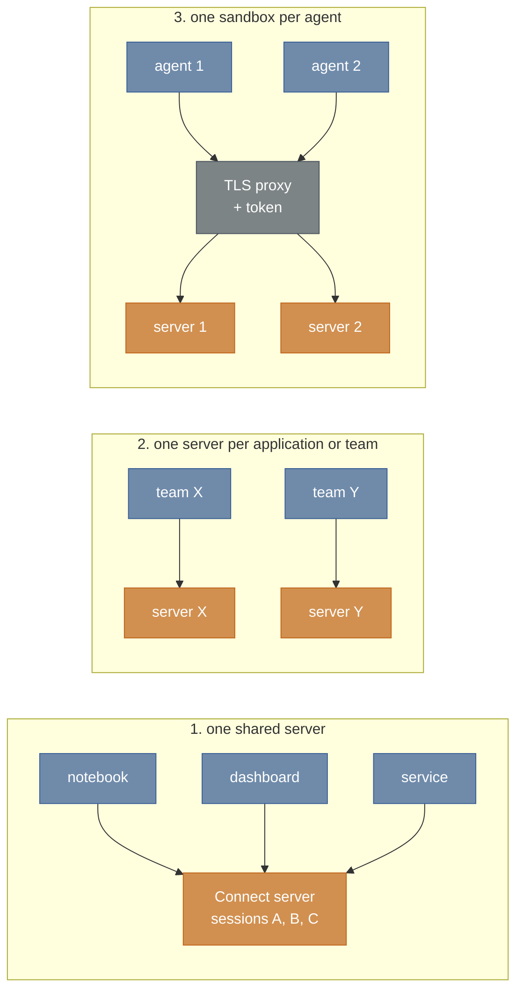
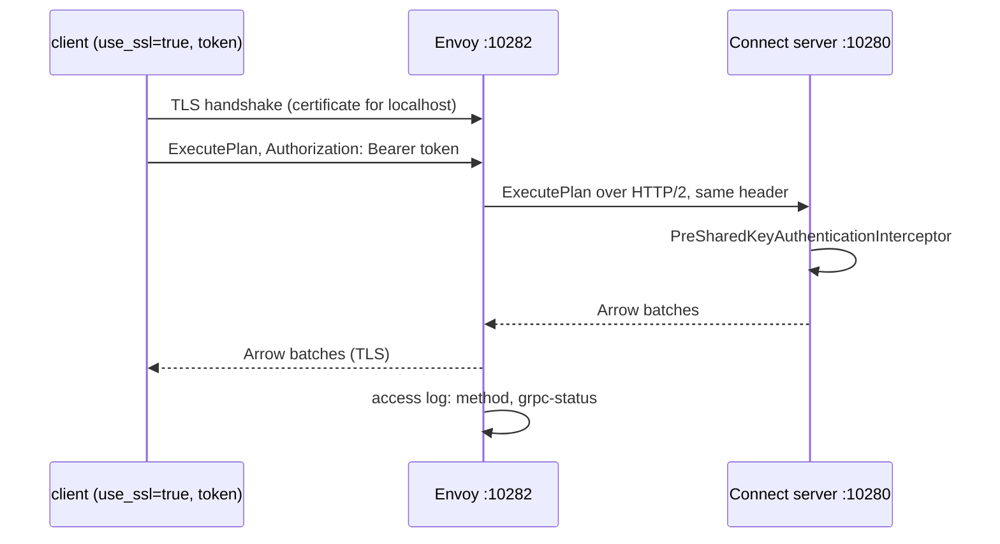

# Chapter 46: Spark Connect in production: deployment patterns

[Chapter 4](ch04-spark-connect.md) started a Connect server on a laptop and sent one query to it. A production server is different. Many clients use it at the same time. Some clients are people, some are services, and some are agents that write their own code. The server must keep them apart where that is necessary, and share what is safe to share. It must also refuse clients that have no right to connect, and survive restarts.

**A Spark Connect server is one Spark application, so all of its sessions share one driver, one set of executors, one catalog and one scheduler. A session isolates only its own state: temporary views, SQL configs, UDFs, artifacts and tags. The sessions share everything else, unless you deploy more servers. Thus the main design decision is the boundary: which clients can share a server, and which need a server of their own.**

The code for this chapter is in [`code/ch46`](https://github.com/lisancao/spark-masterclass/tree/main/code/ch46). The scripts ran on pyspark 4.3.0, OpenJDK 17 and Python 3.12.3 on a 16-core Linux machine. Each output block comes from `code/ch46/output/`. All scripts start the Part VIII Connect server from the pip install with `code/ch43/server.sh`, each with its own settings.

## The deployment patterns



The three patterns have different costs:

- **One shared server.** The cheapest pattern. A new client costs one session. All clients share the executors, the catalog and the failures of the driver.
- **One server per application or team.** Each server has its own driver, executors, configs and resource limits. A failure stays inside one team. This pattern costs one driver JVM for each server, and the executors are not shared.
- **One sandbox per agent.** A server for each agent, with its own storage, its own limits and a short life. This pattern is the most isolated and the most expensive. Step 9 measures it.

The steps below show what each boundary protects, with the server code of 4.3.0 as the reference.

## Step 1: What a session is on the server

When a client connects, the server makes a `SessionHolder` (`sql/connect/server/src/main/scala/org/apache/spark/sql/connect/service/SessionHolder.scala`). The key of a session is the pair `(userId, sessionId)`. The holder contains a new `SparkSession` that the server makes with `newSession()` from the server's own session. A `SparkSession` from `newSession()` shares the `SparkContext` and the `SharedState` (the catalog, the cache manager and the listeners). It has its own `SessionState` (SQL configs, temporary views, the function registry). The holder also has its own artifact manager (Chapter 44, Step 9), its own job tags and its own operations.

## Step 2: What a session isolates, and what sessions share

`isolation.py` opens two sessions on one server. Session A makes a temporary view, sets a SQL config, registers a UDF, makes a global temporary view, writes a table and caches a DataFrame. Then session B tries to see each of these:

```python
a.range(5).createOrReplaceTempView("t")
a.conf.set("spark.sql.shuffle.partitions", "7")
a.udf.register("plus_one", lambda x: x + 1, LongType())   # a DDL string needs an active session
a.range(3).createOrReplaceGlobalTempView("g")
a.range(4).write.saveAsTable("shared_tbl")
cached = a.range(1000).withColumn("sq", F.col("id") * F.col("id"))
cached.cache().count()
```

```text
what session B sees:
  temp view t                                  TABLE_OR_VIEW_NOT_FOUND
  spark.sql.shuffle.partitions                 200
  UDF plus_one                                 UNRESOLVED_ROUTINE
  global temp view global_temp.g               3
  table shared_tbl                             4
  A's cache, used by B's identical query       True
  B sets spark.executor.memory                 CANNOT_MODIFY_CONFIG
  B sets spark.sql.warehouse.dir               CANNOT_MODIFY_STATIC_CONFIG
  B reads a file under the server's /etc       1
  B calls spark.stop() then A runs a query     3
```

<figure markdown>
  <video autoplay loop muted playsinline controls width="1280" height="720" poster="../../media/clips/ch46-isolation.webp">
    <source src="../../media/clips/ch46-isolation.mp4" type="video/mp4">
  </video>
  <figcaption><code>isolation.py</code>: session A sets state on a shared server, and session B finds what is isolated and what is shared.</figcaption>
</figure>

The output divides into three groups:

- **Isolated:** temporary views, SQL configs and UDFs. These belong to the `SessionState` of each session.
- **Shared:** global temporary views, catalog tables and the cache. B's identical query used the `InMemoryTableScan` of A's cache, because the `CacheManager` matches plans across all sessions of the application. One session can thus read the cached data of another session, and `unpersist()` in one session removes the cache for all.
- **Server-wide and protected:** configs of the `SparkContext` (`CANNOT_MODIFY_CONFIG`) and static SQL configs (`CANNOT_MODIFY_STATIC_CONFIG`). No session can change them.

Two more results matter for security. First, a session can read any file that the server process can read, here `/etc/hostname`. The data source paths resolve on the server, with the permissions of the user that runs the server process. Second, `spark.stop()` in a Connect client releases only that session. Session A continued. A client cannot stop the server.

## Step 3: Sessions share the executors and the scheduler

All sessions of a server submit jobs to one `TaskScheduler`. The default `spark.scheduler.mode` is `FIFO`: the first job gets all the task slots that it can use, and later jobs wait. `contention.py` runs a server with two task slots (`local[2]`). Session A runs a query with 16 tasks of 1 second each. Two seconds later, session B runs a small group-by. The script repeats the test with `spark.scheduler.mode=FAIR` and a pool file in which the default pool also uses `FAIR` (`code/ch46/fairscheduler.xml`):

```text
server local[2]; session A: 16 tasks of 1 s; session B: a small group-by, 2 s after A starts
  FIFO run 1: B's query  9.59 s   A's query 11.83 s
  FIFO run 2: B's query  8.86 s   A's query 10.96 s
  FIFO run 3: B's query  8.11 s   A's query 10.15 s
  FAIR run 1: B's query  3.29 s   A's query 12.01 s
  FAIR run 2: B's query  1.67 s   A's query 10.18 s
  FAIR run 3: B's query  1.72 s   A's query 10.37 s
```

Under FIFO, the small query waited until A's tasks finished, about 8 to 10 seconds. Under FAIR, the scheduler gave B a task slot when one of A's tasks finished. B's query took about 1.7 seconds after the first run. A's query took about the same time in the two modes.

The pool file is necessary. `spark.scheduler.mode=FAIR` alone sends all jobs to the `default` pool, and the mode inside that pool is `FIFO` unless the allocation file changes it. The [operator example for a Connect server](ch47-kubernetes-operator.md) sets `spark.scheduler.mode: "FAIR"` for the same reason. The FAIR mode shares task slots, not memory. A session that caches a large table or runs a large broadcast can still take memory from the other sessions.

## Step 4: Authentication with a token, and what `user_id` means

Spark 4.0 added a pre-shared token (`spark.connect.authenticate.token`, or the environment variable `SPARK_CONNECT_AUTHENTICATE_TOKEN`). When it is set, `SparkConnectService` adds a `PreSharedKeyAuthenticationInterceptor` that refuses each RPC without the correct bearer token. `auth.py` starts the server with a token:

```text
Connect server with spark.connect.authenticate.token:
  no token                                       StatusCode.UNAUTHENTICATED: No authentication token provided
  wrong token                                    StatusCode.UNAUTHENTICATED: Invalid authentication token
  right token, user_id=analyst                   ok (3 rows), user_id analyst
  right token, user_id=admin (any name works)    ok (3 rows), user_id admin
  users the server recorded: ['admin', 'analyst']
  right token, host 127.0.0.1 instead of localhost no answer in 30 s (the client keeps retrying)
```

The token works as a password for the server, not for a user. The `user_id` in the connection string is a claim from the client, and the server records it without a check. A client with the token can claim any user, here `admin`. Thus do not use `user_id` for access control. For each person or agent, use a proxy that authenticates the client and sets its identity, or give each identity its own server and token.

The last line shows a rule of the Python client. In `DefaultChannelBuilder.toChannel` (`python/pyspark/sql/connect/client/core.py`), a token makes the channel secure. For `localhost`, the client uses local channel credentials without TLS. For any other host, the client requires TLS. The Connect server has no TLS of its own, so the client could not connect to `127.0.0.1` with a token. The client retried, and the script stopped the try after 30 seconds.

## Step 5: TLS at a proxy

Because the server has no TLS, a remote deployment puts a proxy in front of it. `auth.py` starts Envoy in Docker. Envoy terminates TLS on port 10282 and sends HTTP/2 without TLS to the server on port 10280 (`code/ch46/envoy.yaml`). The certificate is self-signed for `localhost`, and the script points `GRPC_DEFAULT_SSL_ROOTS_FILE_PATH` at it:

```text
through Envoy (TLS on :10282, cleartext to :10280):
  use_ssl=true, right token                      ok (3 rows), user_id analyst
  use_ssl=true, no token                         StatusCode.UNAUTHENTICATED: No authentication token provided
  token without use_ssl (no TLS to localhost)    no answer in 30 s (the client keeps retrying)

Envoy access log: 14 RPCs, for example
   /spark.connect.SparkConnectService/Config grpc-status=OK auth=Bearer s3cre... ua=grpc-python/1.85.3 
   /spark.connect.SparkConnectService/ReleaseExecute grpc-status=OK auth=Bearer s3cre... ua=grpc-python
   /spark.connect.SparkConnectService/ExecutePlan grpc-status=OK auth=Bearer s3cre... ua=grpc-python/1.
   /spark.connect.SparkConnectService/ReleaseSession grpc-status=OK auth=Bearer s3cre... ua=grpc-python
   /spark.connect.SparkConnectService/Config grpc-status=Unauthenticated auth=-... ua=grpc-python/1.85.
   ...
```

The proxy forwarded the token, and the server checked it. The access log shows each RPC by its gRPC method, so a proxy can count, limit or refuse methods. For example, a proxy can refuse `AddArtifacts` for agents that must not upload code.

!!! warning
    A proxy can write the `Authorization` header to its logs. The format in `envoy.yaml` writes only the first characters of the header, for this book. Do not log the full header. Anyone who reads the log can then connect to the server.



## Step 6: The life of a session

Sessions end in four ways. `lifecycle.py` shows each one, with a server that removes idle sessions after 10 seconds (`spark.connect.session.manager.defaultSessionTimeout`, internal, default `60m`):

```text
server: defaultSessionTimeout=10s, maintenanceInterval=2s
  a new session runs a query                           ok: 3
  the same session after 15 s without RPCs             INVALID_HANDLE.SESSION_CLOSED
  a session after release_session()                    INVALID_HANDLE.SESSION_CLOSED
  a session after the server restarted                 NO_ACTIVE_SESSION
  interruptTag(nightly) during a 64-task query         interrupted 1 operation(s); the query: OPERATION_CANCELED
  REST record of that operation                        state CLOSED, jobs ['0']
```

<figure markdown>
  <video autoplay loop muted playsinline controls width="1280" height="720" poster="../../media/clips/ch46-lifecycle.webp">
    <source src="../../media/clips/ch46-lifecycle.mp4" type="video/mp4">
  </video>
  <figcaption><code>lifecycle.py</code>: a session ends by idle timeout, by release and by a server restart, and a supervisor interrupts a tagged query.</figcaption>
</figure>

- **Idle timeout.** The server closed the session after 10 seconds without an RPC. The session ID goes into a list of closed sessions (`closedSessionsTombstonesSize`, default 1000). Thus a later request with that ID gets `INVALID_HANDLE.SESSION_CLOSED`, not a new empty session. A long-lived client must send RPCs, or connect again with a new session.
- **Release.** `release_session()` closes the session at once and frees its state on the server. Spark 4.3 sessions are context managers, so `with ... as spark:` calls it for you.
- **Server restart.** The new server has a new server-side session ID. The client sends the ID that it saw before in `client_observed_server_side_session_id`. The server answers with `INVALID_HANDLE.SESSION_CHANGED`, and the client marks the session closed. The next call then raises `NO_ACTIVE_SESSION` on the client. The server loses all state of the session, for example its temporary views and artifacts. Write important results to tables.
- **Interruption.** A supervisor can stop operations by tag. The server cancelled the query after it started its job. The REST record shows the operation closed with one job.

Tags in the Python client belong to the thread that adds them (`addTag`: "operations started by this thread in this session"). The first version of `lifecycle.py` called `addTag` in the main thread and ran the query in a second thread. `interruptTag` then found no operation, and the query finished. A service that runs each request in a thread pool must call `addTag` in the thread that runs the query.

Reattachable execution, which keeps a result stream alive across a cut connection, is in [Chapter 43](ch43-determinism-retries.md), Step 10. It protects one operation. It does not keep a session alive across a server restart.

## Step 7: A persistent local server (new in 4.3)

On a laptop, `SparkSession.builder.remote("local[2]")` starts a Connect server inside the Python process. Each new process pays for a new JVM. Spark 4.3 adds an option to reuse one server across processes: `spark.local.connect.reuse=true`, or `SPARK_LOCAL_CONNECT_REUSE=1` (`python/pyspark/sql/connect/local_server.py`, which the source calls experimental). `local_reuse.py` runs three short processes in each mode:

```text
fresh: seconds to the first result, pid, session, server
  process 1:   4.4 s  pid 1662226  session a1a5787c  server localhost:15002
  process 2:   4.5 s  pid 1662955  session 77179caa  server localhost:15002
  process 3:   4.4 s  pid 1663695  session fc6d2510  server localhost:15002
reuse: seconds to the first result, pid, session, server
  process 1:   4.5 s  pid 1664493  session 83e0a3ec  server localhost:15002
  process 2:   0.4 s  pid 1665153  session 9a9ce0cd  server localhost:15002
  process 3:   0.4 s  pid 1665292  session a049c7bd  server localhost:15002
discovery file: {'host': 'localhost', 'pid': 1664533, 'port': 15002, 'spark_version': '4.3.0', 'token': '<redacted>'}
discovery folder mode: 0o700  file mode: 0o600
python -m pyspark.sql.connect.local_server --stop: Stopped the persistent local Spark Connect server.
```

With reuse, the first process started the server, and the next processes connected to it in 0.4 seconds instead of about 4.4 seconds. Each process still got its own session. The first process wrote a discovery file with the port, the PID, the Spark version and a token. The file has mode `0600`. The server binds to the IPv4 loopback address and requires the token, so other users of the machine cannot connect. The server runs until `python -m pyspark.sql.connect.local_server --stop`.

This option fits a developer, a test suite, or a local agent that starts many short Python processes. It does not change the isolation of Step 2: the processes share one application.

## Step 8: Project Feather on the server (new in 4.3)

[Chapter 23](ch23-project-feather.md) explains single-task execution (`spark.sql.optimizer.singleTaskExecution.enabled`), the part of Project Feather in 4.3. On a Connect server, it is a SQL config, so each session can set it for itself. `feather_server.py` runs the same small query 20 times in a session with the flag off and in a session with the flag on. It builds a new DataFrame for each run, and it counts jobs and tasks from the 4.3 Connect REST endpoints:

```text
spark.sql.optimizer.singleTaskExecution.enabled: session off = false, session on = true
  single-task off:   99.0 ms median of 20, 5.0 jobs and 9.0 tasks per operation
  single-task on :   54.7 ms median of 20, 2.0 jobs and 2.0 tasks per operation
first row: Row(Borough='Queens', zones=69)
```

<figure markdown>
  <video autoplay loop muted playsinline controls width="1280" height="720" poster="../../media/clips/ch46-feather.webp">
    <source src="../../media/clips/ch46-feather.mp4" type="video/mp4">
  </video>
  <figcaption><code>feather_server.py</code>: one session on a shared server turns on single-task execution. This run happened while other renders used the machine, so its times are higher than in the output above.</figcaption>
</figure>

The query groups the 265 rows of the zone lookup file by borough. With the flag on, each operation ran 2 jobs and 2 tasks instead of 5 jobs and 9 tasks. The median time fell from 99.0 ms to 54.7 ms. The two sessions ran on the same server at the same time. Thus a shared server can give the single-task plans to interactive clients, and keep the normal plans for batch sessions. Interactive clients are, for example, dashboards and agents that ask many small questions.

## Step 9: A sandbox for each agent

An agent writes code that nobody reviewed. On a shared server, the session of an agent can do these things (Steps 2 and 3):

- read each file and table that the server can read
- write tables that other sessions use
- fill the cache
- keep the task slots busy

 The strongest boundary that Spark gives is a separate server. `sandbox.py` starts two dedicated servers, each with one core, 512 MB for the driver, and its own warehouse and scratch folder:

```text
agent-a: server on :10284, ready and answered in 4.9 s, JVM resident memory 481 MB
agent-b: server on :10285, ready and answered in 4.9 s, JVM resident memory 479 MB
agent-b sees agent-a's table: TABLE_OR_VIEW_NOT_FOUND
agent-a after its server stopped: no answer in 20 s (the client keeps retrying)
agent-b still answers: 3 rows
a new session on a running shared server answered in 1.64 s
```

Each sandbox cost one JVM of about 480 MB and 4.9 seconds before its first answer. A new session on a shared server that already ran answered its first query in 1.64 seconds, and it cost no new JVM. Agent A's client got no answer after its server stopped. It retried until the script stopped the try after 20 seconds. The isolation came with the cost: agent B did not see the table of agent A, because each server has its own warehouse. When agent A's server stopped, agent B's server continued.

A sandbox for each agent combines the pieces of this chapter:

- **A server for each agent**, with its own warehouse or catalog namespace, and limits on cores and memory. On Kubernetes, the server is a `SparkApplication` with its own executors ([Chapter 47](ch47-kubernetes-operator.md)).
- **A token for each server**, held by the platform, not by the agent. A proxy in front of the servers authenticates the agent and sends it only to its own server.
- **A catalog with grants** for shared data. Spark's built-in catalog has no grants, so a shared catalog that must refuse writes needs a catalog service that enforces them.
- **Read-only access to production data**, given by the storage credentials of the server, not by the code of the agent.
- **A short life.** Stop the server when the task ends. Use the REST API and the event log (Chapter 45) as the record of what the agent ran.

[Chapter 49](ch49-pipelines-with-agents.md) uses this sandbox as one of the three parts of a harness for agents that write pipelines.

## Step 10: Two traps of the Python client

Two client behaviors caused problems in this part of the book. Both come from the client code, not from the server.

**`F.udf` asks the active session for a config.** In `python/pyspark/sql/connect/udf.py`, `_create_py_udf` calls `SparkSession.active()` and reads `spark.sql.execution.pythonUDF.arrow.enabled` when you do not give `useArrow`. Two results follow:

- If no session is active, the UDF is not an Arrow UDF, although the server default is `true`. Sessions from `.create()` are not active, so `F.udf` with such sessions makes a pickled UDF.
- If the active session is a different session that cannot answer (its server stopped, or it has no token), `F.udf` waits while the client retries. A script in [Chapter 47](ch47-kubernetes-operator.md) stopped in this way, because the first session of the script had no token.

Give `useArrow=True` or `useArrow=False` explicitly when a process has more than one session.

**A session that lost its server keeps a retry thread.** After a server restart, a client that sends a request retries in a background thread, and that thread keeps the Python process alive at exit. The scripts in this chapter end with `os._exit(0)` for this reason. A long-running service must close its sessions, and it must handle `NO_ACTIVE_SESSION` with a new session.

## The whole chapter, on one page

| Question | Answer in 4.3.0 | Evidence |
|---|---|---|
| What does a session isolate? | Temp views, SQL configs, UDFs, artifacts, tags | Step 2 |
| What do sessions share? | Executors, scheduler, catalog, cache, global temp views, server files | Steps 2 and 3 |
| How do I keep a small query fast next to a large one? | `spark.scheduler.mode=FAIR` with a FAIR default pool | Step 3 |
| How do clients authenticate? | One pre-shared token for the server. `user_id` is not checked. | Step 4 |
| Where does TLS end? | At a proxy. The server has no TLS. | Step 5 |
| What happens on a restart? | All sessions and their state are lost | Step 6 |
| How do I stop a client's work? | `interruptTag` in the thread that added the tag, or `interruptOperation` | Step 6 |
| Can laptops skip the JVM start? | `spark.local.connect.reuse=true` (4.3, experimental) | Step 7 |
| Can one session use Feather? | Yes, `singleTaskExecution` is a session config | Step 8 |
| How do I isolate an agent? | A server for each agent, behind a proxy, with its own storage | Step 9 |

The next chapter runs a Connect server, and Spark applications, on Kubernetes with the Apache Spark Kubernetes Operator.

## Further reading

- [Spark Connect overview](https://spark.apache.org/docs/4.3.0/spark-connect-overview.html), with the deployment options and the client connection string.
- [Job scheduling: fair scheduler pools](https://spark.apache.org/docs/4.3.0/job-scheduling.html#fair-scheduler-pools), for the allocation file.
- [`SparkConnectService.scala`](https://github.com/apache/spark/blob/v4.3.0/sql/connect/server/src/main/scala/org/apache/spark/sql/connect/service/SparkConnectService.scala) and [`Connect.scala`](https://github.com/apache/spark/blob/v4.3.0/sql/connect/server/src/main/scala/org/apache/spark/sql/connect/config/Connect.scala), for the token interceptor and the server configs.
- [`local_server.py`](https://github.com/apache/spark/blob/v4.3.0/python/pyspark/sql/connect/local_server.py), the 4.3 persistent local server.
