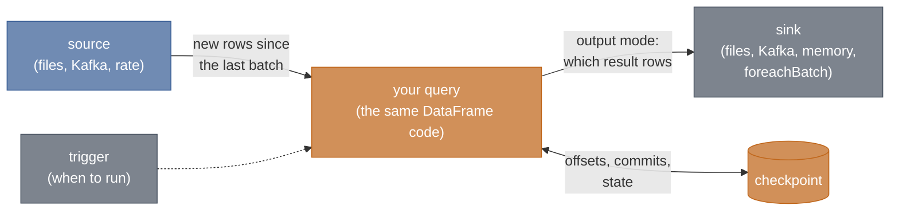
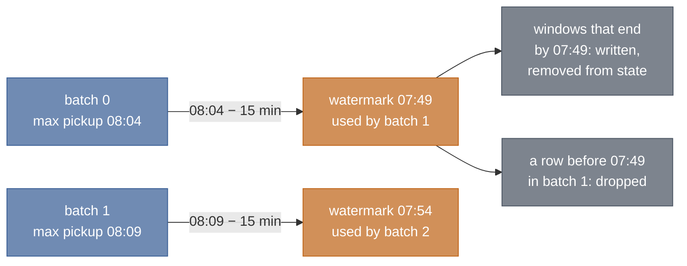
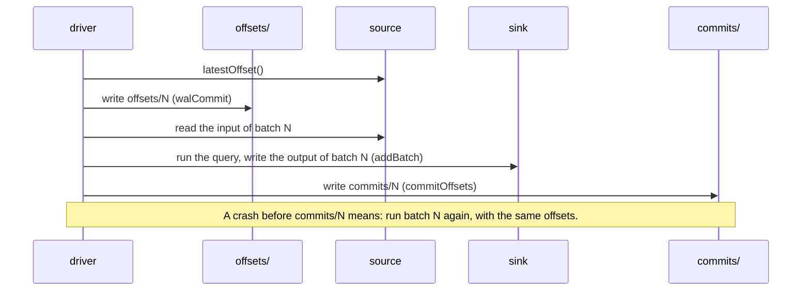
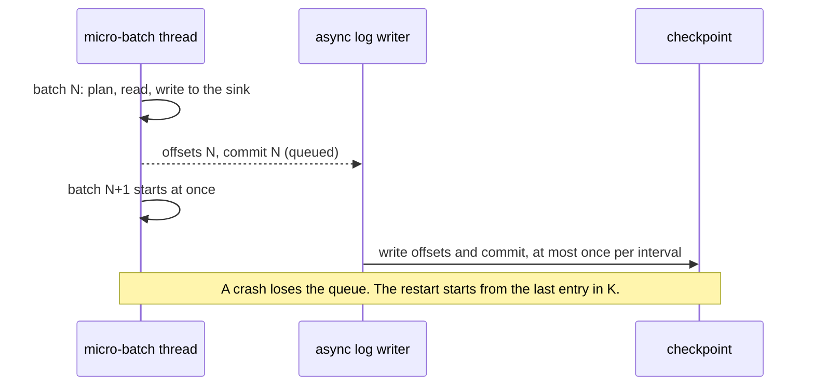

# Chapter 48: Structured Streaming fundamentals

A batch query reads a set of files, calculates a result and stops. Real data does not arrive in a set. A taxi company sends the trips that ended in the last five minutes. A phone sends clicks when it finds a network. A partner puts a file in a folder at a time that nobody knows. You want each new record read one time, the result updated, and nothing read two times, also when the job stops and starts again.

Structured Streaming is the part of Spark that does this work. It uses the same DataFrame API as batch, so the code looks almost the same. But the engine under the code is different, and the differences are where streaming jobs fail.

**A streaming query is a batch query that Spark runs again and again, each time on the input that arrived since the last run. The checkpoint makes the sequence of runs into one query. It records which input each run read, which runs completed, and the state that one run gives to the next. Output modes, triggers, watermarks and restarts are all rules about that sequence.** This chapter follows one stream of real taxi trips through each of these rules. It shows the files and the progress reports that prove each rule.

All the code runs on a laptop against Spark 4.3.0. The scripts are in [`code/ch48`](https://github.com/open-lakehouse/spark-masterclass/tree/main/code/ch48), and each number in the chapter comes from their saved output in `code/ch48/output/`. Most steps use the file source, because it needs no other service. Steps 9 and 15 use Kafka, with a broker in Docker.

## The data: a morning of trips that arrive late

The stream is the NYC yellow-cab trips of the morning of Wednesday 10 June 2026, from the same Parquet file as [Chapter 5](ch05-how-spark-runs.md). `replay.py` changes the trips into a stream of small JSON Lines files. Each file holds the trips that *ended* in one five-minute slice. The reason is that a trip record goes to the Taxi and Limousine Commission when the trip ends.

The time that the queries care about is the pickup time. Thus, the lateness in this stream is real, not simulated. A trip of 40 minutes arrives 40 minutes after its pickup. The schema is:

```python
SCHEMA = ("trip_id STRING, pickup_ts TIMESTAMP, dropoff_ts TIMESTAMP, "
          "PULocationID INT, DOLocationID INT, trip_distance DOUBLE, "
          "fare_amount DOUBLE, total_amount DOUBLE")
```

The first file, `trips_0800.jsonl`, has the 487 trips that ended between 08:00 and 08:05. Each of the twelve files of the morning holds between 450 and 628 trips.

Each script puts files into an inbox folder with `deliver()`, a helper in `code/common/book.py`. The helper writes a hidden file and then renames it. The file source ignores names that start with `.` or `_`, so it never sees half a file. This is the correct method to put a file into a folder that a stream reads. If a program writes the file in place, a micro-batch can start while the file is incomplete, and the stream reads a truncated file.

## The pieces of a streaming query

Structured Streaming thinks of a stream as a table that always becomes larger. New records are new rows at the end of an unbounded input table. Your query is a normal query over that table. Each time that the engine runs it, the engine reads only the new rows, and it updates a result table.



A query has six parts:

- The **source** is where the rows come from: files, Kafka, the `rate` test source, a socket (for tests only) or a Python data source.
- The **query** is your DataFrame code. It is the same API as batch.
- The **sink** is where the result goes: files, Kafka, the console, the memory sink, `foreach` or `foreachBatch`.
- The **trigger** says when to run the next micro-batch.
- The **output mode** says which rows of the result table to write after each micro-batch.
- The **checkpoint** is a folder where the engine records its progress and its state, so that the query can continue after it stops.

The default engine runs the query as a sequence of **micro-batches**. Each micro-batch is a small batch job over the new input. Spark 4.1 added a second engine, Real-time Mode, which [Chapter 51](ch51-real-time-mode.md) explains.

## Step 1: A streaming DataFrame is a plan, not data

The first difference from batch occurs before any query runs. `s1_unbounded.py` tries to open the inbox as a stream without a schema:

```python
spark.readStream.json(str(inbox))
```

```text
1. A file stream with no schema:
  IllegalArgumentException: Schema must be specified when creating a streaming source
  DataFrame. If some files already exist in the directory, then depending on the file
  format you may be able to create a static DataFrame on that directory with ...
```

A batch read of JSON can infer a schema, because it can read all the files first. A stream cannot read all of its input, because most of that input does not exist yet. Thus, a file source needs an explicit schema. With the schema, the DataFrame is streaming, and its plan starts with a `StreamingRelation`:

```text
2. With a schema: isStreaming = True
== Parsed Logical Plan ==
'Aggregate ['PULocationID], ['PULocationID, 'count(1) AS count#8]
+- StreamingRelation FileSource[~/spark-masterclass-parts/part05/data/work/ch48/s1/inbox], [trip_id#0, pickup_ts#1, dropoff_ts#2, PULocationID#3, DOLocationID#4, trip_distance#5, fare_amount#6, total_amount#7], name=<Unassigned>
```

A streaming DataFrame has no rows that you can count. An action such as `count()` fails, and the message tells you the two correct methods to run it:

```text
3. An action on a streaming DataFrame:
  AnalysisException: Queries with streaming sources must be executed with
  writeStream.start(), or from a streaming table or flow definition within a Spark
  Declarative Pipeline.;
```

The second method in the message is Spark Declarative Pipelines, which the book explains in a later part. In this chapter, all queries start with `writeStream.start()`.

You can make Spark infer the schema of a stream with `spark.sql.streaming.schemaInference=true`. But the inference occurs one time, when the query starts, over the files that exist at that time:

```text
5. spark.sql.streaming.schemaInference=true infers once, at start:
   DOLocationID bigint, PULocationID bigint, dropoff_ts string, fare_amount double, pickup_ts string, total_amount double, trip_distance double, trip_id string
```

The inferred schema reads the timestamps as strings and the zone IDs as `bigint`. A field that the producer adds next week is not in this schema. Spark does not tell you that it ignores the field. [Chapter 49](ch49-streaming-messy-data.md) shows what this silent schema does to data that drifts. For production queries, give the schema explicitly.

## Step 2: A first query, run three times on one checkpoint

`s2_first_query.py` counts trips and revenue by pickup borough. It joins the stream with the zone lookup file, which is a batch DataFrame. This join is a **stream-static join**: each micro-batch joins its new trips with the static table. Step 12 shows its rules.

```python
trips = spark.readStream.schema(SCHEMA).json(str(inbox))
by_borough = (trips.join(zones, "PULocationID")          # stream-static join
              .groupBy("Borough").agg(F.count("*").alias("trips"),
                                      F.round(F.sum("total_amount"), 2).alias("revenue")))
q = (by_borough.writeStream
     .format("memory").queryName("by_borough")
     .outputMode("complete")
     .option("checkpointLocation", str(ckpt))
     .trigger(availableNow=True)
     .start())
q.awaitTermination()
```

Four settings on the writer make this a stream that a test can run:

- `format("memory")` keeps the result in an in-memory table that has the name from `queryName`. You read it with `spark.table("by_borough")`. The memory sink is for tests and demos only, because it keeps all output in the driver.
- `outputMode("complete")` writes the full result table after each micro-batch.
- `checkpointLocation` is the folder for the progress of the query.
- `trigger(availableNow=True)` (Spark 3.3) processes all the input that exists when the query starts, in one or more micro-batches, and then stops the query. `awaitTermination()` waits for that stop.

The script runs the query three times:

1. It delivers two files and runs the query.
2. It delivers one more file and runs the query again.
3. It runs the query a third time, with no new file.

The output of the three runs:

```text
run 1: delivered [487, 508], batches (id, rows) [(0, 995)]
+---------+-----+--------+
|  Borough|trips| revenue|
+---------+-----+--------+
|Manhattan|  868|21080.02|
|   Queens|   63| 3909.38|
| Brooklyn|   43| 1824.06|
+---------+-----+--------+
only showing top 3 rows
  checkpoint commits: ['0']
run 2: delivered [450], batches (id, rows) [(1, 450)]
+---------+-----+--------+
|  Borough|trips| revenue|
+---------+-----+--------+
|Manhattan| 1267|30577.01|
|   Queens|   87| 5532.62|
| Brooklyn|   61| 2558.46|
+---------+-----+--------+
only showing top 3 rows
  checkpoint commits: ['0', '1']
run 3: delivered [], batches (id, rows) [(2, 0)]
+-------+-----+-------+
|Borough|trips|revenue|
+-------+-----+-------+
+-------+-----+-------+

  checkpoint commits: ['0', '1']
```

Run 2 read only the new file (450 rows), but the Manhattan total includes the trips from run 1. The engine read the first 995 rows one time only. It kept the partial counts in **state**, and it added the new rows to that state. The checkpoint remembered which files run 1 read, and the state store kept the counts.

Run 3 found no new file. The query made a progress report for batch 2 with zero rows, but it did not run or commit a batch, and it stopped. The memory table is empty, because a memory sink lives in the driver and does not survive a restart of the query. The sink is a new, empty table in each run, and run 3 wrote nothing into it. This is one reason the memory sink is only for tests.

### The progress report

Each micro-batch makes a progress report. `q.recentProgress` holds the most recent reports, `q.lastProgress` holds the last one, and a `StreamingQueryListener` receives each one as an event. This is the report of run 2, with some fields removed:

```text
{
 "id": "b516aa86-9219-4a82-be08-cd4b4fc9d5e6",
 "runId": "ab8a9917-236b-4ca6-b907-6592ae668024",
 "name": "by_borough",
 "batchId": 1,
 "numInputRows": 450,
 "durationMs": {
  "addBatch": 538,
  "commitOffsets": 29,
  "getBatch": 7,
  "latestOffset": 47,
  "queryPlanning": 74,
  "triggerExecution": 732,
  "walCommit": 37
 },
 "stateOperators": [
  {
   "operatorName": "stateStoreSave",
   "numRowsTotal": 6,
   "numRowsUpdated": 5,
   "numShufflePartitions": 4,
   "numStateStoreInstances": 4
  }
 ],
 "sources": [
  {
   "description": "FileStreamSource[file:~/spark-masterclass-parts/part05/data/work/ch48/s2/inbox]",
   "startOffset": {
    "logOffset": 0
   },
   "endOffset": {
    "logOffset": 1
   },
   "numInputRows": 450
  }
 ],
 "sink": {
  "description": "MemorySink",
  "numOutputRows": 6
 }
}
```

Read the report in this sequence:

- **`id` and `runId`.** The `id` is the identity of the query, and the checkpoint keeps it. Each start of the query gets a new `runId`. Thus, three runs on one checkpoint have one `id` and three `runId` values.
- **`batchId`** is the number of the micro-batch. It continues from the checkpoint, so run 2 started at batch 1, not at batch 0.
- **`durationMs`** divides the time of the batch. `latestOffset` asked the source for new input. `walCommit` wrote the offsets to the checkpoint before the batch ran. `addBatch` ran the query and wrote to the sink, and it is most of the time. `commitOffsets` wrote the commit after the sink completed. `triggerExecution` is the total.
- **`stateOperators`** describes each stateful operator. The aggregation keeps six rows, one for each borough, and this batch updated five of them. `numStateStoreInstances` is 4, because the state has one store for each shuffle partition, and the script set `spark.sql.shuffle.partitions` to 4.
- **`sources`** gives the offsets that the batch read. For the file source, an offset is the number of an entry in its log of files. The batch read the files between log offset 0 (not included) and log offset 1.

The value of `spark.sql.shuffle.partitions` is important for a stateful stream. The state store has one instance for each shuffle partition. Step 7 shows that the checkpoint fixes this number for the life of the query. With the default of 200, each micro-batch of this small stream opens 200 state stores. Set the value before the first start of a stateful query.

## Step 3: A stream that ticks

`availableNow` is good for tests and for jobs that a scheduler starts. A query that runs all the time uses a processing-time trigger. `s3_ticking.py` starts a query with `trigger(processingTime="2 seconds")`, and a second thread delivers a file every four seconds. A `StreamingQueryListener` prints each batch when Spark reports its progress:

```python
class Printer(StreamingQueryListener):
    def onQueryProgress(self, e):
        p = e.progress
        if p.numInputRows == 0:
            return                                    # idle triggers report progress too
        state = p.stateOperators[0].numRowsTotal if p.stateOperators else 0
        print(f"{clock()}  batch {p.batchId:>2}  rows {p.numInputRows:>4}  "
              f"state rows {state:>3}  took {p.durationMs['triggerExecution']:>4} ms")
```

```text
  1.6s  started   id=a1a43df8 runId=7194b0a7
  6.3s  + trips_0800.jsonl (487 trips)
 10.0s  batch  0  rows  487  state rows  95  took 2385 ms
 10.3s  + trips_0805.jsonl (508 trips)
 11.9s  batch  1  rows  508  state rows 118  took  465 ms
 14.3s  + trips_0810.jsonl (450 trips)
 15.9s  batch  2  rows  450  state rows 132  took  392 ms
 18.3s  + trips_0815.jsonl (461 trips)
 19.7s  batch  3  rows  461  state rows 140  took  309 ms
 22.3s  + trips_0820.jsonl (518 trips)
 23.6s  batch  4  rows  518  state rows 152  took  232 ms
 26.3s  + trips_0825.jsonl (500 trips)
 27.7s  batch  5  rows  500  state rows 162  took  278 ms
 30.3s  status: 'Waiting for next trigger', active queries: 1
 30.3s  stopped
memory sink: 532 rows appended in update mode (one per changed zone per batch), 162 zones
```

<figure markdown>
  <video autoplay loop muted playsinline controls width="1280" height="720" poster="../../media/clips/ch48-ticking.webp">
    <source src="../../media/clips/ch48-ticking.mp4" type="video/mp4">
  </video>
  <figcaption><code>s3_ticking.py</code> on Spark 4.3.0. A file arrives every four seconds, and the query runs a micro-batch on the next two-second trigger. The state grows as new pickup zones appear.</figcaption>
</figure>

Each file becomes one micro-batch, between 1.3 and 1.9 seconds after the file arrives. That delay is the wait for the next trigger plus the time of the batch. The first batch took 2.4 seconds, and the later batches took between 230 and 470 ms. A possible cause of the slow first batch is code generation and the first start of the state stores. This cause is not verified.

The state grows from 95 to 162 rows, one row for each pickup zone that the stream saw. A `groupBy` without a time column never removes a group, so this state grows for as long as new keys arrive. Step 6 shows how a watermark limits it.

The query used `outputMode("update")`. In update mode, each micro-batch writes only the result rows that changed. The memory sink appends those rows to its table, so a zone that changed in five batches has five rows there. Thus, the memory table has 532 rows for 162 zones. A real update sink (Kafka, or a `MERGE` in `foreachBatch`) uses the key of each row to replace the old value.

`q.status` tells you what the query does now (`Waiting for next trigger`), and `spark.streams.active` lists the queries that run in the session. `q.stop()` stops the query. If a batch runs when you call it, Spark interrupts the batch, and the checkpoint shows that the batch did not complete.

## Step 4: Which output modes each query accepts

The three output modes write different rows of the result table:

- **`append`** writes only rows that will never change again. For a query with no state, that is each new row. For a windowed aggregation, a window goes out one time, after the watermark passes the end of the window.
- **`update`** writes the rows that changed in this micro-batch.
- **`complete`** writes the full result table after each micro-batch. It is only for aggregations, and its output grows with the number of groups.

Not each mode works with each query shape. `s4_output_modes.py` tries all fifteen combinations of five query shapes and three modes:

```text
query shape         append     update     complete   
filter (no state)   ok (24)    ok (24)    error      
groupBy count       error      ok (95)    ok (95)    
window + watermark  ok (6)     ok (9)     ok (9)     
groupBy + orderBy   error      error      ok (95)    
orderBy (no agg)    error      error      error      

filter (no state), complete:
  [STREAMING_OUTPUT_MODE.UNSUPPORTED_OPERATION] Invalid streaming output mode: complete. This output mode is not supported for no streaming aggregations on streaming DataFrames/DataSets. SQLSTATE: 42KDE
groupBy count, append:
  [STREAMING_OUTPUT_MODE.UNSUPPORTED_OPERATION] Invalid streaming output mode: append. This output mode is not supported for streaming aggregations without watermark on streaming DataFrames/DataSets. SQLSTATE: 42KDE
groupBy + orderBy, update:
  Sorting is not supported on streaming DataFrames/Datasets, unless it is on aggregated DataFrame/Dataset in Complete output mode;
```

Each error has a reason in the model:

- **A filter has no result table to complete.** It has no state, so Spark cannot write "all the rows" again.
- **An aggregation without a watermark cannot append.** Spark can never know that a group is final, because a new row for that group can arrive at any time.
- **A windowed aggregation with a watermark accepts all three modes.** The watermark tells Spark when a window is final, so append becomes possible. Append wrote 6 windows, the windows that closed. Update and complete wrote all 9, with the open windows included.
- **A sort needs all the rows.** A stream never has all its rows. The only exception is a sort of an aggregated result in complete mode, because then the full result exists after each batch.

Spark checks these rules when the query starts, not when the first batch runs. Thus, a wrong output mode fails fast.

## Step 5: Windows over event time

Most streaming questions are about time: trips per ten minutes, clicks per user session. The time that matters is the **event time**, the time in the record (`pickup_ts`), not the time when Spark reads the record. The `window()` function assigns each row to a time window. It is the same function in batch and streaming, so `s5_windows.py` shows it on a batch read, where the result is easy to see.

One trip with a pickup at 07:52:00, in three kinds of window:

```text
+----------+-------------------+------------------------------------------+
|trip_id   |pickup_ts          |tumbling                                  |
+----------+-------------------+------------------------------------------+
|0610-00100|2026-06-10 07:52:00|{2026-06-10 07:50:00, 2026-06-10 08:00:00}|
+----------+-------------------+------------------------------------------+

+----------+------------------------------------------+
|trip_id   |sliding                                   |
+----------+------------------------------------------+
|0610-00100|{2026-06-10 07:50:00, 2026-06-10 08:00:00}|
|0610-00100|{2026-06-10 07:45:00, 2026-06-10 07:55:00}|
+----------+------------------------------------------+

+----------+------------------------------------------+
|trip_id   |offset                                    |
+----------+------------------------------------------+
|0610-00100|{2026-06-10 07:43:00, 2026-06-10 07:53:00}|
+----------+------------------------------------------+
```

The figure puts the three results on one time line:

<figure markdown>
  
  
  <figcaption markdown="span">The windows of the trip at 07:52 from `s5_windows.txt`. The trip is in one window of each kind, except the kind with a slide. With a slide of 5 minutes, the trip is in two windows.</figcaption>
</figure>

- **A tumbling window** (`window("pickup_ts", "10 minutes")`) divides time into windows that do not overlap. Each row goes into exactly one window. The windows start at multiples of the duration, counted from the Unix epoch in UTC, so 07:52 goes into 07:50 to 08:00.
- **A sliding window** (`window("pickup_ts", "10 minutes", "5 minutes")`) starts a new window each slide interval. The windows overlap, so each row goes into duration ÷ slide windows. Here, that is two windows. The function returns one row for each window, so a sliding window multiplies the rows.
- **An offset** (`startTime="3 minutes"`) moves all the windows. Use it when your periods do not start on the hour, for example a business day that starts at 06:00.

The counts by tumbling window over the first three files show the lateness of the stream. These files hold the trips that ended between 08:00 and 08:15:

```text
+-----+-----+-----+
|start|  end|count|
+-----+-----+-----+
|06:30|06:40|    1|
|06:50|07:00|    7|
|07:00|07:10|   14|
|07:10|07:20|   12|
|07:20|07:30|   41|
|07:30|07:40|  126|
|07:40|07:50|  301|
|07:50|08:00|  574|
|08:00|08:10|  343|
|08:10|08:20|   26|
+-----+-----+-----+
```

<figure markdown>
  
  
  <figcaption markdown="span">The counts from `s5_windows.txt`. The files hold trips that ended from 08:00 to 08:15, but most of the trips started before 08:00.</figcaption>
</figure>

Trips that ended after 08:00 started as early as 06:30. Most of them started in the 30 minutes before 08:00. Thus, the count for the window 07:50 to 08:00 will increase when the next files arrive. Trips that started at 07:55 continue to end until about 08:30.

**A session window** has no fixed length. `session_window("pickup_ts", "3 minutes")` keeps a session open while rows arrive less than three minutes apart. The session ends three minutes after its last row. These are the pickups at JFK airport (zone 132):

```text
+--------+--------+-----+
|   start|     end|count|
+--------+--------+-----+
|06:37:19|06:40:19|    1|
|06:53:49|07:10:23|   19|
|07:13:23|07:19:24|    6|
|07:19:35|07:23:21|    2|
|07:24:34|07:27:34|    1|
|07:29:13|07:32:13|    1|
|07:33:48|07:36:48|    1|
|07:41:15|07:45:56|    2|
|07:52:07|07:55:40|    2|
|07:57:15|08:01:29|    2|
+--------+--------+-----+
```

A session with one pickup lasts exactly three minutes (06:37:19 to 06:40:19). The session from 06:53:49 to 07:10:23 holds 19 pickups, a group of cabs that left the taxi line together. In a stream, a session window is open until the watermark passes its end. [Chapter 49](ch49-streaming-messy-data.md) uses session windows on clicks.

## Step 6: A watermark that advances over late data

A windowed count in a stream has a problem. When is a window complete? A trip from 07:55 can arrive at 08:30. Without a rule, Spark must keep each window in state for all time, in case one more trip arrives. The state grows without a limit.

A **watermark** is that rule. `withWatermark("pickup_ts", "15 minutes")` gives Spark a rule. A row can be 15 minutes later than the newest row that Spark saw. Spark calculates the watermark as the maximum event time seen so far, minus the delay. A window whose end is before the watermark is complete:

- In append mode, Spark writes the window one time, then removes it from state.
- A row whose window is already complete is too late. Spark drops it.

`s6_watermark.py` counts trips by pickup time in ten-minute windows, in append mode. `maxFilesPerTrigger=1` makes each five-minute file into one micro-batch, so the batches show the stream as it arrived:

```python
trips = (spark.readStream.schema(SCHEMA)
         .option("maxFilesPerTrigger", 1)                  # one 5-minute file per micro-batch
         .json(str(inbox)))
counts = (trips
          .withWatermark("pickup_ts", DELAY)
          .groupBy(F.window("pickup_ts", "10 minutes").alias("w"))
          .agg(F.count("*").alias("trips")))
```

```text
watermark delay 15 minutes; one file of dropoffs per batch

batch  file   rows  max pickup  watermark  dropped  windows out  state rows
    0  0800    487    08:04       00:00          0            0           9
    1  0805    508    08:09       07:49          0            6           3
    2  0810    450    08:14       07:54          5            1           3
    3  0815    461    08:19       07:59          5            0           3
    4  0820    518    08:24       08:04          5            1           3
    5  0825    500    08:29       08:09          4            0           3
    6  0830    547    08:34       08:14          5            1           3
    7  0835    542    08:39       08:19          6            0           3
    8  0840    509    08:44       08:24          6            1           3
    9  0845    517    08:49       08:29          7            0           3
   10  0850    602    08:54       08:34          4            1           3
   11  0855    628    08:59       08:39          8            0           3
   12  (none)    0      -         08:44          0            1           2
```

<figure markdown>
  <video autoplay loop muted playsinline controls width="1280" height="720" poster="../../media/clips/ch48-watermark.webp">
    <source src="../../media/clips/ch48-watermark.mp4" type="video/mp4">
  </video>
  <figcaption><code>s6_watermark.py</code>. Each batch reads one file of trips. The watermark follows the newest pickup, 15 minutes behind, and each window goes out when the watermark passes its end.</figcaption>
</figure>

Read the table one row at a time:

- **Batch 0 has no watermark** (`00:00` is the epoch, which means no watermark yet). The newest pickup in the batch was 08:04, so after the batch, Spark sets the watermark to 08:04 − 15 minutes = 07:49.
- **The watermark of a batch comes from the batches before it.** Batch 1 runs with watermark 07:49, which batch 0 calculated. Spark calculates the watermark at the end of each batch and uses it in the next batch. Step 7 shows the two numbers in the checkpoint.
- **Batch 1 wrote six windows.** All the windows that end at or before 07:49 (from 06:30 up to 07:40 to 07:50) are now complete. The state keeps three open windows after that.
- **From batch 2, the watermark moves five minutes each batch,** because each file holds five minutes of newer pickups. A window goes out every second batch.
- **Batch 12 is a no-data batch.** No file arrived, but the watermark moved after batch 11, and a window became complete. Spark runs a batch with no input when the new watermark lets it write output or remove state. The configuration is `spark.sql.streaming.noDataMicroBatches.enabled`, and it is `true` by default. `availableNow` runs this batch before it stops.
- **The state stays at three rows.** Without the watermark, it grows with each new window (Step 3).

<figure markdown>
  <video autoplay loop muted playsinline controls width="1280" height="720" poster="../../media/clips/ch48-anim-watermark.webp">
    <source src="../../media/clips/ch48-anim-watermark.mp4" type="video/mp4">
  </video>
  <figcaption markdown="span">Animation: the batches of `s6_watermark.py` on an event-time line. The watermark follows the newest pickup 15 minutes behind it. A window moves to the written row when the watermark passes its end. The values of each batch come from `s6_watermark.txt`. The time between the batches is schematic.</figcaption>
</figure>

The `dropped` column needs care. It is `numRowsDroppedByWatermark` of the stateful operator, and the total is 55. But the script also compares the written windows with a batch count of all the trips:

```text
delay 15 minutes: 12 windows written, holding 4992 trips; 513 trips in them arrived too late
(numRowsDroppedByWatermark summed to 55)
window  all trips  written
 07:30        158      101
 07:40        367      301
 07:50        823      739
 08:00       1017      903
 08:10       1085     1002
 08:20       1013      970
 08:30        920      920
 08:40        597   (open)
 08:50        166   (open)
```

513 trips arrived after their window went out, but the metric says 55. The reason is in the plan. A streaming aggregation does a partial aggregation in each task before the shuffle, as in [Chapter 5](ch05-how-spark-runs.md). The stateful operator receives one partial count for each window in each task, not one row for each trip. The metric counts those partial rows (`applyRemovingRowsOlderThanWatermark` in `statefulOperators.scala`).

Thus, `numRowsDroppedByWatermark` tells you *that* data is late, not *how much* data is late. To count late records, compare with a batch count, as this script does, or count them before the aggregation.

### The delay is a trade-off

The delay sets how long Spark waits, and how much late data it drops. The same stream with three other delays:

```text
delay 5 minutes: 13 windows written, holding 4644 trips; 1458 trips in them arrived too late
(numRowsDroppedByWatermark summed to 65)

delay 30 minutes: 10 windows written, holding 3406 trips; 166 trips in them arrived too late
(numRowsDroppedByWatermark summed to 40)

delay 60 minutes: 7 windows written, holding 627 trips; 20 trips in them arrived too late
(numRowsDroppedByWatermark summed to 13)
```

| Delay | Windows written by the end | Trips that arrived too late |
|---|---|---|
| 5 minutes | 13 | 1,458 |
| 15 minutes | 12 | 513 |
| 30 minutes | 10 | 166 |
| 60 minutes | 7 | 20 |

<figure markdown>
  
  
  <figcaption markdown="span">The results of the four delays from `s6_watermark.txt` and `s6_delays.txt`.</figcaption>
</figure>

A short delay writes results early and drops many trips. A long delay drops almost nothing, but the results come out later, and the state holds more windows. No delay is correct for all uses. Choose it from the lateness of your data: here, most trips last less than 30 minutes, so a 30-minute delay drops few trips.



## Step 7: Inside the checkpoint, and a restart after a crash

The checkpoint is what makes a sequence of batch jobs into one query. `s7_checkpoint.py` runs a windowed count with a Parquet sink two times, and then lists the checkpoint folder:

```text
run 1 batches (id, rows): [(0, 487), (1, 0)]
run 2 batches (id, rows): [(2, 508), (3, 0)]

The checkpoint (.crc checksum files left out):
commits/0  (41 B)
commits/1  (41 B)
commits/2  (41 B)
commits/3  (41 B)
metadata  (45 B)
offsets/0  (1170 B)
offsets/1  (1182 B)
offsets/2  (1182 B)
offsets/3  (1182 B)
sources/0/0  (140 B)
sources/0/1  (140 B)
state/0/0/1.delta  (141 B)
state/0/0/2.delta  (106 B)
state/0/0/3.delta  (91 B)
state/0/0/4.delta  (84 B)
state/0/0/_metadata/schema  (402 B)
state/0/1/1.delta  (118 B)
...
state/0/3/4.delta  (46 B)
state/0/_metadata/metadata  (150 B)
```

Each run did one batch with data and one no-data batch, for the watermark. The folder has five parts:

- **`metadata`** holds the query `id`. It is the identity that `id` in the progress report shows.
- **`offsets/N`**: Spark writes this file *before* batch N runs. It records what batch N will read.
- **`commits/N`**: Spark writes this file *after* batch N wrote to the sink. It records that batch N completed.
- **`sources/0/`** is the log of the file source: which files it found, in which batch.
- **`state/0/<partition>/<version>.delta`** is the state of operator 0. It has one folder for each of the four shuffle partitions, and one file for each version. [Chapter 52](ch52-checkpoints-and-state-store.md) opens these files byte by byte.

The offset file of batch 2 has three lines. The second line is JSON:

```text
--- offsets/2 (line 2 pretty-printed)
v1
{
 "batchWatermarkMs": 1781077781000,
 "batchTimestampMs": 1795337199406,
 "conf": {
  "spark.sql.streaming.stateStore.providerClass": "org.apache.spark.sql.execution.streaming.state.HDFSBackedStateStoreProvider",
  ...
  "spark.sql.streaming.multipleWatermarkPolicy": "min",
  ...
  "spark.sql.shuffle.partitions": "4",
  "spark.sql.streaming.join.stateFormatVersion": "2",
  "spark.sql.streaming.stateStore.compression.codec": "lz4",
  "spark.sql.optimizer.pruneFiltersCanPruneStreamingSubplan": "false"
 }
}
{"logOffset":1}
batchWatermarkMs = 2026-06-10 07:49:41 UTC

--- commits/2
v1
{"nextBatchWatermarkMs":1781078086000}
nextBatchWatermarkMs = 2026-06-10 07:54:46 UTC
```

- **`batchWatermarkMs`** is the watermark that batch 2 used (07:49:41). The commit of batch 2 records `nextBatchWatermarkMs` (07:54:46) for batch 3. This pair is the "calculate at the end, use in the next batch" rule from Step 6, written to disk.
- **`conf`** holds the settings that the query must keep for its whole life: the state store provider, the state formats, the watermark policy and `spark.sql.shuffle.partitions`. On a restart, Spark uses these values, not the values of the new session.
- **The third line** is the offset of each source. Here, the file source reads up to entry 1 of its log.

`sources/0/1` names the file of batch 1. Each Parquet sink has its own log, `_spark_metadata/`, next to the data files. A batch reader of the sink folder reads only the files in this log, so it never sees a file from a batch that failed:

```text
--- sources/0/1
v1
{"path":"file://~/spark-masterclass-parts/part05/data/work/ch48/s7/inbox/trips_0805.jsonl","timestamp":1795337199171,"batchId":1}
```

### The protocol, and what a restart does

The order of these writes is the protocol that gives exactly-once processing:



When a query starts, Spark reads the last entry of `offsets/` and the last entry of `commits/`. If they have the same batch number, the last batch completed, and Spark plans a new batch. If `offsets/N` exists and `commits/N` does not exist, batch N started and did not complete. Spark runs batch N again, with exactly the same offsets. The state store goes back to the version after batch N − 1, so the state also gives the same result.

`s7_restart.py` makes this occur. It counts trips by pickup zone with a `foreachBatch` sink, one file per batch. In batch 3, after the sink writes, the script stops the driver with `os._exit(1)`, so Spark cannot write the commit:

```text
  batch 0: zones updated  95, Midtown Center trips so far 15
  batch 1: zones updated  90, Midtown Center trips so far 27
  batch 2: zones updated  88, Midtown Center trips so far 34
  batch 3: zones updated  85, Midtown Center trips so far 44
  ** the driver dies inside batch 3 (os._exit) **
```

The second run uses the same checkpoint, in a new process with `spark.sql.shuffle.partitions` set to 8:

```text
offsets [0, 1, 2, 3], commits [0, 1, 2]: batch 3 was planned and never committed, so it runs again
spark.sql.shuffle.partitions is now 8
  batch 3: zones updated  85, Midtown Center trips so far 44
  batch 4: zones updated  85, Midtown Center trips so far 49
  batch 5: zones updated  89, Midtown Center trips so far 61
batch 3: numShufflePartitions 4, numStateStoreInstances 12
batch 4: numShufflePartitions 4, numStateStoreInstances 12
batch 5: numShufflePartitions 4, numStateStoreInstances 12
offsets [0, 1, 2, 3, 4, 5], commits [0, 1, 2, 3, 4, 5]
```

<figure markdown>
  <video autoplay loop muted playsinline controls width="1280" height="720" poster="../../media/clips/ch48-restart.webp">
    <source src="../../media/clips/ch48-restart.mp4" type="video/mp4">
  </video>
  <figcaption><code>s7_restart.py</code>. The driver stops inside batch 3. The restart finds <code>offsets/3</code> with no <code>commits/3</code>, runs batch 3 again with the same input, and continues.</figcaption>
</figure>

Three facts come from this output:

- **Batch 3 ran two times, with the same result.** The second time, Midtown Center had 44 trips again, not 54. The state store went back to the version after batch 2, and the source gave the same file.
- **The sink saw batch 3 two times.** Spark gives each batch the same `batch_id` when it runs the batch again. This sink writes to `batch_id=3` with `mode("overwrite")`, so the second write replaces the first. A sink that only appends gets the rows of batch 3 two times. This is the second half of exactly-once: the engine processes each batch exactly one time, but the sink must make a repeated write harmless. Step 8 and [Chapter 49](ch49-streaming-messy-data.md) show sinks that do this.
- **The new value for shuffle partitions had no effect.** The session said 8, but `numShufflePartitions` stayed 4, because the offset log fixed it. The state has four partitions by key. A different number of partitions sends each key to a different store.

`numStateStoreInstances` is 12, not 4. The batch function runs three actions on its DataFrame: a write, a `collect()` and a `count()`. Each action runs the plan of the batch again. Each run opens the four state stores, and the metric counts all three runs. Step 8 measures this effect.

To change the number of state partitions, start a new checkpoint or repartition the state offline. Spark 4.2 added the offline method, and [Chapter 52](ch52-checkpoints-and-state-store.md) explains it.

## Step 8: Sinks, admission control and the edges of the API

`s8_sinks.py` shows the options that control how much input each batch takes, and the behavior of the sinks at their limits.

**Admission control.** By default, a micro-batch takes all the new input. The file source has two options that limit a batch. You cannot use the two options together:

```text
1. Admission control: how many rows each micro-batch takes
   {}                             rows per batch [1906]
   {'maxFilesPerTrigger': 1}      rows per batch [487, 508, 450, 461]
   {'maxFilesPerTrigger': 3}      rows per batch [1445, 461]
   {'maxBytesPerTrigger': 200000} rows per batch [487, 958, 461]
  StreamingQueryException: [STREAM_FAILED] ... Options 'maxFilesPerTrigger' and
  'maxBytesPerTrigger' can't be both set at the same time SQLSTATE: XXKST
   latestFirst + maxFiles 1       rows per batch [461, 450, 508, 487] (newest file first)
```

- `maxFilesPerTrigger` limits the number of files in a batch.
- `maxBytesPerTrigger` limits the bytes. It is a soft limit: a batch takes files until the total is more than the limit, so the second batch here has two files.
- The source reads files in the sequence of their modification time, oldest first. `latestFirst=true` reverses that sequence. It is for a backlog where new data is more important than old data.
- `maxFileAge` ignores files that are older than an age, relative to the newest file.
- `fileNameOnly=true` identifies a file by its name only, not by its full path.
- If a file changes after the source read it, the source does not read it again. The `sources/0/` log identifies files by path, and a file in that log is complete for the source.

The two limits are the same thing as `maxOffsetsPerTrigger` on Kafka (Step 9). They prevent a problem after a long stop: without them, the first batch takes all the backlog.

**`foreachBatch` runs the plan once for each action.** `foreachBatch` gives your function each micro-batch as a normal batch DataFrame, plus its `batch_id`. Inside the function, you can use any batch writer. But each action on that DataFrame runs the plan of the batch again:

```python
def body(df, batch_id, persist=persist):
    if persist:
        df = df.persist()
    df.write.mode("overwrite").parquet(str(w / f"fb{persist}/batch_id={batch_id}"))
    df.count()
    df.where("trips > 5").collect()
    if persist:
        df.unpersist()
```

```text
2. foreachBatch runs the batch's plan once per action on it
   persist=False  shuffle partitions 4, state store instances loaded 12
   persist=True   shuffle partitions 4, state store instances loaded 4
```

Without `persist()`, three actions loaded the four state stores three times. With `persist()`, the first action calculates the batch, and the next actions read the cache. Use `persist()` when the function uses the DataFrame more than one time. It also prevents a second problem. If the query has a non-deterministic part, two runs of the plan can give different rows. An example is `current_timestamp()`.

**The memory sink cannot restart.** The second start of the same memory query on the same checkpoint fails:

```text
3. The memory sink keeps nothing across restarts:
  AnalysisException: This query does not support recovering from checkpoint location.
  Delete ~/spark-masterclass-parts/part05/data/work/ch48/s8/mem/offsets to start ...
```

This error occurs in append mode. In complete mode (Step 2), a restart works, because each batch writes the full result again.

**A file sink needs a checkpoint location.** The console and memory sinks can run without a checkpoint, and Spark then uses a temporary folder. A file sink cannot:

```text
4. A file sink needs a checkpoint location of its own:
  AnalysisException: checkpointLocation must be specified either through
  option("checkpointLocation", ...) or ...
```

**Spark deprecates `trigger(once=True)`.** The Spark 4.3 programming guide marks it deprecated and tells you to use `availableNow`. It still runs, and PySpark gives no warning:

```text
5. trigger(once=True), which the 4.3 guide marks deprecated:
   no Python warning | batches: [1906]
```

`once` takes all the input in one batch, and it ignores `maxFilesPerTrigger`. `availableNow` obeys the limits, so it can process a large backlog in many small batches. It also runs the final no-data batch, which lets the watermark write the last windows. If a source does not support `availableNow`, Spark falls back to one batch, as `once` does.

**The Real-time trigger does not accept a file source.** The trigger exists in PySpark (since 4.2), and Spark checks the source when the first batch starts:

```text
6. A Real-time trigger on a file source:
  StreamingQueryException: [STREAM_FAILED] ...
  [STREAMING_REAL_TIME_MODE.INPUT_STREAM_NOT_SUPPORTED] Streaming real-time mode has the
  following limitation: The input stream ...
```

### The triggers

| Trigger | What it does |
|---|---|
| none (the default) | Starts the next micro-batch when the previous one completes. In the source, the default is `ProcessingTime(0)`. |
| `processingTime="2 seconds"` | Starts a micro-batch at each interval. If a batch takes longer than the interval, the next batch starts when it completes. |
| `availableNow=True` | Processes all the input that exists at the start, in one or more batches, then stops. |
| `once=True` | One batch, then stops. Deprecated since 3.4. Use `availableNow`. |
| `realTime="5 minutes"` | Real-time Mode: long-running batches, record by record. Kafka source only. See [Chapter 51](ch51-real-time-mode.md). |
| `continuous="1 second"` | Continuous Processing, experimental since 2.3, map-like queries only. The 4.3 docs tell you to use Real-time Mode. |

The same triggers, compared on the rules that this part of the book tests:

| Trigger | Engine | Sources | Stops by itself | Obeys admission control | No-data batches | Async progress tracking (Step 15) | Delivery |
|---|---|---|---|---|---|---|---|
| default | micro-batch | all | no | yes | yes | yes | exactly once with an idempotent sink |
| `processingTime` | micro-batch | all | no | yes | yes | yes | exactly once with an idempotent sink |
| `availableNow` | micro-batch | all (one batch if the source has no support) | yes | yes | yes, also the last one | no | exactly once with an idempotent sink |
| `once` | micro-batch | all | yes | no | no | no | exactly once with an idempotent sink |
| `realTime` | Real-time Mode | Kafka | no | no (the batch duration decides) | not applicable | on by default for stateless queries (4.3) | at least once to the sink ([Chapter 51](ch51-real-time-mode.md)) |
| `continuous` | Continuous Processing | Kafka, `rate` | no | no | not applicable | no | at least once |

Sources for the table: the triggers section of the 4.3.0 programming guide, the continuous processing section of `docs/streaming/performance-tips.md`, `AsyncProgressTrackingMicroBatchExecution.validateAndGetTrigger`, and the runs in this chapter. The two continuous rows were not run in this chapter.

## Step 9: The same trips through Kafka

Files are good for a book, because they need no other service. In production, the most frequent source is Kafka. `s9_kafka.py` runs against one Kafka broker in Docker:

```bash
ch48/kafka.sh start             # apache/kafka:4.0.0, KRaft mode, on localhost:29055
ch48/kafka.sh topic trips 4     # a topic with 4 partitions
```

The Kafka connector is not part of the PySpark package. The script adds it with `spark.jars.packages`:

```python
KAFKA_PACKAGE = "org.apache.spark:spark-sql-kafka-0-10_2.13:4.3.0"   # the Kafka connector for Spark 4.3
```

The connector version must be the same as the Spark version, and `_2.13` is the Scala version of Spark 4.x. It brings the Kafka client (`kafka-clients` 3.9.2 in this download) with it.

A batch job writes six files of trips to the topic. The key is the pickup zone, so the producer sends all trips of one zone to the same partition. Then a streaming query reads the topic:

```python
raw = (spark.readStream.format("kafka")
       .option("kafka.bootstrap.servers", KAFKA_BOOTSTRAP)
       .option("subscribe", "trips")
       .option("startingOffsets", "earliest")
       .option("maxOffsetsPerTrigger", 1200)
       .load())
```

```text
published 2924 trips (dropoffs 08:00 to 08:30)

What the Kafka source gives you:
root
 |-- key: binary (nullable = true)
 |-- value: binary (nullable = true)
 |-- topic: string (nullable = true)
 |-- partition: integer (nullable = true)
 |-- offset: long (nullable = true)
 |-- timestamp: timestamp (nullable = true)
 |-- timestampType: integer (nullable = true)
```

The Kafka source always has this schema. The record is in `value`, as bytes. You cast it to a string and parse it with `from_json` and the trip schema.

Thus, a Kafka stream does not have the schema problem of Step 1. The source schema never changes, and you decide how to parse the bytes. `timestamp` is the time of the record in Kafka. The topic configuration (`timestampType`) decides which time it is: the time when the producer made the record, or the time when the broker appended it.

The query counts trips for each Kafka partition, and it runs two times:

```text
run 1 batches (id, rows): [(0, 1198), (1, 1198), (2, 528)]
+---------+-----+-----------+
|partition|trips|last_offset|
+---------+-----+-----------+
|        0|  925|        924|
|        1| 1018|       1017|
|        2|  598|        597|
|        3|  383|        382|
+---------+-----+-----------+

offsets/2, line 3 (the source's offset: next offset to read, per partition):
  {"trips":{"0":925,"1":1018,"2":598,"3":383}}
progress, the same source: {"endOffset": {"trips": {"0": 925, "1": 1018, "2": 598, "3": 383}}, "latestOffset": {"trips": {"0": 925, "1": 1018, "2": 598, "3": 383}}}

published 3345 more trips (08:30 to 09:00)
run 2 batches (id, rows): [(3, 1198), (4, 1199), (5, 948)]
+---------+-----+-----------+
|partition|trips|last_offset|
+---------+-----+-----------+
|        0| 1907|       1906|
|        1| 2184|       2183|
|        2| 1327|       1326|
|        3|  851|        850|
+---------+-----+-----------+
```

- **An offset is now one number for each partition.** The checkpoint records the *next* offset to read in each partition. Partition 0 has records 0 to 924, so its next offset is 925.
- **`maxOffsetsPerTrigger` limits the records in a batch.** 2,924 records became batches of about 1,200. Spark divides the limit across the partitions in proportion to their backlog. Thus, a batch can have 1,198 or 1,199 records, not exactly 1,200.
- **The partitions are not equal.** The key decides the partition, and Manhattan zones have more trips. Each Kafka partition becomes one task in the scan, so partition 1 is the slowest task in each batch.
- **Run 2 started from the checkpoint.** `startingOffsets=earliest` applies only to the first start of a query. After that, the checkpoint decides, and run 2 read only the new 3,345 records.

The progress report gives `latestOffset` too: the newest offset in Kafka when Spark planned the batch. The difference between `latestOffset` and `endOffset` is how far the query is behind. Here, the query read all the records, so the two are the same.

[Chapter 53](ch53-kafka-in-depth.md) goes further into the connector: the starting and ending options, batch reads, headers, `failOnDataLoss`, the delivery of the sink, consumer groups and security.

## Step 10: A stream-stream join

The joins so far had a static side. When both sides are streams, a row on one side can arrive before or after its partner on the other side. Spark must keep the rows of each side in state until the partner arrives. `s10_join.py` divides each trip into two events: a pickup event at the pickup time, and a dropoff event at the dropoff time. Each event arrives on its own stream, in five-minute files. The join pairs them again by `trip_id`:

```python
pickups = (spark.readStream.schema("trip_id STRING, PULocationID INT, pickup_ts TIMESTAMP")
           .option("maxFilesPerTrigger", 1).json(str(w / "pickups"))
           .withWatermark("pickup_ts", "10 minutes"))
dropoffs = (spark.readStream.schema("trip_id STRING, DOLocationID INT, dropoff_ts TIMESTAMP, total_amount DOUBLE")
            .option("maxFilesPerTrigger", 1).json(str(w / "dropoffs"))
            .withWatermark("dropoff_ts", "10 minutes")
            .withColumnRenamed("trip_id", "d_trip_id"))
joined = pickups.join(dropoffs, F.expr("""
    trip_id = d_trip_id AND
    dropoff_ts >= pickup_ts AND dropoff_ts <= pickup_ts + INTERVAL 1 HOUR"""))
```

Two parts of this code limit the state:

- **A watermark on each side.** It tells Spark how late each stream can be.
- **A time-range condition** (`dropoff_ts <= pickup_ts + INTERVAL 1 HOUR`). With the watermark on the dropoff side, it tells Spark when a pickup can no longer find a partner. The watermark of the dropoffs passes 09:10, so a pickup from 08:10 is complete and leaves the state.

Without the time-range condition, the join is still correct, but Spark can never remove a row, and the state grows without a limit.

```text
append mode: 6198 trips joined (of 6259 whose pickup was after 07:00)
batch  rows in  joined  watermark  state rows
    0     1461       0    00:00          1461
    1      986     479    00:00          2447
    2     1019     503    07:54          3466
    3      988     446    07:59          4454
    4     1006     458    08:04          4971
    5      989     513    08:09          5446
    6     1042     494    08:14          6026
    7     1037     542    08:19          6581
    8      972     534    08:24          7010
    9      859     500    08:29          7332
   10      763     511    08:34          7491
   11      738     599    08:39          7586
   12      658     619    08:44          7582
   13        0       0    08:49          6863
update mode: 6198 trips joined (of 6259 whose pickup was after 07:00)
```

The state grew while the watermark was behind the data. From batch 11, it stayed near 7,500 rows, and the no-data batch 13 removed about 700 rows. The join paired 6,198 of 6,259 trips. The other 61 are trips whose pickup event arrived in the first file, from before 07:55. Those pickups were older than the watermark when their dropoffs arrived. An inner join drops them.

The join also ran in update mode, with the same result. Before Spark 4.2, a stream-stream join accepted only append mode. Spark 4.2 added update mode for joins that are not outer joins (SPARK-56384). An inner join never changes a row that it wrote, so the two modes give the same rows.

Outer joins also exist. A left outer join writes a pickup with NULL dropoff columns when the watermark tells Spark that no partner can arrive. Thus, the NULL rows come out late, one watermark delay after the time range ends.

### An outer join, and the state that a join keeps

`s10b_join_state.py` makes the outer case visible. It uses the same events, with one change. The dropoff events of each trip whose `trip_id` ends in 7 are lost on the way. Thus, 626 of the 6,259 pickups have no partner. A left outer join must write those pickups with NULL dropoff columns. A `foreachBatch` function counts the matched rows and the NULL rows of each batch:

```text
6259 pickups after 07:00; dropoff events lost for 626 of them (trip_id ends in 7)

1. Left outer join, append mode:
batch  matched  null rows  their pickups    watermark  state rows  state stores
    0        0          0                    00:00          1461            16
    1      432          0                    00:00          2400            16
    2      452          0                    07:54          3368            16
    3      402          0                    07:59          4311            16
    4      412          8   07:00-07:04      08:04          4829            16
    5      461          3   07:05-07:07      08:09          5303            16
    6      444         10   07:10-07:14      08:14          5878            16
    7      488         14   07:15-07:19      08:19          6424            16
    8      482          7   07:20-07:23      08:24          6851            16
    9      449          7   07:25-07:29      08:29          7172            16
   10      459         12   07:30-07:34      08:34          7334            16
   11      539         12   07:35-07:39      08:39          7423            16
   12      557         24   07:40-07:44      08:44          7406            16
   13        0         21   07:44-07:49      08:49          6739            16
null rows written: 118, lost dropoffs: 626
operator: symmetricHashJoin
```

<figure markdown>
  
  
  <figcaption markdown="span">The batches of `s10b_join_state.txt`. A pickup without a partner goes out as a NULL row when the watermark is one hour past the pickup. The pickups after 07:49 stay in state, because the stream stopped.</figcaption>
</figure>

The table shows the rule of the time range:

- **A NULL row waits for the full range.** The condition lets a dropoff arrive up to one hour after its pickup. Thus, a pickup at 07:00 is final only when the watermark passes 08:00. Batch 4 used the watermark 08:04, and it wrote the lost pickups from 07:00 to 07:04.
- **Only 118 of the 626 NULL rows came out.** The other lost pickups are after 07:49. The watermark stopped at 08:49, so Spark cannot know yet that their dropoffs will not arrive. A stream that stops leaves its last hour of NULL rows in state.
- **The watermark is the minimum of the two inputs.** With two watermarks, the default `spark.sql.streaming.multipleWatermarkPolicy=min` uses the slower input. [Chapter 49](ch49-streaming-messy-data.md) shows the `max` policy.

A join keeps four state stores for each shuffle partition, so the progress report shows 16 state stores for 4 partitions. The `state-metadata` source names them:

```text
2. What the checkpoint says the join keeps (state-metadata):
+-----------------+-------------------------+-------------+----------+
|operatorName     |stateStoreName           |numPartitions|maxBatchId|
+-----------------+-------------------------+-------------+----------+
|symmetricHashJoin|left-keyToNumValues      |4            |13        |
|symmetricHashJoin|left-keyWithIndexToValue |4            |13        |
|symmetricHashJoin|right-keyToNumValues     |4            |13        |
|symmetricHashJoin|right-keyWithIndexToValue|4            |13        |
+-----------------+-------------------------+-------------+----------+
```

For each side, `keyToNumValues` counts the rows of each join key, and `keyWithIndexToValue` holds the rows themselves, one entry for each key and index. The state data source reads one side with the option `joinSide`:

```python
st = spark.read.format("statestore").option("joinSide", "left").load(str(w / "ck_outer"))
```

```text
3. The rows that each side still keeps (statestore, joinSide):
   left  (pickup_ts): 5624 rows, from 07:49:53 to 08:59:53
+----------+----------+------------+-------------------+
|field0    |trip_id   |PULocationID|pickup_ts          |
+----------+----------+------------+-------------------+
|0610-00790|0610-00790|239         |2026-06-10 07:49:53|
|0610-01020|0610-01020|68          |2026-06-10 07:49:55|
+----------+----------+------------+-------------------+
only showing top 2 rows
   right (dropoff_ts): 1115 rows, from 08:49:54 to 08:59:59
```

The two sides keep different time spans, and the time-range condition decides each one:

- **The left side keeps one hour of pickups** (07:49 to 08:59 at a watermark of 08:49). A dropoff can come up to one hour after its pickup. Thus, Spark keeps a pickup until the watermark is one hour past it.
- **The right side keeps about ten minutes of dropoffs** (08:49 to 08:59). A new pickup has a pickup time after the watermark. The condition needs `dropoff_ts >= pickup_ts`, so a new pickup cannot match a dropoff that is older than the watermark. Thus, Spark removes a dropoff when the watermark passes it.

The script also tries each join type between two streams, with and without the watermarks and the time range:

```text
4. Join types for two streams, with and without watermarks:
   inner      with watermarks and range: ok
              without:                   ok
   left       with watermarks and range: ok
              without:                   Stream-stream LeftOuter join between two streaming D ...
   right      with watermarks and range: ok
              without:                   Stream-stream RightOuter join between two streaming  ...
   full       with watermarks and range: ok
              without:                   Stream-stream FullOuter join between two streaming D ...
   left_semi  with watermarks and range: ok
              without:                   Stream-stream LeftSemi join between two streaming Da ...
   left_anti  with watermarks and range: LeftAnti joins with a streaming DataFrame/Dataset on ...
              without:                   LeftAnti joins with a streaming DataFrame/Dataset on ...
```

| Join between two streams | Without watermark and range | With watermark and range | When rows go out |
|---|---|---|---|
| inner | accepted, state grows without a limit | accepted | when the partner arrives |
| left, right, full outer | refused | accepted | matched rows at once, NULL rows when the range closes |
| left semi | refused | accepted | when the first partner arrives, one time for each left row |
| left anti | refused | refused | not supported in 4.3.0 |

An inner join without watermarks starts, because it is correct without them. Its state never gets smaller. The outer and semi joins need the watermark to decide that no partner can arrive, so Spark refuses them at `start()`.

## Step 11: Change a query and keep its checkpoint

A checkpoint is bound to the shape of the query. The offset log identifies each source by its position in the query: source 0, source 1. `s11_evolve.py` adds a second source to a query on restart:

```text
2. Positional sources: add a second source on restart
   run 1, yellow only:    [(0, 487)]
  StreamingQueryException: [STREAM_FAILED] ... assertion failed: There are [1] sources in
  the checkpoint offsets and now there are [2] sources requested by the query. Cannot
  continue. SQLSTATE: XXKST
```

Spark 4.2 added names for streaming sources (SPARK-54909), so that a query can add, remove or reorder its sources. The feature is experimental. It works only when the internal flag `spark.sql.streaming.queryEvolution.enableSourceEvolution` is `true`, and it is `false` by default in 4.3.0. Without the flag, `.name()` fails at once:

```text
1. Without the flag, .name() is refused:
  AnalysisException: [STREAMING_QUERY_EVOLUTION_ERROR.SOURCE_NAMING_NOT_SUPPORTED]
  Streaming query evolution error: Streaming source naming is not supported. Source name ...
```

With the flag, the same change works:

```python
spark.conf.set("spark.sql.streaming.queryEvolution.enableSourceEvolution", "true")
...
run(src(yellow, "yellow_trips").unionByName(src(green, "green_trips")), w / "ck_named")
```

```text
3. With enableSourceEvolution=true and a name on every source
   run 1, yellow only:    [(0, 487)]
   run 2, yellow + green: [(1, 958)]
   offsets/1, the source lines:
     green_trips:{"logOffset":0}
     yellow_trips:{"logOffset":1}
   one source left unnamed:
  AnalysisException:
  [STREAMING_QUERY_EVOLUTION_ERROR.UNNAMED_STREAMING_SOURCES_WITH_ENFORCEMENT] Streaming ...
```

The offset log now identifies each source by its name, not by its position. Run 2 read the new yellow file and all of the green folder. With the flag on, each source in the session must have a name. A name can contain only ASCII letters, digits and underscores. The SQL form of a name is `IDENTIFIED BY`. In 4.3, the Scala writer also has `name()` for sinks behind a second internal flag, `spark.sql.streaming.queryEvolution.enableSinkEvolution`, but the PySpark `DataStreamWriter` has no `name()` method.

!!! caution "Do not use source names on a production query yet"
    Use source names only for new queries that you can start again from zero. The feature is experimental in 4.3.0, and it needs an internal flag.

The last part of the script shows a protection that Spark 4.2 added. It removes the `metadata` file from a checkpoint that has offsets and commits, and restarts the query:

```text
4. Remove the metadata file of a checkpoint that has offsets and commits:
  SparkRuntimeException: [STREAMING_CHECKPOINT_MISSING_METADATA_FILE] Checkpoint location
  file:~/spark-masterclass-parts/part05/data/work/ch48/s11/ck_pos is in an
  inconsistent state: the metadata file is missing but offset and/or commit logs contain ...
```

Before 4.2, Spark wrote a new `metadata` file with a new query `id`, and it continued. A sink that uses the query `id` for deduplication could then write data two times. Now Spark stops.

Other changes are not compatible with a checkpoint. Each of these changes fails on restart with a state schema error:

- a change to the grouping keys
- a new aggregate column
- a new stateful operator

 [Chapter 49](ch49-streaming-messy-data.md) tries each of these changes, and [Chapter 52](ch52-checkpoints-and-state-store.md) shows where Spark records the schema that it compares.

!!! caution "Do not share a checkpoint between two queries"
    Give each query its own checkpoint location. If two queries write to one checkpoint, each one reads the offsets and state of the other, and the results are wrong.

## Step 12: Stream-static joins in depth

Step 2 joined the trips with the zone table, which is a static DataFrame. A stream-static join keeps no state, so it needs no watermark. But it has two rules that a stream-stream join does not have. `s12_stream_static.py` tests them.

The first rule is about the join type. Each micro-batch joins only its new rows with the full static table. Thus, Spark can never write a static row "with no partner", because a partner can arrive in a later batch:

```text
1. Join types between a stream (left) and a static table (right), and the reverse:
   stream INNER static         ok
   stream LEFT OUTER static    ok
   stream LEFT SEMI static     ok
   stream LEFT ANTI static     ok
   stream RIGHT OUTER static  refused:
  AnalysisException: RightOuter join with a streaming DataFrame/Dataset on the left and
  a static DataFrame/DataSet on the right not supported;
   stream FULL OUTER static   refused:
  AnalysisException: FullOuter joins with streaming DataFrames/Datasets on the left and
  a static DataFrame/Dataset on the right is not supported;
   static LEFT OUTER stream   refused:
  AnalysisException: LeftOuter join with a streaming DataFrame/Dataset on the right and
  a static DataFrame/Dataset on the left is not supported;
   static RIGHT OUTER stream   ok
```

The rule is the same in each direction. Spark accepts a join type only if the join never writes an unmatched row of the static side. A stream LEFT OUTER static join writes an unmatched trip at once, with NULL zone columns. A LEFT ANTI join writes the trips that have no zone, which is a good test for keys that are not in a lookup table.

The plan of one micro-batch shows how Spark runs the join:

```text
2. The physical plan of one micro-batch (stream LEFT OUTER static):
      +- StateStoreSave [Borough#26], state info [ checkpoint = file:~/spark-masterclass-parts/streaming/data/work/ch48/s
            +- StateStoreRestore [Borough#26], state info [ checkpoint = file:~/spark-masterclass-parts/streaming/data/wo
                  +- Exchange hashpartitioning(Borough#26, 4), REQUIRED_BY_STATEFUL_OPERATOR, [plan_id=107]
                           +- *(2) BroadcastHashJoin [PULocationID#128], [PULocationID#29], LeftOuter, BuildRight, false,
                              :- FileScan json [PULocationID#128] Batched: false, DataFilters: [], Format: JSON, Location
                              +- BroadcastExchange HashedRelationBroadcastMode(List(cast(input[0, int, true] as bigint)),
                                       +- FileScan csv [LocationID#25,Borough#26] Batched: false, DataFilters: [isnotnull
```

The join is a `BroadcastHashJoin`, as in a batch query with a small table ([Chapter 11](ch11-joins.md)). The `FileScan csv` of the zone table is in the plan of each micro-batch. Thus, Spark reads the static side again in each batch. The state stores in the plan belong to the `groupBy` after the join, not to the join.

### When a change to the static side reaches the stream

If Spark reads the static side in each batch, a change to that table should reach the stream. The second part of the script tests this with a folder of Parquet files that gives labels to some zones. A query runs three batches, and the script changes the folder between them:

```text
3. When does a change to the static side reach the stream?
   a) join with the static DataFrame in the query:
   batch 0: labels found {'-': 489, 'airport': 19}   (v1 has two airport zones)
   batch 1: labels found {'-': 432, 'airport': 18}   (a new file v2 added)
   StreamingQueryException: [STREAM_FAILED] ... [FAILED_READ_FILE.FILE_NOT_EXIST]
  Encountered error while reading file file://~/spark-masterclass-parts/streamin
  g/data/work/ch48/s12/labels/v1/part-00000-2f90ac13-3fab-4003-8e22-1245fa1886ec- ...
   b) read the static side again in each batch, inside foreachBatch:
   batch 0: labels found {'-': 489, 'airport': 19}   (v1 has two airport zones)
   batch 1: labels found {'-': 399, 'airport': 18, 'midtown': 7, 'uptown': 26}   (a new file v2 added)
   batch 2: labels found {'-': 408, 'airport': 10, 'midtown': 10, 'times-sq': 3, 'uptown': 30}   (v1 rewritten with a third zone)
```

<figure markdown>
  
  
  <figcaption markdown="span">The two runs of `s12_stream_static.txt`. The static DataFrame keeps the list of files that it found when you made it. A read inside `foreachBatch` lists the folder again in each batch.</figcaption>
</figure>

- **A new file did not reach the stream (a).** Batch 1 found no `midtown` or `uptown` label. Spark reads the files again in each batch, but the list of files does not change. A file-based DataFrame lists its folder when you make it (`InMemoryFileIndex`), and the streaming plan keeps that list.
- **A rewritten file stopped the query (a).** The overwrite removed the old file of `v1`, which was still in the list, and batch 2 failed with `FAILED_READ_FILE.FILE_NOT_EXIST`.
- **A read inside `foreachBatch` sees each change (b).** The function makes a new static DataFrame for each batch, so each batch lists the folder again.

Thus, a static DataFrame over plain files is a snapshot of a file list, not a live table. Use one of these methods when the static side changes:

| Static side | What a stream-static join sees | Use when |
|---|---|---|
| Plain files (Parquet, CSV, JSON) | the files that existed when the DataFrame was made | the table never changes while the query runs |
| A table format (Delta Lake, Apache Iceberg) | the newest snapshot, which the connector resolves for each batch (not tested in this chapter) | the table changes, and a transaction log records each version |
| A read inside `foreachBatch` | the folder or table as it is at the start of each batch | plain files that change, or any source with no snapshot |
| A broadcast that you cache | the data at the time of the cache | a small table that must not change during the query |

## Step 13: Many queries in one session: the StreamingQueryManager

`spark.streams` is the `StreamingQueryManager` of the session. It knows each query that the session started. `s13_manager.py` starts three queries on one stream of trips. One of them calls a Python UDF that fails on a negative fare. One listener receives the events of all three queries:

```python
spark.streams.addListener(Events())
q1 = start("by_zone", trips.groupBy("PULocationID").count(), "complete")
q2 = start("long_trips", trips.where("trip_distance > 20"))
q3 = start("strict", trips.select("trip_id", strict_fare("fare_amount").alias("fare")))
```

```text
1. Three queries on one stream of trips:
     2.5s  listener: started    by_zone
     3.4s  listener: started    long_trips
     3.7s  listener: started    strict

2. spark.streams.active:
   by_zone     id=06598e77  active=True  status=Waiting for next trigger
   long_trips  id=717898df  active=True  status=Waiting for next trigger
   strict      id=fb3789e6  active=True  status=Waiting for next trigger
   spark.streams.get(id) -> long_trips

3. awaitAnyTermination(timeout=3) while all run: False

4. Deliver files. The second file has two trips with a negative fare:
    14.4s  listener: progress   long_trips batch 0 rows 2
    14.7s  listener: progress   by_zone batch 0 rows 487
    15.6s  listener: progress   by_zone batch 1 rows 508
    15.7s  listener: progress   strict batch 0 rows 487
    15.7s  listener: progress   long_trips batch 1 rows 4
    15.8s  listener: terminated strict  exception: org.apache.spark.api.python.PythonException: [PYTHON_EXCEPTI
    16.0s  awaitAnyTermination raised:
    StreamingQueryException: [STREAM_FAILED] ... [PYTHON_EXCEPTION] An exception was ...
     ... ValueError: negative fare -7.9

5. After the failure:
   active: ['by_zone', 'long_trips']
   strict.isActive: False   strict.exception() is set: True
   awaitAnyTermination(1) again -> raises again: StreamingQueryException
   after resetTerminated(), awaitAnyTermination(1) -> False

6. Stop the others, then remove the listener:
    17.2s  listener: terminated long_trips  exception: None
    17.2s  listener: terminated by_zone  exception: None
   active: []
```

<figure markdown>
  <video autoplay loop muted playsinline controls width="1280" height="720" poster="../../media/clips/ch48-manager.webp">
    <source src="../../media/clips/ch48-manager.mp4" type="video/mp4">
  </video>
  <figcaption><code>s13_manager.py</code> on Spark 4.3.0, a second run. Three queries share one session. One listener sees all of them, and <code>awaitAnyTermination()</code> returns when the query with the UDF that fails stops. The times differ from the saved output.</figcaption>
</figure>

The output shows how the manager works:

- **Each query is independent.** Each one has its own checkpoint and its own batches. When `strict` failed, `by_zone` and `long_trips` continued.
- **A listener on `spark.streams` sees every query.** `onQueryStarted`, `onQueryProgress`, `onQueryIdle` and `onQueryTerminated` carry the query ID, so one listener can serve a whole application. `onQueryTerminated` carries the exception text of a failed query. [Chapter 74](ch74-observability.md) sends these events to a monitoring system.
- **`awaitAnyTermination()` returns when any query stops.** With a timeout, it returns `False` while all queries run. If the query failed, it raises the exception of that query.
- **The manager remembers the stop.** A second `awaitAnyTermination()` raised the same exception again. `resetTerminated()` clears it, so that the next call waits for the next stop.

A driver program that runs several queries uses this pattern. It starts all queries, then calls `awaitAnyTermination()` in a loop. When a query stops, the program logs the exception, starts that query again or stops the others, and calls `resetTerminated()`.

| Method | What it does |
|---|---|
| `spark.streams.active` | the queries of this session that run now |
| `spark.streams.get(id)` | one query by its `id` |
| `spark.streams.awaitAnyTermination(timeout)` | wait for any query to stop, raise its exception if it failed |
| `spark.streams.resetTerminated()` | forget the queries that stopped, for the next wait |
| `spark.streams.addListener(l)` / `removeListener(l)` | receive the events of all queries of the session |

## Step 14: foreachBatch patterns

[Chapter 49](ch49-streaming-messy-data.md) wrote good rows and dead letters from one `foreachBatch`, one folder for each `batch_id`. `s14_foreach_batch.py` shows three more patterns.

**One batch, two sinks, and a batch log.** The function writes a summary by borough and a list of long trips from the same batch. It uses `persist()`, so the batch is read one time (Step 8). After both writes, it writes a marker file for the `batch_id`. At the start, it looks for that marker:

```python
def fan_out(df, batch_id):
    done = w / "out/_batches" / str(batch_id)
    if done.exists():                                    # this batch_id was written before: a replay
        calls.append((batch_id, "skipped (in the batch log)"))
        return
    df = df.persist()
    (df.join(zones, "PULocationID").groupBy("Borough").agg(F.count("*").alias("trips"))
       .write.mode("overwrite").parquet(str(w / f"out/by_borough/batch_id={batch_id}")))
    (df.where("trip_distance > 15").select("trip_id", "trip_distance", "total_amount")
       .write.mode("overwrite").json(str(w / f"out/long_trips/batch_id={batch_id}")))
    df.unpersist()
    done.parent.mkdir(parents=True, exist_ok=True)
    done.touch()                                         # the last action: mark the batch as written
```

```text
1. One batch, two sinks, and a batch log:
   run 1 calls: [(0, 'written'), (1, 'written'), (2, 'written')]
   commits/2 removed, run 2 calls: [(2, 'skipped (in the batch log)')]
   files on disk:
     by_borough/batch_id=0 1 part file(s)
     by_borough/batch_id=1 1 part file(s)
     by_borough/batch_id=2 1 part file(s)
     long_trips/batch_id=0 1 part file(s)
     long_trips/batch_id=1 1 part file(s)
     long_trips/batch_id=2 1 part file(s)
     _batches: ['0', '1', '2']
```

The script removed `commits/2`, as a crash before the commit does (Step 7). The restart ran batch 2 again, and the function found its marker and did nothing. The marker must be the last write. If the function stops before the marker, the replay writes both sinks again, and the overwrite by `batch_id` makes that harmless. The two methods together protect a sink that cannot overwrite, for example an API call or a message to another system. In that case, write the marker to the same system, in the same transaction, where you can.

**A failure inside the function.** An exception in the function stops the query. The batch has no commit, so the restart gives the function the same `batch_id`:

```text
2. An exception inside the function fails the query. The retry gets the same batch_id:
   attempt 1:StreamingQueryException: [STREAM_FAILED] ... [FOREACH_BATCH_USER_FUNCTION_ERROR] ...
   attempt 2: completed
   batch_id values the function saw: [0, 1, 1, 2]
```

Spark does not try the function again by itself. A retry inside the function (for a database that is down for a few seconds) is your decision. A retry of the query is the decision of the program that started it, for example with the loop of Step 13.

**`foreach`: a writer for each row.** `foreach` takes an object with `open`, `process` and `close`. Spark calls `open(partition_id, epoch_id)` one time for each partition of each batch, `process(row)` for each row, and `close(error)` at the end:

```text
3. foreach: a writer object, called for each row in each partition:
     epoch0-partition0: 243 rows, error=None
     epoch0-partition1: 244 rows, error=None
     epoch1-partition0: 254 rows, error=None
     epoch1-partition1: 254 rows, error=None
     epoch2-partition0: 225 rows, error=None
     epoch2-partition1: 225 rows, error=None
```

The `epoch_id` is the batch ID, and the pair of `epoch_id` and `partition_id` identifies one piece of output. If `open` returns `False`, Spark skips the partition. A writer can use this to skip a piece that it wrote before. The writer runs in the Python worker, so this script writes its log to small files and the driver reads them.

| Sink | Gets | Runs on | Use for |
|---|---|---|---|
| `foreachBatch` | each micro-batch as a DataFrame, plus `batch_id` | the driver (the function), the executors (its actions) | any batch writer, several sinks, `MERGE`, a batch log |
| `foreach` | each row, with `partition_id` and `epoch_id` | the executors | a sink with no batch writer, one connection for each partition |

`foreachBatch` does not run in Real-time Mode, and `foreach` does ([Chapter 51](ch51-real-time-mode.md)).

## Step 15: Asynchronous progress tracking

Step 2 divided the time of a batch. Two parts of it are writes to the checkpoint: `walCommit` writes `offsets/N` before the batch, and `commitOffsets` writes `commits/N` after it. For a small, fast batch, these two writes can be a large part of the time. **Asynchronous progress tracking** moves both writes to a background thread, and it writes them only once in each interval.

`s15_async.py` copies a Kafka topic of 6,269 trips to a second topic in batches of 100 records (`maxOffsetsPerTrigger`). The query is stateless and uses the Kafka sink. It runs three times with the default progress tracking and three times with the option, alternated, after one warm-up run:

```python
q = (src.writeStream.format("kafka").option("kafka.bootstrap.servers", KAFKA_BOOTSTRAP).option("topic", "apt_out")
     .option("checkpointLocation", str(w / name))
     .option("asyncProgressTrackingEnabled", "true")     # (1)!
     .start())
```

1. The interval is `asyncProgressTrackingCheckpointIntervalMs`, 1000 ms by default.

```text
1. The same copy, synchronous and asynchronous progress tracking (3 runs each, alternated):
mode    batches  offsets/ files  commits/ files  walCommit  commitOffsets  batch (ms)  wall (s)
sync         64              64              64         32             32          96       8.6
async        64               4               4          0              0          32       4.2
(medians over the runs; walCommit, commitOffsets and batch are medians per run of durationMs)
```

<figure markdown>
  
  
  <figcaption markdown="span">The medians of `s15_async.txt`. With asynchronous progress tracking, the two checkpoint writes leave the batch, and the checkpoint gets 4 offset files for 64 batches.</figcaption>
</figure>

- **The checkpoint writes left the batch.** `walCommit` and `commitOffsets` went from 32 ms each to 0 ms. The median batch went from 96 ms to 32 ms, and the whole copy from 8.6 s to 4.2 s.
- **The checkpoint has fewer entries.** 64 batches wrote 64 offset files with the default, and 4 with the option. The background thread writes one entry for each interval of one second.

These times come from a run under the bench lock, on a laptop that other jobs also used. The run used Spark local mode, 4 shuffle partitions and one Kafka broker in Docker. The ratio is the result. Do not use the absolute values for a cluster with a remote checkpoint store, where each write takes longer.

The cost is the guarantee. After a crash, Spark starts again from the last offsets that the background thread wrote. The batches after that entry run again, possibly with different offset ranges. The Spark guide says that exactly-once processing is not available with this option. With the Kafka sink, which writes at least once anyway ([Chapter 53](ch53-kafka-in-depth.md)), that is often an acceptable trade.



The option has strict limits in 4.3.0:

```text
2. What async progress tracking does not accept:
   trigger availableNow:
  IllegalArgumentException: Async progress tracking cannot be used with AvailableNow
  trigger
   a stateful query:
  StreamingQueryException: [STREAM_FAILED] ... Stateful streaming queries does not
  support async progress tracking at this moment. SQLSTATE: XXKST
   foreachBatch sink:
  IllegalArgumentException: Sink ForeachBatchSink does not support async progress
  tracking
   Parquet sink:
  IllegalArgumentException: Sink FileSink[file:~/spark-masterclass-
  parts/streaming/data/work/ch48/s15/bad_Parquet_out] does not support async progress ...
```

- **Triggers:** the default and `processingTime` only. Not `availableNow` and not `once`. In Real-time Mode, 4.3.0 turns it on by default for stateless queries (the internal configuration `spark.sql.streaming.realTimeMode.asyncProgressTrackingByDefault.enabled`).
- **Queries:** stateless only. A stateful query fails when its first batch runs, not at `start()`.
- **Sinks:** Kafka, `foreach`, and the memory sink for tests (`validateAndGetTrigger` in `AsyncProgressTrackingMicroBatchExecution.scala`). A file sink and `foreachBatch` fail at `start()`.

### Turn it off again

A checkpoint that the option wrote has gaps in its logs. A restart without the option fails:

```text
3. Turn it off on a checkpoint that it wrote:
   offsets/ of the async run: [0, 27, 45, 54]  commits/: [0, 27, 45, 54]
   restart with async off:StreamingQueryException: [STREAM_FAILED] ... batch 53 doesn't exist SQLSTATE:
  XXKST
   the documented fix: async on with asyncProgressTrackingCheckpointIntervalMs=0, batches [55, 56, 57] ...
   then async off again: batches [(69, 100), (70, 100)]
```

The synchronous engine reads the entry before the last one, and batch 53 has no entry. The Spark guide gives the procedure, and the script follows it:

1. Start the query with `asyncProgressTrackingEnabled=true` and `asyncProgressTrackingCheckpointIntervalMs=0`.
2. Let the query run at least two micro-batches. With an interval of 0, Spark writes an entry for each batch.
3. Stop the query.
4. Start the query without the option.

## Stateless and stateful operators

The steps of this chapter used two kinds of operators, and the difference is the most important idea in Structured Streaming:

- **Stateless operators** see one row at a time: `select`, `where`, `withColumn`, `explode`, a stream-static join. A batch needs nothing from the batches before it. These queries work in append and update mode.
- **Stateful operators** keep data between batches: a `groupBy` aggregation, a windowed aggregation, `dropDuplicates`, `dropDuplicatesWithinWatermark`, a stream-stream join, `transformWithState`. These operators need a state store and a checkpoint, and they limit the output modes.

A stateful operator keeps its state until something tells it to remove the state. That something is a watermark, a time-range condition, or the state TTL of [Chapter 50](ch50-transform-with-state.md). If none of them applies, the state grows for the life of the query, as the 162 zones of Step 3 did.

## The whole chapter, on one page

- **A stream is an unbounded table, and a streaming query is a batch query that runs again on new rows.** A file source needs a schema, because the files do not exist yet. Schema inference occurs one time, when the query starts.
- **The checkpoint makes many runs into one query.** Spark writes `offsets/N` before batch N, and `commits/N` after the sink completes. A batch with offsets and no commit runs again with the same input and the same state.
- **Exactly-once needs the sink too.** A repeated batch has the same `batch_id`. Write it in a way that a second write replaces the first.
- **The checkpoint fixes some settings.** `spark.sql.shuffle.partitions` and the state store provider stay as they were at the first start.
- **The output mode depends on the query.** Append needs rows that never change, update writes changed rows, complete writes all rows of an aggregation.
- **A watermark is the maximum event time minus a delay.** Spark calculates it at the end of a batch and uses it in the next one. It closes windows, drops late rows and limits the state. `numRowsDroppedByWatermark` counts partial-aggregate rows, not records.
- **The delay is a trade-off** between early results and lost data. Measure the lateness of your data to choose it.
- **Admission control** (`maxFilesPerTrigger`, `maxBytesPerTrigger`, `maxOffsetsPerTrigger`) limits the size of each batch. `availableNow` obeys it. `once` does not obey it, and Spark deprecates it.
- **A stream-stream join needs a watermark on each side and a time-range condition**, or its state never gets smaller.
- **A checkpoint identifies sources by position.** Named sources (experimental, internal flag) remove this limit.
- **A stream-static join reads the static side in each batch, but not its file list.** Spark accepts only the join types that never write an unmatched static row. To see new files, read the static side inside `foreachBatch`, or use a table format.
- **An outer stream-stream join writes its NULL rows when the time range closes.** A join keeps four state stores for each partition, and `joinSide` reads each side from the checkpoint.
- **`spark.streams` manages the queries of a session.** One listener sees all of them, and `awaitAnyTermination()` returns when one stops.
- **Make `foreachBatch` safe for a replay** with an overwrite by `batch_id`, or a batch log written last.
- **Asynchronous progress tracking takes the checkpoint writes out of the batch.** It works for stateless queries with the Kafka, `foreach` or memory sink, and it gives up exactly-once processing.

The rest of Part VIII builds on these rules:

- [Chapter 49](ch49-streaming-messy-data.md) sends messy data through them: drift, broken lines, duplicates and a clock that is one day ahead.
- [Chapter 50](ch50-transform-with-state.md) writes custom state.
- [Chapter 51](ch51-real-time-mode.md) removes the micro-batch.
- [Chapter 52](ch52-checkpoints-and-state-store.md) opens the state store.

## Further reading

- [Structured Streaming Programming Guide](https://spark.apache.org/docs/4.3.0/streaming/index.html), the overview of the model.
- [APIs on DataFrames and Datasets](https://spark.apache.org/docs/4.3.0/streaming/apis-on-dataframes-and-datasets.html), with the full lists of sources, sinks, output modes and triggers.
- [Structured Streaming + Kafka Integration Guide](https://spark.apache.org/docs/4.3.0/streaming/structured-streaming-kafka-integration.html), with all the Kafka source and sink options.
- [NYC TLC trip record data](https://www.nyc.gov/site/tlc/about/tlc-trip-record-data.page), the source of the trips.
