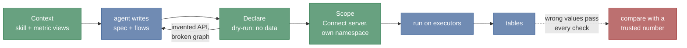
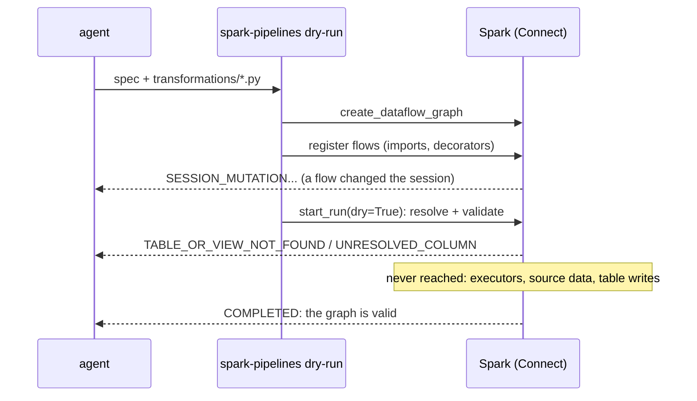

# Chapter 49: Writing Spark pipelines with agents

An agent that writes code writes PySpark quickly, and most of it runs. That is the problem.

A pipeline that raises an error costs a retry. A pipeline that runs and writes a wrong number costs much more, because nothing tells you. The agent learned Spark from public examples of many versions. It does not know which version you run, which tables it may change, or what your metrics mean.

**An agent writes better Spark pipelines inside a harness of three parts. In the *Declare* part, the agent writes Spark Declarative Pipelines, and a dry-run checks them before Spark reads data. In the *Scope* part, the agent works through a Spark Connect server that limits what it can reach. The *Context* part is a skill pinned to your Spark version, and metric views that hold the definitions of your metrics. Each part stops a different class of error, and no part stops all of them.**

This chapter comes from the author's OSA Con 2026 talk, "Getting your agents to write (good) pipelines on Apache Spark", and the study behind it. This chapter quotes the study numbers as the talk's slides state them. The study ran on open source Spark 4.1. All the code in this chapter is new, and it ran on Spark 4.3.0 in [`code/ch49`](https://github.com/lisancao/spark-masterclass/tree/main/code/ch49). Each output block comes from `code/ch49/output/`.

## The study

The talk's study gave the same ticket and the same data to an agent (`claude-opus-4-8`) in two arms:

- **Arm A**: procedural PySpark, without a skill and without a check before the run.
- **Arm B**: Spark Declarative Pipelines (SDP), with the `pyspark-sdp` skill and a dry-run before any data.

The slides give the size as "22 tasks × 12 seeded datasets × 2 arms = 528 runs". Both arms got feedback and could retry, up to a cap. A grader that did not know the arm graded the output of each run. The dry-run is part of what arm B tests, so arm A did not get one.

The slides group what went wrong into four checks:

| Check | Question | When it fails | What addresses it | Evidence (from the slides) |
|---|---|---|---|---|
| API | Real, current, the right method? | Usually raises | Dry-run, skill | "Invented APIs and pre-4.0 casts; 55 of 264 builds stopped before any output" |
| Performance | Concise and efficient? | Passes, slow | SDP's bounds, skill | "Python loops in 246 of 255 programs vs 47 of 258; `collect` 42 vs 0; 134 vs 68 lines; UDF on the classifier task 12 of 12 vs 7 of 12" |
| Scope | Limited to what it should touch? | Blocked if enforced | Connect, catalog, SDP | By design, not measured by the study |
| Correctness | Does it answer the question? | Passes, wrong | Skill, metric views, a trusted number | "timezone errors 7 → 0; `MEASURE()` 0.0923 vs 0.2384 by hand" |

The performance counts compare procedural with declarative. The slides also give a limit: "Dedup and row-drop errors moved with neither the skill nor the framework." Silent errors occurred in the two arms. The harness in this chapter makes the errors fewer and cheaper. It does not remove the need to compare the output with a trusted number.



## Step 1: What agents get wrong in Spark

The talk lists four types of API error that the agents made. Each one is a real failure from the study:

| Type | What the agent did | What is true |
|---|---|---|
| Signature | `dropDuplicatesWithinWatermark(["order_id"], "10 min")` | The method takes only the columns. The time window comes from `withWatermark()`. |
| Method | `broadcast_hint()` | No such method exists. The real one is `F.broadcast(df)`. |
| Platform | `@dlt.table`, `apply_cdc()` | Lakeflow APIs on Databricks, not in open source Spark. |
| Version | `F.col("amount").cast("double")` | A real API, but from 4.0, ANSI mode makes it raise on a bad row. |

The talk gives one reason. Public Spark material is mostly tutorials, and production code is private. Also, examples from 2.x, 3.x and 4.x have no version marker. The slides label this reason as an observation of practitioners, not a measurement.

## Step 2: A pre-4.0 habit under ANSI mode

`ansi.py` repeats the talk's demo on 4.3.0. It casts 1000 valid amounts and one bad value:

```python
rows = [(str(i * 1.5),) for i in range(1000)] + [("POISON",)]          # 1000 valid amounts, one bad row
df = spark.createDataFrame(rows, "amount string")
df.select(F.col("amount").cast("double").alias("amount")).collect()
...
out = df.select(F.col("amount").try_cast("double").alias("amount")).collect()
```

```text
spark 4.3.0 | spark.sql.ansi.enabled = true
F.col("amount").cast("double")     -> CAST_INVALID_INPUT SQLSTATE 22018
F.col("amount").try_cast("double") -> 1001 rows, 1 null
```

Before 4.0, `cast` changed the bad value to null without an error. Since 4.0, `spark.sql.ansi.enabled` is `true` by default, and the job fails. An agent that learned from older examples writes `cast`. This error is the good kind: it raises. The next steps make such errors appear before the job reads data.

## Step 3: Declare, and let the dry-run check the graph

In SDP, the agent declares tables as functions, and Spark finds the run order from the dependencies. [Chapter 32](ch32-declarative-pipelines.md) teaches the model and the CLI. For agents, the important command is `spark-pipelines dry-run`.

It loads the spec, imports the Python files and registers each flow. Then it resolves and validates the whole graph. It does not read the source data, and it writes no table.

`code/ch49/pipeline/` is a three-table pipeline: `bronze_orders` reads the order feed, `silver_orders` parses it, and `gold_daily_revenue` adds the revenue for each day. `dryrun.sh` runs the dry-run on five versions of the gold flow, each with one error that an agent makes:

```python
# variants/gold_typo.py: a table name that nothing creates
return (spark.read.table("silver_order")
# variants/gold_column.py: a column that does not exist
.agg(F.round(F.sum("amount_usd"), 2).alias("revenue")))
# variants/gold_conf.py: a session config inside a flow
spark.conf.set("spark.sql.shuffle.partitions", "8")      # an agent tunes the job inside the flow
```

```text
--- dry-run, gold_typo.py
Error: [TABLE_OR_VIEW_NOT_FOUND] The table or view `spark_catalog`.`default`.`silver_order` cannot be found. Verify the spelling and correctness of th
pyspark.errors.exceptions.connect.AnalysisException: 
--- dry-run, gold_column.py
Error: [UNRESOLVED_COLUMN.WITH_SUGGESTION] A column, variable, or function parameter with name `amount_usd` cannot be resolved. Did you mean one of th
pyspark.errors.exceptions.connect.AnalysisException: 
--- dry-run, gold_conf.py
    raise PySparkException(
pyspark.errors.exceptions.base.PySparkException: [SESSION_MUTATION_IN_DECLARATIVE_PIPELINE.SET_RUNTIME_CONF] Session mutation 'RuntimeConf.set' is not
--- dry-run, gold_epoch.py
Run is COMPLETED.
--- dry-run, gold_ok.py
Run is COMPLETED.
```

<figure markdown>
  <video autoplay loop muted playsinline controls width="1280" height="720" poster="../../media/clips/ch49-dryrun.webp">
    <source src="../../media/clips/ch49-dryrun.mp4" type="video/mp4">
  </video>
  <figcaption><code>dryrun.sh</code>: the dry-run refuses three versions of the gold flow before Spark reads any data, and passes the other two.</figcaption>
</figure>

The dry-run stopped three errors and read no orders. In a procedural script, the same errors stop the job after the earlier steps ran, and possibly after they wrote their tables. The slides compare the two arms in this way:

| | Procedural | Declarative (SDP) |
|---|---|---|
| Errors stopped before any output | none | 55 of 264 builds |
| Where errors surface | mid-run, sometimes after partial writes | at the dry-run |

The third error is a rule of SDP itself. A flow function must only describe a DataFrame. A call to `spark.conf.set` inside it raises `SESSION_MUTATION_IN_DECLARATIVE_PIPELINE`, so an agent cannot change the session that the other flows use. Configs go in the `configuration` section of the spec.



## Step 4: What the dry-run misses

The dry-run checks structure and configuration. It does not check values. `gold_epoch.py` passed the dry-run. The order feed has an `event_ms` field in epoch milliseconds, and the flow casts it as if it were seconds:

```python
# event_time holds epoch milliseconds in this feed; the cast reads them as seconds
return (spark.read.table("silver_orders")
        .groupBy(F.col("event_ms").cast("timestamp").cast("date").alias("day"))
```

```text
--- run, gold_epoch.py
Run is COMPLETED.
gold_daily_revenue: [('+58384-08-15', 20.58), ('+58384-08-23', 26.35), ('+58384-08-28', 70.32)] ... 561 rows
--- run, gold_ok.py
Run is COMPLETED.
gold_daily_revenue: [('2026-06-01', 4757.14), ('2026-06-02', 5755.45), ('2026-06-03', 5380.04)] ... 5 rows
```

The wrong flow ran without an error, and it wrote 561 days in the year 58384 instead of 5 days in June 2026. The talk calls these silent errors. It lists the ones from the study:

- a currency that a join dropped
- a day boundary in the wrong time zone
- a dedup without a deterministic tie-break
- a filter that also removed valid rows

 Only a comparison with a trusted number from outside the pipeline finds them. The rest of the harness reduces them. It does not remove them.

## Step 5: Scope the agent with Spark Connect

An agent that runs procedural PySpark in Classic mode owns a driver JVM. It can call `sparkContext`, reach the JVM through `_jvm`, and set any config. Over Connect, the client has none of these. `scope.py` connects as `agent-7` to a Connect server of its own:

```text
what the agent's Connect client cannot reach:
  spark.sparkContext                           JVM_ATTRIBUTE_NOT_SUPPORTED
  df.rdd                                       NOT_IMPLEMENTED
  spark._jvm                                   JVM_ATTRIBUTE_NOT_SUPPORTED
  spark.conf.set('spark.executor.memory')      CANNOT_MODIFY_CONFIG
a namespace for the agent:
  write sandbox_agent_7.draft                  ok
  overwrite prod.daily_revenue                 ok (nothing refused it)
  namespaces: ['default', 'prod', 'sandbox_agent_7']
```

The client refused the JVM handles, and the server refused the executor config. The agent's code stays the same between a laptop and a cluster. Only `SPARK_REMOTE` changes.

The second part of the output is the important limit. The talk proposes one namespace for each agent. The agent gets read access where the policy allows it, and create and modify rights only on `sandbox_<id>`. It gets no rights on production.

The agent wrote its sandbox, but it also overwrote `prod.daily_revenue`, because Spark's built-in catalog has no grants. A namespace is a convention until a catalog with grants enforces it. The slides mark scope as "by design, not measured by the study".

The parts that enforce scope are in the earlier chapters:

- A Connect server for each agent, with its own warehouse and storage credentials. A proxy in front of it holds the token ([Chapter 46](ch46-connect-in-production.md), Steps 4, 5 and 9).
- A catalog service that enforces grants for each principal, for writes to shared namespaces.
- A server that runs in a cluster with its own executors, which the operator restarts ([Chapter 47](ch47-kubernetes-operator.md)).
- The 4.3 REST endpoints and the event log, as the record of each operation that the agent ran ([Chapter 45](ch45-observability.md)).

Spark 4.3 helps the local loop of an agent in two ways. The persistent local server (`spark.local.connect.reuse`) answers a new process in 0.4 seconds instead of about 4.4 seconds. Single-task execution makes small queries faster (Chapter 46, Steps 7 and 8). The talk notes a risk that applies here: a local mode that behaves differently from the cluster is a new place for silent errors.

## Step 6: Context, part 1: a skill pinned to your Spark version

A skill is a file that the agent reads before it writes code. The talk's skill, `pyspark-sdp`, has 164 lines for open source Spark 4.1 and later. The slides describe its content: how to declare a view, wire a dependency and write a valid spec. They also say what it leaves out, which is what the pipeline should compute. The talk also reports a negative result:

> An earlier `spark-safety` skill moved the silent-defect rate by 0.000 and was removed.

 A skill helps when it states facts that the model does not know. General advice to be careful did not help.

`code/ch49/skill/SKILL.md` is a short skill pinned to 4.3.0 for this book. Each rule in it comes from output that ran in this part of the book. `idioms.py` checks three of them:

```text
import dlt                ModuleNotFoundError: No module named 'dlt'
import pyspark.pipelines  ok
session time zone UTC                  to_date(ts): ['2026-06-24', '2026-06-25']   UTC day: ['2026-06-24', '2026-06-25']
session time zone America/Los_Angeles  to_date(ts): ['2026-06-24', '2026-06-24']   UTC day: ['2026-06-24', '2026-06-25']
epoch ms cast as seconds: +58450-04-13 17:00:00
epoch ms, divided first:  2026-06-24 17:00:00
```

- **The module.** `dlt` does not exist in open source Spark. The import is `from pyspark import pipelines as dp`.
- **The day boundary.** The event at 06:30 UTC on 25 June fell on 24 June when the session time zone was `America/Los_Angeles`. The UTC idiom gave the same days in the two zones. The last two lines show their timestamps in the session time zone, which was still Los Angeles.
- **The epoch unit.** `cast("timestamp")` reads a number as seconds. `F.timestamp_millis` reads it as milliseconds.

The talk's study shows the effect of the time-zone rule. The slides show one task (`new_stream_stream_join`, seed 16180). The run with the first skill put 244 payments on 24 June, a day with 0 payments. The two runs exited with code 0. After the UTC idiom went into the skill, the slides report:

> In the re-run, timezone errors went 7 → 0, and six of those seven runs still shipped a row-drop error.

 The skill fixed the error that it named, and nothing else.

Pin a skill to a version, the way you pin a dependency. Write the version at the top, and put only rules that you checked on that version.

## Step 7: Context, part 2: metric views

The second kind of context is what your metrics mean. A metric view holds the definition of each measure in the catalog. `MEASURE()` computes each measure correctly at any grain. [Chapter 35](ch35-metric-views.md) teaches metric views in full. `metric_view.py` registers the talk's `delivery_metrics` view over its `sessions` table, and compares the view with the SQL that an agent writes from the raw table:

```yaml
source: default.sessions
dimensions:
  - name: region
    expr: region
measures:
  - name: conversion_rate
    expr: SUM(CAST(converted AS INT)) / COUNT(1)
  - name: active_users
    expr: COUNT(DISTINCT user_id)
```

```text
DESCRIBE delivery_metrics: [('region', 'string'), ('session_date', 'string'), ('total_sessions', 'bigint'), ('converted_sessions', 'bigint'), ('conversion_rate', 'double'), ('active_users', 'bigint')]
conversion rate  by hand (average of regional rates) 0.2384   MEASURE() 0.0923
active users     by hand (sum of daily distinct users) 69,420   MEASURE() 9,994
MEASURE() at the region grain:
  metro        0.0787   6,370
  remote        0.515      32
  rural        0.3775      99
  suburban     0.1218     974
  urban         0.099   2,519
```

<figure markdown>
  <video autoplay loop muted playsinline controls width="1280" height="720" poster="../../media/clips/ch49-metrics.webp">
    <source src="../../media/clips/ch49-metrics.mp4" type="video/mp4">
  </video>
  <figcaption><code>metric_view.py</code> on Spark 4.3.0: the by-hand SQL and <code>MEASURE()</code> give different answers to the same questions, and both exit 0.</figcaption>
</figure>

The numbers are the same as on the talk's slides, now on 4.3.0. The by-hand SQL had two errors that raise nothing:

- **An average of ratios.** The average of the five regional rates gives `remote` (32 users, rate 0.515) the same weight as `metro` (6,370 users, rate 0.0787). The correct rate is total conversions divided by total sessions, 0.0923.
- **A sum of distinct counts.** A user active on many days counts once for each day. The month has 9,994 distinct users, not 69,420.

The view also made the agent's work shorter. The slides count the SQL statements that the agent used for three questions:

| Question | Statements, metric view | Statements, raw tables |
|---|---|---|
| Conversion rate in June, by region | 2 | 6 |
| Users active in June | 2 | 2 |
| AOV and revenue per paying user, core regions on weekends | 1 | 8 |

In the raw-tables run of the third question, the agent found the metric view in the catalog to learn what "core" means. The definition was useful even to the agent that did not use the view for the answer.

## Step 8: What the harness costs

The harness is not free, and the slides say so. In the study's appendix:

| Metric | Arm B | Arm A |
|---|---|---|
| Final program lines | 67.9 | 134.0 |
| Median tokens to correct | 26,480 | 11,524 |
| Completion | 65.2% | 68.9% |

The declarative programs were about half the length. But the agent in arm B used about 2.3 times the tokens to get a correct result. Arm A completed 3.7 points more of its runs. A dry-run that refuses a pipeline makes the agent work more before anything runs. The trade is more tokens before the run, for fewer jobs that fail in the middle or write partial output.

## The whole chapter, on one page

| Part | What it does | Built with (4.3.0) | What it does not do |
|---|---|---|---|
| Declare | Bounds how the agent writes, and checks the graph before data | SDP, `spark-pipelines dry-run` | Check values (Step 4) |
| Scope | Limits what the agent can reach | Connect client, a server for each agent, a catalog with grants | Enforce a namespace without grants (Step 5) |
| Context | Gives the facts of your version and your metrics | A version-pinned skill, metric views | Fix errors that it does not name (Step 6) |

What to try first, from the talk's last slide:

1. Dry-run one pipeline before you run it.
2. Point your agent at a Connect server, not a local Classic session.
3. Put one idiom in a skill, and one metric in a metric view.

And keep one number from outside the pipeline to compare with. Every check in this chapter passed the epoch error in Step 4.

## Further reading

- The OSA Con 2026 talk, "Getting your agents to write (good) pipelines on Apache Spark": [slides](https://systemsnull.net/talks/osa-con-2026/deck) and [demos](https://github.com/lisancao/spark-demos).
- [Built for Agents: The Case for Spark Declarative Pipelines](https://systemsnull.net/), the author's post with the study.
- [The `pyspark-sdp` skill](https://github.com/lisancao/pyspark-sdp).
- [Spark Declarative Pipelines programming guide](https://spark.apache.org/docs/4.3.0/declarative-pipelines-programming-guide.html).
- [Spark Connect gotchas](https://spark.apache.org/docs/latest/spark-connect-gotchas.html).
