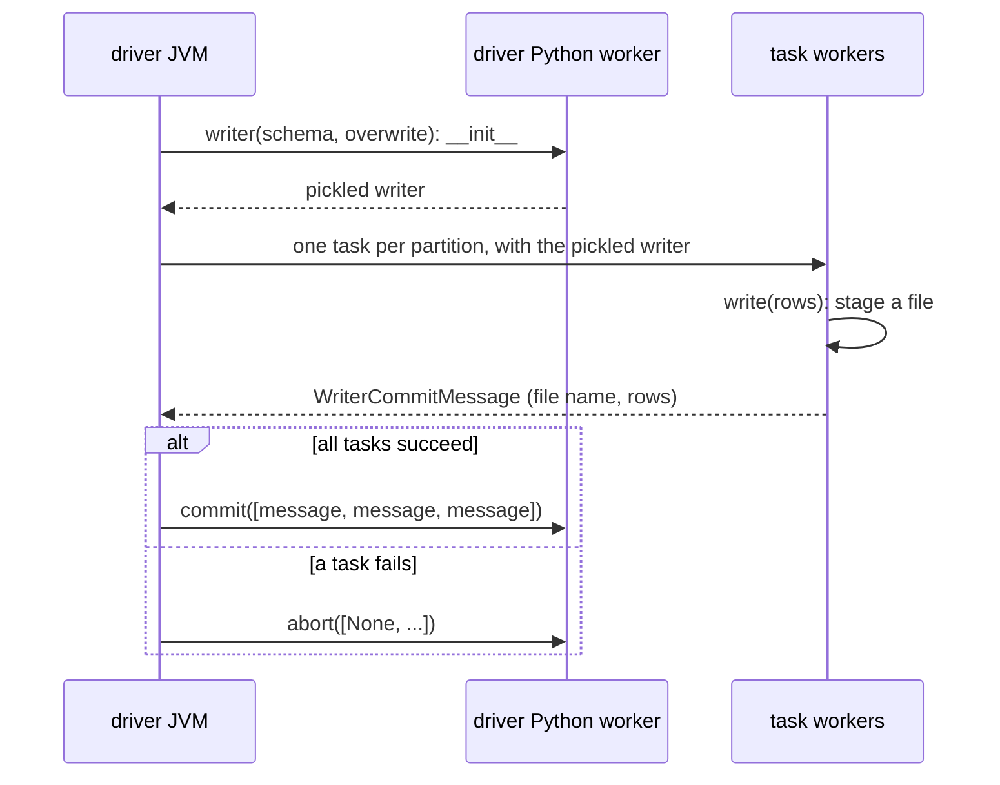
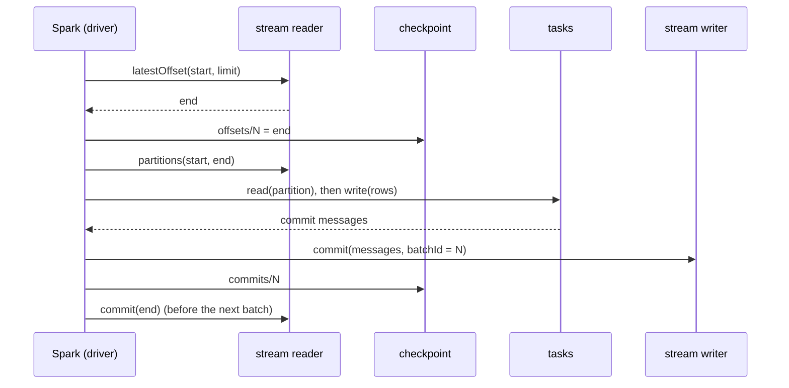

# Chapter 50: Python data sources IV: writers and streaming

The readers of Chapters 47 to 49 can fail and start again with no effect on the source. A writer is different. When a write fails halfway, some files are on the disk, some rows are in the database, and some requests went to the API. A stream is different too. It reads the same source again and again, and it must know where it stopped.

**A writer and a stream reader are protocols, like a reader. Spark calls your methods in a fixed order and in fixed processes. It gives you a small set of facts: the messages of the tasks, a batch ID and an offset. Spark does not make your output atomic, and it does not prevent a replay. Your commit protocol does that, and the facts that Spark gives you are sufficient to build it.**

This chapter builds two sinks and one stream source:

- `jsonlog`, a batch writer that publishes files with a manifest.
- `arrowparquet`, a writer that receives Arrow batches.
- `inbox`, a stream reader over a folder that grows, and a stream writer that skips a batch that it already published.

The scripts are in [`code/ch50`](https://github.com/lisancao/spark-masterclass/tree/main/code/ch50). All output comes from `code/ch50/output/`, from runs on `pyspark==4.3.0` in local mode.

!!! note "New in 4.3"
    The writer and stream APIs are the same as in 4.2. Admission control (`getDefaultReadLimit()`, `latestOffset(start, limit)`) and `SupportsTriggerAvailableNow` came in 4.2 (SPARK-55304). Real-time mode is the important new streaming feature of 4.3. Step 10 shows that a Python stream reader cannot use it: Spark 4.3.0 refuses the Python scan and the Python sink. In 4.3.0, the writer change of SPARK-58019 converts Arrow list columns to Python rows in bulk before `write()` receives them.

## Step 1: Who runs what in a write

A write has three kinds of calls. `writers.py` traces each call with its process ID and its task attempt:

```text
requests: 200 rows in 3 partitions

driver (this script)                   pid 234390
JsonLogWriter.__init__                 pid 239042   no task
JsonLogWriter.write                    pid 239278   task 0 attempt 0
JsonLogWriter.write                    pid 239273   task 1 attempt 0
JsonLogWriter.write                    pid 239281   task 2 attempt 0
JsonLogWriter.commit: 3 msgs, 3 staged pid 239578   no task
after append 1: manifest rows 200, files 3, commits 1, part files on disk 3, staged 0
```

The input is the 200 requests in SparkTutor's `access.log`, parsed by a regular expression and divided into 3 partitions.

| Method | Runs | Where | Receives |
|---|---|---|---|
| `DataSource.writer(schema, overwrite)` and the writer's `__init__` | one time, at the start of the write | a Python worker of the driver | the options, and `True` for overwrite |
| `DataSourceWriter.write(iterator)` | one time for each task attempt | Python workers of the executors | an iterator of `Row` objects |
| `commit(messages)` | one time, if all tasks succeed | a Python worker of the driver | one message from each task |
| `abort(messages)` | one time, if the job fails | a Python worker of the driver | one message or `None` for each task |



`write()` must return a `WriterCommitMessage`. Spark sends the messages to `commit()`, so a message is the only information that goes from a task to the commit. Keep messages small: a file name and a row count, not data.

```python
class FileWritten(WriterCommitMessage):
    """What one task tells the driver: the file it staged and its row count."""
    def __init__(self, file, rows):
        self.file, self.rows = file, rows
```

A source that only writes needs no `schema()` and no `reader()`. `jsonlog` has only `writer()`.

## Step 2: Save modes

A Python writer accepts two save modes, `append` and `overwrite`. The default mode (`errorifexists`) and `ignore` fail:

```text
mode error (the default)   UNSUPPORTED_DATA_SOURCE_SAVE_MODE
mode ignore                UNSUPPORTED_DATA_SOURCE_SAVE_MODE
write() returns None       PYTHON_EXCEPTION / DATA_SOURCE_TYPE_MISMATCH
source without writer()    PYTHON_DATA_SOURCE_ERROR / NOT_IMPLEMENTED
```

Thus each user must call `.mode("append")` or `.mode("overwrite")`. Two more facts are important:

- **Overwrite is only a boolean.** Spark deletes nothing. The writer receives `overwrite=True`, and the writer must remove the old data itself.
- **`.save(path)` sets the option `path`.** The writer reads it from `options["path"]`.

The last two lines of the output show two mistakes. A `write()` that returns `None` fails in each task with `DATA_SOURCE_TYPE_MISMATCH`. A source with no `writer()` fails during planning with `NOT_IMPLEMENTED`.

## Step 3: A commit protocol with a manifest

If each task writes its file directly into the output folder, a reader can see the files of a job that is not complete. A failed job also leaves its files there. The `jsonlog` writer uses a commit protocol in four parts:

1. Each task writes its file into a staging folder, `_staging/<job id>/`.
2. `commit()` moves the staged files next to the data.
3. `commit()` replaces `_MANIFEST.json`, which lists the committed files, in one rename.
4. `commit()` deletes the old files (for an overwrite) and the staging folder.

```python
class JsonLogWriter(DataSourceWriter):
    def __init__(self, options, overwrite):
        trace("JsonLogWriter.__init__")
        if "path" not in options:
            raise ValueError("jsonlog needs a path: .save(path) or .option('path', ...)")
        self.root = options["path"]
        self.overwrite = overwrite
        self.job = uuid.uuid4().hex[:8]                    # one id for the whole job, pickled to every task
        self.staging = os.path.join(self.root, "_staging", self.job)
        self.fail_on = options.get("fail_on")              # a path that makes a task fail, for the demo

    def write(self, rows):
        from pyspark import TaskContext
        ctx = TaskContext.get()
        trace("JsonLogWriter.write")
        os.makedirs(self.staging, exist_ok=True)
        # The attempt number is in the name, so two attempts of one task never share a file.
        name = f"part-{ctx.partitionId():05d}-{self.job}-a{ctx.attemptNumber()}.jsonl"
        count = 0
        with open(os.path.join(self.staging, name), "w") as f:
            for row in rows:
                if self.fail_on and row.path == self.fail_on and ctx.attemptNumber() == 0:
                    raise RuntimeError(f"cannot write {row.path}")
                f.write(json.dumps(row.asDict()) + "\n")
                count += 1
        return FileWritten(name, count)

    def commit(self, messages):
        staged = len(os.listdir(self.staging))
        trace(f"JsonLogWriter.commit: {len(messages)} msgs, {staged} staged")
        old = read_manifest(self.root)
        for m in messages:                                  # 1. move the staged files into place
            os.replace(os.path.join(self.staging, m.file), os.path.join(self.root, m.file))
        new_files, new_rows = [m.file for m in messages], sum(m.rows for m in messages)
        files = new_files if self.overwrite else old["files"] + new_files
        rows = new_rows if self.overwrite else old["rows"] + new_rows
        write_manifest(self.root, {"files": files, "rows": rows, "commits": old["commits"] + 1,
                                   "last_mode": "overwrite" if self.overwrite else "append"})   # 2. publish
        if self.overwrite:                                  # 3. only now delete what it replaced
            for name in old["files"]:
                path = os.path.join(self.root, name)
                if os.path.exists(path):
                    os.remove(path)
        shutil.rmtree(self.staging, ignore_errors=True)    # 4. remove the staging folder
```

The job ID comes from `__init__`, which runs one time. Spark pickles the writer and sends a copy to each task, so all the tasks of a job use the same staging folder. The job ID cannot come from `write()`, because each task would make a different ID.

`write_manifest()` writes a hidden temporary file and then calls `os.replace()`. On a local file system, a rename in one folder is atomic. A reader sees the old manifest or the new manifest, never half of one. The names start with `_` or `.`, and Spark's file readers ignore such files. Thus `spark.read.json(out)` reads only the data:

```text
after append 2: manifest rows 400, files 6, commits 2, part files on disk 6, staged 0
Spark's JSON reader on the folder: 400 rows
after overwrite: manifest rows 200, files 3, commits 3, part files on disk 3, staged 0
files on disk: ['_MANIFEST.json', '_staging', 'part-00000-1d143314-a0.jsonl', 'part-00001-1d143314-a0.jsonl', 'part-00002-1d143314-a0.jsonl']
```

The order in `commit()` is important. If the driver stops after the move and before the manifest, the folder has files that no manifest lists. That result is untidy but harmless: a reader of the manifest does not see them, and a cleanup can delete them. If the order is the opposite, a manifest can list files that are not there, and the data is gone. For an overwrite, the old files go only after the new manifest is in place, for the same reason.

## Step 4: A failed job, and `abort()`

The option `fail_on` makes the first attempt of a task fail when it sees the path `/login`. In local mode, a task has one attempt, so the job fails:

```text
failed write: PYTHON_EXCEPTION
abort(): messages that are None: [True, True, True] | staged files before cleanup: 3
after the failed append: manifest rows 200, files 3, commits 3, part files on disk 3, staged 0
  JsonLogWriter.abort([None, None, None])
```

<figure markdown>
  <video autoplay loop muted playsinline controls width="1280" height="720" poster="../../media/clips/ch50-commit.webp">
    <source src="../../media/clips/ch50-commit.mp4" type="video/mp4">
  </video>
  <figcaption><code>writers.py</code> on Spark 4.3.0: append, append, overwrite, then a failed append. The manifest does not change when the job fails.</figcaption>
</figure>

`abort()` received `None` for each task. A failed task sends no message, and in this run each of the three partitions contained `/login`. But the three tasks still left three half-written files in the staging folder. Thus `abort()` cannot know the files from the messages. It deletes the full staging folder of the job, which it knows from the job ID on `self`. The committed data did not change: 200 rows in 3 files.

## Step 5: Task retries

On a cluster, Spark tries a failed task again (`spark.task.maxFailures`). The master `local[4,2]` gives two attempts in local mode. The first attempt of each task fails, and the second attempt succeeds:

```text
master: local[4,2]
  JsonLogWriter.__init__ | no task
  JsonLogWriter.write | task 0 attempt 0
  JsonLogWriter.write | task 2 attempt 0
  JsonLogWriter.write | task 1 attempt 0
  JsonLogWriter.write | task 0 attempt 1
  JsonLogWriter.write | task 2 attempt 1
  JsonLogWriter.write | task 1 attempt 1
  JsonLogWriter.commit: 3 msgs, 6 staged | no task
manifest files: ['part-00000-cea8bfa3-a1.jsonl', 'part-00001-cea8bfa3-a1.jsonl', 'part-00002-cea8bfa3-a1.jsonl']
manifest rows 200, files 3, commits 1, part files on disk 3, staged 0
```

When `commit()` ran, the staging folder had 6 files: three partial files of attempt 0 and three complete files of attempt 1. The commit received 3 messages, one from each successful attempt, and it moved only those files. The partial files stayed in staging until the last step removed the folder.

Two rules come from this run:

- **Put the attempt number in each name** (`TaskContext.get().attemptNumber()`). Two attempts of one task can run at the same time, for example with speculative execution (`spark.speculation`). With the same name, they write into the same file.
- **Commit only the files that the messages name.** Spark sends one message for each partition, from the attempt that succeeded. A listing of the staging folder also finds the files of failed attempts.

## Step 6: The Arrow writer

`DataSourceArrowWriter` (4.0) is a writer whose `write()` receives an iterator of `pyarrow.RecordBatch` objects, not of `Row` objects. The `arrowparquet` writer gives the batches to `pyarrow.parquet` directly, with no conversion of each row:

```python
class TracedArrowWriter(DataSourceArrowWriter):
    def __init__(self, options):
        self.root = options["path"]

    def write(self, batches):
        """`batches` is an iterator of pyarrow.RecordBatch, not of Row."""
        import pyarrow as pa
        import pyarrow.parquet as pq
        from pyspark import TaskContext
        batches = list(batches)
        sizes = [b.num_rows for b in batches]
        task = TaskContext.get().partitionId()
        if not batches:
            return FileWritten(None, 0)
        os.makedirs(self.root, exist_ok=True)
        name = f"part-{task:05d}.parquet"
        pq.write_table(pa.Table.from_batches(batches), os.path.join(self.root, name))
        trace(f"arrow write: batches {sizes}")
        return FileWritten(name, sum(sizes))
```

`spark.sql.execution.arrow.maxRecordsPerBatch` sets the size of the batches:

```text
maxRecordsPerBatch=10000:
  arrow write: batches [67] | task 0 attempt 0
  arrow write: batches [67] | task 1 attempt 0
  arrow write: batches [66] | task 2 attempt 0

maxRecordsPerBatch=50:
  arrow write: batches [50, 17] | task 0 attempt 0
  arrow write: batches [50, 17] | task 1 attempt 0
  arrow write: batches [50, 16] | task 2 attempt 0
Parquet back: 200 rows; {200: 98, 302: 24, 404: 41, 500: 37}
```

With the default of 10,000, each task received one batch with all of its rows. With 50, each task received a batch of 50 and a batch of the remainder. Spark read the Parquet files back with the same status counts as the input.

This short writer is not safe. It writes directly into the output folder, with names that have no job ID and no attempt number. Use it only to see the Arrow interface. A real Arrow writer uses the commit protocol of Step 3.

## Step 7: What the manifest cannot do

The manifest protocol is correct for one writer on a local disk. It has known limits:

- **Two jobs at the same time.** Two commits can read the same old manifest and each write a new one. The second commit removes the files of the first commit from the list. The protocol has no lock and no version check.
- **Object stores.** On S3, a rename is a copy and a delete, and it is not atomic.
- **Readers that list the folder.** A reader that does not read the manifest sees files that a failed commit left.

Table formats such as Delta Lake and Apache Iceberg solve these problems. They write a new version of the table metadata with an atomic operation that fails if another writer committed first. If your sink is a set of files, write to a table format. Do not build your own protocol.

## Step 8: The micro-batch loop of a stream reader

A stream reader reads a source that grows. Spark runs it in micro-batches. For each batch, Spark asks the reader for the newest offset. Then it plans the partitions between the last offset and the new offset, and runs the tasks. An **offset** is a JSON-serializable `dict` that your reader defines. Spark only stores it and gives it back.

The `inbox` reader in `streaming.py` reads a folder of files. Its offset is the key of the last file that it read: the modification time in nanoseconds and the name.

```python
class InboxStreamReader(DataSourceStreamReader):
    def __init__(self, options):
        self.root = options["path"]
        self.max_files = int(options.get("maxFilesPerTrigger", "2"))
        self.target = None

    def initialOffset(self):
        note("initialOffset()")
        return offset_of((0, ""))

    def getDefaultReadLimit(self):
        return ReadMaxFiles(self.max_files)

    def latestOffset(self, start, limit):
        new = [k for k in list_inbox(self.root) if k > key_of(start)]
        if self.target is not None:
            new = [k for k in new if k <= self.target]
        if not isinstance(limit, ReadAllAvailable):
            new = new[:limit.max_files]
        end = offset_of(new[-1]) if new else start          # end == start: no new batch
        note(f"latestOffset({short(start)}, {type(limit).__name__}) -> {short(end)}")
        return end

    def partitions(self, start, end):
        lo, hi = key_of(start), key_of(end)
        parts = [FilePartition(n) for (t, n) in list_inbox(self.root) if lo < (t, n) <= hi]
        note(f"partitions({short(start)}, {short(end)}) -> {len(parts)}")
        return parts

    def read(self, partition):
        st = os.stat(os.path.join(self.root, partition.name))
        kind = KINDS.get(os.path.splitext(partition.name)[1].lower(), "other")
        yield (partition.name, kind, st.st_size, st.st_mtime_ns)

    def commit(self, end):
        note(f"reader.commit({short(end)})")
```

The script copies four e-mails into the inbox with fixed modification times, and starts a query with `Trigger.AvailableNow` and `maxFilesPerTrigger=3`. The reader records each call:

```text
run 1, availableNow: [(0, 3), (1, 1)]
   prepareForTriggerAvailableNow() -> ticket_3.eml
   initialOffset()
   latestOffset((start), ReadMaxFiles) -> ticket_2.eml
   initialOffset()
   partitions((start), ticket_2.eml) -> 3
   writer.commit(batch 0): 3 rows published
   latestOffset(ticket_2.eml, ReadMaxFiles) -> ticket_3.eml
   reader.commit(ticket_2.eml)
   partitions(ticket_2.eml, ticket_3.eml) -> 1
   writer.commit(batch 1): 1 rows published
   latestOffset(ticket_3.eml, ReadMaxFiles) -> ticket_3.eml
```

<figure markdown>
  <video autoplay loop muted playsinline controls width="1280" height="720" poster="../../media/clips/ch50-stream.webp">
    <source src="../../media/clips/ch50-stream.mp4" type="video/mp4">
  </video>
  <figcaption><code>streaming.py</code> on Spark 4.3.0: the calls of one stream run, the checkpoint, a restart and a replay.</figcaption>
</figure>

The calls follow the loop:

1. `latestOffset(start, limit)` returns the end of the next batch. With the limit `ReadMaxFiles(3)`, it returned the third file. When it returns `start`, there is no new data, and Spark runs no batch. The last call above ended the run.
2. `partitions(start, end)` plans the files between the two offsets. In `inbox`, the start is exclusive and the end is inclusive.
3. The tasks call `read()`. Then the sink commits the batch.
4. `reader.commit(end)` tells the reader that Spark processed all data up to `end`. In this run, Spark called it for batch 0 when it started batch 1. A source that deletes or archives consumed files does that in `commit()`.

`read()` must not depend on state that changes on `self`, because each task has its own pickled copy. Put all the information that a task needs into the partition.



## Step 9: The checkpoint, a restart and a replay

The checkpoint folder records the stream:

```text
checkpoint folders: ['commits', 'metadata', 'offsets']
offsets/: ['0', '1']  commits/: ['0', '1']
offsets/1:
   v1
   {"batchWatermarkMs":0,"batchTimestampMs":1795342082372,"conf":{"spark.sql.streaming...
   {"v": 1, "mtime_ns": 1790000003000000000, "name": "ticket_3.eml"}
```

The last line of `offsets/1` is the offset of the reader, as JSON. Spark writes `offsets/N` **before** it runs batch N, and `commits/N` **after** the sink commits batch N. The `"v": 1` in the offset is a version. If you change the design of an offset later, the new code can read old checkpoints and convert them.

The design of the offset decides what the reader can find:

- **A count of files** fails when a user deletes a file. The count then points to the wrong file.
- **The last name** fails when names do not sort in the order of arrival.
- **A set of all names** is correct, but it grows with each file, and Spark writes it in each `offsets/N`.
- **`(mtime_ns, name)`** is small and sorts by arrival. It misses a file that arrives with an old modification time, for example from `cp -p` or `rsync -t`. The built-in file source of Spark keeps a log of the files that it saw, for this reason.

Four new files arrive, and the query starts again with a processing-time trigger. It continues at batch 2. Then the script deletes `commits/3` (and `.3.crc`) and starts the query again:

```text
run 2, restart, processingTime: [(2, 3), (3, 1)]
run 3, after deleting commits/3: [(3, 1)]
   writer.commit(batch 3): already published, replay skipped
sink: 8 rows, 8 distinct files, folders ['batch=00000', 'batch=00001', 'batch=00002', 'batch=00003']
```

Without `commits/3`, Spark found an offset with no commit. It ran batch 3 again, with the same offsets and the same batch ID. The same thing occurs if the driver stops after the sink commit and before Spark writes `commits/3`. Thus a sink must expect each batch ID more than one time. The `BatchFolderWriter` uses the batch ID as the name of the published folder, and it skips a batch whose folder exists:

```python
def commit(self, messages, batchId):
    target = os.path.join(self.root, f"batch={batchId:05d}")
    if os.path.isdir(target):                          # a replay of a published batch
        for m in messages:
            os.remove(os.path.join(self.staging, m.file))
        note(f"writer.commit(batch {batchId}): already published, replay skipped")
        return
    tmp = os.path.join(self.root, f"_tmp-batch={batchId:05d}")
    shutil.rmtree(tmp, ignore_errors=True)               # what a crash in an earlier try left
    os.makedirs(tmp)
    for m in messages:
        staged = os.path.join(self.staging, m.file)
        if m.rows:
            os.replace(staged, os.path.join(tmp, m.file))
        else:
            os.remove(staged)
    with open(os.path.join(tmp, "_SUMMARY.json"), "w") as f:
        json.dump({"batch": batchId, "rows": sum(m.rows for m in messages)}, f)
    os.replace(tmp, target)                            # one rename publishes the whole batch
    note(f"writer.commit(batch {batchId}): {sum(m.rows for m in messages)} rows published")
```

The commit builds the batch in a temporary folder and publishes it with one rename. If the driver stops during the commit, the temporary folder is incomplete, but `batch=00003` does not exist. The replay deletes the temporary folder and builds it again. Think of a commit that moves files into `batch=00003` one at a time. A stop in the middle leaves a partial folder, and the replay skips it. The sink holds each of the 8 files exactly once.

`DataSourceStreamWriter` (4.0) has `write()`, `commit(messages, batchId)` and `abort(messages, batchId)`. `DataSourceStreamArrowWriter` (4.1) receives Arrow batches. One `DataSource` class can be the source and the sink: `inbox` has `streamReader()` and `streamWriter()`.

## Step 10: Admission control, `AvailableNow` and real-time mode

`getDefaultReadLimit()` gives the limit that Spark passes to `latestOffset()`. The classes are in `pyspark.sql.streaming.datasource`: `ReadAllAvailable`, `ReadMaxFiles`, `ReadMaxRows`, `ReadMinRows` and `ReadMaxBytes`. A reader must accept `ReadAllAvailable` and then read everything.

`Trigger.AvailableNow` reads all of the data that exists when the query starts, in batches, and then stops. A reader that implements `SupportsTriggerAvailableNow` gets a call to `prepareForTriggerAvailableNow()` first. The `inbox` reader records the newest file at that moment in `self.target`, and does not read past it. Without the mixin, Spark reads the full backlog in one batch:

```text
the same 8 files, a new checkpoint:
  with SupportsTriggerAvailableNow:    [(0, 3), (1, 3), (2, 2)]
  without SupportsTriggerAvailableNow: [(0, 8)]
```

For a large backlog, one batch can be too large for the memory of the cluster. Implement the mixin in each reader that has a read limit.

Real-time mode (`trigger(realTime=...)`) is new in Spark 4.3. Its tasks do not stop between batches, and they give each row to the sink with low latency. The script tries it with the `inbox` sink, and then with the console sink:

```text
realTime trigger, inbox sink: STREAMING_REAL_TIME_MODE.OPERATOR_OR_SINK_NOT_IN_ALLOWLIST
   Streaming real-time mode has the following limitation: The sink(s):
   org.apache.spark.sql.execution.datasources.v2.python.PythonTable is not in the
   sink allowlist for Real-Time Mode. To bypass this check, set [...]

realTime trigger, console sink: STREAMING_REAL_TIME_MODE.INPUT_STREAM_NOT_SUPPORTED
   Streaming real-time mode has the following limitation: The input stream org.apach
   e.spark.sql.execution.datasources.v2.python.PythonMicroBatchStreamWithTriggerAvai
   lableNow is not supported in Real-time Mode.
```

Spark refused both halves. The sink allowlist in `RealTimeModeAllowlist.scala` has the console, memory, `foreach` and Kafka sinks. The Python stream (`PythonMicroBatchStream`) does not implement `SupportsRealTimeMode`. Thus in 4.3.0, a Python source and a Python sink work only with micro-batch triggers.

## Step 11: `SimpleDataSourceStreamReader`

For a small source that the driver can read alone, `SimpleDataSourceStreamReader` is shorter. It has no partitions. Its `read(start)` returns the rows and the next offset in one call, and Spark runs it in the driver. `readBetweenOffsets(start, end)` reads a batch again after a restart:

```python
class Counter(SimpleDataSourceStreamReader):
    def __init__(self, options):
        self.stuck = options.get("stuck") == "true"

    def initialOffset(self):
        return {"n": 0}

    def read(self, start):
        n = start["n"]
        if n >= 12:
            return iter([]), start                  # the end of this demo stream: no new batch
        if self.stuck:
            return iter([(n,)]), {"n": n}          # rows, but the offset does not move
        return iter([(i,) for i in range(n, n + 4)]), {"n": n + 4}

    def readBetweenOffsets(self, start, end):
        return iter([(i,) for i in range(start["n"], end["n"])])
```

```text
simple reader, stuck=false: batches [(0, 4), (1, 4), (2, 4)] ...
simple reader, stuck=true: SIMPLE_STREAM_READER_OFFSET_DID_NOT_ADVANCE
```

A reader that returns rows with the same offset fails with `SIMPLE_STREAM_READER_OFFSET_DID_NOT_ADVANCE`. Spark cannot record a batch whose end is its start. The rows would come again after a restart. Use the simple reader only for small rates of data, because all of the data goes through one process.

## The whole chapter, on one page

- **A batch write calls `writer()` one time on the driver side, `write()` one time for each task attempt, and then `commit()` or `abort()` one time.** Messages are the only link from the tasks to the commit.
- **Only `append` and `overwrite` work.** Overwrite is a boolean, and Spark deletes nothing.
- **Stage, then publish.** Tasks write into a staging folder with a job ID from `__init__`. The commit moves the files, replaces the manifest with one rename, and only then deletes old data.
- **`abort()` gets `None` for failed tasks.** Delete the staging folder of the job, not the files that the messages name.
- **Put the attempt number in names, and commit only the files in the messages.** Retries and speculative tasks can leave other files.
- **`DataSourceArrowWriter` receives `RecordBatch` objects** of `maxRecordsPerBatch` rows.
- **A manifest is not a table format.** Concurrent writers and object stores need Delta Lake or Iceberg.
- **A stream reader is a loop of `latestOffset()`, `partitions()`, `read()` and `commit(end)`.** Offsets are your JSON, with a version.
- **Spark writes `offsets/N` before the batch and `commits/N` after the sink commit.** A batch can run again with the same ID, so make the sink commit idempotent on `batchId`, and publish with one rename.
- **Implement `SupportsTriggerAvailableNow` with a read limit.** Without it, `AvailableNow` reads the backlog in one batch.
- **Real-time mode in 4.3.0 refuses Python streams and Python sinks.**

[Chapter 51](ch51-shipping-a-python-data-source.md) puts a source into a package, registers it automatically, tests it, and reads its logs.

## Further reading

- [Python Data Source API tutorial](https://spark.apache.org/docs/4.3.0/api/python/tutorial/sql/python_data_source.html), the sections on writers and stream readers.
- [`pyspark/sql/streaming/datasource.py` at v4.3.0](https://github.com/apache/spark/blob/v4.3.0/python/pyspark/sql/streaming/datasource.py), the read limits and `SupportsTriggerAvailableNow`.
- [Structured Streaming programming guide](https://spark.apache.org/docs/4.3.0/streaming/index.html), triggers, checkpoints and fault tolerance.
- [`RealTimeModeAllowlist.scala` at v4.3.0](https://github.com/apache/spark/blob/v4.3.0/sql/core/src/main/scala/org/apache/spark/sql/execution/streaming/runtime/RealTimeModeAllowlist.scala), the sinks and operators that real-time mode accepts.
