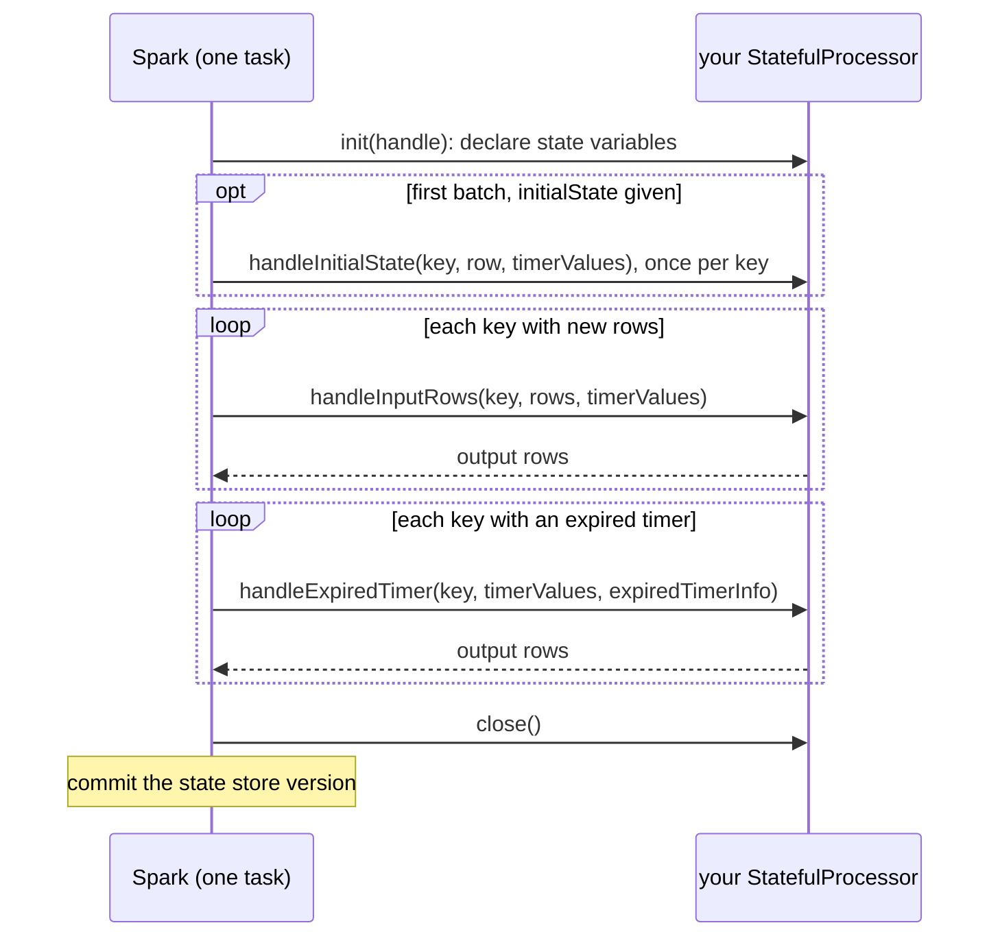
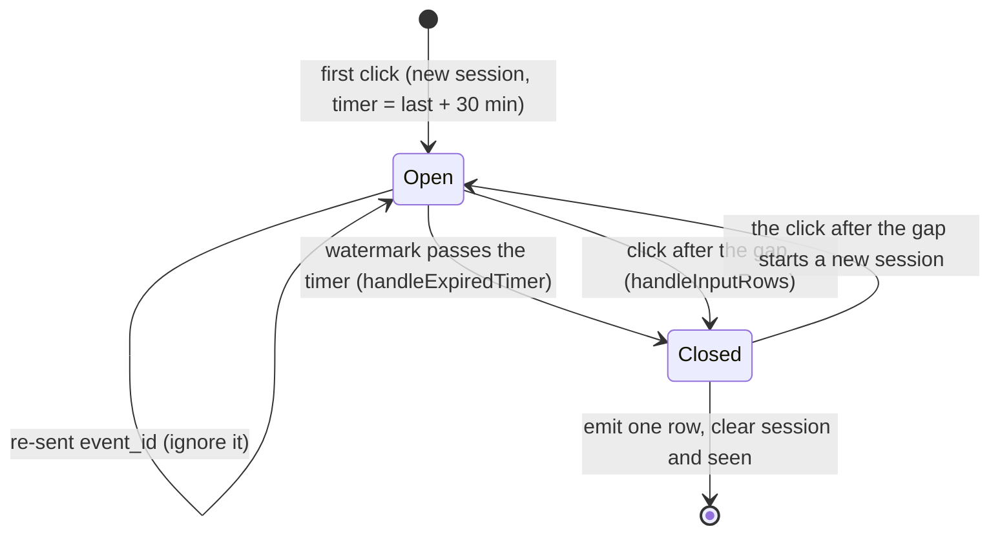
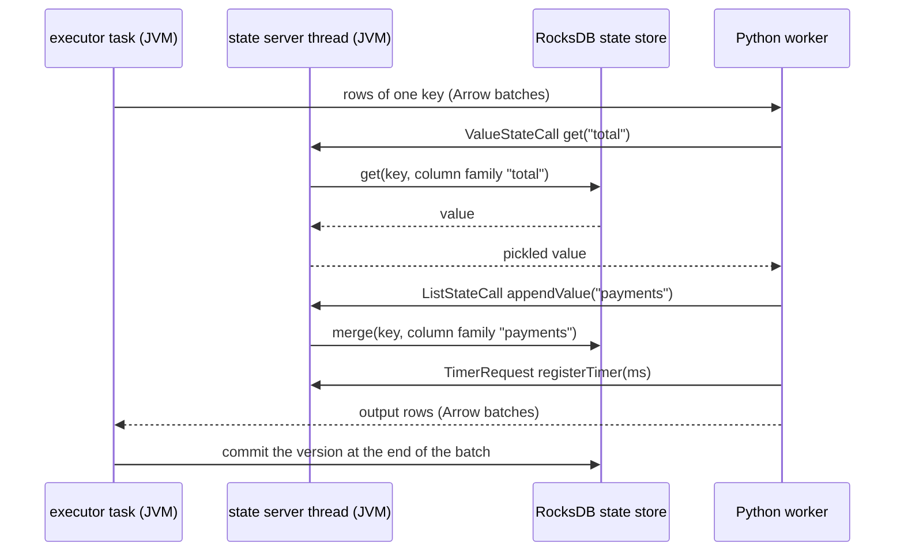

# Chapter 50: Stateful processing with transformWithState

The stateful operators of [Chapter 48](ch48-structured-streaming.md) each have one fixed rule. A `groupBy` adds rows to an aggregate. A `session_window` closes a session after a gap. `dropDuplicates` removes a key that it saw before.

Many real streams need a rule that is not in this list. A checkout session must close on a gap, but it must also ignore an event that the phone sent two times. A spend tracker must start from the balance in another system. A reminder must go to a user five seconds after the last click, also when no more events arrive.

For these rules, Spark gives you `transformWithState`. You write a small class, and Spark calls it for each key with the new rows of that key. The class keeps typed state variables, sets timers, and gives a time to live (TTL) to state that must expire. Spark 4.0 added this API as the second version of arbitrary state. It replaces `mapGroupsWithState` and `applyInPandasWithState`, which Step 9 compares with it. Spark 4.1 added the row-based Python API that this chapter uses.

**`transformWithState` gives your code the state of one key, one key at a time. Spark keeps that state in RocksDB, writes it into the checkpoint, and calls your code again when a timer expires. You decide what the state is and when it ends. Spark decides when your code runs. Most errors in a processor come from a wrong idea of when Spark calls it.**

This chapter writes three processors against one stream of checkout events. It shows the state that each processor keeps, read back from the checkpoint, and the exact batches in which Spark calls each method.

The scripts are in [`code/ch50`](https://github.com/open-lakehouse/spark-masterclass/tree/main/code/ch50), and each number in the chapter comes from their saved output in `code/ch50/output/`. All of them use the file source on Spark 4.3.0, so no other service is necessary.

## The data: four drops from a checkout service

The stream is the messy checkout set of SparkTutor: views, cart adds and payments of seven users on the morning of 5 October 2026. It is in `code/data/checkout_events/` as four files, and each file is one drop:

```python
SCHEMA = "event_id STRING, user STRING, action STRING, page STRING, ts TIMESTAMP, amount DOUBLE"
```

The drops have three problems that a stateful rule must handle:

- **Re-sent events.** Drop 2 sends `c008` and `c009` again. Drop 3 sends `c012` again.
- **Out-of-order events.** `c011` (09:36:30) arrives in drop 2, after events from 10:05.
- **One very late event.** `c999` has the time 08:10:00, and it arrives in drop 3, after events from 11:00.

`checkout.py` puts drop `i` into an inbox with the `deliver()` helper of [Chapter 48](ch48-structured-streaming.md). The scripts read the inbox with `maxFilesPerTrigger=1`, so each drop is one micro-batch.

## The pieces of a stateful processor

A processor is a subclass of `StatefulProcessor`. Spark calls its methods in a fixed sequence. The diagram shows the sequence for one task (one partition of the state) in one micro-batch:



The methods have these jobs:

- **`init(handle)`** declares the state variables. Each one has a name and a schema. The `handle` also registers, lists and deletes timers, so keep a reference to it.
- **`handleInitialState`** loads the state of one key from a batch DataFrame. Spark calls it only in the first batch of a new checkpoint.
- **`handleInputRows(key, rows, timerValues)`** gets the new rows of one key. `key` is a tuple of the grouping columns. `rows` is an iterator. The method yields output rows.
- **`handleExpiredTimer`** gets one key whose timer expired. It also yields output rows.
- **`close()`** releases resources at the end of the task.

The state variables are always for the current key. `self.total.get()` returns the total of the key that Spark gave to `handleInputRows`. You never give a key to a state variable yourself. There are three types:

| Type | Holds | Methods |
|---|---|---|
| `ValueState` | one value for each key | `get`, `update`, `exists`, `clear` |
| `ListState` | a list for each key | `get` (an iterator), `appendValue`, `appendList`, `put`, `exists`, `clear` |
| `MapState` | a map for each key | `getValue`, `updateValue`, `containsKey`, `keys`, `values`, `iterator`, `removeKey`, `exists`, `clear` |

Each value is a tuple that matches the schema of the variable. A `ListState` keeps each element as a separate entry, so `appendValue` adds one entry and does not write the full list again. Each getter on the handle also accepts `ttlDurationMs`, which Step 6 uses.

## Step 1: A first processor, and the state store that it needs

`t1_spend.py` keeps the total spend of each user. It reads only the payments, and it flags a user when the total is more than 50.00:

```python
class SpendTracker(StatefulProcessor):
    """Total spend per user; flags a user once the total passes LIMIT."""

    def init(self, handle: StatefulProcessorHandle) -> None:
        self.total = handle.getValueState("total", "amount DOUBLE")
        self.payments = handle.getListState("payments", "event_id STRING, amount DOUBLE")

    def handleInitialState(self, key, initialState, timerValues) -> None:
        self.total.update((initialState.opening,))       # once per key, before any input

    def handleInputRows(self, key, rows, timerValues):
        (user,) = key
        total = self.total.get()[0] if self.total.exists() else 0.0
        n = 0
        for r in rows:
            total += r.amount
            n += 1
            self.payments.appendValue((r.event_id, r.amount))
        self.total.update((total,))
        yield Row(user=user, total=round(total, 2), payments=n, flagged=total > LIMIT)
```

The processor reads the old total one time, adds the new payments, and writes the total one time. It reads `rows` in one pass. The iterator can hold many rows, so do not change it into a list if you do not need random access.

The query groups the payments by user and gives the processor to `transformWithState`:

```python
return pays.groupBy("user").transformWithState(
    statefulProcessor=SpendTracker(),
    outputStructType="user STRING, total DOUBLE, payments INT, flagged BOOLEAN",
    outputMode="Update",
    timeMode="None",
    initialState=opening.groupBy("user"))
```

The arguments give the output schema, the output mode and the time mode. The output mode here must agree with the output mode on the writer. `timeMode="None"` means that the processor uses no timers and no TTL.

The first run uses the default state store. The query starts with no error. The error comes from `awaitTermination()`:

```text
1. On the default state store:
  StreamingQueryException: [STREAM_FAILED] ...
  [UNSUPPORTED_FEATURE.STORE_BACKEND_NOT_SUPPORTED_FOR_TWS] The feature is not supported:
  Store backend
  org.apache.spark.sql.execution.streaming.state.HDFSBackedStateStoreProvider is not ...
```

`transformWithState` needs the RocksDB state store provider. The default provider keeps one hash map for each partition. `transformWithState` keeps many state variables for each key, and it keeps timers that it must scan in time order. RocksDB gives it a column family for each variable and ordered range scans. [Chapter 52](ch52-checkpoints-and-state-store.md) opens these column families.

!!! caution "Set the RocksDB provider before the first start"
    Set `spark.sql.streaming.stateStore.providerClass` to `org.apache.spark.sql.execution.streaming.state.RocksDBStateStoreProvider` before the query starts for the first time. The checkpoint records the provider. A restart on the same checkpoint keeps the old provider, also if you change the configuration.

With RocksDB, the query runs. Its physical plan shows the shape of each `transformWithState` query:

```text
  !TransformWithStateInPySpark transformWithStateWithInitStateUDF(user, event_id, amount), [...], [...
  :- *(2) Sort [...], false, 0
  :  +- Exchange hashpartitioning(user, 2), REQUIRED_BY_STATEFUL_OPERATOR, [...]
  :     +- *(1) Project [...]
  :        +- *(1) Filter (isnotnull(action) AND (action = pay))
  :           +- StreamingRelation FileSource[~/spark-masterclass/data/work/ch50/
  +- *(4) Sort [...], false, 0
     +- Exchange hashpartitioning(user, 2), REQUIRED_BY_STATEFUL_OPERATOR, [...]
        +- *(3) Project [...]
           +- *(3) Scan ExistingRDD[...]
```

The plan has three parts:

- An `Exchange hashpartitioning(user, 2)` sends all rows of one user to one partition. The reason `REQUIRED_BY_STATEFUL_OPERATOR` tells you that the state needs this partitioning. The number of state partitions is `spark.sql.shuffle.partitions` at the first start (2 here).
- A `Sort` on the key puts the rows of one key next to each other. Thus, the operator can give one key at a time to Python.
- The second child is the initial state (`Scan ExistingRDD`). Spark shuffles it with the same partitioning, so the initial state of a user goes to the same task as the payments of that user.

## Step 2: What the processor wrote, and what the sink kept

The query ran four micro-batches, one for each drop. The memory sink then holds these rows:

```text
2. With RocksDB. Batches (id, input rows): [(0, 1), (1, 2), (2, 2), (3, 1)]
Every row the memory sink received (update mode appends each emitted row):
+----+-----+--------+-------+
|user|total|payments|flagged|
+----+-----+--------+-------+
|  u1|36.39|       1|  false|
|  u1|78.15|       1|   true|
|  u2|43.33|       1|  false|
|  u3|39.26|       1|  false|
|  u5|67.99|       1|   true|
|  u6|19.15|       1|  false|
+----+-----+--------+-------+
```

The numbers show three rules:

- **The initial state is in the totals.** `u1` paid 16.39 in batch 0, and the opening balance was 20.00, so the first total is 36.39. `u5` paid 62.99 on an opening balance of 5.00.
- **A key with no input gives no output.** `u9` has an opening balance of 99.00, which is more than the limit. But `u9` never pays, so Spark never calls `handleInputRows` for `u9`, and no row for `u9` comes out. Spark calls `handleInitialState` for `u9`, but that method cannot yield rows.
- **The memory sink appends in update mode.** `u1` changed in two batches, so the table has two rows for `u1`. A real update sink replaces the old row by key. With the memory sink, keep the latest row for each key when you read it:

```text
The latest row per user:
+----+-----+-------+
|user|total|flagged|
+----+-----+-------+
|  u1|78.15|   true|
|  u2|43.33|  false|
|  u3|39.26|  false|
|  u5|67.99|   true|
|  u6|19.15|  false|
+----+-----+-------+
```

The script uses `QUALIFY row_number() OVER (PARTITION BY user ORDER BY total DESC) = 1`. The total of a user only increases, so the largest total is the latest one.

## Step 3: Read the state back from the checkpoint

The output shows what the processor yielded. It does not show what the processor keeps. The **state data source** reads the state from the checkpoint as a DataFrame. For `transformWithState`, give the name of one state variable:

```python
spark.read.format("statestore").option("stateVarName", "total").load(str(ck)) \
    .select("key.user", F.col("value.amount").alias("total"), "partition_id").orderBy("user").show()
spark.read.format("statestore").option("stateVarName", "payments").load(str(ck)) \
    .select("key.user", "list_element.*").orderBy("user", "event_id").show()
```

```text
+----+-----------------+------------+
|user|            total|partition_id|
+----+-----------------+------------+
|  u1|            78.15|           0|
|  u2|            43.33|           1|
|  u3|            39.26|           1|
|  u5|67.99000000000001|           0|
|  u6|            19.15|           1|
|  u9|             99.0|           1|
+----+-----------------+------------+

+----+--------+------+
|user|event_id|amount|
+----+--------+------+
|  u1|    c003| 16.39|
|  u1|    c019| 41.76|
|  u2|    c013| 43.33|
|  u3|    c015| 39.26|
|  u5|    c021| 62.99|
|  u6|    c025| 19.15|
+----+--------+------+
```

The state has a row for `u9`, which the output never showed. The state also has the full double `67.99000000000001`, because the processor rounds only the output. A `ValueState` gives a `value` struct. A `ListState` gives one row for each element, in a `list_element` struct. A `MapState` gives `user_map_key` and `user_map_value`, as Step 5 shows.

The `state-metadata` source tells you which stateful operators the checkpoint has:

```text
state-metadata: what the checkpoint says each operator keeps
+-------------------------------+--------------+-------------+----------+----------+
|operatorName                   |stateStoreName|numPartitions|minBatchId|maxBatchId|
+-------------------------------+--------------+-------------+----------+----------+
|transformWithStateInPySparkExec|default       |2            |0         |3         |
+-------------------------------+--------------+-------------+----------+----------+
```

Both sources read the checkpoint of a query that does not run. Thus, you can examine the state of a production query on a copy of its checkpoint. The live query does not change.

The initial state is for a new checkpoint only. `t5_pandas_restart.py` starts the checkpoint of `t1` again. It gives a new opening balance of 500.00 for `u1`, and it delivers one new payment of 10.00 for `u1`:

```text
1. Restart t1's checkpoint with a new opening balance for u1 (500.0) and a new drop:
   u1 total in state before: 78.15
   batches this run: [(4, 1)]
   u1 total in state after:  88.15 (the 500.0 was not applied)
```

Spark ignored the new initial state, because the checkpoint already had state. The new payment went on the old total. To load the state again from another system, start a new checkpoint.

The restart also showed a limit of the memory sink. The first version of the script restarted with the memory sink in update mode, and the query did not start: `This query does not support recovering from checkpoint location`. The memory sink can restart only in complete mode. The script uses the `noop` sink for the restart.

## Step 4: Sessions with event-time timers

`t2_sessions_lib.py` keeps one session for each user. A session ends when the user does nothing for 30 minutes. It ignores events that it already applied. The processor has two state variables and one timer:

```python
class Sessionizer(StatefulProcessor):
    def init(self, handle):
        self.handle = handle
        self.session = handle.getValueState("session", "start_ms LONG, last_ms LONG, clicks INT, revenue DOUBLE")
        self.seen = handle.getMapState("seen", "event_id STRING", "ts_ms LONG")

    def handleInputRows(self, key, rows, timerValues):
        user = key[0]
        s = self.session.get() if self.session.exists() else None
        for r in sorted(rows, key=lambda r: r.ts):
            if self.seen.containsKey((r.event_id,)):
                continue                                    # a re-sent event
            ms = to_ms(r.ts)
            if s is not None and ms > s[1] + GAP_MS:
                yield self._closed(user, s, "gap")          # a new click after a long gap
                self.seen.clear()
                s = None
            amount = r.amount or 0.0
            s = (ms, ms, 1, amount) if s is None else (min(s[0], ms), max(s[1], ms), s[2] + 1, s[3] + amount)
            self.seen.updateValue((r.event_id,), (ms,))
        if s is None:
            return
        for t in self.handle.listTimers():                  # one timer per user: move it
            self.handle.deleteTimer(t)
        self.session.update(s)
        self.handle.registerTimer(s[1] + GAP_MS)

    def handleExpiredTimer(self, key, timerValues, expiredTimerInfo):
        s = self.session.get()
        self.session.clear()
        self.seen.clear()
        yield self._closed(key[0], s, "timer")
```

The design has four parts:

- **`session`** (a `ValueState`) holds the start, the last click, the number of clicks and the revenue. The times are epoch milliseconds, not `TIMESTAMP` values. Step 6 shows the reason.
- **`seen`** (a `MapState`) holds the IDs of the events in the open session. `containsKey` finds a re-sent event without a scan.
- **The timer** is at the last click plus 30 minutes. Each new click deletes the old timer and registers a new one, so each user has one timer at a time.
- **Two paths close a session.** `handleExpiredTimer` closes it when the watermark passes the timer. `handleInputRows` closes it when a new click arrives after the gap. The second path is necessary, and the next step shows why.

The query declares the event time with a watermark, and it asks for event-time timers:

```python
events = (spark.readStream.schema(SCHEMA).option("maxFilesPerTrigger", 1).json(str(inbox))
          .withWatermark("ts", "10 minutes"))
sessions = events.groupBy("user").transformWithState(
    Sessionizer(), "user STRING, start_ms LONG, end_ms LONG, clicks INT, revenue DOUBLE, closed_by STRING",
    "Append", "EventTime")
```

With `timeMode="EventTime"`, a timer expires when the watermark is equal to or more than the time of the timer. The output mode is `Append`, because each closed session is final. Spark can write it to a Parquet sink, which accepts only append mode.

The life of one session is a small state machine:



## Step 5: When the timers fire, and what stays open

`t2_sessions.py` runs the query over the four drops. Each row of progress shows the watermark that the batch used:

```text
batch  rows  watermark  state rows updated
    0    10   00:00:00                  14
    1     9   09:30:48                  11
    2     8   10:02:28                  10
    3     4   10:48:40                   7
    4     0   11:38:03                   0
```

There are four drops but five batches. Batch 4 has no input. Spark ran it because the watermark moved after batch 3, and the operator had timers that the new watermark could expire. This is a **no-data batch**. Without it, the last sessions would wait for the next file. The sink received these closed sessions:

```text
Closed sessions:
+----+--------+--------+------+-------+---------+
|user|   start|     end|clicks|revenue|closed_by|
+----+--------+--------+------+-------+---------+
|  u1|09:00:14|09:09:18|     3|  16.39|      gap|
|  u1|10:45:56|10:50:12|     2|  41.76|      gap|
|  u2|09:02:03|09:48:54|     4|  43.33|    timer|
|  u3|09:30:04|09:58:49|     5|  39.26|    timer|
|  u4|09:38:21|10:05:44|     3|    0.0|      gap|
|  u4|10:58:40|10:58:40|     1|    0.0|    timer|
|  u5|10:10:05|10:44:31|     4|  62.99|    timer|
+----+--------+--------+------+-------+---------+
```

Look at the first session of `u1`. Its last click was at 09:09:18, so its timer was at 09:39:18. Batch 2 used the watermark 10:02:28, which is after the timer. But the session closed by `gap`, not by `timer`. The reason is the order of the calls in a batch:

1. Batch 2 contains `c018`, a click of `u1` at 10:45:56.
2. Spark calls `handleInputRows` for all keys with new rows first.
3. Then Spark calls `handleExpiredTimer` for the keys with expired timers.

Thus, the processor saw the new click before the timer. Without the gap test in `handleInputRows`, the click at 10:45:56 would join a session that ended at 09:09:18. The watermark is always behind the data, so a processor with event-time timers must also look for the gap in its input.

<figure markdown>
  <video autoplay loop muted playsinline controls width="1280" height="720" poster="../../media/clips/ch50-anim-call-order.webp">
    <source src="../../media/clips/ch50-anim-call-order.mp4" type="video/mp4">
  </video>
  <figcaption markdown="span">Animation: batch 2 for the key `u1`. The watermark is past the timer, but `handleInputRows` runs first and closes the session by `gap`. The times and the closed row come from `t2_sessions.txt`. The new timer follows the code of the `Sessionizer`. The time scale is schematic.</figcaption>
</figure>

The data also shows the other defenses:

- `u3` has five clicks. The re-sent `c008` did not count, and the out-of-order `c011` (09:36:30) went into the correct session.
- `u2` has four clicks. The late `c999` (08:10:00) arrived in batch 2, when the watermark was 10:02:28. Spark dropped it before the processor, because it was older than the watermark.

The sessions that are still open are in the state. The state data source reads the `session` variable and the registered timers:

```python
open_ = (spark.read.format("statestore").option("stateVarName", "session").load(str(ck))
         .select("key.user", hm("value.start_ms").alias("start"), hm("value.last_ms").alias("last"), "value.clicks"))
timers = (spark.read.format("statestore").option("readRegisteredTimers", "true").load(str(ck))
          .select("key.user", hm("expiration_timestamp_ms").alias("timer_at")))
```

```text
Still open, from the state data source: the session value and its timer
+----+--------+--------+------+--------+
|user|   start|    last|clicks|timer_at|
+----+--------+--------+------+--------+
|  u1|11:40:50|11:40:50|     1|12:10:50|
|  u6|10:55:05|11:31:49|     3|12:01:49|
|  u7|11:48:03|11:48:03|     1|12:18:03|
+----+--------+--------+------+--------+
```

<figure markdown>
  
  
  <figcaption markdown="span">The closed sessions and the open sessions from `t2_sessions.txt`, with the watermark of each batch. Each open session has one timer, 30 minutes after its last click.</figcaption>
</figure>

Each open session has one timer, 30 minutes after its last click. The last watermark is 11:38:03, so no timer can expire until more data moves the watermark. The `seen` map of `u6` holds the three events of its open session:

```text
The map state for u6 (event ids already applied):
+----+--------+--------+
|user|event_id|      ts|
+----+--------+--------+
|  u6|    c022|10:55:05|
|  u6|    c024|11:20:44|
|  u6|    c025|11:31:49|
+----+--------+--------+
```

This query shows why the state data source is important. A user can ask why a session closed at a given time. To find the answer, read the session, its timer and its event IDs from a copy of the checkpoint.

<figure markdown>
  <video autoplay loop muted playsinline controls width="1280" height="720" poster="../../media/clips/ch50-sessions.webp">
    <source src="../../media/clips/ch50-sessions.mp4" type="video/mp4">
  </video>
  <figcaption><code>t2_sessions.py</code> on Spark 4.3.0. Four drops become five batches. The last batch has no input and fires the timers that the new watermark expired. Then the state data source shows the sessions that stay open.</figcaption>
</figure>

## Step 6: Processing time: timers and TTL on the clock

Event time comes from the data. Processing time comes from the clock of the machine. `t3_time.py` uses processing time for two jobs:

- It remembers the last page of each user for 8 seconds. This is a TTL on the state.
- It sends a reminder 5 seconds after the last click. This is a processing-time timer.

```python
class LastSeen(StatefulProcessor):
    """Remembers each user's last page for 8 s (TTL), and nudges a user 5 s after the last click (timer)."""

    def init(self, handle):
        self.handle = handle
        self.last = handle.getValueState("last", "page STRING", ttlDurationMs=8000)

    def handleInputRows(self, key, rows, timerValues):
        had = self.last.get()[0] if self.last.exists() else None
        for r in rows:
            self.last.update((r.page,))
        for t in self.handle.listTimers():
            self.handle.deleteTimer(t)
        self.handle.registerTimer(timerValues.getCurrentProcessingTimeInMs() + 5000)
        yield Row(user=key[0], event="click", remembered_before=had)

    def handleExpiredTimer(self, key, timerValues, expiredTimerInfo):
        had = self.last.get()[0] if self.last.exists() else None
        yield Row(user=key[0], event="timer", remembered_before=had)
```

The query runs with `timeMode="ProcessingTime"` and a trigger of one second. The script delivers four clicks at fixed times, and it prints each output row with the time since the script started:

```text
 13.4s  (warm-up done)
 13.4s  + click a /p/desk
 14.7s  batch  9  a  click  state before: None
 16.4s  + click a /cart
 17.4s  + click b /
 17.5s  batch 12  a  click  state before: /p/desk
 18.5s  batch 13  b  click  state before: None
 23.6s  batch 18  a  timer  state before: /cart
 24.6s  batch 19  b  timer  state before: /
 28.4s  + click a /p/lamp
 29.7s  batch 24  a  click  state before: None
```

<figure markdown>
  
  
  <figcaption markdown="span">The rows of `t3_time.txt` on a time line. Each timer fires about 5 seconds after the last click of its user. The value `/cart` expires 8 seconds after its update.</figcaption>
</figure>

<figure markdown>
  <video autoplay loop muted playsinline controls width="1280" height="720" poster="../../media/clips/ch50-clock.webp">
    <source src="../../media/clips/ch50-clock.mp4" type="video/mp4">
  </video>
  <figcaption><code>t3_time.py</code> on Spark 4.3.0, a second run. The clicks arrive at fixed times. Each timer fires about five seconds after the last click of its user. The click at the end finds no page in the state, because the TTL of eight seconds expired.</figcaption>
</figure>

The output shows the two clocks:

- **The timers.** The last click of `a` was at 16.4 s, and its timer fired in batch 18, at 23.6 s. The timer of `b` fired one second later. A timer fires in the first batch after its time. Thus, it is late by up to one trigger interval plus the time of the batch.
- **The TTL.** At 23.6 s, the state of `a` still had `/cart`, 7.2 seconds after the update. At 28.4 s, 12 seconds after the update, the value was older than the TTL, and the state gave no value. The TTL counts from the last update of the value.
- **The batches.** The batch numbers increase by about one each second, also with no input. In processing-time mode, Spark runs a batch on each trigger, because a timer can expire at any time.

TTL is a processing-time feature only. The script tries the same processor in the other two time modes:

```text
The time-mode rules:
  timeMode=None: [STATEFUL_PROCESSOR_INCORRECT_TIME_MODE_TO_ASSIGN_TTL]
   Cannot use TTL for state=last in timeMode=NoTime, use TimeMode.ProcessingTime() instead. SQLSTATE: 42802
  timeMode=EventTime: [STATEFUL_PROCESSOR_INCORRECT_TIME_MODE_TO_ASSIGN_TTL]
   Cannot use TTL for state=last in timeMode=EventTime, use TimeMode.ProcessingTime() instead. SQLSTATE: 42802
```

Thus, an event-time processor cannot use TTL to remove old keys. It must clear its state in a timer, as the `Sessionizer` does.

The last part of the script puts a `TIMESTAMP` into a `ValueState` and reads it back. The session time zone is UTC. The machine time zone is US Pacific:

```text
A TIMESTAMP through state (session time zone UTC, the worker's zone is the machine's):
  in handleInputRows: 2026-10-05 09:00:00+00:00
  read back from state: 2026-10-05 02:00:00
  machine time zone: PST
```

The input row gives an aware `datetime` in UTC. The value from the state is a naive `datetime` in the local time of the Python worker. The instant is the same, but the time zone is not there, so code that compares the two values gets a wrong result.

The 4.3.0 source shows the cause. The Python client changes the value with `schema.toInternal` when it writes. It does not call `fromInternal` when it reads (`value_state_client.py`). This looks like a bug, and it is an open item in the part notes. Until a fix is available, keep times in state as epoch milliseconds in a `LONG`, as the `Sessionizer` does.

## Step 7: Test a processor without a stream

A processor is a Python class, so you can test it without a query. `TwsTester` (in `pyspark.sql.streaming.tws_tester`) runs a processor against in-memory state. You give it rows and a watermark, and it returns the output. `t4_tester.py` tests the `Sessionizer`:

```python
t = TwsTester(Sessionizer(), timeMode="EventTime", outputMode="Append",
              eventTimeExtractor=lambda r: ms(r.ts))
print("1. two clicks, then the same event again:")
print("  ", t.test("u1", [click("c1", at(9, 0)), click("c2", at(9, 10), 5.0)]))
print("  ", t.test("u1", [click("c2", at(9, 10), 5.0)]), "(re-sent: no output)")
print("   session state:", t.peekValueState("session", "u1"))
```

```text
1. two clicks, then the same event again:
   []
   [] (re-sent: no output)
   session state: (1791190800000, 1791191400000, 2, 5.0)
   seen ids: ['c1', 'c2']
2. a click 40 minutes later closes the session by gap:
   [Row(user='u1', start_ms=1791190800000, end_ms=1791191400000, clicks=2, revenue=5.0, closed_by='gap')]
3. move the watermark past the timer (last click + 30 min):
   setWatermark(09:50 + 29 min) -> []
   setWatermark(09:50 + 30 min) -> [Row(user='u1', start_ms=1791193800000, end_ms=1791193800000, clicks=1, revenue=0.0, closed_by='timer')]
4. late events are filtered against the watermark the test set:
   [] (08:00 is behind the 10:20 watermark)
```

Each case tests one rule of the state machine in Step 4:

1. A re-sent event does not change the session. `peekValueState` and `peekMapState` show the state after each call.
2. A click after the gap closes the old session in `handleInputRows`.
3. A timer at 10:20 does not fire at a watermark of 10:19. It fires at a watermark of 10:20. Thus, the comparison is "equal to or more than".
4. With `eventTimeExtractor`, the tester drops a row that is older than the watermark, as the real query does.

The tests ran in milliseconds, with no stream, no checkpoint and no RocksDB. Use them for each rule of a processor, and use a real query for the integration.

The script also measures one more limit of processing time. It starts two queries with `trigger(availableNow=True)` over one file. One query uses `timeMode="None"`, and the other uses `timeMode="ProcessingTime"`:

```text
5. availableNow with timeMode=ProcessingTime: does the query stop by itself?
   timeMode=None            finished=True  after  7.2 s, batches [0] (1)
   timeMode=ProcessingTime  finished=False  after 45.4 s, batches [0, 1, 2, 3, 4, 5] ... (80)
```

The processing-time query did not stop. It ran 80 empty batches in 45 seconds, and the script stopped it. The cause is in `TransformWithStateExecBase.shouldRunAnotherBatch`. In processing-time mode, it always returns `true`, with the comment `TODO SPARK-50180: check if we can return true only if actual timers are registered, or there is expired state`. An `availableNow` query stops only when no more batches are necessary, so this query never stops.

!!! caution "Do not use availableNow with timeMode ProcessingTime"
    Do not run a `transformWithState` query with `timeMode="ProcessingTime"` on `trigger(availableNow=True)` in Spark 4.3.0. The query does not stop, and a scheduled job runs until a timeout stops it. Use a processing-time trigger, and stop the query yourself.

## Step 8: How the Python processor talks to the state

The processor runs in a Python worker, and the state is in RocksDB in the executor JVM. The plan in Step 1 named the operator `TransformWithStateInPySpark`. For each task, it starts a Python worker and a **state server** thread. In the 4.3.0 source, `TransformWithStateInPySparkStateServer` opens a socket for each task. The Python side sends each state call over that socket as a `StateMessage` protocol buffer:



Two results follow from this design:

- **Each state call is a round trip** between Python and the JVM. Read a value one time for each key and keep it in a local variable, as `SpendTracker` keeps `total`. Do not call `get()` in a loop over the rows.
- **The state is not in Python.** A Python worker can stop and start again, and the state is still in RocksDB. The state is also in the checkpoint, so a new executor can load it after a failure.

The same server serves `transformWithStateInPandas`, the older Python API. In that API, `handleInputRows` gets an iterator of pandas DataFrames and yields pandas DataFrames. `t5_pandas_restart.py` writes the spend total in that form:

```python
    def handleInputRows(self, key, rows, timerValues):
        total = self.total.get()[0] if self.total.exists() else 0.0
        n = 0
        for pdf in rows:                                 # an iterator of pandas DataFrames
            total += float(pdf["amount"].sum())
            n += len(pdf)
        self.total.update((total,))
        yield pd.DataFrame({"user": [key[0]], "total": [round(total, 2)], "payments": [n]})
```

```text
2. transformWithStateInPandas, all four drops at once:
+----+-----+--------+
|user|total|payments|
+----+-----+--------+
|  u1|58.15|       2|
|  u2|43.33|       1|
|  u3|39.26|       1|
|  u5|62.99|       1|
|  u6|19.15|       1|
+----+-----+--------+
```

The totals have no opening balances, because this query has no initial state. The pandas API is better when the processor does vector calculations on many rows of one key. The row API is simpler when the processor looks at one row at a time.

!!! note "New in 4.3: `transformWithState` in Real-time Mode"
    Spark 4.3.0 runs `transformWithState` in Real-time Mode, but only the Scala and Java API. The PySpark `transformWithState` and `transformWithStateInPandas` APIs are not in the allowlist. In Real-time Mode, Spark calls `handleInputRows` one time for each row. [Chapter 51](ch51-real-time-mode.md) explains Real-time Mode.

## Step 9: The older APIs, and when each is still used

`transformWithState` is the second version of arbitrary state. The first version is still in Spark 4.3.0, and many queries in production use it:

- **`mapGroupsWithState` and `flatMapGroupsWithState`** (Spark 2.2) on a `KeyValueGroupedDataset`, in Scala and Java only.
- **`applyInPandasWithState`** (Spark 3.4) on a grouped DataFrame, in Python. It is the Python form of `flatMapGroupsWithState`, with pandas DataFrames.

All three give your function one object for each key: a `GroupState`. The object holds one value and one timeout. This step does three things. It runs the session rule of Step 4 in `applyInPandasWithState`. It runs the spend rule of Step 1 in both Scala APIs. Then it moves the open sessions of the old query into the `Sessionizer`.

### applyInPandasWithState: one state value, one timeout

`t6_legacy.py` writes the `Sessionizer` with a `GroupState`. The function gets the key, an iterator of pandas DataFrames and the state. Spark calls it for a key with new rows, or for a key whose timeout expired:

```python
def sessions(key, pdfs, state):
    """One state tuple and one timeout per user. Spark calls this for new rows OR for a timeout."""
    user = key[0]
    if state.hasTimedOut:                                     # called for the timeout, with no rows
        s = state.get
        state.remove()
        yield pd.DataFrame([dict(user=user, start_ms=s[0], end_ms=s[1], clicks=s[2], revenue=round(s[3], 2), closed_by="timeout")])
        return
    s = state.get if state.exists else None
    ...                                                       # the same gap and re-send rules as Step 4
    state.update(s)
    state.setTimeoutTimestamp(s[1] + GAP_MS)                  # replaces the old timeout of this user
    yield pd.DataFrame(closed, columns=OUT_COLS)

legacy = events.groupBy("user").applyInPandasWithState(
    sessions, outputStructType=OUT, stateStructType=STATE,
    outputMode="append", timeoutConf=GroupStateTimeout.EventTimeTimeout)
```

The design is different from Step 4 in three places:

- **One value for each key.** The session and the IDs of its events must go into one struct. The `Sessionizer` used a `ValueState` and a `MapState`.
- **One timeout for each key.** `setTimeoutTimestamp` replaces the previous timeout. A processor can register many timers for one key.
- **One function for two events.** `state.hasTimedOut` tells the function why Spark called it. The `Sessionizer` has `handleInputRows` and `handleExpiredTimer`.

The script keeps the event IDs as one comma-separated `STRING`. In this test on 4.3.0, a state schema with an `ARRAY<STRING>` field failed in the Python worker with `KeyError: 'elementType'` (`t6_array_state.py`). The part notes record it as an open item.

The query reads drops 1 to 3 on the default state store:

```text
1. applyInPandasWithState on drops 1 to 3, default state store (HDFS-backed):
   provider: HDFSBackedStateStoreProvider
   batches (id, input rows): [(0, 10), (1, 9), (2, 8), (3, 0)]
+----+--------+--------+------+-------+---------+
|user|   start|     end|clicks|revenue|closed_by|
+----+--------+--------+------+-------+---------+
|  u1|09:00:14|09:09:18|     3|  16.39|      gap|
|  u2|09:02:03|09:48:54|     4|  43.33|  timeout|
|  u3|09:30:04|09:58:49|     5|  39.26|  timeout|
|  u4|09:38:21|10:05:44|     3|    0.0|      gap|
+----+--------+--------+------+-------+---------+
```

These are the same four sessions that the `Sessionizer` closed in Step 5 from the same drops. The old API ran on the default HDFS-backed store, because it keeps one value for each key. `transformWithState` needs RocksDB (Step 1).

The state data source reads the old state too. The value has two fields: the `groupState` struct and the `timeoutTimestamp` of the key:

```text
+----+--------+--------+------+-------------------+----------+
|user|start   |last    |clicks|seen               |timeout_at|
+----+--------+--------+------+-------------------+----------+
|u1  |10:45:56|10:50:12|2     |c018,c019          |11:20:12  |
|u4  |10:58:40|10:58:40|1     |c023               |11:28:40  |
|u5  |10:10:05|10:44:31|4     |c012,c017,c020,c021|11:14:31  |
|u6  |10:55:05|10:55:05|1     |c022               |11:25:05  |
+----+--------+--------+------+-------------------+----------+
```

### mapGroupsWithState and flatMapGroupsWithState in Scala

`t7_groupstate.scala` runs in `spark-shell` (`t7_groupstate.sh`). It keeps the spend of each user in a `GroupState[Double]`, with two output rules:

```scala
// mapGroupsWithState: exactly one output row per key that has new rows, update mode only.
def spend(user: String, rows: Iterator[Pay], state: GroupState[Double]): (String, Double, Int) = {
  val ps = rows.toSeq
  val total = state.getOption.getOrElse(0.0) + ps.map(_._3).sum
  state.update(total)
  (user, r2(total), ps.size)                  // (user, total, payments)
}
pays.groupByKey(_._1).mapGroupsWithState(GroupStateTimeout.NoTimeout)(spend _)

// flatMapGroupsWithState: zero or more rows per key, here one row only when a user passes 50.00.
pays.groupByKey(_._1).flatMapGroupsWithState(OutputMode.Append(), GroupStateTimeout.NoTimeout)(alerts _)
```

```text
1. mapGroupsWithState, update mode: one row per user per batch with payments
+----+-----+--------+
|user|total|payments|
+----+-----+--------+
|  u1|16.39|       1|
|  u2|43.33|       1|
|  u3|39.26|       1|
|  u1|58.15|       1|
|  u5|62.99|       1|
|  u6|19.15|       1|
+----+-----+--------+

2. flatMapGroupsWithState, append mode: a row only when a user passes 50.00
+----+-----+----------+
|user|total|crossed_by|
+----+-----+----------+
|  u1|58.15|      c019|
|  u5|62.99|      c021|
+----+-----+----------+

   batches (id, input rows): (0,1), (1,2), (2,2), (3,1)
   state operator: flatMapGroupsWithState
3. mapGroupsWithState in append mode:
   ExtendedAnalysisException: mapGroupsWithState is not supported with Append output mode on a streaming DataFrame/Dataset;
```

- **`mapGroupsWithState`** returns exactly one row for each key with new rows. Thus, it accepts only update mode, as the error shows.
- **`flatMapGroupsWithState`** returns an iterator, so a key can give no row or many rows. It accepts append mode, and the output can go to a file sink.

The script uses tuples, not case classes. The first version used a case class that it defined in `spark-shell`. The executor task waited for the class of the shell line, and the driver thread ran the query in that same line. The query did not progress. A compiled application does not have this problem.

### Move the state into transformWithState

A checkpoint belongs to one stateful operator. The last part of `t6_legacy.py` starts `transformWithState` on the checkpoint of the old query, with drop 4:

```text
4. Restart the old checkpoint with transformWithState, and give it drop 4:
  StreamingQueryException: [STREAM_FAILED] ...
  [STREAMING_STATEFUL_OPERATOR_NOT_MATCH_IN_STATE_METADATA] Streaming stateful operator
  name does not match with the operator in state metadata. This likely to happen when ...
```

The way across is the initial state of Step 1. Read the old state with the state data source, and give it to the new query as `initialState`. The new processor needs one more method, which loads one open session and registers its timer:

```python
class MigratedSessionizer(Sessionizer):
    """The Sessionizer of Step 4, plus handleInitialState: load one open session from the old state."""

    def handleInitialState(self, key, init, timerValues):
        self.session.update((init.start_ms, init.last_ms, init.clicks, init.revenue))
        for e in init.seen.split(","):
            self.seen.updateValue((e,), (init.last_ms,))
        self.handle.registerTimer(init.last_ms + GAP_MS)


initial = old.select("key.user", "value.groupState.*").groupBy("user")
tws = (spark.readStream.schema(SCHEMA).json(str(inbox4)).withWatermark("ts", "10 minutes")
       .groupBy("user").transformWithState(MigratedSessionizer(), OUT, "Append", "EventTime", initialState=initial))
```

```text
3. Move the open sessions into transformWithState (new checkpoint, RocksDB), then read drop 4:
   batches (id, input rows): [(0, 4), (1, 0)]
+----+--------+--------+------+-------+---------+
|user|   start|     end|clicks|revenue|closed_by|
+----+--------+--------+------+-------+---------+
|  u1|10:45:56|10:50:12|     2|  41.76|      gap|
|  u4|10:58:40|10:58:40|     1|    0.0|    timer|
|  u5|10:10:05|10:44:31|     4|  62.99|    timer|
+----+--------+--------+------+-------+---------+

   still open after drop 4:
+----+--------+--------+------+
|user|   start|    last|clicks|
+----+--------+--------+------+
|  u1|11:40:50|11:40:50|     1|
|  u6|10:55:05|11:31:49|     3|
|  u7|11:48:03|11:48:03|     1|
+----+--------+--------+------+
```

<figure markdown>
  <video autoplay loop muted playsinline controls width="1280" height="720" poster="../../media/clips/ch50-legacy.webp">
    <source src="../../media/clips/ch50-legacy.mp4" type="video/mp4">
  </video>
  <figcaption><code>t6_legacy.py</code> on Spark 4.3.0. The old API closes four sessions from drops 1 to 3. Then its open sessions move into <code>transformWithState</code>, which closes three more from drop 4. The wait for Spark is cut out.</figcaption>
</figure>

<figure markdown>
  
  
  <figcaption markdown="span">The move in `t6_legacy.txt`. The old checkpoint is read, not restarted. Its open sessions become the initial state of a new checkpoint, and the new source starts after drop 3.</figcaption>
</figure>

The closed sessions and the open sessions are the same as in Step 5, where one `transformWithState` query read all four drops. The open session of `u1` from 10:45 closed by `gap`, and `u4` and `u5` closed by `timer`. Thus, the move kept the state and the timers.

The move has a second half that the script does in a simple way. The new query has a new checkpoint, so its source starts from nothing. The script puts drop 4 into a new folder. For Kafka, give the new query `startingOffsets` as JSON ([Chapter 53](ch53-kafka-in-depth.md), Step 2). Use the offsets from the last `offsets/N` file of the old checkpoint. Stop the old query before you read its state.

### When to use which API

| | `mapGroupsWithState` | `flatMapGroupsWithState` | `applyInPandasWithState` | `transformWithState` |
|---|---|---|---|---|
| Languages | Scala, Java | Scala, Java | Python (pandas) | Scala, Java, Python (rows or pandas) |
| Since | 2.2 | 2.2 | 3.4 | 4.0 (Python rows: 4.1) |
| State for each key | one value | one value | one value (a struct) | many variables: value, list, map |
| Timers for each key | one timeout | one timeout | one timeout | many timers |
| TTL | no | no | no | yes, processing time (Step 6) |
| Output for each key | exactly one row | zero or more rows | zero or more rows | zero or more rows |
| Output modes | update | append, update | append, update | append, update |
| Initial state | yes (3.2) | yes (3.2) | no | yes |
| State store | any | any | any | RocksDB only |
| Schema change of the state | no | no | no | add or remove variables, Avro encoding (below) |

Use the older APIs in these cases:

- **A query that already runs on them.** Its checkpoint holds state in the old format. Keep the query as it is, or move the state as this step shows.
- **A state store that is not RocksDB.** The older APIs run on the default HDFS-backed store.
- **A Scala `mapGroupsWithState` with one result row for each key**, when the rule is simple and the code exists.

For new queries, use `transformWithState`. It has the state types, timers, TTL, schema changes and the test tools of Steps 3 to 7.

## Change a processor and keep its state

A streaming query can run for months, and its processor changes. The checkpoint records the schema of each state variable, so a change to the processor must agree with that schema. The rules for `transformWithState` are:

- You can add a state variable. A new variable starts empty for each key.
- You can remove a state variable. Call `handle.deleteIfExists("name")` in `init` to remove its data.
- To add, remove or widen a field inside a variable, start the query with `spark.sql.streaming.stateStore.encodingFormat=avro`. The default encoding (`unsaferow`) does not accept a change of the value schema.
- You cannot change the key. The key comes from the grouping columns.

[Chapter 52](ch52-checkpoints-and-state-store.md) changes a value schema under each encoding, and it shows the schema files that the checkpoint keeps.

## The whole chapter, on one page

- **A processor is a class with five methods.** Spark calls `init` and then `handleInitialState` (first batch only). Then it calls `handleInputRows` for each key with new rows, `handleExpiredTimer` for each key with an expired timer, and `close`.
- **State is for the current key.** Use `ValueState`, `ListState` and `MapState`, with tuples that match their schemas.
- **`transformWithState` needs RocksDB.** The error `STORE_BACKEND_NOT_SUPPORTED_FOR_TWS` comes from `awaitTermination()`, not from `start()`.
- **A key with no input gives no output**, also when its initial state is in the store.
- **The initial state is for a new checkpoint only.** A restart ignores it.
- **The memory sink appends each row in update mode**, and it cannot restart in update mode. Keep the latest row for each key when you read it.
- **Spark calls `handleInputRows` before `handleExpiredTimer`.** The watermark is behind the data, so look for gaps in the input too.
- **An event-time timer fires when the watermark is equal to or more than its time.** No-data batches fire timers when no new file arrives.
- **TTL is for processing time only.** An event-time processor clears its own state in a timer.
- **Keep times in state as epoch milliseconds.** A `TIMESTAMP` comes back from Python state as a naive local time in 4.3.0.
- **Do not combine `availableNow` with `timeMode="ProcessingTime"`.** The query does not stop (SPARK-50180).
- **Test each rule with `TwsTester`**, and read production state with the `statestore` source.
- **The older APIs keep one value and one timeout for each key.** `mapGroupsWithState`, `flatMapGroupsWithState` (Scala, Java) and `applyInPandasWithState` (Python) still run in 4.3.0, on any state store.
- **Move old state with the state data source.** Read the old checkpoint, give the rows to `transformWithState` as `initialState`, and start the new source after the old offsets.

The full code of this chapter, in the sequence of the steps:

```bash
cd code
uv run python ch50/t1_spend.py          # Steps 1-3: the first processor and its state
uv run python ch50/t5_pandas_restart.py # Step 3 restart, Step 8 pandas
uv run python ch50/t2_sessions.py       # Steps 4-5: sessions with event-time timers
uv run python ch50/t3_time.py           # Step 6: processing-time timers and TTL
uv run python ch50/t4_tester.py         # Step 7: TwsTester and availableNow
uv run python ch50/t6_legacy.py         # Step 9: applyInPandasWithState and the move
ch50/t7_groupstate.sh                   # Step 9: mapGroupsWithState, flatMapGroupsWithState
```

## Further reading

- [Structured Streaming: transformWithState](https://spark.apache.org/docs/4.3.0/streaming/structured-streaming-transform-with-state.html), the guide for the API.
- [State Data Source Integration Guide](https://spark.apache.org/docs/4.3.0/streaming/structured-streaming-state-data-source.html), with all options of the `statestore` source.
- [SPARK-46815](https://issues.apache.org/jira/browse/SPARK-46815), the design of the second version of arbitrary state.
- [SPARK-50180](https://issues.apache.org/jira/browse/SPARK-50180), the open task for no-data batches in processing-time mode.
