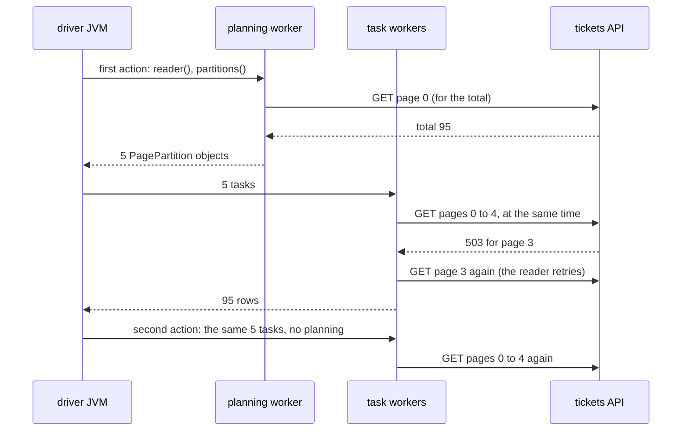
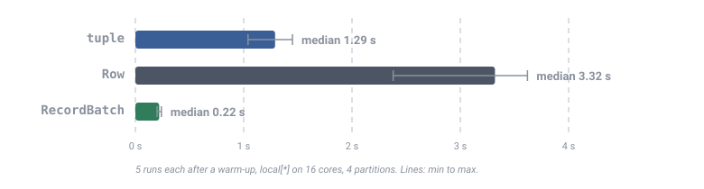
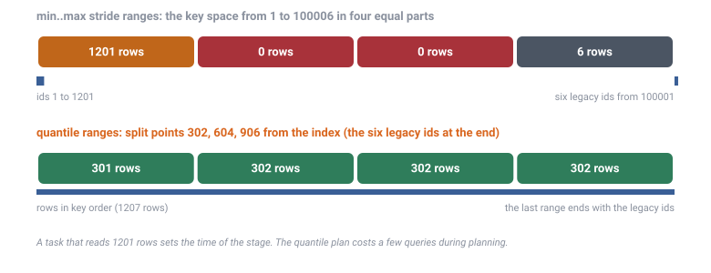
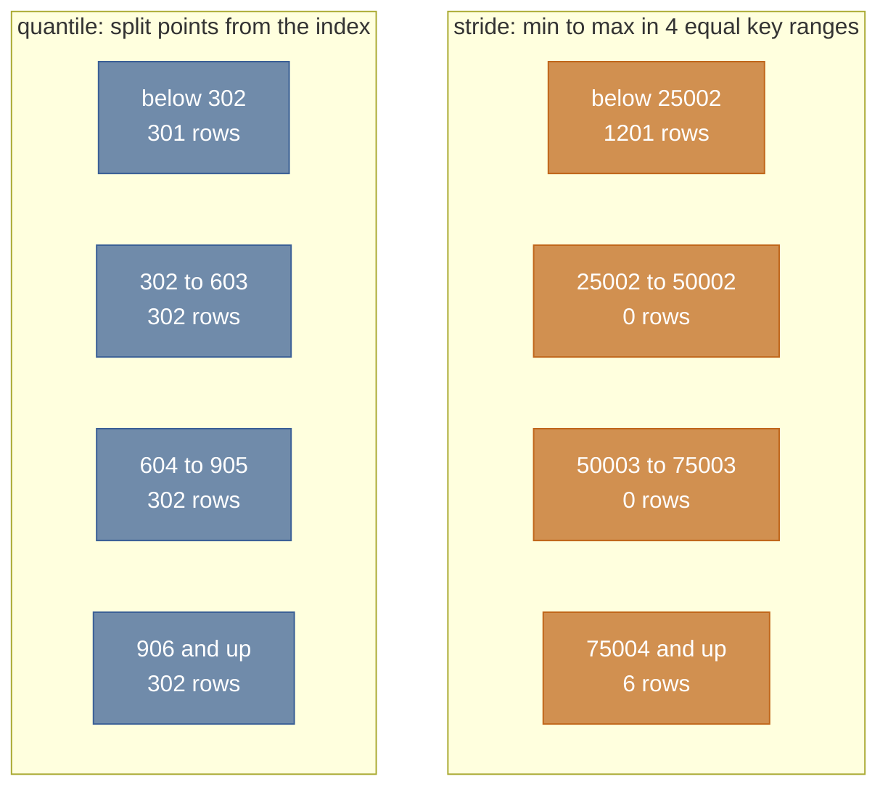

# Chapter 51: Python data sources II: APIs, databases and Arrow batches

[Chapter 50](ch50-python-data-sources-readers.md) read files from a disk. Many sources are on the other side of a network: a REST API with pages, or a database table. These sources add three new problems. Each request costs time and load on a server that is not yours. A request can fail. And the data can change while the tasks read it.

**For a network source, the partitions are the design. The partitions set how many requests go to the server at the same time. They set what Spark reads again when a task fails. They also set if all the tasks see the same version of the data. Spark takes your partitions as they are. Thus a source that plans good partitions is fast and correct, and a source that plans bad partitions is slow or wrong, with no error.**

This chapter builds two sources against local servers that the scripts start themselves:

- `tickets`, a source over a paginated REST API.
- `sqlite`, a source over a SQLite table, with key ranges like the JDBC source of Spark.

Between the two sources, the chapter looks at what Spark does with the values that `read()` yields, and when to yield Arrow batches. The scripts are in [`code/ch51`](https://github.com/lisancao/spark-masterclass/tree/main/code/ch51). All output comes from `code/ch51/output/`, from runs on `pyspark==4.3.0` in local mode on a 16-core machine.

!!! note "New in 4.3"
    The Python Data Source API did not change in 4.3.0 (see the note in [Chapter 50](ch50-python-data-sources-readers.md)). The `VARIANT` output in Step 6 needs Spark 4.1 or later. The JDBC source of Spark 4.3.0 includes ten built-in dialects (`JdbcDialects.scala` at `v4.3.0`). They are MySQL, PostgreSQL, DB2, SQL Server, Derby, Oracle, Teradata, H2, Snowflake and Databricks. It has no SQLite dialect.

## Step 1: The driver loop, and why it fails

The first version of an API reader is usually a loop in the driver. The loop requests each page, puts the items into a list, and calls `spark.createDataFrame()`. `tickets_api.py` starts a small API on a free port of `127.0.0.1`. The API has 95 tickets in pages of 20. Page 3 is unreliable on purpose: each odd request to it gets HTTP 503. `api_source.py` starts with the loop:

```python
rows = []
try:
    for page in range(5):
        with urllib.request.urlopen(f"{api.url}?page={page}", timeout=10) as r:
            rows += json.load(r)["items"]
except Exception as e:
    print(f"driver loop: {len(rows)} rows, then {type(e).__name__}: {e}")
print("driver loop:", api.take_log(), "\n")
```

```text
driver loop: 60 rows, then HTTPError: HTTP Error 503: Service Unavailable
driver loop: 4 requests: p0 p1 p2 p3(503) 
```

The loop has the problems of the loop in Chapter 50, and two more. It reads one page at a time, in one process. And one bad response stops all of the work, with 60 rows in memory and no method to continue. The server records each request, so each step of this chapter can count its requests.

## Step 2: Pages are partitions

How an API divides its results into pages decides if you can read it in parallel:

| Kind of pages | Can each page be a partition? |
|---|---|
| **Page numbers or offsets** (`?page=3`, `?offset=60&limit=20`) | You can calculate the address of each page before you read it. Thus each page can be a partition. Ask one time for the total, and plan `ceil(total / page_size)` partitions. |
| **Cursors or next links** (`?cursor=...`, or a `next` URL in each response) | You know the address of page 4 only after you read page 3. The pages are a chain, and a chain is one partition. You can still read in parallel on a different dimension that the API can filter, for example one partition for each day. Each partition then follows its own chain. |

The tickets API uses page numbers. The reader requests page 0 in `partitions()` to get the total, and plans one `PagePartition` for each page:

```python
class PagePartition(InputPartition):
    def __init__(self, pages):
        self.pages = pages                  # one or more page numbers, read in order by one task


class TicketsReader(DataSourceReader):
    def __init__(self, options):
        self.url = options["url"]
        self.page_size = int(options.get("page_size", "20"))
        self.timeout = float(options.get("timeout", "10"))
        self.retries = int(options.get("retries", "3"))
        self.pages_per_partition = int(options.get("pages_per_partition", "1"))

    def page_url(self, page):
        return f"{self.url}?page={page}&page_size={self.page_size}"

    def partitions(self):
        first = fetch_json(self.page_url(0), self.timeout, self.retries)
        pages = list(range(math.ceil(first["total"] / self.page_size)))
        k = self.pages_per_partition         # caps the number of concurrent requests
        return [PagePartition(pages[i:i + k]) for i in range(0, len(pages), k)]

    def read(self, partition):
        import json
        from pyspark.sql.types import VariantVal

        for page in partition.pages:
            body = fetch_json(self.page_url(page), self.timeout, self.retries)
            for item in body["items"]:
                yield (item["id"], item["status"], item["subject"],
                       VariantVal.parseJson(json.dumps(item["meta"])))
```

All network calls are in `read()` and in `partitions()`, never in `__init__` onto `self`. A socket does not pickle (Chapter 50, Step 6). The imports are inside `read()`, so that the worker that runs the task imports them.

The tasks must be able to connect to the API. Here, the API listens on `127.0.0.1`, and that is correct only in local mode. On a cluster, each executor connects from its own machine, so the API must accept connections from all of them.

The script counts the requests of each step:

```text
load(): 0 requests
== Physical Plan ==
*(1) Project [id#12, status#13, subject#14, meta#15]
+- BatchScan tickets[id#12, status#13, subject#14, meta#15] (Python) RuntimeFilters: []


explain(): 0 requests
count() = 95 in 5 partitions: 7 requests: p0 p0 p1 p2 p3(503) p3 p4
+-------+-----+
| status|count|
+-------+-----+
| closed|   38|
|   open|   38|
|pending|   19|
+-------+-----+

groupBy().count(): 6 requests: p0 p1 p2 p3(503) p3 p4
cache() + count(): 6 requests: p0 p1 p2 p3(503) p3 p4
two more queries on the cached df: 0 requests
```

<figure markdown>
  <video autoplay loop muted playsinline controls width="1280" height="720" poster="../../media/clips/ch51-requests.webp">
    <source src="../../media/clips/ch51-requests.mp4" type="video/mp4">
  </video>
  <figcaption><code>api_source.py</code> on Spark 4.3.0: the requests that each step sends to the tickets API.</figcaption>
</figure>

Each number has a cause:

- **`load()` and `explain()` sent no requests.** `load()` calls `schema()`, which here is a fixed string. `explain()` plans the query, but the `BatchScan` node does not call `partitions()` to print the plan.
- **The first `count()` sent 7 requests.** One request was the page 0 of `partitions()`. Then the five tasks each read one page. Page 3 failed one time, and the reader tried again. Thus the 7 requests are 1 + 5 + 1.
- **The second query sent 6 requests, not 7.** Spark keeps the planned read on the DataFrame (Chapter 50, Step 11), so `partitions()` did not run again. But Spark does not keep rows. Each action runs all the tasks again, and each task requests its page again.
- **After `cache()` and one action, the queries sent no requests.** The cached rows answered them.

The animation shows the requests of the first two actions. The request logs come from the output above.

<figure markdown>
  <video autoplay loop muted playsinline controls width="1280" height="720" poster="../../media/clips/ch51-anim-requests.webp">
    <source src="../../media/clips/ch51-anim-requests.mp4" type="video/mp4">
  </video>
  <figcaption>The planning worker asks for page 0. Then each task asks for its page. The reader tries page 3 again after the 503 error.</figcaption>
</figure>



The rule for an API source follows from these counts. A query against an API is not free, and Spark sends it again for each action. For anything more than a look at the data, land the API data in a table one time, and query the table. The table also keeps a record of what the API returned. You will need that record on the day that the API changes.

## Step 3: Retries are your work, not the work of Spark

Real APIs fail at some times: a 503 during a deploy, a closed connection, a 429 when you send too many requests. Spark can try a failed task again, but this does not help much:

- **In local mode, Spark does not try a task again.** `local[*]` permits exactly one attempt for each task (`MAX_LOCAL_TASK_FAILURES = 1` in `SparkContext.scala`). The master `local[4,3]` gives 4 threads and up to 3 attempts.
- **On a cluster, a task gets `spark.task.maxFailures` attempts** (4 by default). But a new attempt reads the full partition again, maybe on a different machine, and with no pause. A server that has a problem gets the same request again immediately.

Thus the reader tries again itself, only for errors that can succeed later, and with a pause that increases:

```python
def fetch_json(url, timeout, retries):
    """GET with a timeout. Retry 5xx and network errors with a growing pause, raise 4xx at once."""
    import json, time
    from urllib.error import HTTPError, URLError
    from urllib.request import urlopen

    for attempt in range(retries + 1):
        try:
            with urlopen(url, timeout=timeout) as response:
                return json.load(response)
        except HTTPError as e:           # a subclass of URLError, so it must come first
            if e.code < 500 or attempt == retries:
                raise                    # 4xx: our request is wrong, a retry will not help
        except URLError:
            if attempt == retries:
                raise
        time.sleep(0.1 * 2 ** attempt)
```

Some details are important:

- **Always give a `timeout`.** Without it, `urlopen` can wait for all time, and the task does not end.
- **`HTTPError` is a subclass of `URLError`.** Thus the `except HTTPError` must come first.
- **A 4xx error means that the request is wrong.** A new attempt gives the same error, so raise it immediately. For a 429, real code also reads the `Retry-After` header and waits for that time.
- **A retry is safe only because a `GET` of a page has no side effects.** Do not try again a call that creates something.

With `retries=0`, the error of page 3 stops the job. The same reader under `local[4,3]` succeeds, because Spark tries the task again:

```text
retries=0: [PYTHON_EXCEPTION] An exception was thrown from the Python worker: 
           HTTPError: HTTP Error 503: Service Unavailable
retries=0: 6 requests: p0 p0 p1 p2 p3(503) p4

master local[4,3], retries=0: count() = 95: 7 requests: p0 p0 p1 p2 p3(503) p3 p4
```

The second line comes from `api_task_retries.txt`, a separate run with `SPARK_MASTER='local[4,3]'`. The task retry gave the same 7 requests as the retry in the reader. On this API, a task has one page, so the two methods cost the same. With `pages_per_partition=10`, a task retry requests ten pages again for one bad page.

## Step 4: Check options early

The `tickets` source cannot do anything without a `url`. In Chapter 50, the `counter` source checked its options in the reader, so an absent option failed at the first action. `TicketsDataSource` checks in `DataSource.__init__`:

```python
class TicketsDataSource(DataSource):
    @classmethod
    def name(cls):
        return "tickets"

    def __init__(self, options):
        super().__init__(options)
        if "url" not in options:
            raise ValueError("option 'url' is required")

    def schema(self):
        return "id int, status string, subject string, meta variant"

    def reader(self, schema):
        return TicketsReader(self.options)
```

```text
no url: [PYTHON_DATA_SOURCE_ERROR] Failed to create Python data source instance 
        ValueError: option 'url' is required 

no url, user schema: load() returned a DataFrame with columns ['id', 'status', 'subject', 'meta']
  first action: [PYTHON_DATA_SOURCE_ERROR] Failed to create Python data source instance 
                ValueError: option 'url' is required 
```

Without a user schema, the error appeared at `load()`. Spark must create the `DataSource` to call `schema()`. With a user schema, Spark does not need `schema()`, so it creates the `DataSource` only at the first action. The same check then fails later. On Spark Connect, the check fails at the first call that needs the schema (Chapter 50, Step 12).

## Step 5: Control the load on the API

The number of partitions is the number of requests that can run at the same time. With one partition for each page and `local[*]` on 16 cores, up to 16 requests run together. On a cluster, the number can be hundreds. Two options of the `tickets` source decrease the load:

```text
page_size=50: 95 rows in 2 partitions: 3 requests: p0 p0 p1
retries=0: [PYTHON_EXCEPTION] An exception was thrown from the Python worker: 
           HTTPError: HTTP Error 503: Service Unavailable
retries=0: 6 requests: p0 p0 p1 p2 p3(503) p4
duplicate ids: 0 | 5 requests: p0 p1 p2 p3 p4
pages_per_partition=2: 95 rows in 3 partitions: 7 requests: p0 p0 p1 p2 p3(503) p3 p4
```

- **Larger pages mean fewer requests.** Each request has a fixed cost. `page_size=50` read the 95 tickets in 3 requests, not 7. Use the largest page size that the API permits.
- **More pages in each partition mean fewer tasks.** `pages_per_partition=2` read the same five pages in three tasks. Not more than three requests ran at the same time.

Page numbers are correct only if the API sorts by a value that does not change, such as an ID or a creation time. If new records go to the front while the tasks read, rows move from one page to the next page. Then the result can have duplicate rows or rows that are not there. The script checks the result for duplicate IDs. Do this check for each API source.

!!! warning "Secrets in options go to each task"
    Give a token with `.option("api_token", ...)`, not in the source code. The token does not show in `explain()` (the script checked `extended` and `formatted` output: `api_token in explain() output: False`). But Spark pickles the reader, with its options, and sends a copy to each task. Do not write the options to a log.

## Step 6: Loose fields as VARIANT

Each ticket has a `meta` object with different keys: sometimes `tags` only, sometimes a priority, sometimes a customer. A schema with a column for each key is long, and it is wrong on the day that the API adds a key. The `tickets` source declares `meta variant` and yields a `VariantVal`:

```python
VariantVal.parseJson(json.dumps(item["meta"]))
```

Queries then take the parts that they need with `try_variant_get`, which returns `NULL` for a path that is not there:

```text
+--------+-----+
|     tag|count|
+--------+-----+
| account|   19|
| billing|   19|
|  damage|   19|
|  refund|   19|
|shipping|   38|
+--------+-----+

+--------+-----+
|priority|count|
+--------+-----+
|    NULL|   63|
|    high|   16|
|     low|   16|
+--------+-----+

gold customers: 11  tickets without a customer: 24
```

A `VARIANT` column accepts only a `VariantVal`. A reader that yields the Python `dict` fails in the task:

```text
dict for a variant column:
  [PYTHON_EXCEPTION] An exception was thrown from the Python worker:
  PySparkValueError: [MALFORMED_VARIANT] Variant binary is malformed. Please check the dat
```

## Step 7: What Spark does with the values that you yield

A reader yields Python values. Spark changes them to Arrow in the Python worker, and then to its own rows in the JVM. The two changes have rules, and some of the rules are not obvious. `arrow_batches.py` declares a column of one type, yields one value, and reads back the result:

```text
declared, yielded      result
int 7                  7
int None               None
int 1.5                1
int True               fails: ArrowTypeError: Expected integer, got bool
int '7'                fails: ArrowInvalid: Could not convert '7' with type str: tried to conver
int 2**40              fails: ArrowInvalid: Value 1099511627776 too large to fit in C integer ty
double 2               2.0
decimal(5,2) Decimal   1.25
decimal(5,2) 1.25      fails: AssertionError in conversion.py:convert_decimal()
date '2026-10-01'      fails: ArrowTypeError: object of type <class 'str'> cannot be converted t
timestamp str          fails: AssertionError in conversion.py:convert_timestamp()
timestamp aware        2026-10-01 10:00:00
timestamp_ntz aware    fails: AssertionError in conversion.py:convert_timestamp_ntz()
binary bytes           0001
binary str             fails: AssertionError in conversion.py:convert_binary()
array<int> list        [1, 2]
map<string,int> dict   {k -> 1}
struct dict            {1, x}
```

The table gives these rules:

- **Spark does not parse strings.** A string for an `int`, a `date`, a `timestamp` or a `binary` column fails. Parse the value in `read()`.
- **A `float` for an `int` column loses its fraction, with no error.** `1.5` became `1`. This is the most dangerous line in the table. Convert explicitly, and decide what to do with a fraction.
- **A `decimal` column needs a `decimal.Decimal`.** A `float` fails.
- **Four of the failures are a bare `AssertionError`, with no message.** The converters in `pyspark/sql/conversion.py` check the type with `assert isinstance(...)`. The traceback names the function, for example `convert_decimal`, but not the column or the value. Find the column from the function name.
- **Lists, dicts and `Row` objects fill `array`, `map` and `struct` columns.**

## Step 8: Yield Arrow batches

`read()` can also yield `pyarrow.RecordBatch` objects. Spark then does not convert row by row. The batch goes to the JVM as it is. The `rows` source in `arrow_batches.py` makes the same rows in three ways:

- `tuple`: one tuple for each row.
- `row`: one `Row` for each row.
- `arrow`: one `RecordBatch` for each 10,000 rows, built with `pyarrow.compute`.

```python
for lo in range(partition.start, partition.end, 10_000):
    ids = pa.array(range(lo, min(lo + 10_000, partition.end)), schema.field("id").type)
    yield pa.RecordBatch.from_arrays([
        ids,
        pc.binary_join_element_wise("s", pc.cast(pc.bit_wise_and(ids, 7), pa.string()), ""),
        pc.multiply(pc.cast(ids, pa.float64()), 0.5),
        pc.add(pa.scalar(base, schema.field("ts").type),
               pc.cast(pc.multiply(pc.cast(ids, pa.int64()), 1_000_000), pa.duration("us"))),
    ], schema=schema)
```

```text
tuple  2,000,000 rows: median 1.29 s over 5 runs (min 1.04, max 1.45)
row    2,000,000 rows: median 3.32 s over 5 runs (min 2.38, max 3.62)
arrow  2,000,000 rows: median 0.22 s over 5 runs (min 0.20, max 0.24)
tuples / batches: 5.7x, rows / tuples: 2.6x
conditions: local[*] on 16 cores, 4 partitions, maxRecordsPerBatch 10000
```

The query reads 2,000,000 rows of four columns, in 4 partitions, and aggregates them. `arrow_batches.py --timing` ran it 5 times for each mode, after one warm-up run, on a 16-core machine, under the benchmark lock of the book. The batches took a median of 0.22 s. The tuples took 1.29 s, which is 5.7 times as long. The `Row` objects took 3.32 s, which is 2.6 times as long as the tuples. The minimum and maximum times in the output show that the three modes do not overlap.

<figure markdown>
  
  <figcaption>The three modes of <code>read()</code>, from the output above. The lines show the fastest and the slowest of the five runs.</figcaption>
</figure>

The cost of a tuple is the conversion of each value in Python, one row at a time. A `Row` adds the work of a `Row` object and the match of its field names to the schema. Thus, yield tuples, not `Row` objects, when you yield rows.

A batch must agree exactly with the schema. Spark does not cast the Arrow types. A batch with `int64` for an `int` column fails in the task:

```text
RecordBatch with id as int64, schema says int:
  [DATA_SOURCE_RETURN_SCHEMA_MISMATCH] Return schema mismatch in the result from 'read'
  method. Expected: id: int32 sensor: string value: double ts: timestamp[us, tz=UTC]
  columns, Found: id: int64 sensor: string value: double ts: timestamp[us, tz=UTC]
  columns. ...
the same rows, correct batches: [Row(id=0, sensor='s0', value=0.0), Row(id=1, sensor='s1', value=0.5)]
```

Use batches when a library already gives you Arrow data or columns. Examples are a database driver with an Arrow interface, Parquet or Feather files, and a pandas DataFrame. For an API that returns JSON, the rows are Python objects before you can make a batch, so most of the gain is not available.

## Step 9: The time zone of the worker

A Python `datetime` without `tzinfo` (a naive value) has no time zone. Spark must choose one, and it uses the time zone of the Python worker process, not the session time zone. The script reads the same two values with the session time zone `UTC` and three different `TZ` values for the process:

```text
Timestamps: session time zone UTC, three worker time zones:
  TZ=UTC                  naive -> 2026-10-01 10:00:00   aware -> 2026-10-01 10:00:00
  TZ=America/Los_Angeles  naive -> 2026-10-01 17:00:00   aware -> 2026-10-01 10:00:00
  TZ=Asia/Ho_Chi_Minh     naive -> 2026-10-01 03:00:00   aware -> 2026-10-01 10:00:00
```

<figure markdown>
  <video autoplay loop muted playsinline controls width="1280" height="720" poster="../../media/clips/ch51-timezone.webp">
    <source src="../../media/clips/ch51-timezone.mp4" type="video/mp4">
  </video>
  <figcaption>The same naive <code>datetime</code> gives three different instants under three worker time zones. The aware value stays correct.</figcaption>
</figure>

The naive value moved by the offset of the worker. The aware value (`tzinfo=UTC`) stayed correct. On a cluster, each executor machine can have a different time zone, so a naive value can give different results in different tasks. Thus, always yield aware `datetime` values for a `timestamp` column. For a `timestamp_ntz` column, yield a naive value (an aware value fails, as Step 7 shows).

## Step 10: A database: SQLite and its types

The second source reads a SQLite table. SQLite is a good teacher, because its column types are only suggestions. Each value keeps its own storage class. `database_source.py` puts strange values into a table with five declared types:

```text
(12.5, 'real', 7, 'integer', '42', 'text', 2, 'integer', 'text')
('N/A', 'text', 'seven', 'text', 'x', 'text', 2.7, 'real', 'integer')
('12,50', 'text', 8, 'integer', None, 'null', 1.5, 'real', 'blob')
affinity: {'DECIMAL(10,2)': 'NUMERIC', 'INT': 'INTEGER', 'VARCHAR(10)': 'TEXT', 'FLOATING POINT': 'INTEGER', '': 'BLOB'}
ProgrammingError: Error binding parameter 1: type 'decimal.Decimal' is not supported
TypeError: cannot pickle 'sqlite3.Connection' object
SQLite 3.45.1
```

SQLite gives each column an **affinity** from the declared type, with rules in a fixed order ("Datatypes In SQLite", section 3.1). The affinity tries to convert a value. If the conversion fails, SQLite keeps the value as it is:

- `'N/A'` stayed text in a `DECIMAL(10,2)` column. `'12,50'` also stayed text, because a comma is not a decimal point.
- `"FLOATING POINT"` got INTEGER affinity, because the first rule looks for `INT`, and `POINT` contains `INT`.
- A column with no declared type keeps each value as it is (BLOB affinity).

Also, `sqlite3` cannot bind a `Decimal` as a parameter, and a connection does not pickle.

The `sqlite` source (`sqlite_source.py`) reads the declared types with `PRAGMA table_info`, maps each affinity to a Spark type, and converts each value. A value that does not fit its column becomes `NULL`:

```python
def to_spark_value(v, t):
    """Convert one stored value to the column's Spark type, or None when it does not fit."""
    if v is None:
        return None
    if t == "bigint":
        return v if isinstance(v, int) and not isinstance(v, bool) else None
    if t == "double":
        return float(v) if isinstance(v, (int, float)) else None
    if t.startswith("decimal"):
        scale = int(t.split(",")[1].rstrip(")"))
        if isinstance(v, (int, float)):
            return decimal.Decimal(repr(v)).quantize(decimal.Decimal(1).scaleb(-scale))
        return None
    if t == "boolean":
        s = str(v).strip().lower()
        return True if s in TRUE else False if s in FALSE else None
    if t == "timestamp":
        if isinstance(v, int):
            return datetime.datetime.fromtimestamp(v, tz=datetime.timezone.utc)
        if isinstance(v, str):
            try:
                ts = datetime.datetime.fromisoformat(v.replace("Z", "+00:00"))
            except ValueError:
                return None
            return ts if ts.tzinfo else ts.replace(tzinfo=datetime.timezone.utc)
        return None
    if isinstance(v, bytes):
        return v.decode("utf-8", "replace")
    return str(v)
```

`shopdb.py` builds `shop.db` with an `orders` table of 1,207 rows. The table has the values that real tables collect over the years:

- Amounts such as `'N/A'` and `''`.
- Quantities such as `'two'`.
- Three formats of timestamp.
- Five spellings of a boolean.

The schema and some values:

```text
shop.db: 1207 orders
root
 |-- order_id: long (nullable = true)
 |-- customer: string (nullable = true)
 |-- status: string (nullable = true)
 |-- amount: decimal(10,2) (nullable = true)
 |-- qty: long (nullable = true)
 |-- placed_at: timestamp (nullable = true)
 |-- gift: boolean (nullable = true)
 |-- note: string (nullable = true)

Stored values and what the source made of them:
  (88.61, 4, '2026-09-02T07:00:00Z', 'yes', '42')    -> 88.61, 4, 09-02 07:00, True, 42
  ('', 4, 1788505200, 0, None)                       -> None, 4, 09-04 07:00, False, None
  (235.72, 6, '2026-09-04 07:00:00', 'yes', '42')    -> 235.72, 6, 09-04 07:00, True, 42
  (157.16, 1, '2026-09-14T07:00:00Z', 'true', '42')  -> 157.16, 1, 09-14 07:00, True, 42
  (229.76, 2, '2026-09-03 07:00:00', 'yes', None)    -> 229.76, 2, 09-03 07:00, True, None
  (26.96, 6, 1789974000, 'no', '42')                 -> 26.96, 6, 09-21 07:00, False, 42
```

The three timestamp formats (ISO with `Z`, a space, Unix seconds) all became the correct instant. The empty amount became `NULL`, not `0`.

Why not the JDBC source of Spark? It works with each database that has a JDBC driver, and it has key-range partitions. But Spark has no SQLite dialect, and the conversion is the conversion of the driver. `jdbc_sqlite.py` reads the same table with `org.xerial:sqlite-jdbc:3.50.3.0` from Maven Central:

```text
driver: org.xerial:sqlite-jdbc:3.50.3.0
qty        bigint         reads; some values: ['0', '1', '2', '3', '4']
gift       boolean        reads; some values: ['False', 'None', 'True']
placed_at  date           fails: java.sql.SQLException: Error parsing date
amount     decimal(10,2)  fails: java.sql.SQLException: Bad value for type BigDecimal : 
note       decimal(38,18) fails: java.sql.SQLException: column -1 out of bounds [1,2]
stored qty values that are not integers: [(83, 2.5), (112, 2.5), (145, 2.5), (240, 'two')]
JDBC reads them as: [(83, 2), (112, 2), (145, 2), (240, 0)]
gift 'yes' rows, JDBC values: ['False']
```

The JDBC read is worse in two ways:

- **Three columns fail.** The driver reports `DATETIME` as a date and cannot parse the values. The `''` amount stops the decimal column.
- **Two columns give wrong values with no error.** `'two'` became `0`, `2.5` became `2`, and `'yes'` became `False`.

The `customSchema` option of the JDBC source can change the column types, but it cannot change what the driver does with each value. A Python source puts the conversion in your code, where you can test it.

The `sqlite` source opens each connection in `read()`, in read-only mode (`?mode=ro`), reads with `fetchmany(500)`, and closes the connection in a `finally` block. A connection on `self` fails at the first action:

```text
connection on self: TypeError: cannot pickle 'sqlite3.Connection' object
```

## Step 11: Key ranges, like JDBC

A table has no pages. The JDBC source divides a table into ranges of a numeric key: `partitionColumn`, `lowerBound`, `upperBound` and `numPartitions`. `database_source.py` writes 1,003 rows into Derby (its JAR is part of PySpark) and asks Spark for the `WHERE` clause of each partition. The IDs are 1 to 1,000, two late IDs at 1,000,000 and 1,000,001, and one `NULL`:

```text
JDBC, lowerBound=1 upperBound=1000001 numPartitions=4:
   "ID" < 250001 or "ID" is null
   "ID" >= 250001 AND "ID" < 500001
   "ID" >= 500001 AND "ID" < 750001
   "ID" >= 750001
rows per partition: [1001, 0, 0, 2] of 1003
bounds 100..200 (not a filter): 1003 rows, [125, 25, 25, 828]
bounds 1..3 with numPartitions=8: 2 partitions
predicates: [500, 500, 3]
```

<figure markdown>
  <video autoplay loop muted playsinline controls width="1280" height="720" poster="../../media/clips/ch51-ranges.webp">
    <source src="../../media/clips/ch51-ranges.mp4" type="video/mp4">
  </video>
  <figcaption>JDBC ranges in key space against quantile ranges in the Python source: the rows that each task read.</figcaption>
</figure>

The output shows four rules of JDBC partitions:

- **The ranges are equal in key space, not in rows.** Two late IDs made the key space a million wide. One task read 1,001 rows, two tasks read nothing, and one task read 2.
- **The bounds are not a filter.** With bounds 100 to 200, Spark still read all 1,003 rows. The first range has no lower end, and the last range has no upper end.
- **The first range also takes the `NULL` keys.**
- **Spark decreases the number of partitions if the key range is too small.** Bounds 1 to 3 with `numPartitions=8` gave 2 partitions (`JDBCRelation.columnPartition`).

The `predicates` argument gives one partition for each `WHERE` clause that you write. That is the JDBC method for ranges that you calculate yourself. (The script gets the clauses with `_jdf.queryExecution().toRdd().partitions()`, which works only in a classic session.)

The `sqlite` source plans the same ranges, with `?` parameters for the values:

```python
def range_partitions(column, split_points):
    """One (where_sql, params) per key range. The first range takes NULL keys, the last is open."""
    q = quote_ident(column)
    if not split_points:
        return [("1 = 1", [])]
    ranges = [(f"({q} < ? OR {q} IS NULL)", [split_points[0]])]
    for lo, hi in zip(split_points, split_points[1:]):
        ranges.append((f"({q} >= ? AND {q} < ?)", [lo, hi]))
    ranges.append((f"{q} >= ?", [split_points[-1]]))
    return ranges
```

The `orders` table has the same shape: IDs 1 to 1,201 and six legacy IDs from 100,001. With split points from `min` and `max`, the ranges have the JDBC problem. With `bounds=quantile`, the source asks the index for the key at each quantile, with `ORDER BY ... LIMIT 1 OFFSET k`:

```text
range_partitions('order_id', [100, 200]):
   ("order_id" < ? OR "order_id" IS NULL) [100]
   ("order_id" >= ? AND "order_id" < ?) [100, 200]
   "order_id" >= ? [200]
Python source, min..max stride ranges: [1201, 0, 0, 6]
Python source, quantile ranges:       [301, 302, 302, 302]
quantile split points: [302, 604, 906]
[(8, 0, 0, 'SCAN orders')]
```

The quantile ranges have almost equal row counts. The cost is a few queries during planning. Here, `order_id` is an `INTEGER PRIMARY KEY`, which is the rowid of SQLite. Thus `EXPLAIN QUERY PLAN` shows a scan of the table in key order, with no sort. For a key with no index, each quantile query sorts the table, and the planning cost can be more than the read. Other methods give a similar result:

<figure markdown>
  
  <figcaption>The four partitions of the <code>orders</code> table in the two plans. Equal key ranges put 1,201 rows in one task. Quantile ranges give each task about 302 rows.</figcaption>
</figure>

- A modulo of the key (`id % n = i`) gives equal ranges if the keys have no pattern, but each task scans the full table.
- The statistics of the database, for example `pg_stats` in PostgreSQL, give quantiles with no query.
- Many small ranges (more partitions than cores) decrease the effect of one large range.



## Step 12: One read, many moments

Each task opens its own connection, at its own time. A table that changes between the tasks gives a result that never existed at one moment. `read_two_ranges()` in `database_source.py` does the work of Spark in one process, with no JVM. It plans two ranges, reads the first range, and then changes the table, as another program can do. Then it reads the second range:

```python
rows = list(reader.read(parts[0]))
w = sqlite3.connect(db)                       # another program writes between the two tasks
w.execute("UPDATE orders SET order_id = 1300 WHERE order_id = 1")
w.execute("INSERT INTO orders (customer) VALUES ('new')")       # gets the next rowid
w.commit()
w.close()
rows += list(reader.read(parts[1]))
```

```text
1207 rows when planned. Rows read, and copies of order 1:
  no snapshot mark:   (1209, 2)
  rowid <= max(rowid): (1208, 2)
```

Without protection, the read gave 1,209 rows for a table that had 1,207 rows and then 1,208 rows. The update moved order 1 from the first range into the second range, so the read got it two times. The insert added one more row.

The `sqlite` source records `max(rowid)` during planning and adds `rowid <= ?` to the query of each task. That mark stopped the new row (1,208). But it did not stop the copy, because an update does not change which rows are below the mark.

A mark like this is the minimum. For a correct snapshot, all the tasks must read the same version of the data:

- SQLite: copy the file with `Connection.backup` during planning, and read the copy.
- PostgreSQL: export a snapshot with `pg_export_snapshot()` in one transaction during planning. Then each task starts a transaction with `SET TRANSACTION SNAPSHOT`.
- Any database: read a replica that does not change during the read, or a change table with a fixed end.

## The whole chapter, on one page

- **Pages, key ranges and file groups are partitions.** Page numbers and offsets give parallel partitions. A cursor chain gives one partition. Plan `ceil(total / page_size)` pages from one request.
- **Count your requests.** `load()` and `explain()` send none. The first action plans and reads. Each later action reads again, unless you `cache()`. Land API data in a table one time.
- **Try again in the reader.** Use a timeout, try again only 5xx and network errors, with a pause that increases. Local mode does not try a task again, and a cluster tries the full partition again with no pause.
- **Check options in `DataSource.__init__`.** The error then appears at `load()`, unless the user gives a schema.
- **The partition count is the load on the server.** Use large pages, and put more pages in a partition to decrease the number of tasks.
- **Yield the exact Python types.** Spark does not parse strings. A float in an `int` column loses its fraction. Four type errors are a bare `AssertionError`.
- **Arrow batches skip the conversion of each row.** A batch must agree with the schema exactly.
- **Yield aware `datetime` values.** A naive value takes the time zone of the worker.
- **Convert database values in your code.** SQLite affinity keeps text in numeric columns. The JDBC driver changed some of those values to wrong values with no error.
- **Plan key ranges by rows, not by key space.** JDBC strides are equal in key space. Quantiles from the index give equal tasks.
- **Each task reads at its own moment.** A rowid mark stops inserts, not updates. Use a snapshot for a correct read.

[Chapter 52](ch52-python-data-sources-pushdown.md) gives the `WHERE` clause of a query to these sources. It also shows the problems that come with it: SQL injection, and filters that a database calculates differently from Spark.

## Further reading

- [Python Data Source API tutorial](https://spark.apache.org/docs/4.3.0/api/python/tutorial/sql/python_data_source.html), with the type conversion rules.
- [JDBC to other databases](https://spark.apache.org/docs/4.3.0/sql-data-sources-jdbc.html), the options `partitionColumn`, `lowerBound`, `upperBound`, `numPartitions`, `predicates` and `customSchema`.
- [Datatypes In SQLite](https://www.sqlite.org/datatype3.html), the affinity rules.
- [PostgreSQL snapshot synchronization functions](https://www.postgresql.org/docs/current/functions-admin.html#FUNCTIONS-SNAPSHOT-SYNCHRONIZATION), `pg_export_snapshot()`.
