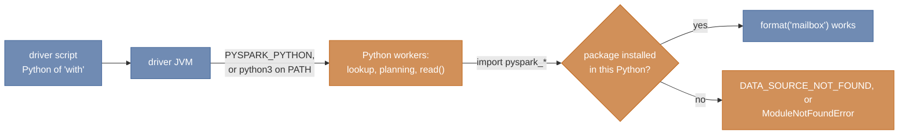

# Chapter 51: Shipping a source: packaging, testing and debugging

In Chapters 47 to 50, each source lived in the script that used it, and the script registered it by hand. That is correct for a demo. A source that a team uses needs more:

- Other users install it, and `format("mailbox")` works with no `register()` call.
- Tests run without Spark, in less than a second.
- When the source fails in a task on an executor that you cannot see, you can find the cause.

**A packaged source runs in Python processes that are not yours: the workers of the driver, of each executor and of the Connect server. Most problems with a shipped source come from one question: which Python does each worker use, and what can it import? Answer that question before you test the code. Then test the code as plain Python, and read its logs from a table.**

The scripts are in [`code/ch51`](https://github.com/lisancao/spark-masterclass/tree/main/code/ch51). `packaging.sh` makes two virtual environments with `uv`, installs the package into one of them, and runs `registration.py` in different setups. All output is from `code/ch51/output/packaging.txt`, from a run on `pyspark==4.3.0`.

!!! note "New in 4.3"
    The lookup of packaged sources, the registration rules and the worker logs did not change in 4.3.0. The override of an automatically registered source came in 4.1 (SPARK-51919). The worker logs and `spark.tvf.python_worker_logs()` came in 4.1. Step 7 shows that `getCondition()` still gives `None` for some errors in 4.3.0, with different gaps in a classic session and on Connect.

## Step 1: A source as a package

When a session needs a Python data source for the first time, Spark starts a Python worker that runs `pyspark/sql/worker/lookup_data_sources.py`. That worker imports each top-level module whose name starts with `pyspark_`. If the module has a `DefaultSource` that is a subclass of `DataSource`, Spark registers it under `DefaultSource.name()`:

```python
for info in iter_modules():
    if info.name.startswith("pyspark_"):
        mod = import_module(info.name)
        if hasattr(mod, "DefaultSource") and issubclass(mod.DefaultSource, DataSource):
            infos[mod.DefaultSource.name()] = mod.DefaultSource
```

The `mailbox` source reads one row for each `.eml` file in a folder. Its package is in `code/ch51/pyspark-mailbox`:

```text
pyspark-mailbox/
  pyproject.toml
  src/pyspark_mailbox/__init__.py
  src/pyspark_mailbox/source.py      # MailboxDataSource and its reader
  tests/test_reader.py
```

```toml
[build-system]
requires = ["setuptools>=68"]
build-backend = "setuptools.build_meta"

[project]
name = "pyspark-mailbox"
version = "0.1.0"
description = "format('mailbox'): one row per .eml file, a Python data source for Spark 4"
requires-python = ">=3.10"
dependencies = ["pyspark>=4.0"]

[project.optional-dependencies]
test = ["pytest>=8"]

[tool.setuptools.packages.find]
where = ["src"]
```

```python
"""pyspark_mailbox: Spark imports every top-level pyspark_* module and registers its DefaultSource."""
from pyspark_mailbox.source import MailboxDataSource

DefaultSource = MailboxDataSource
```

The registered name comes from `name()`, not from the module name. `pip install -e` (an editable install) links the package to its source folder, so a change takes effect at the next start of Spark. For other users, build a wheel (`python -m build`, or `uv build`).

`packaging.sh` installs the package into a virtual environment called `with`. A second environment, `bare`, has only PySpark:

```text
== Two virtual environments: 'with' has the package, 'bare' has only pyspark
pyspark                  4.3.0
pyspark-mailbox          0.1.0    ~/spark-masterclass-parts/part09a/code/ch51/pyspark-mailbox
```

## Step 2: Which Python do the workers use?

The first run uses the Python of `with` for the driver script, and it does not set `PYSPARK_PYTHON`:

```text
== 1. The driver uses 'with', PYSPARK_PYTHON is not set
driver python: $CH51_VENVS/with/bin/python
PYSPARK_PYTHON: (not set)
format('mailbox'), no register(): DATA_SOURCE_NOT_FOUND | An error occurred while calling o30.load.
register(MailboxDataSource), then count(): PYTHON_DATA_SOURCE_ERROR 
   ModuleNotFoundError: No module named 'pyspark_mailbox'
```

<figure markdown>
  <video autoplay loop muted playsinline controls width="1280" height="720" poster="../../media/clips/ch51-workers.webp">
    <source src="../../media/clips/ch51-workers.mp4" type="video/mp4">
  </video>
  <figcaption><code>registration.py</code> on Spark 4.3.0: the same package, found or not found, as the Python of the workers changes.</figcaption>
</figure>

The package is in the Python of the driver script, but Spark did not find it. In a classic session, the workers use the interpreter in `PYSPARK_PYTHON`. If that variable is not set, they use `python3` from the `PATH` (`pyspark/core/context.py`, line 341 at `v4.3.0`). The lookup ran in that other Python and found no `pyspark_mailbox`.

The second line shows a different failure. The script imported `MailboxDataSource` and registered it by hand. Then the read failed with `ModuleNotFoundError` in the worker. The reason is a rule of cloudpickle:

- **A class from your `__main__` script travels by value.** Its code goes with the pickled object, so the worker does not need your file. That is why all the scripts of Chapters 47 to 50 worked with no install.
- **A class from an installed module travels by reference.** The pickle only says "import `pyspark_mailbox` and take `MailboxDataSource`". The worker must be able to import that module.

With `PYSPARK_PYTHON` set to the Python of `with`, the lookup works. With the workers in `bare`, the failures of the first run come back:

```text
== 2. Driver and workers both use 'with'
driver python: $CH51_VENVS/with/bin/python
PYSPARK_PYTHON: $CH51_VENVS/with/bin/python
format('mailbox'), no register(): 4 rows

== 3. The driver uses 'with', the workers use 'bare'
driver python: $CH51_VENVS/with/bin/python
PYSPARK_PYTHON: $CH51_VENVS/bare/bin/python
format('mailbox'), no register(): DATA_SOURCE_NOT_FOUND | An error occurred while calling o30.load.
register(MailboxDataSource), then count(): PYTHON_DATA_SOURCE_ERROR 
   ModuleNotFoundError: No module named 'pyspark_mailbox'
```



Thus install the package in the Python of every worker:

1. In a classic session, set `PYSPARK_PYTHON` (or `spark.pyspark.python` for `spark-submit`) to an interpreter that has the package.
2. On a cluster, install the package on the driver and on each executor. Or ship an environment with `spark.archives` (the PySpark packaging guide in the further reading shows how).
3. On Spark Connect, install it where the Connect server runs (Step 5).

The lookup runs one time for each Spark application. A package that you install after the session starts is not available until a new session.

## Step 3: One broken package hides all the others

The lookup imports every `pyspark_*` module in one worker. `packaging.sh` installs a second package, `pyspark-broken`, whose module imports a module that does not exist:

```text
== 4. A second pyspark_* package that fails to import
driver python: $CH51_VENVS/with/bin/python
PYSPARK_PYTHON: $CH51_VENVS/with/bin/python
format('mailbox'), no register(): DATA_SOURCE_NOT_FOUND | An error occurred while calling o30.load.
register(MailboxDataSource), then count(): 4 rows
Skipping the lookup of Python Data Sources due to the failure.
ModuleNotFoundError: No module named 'a_module_that_is_not_installed'
```

The broken package stopped the lookup, and Spark registered no packaged source, not even `mailbox`. The cause is only in the driver log, as a warning. The error of the user is `DATA_SOURCE_NOT_FOUND`, which names `mailbox`, not the broken package. Registration by hand still worked, because the workers could import `pyspark_mailbox`. If a packaged source disappears, look in the driver log for `Skipping the lookup`.

## Step 4: Registration rules

`spark.dataSource.register(cls)` registers a class for the current session, under `cls.name()`:

```text
format('MailBox') (names have no case): 4 rows
register a source named 'json': DATA_SOURCE_ALREADY_EXISTS
register() again under the same name: MailboxV2
```

- **Names have no case.** `format("MailBox")` found `mailbox`.
- **A Python source cannot replace a built-in or JVM source.** A source whose `name()` is `json` fails at `register()` with `DATA_SOURCE_ALREADY_EXISTS`. Thus a Python source cannot hide `json`, `parquet`, `csv` or a connector on the classpath. Choose a name that no other source uses.
- **A second `register()` with the same name replaces the source.** This also applies to a packaged source (since 4.1, SPARK-51919). `MailboxV2` adds a column, and the next read used it. Use this to try a fix without a new install.
- **An unknown name fails at `load()`** with `DATA_SOURCE_NOT_FOUND`.

## Step 5: The package on Spark Connect

On Spark Connect, the server runs all the Python workers ([Chapter 47](ch47-python-data-sources-readers.md), Step 12). `packaging.sh` starts a Connect server whose workers use `bare`, and runs the client in `with`:

```text
== 5. Spark Connect: the server's workers use 'bare', the client uses 'with'
driver python: $CH51_VENVS/with/bin/python
PYSPARK_PYTHON: (not set)
format('mailbox'), no register(): DATA_SOURCE_NOT_FOUND | (org.apache.spark.SparkClassNotFoundException) [DATA_SOURCE_NOT_FOUND] Failed to fin
register(MailboxDataSource), then count(): PYTHON_DATA_SOURCE_ERROR 
   ModuleNotFoundError: No module named 'pyspark_mailbox'
addArtifacts(pyspark_mailbox.zip, pyfile=True), then count(): PYTHON_DATA_SOURCE_ERROR 
   ModuleNotFoundError: No module named 'pyspark_mailbox'
register() again after addArtifacts(), then count(): 4 rows
```

<figure markdown>
  <video autoplay loop muted playsinline controls width="1280" height="720" poster="../../media/clips/ch51-connect.webp">
    <source src="../../media/clips/ch51-connect.mp4" type="video/mp4">
  </video>
  <figcaption>A Connect client sends the package to the server as an artifact. The read works only after a second <code>register()</code>.</figcaption>
</figure>

The client has the package, but the server workers do not, so the first two reads failed as in Step 2. A Connect client can send Python files to its server session with `spark.addArtifacts(path, pyfile=True)`. The script zips `src/pyspark_mailbox` and sends it. The next read still failed. A second `register()` after `addArtifacts()` made the read work.

The 4.3.0 source shows why. `register()` creates the Python function of the source, with the Python includes of the session at that moment (`pythonIncludes` in `UserDefinedPythonDataSource.scala`). `PythonPlannerRunner` gives the worker only those includes. An artifact that the session gets after `register()` is not in the list. Thus, on Connect, call `addArtifacts()` first, and `register()` after it. The part notes record this order as a gap in the documentation.

## Step 6: Unit tests without Spark

A reader is a plain Python object. A test can create it, plan its partitions and call `read()` with no `SparkSession`. [Chapter 47](ch47-python-data-sources-readers.md), Step 7, built `read_without_spark()`. The package has the same helper in its pytest file, with the checks that Spark makes:

```python
def read_without_spark(options, ncols=4):
    """Plan and read like Spark: a list of InputPartition, a pickle round trip, rows of ncols values."""
    reader = MailboxDataSource(CaseInsensitiveDict(options)).reader(None)
    parts = reader.partitions()
    assert isinstance(parts, list), f"partitions() must return a list, got {type(parts).__name__}"
    assert all(isinstance(p, InputPartition) for p in parts), "every partition must be an InputPartition"
    reader, parts = cloudpickle.loads(cloudpickle.dumps((reader, parts)))
    rows = [tuple(r) for p in parts for r in reader.read(p)]
    assert all(len(r) == ncols for r in rows), "every row needs one value per column"
    return parts, rows


def test_one_row_per_email():
    parts, rows = read_without_spark({"path": MAIL, "Partitions": "3"})
    assert len(parts) == 3 and len(rows) == 4


def test_broken_file_names_the_file(tmp_path):
    shutil.copy(os.path.join(MAIL, "ticket_0.eml"), tmp_path)
    (tmp_path / "broken.eml").write_text("Subject: no sender\n\nhello\n")
    with pytest.raises(ValueError, match="broken.eml has no From header"):
        read_without_spark({"path": str(tmp_path), "partitions": "1"})
```

```text
== Plain-Python tests: no SparkSession, no JVM
.....                                                                    [100%]
5 passed in 0.08s
```

The five tests ran in 0.08 s. The table gives the check in the helper for each error that Spark gives:

| The helper checks | Spark gives |
|---|---|
| `partitions()` returns a `list` | `DATA_SOURCE_TYPE_MISMATCH`: Expected 'partitions' to return a list |
| each partition is an `InputPartition` | `DATA_SOURCE_TYPE_MISMATCH` |
| each row has one value for each column | `DATA_SOURCE_RETURN_SCHEMA_MISMATCH` |
| the reader and the partitions pickle with `pyspark.cloudpickle` | a pickling error at the first action |

Options in a test are strings, as in Spark (`"Partitions": "3"`, with a key in mixed case). `CaseInsensitiveDict` gives the same key rules that Spark gives.

Plain tests cannot find everything. Keep a few integration tests that start a local session. They test three things that only Spark does: registration, the conversion of values (Chapter 48, Step 7) and pushdown (Chapter 49).

## Step 7: Two error surfaces, and the condition of each error

A Python source gives errors at two moments ([Chapter 47](ch47-python-data-sources-readers.md), Step 6):

- **During planning** (at `load()` or at the first action): `PYTHON_DATA_SOURCE_ERROR`, with your traceback.
- **In a task**: `PYTHON_EXCEPTION`, with the traceback of `read()`.

Code that handles errors asks for the condition with `e.getCondition()`. `registration.py` makes three errors in a classic session and on Connect:

```text
Error conditions in a classic session:
  unknown format   Py4JJavaError                getCondition(): None                       in message: DATA_SOURCE_NOT_FOUND
                   An error occurred while calling o69.load.
  no path          AnalysisException            getCondition(): PYTHON_DATA_SOURCE_ERROR   in message: PYTHON_DATA_SOURCE_ERROR
                   ValueError: mailbox needs a folder: .load(path)
  read() raises    PythonException              getCondition(): PYTHON_EXCEPTION           in message: None
                   ValueError: broken.eml has no From header

Error conditions on Connect:
  unknown format   UnknownException             getCondition(): DATA_SOURCE_NOT_FOUND      in message: DATA_SOURCE_NOT_FOUND
  no path          AnalysisException            getCondition(): PYTHON_DATA_SOURCE_ERROR   in message: PYTHON_DATA_SOURCE_ERROR
  read() raises    PythonException              getCondition(): None                       in message: PYTHON_EXCEPTION
```

The gaps are different in the two modes:

| Error | Classic | Connect |
|---|---|---|
| `DATA_SOURCE_NOT_FOUND` | a `Py4JJavaError`, `getCondition()` is `None` | an `UnknownException` with the condition |
| `PYTHON_EXCEPTION` from `read()` | the condition, but not in the message | `getCondition()` is `None`, the condition is in the message |
| `PYTHON_DATA_SOURCE_ERROR` | the condition | the condition |

Thus a helper that names the error must use two methods. It uses `getCondition()` first. If that gives `None`, it uses the first `[CONDITION]` in `str(e)`. `condition()` in `registration.py` does both.

## Step 8: Read the logs of `read()`

`read()` runs in a worker on an executor. A `print()` there does not go to your terminal. On a cluster, it goes to a log file on a machine that you maybe cannot reach. Spark 4.1 added a method to collect the logs into a table. Set `spark.sql.pyspark.worker.logging.enabled` to `true` (the default is `false`), run the query, and read `spark.tvf.python_worker_logs()`.

The `chatty` source logs three things in each call of `read()`: an `info()` call, a `warning()` call and a `print()` with three arguments. The `mailbox` reader under it logs `info()` for each file, after it sets the level of its logger to `INFO`:

```python
def read(self, partition):
    import logging
    logging.getLogger("chatty").info("info, level not set")     # dropped: WARNING is the default
    logging.getLogger("chatty").warning("files %s", partition.files)
    print("print with", len(partition.files), "files")           # three arguments
    yield from super().read(partition)
```

```text
python_worker_logs() columns: ['ts', 'level', 'msg', 'context', 'exception', 'logger']
rows from our loggers, read right after the action: 12 | later reads: []
  WARNING  chatty   warning "files ['ticket_0.eml', 'ticket_2.eml']"
  WARNING  chatty   warning "files ['ticket_1.eml', 'ticket_3.eml']"
  INFO     mailbox  read   'parsed ticket_0.eml'
  INFO     mailbox  read   'parsed ticket_1.eml'
  INFO     mailbox  read   'parsed ticket_2.eml'
  INFO     mailbox  read   'parsed ticket_3.eml'
  INFO     stdout   context_provider '2'
  INFO     stdout   context_provider '2'
  INFO     stdout   context_provider 'files'
  INFO     stdout   context_provider 'files'
  INFO     stdout   context_provider 'print with'
  INFO     stdout   context_provider 'print with'
```

<figure markdown>
  <video autoplay loop muted playsinline controls width="1280" height="720" poster="../../media/clips/ch51-logs.webp">
    <source src="../../media/clips/ch51-logs.mp4" type="video/mp4">
  </video>
  <figcaption>The logs of two <code>read()</code> calls, collected from the workers into the <code>python_worker_logs()</code> table.</figcaption>
</figure>

The table has the columns `ts`, `level`, `msg`, `context` (a map with the name of the function), `exception` and `logger`. Three results need attention:

- **The `info()` call of `chatty` is not in the table.** Python loggers have the level `WARNING` by default, so `info()` gives nothing. The `mailbox` logger set its level to `INFO`, so its `info()` calls are in the table.
- **Each `print()` gave three rows, one for each argument.** `print()` writes its arguments separately, and the logger `stdout` records each piece at the level `INFO`. Use one f-string, or `logging` with a format string.
- **The `context` of a `print()` row names a function of PySpark (`context_provider`), not `read`.** Use `logging` if you need the function name.

The script reads the table again until it has the 12 rows. In this run, the first read after the action had all 12 rows. The SparkTutor lesson for Spark 4.2.0 saw rows that arrived later than the first read. This run does not confirm that behavior in 4.3.0, and it does not exclude it. Thus, in a test, read the table again until the rows that you expect arrive, with a time limit.

## Step 9: A checklist before you ship

- **The name.** A short, lowercase `name()` that no built-in or JVM source uses.
- **The package.** A top-level module `pyspark_<name>` with `DefaultSource`. The module imports only what it needs, because a failed import hides all packaged sources.
- **The Python of the workers.** Install the package in each Python that runs workers: `PYSPARK_PYTHON` in a classic session, each executor on a cluster, the Connect server on Connect. On Connect, call `addArtifacts()` before `register()`.
- **Options.** Strings with no case. Check them in `DataSource.__init__` or in the reader, with messages that name the option.
- **Partitions.** Small, picklable descriptions of work, planned by bytes or rows (Chapters 47 and 48).
- **Types.** Exact Python types for the schema, aware `datetime` values (Chapter 48).
- **Pushdown.** Accept only filters that give the result of Spark. Tell users to set `spark.sql.python.filterPushdown.enabled`, and to call `load()` for each query in 4.3.0 (Chapter 49).
- **Writes.** Stage, then commit with one rename. Idempotent stream commits on `batchId` (Chapter 50).
- **Tests.** Plain-Python tests with the checks of Spark, and a few integration tests with a local session.
- **Logs.** `logging` with a level, not `print()`. Tell users about `spark.sql.pyspark.worker.logging.enabled`.

## The whole chapter, on one page

`packaging.sh` runs all of the steps of this chapter in one script.

- **Spark finds packaged sources by a name convention:** `pyspark_*` modules with a `DefaultSource`, imported in a worker one time for each application.
- **The workers must import the package.** A classic session uses `PYSPARK_PYTHON`, or `python3` from the `PATH`. A class from an installed module travels by reference.
- **One broken `pyspark_*` package hides all of them.** Look for `Skipping the lookup` in the driver log.
- **`register()` replaces a Python source, but never a built-in one.** Names have no case.
- **On Connect, send the package with `addArtifacts()`, then call `register()`.**
- **Test the reader as plain Python**, with the list, `InputPartition`, row length and pickle checks of Spark.
- **`getCondition()` can give `None`.** Read the first `[CONDITION]` in the message as a second method.
- **Collect worker logs into a table** with `spark.sql.pyspark.worker.logging.enabled` and `python_worker_logs()`. Set a log level, and do not use `print()` with more than one argument.

This chapter ends the Python part of the API. [Chapter 52](../roadmap.md) builds a connector in Java. It uses the DataSource V2 interfaces, which are under the Python API.

## Further reading

- [`lookup_data_sources.py` at v4.3.0](https://github.com/apache/spark/blob/v4.3.0/python/pyspark/sql/worker/lookup_data_sources.py), the lookup of `pyspark_*` modules.
- [Python Data Source API tutorial](https://spark.apache.org/docs/4.3.0/api/python/tutorial/sql/python_data_source.html), the section on registration.
- [Python packaging in PySpark](https://spark.apache.org/docs/4.3.0/api/python/tutorial/python_packaging.html), `spark.archives`, conda and virtual environments for executors.
- [`pyspark/sql/tvf.py` at v4.3.0](https://github.com/apache/spark/blob/v4.3.0/python/pyspark/sql/tvf.py), `python_worker_logs()`.
