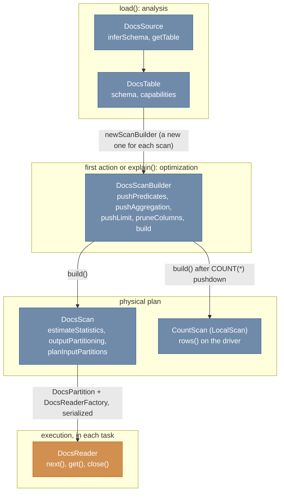
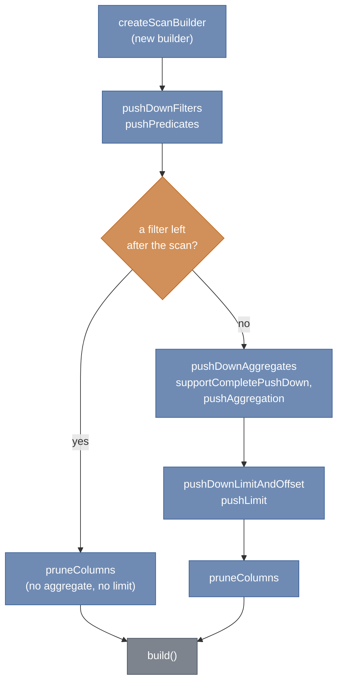
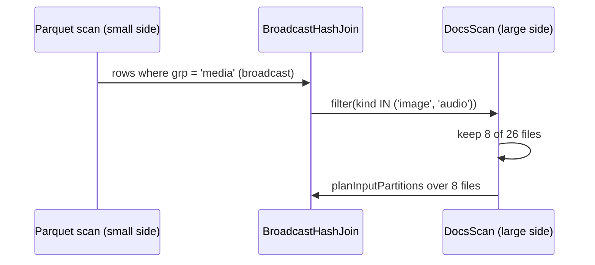

# Chapter 52: A DSv2 connector in Java

The Python data source chapters (47 to 51) built `docs`, a source that lists a folder and reads the header bytes of each file. That source is a Python class, but Spark plans it with JVM classes: `PythonDataSourceV2`, `PythonScanBuilder` and `PythonScan`. These classes implement the Java connector API of Spark, **DataSource V2** (DSv2). They implement only a small part of it.

This chapter writes `jdocs`, the same source, directly against DSv2 in Java. It builds the source with Maven against Spark 4.3.0, loads the jar into a PySpark session and examines what the optimizer does with it.

**A Python data source can only accept filters. A DSv2 source in Java can answer the questions of the optimizer. It can say which columns it needs, how many rows it returns and how it partitions its data. It can also calculate part of the query itself, for example a `COUNT(*)` from the list of files in the folder, with no task. Each answer removes work from the plan: a column, a `Filter`, a `Limit`, an `Exchange` or a whole job.**

The code is in [`code/ch52`](https://github.com/lisancao/spark-masterclass/tree/main/code/ch52). The Java project is `code/ch52/jdocs`. The PySpark scripts that drive it are next to it, and each output block in this chapter comes from `code/ch52/output/`.

## The capability table

A Python data source is a DSv2 source whose Java half Spark wrote for you. In Spark 4.3.0 the files are in `sql/core/src/main/scala/org/apache/spark/sql/execution/datasources/v2/python/`. This is the declaration of the scan builder:

```scala
class PythonScanBuilder(
    ds: PythonDataSourceV2,
    shortName: String,
    outputSchema: StructType,
    options: CaseInsensitiveStringMap)
    extends ScanBuilder
    with SupportsPushDownFilters {
```

It has one mix-in, `SupportsPushDownFilters`. This interface uses the older V1 `org.apache.spark.sql.sources.Filter` classes (`EqualTo`, `StringEndsWith` and the others that Chapter 49 shows). And in 4.3.0 it accepts filters only if `spark.sql.python.filterPushdown.enabled` is `true`. This config is internal and its default is `false`. The other parts of the read API keep their defaults. The table compares the two kinds of source in Spark 4.3.0:

| DSv2 capability (Java interface) | Python data source | Java source |
|---|---|---|
| Filters (`SupportsPushDownV2Filters`) | V1 filters, only the parts of an `AND`, only with the internal flag on | V2 `Predicate`s, which include `OR`, `NOT` and functions |
| Column pruning (`SupportsPushDownRequiredColumns`) | no: `reader(schema)` always gets the full schema | yes |
| `LIMIT`, top N, `OFFSET` (`SupportsPushDownLimit`, `...TopN`, `...Offset`) | no | yes |
| Aggregates (`SupportsPushDownAggregates`) | no | yes, complete or partial |
| Statistics (`SupportsReportStatistics`) | no | yes |
| Partitioning (`SupportsReportPartitioning`) | no | yes, removes shuffles |
| Runtime filters (`SupportsRuntimeV2Filtering`) | no | yes |
| Columnar reads (`PartitionReaderFactory.supportColumnarReads`) | rows only | `ColumnarBatch` |
| Rows | Python tuples, converted through Arrow | `InternalRow`, no conversion |
| Custom metrics in the Spark UI | only the fixed metrics of the Python runner (`PythonCustomMetric`) | your own `CustomMetric`s |

The Python API of 4.3.0 did not add any of these capabilities. A check of `python/pyspark/sql/datasource.py` at the `v4.3.0` tag shows `pushFilters` as the only pushdown method of `DataSourceReader`.

This table does not make Python sources bad. For an API or a folder of unusual files, Python is usually the correct tool. Java is a better choice when the optimizer must know facts about your data. Examples are the number of rows, the columns, the partitioning, and the parts of the query that the source can calculate itself.

`capability.py` asks the same three questions of the Python source (`pydocs`) and of `jdocs`, over the same folder of 26 files:

```text
== filter + two columns: pydocs
*(1) Project [name#1, width#5]
+- *(1) Filter isnotnull(kind#2)
   +- BatchScan pydocs[path#0, name#1, kind#2, size#3L, modified#4, width#5, height#6] (Python) RuntimeFilters: []

== filter + two columns: jdocs
*(1) Project [name#17, width#21]
+- BatchScan jdocs[name#17, width#21] jdocs[files=5, pushed=[kind = 'image']] RuntimeFilters: []

== limit(3): pydocs
CollectLimit 3
+- *(1) Project [name#26]
   +- BatchScan pydocs[path#25, name#26, kind#27, size#28L, modified#29, width#30, height#31] (Python) RuntimeFilters: []

== limit(3): jdocs
*(1) Project [name#42]
+- BatchScan jdocs[name#42] jdocs[files=3, pushed=[], limit=3] RuntimeFilters: []

== count(*): jdocs
*(1) Project [count#93L AS count(1)#91L AS count#83L]
+- *(1) LocalTableScan [count#93L]
```

<figure markdown>
  <video autoplay loop muted playsinline controls width="1280" height="720" poster="../../media/clips/ch52-capability.webp">
    <source src="../../media/clips/ch52-capability.mp4" type="video/mp4">
  </video>
  <figcaption><code>capability.py</code> asks the Python source and the Java source the same questions. The Java scan reads two columns, takes the limit and answers <code>count(*)</code> with no scan.</figcaption>
</figure>

Read the three pairs:

- **Filter and two columns.** The Python scan returns all seven columns. Spark keeps a `Filter isnotnull(kind)` above it. The Python source took `EqualTo(kind,image)`, but it returned the `IsNotNull(kind)` filter that Spark also offered. The Java scan returns two columns and Spark keeps no `Filter`.
- **`limit(3)`.** Spark keeps `CollectLimit 3` above the Python scan, which reads all 26 files. The Java scan reads three files and Spark keeps no `Limit`.
- **`count(*)`.** For the Python source, the plan is a scan, a partial count, a shuffle and a final count. The full plan is in `output/capability.txt`. For the Java source, the plan is a `LocalTableScan` of one row that the source calculated when Spark planned the query.

The script also asks the optimizer for its size estimate of each source, before any filter:

```text
== statistics the optimizer sees, before any filter
pydocs  Statistics(sizeInBytes=8.0 EiB)
jdocs   Statistics(sizeInBytes=3.0 KiB)
```

A source that reports no statistics gets the default size, `Long.MaxValue` bytes, which `explain` prints as 8.0 EiB. Spark never broadcasts a relation of that size in a join. `jdocs` reports 26 rows of 120 bytes each. Step 9 shows where that number comes from.

The script also measures the time of `select("name", "size")`, with a new DataFrame for each run. Other work used the machine when the script ran. In four runs, the median for `pydocs` went from 74 to 131 ms and the median for `jdocs` went from 15 to 75 ms. `jdocs` was faster in each run.

The difference is mostly the cost of the Python worker. `pydocs` uses a Python process when Spark plans the query and in each task, and `jdocs` stays in the JVM. These timings are not a benchmark. They only show that the Python path has a fixed cost that the Java path does not have.

## Step 1: Build the jar with Maven

A connector is a normal Java project. `code/ch52/jdocs/pom.xml` builds it into `target/jdocs-0.1.0.jar`:

```xml
<properties>
  <maven.compiler.release>17</maven.compiler.release>
  <project.build.sourceEncoding>UTF-8</project.build.sourceEncoding>
  <spark.version>4.3.0</spark.version>
</properties>

<dependencies>
  <!-- provided: Spark is on the cluster's classpath already, do not bundle it -->
  <dependency>
    <groupId>org.apache.spark</groupId>
    <artifactId>spark-sql_2.13</artifactId>
    <version>${spark.version}</version>
    <scope>provided</scope>
  </dependency>
</dependencies>

<build>
  <plugins>
    <!-- Pin the compiler plugin: Maven 3.8's built-in default (3.1) ignores maven.compiler.release -->
    <plugin>
      <groupId>org.apache.maven.plugins</groupId>
      <artifactId>maven-compiler-plugin</artifactId>
      <version>3.13.0</version>
    </plugin>
  </plugins>
</build>
```

Do these steps from the `code/` folder of the repo:

1. Make sure that `javac -version` shows 17 or later. A Java runtime alone is not sufficient.
2. Run `ch52/build.sh`.

```text
built target/jdocs-0.1.0.jar with Apache Maven 3.8.7, javac 17.0.21.1
```

Three details in the `pom.xml` are important:

- **Scala 2.13.** The artifact name ends in `_2.13` because Spark 4 is built only for Scala 2.13. The jar that Maven downloads, `spark-sql_2.13-4.3.0.jar`, comes from Maven Central.
- **`provided` scope.** Each cluster already has the Spark jars. If you bundle them, the jar becomes very large, and the classpath gets two copies of the Spark classes.
- **A pinned `maven-compiler-plugin`.** `nopin.sh` removes the `<build>` block and builds again:

```text
Apache Maven 3.8.7
[ERROR] Failed to execute goal org.apache.maven.plugins:maven-compiler-plugin:3.1:compile (default-compile)
[ERROR] Source option 5 is no longer supported. Use 7 or later.
```

Without the block, Maven 3.8.7 uses its built-in compiler plugin 3.1. That version ignores `maven.compiler.release`, and the build fails.

If your connector has its own dependencies, build a shaded jar with the `maven-shade-plugin`. Relocate the libraries that Spark also has, for example Guava or Jackson, so that the two versions cannot collide. `jdocs` has no dependencies other than Spark, so it needs no relocated packages. The book builds with Maven only. A Gradle build of the same sources needs the same `provided` dependency (Gradle calls it `compileOnly`), but the book did not test a Gradle build.

The scripts load the jar with `spark.jars`, which `common/book.py` passes to the session builder:

```python
spark = session("ch52-jdocs", spark_jars=str(JAR), spark_sql_session_timeZone="UTC")
```

`spark.jars` is a static configuration. The jar must be on the classpath of the driver before the JVM starts. Thus, set it in the builder, or with `spark-submit --jars`, never with `spark.conf.set`.

In local mode the driver and the executor are one JVM, and PySpark communicates with it through Py4J. This gives a test a direct path into your classes: `spark._jvm.jdocs.Audit.opened()` calls a static method in the same JVM where the tasks ran. `jdocs` has an `Audit` class with counters (files opened, folder listings, scan builders, calls to the statistics methods, the predicates that Spark offered). This path works only in a Classic session in local mode. On a cluster, each executor has its own JVM. Spark Connect has no `_jvm` at all, and [Chapter 54](ch54-connect-plugins.md) shows a replacement.

## Step 2: The read path, class by class

All of the interfaces below are in `sql/catalyst/src/main/java/org/apache/spark/sql/connector/` (folders `catalog/` and `read/`). The exception is `DataSourceRegister`, which is in `org.apache.spark.sql.sources`.

| Class in jdocs | Implements | Runs on | Spark calls it |
|---|---|---|---|
| `DocsSource` | `TableProvider`, `DataSourceRegister` | driver | at `load()`: `inferSchema`, then `getTable` |
| `DocsTable` | `Table`, `SupportsRead` | driver | `load()` keeps it in a `DataSourceV2Relation` |
| `DocsScanBuilder` | `ScanBuilder` and the `SupportsPushDown*` interfaces | driver | during optimization: `newScanBuilder`, the pushdown calls, `build()` |
| `DocsScan` | `Scan`, `Batch`, `SupportsReportStatistics`, `SupportsReportPartitioning`, `SupportsRuntimeV2Filtering` | driver | when Spark makes the physical plan: `toBatch`, `planInputPartitions` |
| `CountScan` | `LocalScan` | driver | instead of `DocsScan` when Spark pushes a `COUNT(*)` |
| `DocsPartition` | `InputPartition` (`Serializable`) | serialized into each task | |
| `DocsReaderFactory` | `PartitionReaderFactory` (`Serializable`) | serialized to the executors | once for each task: `createReader` |
| `DocsReader` | `PartitionReader<InternalRow>` | executor | `next()` and `get()` for each row, then `close()` |



The rule that changes the relation into a scan is `V2ScanRelationPushDown` (`sql/core/.../datasources/v2/V2ScanRelationPushDown.scala`). In 4.3.0 its `apply` method runs these steps in this sequence:

```scala
val pushdownRules = Seq[LogicalPlan => LogicalPlan] (
  createScanBuilder,
  pushDownSample,
  pushDownFilters,
  pushDownJoin,
  pushDownAggregates,
  // Apply the fallback after the source has tried the lower aggregation, but before its
  // required columns are finalized by pruneColumns.
  collapseGroupedSumOfCount,
  pushDownVariants,
  pushDownLimitAndOffset,
  buildScanWithPushedAggregate,
  buildScanWithPushedJoin,
  buildScanWithPushedVariants,
  pruneColumns)
```

`collapseGroupedSumOfCount` is new in this list in 4.3. It changes a grouped `SUM(COUNT(1))` into one `SUM(1)` after the source tried to take the lower `COUNT(1)`. The other steps are the same as in 4.2.

`createScanBuilder` calls `table.newScanBuilder(options)` for each scan in the plan. Thus, each scan gets a **new** builder. Pushdown state that you keep in the builder and in its `Scan` cannot go into a different scan. Keep pushdown state there, never in the `TableProvider` or the `Table`.

The Python data source of 4.3.0 also gets a new builder for each scan. But its builder keeps the planned read on the provider object, with `ds.setReadInfo(...)` in `PythonScanBuilder` above. All scans of one relation share that object. [Chapter 55](ch55-capstone-connector.md) shows that this can still give wrong results in 4.3.0.

## Step 3: Register a short name

`spark.read.format("jdocs")` works because the jar contains a service file, `META-INF/services/org.apache.spark.sql.sources.DataSourceRegister`, with one line: `jdocs.DocsSource`. Spark loads each class listed in such files with the `ServiceLoader` of Java. Then it selects the class whose `shortName()` returns `"jdocs"`.

`no_service.py` removes the service file from a copy of the jar and tries the two names:

```text
jar entries under META-INF/services: 0
format('jdocs'): Py4JJavaError
  org.apache.spark.SparkClassNotFoundException: [DATA_SOURCE_NOT_FOUND] Failed to find the data source: jdocs. Make sure the provider name is correct an
  Caused by: java.lang.ClassNotFoundException: jdocs.DefaultSource
format('jdocs.DocsSource'): 26 rows
```

The `Caused by` line shows the fallback. After the service lookup, Spark tries the name as a class name, and then `<name>.DefaultSource`. Thus, the full class name works without a service file, and a class called `jdocs.DefaultSource` would also work. Short names are for users. The class name is useful in tests.

SQL uses the same lookup:

```python
spark.sql(f"CREATE OR REPLACE TEMPORARY VIEW files USING jdocs OPTIONS (path '{root}')")
spark.sql("SELECT kind, count(*) AS files FROM files GROUP BY kind ORDER BY kind").show()
```

```text
+-----+-----+
| kind|files|
+-----+-----+
|audio|    3|
|email|    4|
|image|    5|
| json|    3|
|  log|    2|
|  pdf|    2|
| text|    6|
|  xml|    1|
+-----+-----+
```

The folder is a copy of eight folders of the messy sample data from SparkTutor (`code/data/messy`). `lib.py` copies them, with their modification times, to a fixed temporary path. Thus, the counts in this chapter stay the same when the sample data gets more files.

`jdocs.py` also compares each row of `jdocs` with the same source in Python, with `exceptAll` in the two directions:

```text
schema: struct<path:string,name:string,kind:string,size:bigint,modified:timestamp,width:int,height:int>
jdocs rows: 26, Python rows: 26, rows that differ: 0
```

## Step 4: When each method runs

In a Classic session, `load()` analyzes the plan immediately. Analysis calls `inferSchema` and `getTable`. Spark does not create the scan builder until it optimizes the plan, at the first action or at `explain()`. This sets when your errors occur. `jdocs` examines its `path` option when it lists the folder, in `build()`:

```text
load() returned ['path', 'name', 'kind', 'size', 'modified', 'width', 'height'] | scan builders so far: 0
explain() -> IllegalArgumentException: option 'path' must be an existing folder, got '/nope'
explain + collect + count on one DataFrame: scan builders 2 | listings 2
```

`load()` succeeded and `explain()` failed. If you want bad options to fail at `load()`, examine them in `getTable` or in `inferSchema`. PySpark changed the Java `IllegalArgumentException` into its own `IllegalArgumentException`, and it kept the message. The error classes of Spark (`[SOME_CLASS] ...`) need an entry in the error registry of Spark, which a connector cannot add to. Thus, a standard Java exception with a clear message is the correct choice for a connector.

The last line counts builders. `explain()` and `collect()` on one DataFrame share one optimized plan, so they made one builder and one list of files. `count()` makes a new DataFrame with an aggregate, which Spark optimizes again. Thus, each new query gets a new builder, and the builder lists the folder again.

## Step 5: Rows in the internal format of Spark

A `PartitionReader<InternalRow>` gives Spark rows in its **internal** format, and Spark does no conversion. You must use the internal value types of Spark. `InternalRow` and `SpecificInternalRow` (`sql/catalyst/.../InternalRow.scala`) list them for each data type:

| Spark type | Java value in an `InternalRow` |
|---|---|
| `StringType` | `org.apache.spark.unsafe.types.UTF8String` |
| `IntegerType`, `DateType` | `int` (a date is the number of days after 1970-01-01) |
| `LongType`, `TimestampType`, `TimestampNTZType` | `long` (a timestamp is the number of microseconds after the epoch) |
| `TimestampLTZNanosType`, `TimestampNTZNanosType` (new in 4.3, `@Unstable`) | `TimestampNanosVal` (microseconds after the epoch, plus nanoseconds in that microsecond) |
| `DoubleType`, `BooleanType`, `BinaryType` | `double`, `boolean`, `byte[]` |
| `DecimalType` | `org.apache.spark.sql.types.Decimal` |
| `VariantType` | `org.apache.spark.unsafe.types.VariantVal` |
| `ArrayType`, `MapType`, `StructType` | `ArrayData`, `MapData`, `InternalRow` |
| any nullable column | `null` |

The two nanosecond rows come from `PhysicalDataType.scala` at the `v4.3.0` tag. `jdocs` does not use these types, and the book did not run them. `DocsReader` fills an `Object[]` in the sequence of the read schema and puts it in a `GenericInternalRow`:

```java
values[c] = switch (columns[c]) {
  case "path" -> UTF8String.fromString(f.path);   // StringType: UTF8String
  case "name" -> brokenName ? f.name : UTF8String.fromString(f.name);
  case "kind" -> UTF8String.fromString(f.kind);
  case "size" -> f.size;                          // LongType: a long
  case "modified" -> f.modifiedMicros;            // TimestampType: microseconds since the epoch
  case "width" -> wh == null ? null : wh[0];      // IntegerType: an int, or null
  case "height" -> wh == null ? null : wh[1];
  default -> throw new IllegalStateException("unknown column " + columns[c]);
};
current = new GenericInternalRow(values);
```

`columns` is the read schema after column pruning, so the reader fills only the columns that the query uses. The modification time comes from `BasicFileAttributes.lastModifiedTime().to(TimeUnit.MICROSECONDS)`, which is the value that a `TimestampType` slot needs. The Python comparison calculates the same value from `os.stat(...).st_mtime_ns // 1000`. A float `st_mtime` can be different from it by a microsecond.

Nothing examines the types until a task reads the value. The option `brokenName=true` puts a `java.lang.String` in the `name` slot. The plan is correct, and the task fails:

```text
planned: +- BatchScan jdocs[name#577] jdocs[files=26, pushed=[]] Runt
java.lang.ClassCastException: class java.lang.String cannot be cast to class org.apache.spark.unsafe.types.UTF8String
```

## Step 6: Filters as V2 predicates

`SupportsPushDownV2Filters` has two methods:

```java
Predicate[] pushPredicates(Predicate[] predicates);   // return what Spark must still evaluate
Predicate[] pushedPredicates();                       // what you took over, for explain and rules
```

A `Predicate` (`connector/expressions/filter/Predicate.java`) is a `GeneralScalarExpression`: an upper-case `name()` and `children()`. A child is a `NamedReference` (a column), a `Literal` or a different expression. `DocsScanBuilder.pushPredicates` records each predicate that Spark offers, with its shape and the type of each literal. `jdocs.py` runs 13 conditions and prints what arrived. Here, `width` and `height` are nullable and the other columns are not nullable. The session time zone is UTC.

```text
kind = 'image' AND width > 12
    returned IS_NOT_NULL(width)  |  width IS NOT NULL
    pushed   =(kind, lit:UTF8String)  |  kind = 'image'
    returned >(width, lit:Integer)  |  width > 12
kind IN ('pdf', 'email')
    pushed   IN(kind, lit:UTF8String, lit:UTF8String)  |  kind IN ('pdf', 'email')
name LIKE '%.png'
    pushed   ENDS_WITH(name, lit:UTF8String)  |  name LIKE '%.png' ESCAPE '\'
name LIKE 'red%'
    returned STARTS_WITH(name, lit:UTF8String)  |  name LIKE 'red%' ESCAPE '\'
name LIKE '%ra%'
    returned CONTAINS(name, lit:UTF8String)  |  name LIKE '%ra%' ESCAPE '\'
kind <> 'image'
    returned NOT(=(kind, lit:UTF8String))  |  NOT (kind = 'image')
size BETWEEN 10 AND 100
    pushed   >=(size, lit:Long)  |  size >= 10
    pushed   <=(size, lit:Long)  |  size <= 100
width IS NULL
    returned IS_NULL(width)  |  width IS NULL
lower(kind) = 'image'
    returned =(LOWER(kind), lit:UTF8String)  |  LOWER(kind) = 'image'
kind = 'audio' OR size < 100
    returned OR(=(kind, lit:UTF8String), <(size, lit:Long))  |  (kind = 'audio') OR (size < 100)
size % 2 = 1
    returned =(%(size, lit:Long), lit:Long)  |  (size % 2) = 1
width > height
    returned IS_NOT_NULL(width)  |  width IS NOT NULL
    returned IS_NOT_NULL(height)  |  height IS NOT NULL
    returned >(width, height)  |  width > height
modified > TIMESTAMP '2020-01-01 00:00:00'
    returned >(modified, lit:Long)  |  modified > 1577836800000000
```

`pushed` means that `jdocs` took the predicate over. `returned` means that Spark must evaluate it after the scan. Compare these shapes with the V1 filters of a Python source in Chapter 49. The V2 API also carries `OR`, functions (`LOWER`), arithmetic (`%`) and comparisons between two columns. These details are important when you translate a predicate:

- **Literal values are internal values.** A string literal is a `UTF8String`, a `bigint` literal is a `Long`, and a timestamp is a `Long` in microseconds. Spark already converted the timestamp with the session time zone: midnight UTC on 2020-01-01 is `1577836800000000`.
- **Spark casts literals to the type of the column** during analysis. `size BETWEEN 10 AND 100` arrives with `Long` values because `size` is a `bigint`. `width > 12` arrives with an `Integer` value.
- **Columns that are not nullable get no `IS_NOT_NULL`.** Spark infers `isnotnull(col)` from a comparison only for a nullable column. `jdocs` accepts `IS_NOT_NULL` on the columns that it knows are never null, and it returns the others.
- **Return each predicate that you do not apply exactly, without changes.** If you keep a predicate and ignore it, the query silently returns too many rows. If you keep a predicate and also return it, the result is correct and Spark evaluates it again after the scan. Parquet uses this second pattern for row groups.

`Filters.accept` is the decision. It takes `IS_NOT_NULL` on the never-null columns, `=` and `IN` on `kind`, `=` and the four comparisons on `size`, and `ENDS_WITH` on `name`. The list of files alone decides all of these, before any file opens. `Filters.matches` applies them when `build()` lists the folder.

## Step 7: Pushdown in the plan

`DocsScan.description()` is the text that `explain` prints after `BatchScan jdocs[...]`:

```java
@Override public String description() {
  return "jdocs[files=" + files.size() + ", pushed=" + pushed + (limit >= 0 ? ", limit=" + limit : "") + "]";
}
```

```text
*(1) Project [name#366, width#370]
+- BatchScan jdocs[name#366, width#370] jdocs[files=5, pushed=[kind = 'image']] RuntimeFilters: []

rows: 5 | files opened: 5
```

Read the scan line from left to right:

- `jdocs[name#366, width#370]` is the output of the scan. Column pruning worked: `pruneColumns` received only `name` and `width`. The query also uses `kind`, but only in a filter that the scan took over. Thus, the scan does not return `kind`.
- `jdocs[files=5, pushed=[kind = 'image']]` is the text of `description()`. `BatchScanExec` prints this text and nothing else about your pushdown. Without `description()`, the plan shows `class jdocs.DocsScan`. The formatted plan of `capability.py` shows the same fact: the Python scan has a `PushedFilters:` line, and the `jdocs` scan has only `Output`. `PythonScan` gets that line from an internal trait, `SupportsMetadata`. A third-party Java scan must put its pushdown information in `description()`.
- There is no `Filter` node. Spark trusts the scan for `kind = 'image'`.

The audit counter agrees with the plan. The reader opened only the five PNG files, because `width` needs the header bytes. The pruned query of `select("name", "size")` opens no file:

```text
+- BatchScan jdocs[name#175, size#177L] jdocs[files=26, pushed=[]] RuntimeFilters: []
files opened: 0
```

What `jdocs` cannot decide stays in Spark, as a `Filter` above the scan:

```text
kind = 'image' AND width > 12 -> 3 rows
*(1) Project [name#375]
+- *(1) Filter (isnotnull(width#379) AND (width#379 > 12))
   +- BatchScan jdocs[name#375, width#379] jdocs[files=5, pushed=[kind = 'image']] RuntimeFilters: []

kind = 'audio' OR size < 100 -> 9 rows
*(1) Project [name#390]
+- *(1) Filter ((kind#391 = audio) OR (size#392L < 100))
   +- BatchScan jdocs[name#390, kind#391, size#392L] jdocs[files=26, pushed=[]] RuntimeFilters: []
```

In the first query, the scan took `kind = 'image'` and Spark kept `width > 12`. In the second query, Spark kept the whole `OR`, because `jdocs` returned it.

## Step 8: LIMIT, aggregates and the sequence of pushdown

`SupportsPushDownLimit.pushLimit(int)` returns whether the source takes the limit. `isPartiallyPushed()` (default `true`) tells Spark whether it must apply the limit again. In `jdocs`, one file is one row and each pushed filter is exact. Thus, the scan can cut the list of files to `n` files and say that the limit is complete:

```text
*(1) Project [name#407]
+- BatchScan jdocs[name#407] jdocs[files=3, pushed=[], limit=3] RuntimeFilters: []

with a filter left after the scan:
CollectLimit 2
+- *(1) Project [name#415]
   +- *(1) Filter (isnotnull(width#419) AND (width#419 > 12))
      +- BatchScan jdocs[name#415, width#419] jdocs[files=26, pushed=[]] RuntimeFilters: []
```

In the second plan, Spark did not offer the limit to the source. `pushDownLimit` matches only `PhysicalOperation(_, Nil, sHolder)`, which is a scan with no filter left above it. A limit applied before an unpushed filter would return too few rows.

The same rule guards aggregates. That is why the sequence in Step 2 is important. Filters go first. The filters that remain decide whether Spark offers the aggregate and the limit at all.



`SupportsPushDownAggregates` has two methods. Spark calls `supportCompletePushDown(agg)` first. If it returns `true` and `pushAggregation(agg)` accepts the aggregate, Spark **removes its own `Aggregate`** and uses the rows of the scan as the final answer. If `supportCompletePushDown` returns `false`, a source can still return partial results (for example, one count for each partition), and Spark aggregates them again.

An `Aggregation` (a Java `record`) has `aggregateExpressions()` (`CountStar`, `Count`, `Sum`, `Min`, `Max`, `Avg` or `GeneralAggregateFunc`) and `groupByExpressions()`. `jdocs` accepts exactly one `CountStar`, with no `GROUP BY` or with `GROUP BY kind`. The list of files alone answers these two:

```java
private static boolean answerable(Aggregation agg) {
  AggregateFunc[] fs = agg.aggregateExpressions();
  Expression[] gs = agg.groupByExpressions();
  if (fs.length != 1 || !(fs[0] instanceof CountStar)) return false;
  return gs.length == 0 || (gs.length == 1 && "kind".equals(Filters.column(gs[0])));
}
```

After an accepted aggregate, `build()` returns a `CountScan`. This class is a `LocalScan`, which calculates its rows on the driver as an `InternalRow[]`. Its read schema has the `GROUP BY` columns first, then the aggregates:

```text
count of images: 5 | files opened: 0 | Spark jobs run: 1
*(1) Project [count#440L AS count(1)#438L AS count#430L]
+- *(1) LocalTableScan [count#440L]

*(1) Project [kind#459, count#460L AS count(1)#456L AS count#448L]
+- *(1) LocalTableScan [kind#459, count#460L]

sum(size) is refused:
AdaptiveSparkPlan isFinalPlan=false
+- HashAggregate(keys=[kind#463], functions=[sum(size#464L)], output=[kind#463, sum(size)#476L])
   +- Exchange hashpartitioning(kind#463, 200), ENSURE_REQUIREMENTS, [plan_id=716]
      +- HashAggregate(keys=[kind#463], functions=[partial_sum(size#464L)], output=[kind#463, sum#480L])
         +- Project [kind#463, size#464L]
            +- BatchScan jdocs[kind#463, size#464L] jdocs[files=26, pushed=[]] RuntimeFilters: []
```

The first plan counts the images. The filter `kind = 'image'` went to the scan first, so no filter remained, and Spark offered the `COUNT(*)`. The plan has no `BatchScan`, no `HashAggregate` and no `Exchange`. It is a `LocalTableScan` of the row that `CountScan` calculated when Spark planned the query. The reader opened no file.

The REST API counted one Spark job for the `collect()`, which returns the local rows. Before the pushdown, the same count needed a scan stage and a shuffle.

`jdocs` refuses `sum(size)`, because `pushAggregation` returns `false`. Spark plans a normal scan and aggregate.

A small decision in `Filters` keeps this path open. If `jdocs` returned an `IS_NOT_NULL` on a column that is never null, a `Filter` would remain after the scan. Then Spark would not offer the aggregate or the limit. Accept the predicates that are always true for your data, so that the rest of the pushdown chain stays open.

<figure markdown>
  <video autoplay loop muted playsinline controls width="1280" height="720" poster="../../media/clips/ch52-pushdown.webp">
    <source src="../../media/clips/ch52-pushdown.mp4" type="video/mp4">
  </video>
  <figcaption><code>jdocs.py</code>: a pruned scan that opens no file, a pushed filter that opens only the PNG files, and a <code>COUNT(*)</code> that becomes a <code>LocalTableScan</code>.</figcaption>
</figure>

## Step 9: Statistics for the optimizer

`SupportsReportStatistics.estimateStatistics()` returns `sizeInBytes` and `numRows`, and optionally `columnStats`. Spark asks **after** pushdown. Thus, the numbers can include the effect of the pushed filters.

**New in 4.3.** `SupportsReportStatistics` has a second method, `estimateSizeInBytes()` (`@since 4.3.0`). Its javadoc says that Spark mostly needs only the size when cost-based optimization and plan statistics are off. An example is the broadcast threshold of a join.

A connector that can give a size cheaply returns it from this method, and Spark does not ask for the full statistics. The default returns `OptionalLong.empty()`, and then Spark uses `estimateStatistics()` as before. `jdocs` implements the two methods and counts the calls:

```text
spark.sql.cbo.enabled=false: Statistics(sizeInBytes=240.0 B) | estimateSizeInBytes calls 1, estimateStatistics calls 0
spark.sql.cbo.enabled=true: Statistics(sizeInBytes=240.0 B, rowCount=2) | estimateSizeInBytes calls 0, estimateStatistics calls 1
```

The query was `kind = 'pdf'`: two files, multiplied by the 120 bytes for each row that `jdocs` estimates. With CBO off, Spark called only the new method and the statistics have no row count. With CBO on, Spark called `estimateStatistics()`, and the statistics have `rowCount=2`.

4.3 also adds `reflectsFullyPushedDownFilters()` (`@since 4.3.0`, default `true`). A source that returns `false` tells Spark that its statistics describe the whole table and do not include the fully pushed filters. Then Spark can apply those filters to the statistics itself. `jdocs` keeps the default, because its statistics count only the files that passed the filters.

The optimizer uses `sizeInBytes` to decide if a side of a join is small enough to broadcast (`spark.sql.autoBroadcastJoinThreshold`, 10 MB by default). Report the size of the data that your scan **returns**, not the size of the files that it reads. `jdocs` returns metadata rows, not file contents.

## Step 10: Report partitioning, and remove a shuffle

A `groupBy("kind")` usually needs an `Exchange`, so that all rows of one kind go to one task. If the source already put each kind in its own partition, it can say so. The scan implements `SupportsReportPartitioning` and returns a `KeyGroupedPartitioning`. Each partition implements `HasPartitionKey`:

```java
@Override public Partitioning outputPartitioning() {
  if (byKind && hasKind()) {
    long kinds = files.stream().map(f -> f.kind).distinct().count();
    return new KeyGroupedPartitioning(new Expression[] {Expressions.identity("kind")}, (int) kinds);
  }
  return new UnknownPartitioning(0);
}
```

```java
public class KindPartition extends DocsPartition implements HasPartitionKey {
  final String kind;
  KindPartition(String kind, List<FileEntry> files) { super(files); this.kind = kind; }
  @Override public InternalRow partitionKey() {
    return new GenericInternalRow(new Object[] {UTF8String.fromString(kind)});
  }
}
```

These are the final plans of `groupBy("kind").agg(sum("size"))`. The first plan uses the usual partitions, which `planInputPartitions` balances by size. The second plan uses the option `byKind=true`, which plans one partition for each kind:

```text
byKind=false
   ResultQueryStage 1
   +- *(2) HashAggregate(keys=[kind#511], functions=[sum(size#512L)], output=[kind#511, bytes#516L])
      +- AQEShuffleRead coalesced
         +- ShuffleQueryStage 0
            +- Exchange hashpartitioning(kind#511, 200), ENSURE_REQUIREMENTS, [plan_id=747]
               +- *(1) HashAggregate(keys=[kind#511], functions=[partial_sum(size#512L)], output=[kind#511, sum#528L])
                  +- *(1) Project [kind#511, size#512L]
                     +- BatchScan jdocs[kind#511, size#512L] jdocs[files=26, pushed=[]] RuntimeFilters: []
byKind=true
   ResultQueryStage 0
   +- *(1) HashAggregate(keys=[kind#533], functions=[sum(size#534L)], output=[kind#533, bytes#538L])
      +- *(1) Project [kind#533, size#534L]
         +- BatchScan jdocs[kind#533, size#534L] jdocs[files=26, pushed=[]] RuntimeFilters: []
```

The `Exchange` is not there. The second plan is one stage, and its partial aggregate also disappeared, because each task already has all the rows of its kind. The same report lets two sources with the same partitioning join without a shuffle. This is a storage-partitioned join, behind `spark.sql.sources.v2.bucketing.enabled`.

The promise is yours to keep. The javadoc of `HasPartitionKey` says "Spark doesn't check this property". If a partition says `kind = 'image'` and holds a PDF row, the groups are wrong and no error occurs. Each partition must implement `HasPartitionKey`, or Spark cannot use the partitioning at all.

## Step 11: Runtime filters from a join

With dynamic partition pruning (DPP), a join gives the keys of its small, filtered side to the scan of the large side. This occurs **while the query runs**. A DSv2 scan accepts these filters when it implements `SupportsRuntimeV2Filtering`:

```java
@Override public NamedReference[] filterAttributes() {
  return hasKind() ? new NamedReference[] {Expressions.column("kind")} : new NamedReference[0];
}

@Override public void filter(Predicate[] predicates) {
  for (Predicate p : predicates) {
    Audit.runtime(p.toString());
    Filters f = new Filters();
    if (f.accept(p)) {            // IN or = on kind: drop the files that cannot match
      List<FileEntry> keep = new ArrayList<>();
      for (FileEntry e : files) if (f.matches(e)) keep.add(e);
      files = keep;
      runtime.add(p);
    }
  }
}
```

`jdocs.py` joins `jdocs` with a small Parquet table of kind groups, filtered on `grp = 'media'`. The option `rowBytes=1000000` makes the statistics of `jdocs` large, so that the Parquet side is the side that Spark broadcasts:

```text
      +- *(2) BroadcastHashJoin [kind#558], [kind#553], Inner, BuildRight, false, false
         :  +- BatchScan jdocs[name#557, kind#558] jdocs[files=8, pushed=[]] RuntimeFilters: [dynamicpruningexpression(kind#558 IN dynamicpruning#565)]
filter() received: kind IN ('image', 'audio')
rows: 8 kinds: ['audio', 'image']
```



The scan received `kind IN ('image', 'audio')` while the query ran. It kept 8 of the 26 files, and `description()` printed `files=8`. The sequence of the values in the `IN` list was different in two runs of the script. Do not let your code depend on it.

The conditions come from the `PartitionPruning` rule (`sql/core/.../dynamicpruning/PartitionPruning.scala`):

- The join key must be one of the `filterAttributes`.
- The other side must have a predicate that `isLikelySelective` accepts, for example a comparison, `IN` or `LIKE`.
- With the default `spark.sql.optimizer.dynamicPartitionPruning.reuseBroadcastOnly=true`, Spark adds the filter only when it can use the broadcast of the join again.

The scan also returns the runtime filters that it applied from `pushedPredicates()`. Spark 4.2 added this method and `supportsIterativePushdown()` to `SupportsRuntimeV2Filtering`, so that Spark can push a second round of partition predicates. Keep their defaults unless your source has partition transforms.

## Step 12: A custom metric in the Spark UI

A static counter such as `Audit` works only in local mode. A production connector reports its own numbers as **custom metrics**. `Scan.supportedCustomMetrics()` declares them, and `PartitionReader.currentMetricsValues()` reports the value for each task:

```java
public static class FilesOpened extends CustomSumMetric {
  @Override public String name() { return "filesOpened"; }
  @Override public String description() { return "files opened by jdocs"; }
}

@Override public CustomMetric[] supportedCustomMetrics() { return new CustomMetric[] {new FilesOpened()}; }
```

Spark adds the values of all tasks and shows the sum on the scan node in the SQL tab of the Spark UI. The script reads it from the REST API of the UI, after `select("name", "width")`:

```text
BatchScan jdocs | files opened by jdocs = 5
```

## Step 13: The rest of the read API

`jdocs` does not use these interfaces, but other connectors do. All of them are in `connector/read/`:

- **`SupportsPushDownTopN`** (`ORDER BY ... LIMIT n`), **`SupportsPushDownOffset`** and **`SupportsPushDownTableSample`** use the same pattern as `pushLimit`. The JDBC source implements them, so that the database does the sort.
- **`SupportsPushDownJoin`** (`@since 4.1.0`) pushes a join of two scans of the same source into the source. It is for JDBC sources on the same database.
- **`SupportsPushDownVariantExtractions`** (`@since 4.1.0`, `@Experimental`) receives the `variant_get` paths that a query extracts. Then a source can read only those fields.
- **Columnar reads.** A `PartitionReaderFactory` whose `supportColumnarReads(partition)` returns `true` implements `createColumnarReader` and returns `ColumnarBatch` objects. Parquet and ORC do this, and they do no work for each row.
- **`SupportsReportOrdering`** tells Spark that each partition is already sorted, so that Spark can remove a `Sort`.
- **`SupportsPushDownFilters`** is the V1 filter version. Spark still supports it, and Python sources use it. Use V2 in new code. The javadoc of `SupportsPushDownV2Filters` says that V1 is less efficient, because Spark must convert each value from the internal format to the external format.

**New in 4.3** on the `Table` side, `TableCapability.SCAN_MERGING` lets Spark merge two batch scans of one table. The two scans can differ only in their columns and pushed filters. The javadoc calls it a determinism contract. With the same options, a new `ScanBuilder` with the same pushed filters and pruned columns must give an equivalent scan. Spark builds the merged scan itself and never merges a scan that has a pushed aggregate, join, limit, offset, top N or sample. `jdocs` does not declare this capability, and the book did not test it.

## The whole chapter, on one page

- **The Python API accepts filters only.** In 4.3.0, `PythonScanBuilder` implements one mix-in, `SupportsPushDownFilters`, behind an internal flag that is off by default. DSv2 in Java also gives column pruning, limits, aggregates, statistics, partitioning, runtime filters, columnar reads and custom metrics.
- **Build against the jars that you run on.** Use Maven with `spark-sql_2.13:4.3.0` as `provided` and a pinned `maven-compiler-plugin`. Load the jar with the static `spark.jars`.
- **The read path:** `TableProvider` to `Table` (`SupportsRead`) to `ScanBuilder` to `Scan` and `Batch` to `InputPartition` and `PartitionReaderFactory` to `PartitionReader<InternalRow>`. The first four run on the driver. Spark serializes the partitions and the factory into the tasks.
- **`load()` calls `inferSchema` and `getTable`.** Spark makes a new scan builder for each optimization, at the first action or `explain()`. Pushdown and `build()` run then.
- **Short names** come from `DataSourceRegister` and a `META-INF/services` file. Without the file, the short name gives `DATA_SOURCE_NOT_FOUND`, and the full class name still works.
- **`InternalRow`s carry internal values:** `UTF8String`, `int` days, `long` microseconds, `Decimal`, `ArrayData`. A wrong type fails in a task with a `ClassCastException`.
- **V2 `Predicate`s carry more than V1 filters:** `OR`, functions, arithmetic and column comparisons. Literals arrive as internal values. Return each predicate that you do not apply exactly.
- **Spark pushes limits and aggregates only when no filter remains after the scan.** A complete aggregate pushdown with a `LocalScan` removes the scan, the aggregate and the shuffle.
- **`description()` is the only pushdown information that `explain()` shows** for your scan.
- **Statistics help Spark plan joins.** 4.3 adds `estimateSizeInBytes()` for a cheap size. `KeyGroupedPartitioning` removes shuffles, and Spark does not check it. `SupportsRuntimeV2Filtering` receives DPP filters while the query runs.

To run all of it, do these steps from the `code/` folder:

```bash
ch52/build.sh
uv run python ch52/jdocs.py
uv run python ch52/no_service.py
uv run python ch52/capability.py
```

The next chapter stays in Java and changes the optimizer of Spark itself. It adds a native function, a rule that replaces a Python UDF with that function, and a check rule. It also compares the hand-written rule with the Python UDF transpiler that is new in 4.3.

## Further reading

- [`connector/read` in Spark 4.3.0](https://github.com/apache/spark/tree/v4.3.0/sql/catalyst/src/main/java/org/apache/spark/sql/connector/read), the interfaces of this chapter, with their javadoc.
- [`V2ScanRelationPushDown.scala`](https://github.com/apache/spark/blob/v4.3.0/sql/core/src/main/scala/org/apache/spark/sql/execution/datasources/v2/V2ScanRelationPushDown.scala), the rule that runs the pushdown steps.
- [Python data source API](https://spark.apache.org/docs/4.3.0/api/python/tutorial/sql/python_data_source.html), the Python side of the capability table.
- [Apache Maven Compiler Plugin](https://maven.apache.org/plugins/maven-compiler-plugin/), for the `release` parameter.
