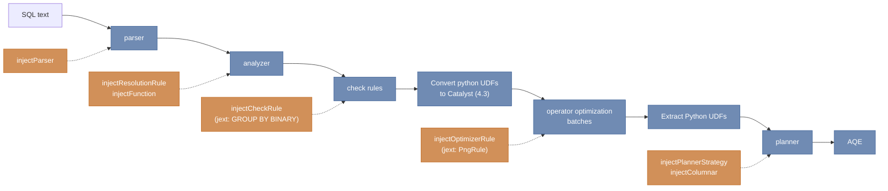
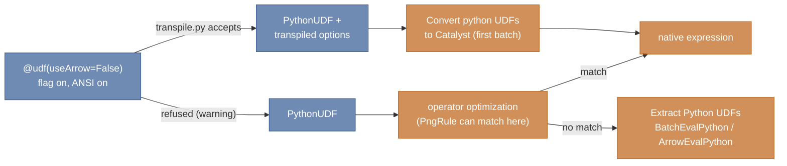

# Chapter 53: Catalyst extensions: rules and native functions

[Chapter 52](ch52-dsv2-connector-java.md) put a data source into Spark from Java. This chapter puts Java code into Catalyst itself, through `SparkSessionExtensions`. One jar, `jext`, adds three things:

- a **native function**, `is_png(bytes)`, written as a Catalyst `Expression`, and a second version, `is_png_fast`, built on `StaticInvoke`, which takes part in whole-stage code generation
- an **optimizer rule** that finds a Python UDF called `is_png` and replaces it with the native expression. Then the query does not need a Python worker, and all results stay the same, NULL values included
- a **check rule** that rejects a messy-data mistake (a `GROUP BY` over the bytes of whole files) during analysis

Spark 4.3 also adds an experimental optimizer feature that does a part of this work automatically: **Python UDF transpilation**. The chapter runs the two and compares them.

**An extension can change what Spark plans without a change to the code of the user. A function becomes part of SQL. A rule replaces an expensive expression with an equivalent cheap expression. A check rule stops a bad plan before it runs.

In 4.3, the transpiler changes simple Python UDFs into Catalyst expressions by itself. But it refuses many real UDFs, so a hand-written rule still has a purpose. The two have the same job: they must keep each result exactly the same.**

The code is in [`code/ch53`](https://github.com/lisancao/spark-masterclass/tree/main/code/ch53). The Java project is `code/ch53/jext`. `ch53/build.sh` builds it with Maven against Spark 4.3.0. Its `pom.xml` is the same as the `pom.xml` of `jdocs` in Chapter 52, but the `artifactId` is different. `spark-sql_2.13` brings `spark-catalyst` with it.

## Step 1: The injection points

`SparkSessionExtensions` (`sql/core/src/main/scala/org/apache/spark/sql/SparkSessionExtensions.scala`) holds builders. Your extension class receives it once for each new session and calls `inject*` methods. These are the methods in 4.3.0, and the part of Catalyst where each one acts:

| Method | Builder type (Scala) | Acts in |
|---|---|---|
| `injectParser` | `(SparkSession, ParserInterface) => ParserInterface` | the parser of SQL text (wrap the previous parser) |
| `injectResolutionRule`, `injectHintResolutionRule`, `injectPostHocResolutionRule` | `SparkSession => Rule[LogicalPlan]` | the analyzer |
| `injectCheckRule` | `SparkSession => LogicalPlan => Unit` | after analysis: throw an exception to reject a plan |
| `injectPlanNormalizationRule` | `SparkSession => Rule[LogicalPlan]` | the normalization of plans for the cache lookup |
| `injectPreOperatorOptimizationRule` (new in 4.3) | `SparkSession => Rule[LogicalPlan]` | one pass before the operator optimization batch |
| `injectOptimizerRule` | `SparkSession => Rule[LogicalPlan]` | the operator optimization batches of the optimizer |
| `injectPreCBORule` | `SparkSession => Rule[LogicalPlan]` | once after operator optimization, before the rules that use statistics |
| `injectPlannerStrategy` | `SparkSession => Strategy` | the change from a logical plan to a physical plan |
| `injectColumnar` | `SparkSession => ColumnarRule` | the physical plan, transitions between rows and columns |
| `injectQueryPostPlannerStrategyRule`, `injectQueryStagePrepRule`, `injectRuntimeOptimizerRule`, `injectQueryStageOptimizerRule` | different types | adaptive query execution |
| `injectFunction`, `injectTableFunction` | `(FunctionIdentifier, ExpressionInfo, Seq[Expression] => ...)` | the function registry |

**New in 4.3.** `injectPreOperatorOptimizationRule` is not in 4.2.0. Its doc says that its rules run in a single pass (`Once`) before the main operator optimization batch. It is for rules that must see the plan before built-in rules such as `FoldablePropagation` or `ConstantFolding` change it.



The annotations of the class are `@DeveloperApi @Experimental @Unstable`. Its doc says: "We make NO guarantee about the stability regarding binary compatibility and source compatibility of methods here." The Catalyst classes that an extension uses (`Expression`, `LogicalPlan`, `PythonUDF`) are internal too. Thus, compile an extension against one Spark version, and test it again on each upgrade. Delta Lake does this, with one build for each minor version of Spark.

There are three methods to load an extension class:

- `spark.sql.extensions` is a **static**, comma-separated list of classes with a constructor that has no arguments. Spark applies them in sequence. If two extensions register the same function name, the last one wins. Set it before the session starts.
- `SparkSession.builder.withExtensions(...)` is for Scala and Java only.
- A `META-INF/services/org.apache.spark.sql.SparkSessionExtensionsProvider` file lists classes that implement `SparkSessionExtensionsProvider` (since 3.2). Spark finds them with `ServiceLoader` when it creates a session.

## Step 2: The extension class in Java

`spark.sql.extensions` expects a `Function1[SparkSessionExtensions, Unit]`. In Java, that is `scala.runtime.AbstractFunction1` with `BoxedUnit` as the result type. This is the whole extension class of `jext`:

```java
public class Extensions extends AbstractFunction1<SparkSessionExtensions, BoxedUnit> {
  @Override public BoxedUnit apply(SparkSessionExtensions ext) {
    // 1. is_png(bytes): our own Expression class
    ext.injectFunction(new Tuple3<>(
        new FunctionIdentifier("is_png"),
        new ExpressionInfo(IsPng.class.getName(), null, "is_png",
            "is_png(bytes) - true if bytes start with the PNG signature", ""),
        (Function1<Seq<Expression>, Expression>) args -> {
          if (args.size() != 1) throw new IllegalArgumentException("is_png takes 1 argument, got " + args.size());
          return new IsPng(args.apply(0));
        }));

    // 2. is_png_fast(bytes): a StaticInvoke of IsPng.check, which Spark compiles into generated code
    ext.injectFunction(new Tuple3<>(
        new FunctionIdentifier("is_png_fast"),
        new ExpressionInfo(IsPng.class.getName(), "is_png_fast"),
        (Function1<Seq<Expression>, Expression>) args -> new StaticInvoke(
            IsPng.class, DataTypes.BooleanType, "check", args,
            CollectionConverters.asScala(List.<AbstractDataType>of(DataTypes.BinaryType)).toSeq(),
            true, true, true, Option.empty())));

    // 3. The optimizer rule
    ext.injectOptimizerRule(session -> new PngRule());

    // 4. A check rule: runs on every analyzed plan and throws to reject it
    ext.injectCheckRule(session -> plan -> {
      plan.foreach(node -> {
        if (node instanceof Aggregate a) {
          a.groupingExpressions().foreach(g -> {
            if (g.resolved() && g.dataType() instanceof BinaryType)
              throw new IllegalArgumentException("Grouping by a BINARY column (" + g.sql()
                  + ") compares whole file contents; group by sha2(" + g.sql() + ", 256) instead");
            return BoxedUnit.UNIT;
          });
        }
        return BoxedUnit.UNIT;
      });
      return BoxedUnit.UNIT;
    });
    return BoxedUnit.UNIT;
  }
}
```

Scala 2.13 compiles `Function1` to an interface whose only abstract method is `apply`. Thus, a Java lambda can replace a Scala function (`session -> new PngRule()`). A Scala function that returns `Unit` is a Java function that returns `BoxedUnit.UNIT`.

The session needs two static settings. The scripts set them in the builder:

```python
spark = session("ch53-extensions", spark_jars=str(JAR), spark_sql_extensions="jext.Extensions")
```

With `spark-submit`, the same settings are `--jars jext-0.1.0.jar --conf spark.sql.extensions=jext.Extensions`.

## Step 3: A Catalyst expression, written by hand

The built-in functions of Spark are Scala case classes that extend `Expression` (`sql/catalyst/.../expressions/Expression.scala`). A case class generates `equals`, `hashCode`, `copy`, the `Product` methods that tree operations use, and `Serializable`. In Java, you write each of these yourself. This is `IsPng`:

```java
public class IsPng extends Expression implements CodegenFallback, Serializable {
  static final byte[] SIG = {(byte) 0x89, 'P', 'N', 'G', '\r', '\n', 0x1a, '\n'};
  private final Expression child;

  public IsPng(Expression child) { this.child = child; }

  /** The check itself, also called directly by the StaticInvoke version. */
  public static boolean check(byte[] b) {
    if (b.length < SIG.length) return false;
    for (int i = 0; i < SIG.length; i++) if (b[i] != SIG[i]) return false;
    return true;
  }

  /** Interpreted evaluation: BinaryType values are byte[]; a NULL child gives NULL. */
  @Override public Object eval(InternalRow row) {
    Object v = child.eval(row);
    return v == null ? null : check((byte[]) v);
  }

  /** CodegenFallback: generated code calls eval(). Java must ask for the trait's method by name. */
  @Override public ExprCode doGenCode(CodegenContext ctx, ExprCode ev) {
    return CodegenFallback.super.doGenCode(ctx, ev);
  }

  @Override public TypeCheckResult checkInputDataTypes() {
    DataType t = child.dataType();
    if (t instanceof BinaryType || t instanceof NullType) return TypeCheckResult.TypeCheckSuccess$.MODULE$;
    return new TypeCheckResult.TypeCheckFailure("is_png expects BINARY, got " + child.dataType().simpleString());
  }

  @Override public DataType dataType() { return DataTypes.BooleanType; }
  @Override public boolean nullable() { return child.nullable(); }
  @Override public String prettyName() { return "is_png"; }

  // Tree plumbing that a Scala case class would generate.
  @Override public Seq<Expression> children() { return CollectionConverters.asScala(List.of(child)).toSeq(); }
  @Override public Expression withNewChildrenInternal(IndexedSeq<Expression> c) { return new IsPng(c.apply(0)); }
  @Override public int productArity() { return 1; }
  @Override public Object productElement(int n) {
    if (n == 0) return child;
    throw new IndexOutOfBoundsException(n);
  }
  @Override public boolean canEqual(Object o) { return o instanceof IsPng; }
  @Override public boolean equals(Object o) { return o instanceof IsPng p && p.child.equals(child); }
  @Override public int hashCode() { return Objects.hash("is_png", child); }
}
```

`extensions.py` calls it on literals that cover each case. The case `untyped_null` is a bare `NULL`:

```text
+----+------+-----+-----+-----+-------+------------+
| sig|longer|short|empty|wrong|null_in|untyped_null|
+----+------+-----+-----+-----+-------+------------+
|true|  true|false|false|false|   NULL|        NULL|
+----+------+-----+-----+-----+-------+------------+
```

## Step 4: Five traps of a Java expression

Each part of `IsPng` that looks unusual is there because of a trap. `traps.py` proves each one. It changes `IsPng.java` in one location and compiles the jar with `javac` against the jars of pyspark. Then it runs one query in a new process, because a session reads `spark.jars` only when it starts:

```text
== 1. extend UnaryExpression
javac: /src/jext/IsPng.java:27: error: IsPng is not abstract and does not override abstract method withNewChildInternal(Expression) in UnaryLike
javac: /src/jext/IsPng.java:66: error: children() in IsPng cannot override children() in UnaryExpression
javac: /src/jext/IsPng.java:67: error: name clash: withNewChildrenInternal(IndexedSeq<Expression>) in IsPng and withNewChildrenInternal(IndexedSeq) in UnaryExpression

== 2. not Serializable
Task not serializable
NotSerializableException: jext.IsPng

== 3. eval returns null, nullable follows the child
NullPointerException: Cannot invoke "java.lang.Boolean.booleanValue()" because "<local2>" is null
GeneratedClass$SpecificUnsafeProjection.apply(Unknown Source)

== 4. no checkInputDataTypes
ClassCastException: class org.apache.spark.unsafe.types.UTF8String cannot be cast to class [B (org.apache.spark.unsafe.types.UTF8String is in unnamed

== 5. BINARY only, no NullType
DATATYPE_MISMATCH.TYPE_CHECK_FAILURE_WITH_HINT] Cannot resolve "is_png(NULL)" due to data type mismatch: is_png expects BINARY, got void. SQLSTATE: 42
```

1. **Scala traits do not always work from Java.** The usual base class for one child is `UnaryExpression`. From Java it does not compile. The methods for one child are in the Scala trait `UnaryLike`, with generic signatures that `javac` cannot match with the methods of `TreeNode`. If you extend `Expression` directly and write `children()` and `withNewChildrenInternal` yourself, you do not use the trait. A similar problem occurs with `CodegenFallback`. It gives `doGenCode` as a Java default method, but `Expression` declares the method abstract, and in Java the class declaration wins. Thus, you must override `doGenCode` and call `CodegenFallback.super.doGenCode(ctx, ev)` explicitly.
2. **Expressions go to the executors.** Without `Serializable`, the first query fails before any task starts.
3. **`nullable` is a promise.** `nullable()` returns `child.nullable()`. For a literal that is not NULL, Spark generates code that never examines the result for NULL. An `eval` that returns `null` anyway causes a `NullPointerException` in the generated code.
4. **Examine the input types during analysis.** Without `checkInputDataTypes`, `is_png('not binary')` passes analysis and fails in a task with a `ClassCastException`. With it, the query fails during analysis with `DATATYPE_MISMATCH`, as Step 5 shows.
5. **An untyped NULL has its own type.** A bare `NULL` literal has `NullType`, which Spark shows as `void`. The built-in functions accept it through implicit casts. `IsPng` accepts `NullType` explicitly and returns NULL for it.

## Step 5: Register the function and call it

`injectFunction` takes a Scala `Tuple3`: the name, an `ExpressionInfo` (the text that `DESCRIBE FUNCTION` shows) and a builder from the list of arguments to an expression:

```text
+-----------------------------------------------------------------+
|function_desc                                                    |
+-----------------------------------------------------------------+
|Function: is_png                                                 |
|Class: jext.IsPng                                                |
|Usage: is_png(bytes) - true if bytes start with the PNG signature|
|Extended Usage:\n    No example/argument for is_png.\n           |
+-----------------------------------------------------------------+
```

The builder runs during analysis, before Spark resolves the arguments. Thus, it can count the arguments, but it cannot examine their types. That is the job of `checkInputDataTypes`:

```text
SELECT is_png('not binary') -> AnalysisException: [DATATYPE_MISMATCH.TYPE_CHECK_FAILURE_WITH_HINT] Cannot resolve "is_png(not binary)" due to data type mismatch: is_png expects BINARY, got string. SQL
SELECT is_png(X'00', X'01') -> IllegalArgumentException: is_png takes 1 argument, got 2
```

PySpark has no `F.is_png`. Call the function by its name, with `F.call_function` (since 3.5) or `F.expr`:

```python
imgs = spark.read.format("binaryFile").option("recursiveFileLookup", "true").load(str(IMAGES))
(imgs.select(F.substring_index("path", "/", -1).alias("file"),
             F.call_function("is_png", "content").alias("call_function"),
             F.expr("is_png(content)").alias("expr"))
 .orderBy("file").show(truncate=False))
```

```text
binaryFile without recursiveFileLookup: 0 rows
+-------------------+-------------+-----+
|file               |call_function|expr |
+-------------------+-------------+-----+
|corrupt.png        |true         |true |
|gradient_32x32.png |true         |true |
|gray_20x10.png     |true         |true |
|logo_rgba_12x12.png|true         |true |
|readme.txt         |false        |false|
|red_16x8.png       |true         |true |
+-------------------+-------------+-----+
```

`F.call_function` is the better choice in a library. It takes `Column` objects, so your code does not build a SQL string. A small Python wrapper makes a native function look like a built-in function:

```python
def is_png(col):
    """True if the bytes start with the PNG signature (native, jext)."""
    return F.call_function("is_png", col)
```

The first line of the output shows a trap of `binaryFile`. The folder `images` has subfolders (`products/`, `scans/`), and `binaryFile` does not go into folders that are not `key=value` partitions. Without `recursiveFileLookup`, the read returns no rows at all. `corrupt.png` is true because its first eight bytes are a correct PNG signature. `is_png` examines the signature, not the rest of the file.

## Step 6: CodegenFallback and StaticInvoke

`CodegenFallback` tells Spark that generated code must call `eval`. This is correct, but it has a cost that you can see in the plan. These are the first lines of the two physical plans:

```text
Project [is_png(content#52) AS is_png(content)#69]
*(1) Project [static_invoke(jext.IsPng.check(content#52)) AS static_invoke(jext.IsPng.check(content))#70]
```

The `*(1)` marks an operator in a whole-stage code generation stage. The first `Project` has no mark. The reason is in `sql/core/.../execution/WholeStageCodegenExec.scala`:

```scala
private def supportCodegen(e: Expression): Boolean = e match {
  case e: LeafExpression => true
  // CodegenFallback requires the input to be an InternalRow
  case e: CodegenFallback => false
  case _ => true
}
```

One `CodegenFallback` expression takes its whole operator out of the fused stage. `StaticInvoke` (`sql/catalyst/.../expressions/objects/objects.scala`) generates a direct call to a static Java method. It also does the NULL propagation for you (`propagateNull = true`). Many built-in functions use this pattern. For example, `UrlEncode` is a `RuntimeReplaceable` whose `replacement` is a `StaticInvoke` of `UrlCodec.encode`.

From Java, a function builder that returns a `StaticInvoke` is the shortest path to a native function with real code generation. Java has no default arguments, so `Extensions` gives all nine parameters of the constructor. At the `v4.3.0` tag they are: `staticObject`, `dataType`, `functionName`, `arguments`, `inputTypes`, `propagateNull`, `returnNullable`, `isDeterministic` and `scalarFunction`. The name that the plan shows is less clear (`static_invoke(jext.IsPng.check(...))`). A `RuntimeReplaceable` wrapper in Scala gives a clear name and the `StaticInvoke` together.

Your expression can also run on the **driver**:

```text
optimized: LocalRelation [p#72]
result: [Row(p=False)]
```

That is the optimized plan of `SELECT is_png(content) AS p FROM VALUES (X'00') AS t(content)`. The optimizer called `eval` while it folded the local relation, and the plan has only the result. An expression must not expect that it always runs in a task.

## Step 7: A rule that replaces a Python UDF

Messy-data code has many small Python UDFs like this one. Each one costs a round trip to a Python worker for each batch of rows:

```python
@F.udf("boolean")
def is_png(b):
    return b is not None and bytes(b[:8]) == PNG_SIG
```

If your team already has a native version, an optimizer rule can replace the UDF, and nobody changes their code. `extensions.py` also defines `looks_like_png`, with the same body but a different name. The rule does not change it:

```text
looks_like_png (not rewritten):
*(1) Project [path#49]
+- *(1) Filter pythonUDF0#74: boolean
   +- ArrowEvalPython [looks_like_png(content#52)#73], [pythonUDF0#74], 101
      +- FileScan binaryFile [path#49,content#52] Batched: false, DataFilters: [], Format: BINARYFILE, Location: InMemoryFileIndex(1 paths)[file:<repo>/code/data/messy/images], PartitionFilters: [], PushedFilters: [], ReadSchema: struct<path:string,content:binary>

is_png (rewritten by jext.PngRule):
*(1) Project [path#49]
+- Filter coalesce(is_png(content#52), false)
   +- FileScan binaryFile [path#49,content#52] Batched: false, DataFilters: [coalesce(is_png(content#52), false)], Format: BINARYFILE, Location: InMemoryFileIndex(1 paths)[file:<repo>/code/data/messy/images], PartitionFilters: [], PushedFilters: [], ReadSchema: struct<path:string,content:binary>
```

`ArrowEvalPython` with eval type `101` is the Arrow-optimized Python UDF, which is the default for a plain `@udf` in 4.3 (`spark.sql.execution.pythonUDF.arrow.enabled` is `true`). It sends the bytes of each file to Python. After the rewrite, the plan has no Python node. The condition is a plain Catalyst expression, so it is also in the `DataFilters` of the scan. The `Filter` has no `*` because `IsPng` is a `CodegenFallback`.

<figure markdown>
  <video autoplay loop muted playsinline controls width="1280" height="720" poster="../../media/clips/ch53-rule.webp">
    <source src="../../media/clips/ch53-rule.mp4" type="video/mp4">
  </video>
  <figcaption><code>extensions.py</code>: the same Python UDF under two names. The rule replaces only <code>is_png</code>, and the NULL row gets the same answer as in Python.</figcaption>
</figure>

This is the rule:

```java
public class PngRule extends Rule<LogicalPlan> {
  static boolean matches(Expression e) {
    if (!(e instanceof PythonUDF u)) return false;
    return u.name().equals("is_png")
        && u.udfDeterministic()
        && u.dataType().equals(DataTypes.BooleanType)
        && u.children().size() == 1
        && u.children().apply(0).dataType().equals(DataTypes.BinaryType);
  }

  static Expression replacement(PythonUDF u) {
    Expression child = u.children().apply(0);
    return new Coalesce(CollectionConverters.asScala(
        List.<Expression>of(new IsPng(child), Literal.FalseLiteral())).toSeq());
  }

  @Override public LogicalPlan apply(LogicalPlan plan) {
    return (LogicalPlan) plan.transformAllExpressions(new AbstractPartialFunction<Expression, Expression>() {
      @Override public boolean isDefinedAt(Expression e) { return matches(e); }

      @Override @SuppressWarnings("unchecked")
      public <A1 extends Expression, B1> B1 applyOrElse(A1 e, Function1<A1, B1> otherwise) {
        if (!matches(e)) return otherwise.apply(e);
        rewrites++;
        return (B1) replacement((PythonUDF) e);
      }
    });
  }
}
```

`transformAllExpressions` takes a Scala `PartialFunction`. In Java, that is `scala.runtime.AbstractPartialFunction` with `isDefinedAt` and `applyOrElse`. At the `v4.3.0` tag, `PythonUDF` (`sql/catalyst/.../expressions/PythonUDF.scala`) is a case class with the fields `name`, `func`, `dataType`, `children`, `evalType`, `udfDeterministic` and `resultId`.

## Step 8: When is a rewrite safe?

A rule that changes results is a bug that your tests cannot find, because users never see the original result. `PngRule` changes a UDF only when all of these conditions are true:

- The `name()` of the UDF is `is_png`. This is the `__name__` of the function in Python. It is a contract between your team and the rule.
- `udfDeterministic()` is true. A UDF marked `asNondeterministic()` can have side effects or random values that the native code does not have.
- The UDF returns `BOOLEAN` and takes exactly one `BINARY` argument.

`extensions.py` makes three UDFs that break one condition each. All three stay in Python:

```text
another name       -> still in Python: ['ArrowEvalPython']
a string result    -> still in Python: ['ArrowEvalPython']
nondeterministic   -> still in Python: ['ArrowEvalPython']
```

The replacement must also give the same answer as the UDF for **each** input. The Python function returns `False` for `None`. The native `is_png` returns NULL for NULL, like each SQL function. A plain replacement would change `False` into NULL, and `filter(~is_png(content))` would lose the NULL rows. Thus, the rule emits `coalesce(is_png(content), false)`. The script adds a NULL row to the files and compares:

```text
Python looks_like_png  values [False, False, True, True, True, True, True] | rows where NOT holds: 2
rewritten is_png       values [False, False, True, True, True, True, True] | rows where NOT holds: 2
native is_png alone    values [False, None, True, True, True, True, True] | rows where NOT holds: 1
rewrites so far: 5
```

The rewritten UDF gives the same values as the Python UDF. The native function alone gives `None` for the NULL row, and `~is_png` then loses that row.

A rule also needs these two properties:

- **It must get to a fixed point.** An optimizer batch runs its rules again and again until the plan does not change. After the rewrite, the expression is a `Coalesce`, not a `PythonUDF`. Thus, the rule finds nothing the second time. A rule that always makes a "new" plan runs until the iteration limit of the batch.
- **It must run before Spark extracts the Python UDFs.** `injectOptimizerRule` adds the rule to the operator optimization batches (`customOperatorOptimizationRules` in `BaseSessionStateBuilder.scala`). In `SparkOptimizer.scala`, the batch "Extract Python UDFs" comes after all of them. That batch moves each `PythonUDF` into an `ArrowEvalPython` or `BatchEvalPython` node. The doc of `postHocOptimizationBatches` says that "Extract Python UDFs" runs even after those batches.

`planchange.py` shows the rule in the plan change log (`spark.sql.planChangeLog.level` and `spark.sql.planChangeLog.rules`). The log goes to the log of the driver:

```text
=== Applying Rule jext.PngRule ===
!Project [is_png(content#3)#4 AS png#5]                                   Project [coalesce(is_png(content#3), false) AS png#5]
 +- Relation [path#0,modificationTime#1,length#2L,content#3] binaryFile   +- Relation [path#0,modificationTime#1,length#2L,content#3] binaryFile
```

## Step 9: New in 4.3: Python UDF transpilation

Spark 4.3 adds `spark.sql.experimental.optimizer.transpilePyUDFs` (default `false`). When it is `true`, PySpark tries to change the body of a Python UDF into a Catalyst expression. Then the optimizer uses that expression instead of the Python worker. This is the work of `PngRule`, done automatically and for any name. The doc of the config gives the conditions:

- It needs ANSI mode (`spark.sql.ansi.enabled=true`). The transpiled expressions use ANSI semantics.
- "Transpiled UDFS attempt to match the Python functionality but may not be 100% equivalent." The doc names overflow of the input types, type coercion in comparisons and implicit returns.
- "This initial version only works with non-Connect Spark".

`python/pyspark/sql/udf.py` gives one more condition. It tries transpilation only for a deterministic UDF with eval type `SQL_BATCHED_UDF` (100), which is the pickled UDF, not the Arrow-optimized UDF. `transpile.py` shows what this means in 4.3:

```text
defaults: spark.sql.experimental.optimizer.transpilePyUDFs = false | spark.sql.ansi.enabled = true | spark.sql.execution.pythonUDF.arrow.enabled = true

== 1. flag on, plain @udf (Arrow-optimized by default in 4.3)
   eval type: 101 | Python node in plan: ArrowEvalPython
   warning: Cannot infer the eval type from type hints. 

== 2. flag on, useArrow=False
   eval type: 100 | Python node in plan: none
   the plan's Project, start: *(1) Project [CASE WHEN coalesce((isnull(fare_amount#10) OR CASE WHEN isnull(fare_amount#10) THEN cast(raise_error(USER_RAISED_EXCEPTION, map(keys: [e
   ... 1178 characters in all
```

The UDF is the `fare_band` function from [Chapter 1](ch01-how-spark-runs.md#step-6-where-python-runs), with a type hint on its argument. With the flag on, a plain `@udf` stays a Python UDF, because its eval type is 101. The warning in the first case is not about transpilation. It comes from the type hint.

With `useArrow=False`, the eval type is 100, and the plan has no Python node. The `Project` has a `CASE WHEN` expression of 1178 characters. The `raise_error` in it reproduces the errors that Python can raise.

<figure markdown>
  <video autoplay loop muted playsinline controls width="1280" height="720" poster="../../media/clips/ch53-transpile.webp">
    <source src="../../media/clips/ch53-transpile.mp4" type="video/mp4">
  </video>
  <figcaption><code>transpile.py</code>: with the 4.3 flag on, only the non-Arrow UDF loses its Python node. The transpiler names its reason for each UDF that it refuses.</figcaption>
</figure>

The transpiler refuses many functions. It gives its reason in a warning when you build the UDF:

```text
== 3. what the transpiler refuses (useArrow=False)
   band_if  -> functions with more than one top-level statement are not supported by the transpiler
   tip_pct  -> binary operator Div is not supported by the transpiler
   is_png   -> a numeric-typed lowering does not match the declared return type boolean; the interpreted path would return NULL where t
```

- `band_if` is the same logic with an `if` statement and a `return`. The transpiler accepts only a single expression.
- `tip_pct` divides two numbers. Division is not in the 4.3.0 transpiler.
- `is_png` is the UDF of Step 7. The transpiler refuses it. Thus, a hand-written rule is still the only way to make this UDF native.

Two more details from `transpile.py`:

```text
== 4. the flag is read when the UDF is built, not when the query runs
   built with the flag off, run with it on: Python node = BatchEvalPython

== 5. ANSI mode off
   warning: Python UDF transpilation (spark.sql.experimental.optimizer.transpilePyUDFs) is only supported when ANSI mode is enabled 
   Python node: BatchEvalPython

== 6. same answer, Python and transpiled
   Python:     [('$10 to $30', 2192451), ('invalid', 16815), ('over $30', 777470), ('under $10', 850512)]
   transpiled: [('$10 to $30', 2192451), ('invalid', 16815), ('over $30', 777470), ('under $10', 850512)]
   equal: True
```

PySpark reads the flag when it **builds** the UDF object, not when the query runs. A UDF that a module defined before you set the flag stays in Python. With ANSI off, PySpark gives a warning and keeps the Python UDF. And for the `fare_band` UDF, the Python and the transpiled versions give the same counts over all 3,837,248 trips of June 2026.

Where does the transpiled expression go? `planchange.py` also logs the rule `ConvertToCatalyst`, on a UDF that adds 1 to a `bigint`:

```text
=== Applying Rule org.apache.spark.sql.catalyst.optimizer.ConvertToCatalyst ===
!Project [transpiledpythonudf(plus_one, plus_one(id#8L)#9L, cast((transpiledudfparameter(0, Some(LongType), false) + cast(1 as bigint)) as bigint)) AS y#10L]   Project [cast((id#8L + cast(1 as bigint)) as bigint) AS y#10L]
 +- Range (0, 3, step=1, splits=Some(16))                                                                                                                       +- Range (0, 3, step=1, splits=Some(16))
```

PySpark sends the transpiled expression with the UDF, in a `transpiledpythonudf` node. `ConvertToCatalyst` replaces the node with that expression. In `Optimizer.scala` at the `v4.3.0` tag, it is the only rule of the batch "Convert python UDFs to Catalyst". That batch is the **first** batch of the optimizer. It is also in `nonExcludableRules`, because it is the only rule that removes the `Unevaluable` node. Thus, a transpiled UDF is a Catalyst expression before your rule in the operator optimization batches sees the plan.



Thus, the two tools work together:

- The **transpiler** is general. It works on any name, but only on simple, single-expression, non-Arrow UDFs, only in Classic sessions, and only in 4.3 as an experimental feature.
- A **hand-written rule** is narrow. It matches one UDF by name and types. But it can call any native code, for example a library of your organization. It also works on Arrow UDFs and on the UDFs that the transpiler refuses.

## Step 10: Check rules

A check rule receives the analyzed plan and throws an exception to reject it. The rule in `Extensions` rejects a `GROUP BY` over a `BINARY` column. If you group a `binaryFile` read by `content`, Spark hashes and compares whole files in the shuffle. A fixed-size hash does the same deduplication with much fewer shuffle bytes. The rule changes that advice into an error:

```text
groupBy('content').count() -> IllegalArgumentException: Grouping by a BINARY column (content) compares whole file contents; group by sha2(content, 256) instead
groupBy(sha2(content, 256)) is allowed: 6 groups
```

The error occurs at `count()`, which builds the DataFrame, before any action. A Classic session analyzes each new DataFrame immediately, and check rules are part of analysis. This is also a caution:

!!! warning "Reject only constructs that are always wrong"
    Do not write a check rule that rejects a plan which can be correct as an intermediate DataFrame. A check rule sees **each** analyzed plan, and that includes each intermediate DataFrame. For example, a rule that rejects "a `binaryFile` read without a limit" would reject `spark.read.format("binaryFile").load(...)` itself.

A Java `IllegalArgumentException` gets to Python as the `IllegalArgumentException` of PySpark. The error classes of Spark, such as `DATATYPE_MISMATCH`, need entries in the error registry of Spark, and an extension cannot add entries. Thus, a clear standard exception is the correct choice.

## Step 11: Measure without errors

`bench.py` measures each version. Each time is the median of 5 runs after 1 warm-up run, with a **new** DataFrame for each run. The script ran under the shared benchmark lock of the book. Part A counts the matches in 2,000,000 cached binary values (a third of them start with the PNG signature). Part B groups the June 2026 trips by `fare_band`:

```text
BENCH
```

BENCH-PROSE

**The benchmark trap.** Run the same DataFrame object a second time, and Spark uses its physical plan again, and also the shuffle files of the earlier run. Thus, only the last stage runs again, and a slow Python UDF can look fast. Build a **new** DataFrame for each timed run, and make sure that a time is physically possible before you believe it.

## The whole chapter, on one page

- **`SparkSessionExtensions`** has injection points for the parser, the analyzer, check rules, the optimizer (4.3 adds `injectPreOperatorOptimizationRule`), the planner, columnar rules, AQE rules and functions. Load an extension with the static `spark.sql.extensions`, or with a `SparkSessionExtensionsProvider` service file. The API is experimental and unstable, so build for each Spark version.
- **From Java:** extend `AbstractFunction1<SparkSessionExtensions, BoxedUnit>`, use lambdas for Scala functions, and use `AbstractPartialFunction` for the `transform*` methods.
- **A Java `Expression`** must be `Serializable` and implement the tree and `Product` methods. It must keep its `nullable()` promise and examine its input types in `checkInputDataTypes`, with `NullType` accepted. It must call `CodegenFallback.super.doGenCode` explicitly.
- **`CodegenFallback` takes the operator out of whole-stage code generation.** A `StaticInvoke` of a static method keeps it in.
- **`F.call_function` and `F.expr`** call a native function from Python. A small wrapper makes it look built in.
- **An optimizer rule can replace a `PythonUDF`** with native code, because the operator optimization batches run before "Extract Python UDFs". A safe rewrite matches the name, the determinism and the types exactly, and it keeps the NULL behavior of the UDF.
- **The 4.3 transpiler** changes deterministic, non-Arrow UDFs with a single expression into Catalyst expressions. This occurs in the first batch of the optimizer, in Classic sessions with ANSI on. It refuses many UDFs and tells you why.
- **Check rules run on each analyzed plan**, immediately in Classic sessions, and reject plans with an exception.
- **Measure with a new DataFrame for each run.**

To run all of it, do these steps from the `code/` folder:

```bash
ch53/build.sh
uv run python ch53/extensions.py
uv run python ch53/traps.py
uv run python ch53/transpile.py
uv run python ch53/planchange.py 2>&1 | sed -n '/=== Applying Rule/,/^$/p'
flock $HOME/spark-masterclass/data/.bench.lock uv run python ch53/bench.py
```

The next chapter takes the same JVM code to a client that has no Py4J gateway: Spark Connect. It writes relation, expression and command plugins, and it sends custom protobuf messages from Python.

## Further reading

- [`SparkSessionExtensions.scala` at v4.3.0](https://github.com/apache/spark/blob/v4.3.0/sql/core/src/main/scala/org/apache/spark/sql/SparkSessionExtensions.scala), with the doc of each injection point.
- [`python/pyspark/sql/transpile.py` at v4.3.0](https://github.com/apache/spark/blob/v4.3.0/python/pyspark/sql/transpile.py), the doc string of the transpiler, with what it accepts.
- [`Optimizer.scala` at v4.3.0](https://github.com/apache/spark/blob/v4.3.0/sql/catalyst/src/main/scala/org/apache/spark/sql/catalyst/optimizer/Optimizer.scala), the batches of the optimizer, with `ConvertToCatalyst` first.
- [Python UDFs in Chapter 1](ch01-how-spark-runs.md#step-6-where-python-runs), where the `fare_band` UDF first runs.
