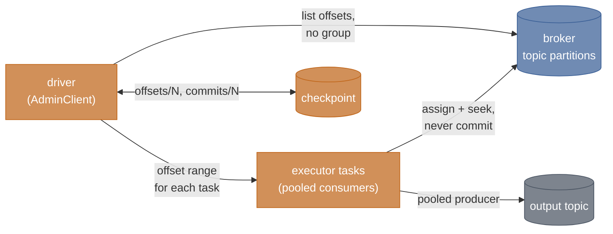
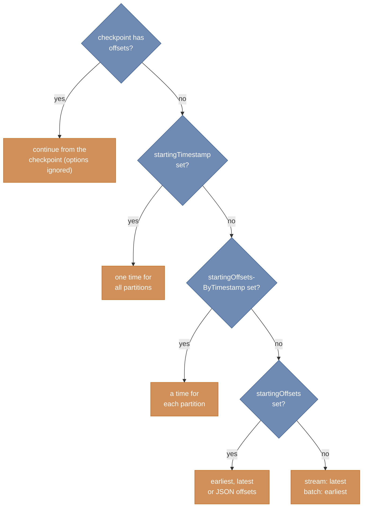
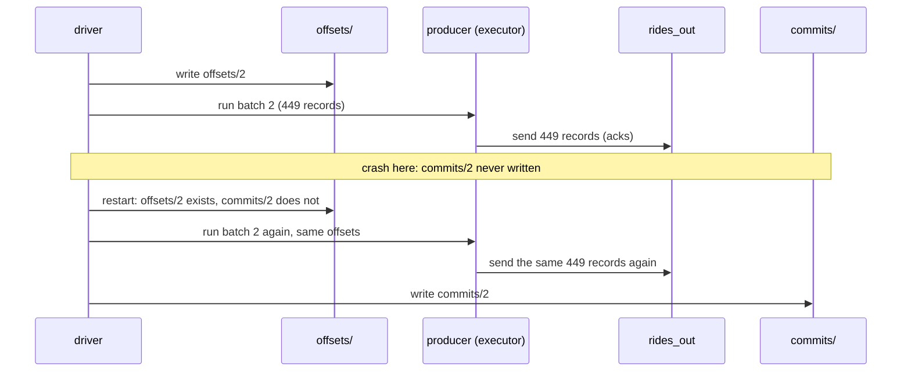

# Chapter 53: Kafka with Spark in depth

[Chapter 48](ch48-structured-streaming.md) read a Kafka topic for the first time. It showed the fixed schema of the source and `maxOffsetsPerTrigger`. It also showed one offset for each partition in the checkpoint. In [Chapter 51](ch51-real-time-mode.md), records went from Kafka to Kafka in Real-time Mode.

[Chapter 36](ch36-xml-avro-protobuf.md) decoded the bytes of a Kafka message. This chapter is about the connector itself. It shows the options that decide which records a query reads and how many records each batch takes. It also shows what the sink promises, and how a query logs in to a broker that needs a password.

**The Kafka connector does not use Kafka to remember where a query is. The checkpoint holds the offsets, Spark picks each offset range itself, and the consumer group that Kafka shows is empty. Thus, the starting options apply only to a new checkpoint. `failOnDataLoss` decides what occurs when the broker deletes records that the checkpoint still wants. The sink can write a record two times. A correct Kafka pipeline is a checkpoint, a retention time that is longer than the longest stop, and a reader that removes duplicates by key.**

All the code runs against Spark 4.3.0 and one Kafka broker in Docker. The scripts are in [`code/ch53`](https://github.com/open-lakehouse/spark-masterclass/tree/main/code/ch53), and each number in the chapter comes from their saved output in `code/ch53/output/`.

## The setup: one broker with two doors

`ch53/kafka.sh` starts the image `apache/kafka:4.0.0` in KRaft mode. The broker has two listeners for Spark on the host:

| Listener | Address | Security protocol | Used in |
|---|---|---|---|
| `HOST` | `localhost:29116` | `PLAINTEXT` (no login) | Steps 1 to 8 |
| `SASL` | `localhost:29117` | `SASL_PLAINTEXT`, mechanism `PLAIN`, users `alice` and `bob` | Step 9 |

```bash
ch53/kafka.sh start              # broker and both listeners
ch53/kafka.sh topic trips 4      # a topic with 4 partitions
ch53/kafka.sh cli kafka-get-offsets --topic trips
```

The records are the taxi trips of the morning of 10 June 2026 from [Chapter 48](ch48-structured-streaming.md), one JSON document for each trip. A batch job writes them to a topic with the Kafka sink. The key is the pickup zone, so all trips of one zone go to the same partition.



The diagram shows the division of work that the rest of the chapter proves. The driver asks the broker for offsets and decides the range of each task. The executors read exactly those ranges. Nobody commits an offset to Kafka.

## Step 1: The connector is a package

PySpark does not contain the Kafka connector. Without it, `format("kafka")` fails at once (`k1_package.py`):

```text
1. Without the package:
   AnalysisException [KAFKA_DATA_SOURCE_NOT_ENABLED] Failed to find data source: kafka. Please deploy the application as per the deployment section of Structured Streaming + Kafka Integration
```

Add the connector with `spark.jars.packages` or `--packages`. Spark resolves it and its dependencies from Maven Central at the start of the session:

```text
2. spark.jars.packages = org.apache.spark:spark-sql-kafka-0-10_2.13:4.3.0
   jars that Spark resolved and put on the classpath:
     at.yawk.lz4_lz4-java-1.11.0.jar
     com.google.code.findbugs_jsr305-3.0.0.jar
     org.apache.commons_commons-pool2-2.13.1.jar
     org.apache.hadoop_hadoop-client-api-3.5.0.jar
     org.apache.hadoop_hadoop-client-runtime-3.5.0.jar
     org.apache.kafka_kafka-clients-3.9.2.jar
     org.apache.spark_spark-sql-kafka-0-10_2.13-4.3.0.jar
     org.apache.spark_spark-token-provider-kafka-0-10_2.13-4.3.0.jar
     org.scala-lang.modules_scala-parallel-collections_2.13-1.2.0.jar
     org.slf4j_slf4j-api-2.0.17.jar
     org.xerial.snappy_snappy-java-1.1.10.8.jar
```

The coordinates have three parts, and each one must agree with your Spark:

- **`spark-sql-kafka-0-10`** is the Structured Streaming connector. The `0-10` is the oldest broker version that it supports (0.10.0). It is not the client version.
- **`_2.13`** is the Scala version. Spark 4.x is built for Scala 2.13 only.
- **`4.3.0`** must be the version of your Spark. Do not mix a connector of one Spark release with the runtime of another.

The connector brings `kafka-clients` 3.9.2, the Kafka client library. It also brings `commons-pool2` for the consumer pool (Step 8) and the token provider for delegation tokens (Step 9). The broker in this chapter is Kafka 4.0. A newer client talks to an older broker, and the reverse, through the version negotiation of the Kafka protocol. Headers need a broker of 0.11 or newer, and the timestamp options of Step 2 need 0.10.1 or newer.

If the cluster has no internet access, download the jars one time. Then give them with `spark.jars`, or put them in the `jars/` folder of the Spark installation.

The schema of the source always contains seven columns. `includeHeaders=true` adds an eighth:

```text
3. The source schema, with and without includeHeaders:
   default:         key binary, value binary, topic string, partition int, offset bigint, timestamp timestamp, timestampType int
   includeHeaders: + headers array<struct<key:string,value:binary>>
```

## Step 2: Where a new query starts

`k2_start.py` writes three deliveries to the topic `trips`, two seconds apart, and records the clock time before each one. Then it starts eight new queries, each on a new checkpoint, with `trigger(availableNow=True)`. Each query counts the rows that it read in each partition:

```text
A new query on each line (availableNow, new checkpoint):
  default (latest)                0 rows  p0=0 p1=0 p2=0 p3=0
  earliest                     2924 rows  p0=925 p1=1018 p2=598 p3=383
  JSON offsets                 1926 rows  p0=825 p1=1018 p2=0 p3=83
  JSON, p3 past its end         StreamingQueryException: [STREAM_FAILED] ... Some data may have been lost because they
  are not available in Kafka any more;
  startingTimestamp=t2         1929 rows  p0=616 p1=663 p2=402 p3=248
  startingOffsetsByTimestamp   1510 rows  p0=307 p1=663 p2=402 p3=138
  timestamp in the future       StreamingQueryException: [STREAM_FAILED] ... No offset matched from request of topic-
  partition trips-3 and timestamp 1795394167561. SQLSTATE: XXKST
  future, strategy latest         0 rows  p0=0 p1=0 p2=0 p3=0
  (JSON: p0 from offset 100, p1 earliest (-2), p2 latest (-1), p3 from offset 300, then 500)
```

<figure markdown>
  
  
  <figcaption markdown="span">The four partitions of `trips` after three deliveries, from `k2_start.txt`. Each mark is the first offset that a new query reads with that option. A query reads from its mark to the end of the partition.</figcaption>
</figure>

Each line teaches one rule:

- **The default for a stream is `latest`.** A new query with no option reads only records that arrive after it starts. With `availableNow`, the query reads no records. For a batch read, the default is `earliest` (Step 3).
- **`earliest`** reads each partition from its first record that the broker still keeps.
- **A JSON object** gives a start for each partition. `-2` means earliest and `-1` means latest. The JSON must name all partitions of the subscribed topics.
- **An offset past the end of a partition is data loss.** Partition 3 had 383 records, so offset 500 does not exist. Spark treats this case as lost data, and `failOnDataLoss` (Step 6) decides the result.
- **`startingTimestamp`** gives one time in milliseconds for all partitions. Spark asks the broker for the first offset with a record timestamp that is equal to or later than the time. The call is `offsetsForTimes` in the Kafka client. The query read deliveries 2 and 3: 911 + 1018 = 1929 records.
- **`startingOffsetsByTimestamp`** gives a time for each partition. Here, partitions 0 and 3 start at delivery 3, and partitions 1 and 2 start at delivery 2.
- **A time after the newest record has no offset.** The default `startingOffsetsByTimestampStrategy=error` stops the query. With `latest`, the partition starts at its end, as with `startingOffsets=latest`.

If you give more than one of these options, Spark uses one of them, in a fixed order. The order is in `KafkaSourceProvider.getKafkaOffsetRangeLimit` in the 4.3.0 source:



The first test is the most important. [Chapter 48](ch48-structured-streaming.md) showed that a restart ignores `startingOffsets`. The timestamp options obey the same rule. To start a query again from a time, give it a new checkpoint.

The record timestamp is the time that the topic configuration selects (`message.timestamp.type`). `CreateTime` is the time of the producer, and `LogAppendTime` is the time of the broker. Spark gives the value to the broker and does not interpret it.

### Partitions that appear later

A topic can get more partitions while a query runs. The second half of the script starts a query with `startingOffsets=latest`, adds two partitions to the topic, and writes 1,089 more trips:

```text
The rule for partitions that appear later: they start at earliest.
  run 1, startingOffsets=latest: batches with rows []
  topic altered to 6 partitions, then 1089 trips published; end offsets {0: 1021, 1: 1159, 2: 898, 3: 560, 4: 146, 5: 229}
  run 2, same checkpoint:      batches with rows [(1, 1089)]
  offsets/1 source line: {"trips":{"0":1021,"1":1159,"2":898,"3":560,"4":146,"5":229}}
```

Run 2 read the new partitions 4 and 5 from offset 0, also though the query started with `latest`. A partition that is not in the checkpoint starts at earliest, so the query does not lose the first records of a new partition.

The first version of this script wrote the 1,089 trips with the same writer options as before. All the trips went to partitions 0 to 3, and partitions 4 and 5 stayed empty.

The cause is the producer pool of the sink. Spark keeps one producer for each set of producer options (`spark.kafka.producer.cache.timeout`, 10 minutes by default). That producer still had the old topic metadata, with four partitions. The Kafka client refreshes the metadata only after `metadata.max.age.ms` (5 minutes by default). The final script gives a new `kafka.client.id`, so the sink makes a new producer that sees six partitions.

## Step 3: Kafka as a batch source

`spark.read.format("kafka")` reads a range of offsets as a normal DataFrame. The default range is earliest to latest. `k3_batch.py` reads the topic of Step 2, which now has six partitions:

```text
1. Default range, earliest to latest:
   p0:0-1020  p1:0-1158  p2:0-897  p3:0-559  p4:0-145  p5:0-228  (4013 rows)

2. startingOffsets and endingOffsets as JSON (end offset not included):
   p0:0-49  p1:100-149  p2:0-9  p3:0-9  p4:0-9  p5:0-228  (359 rows)
```

`endingOffsets` exists only for batch reads. The end offset is not included, so `"0": 50` reads offsets 0 to 49. A batch read can also end at a time, with `endingTimestamp` or `endingOffsetsByTimestamp`. The bytes become trips with `from_json`, as in a stream:

```python
trips = rng.select("partition", "offset",
                   F.from_json(F.col("value").cast("string"), SCHEMA).alias("t")).select("partition", "offset", "t.*")
```

A batch DataFrame keeps its options, not its offsets. Spark resolves `latest` and `-1` again at each action:

```text
4. Spark resolves latest (and -1) again at each action:
   before: latest range 4013, JSON range (p5 ends at -1) 359
   509 trips published
   after:  latest range 4522, JSON range (p5 ends at -1) 465
```

The second `count()` of the same DataFrame saw 509 more records. The JSON range also changed, because its partition 5 ended at `-1`. To read the same records each time, give explicit end offsets, or save the result.

Some options belong to one mode only, and some Kafka client options are not allowed at all:

```text
5. Options that one mode does not accept:
   batch, startingOffsets=latest   IllegalArgumentException: starting offset can't be latest for batch queries on
  Kafka
   batch, endingOffsets=earliest   IllegalArgumentException: ending offset can't be earliest for batch queries on
  Kafka
   batch, end before start         IllegalArgumentException: The specified start offset 50 is greater than the end
  offset 10 for topic trips partition 0.
   batch, maxOffsetsPerTrigger      accepted (4522)
   stream, endingOffsets           IllegalArgumentException: ending offset not valid in streaming queries
   kafka.auto.offset.reset         IllegalArgumentException: Kafka option 'auto.offset.reset' is not supported.
  Instead set the source option 'startingoffsets' to 'earliest' or 'latest' to ...
   kafka.enable.auto.commit        IllegalArgumentException: Kafka option 'enable.auto.commit' is not supported
   kafka.value.deserializer        IllegalArgumentException: Kafka option 'value.deserializer' is not supported as
  values are deserialized as byte arrays with ByteArrayDeserializer. Use DataFrame ...
```

- Each option with the prefix `kafka.` goes to the Kafka client. Spark refuses the client options that would take control from it: `auto.offset.reset`, `enable.auto.commit`, `interceptor.classes` and the deserializers.
- `maxOffsetsPerTrigger` does nothing in a batch read. Spark ignores it, and the read took all 4,522 records.

## Step 4: How many records a batch takes, and how many tasks read them

By default, each Kafka partition in a batch becomes one Spark task. `k4_admission.py` reads a topic of 4 partitions and shows the offsets that each task read (`spark_partition_id()` against `offset`):

```text
1. Spark tasks for one batch of the topic (4 Kafka partitions, 2924 records):
   default: 4 tasks
     task  0  kafka p0  offsets    0-924  (925 records)
     task  1  kafka p1  offsets    0-1017 (1018 records)
     task  2  kafka p2  offsets    0-597  (598 records)
     task  3  kafka p3  offsets    0-382  (383 records)
   minPartitions=10: 10 tasks
     task  0  kafka p1  offsets    0-253  (254 records)
     task  1  kafka p1  offsets  254-507  (254 records)
     task  2  kafka p1  offsets  508-762  (255 records)
     task  3  kafka p1  offsets  763-1017 (255 records)
     task  4  kafka p0  offsets    0-307  (308 records)
     task  5  kafka p0  offsets  308-615  (308 records)
     task  6  kafka p0  offsets  616-924  (309 records)
     task  7  kafka p3  offsets    0-382  (383 records)
     task  8  kafka p2  offsets    0-298  (299 records)
     task  9  kafka p2  offsets  299-597  (299 records)
```

<figure markdown>
  
  
  <figcaption markdown="span">The offset range of each task from `k4_admission.txt`. With `minPartitions=10`, Spark cuts the large partitions into more pieces and keeps the small partition 3 as one task.</figcaption>
</figure>

**`minPartitions`** asks for at least that many tasks. Spark divides the partitions in proportion to their size: partition 1 (1,018 records) became four tasks, and partition 3 (383 records) stayed one task. Use it when a few large partitions make a few slow tasks, or when the topic has fewer partitions than your cluster has cores.

**`maxRecordsPerPartition`** (Spark 4.0) limits the records in one task. On a stream, it worked as the guide says: 400 records for each task gave 9 tasks. On a batch read, the result depended on how the range was given:

```text
   maxRecordsPerPartition=400, earliest to latest: 4 tasks
   maxRecordsPerPartition=400, explicit offsets: 9 tasks
     ...
   the same option on a stream: the batch ran 9 tasks (Spark UI REST API)
```

With `earliest` and `latest`, the batch read ignored the option. With explicit start and end offsets in JSON, it made 9 tasks. In the 4.3.0 source, `KafkaOffsetReaderAdmin.getOffsetRangesFromUnresolvedOffsets` decides to split before it resolves `earliest` and `latest` to real offsets, so the size test sees placeholder values. The book notes this behavior as an open item. For a batch read, give explicit offsets when you need this option.

### A batch that waits for enough records

`maxOffsetsPerTrigger` puts an upper limit on a batch ([Chapter 48](ch48-structured-streaming.md), Step 9). `minOffsetsPerTrigger` puts a lower limit on it. Spark does not start a batch until enough new records are available. The other condition is time: Spark starts the batch when the time since the last batch is more than `maxTriggerDelay` (15 minutes by default). The second part of the script uses a minimum of 1,000 records and a delay of 6 seconds. A producer writes 400 records every 1.5 seconds, and then 100 records every 2 seconds:

```text
2. A stream that waits for 1000 records, or at most 6 seconds after the last batch:
     0.5s  + 400 records
     2.3s  + 400 records
     4.0s  + 400 records
     5.7s  batch 1  rows 1200
     5.8s  + 400 records
     7.5s  + 400 records
     9.3s  + 100 records
    11.6s  + 100 records
    11.7s  batch 2  rows  900
    13.8s  + 100 records
    16.1s  + 100 records
    18.4s  + 100 records
    18.5s  batch 3  rows  300
    20.7s  + 100 records
    25.9s  batch 4  rows  200
```

- **Batch 1 started on the count.** After the third delivery, 1,200 records were available, more than 1,000.
- **Batches 2, 3 and 4 started on the delay.** Fewer than 1,000 records arrived, and each batch started about 6 to 7 seconds after the previous one, on the next one-second trigger.

Use `minOffsetsPerTrigger` when each batch has a fixed cost (a `MERGE` into a table, many small files) and you prefer fewer, larger batches. Use it with a processing-time trigger. With `maxTriggerDelay`, you keep an upper limit on the latency.

| Option | Applies to | Controls |
|---|---|---|
| `maxOffsetsPerTrigger` | stream | the most records in a batch, divided across partitions by backlog |
| `minOffsetsPerTrigger` + `maxTriggerDelay` | stream | the fewest records in a batch, with a time limit |
| `minPartitions` | stream and batch | at least this many tasks for a batch |
| `maxRecordsPerPartition` | stream and batch (batch: explicit offsets, see above) | the most records in one task |

## Step 5: Headers, and the columns of the sink

The Kafka sink reads up to five columns from the DataFrame that you write. It needs only `value`. `k5_headers.py` writes each trip with all five:

```python
out = trips.select(
    F.col("trip_id").alias("key"),                                         # (1)!
    F.col("json").alias("value"),                                          # (2)!
    F.array(F.struct(F.lit("schema").alias("key"), F.lit("trip-v1").cast("binary").alias("value")),
            F.struct(F.lit("borough").alias("key"), F.col("Borough").cast("binary").alias("value"))
            ).alias("headers"),                                            # (3)!
    F.when(F.col("Borough") == "Manhattan", "trips_manhattan").otherwise("trips_other").alias("topic"),  # (4)!
    F.when(F.col("PULocationID").isin(132, 138), F.lit(0)).alias("partition"))   # (5)!
out.write.format("kafka").option("kafka.bootstrap.servers", PLAIN).option("includeHeaders", "true").save()
```

1. The key, as a string or binary. The producer hashes the key to select a partition.
2. The value, as a string or binary. The sink needs this column.
3. Headers: an array of structs with a string key and a binary value. A header can occur more than one time.
4. The topic of each row. Without the `topic` option, each row names its own topic.
5. The partition of each row. Here, airport trips go to partition 0, and a NULL lets the producer select.

The sink checks the types of these columns before it writes a record:

```text
5. Sink errors:
   no value column       AnalysisException: Required attribute 'value' not found
   value as an int       AnalysisException: value attribute unsupported type int. value must be a(n) string
  or binary
   headers, wrong type   AnalysisException: headers attribute unsupported type string. headers must be a(n)
  array<struct<key:string,value:binary>>
   mode(overwrite)       AnalysisException: Save mode Overwrite not allowed for Kafka. Allowed save modes are
  Append and ErrorIfExists (default).
```

The sink cannot overwrite a topic, so a batch write accepts only the save modes `append` and `errorifexists`. Both modes append. If the DataFrame has a `topic` column and you also set the `topic` option, the option wins.

The reader asks for the headers with `includeHeaders=true`. A filter on a header does not need to parse the value:

```python
borough = F.expr("cast(filter(headers, h -> h.key = 'borough')[0].value as string)")
src.where(borough == "Queens").groupBy("partition").count()
```

```text
   one record:
+-----------+---------+------+----------+--------------------------------+
|topic      |partition|offset|key       |headers                         |
+-----------+---------+------+----------+--------------------------------+
|trips_other|0        |0     |0610-00620|[schema=trip-v1, borough=Queens]|
+-----------+---------+------+----------+--------------------------------+

4. The airport trips went to partition 0 of their topic, by the `partition` column:
+-----------+---------+-----+
|      topic|partition|count|
+-----------+---------+-----+
|trips_other|        0|   36|
+-----------+---------+-----+
```

Headers are the correct place for data about the record: a schema version, a source system, a trace ID, a content type. A consumer can route or reject a record before it decodes the value. The other method is in [Chapter 36](ch36-xml-avro-protobuf.md): a schema ID in the first bytes of the value.

## Step 6: failOnDataLoss, when records leave the topic first

A broker deletes old records when the retention time or size of the topic passes. A query that stops for longer than the retention time can find that its next offsets do not exist any more. `k6_dataloss.py` makes this occur in a controlled way. A query reads 1,000 records and stops. Then 1,000 more records arrive, and `kafka-delete-records.sh` moves the start of each partition past the checkpoint, as retention does:

```text
1. 1000 records published. Run 1: batches (id, rows) [(0, 1000)]
   the checkpoint says: next offsets {'0': 508, '1': 492}

2. 1000 more records published. End offsets now {0: 1035, 1: 965}
   kafka-delete-records: partition: ledger-1	low_watermark: 692 partition: ledger-0	low_watermark: 708
   400 records that the query did not read are gone

3. Run 2, failOnDataLoss=true (the default):
  StreamingQueryException: [STREAM_FAILED] ... Some data may have been lost because they
  are not available in Kafka any more; either the data was aged out by Kafka or the
  topic may have been deleted before all the data in the topic was processed. If you
  don't want your streaming query to fail on such cases, set the source option
  failOnDataLoss to false. Reason: Could not read records in offset [508, 1035) for ...

4. Run 3, the same checkpoint, failOnDataLoss=false:
   batches (id, rows) [(1, 600)]
   records read in run 3 + records deleted = 600 + 400 = 1000 (the records after run 1)
```

<figure markdown>
  <video autoplay loop muted playsinline controls width="1280" height="720" poster="../../media/clips/ch53-dataloss.webp">
    <source src="../../media/clips/ch53-dataloss.mp4" type="video/mp4">
  </video>
  <figcaption><code>k6_dataloss.py</code> on Spark 4.3.0. The broker deletes 400 records that the checkpoint still wants. With the default, the restart stops. With <code>failOnDataLoss=false</code>, it continues and skips them.</figcaption>
</figure>

- **The default stops the query.** Spark found that offset 508 of partition 0 no longer exists, and the message names the range. The query wrote nothing. The checkpoint got only the new file `offsets/1`.
- **`failOnDataLoss=false` continues.** Run 3 used the same checkpoint and read the 600 records that were left. The 400 deleted records are lost, and the query did not fail.
- **The option is not in the checkpoint.** You can change it on a restart, as run 3 did.

The same rule applies to a batch read that starts before the first record that is left. With the default, the count failed with `OffsetOutOfRangeException`. With `false`, it returned the 600 records.

This error has two other causes. Someone deleted the topic and made it again, or `startingOffsets` names offsets that do not exist (Step 2).

!!! caution "Do not set failOnDataLoss to false to make an error go away"
    Set `failOnDataLoss=false` only when you accept lost records for that query. With `false`, a query that is slower than the retention time loses data each day, and no error tells you. Make the retention of the topic longer than the longest stop of the query, and monitor the lag (Step 8).

## Step 7: The sink writes at least once

[Chapter 48](ch48-structured-streaming.md), Step 7, showed the protocol of a micro-batch. Spark writes `offsets/N`, runs the batch, writes the output, and then writes `commits/N`. A crash between the output and the commit makes Spark run batch N again with the same offsets. A file sink or a `foreachBatch` keyed by `batch_id` can replace the first output. A Kafka topic cannot: a record that the producer sent stays in the topic.

`k7_sink.py` copies the topic `rides` (1,445 trips) to `rides_out` with the Kafka sink, in batches of about 500 records. The key is the `trip_id`, and a header `src` records the topic, partition and offset of the input record. Then the script removes `commits/2` from the checkpoint. That is the state that a crash leaves after the sink wrote batch 2 and before Spark wrote the commit:

```text
published 1445 trips to rides
run 1, batches (id, rows): [(0, 498), (1, 498), (2, 449)]
removed commits/2: offsets [0, 1, 2] commits [0, 1]
run 2, batches (id, rows): [(2, 449)]

rides_out holds:
  records            1894
  distinct keys      1445   (trip_id)
  distinct src       1445   (input topic:partition:offset)
  keys written twice 449
```

<figure markdown>
  <video autoplay loop muted playsinline controls width="1280" height="720" poster="../../media/clips/ch53-anim-replay.webp">
    <source src="../../media/clips/ch53-anim-replay.mp4" type="video/mp4">
  </video>
  <figcaption markdown="span">Animation: the replay of batch 2 in `k7_sink.py`. The sink wrote the 449 records, Spark wrote no commit, and the restart writes the same 449 records again. The counts come from `k7_sink.txt`. The time scale is schematic.</figcaption>
</figure>

Run 2 ran batch 2 again, and the topic now has 1,894 records for 1,445 trips. Each of the 449 records of batch 2 is in the topic two times. The engine processed each input record exactly one time, as the 1,445 distinct `src` values show. The delivery to Kafka is at least once.



Two Kafka features do not remove this duplicate:

- **The idempotent producer.** `enable.idempotence` is on by default in the Kafka client since 3.0, and Spark does not turn it off. It removes duplicates that a retry of one producer session makes. The replay uses a new producer session, so the broker accepts the records as new.
- **Transactions.** The sink has no transactional writes. With `kafka.transactional.id`, the producer refuses to send, because Spark never calls `initTransactions`:

```text
The sink accepts no Kafka transactions:
  IllegalStateException: Cannot add partition rides_out-0 to transaction before
  completing a call to initTransactions
```

<figure markdown>
  <video autoplay loop muted playsinline controls width="1280" height="720" poster="../../media/clips/ch53-sink.webp">
    <source src="../../media/clips/ch53-sink.mp4" type="video/mp4">
  </video>
  <figcaption><code>k7_sink.py</code> on Spark 4.3.0, a second run. The replay of batch 2 leaves 1,894 records in the topic for 1,445 trips. The wait for Spark is cut out.</figcaption>
</figure>

### Idempotent results from an at-least-once sink

The duplicates are complete copies, with the same key and the same headers. Thus, a reader can remove them. Give each record a stable identity, and keep one record for each identity:

```text
A reader that keeps one record per key gets the input exactly:
  dropDuplicates(['key']) -> 1445 records, 1445 trips published
```

Choose the identity in one of these ways:

| Identity | When to use it | How the reader uses it |
|---|---|---|
| A business key (`trip_id`, `order_id`) | The record describes one entity, and the latest version wins | an upsert or `MERGE` by key, or a log-compacted topic |
| The position of the input (`topic:partition:offset` in a header) | Kafka to Kafka, one output record for each input record | `dropDuplicates` on the header value |
| An event ID made by the producer | Many outputs from one input, or no stable key | `dropDuplicatesWithinWatermark` in a stream ([Chapter 49](ch49-streaming-messy-data.md)) |

The position of the input works because a replay reads the same offsets. A key from `uuid()` or `current_timestamp()` does not work, because it changes on the replay. A topic with `cleanup.policy=compact` keeps the last record for each key, but the broker compacts later, not at once. A reader that reads the topic before compaction still sees both copies.

The same rule applies in Real-time Mode ([Chapter 51](ch51-real-time-mode.md), Step 6).

## Step 8: Consumer groups, and where to see the lag

Each Kafka consumer has a group ID. Many teams monitor Kafka with the lag of each consumer group. `k8_groups.py` starts a query that reads 200 records each two seconds, and it asks the broker for the groups while the query runs:

```text
1. kafka-consumer-groups --list while the query ran: (no groups)
   query progress so far: [(0, 198), (1, 198), (2, 198), (3, 199), (4, 199)]

2. For contrast, a plain Kafka consumer with a group (kafka-console-consumer):
   --list: ['cli-reader']
    GROUP TOPIC PARTITION CURRENT-OFFSET LOG-END-OFFSET LAG
    cli-reader trips4 1 300 1018 718
    cli-reader trips4 0 0 925 925
    cli-reader trips4 3 0 383 383
    cli-reader trips4 2 0 598 598
```

The query read about 1,000 records, but the broker listed no group. The console consumer, which commits its offsets, appeared at once with its lag. The 4.3.0 source shows the reasons:

- **The driver does not use a consumer.** Since Spark 3.1, the driver gets offsets with the Kafka `AdminClient` (`KafkaOffsetReaderAdmin`). An admin client does not join a group.
- **The executors assign partitions themselves.** Each task calls `assign` and `seek` for its offset range. It never subscribes, so the broker sees no group member.
- **Nobody commits.** `kafkaParamsForExecutors` sets `enable.auto.commit=false`. The checkpoint holds the offsets.

The executors still use a group ID. It is `spark-kafka-source-<random UUID>-<hash of the checkpoint path>-executor` for a stream, and `spark-kafka-relation-<UUID>-executor` for a batch read. `groupIdPrefix` changes the first part. `kafka.group.id` sets the full ID. The script started one query with each, and the broker still listed only `cli-reader`.

Set these options when the broker has access rules (ACLs) on group IDs. Do not use them to monitor the query.

!!! caution "Do not share one kafka.group.id between two queries"
    Give each query its own group ID. The Spark guide warns that queries with the same `kafka.group.id` can interfere with each other, and each query can read only part of the data.

The lag is in the progress report of the query:

```text
3. The lag, from Spark's own progress report (source metrics):
    batch 10 endOffset {"trips4": {"0": 691, "1": 759, "2": 446, "3": 286}}
    latestOffset {"trips4": {"0": 925, "1": 1018, "2": 598, "3": 383}}
    metrics {'avgOffsetsBehindLatest': '185.5', 'maxOffsetsBehindLatest': '259', 'minOffsetsBehindLatest': '97'}
```

`latestOffset` is the newest offset when Spark planned the batch, and `endOffset` is where the batch ended. The Kafka source also reports three metrics: the smallest, largest and average number of offsets behind the latest offset, over the partitions. Send these values to your monitoring system from a `StreamingQueryListener` ([Chapter 74](ch74-observability.md)). An alert on `maxOffsetsBehindLatest` that grows for a long time protects you from the data loss of Step 6.

### The consumer and producer pools

Spark keeps Kafka clients between batches, because a new client is slow to connect:

| Configuration | Default | Controls |
|---|---|---|
| `spark.kafka.consumer.cache.capacity` | 64 | the soft limit of cached consumers on each executor |
| `spark.kafka.consumer.cache.timeout` | 5m | how long an idle consumer stays in the pool |
| `spark.kafka.consumer.fetchedData.cache.timeout` | 5m | how long fetched records that a task did not use stay in the pool |
| `spark.kafka.producer.cache.timeout` | 10m | how long an idle producer stays in the pool |

The consumer pool has one entry for each topic partition and group ID. Thus, a task in the next batch can use the consumer of the previous batch. If a task fails, Spark closes the consumers of that key, and the next try makes a new one. The producer pool has one producer for each set of producer options. Step 2 showed one effect of this pool: a producer that keeps old topic metadata.

## Step 9: A broker that needs a login

The second listener of the broker requires SASL authentication with the `PLAIN` mechanism. The client options are Kafka client options, so each one has the prefix `kafka.` (`k9_security.py`):

```python
PASSWORD = os.environ.get("KAFKA_PASSWORD", "alice-secret")      # from a secret store in production
JAAS = ('org.apache.kafka.common.security.plain.PlainLoginModule required '
        f'username="alice" password="{PASSWORD}";')
secure = {"kafka.bootstrap.servers": SASL,
          "kafka.security.protocol": "SASL_PLAINTEXT",
          "kafka.sasl.mechanism": "PLAIN",
          "kafka.sasl.jaas.config": JAAS}
spark.readStream.format("kafka").options(**secure).option("subscribe", "secure_trips")
```

```text
1. Write 487 trips over SASL_PLAINTEXT as alice:
   done

2. Read them back as a stream (availableNow), as alice:
   rows per partition: {1: 242, 0: 245}

3. The same read without credentials, to the SASL port (short timeouts):
  TimeoutException: Timed out waiting for a node assignment. Call: listNodes

4. A wrong password:
  SaslAuthenticationException: Authentication failed: Invalid username or password

5. The PLAINTEXT port of the same broker needs no login (this is why it must not be public):
   rows: 487
```

<figure markdown>
  <video autoplay loop muted playsinline controls width="1280" height="720" poster="../../media/clips/ch53-security.webp">
    <source src="../../media/clips/ch53-security.mp4" type="video/mp4">
  </video>
  <figcaption><code>k9_security.py</code> on Spark 4.3.0. Alice writes and reads over SASL_PLAINTEXT. A client without credentials times out, a wrong password fails at once, and an option that the platform disallowed fails before Spark connects.</figcaption>
</figure>

The errors are different, and each one points to its cause:

- **No credentials** gives a timeout, not an authentication error. A probable cause is that the client spoke `PLAINTEXT` to a SASL port, and the broker closed each connection. This cause is not verified. The script set short timeouts (`kafka.request.timeout.ms`, `kafka.default.api.timeout.ms`), so that the error came in seconds.
- **A wrong password** gives `SaslAuthenticationException` at once.
- **The PLAINTEXT listener** accepts anyone. On a real broker, open only the authenticated listeners to clients.

`SASL_PLAINTEXT` sends the records without encryption. SASL protects only the login. With `PLAIN`, the password itself goes over the network as text. This chapter uses it only because the broker and Spark are on one machine. For a real cluster, use TLS. The options for each protocol are:

| `kafka.security.protocol` | Encryption | Login | Other `kafka.` options that you set |
|---|---|---|---|
| `PLAINTEXT` | no | no | none |
| `SSL` | TLS | optional, with a client certificate | `ssl.truststore.location`, `ssl.truststore.password`, and for client certificates `ssl.keystore.location`, `ssl.keystore.password`, `ssl.key.password` |
| `SASL_PLAINTEXT` | no | SASL | `sasl.mechanism`, `sasl.jaas.config` |
| `SASL_SSL` | TLS | SASL | the truststore options of `SSL`, plus `sasl.mechanism`, `sasl.jaas.config` |

Only `SASL_PLAINTEXT` ran in this chapter. The `SSL` and `SASL_SSL` rows come from the Spark and Kafka documentation. The SASL mechanisms are `PLAIN`, `SCRAM-SHA-256`, `SCRAM-SHA-512`, `GSSAPI` (Kerberos) and `OAUTHBEARER`. Each mechanism has its own login module in `sasl.jaas.config`.

The truststore and keystore files must be on each executor at the same path, because the executors open their own connections. Ship them with `--files`, or put them in the container image.

!!! caution "Do not write a password in the code of a query"
    Read the password from a secret store. An environment variable also works, as in `k9_security.py`. A password in `sasl.jaas.config` also goes into the query options. It can appear in logs and in the plan that the Spark UI shows.

### Delegation tokens

On a cluster with Kerberos, Spark can get a Kafka delegation token one time and send it to the executors. The executors then log in with the token, not with a keytab. The configuration is a set of Spark settings, not source options:

```text
spark.kafka.clusters.<cluster>.auth.bootstrap.servers   brokers that give the token
spark.kafka.clusters.<cluster>.target.bootstrap.servers.regex   brokers that accept it
spark.kafka.clusters.<cluster>.security.protocol        SASL_SSL by default
```

Spark renews the token. The provider is on when `spark.security.credentials.kafka.enabled` is `true` (the default) and you configure a cluster. This setup needs a Kerberos realm, and it did not run in this chapter.

### New in 4.3: options that a platform team forbids

!!! note "New in 4.3: `spark.sql.kafka.disallowedOptions`"
    Spark 4.3.0 adds an internal, static configuration that lists Kafka client options that no query can set (SPARK-59328). A platform team sets it when the cluster starts. The script forbids `ssl.endpoint.identification.algorithm`, because an empty value turns off the check of the host name of the broker.

```text
6. An option that the platform disallowed (spark.sql.kafka.disallowedOptions):
  IllegalArgumentException: The Kafka option
  'kafka.ssl.endpoint.identification.algorithm' is not allowed because it is listed in
  spark.sql.kafka.disallowedOptions.
   and the setting is static:
  AnalysisException: [CANNOT_MODIFY_STATIC_CONFIG] Cannot modify the value of the
  static Spark config: "spark.sql.kafka.disallowedOptions". SQLSTATE: 46110
```

The list holds option names without the `kafka.` prefix. The configuration is static, so a session cannot change it after it starts. It applies to the source and to the sink.

!!! note "New in 4.3: `partition.metadata.cache.ttl.ms`"
    A new source option caches the topic partitions in the driver (SPARK-49442). Thus, each batch does not ask the broker again. The default `-1` turns the cache off. With a cache, a new partition is found only after the time expires. This chapter did not measure the option.

## The options, on one page

The source options that this chapter used, and the others in 4.3.0:

| Option | Mode | Default | What it does |
|---|---|---|---|
| `subscribe`, `subscribePattern`, `assign` | both | (one required) | the topics, a regex of topics, or exact partitions as JSON |
| `startingOffsets` | both | stream `latest`, batch `earliest` | where a new query starts (Step 2) |
| `startingTimestamp`, `startingOffsetsByTimestamp` | both | none | start at a record time (Step 2) |
| `startingOffsetsByTimestampStrategy` | both | `error` | `error` or `latest` when no offset matches the time |
| `endingOffsets`, `endingTimestamp`, `endingOffsetsByTimestamp` | batch | `latest` | where a batch read ends (Step 3) |
| `failOnDataLoss` | both | `true` | stop when offsets are gone (Step 6) |
| `maxOffsetsPerTrigger` | stream | none | the most records in a batch |
| `minOffsetsPerTrigger`, `maxTriggerDelay` | stream | none, `15m` | the fewest records in a batch, and the time limit (Step 4) |
| `minPartitions`, `maxRecordsPerPartition` | both | none | more tasks for a batch (Step 4) |
| `includeHeaders` | both | `false` | add the `headers` column (Step 5) |
| `groupIdPrefix`, `kafka.group.id` | both | `spark-kafka-source` | the group ID of the executors (Step 8) |
| `kafkaConsumer.pollTimeoutMs` | both | `spark.network.timeout` | the poll timeout on the executors |
| `fetchOffset.numRetries`, `fetchOffset.retryIntervalMs` | both | 3, 10 ms | retries when the driver gets offsets |
| `partition.metadata.cache.ttl.ms` | both | `-1` | **4.3:** cache the partition list in the driver |
| `kafka.<client option>` | both | | any Kafka client option, except the ones that Step 3 lists |

The sink takes `kafka.bootstrap.servers`, an optional `topic`, `includeHeaders`, and `kafka.<producer option>`. The columns are `value`, and optionally `key`, `headers`, `topic` and `partition` (Step 5).

## The whole chapter, on one page

- **The connector is a package.** Use `org.apache.spark:spark-sql-kafka-0-10_2.13:4.3.0` with Spark 4.3.0. It brings `kafka-clients` 3.9.2.
- **The checkpoint decides where a query continues.** The starting options (`startingOffsets`, `startingTimestamp`, `startingOffsetsByTimestamp`) apply to a new checkpoint only. A partition that is not in the checkpoint starts at earliest.
- **A batch read is a range of offsets.** `latest` and `-1` resolve again at each action. Give explicit end offsets for a repeatable read.
- **Control the size of a batch** with `maxOffsetsPerTrigger`, `minOffsetsPerTrigger` and `maxTriggerDelay`, and the number of tasks with `minPartitions` and `maxRecordsPerPartition`.
- **Headers carry data about the record.** The sink writes `key`, `value`, `headers`, `topic` and `partition` from columns.
- **`failOnDataLoss=true` stops a query whose offsets are gone.** Keep it, make the retention longer than the longest stop, and monitor the lag.
- **The sink writes at least once.** A replayed batch writes its records again. Give each record a stable identity and remove duplicates in the reader.
- **Kafka shows no consumer group for a query.** The lag is in the progress report: `latestOffset`, `endOffset` and the `OffsetsBehindLatest` metrics.
- **Security options are Kafka client options with the prefix `kafka.`.** Use TLS on a real cluster, and keep passwords out of the code. In 4.3, `spark.sql.kafka.disallowedOptions` lets a platform team forbid client options.

The full code of this chapter, in the sequence of the steps:

```bash
cd code
ch53/kafka.sh start
uv run python ch53/k1_package.py     # Step 1: the package and the schema
uv run python ch53/k2_start.py       # Step 2: starting options, new partitions
uv run python ch53/k3_batch.py       # Step 3: batch reads (after k2)
uv run python ch53/k4_admission.py   # Step 4: tasks and batch sizes
uv run python ch53/k5_headers.py     # Step 5: headers and the sink columns
uv run python ch53/k6_dataloss.py    # Step 6: failOnDataLoss
uv run python ch53/k7_sink.py        # Step 7: at-least-once and duplicates
uv run python ch53/k8_groups.py      # Step 8: consumer groups and lag (after k4)
uv run python ch53/k9_security.py    # Step 9: SASL_PLAINTEXT and disallowed options
ch53/kafka.sh stop
```

## Further reading

- [Structured Streaming + Kafka Integration Guide](https://spark.apache.org/docs/4.3.0/streaming/structured-streaming-kafka-integration.html), with all the source and sink options, the pools and the security settings.
- [Apache Kafka documentation: security](https://kafka.apache.org/documentation/#security), for the SASL mechanisms, TLS and delegation tokens.
- [Apache Kafka documentation: consumer configs](https://kafka.apache.org/documentation/#consumerconfigs) and [producer configs](https://kafka.apache.org/documentation/#producerconfigs), for the options that you give with the prefix `kafka.`.
- [SPARK-59328](https://issues.apache.org/jira/browse/SPARK-59328), the option denylist, and [SPARK-49442](https://issues.apache.org/jira/browse/SPARK-49442), the partition metadata cache.
