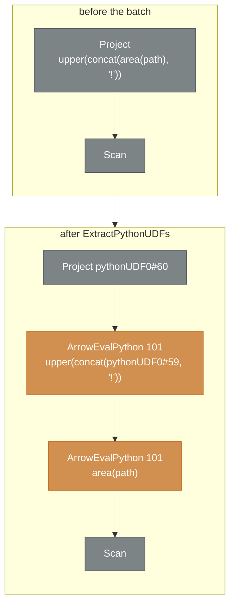

# Chapter 56: How Catalyst plans Python

[Chapter 1](ch01-how-spark-runs.md) showed that a Python UDF adds an `ArrowEvalPython` operator to a plan, and that the operator sends rows to Python processes. This chapter looks inside the planner and asks why that operator is where it is. The answers explain a set of effects that users see but cannot explain from the documentation:

- A filter that you wrote after a UDF goes to the Parquet scan, but a filter on the UDF result does not.
- A UDF that you call once runs more times than there are rows.
- A second UDF in the same `select` sometimes joins the first operator and sometimes gets its own operator.
- Whole-stage code generation stops at each Python operator.

**For Catalyst, a Python UDF is an expression that it cannot evaluate. The optimizer moves other expressions around it, and it can copy it. At the end of optimization, one batch of rules takes each Python UDF out of its expression and puts it into a special operator. All the effects in the list above come from these two facts. In Spark 4.3, an experimental option can change some UDFs into native expressions before the optimizer starts, and then none of these effects occur.**

The method of this chapter is the method of the whole part. Read the source at the `v4.3.0` tag, and then run something that shows the behavior. Each source excerpt names its file in the [apache/spark](https://github.com/apache/spark/tree/v4.3.0) repository at that tag. The scripts are in [`code/ch56`](https://github.com/lisancao/spark-masterclass/tree/main/code/ch56), and each output block comes from `code/ch56/output/`. Most scripts use Py4J to reach JVM objects, so they need a Classic session. Step 10 uses Spark Connect.

## The running example

The data is a web server log with 200 requests, from the SparkTutor course. Each line has a client address, a time, a request and a status code:

```text
10.0.2.238 - - [01/Oct/2026:10:00:00 +0000] "GET /?session=s1 HTTP/1.1" 404 7708 "-" "Mozilla/5.0"
10.0.0.19 - - [01/Oct/2026:10:00:01 +0000] "GET /api/orders/42?session=s9 HTTP/1.1" 302 2370 "-" "Mozilla/5.0"
10.0.2.226 - - [01/Oct/2026:10:00:02 +0000] "GET /cart?session=s12 HTTP/1.1" 200 4869 "-" "Mozilla/5.0"
```

`code/ch56/logs.py` parses the log with a regular expression and writes three columns (`ip`, `path`, `status`) to a Parquet file. Each script reads that file, so each plan has a real file scan, with pushed filters. The UDF is plain Python. It returns the first part of the path, which this chapter calls the area:

```python
def _area(path):
    # "/api/orders/42?session=s9" -> "api"; "/?session=s1" -> "home"
    return path.split("?")[0].split("/")[1] or "home"
```

The log has 98 requests with status 200, and 31 of these requests are in the `api` area. There are 70 `api` requests in total. These numbers are the key to Step 7.

## Step 1: The phases of a query

A DataFrame holds a `QueryExecution`, and the `QueryExecution` holds the plan in each phase. `explain("extended")` prints four of the phases:

```python
q = df.filter((F.col("status") == 200) & (area("path") == "api"))
q.explain("extended")
```

```text
== Parsed Logical Plan ==
'Filter 'and('`=`('status, 200), '`=`(_area('path)#33, api))
+- Relation [ip#6,path#7,status#8] parquet

== Analyzed Logical Plan ==
ip: string, path: string, status: int
Filter ((status#8 = 200) AND (_area(path#7)#33 = api))
+- Relation [ip#6,path#7,status#8] parquet

== Optimized Logical Plan ==
Project [ip#6, path#7, status#8]
+- Filter (pythonUDF0#34 = api)
   +- ArrowEvalPython [_area(path#7)#33], [pythonUDF0#34], 101
      +- Filter (isnotnull(status#8) AND (status#8 = 200))
         +- Relation [ip#6,path#7,status#8] parquet

== Physical Plan ==
*(2) Project [ip#6, path#7, status#8]
+- *(2) Filter (pythonUDF0#34 = api)
   +- ArrowEvalPython [_area(path#7)#33], [pythonUDF0#34], 101
      +- *(1) Filter (isnotnull(status#8) AND (status#8 = 200))
         +- *(1) ColumnarToRow
            +- FileScan parquet [ip#6,path#7,status#8] Batched: true, DataFilters: [isnotnull(status#8), (status#8 = 200)], Format: Parquet, Location: InMemoryFileIndex(1 paths)[file:/tmp/ch56-z9d7w4ly/access], PartitionFilters: [], PushedFilters: [IsNotNull(status), EqualTo(status,200)], ReadSchema: struct<ip:string,path:string,status:int>
```

Each phase does one job:

- **Parsed.** The plan from your code, with no names resolved. A quote mark (`'status`, `'Filter`) marks a node or a name that the analyzer did not resolve yet.
- **Analyzed.** The analyzer looked up each name against the schema of the file. Each column now has an expression ID: `status#8` is one specific attribute, and `#8` is its identity in all later plans. The UDF call is `_area(path#7)#33`. The `#33` is the ID of the UDF result.
- **Optimized.** The optimizer split the `AND` into two filters. It moved the `status` filter down, next to the scan, and it added `isnotnull`. Then it took the UDF out of the filter and put it into an `ArrowEvalPython` operator. The filter now compares `pythonUDF0#34`, a new attribute that the operator produces.
- **Physical.** The planner chose an implementation for each node. The status filter became `PushedFilters` in the scan. The `*(1)` and `*(2)` marks show two separate units of whole-stage code generation, one on each side of the Python operator.

The physical plan also shows `101` at the end of the `ArrowEvalPython` line. This number is the **eval type**, and Step 4 is about it.

```mermaid
flowchart LR
  classDef ph fill:#3a5f96,fill-opacity:0.72,stroke:#3a5f96,color:#ffffff
  classDef py fill:#c0661a,fill-opacity:0.72,stroke:#c0661a,color:#ffffff
  code["DataFrame calls"]:::ph --> parsed["logical<br/>(unresolved)"]:::ph
  parsed -->|"Analyzer"| analyzed["analyzed"]:::ph
  analyzed -->|"Optimizer batches"| opt1["optimized<br/>(UDF still inside<br/>an expression)"]:::ph
  opt1 -->|"batch: Extract Python UDFs"| opt2["optimizedPlan<br/>(ArrowEvalPython node)"]:::py
  opt2 -->|"SparkPlanner<br/>strategy PythonEvals"| sp["sparkPlan"]:::ph
  sp -->|"preparations:<br/>codegen, AQE"| ex["executedPlan"]:::ph
```



## Step 2: The phases are JVM objects

The text of a plan is good for a person. But a test or a tool can read the plan as objects. In a Classic session, `df._jdf.queryExecution()` returns the JVM `QueryExecution` through Py4J. Each phase is a lazy field. This excerpt is from `sql/core/src/main/scala/org/apache/spark/sql/execution/QueryExecution.scala`:

```scala
  private val lazyOptimizedPlan = LazyTry {
    // We need to materialize the commandExecuted here because optimizedPlan is also tracked under
    // the optimizing phase
    assertCommandExecuted()
    executePhase(QueryPlanningTracker.OPTIMIZATION) {
      // clone the plan to avoid sharing the plan instance between different stages like analyzing,
      // optimizing and planning.
      val plan =
        sparkSession.sessionState.optimizer.executeAndTrack(withCachedData.clone(), tracker)
```

Each phase calls the phase before it, and `executePhase` records the time of each phase in a tracker. `phases.py` reads the class of each phase, walks the executed plan with the `TreeNode` API (`nodeName()`, `children()`), and reads the tracker:

```python
def walk(plan, depth=0):
    """Every node of a physical plan, top-down, descending into AdaptiveSparkPlan by hand."""
    yield depth, plan
    if plan.nodeName() == "AdaptiveSparkPlan":
        yield from walk(plan.executedPlan(), depth + 1)
        return
    children = plan.children()
    for i in range(children.length()):
        yield from walk(children.apply(i), depth + 1)
```

```text
logical       org.apache.spark.sql.catalyst.plans.logical.Filter
analyzed      org.apache.spark.sql.catalyst.plans.logical.Filter
optimizedPlan org.apache.spark.sql.catalyst.plans.logical.Project
sparkPlan     org.apache.spark.sql.execution.ProjectExec
executedPlan  org.apache.spark.sql.execution.WholeStageCodegenExec

The executed plan as a tree of JVM objects:
  'WholeStageCodegen (2)'
    'Project'
      'Filter'
        'InputAdapter'
          'ArrowEvalPython'
            'WholeStageCodegen (1)'
              'Filter'
                'ColumnarToRow'
                  'InputAdapter'
                    'Scan parquet '

qe.tracker().phases():
  planning        3 ms
  optimization    5 ms
  analysis        3 ms
```

Two details in this output are traps for a test that reads plans:

- **Node names are not the text of `explain()`.** The scan prints as `FileScan parquet` in `explain()`, but its `nodeName()` is `Scan parquet ` (with a space at the end). A test that compares node names must use the names of the tree, not of the text.
- **`AdaptiveSparkPlan` hides its children.** Its `children()` is empty. The current plan is in the `executedPlan()` method of the node, so the walker goes into it by hand. This query has no shuffle, so AQE did not wrap it. The walker still needs the branch for other queries.

The tracker times change from run to run. In a second run of the same script, the three phases took 8, 10 and 7 ms. A test can use the tracker to find a slow phase, but not to assert a time.

## Step 3: Rules, batches and the plan change log

The analyzer and the optimizer are both a `RuleExecutor`. A `RuleExecutor` runs a list of **batches**. Each batch is a list of **rules**, and each rule is a function from a plan to a plan. A batch has a strategy, from `sql/catalyst/src/main/scala/org/apache/spark/sql/catalyst/rules/RuleExecutor.scala`:

```scala
  case object Once extends Strategy { val maxIterations = 1 }

  /**
   * A strategy that runs until fix point or maxIterations times, whichever comes first.
```

A `FixedPoint` batch runs its rules again and again until the plan does not change, or until it reaches the limit. The limit comes from `spark.sql.optimizer.maxIterations`, which is 100 in the session of the script. A `Once` batch runs one time.

You can watch rules work. Three settings turn on the **plan change log**:

- `spark.sql.planChangeLog.level` sets the log level of the messages.
- `spark.sql.planChangeLog.rules` limits the log to the named rules.
- `spark.sql.planChangeLog.batches` limits the log to the named batches.

`rules.py` sets them for two rules and two batches, and then it plans a query that filters on a UDF column:

```python
spark.conf.set("spark.sql.planChangeLog.level", "WARN")
spark.conf.set("spark.sql.planChangeLog.rules",
               "org.apache.spark.sql.catalyst.optimizer.PushDownPredicates,"
               "org.apache.spark.sql.execution.python.ExtractPythonUDFs")
spark.conf.set("spark.sql.planChangeLog.batches", "Operator Optimization before Inferring Filters,"
               "Extract Python UDFs")
q = df.withColumn("area", area("path")).filter(F.col("area") == "api")
```

The log prints the plan before a change on the left and after it on the right. A `!` marks each line that changed:

```text
=== Applying Rule org.apache.spark.sql.catalyst.optimizer.PushDownPredicates ===
!Filter (area#11 = api)                                            Project [ip#6, path#7, status#8, _area(path#7)#9 AS area#11]
!+- Project [ip#6, path#7, status#8, _area(path#7)#9 AS area#11]   +- Filter (_area(path#7)#9 = api)
    +- Relation [ip#6,path#7,status#8] parquet                        +- Relation [ip#6,path#7,status#8] parquet
=== Applying Rule org.apache.spark.sql.execution.python.ExtractPythonUDFs ===
!Project [ip#6, path#7, status#8, _area(path#7)#9 AS area#11]   Project [ip#6, path#7, status#8, pythonUDF0#13 AS area#11]
!+- Filter (_area(path#7)#9 = api)                              +- ArrowEvalPython [_area(path#7)#9], [pythonUDF0#13], 101
!   +- Relation [ip#6,path#7,status#8] parquet                     +- Project [ip#6, path#7, status#8]
!                                                                     +- Filter (pythonUDF0#12 = api)
!                                                                        +- ArrowEvalPython [_area(path#7)#9], [pythonUDF0#12], 101
!                                                                           +- Relation [ip#6,path#7,status#8] parquet
```

Read the two rules in sequence:

1. `PushDownPredicates` moved the filter below the projection. The filter referred to `area#11`, an alias. To move the filter, the rule replaced the alias with its definition. Thus, the filter now contains `_area(path#7)#9`, a second copy of the UDF call.
2. `ExtractPythonUDFs` found the UDF in two operators, and it made one `ArrowEvalPython` for each operator. The two operators produce `pythonUDF0#12` and `pythonUDF0#13`. They call the same function on the same rows.

This plan calls the UDF two times for each row that passes the filter. Step 7 counts the calls.

The JVM also keeps a total time for each rule in the process. `RuleExecutor.dumpTimeSpent()` returns a table. The top rows of the table, for all the queries of the script, are:

```text
=== Metrics of Analyzer/Optimizer Rules ===
Total number of runs: 1947
Total time: 0.99532005 seconds
rule (package org.apache.spark.sql. removed)               effective ns     total ns  runs
catalyst.analysis.ResolveDataSource                         461,085,608  461,314,828  2/13
execution.datasources.PushVariantIntoScan                             0   51,846,268  0/2
catalyst.analysis.Analyzer$ResolveReferences                 27,778,008   44,614,055  4/13
catalyst.analysis.Analyzer$ResolveFunctions                  18,501,811   19,703,089  2/13
catalyst.optimizer.Optimizer$FinishAnalysis                           0   18,056,478  0/2
catalyst.analysis.ResolveSessionCatalog                               0   16,630,950  0/13
```

An **effective** run is a run that changed the plan. Most rules run many times and change nothing. `ResolveDataSource` used almost half a second in two effective runs, because it opens the files to get their schema. Use this table when Spark uses more time to plan a query than to run it.

## Step 4: The PythonUDF expression and its eval type

When you call a UDF in a DataFrame expression, PySpark builds a `PythonUDF` expression on the JVM. This excerpt is from `sql/catalyst/src/main/scala/org/apache/spark/sql/catalyst/expressions/PythonUDF.scala`:

```scala
/**
 * A serialized version of a Python lambda function. This is a special expression, which needs a
 * dedicated physical operator to execute it, and thus can't be pushed down to data sources.
 */
case class PythonUDF(
    name: String,
    func: PythonFunction,
    dataType: DataType,
    children: Seq[Expression],
    evalType: Int,
    udfDeterministic: Boolean,
    resultId: ExprId = NamedExpression.newExprId)
  extends Expression with PythonFuncExpression with Unevaluable {
```

Three parts of this declaration are important:

- **`Unevaluable`.** The JVM cannot evaluate this expression. If a `PythonUDF` arrives at execution inside a normal operator, the query fails. Thus, some rule must take each one out before execution.
- **`func`.** This field holds the pickled Python function as bytes. The JVM does not read it. It sends the bytes to a Python worker, as [Chapter 57](ch57-python-worker-protocol.md) shows byte by byte.
- **`evalType`.** This number tells the worker how to call the function and how the data arrives. The values are in `core/src/main/scala/org/apache/spark/api/python/PythonRunner.scala`, in the `PythonEvalType` object.

`eval_types.py` makes one UDF of each common kind and prints the Python node of each plan:

```text
spark.sql.execution.pythonUDF.arrow.enabled = true 

udf(useArrow=False)    BatchEvalPython [_area(path#7)#9], [pythonUDF0#28]
udf (default)          ArrowEvalPython [_area(path#7)#12], [pythonUDF0#29], 101
pandas_udf, Series     ArrowEvalPython [strip_q(path#7)#14], [pythonUDF0#30], 200
pandas_udf, iterator   ArrowEvalPython [strip_q_iter(path#7)#16], [pythonUDF0#31], 204
arrow_udf              ArrowEvalPython [strip_q_arrow(path#7)#18], [pythonUDF0#32], 250
mapInPandas            MapInPandas <lambda>(ip#6, path#7, status#8)#20, [ip#21, path#22
mapInArrow             MapInArrow <lambda>(ip#6, path#7, status#8)#24, [ip#25, path#26,
```

| Eval type | Name in `PythonEvalType` | Python API | Data to the worker |
|---|---|---|---|
| 100 | `SQL_BATCHED_UDF` | `@udf(useArrow=False)` | pickled rows |
| 101 | `SQL_ARROW_BATCHED_UDF` | `@udf` (the default) | Arrow batches, function called per row |
| 200 | `SQL_SCALAR_PANDAS_UDF` | `@pandas_udf`, Series to Series | Arrow batches as `pandas.Series` |
| 204 | `SQL_SCALAR_PANDAS_ITER_UDF` | `@pandas_udf`, iterator of Series | an iterator of `pandas.Series` |
| 205 | `SQL_MAP_PANDAS_ITER_UDF` | `mapInPandas` | an iterator of `pandas.DataFrame` |
| 207 | `SQL_MAP_ARROW_ITER_UDF` | `mapInArrow`, and Python data source reads | an iterator of `pyarrow.RecordBatch` |
| 250 | `SQL_SCALAR_ARROW_UDF` | `@arrow_udf` | Arrow arrays |

A plain `@udf` gets eval type 101, not 100, because `spark.sql.execution.pythonUDF.arrow.enabled` is `true`. This default changed in Spark 4.2 (SPARK-54555). With `useArrow=False`, the same function gets eval type 100 and a different operator, `BatchEvalPython`. `mapInPandas` and `mapInArrow` are not expressions. They are operators of their own, and Step 8 is about them.

## Step 5: ExtractPythonUDFs, and when UDFs share one operator

The rule that takes UDFs out of expressions is in the last batch of the optimizer. This excerpt is from `sql/core/src/main/scala/org/apache/spark/sql/execution/SparkOptimizer.scala`:

```scala
    Batch("Extract Python UDFs", Once,
      ExtractPythonUDFFromJoinCondition,
      // `ExtractPythonUDFFromJoinCondition` can convert a join to a cartesian product.
      // Here, we rerun cartesian product check.
      CheckCartesianProducts,
      ExtractPythonUDFFromAggregate,
      // This must be executed after `ExtractPythonUDFFromAggregate` and before `ExtractPythonUDFs`.
      ExtractGroupingPythonUDFFromAggregate,
      ExtractPythonUDFs,
      ExtractPythonUDTFs,
      // The eval-python node may be between Project/Filter and the scan node, which breaks
      // column pruning and filter push-down. Here we rerun the related optimizer rules.
      ColumnPruning,
      LimitPushDown,
      PushPredicateThroughNonJoin,
      PushProjectionThroughLimitAndOffset,
      RemoveNoopOperators),
```

The batch runs `Once`, after all the main optimizer batches. Thus, during the main optimization, each UDF is still inside the expression where you wrote it. The optimizer can move that expression, and it can copy it (Step 3 showed a copy). The batch then runs a few rules again, because the new Python operator sits between other operators and the scan.

`ExtractPythonUDFs` makes one operator for a group of UDFs that it can **chain**. The comment on the rule, in `sql/core/src/main/scala/org/apache/spark/sql/execution/python/ExtractPythonUDFs.scala`, gives the conditions:

```scala
   * We can only fuse UDFs of the same eval type, and never UDFs of SQL_SCALAR_PANDAS_ITER_UDF.
```

```scala
    def canChainWithParallelUDFs(evalType: Int): Boolean = {
      if (evalType == PythonEvalType.SQL_SCALAR_PANDAS_ITER_UDF ||
        evalType == PythonEvalType.SQL_SCALAR_ARROW_ITER_UDF) {
        false
      } else {
        evalType == firstVisitedScalarUDFEvalType.get
      }
    }
```

The second half of `eval_types.py` tests each condition. `upper` is a second Arrow UDF (type 101), `strip_q` is a pandas UDF (type 200), and `strip_q_iter` is an iterator pandas UDF (type 204):

```text
nested, same type    upper(area(path))
  ArrowEvalPython [<lambda>(_area(path#7)#33)#34], [pythonUDF0#54], 101

siblings, same type  area(path), upper(ip)
  ArrowEvalPython [_area(path#7)#36, <lambda>(ip#6)#37], [pythonUDF0#55, pythonUDF1#56], 101

nested, 101 over 200 area(strip_q(path))
  ArrowEvalPython [_area(pythonUDF0#57)#41], [pythonUDF0#58], 101
  ArrowEvalPython [strip_q(path#7)#40], [pythonUDF0#57], 200

JVM expr between     upper(concat(area(path), '!'))
  ArrowEvalPython [<lambda>(concat(pythonUDF0#59, !))#44], [pythonUDF0#60], 101
  ArrowEvalPython [_area(path#7)#43], [pythonUDF0#59], 101

iterator siblings    strip_q_iter(path), strip_q_iter(ip)
  ArrowEvalPython [strip_q_iter(ip#6)#47], [pythonUDF0#62], 204
  ArrowEvalPython [strip_q_iter(path#7)#46], [pythonUDF0#61], 204

same call twice      area(path), area(path)
  ArrowEvalPython [_area(path#7)#50], [pythonUDF0#63], 101
```

The rules, as the plans show them:

- **Nested UDFs of one eval type fuse.** `upper(area(path))` is one operator. The worker calls `_area` and then `upper` on each row, and the intermediate value does not go back to the JVM.
- **UDFs side by side, of one eval type, fuse.** Two UDFs in one `select` share one operator and one trip to Python. The operator has two outputs.
- **Different eval types do not fuse.** The pandas UDF runs in its own operator, and its result goes back to the JVM. Then the Arrow UDF runs in a second operator.
- **A JVM expression between two UDFs stops the chain.** `concat` must run in the JVM. Thus, the inner UDF result comes back, the JVM calls `concat`, and a second operator sends the result to Python again.
- **Iterator UDFs never fuse.** Each iterator pandas UDF gets its own operator, even next to a UDF of the same type.
- **Spark evaluates identical calls one time.** Two calls with the same function and the same input share one result.



In this example, `concat` appears inside the top operator, as an argument. The JVM evaluates the arguments of a Python operator before it sends the rows. Thus, the JVM work still occurs in the JVM, but it costs a second trip across the process boundary.

## Step 6: Filters around Python

A filter can go to the scan only if it moves below the Python operator. `filters.py` plans four cases. The scan part of each line is cut to its `PushedFilters`:

```text
--- 1. a UDF next to a native condition
*(2) Project [ip#6, path#7, status#8]
+- *(2) Filter (pythonUDF0#11 = api)
   +- ArrowEvalPython [_area(path#7)#9], [pythonUDF0#11], 101
      +- *(1) Filter (isnotnull(status#8) AND (status#8 = 200))
         +- *(1) ColumnarToRow
            +- FileScan parquet [ip#6,path#7,status#8] ... PushedFilters: [IsNotNull(status), EqualTo(status,200)]

--- 2. a native filter written after a UDF column
*(2) Project [ip#6, path#7, status#8, pythonUDF0#14 AS a#13]
+- ArrowEvalPython [_area(path#7)#12], [pythonUDF0#14], 101
   +- *(1) Filter (isnotnull(status#8) AND (status#8 = 200))
      +- *(1) ColumnarToRow
         +- FileScan parquet [ip#6,path#7,status#8] ... PushedFilters: [IsNotNull(status), EqualTo(status,200)]

--- 3. the same, with the UDF nondeterministic
*(1) Project [ip#6, path#7, status#8, pythonUDF0#17 AS a#16]
+- *(1) Filter (isnotnull(status#8) AND (status#8 = 200))
   +- ArrowEvalPython [_area(path#7)#15], [pythonUDF0#17], 101
      +- FileScan parquet [ip#6,path#7,status#8] ... PushedFilters: []

--- 4a. a UDF as the predicate
*(1) Project [ip#6, path#7, status#8]
+- *(1) Filter pythonUDF0#19: boolean
   +- ArrowEvalPython [<lambda>(status#8)#18], [pythonUDF0#19], 101
      +- FileScan parquet [ip#6,path#7,status#8] ... PushedFilters: []

--- 4b. the native predicate
*(1) Filter (isnotnull(status#8) AND (status#8 < 400))
+- *(1) ColumnarToRow
   +- FileScan parquet [ip#6,path#7,status#8] ... PushedFilters: [IsNotNull(status), LessThan(status,400)]
```

Case by case:

1. **The optimizer splits an `AND`.** Each part of the condition moves on its own. The `status` part goes to the scan, and the UDF part stays above the Python operator.
2. **The order in the code does not matter.** The filter comes after the UDF column in the code. The optimizer moves it below the projection, because the filter does not use the UDF column.
3. **A nondeterministic UDF stops the filter.** With `asNondeterministic()`, the filter stays above the Python operator, and nothing goes to the scan. The scan reads all 200 rows, and the UDF runs on all of them.
4. **A UDF predicate never goes to the scan.** The Parquet reader cannot run Python. The native predicate `status < 400` goes to the scan as `LessThan(status,400)`.

Case 3 comes from a guard in `PushPredicateThroughNonJoin`, in `sql/catalyst/src/main/scala/org/apache/spark/sql/catalyst/optimizer/Optimizer.scala`:

```scala
    // SPARK-13473: We can't push the predicate down when the underlying projection output non-
    // deterministic field(s).  Non-deterministic expressions are essentially stateful. This
    // implies that, for a given input row, the output are determined by the expression's initial
    // state and all the input rows processed before. In another word, the order of input rows
    // matters for non-deterministic expressions, while pushing down predicates changes the order.
    // This also applies to Aggregate.
    case f @ Filter(condition, project @ Project(fields, grandChild))
      if fields.forall(_.deterministic) && canPushThroughCondition(grandChild, condition) =>
```

The guard looks at the whole projection: `fields.forall(_.deterministic)`. One nondeterministic field in a projection stops all filters above it, also the filters that do not use that field. Mark a UDF nondeterministic only when it is really nondeterministic, or put your filters before it in the code. Step 7 shows a correct use of this behavior.

A filter can also move through a Python operator after the batch, because the same file lists the eval-python nodes in `canPushThrough`:

```scala
    case _: BatchEvalPython => true
    case _: ArrowEvalPython => true
```

## Step 7: The UDF that runs twice

Step 3 showed that `PushDownPredicates` can copy a UDF call. `twice.py` counts the calls. The UDF adds 1 to an accumulator each time it runs, and the script reads the accumulator after each action:

```python
calls = spark.sparkContext.accumulator(0)

def counted_area(path):
    calls.add(1)
    return _area(path)

area = F.udf(counted_area, "string")
u = df.withColumn("area", area("path"))
slow = u.filter(F.col("area") == "api").filter(F.col("status") == 200)
```

<figure markdown>
  <video autoplay loop muted playsinline controls width="1280" height="720" poster="../../media/clips/ch56-twice.webp">
    <source src="../../media/clips/ch56-twice.mp4" type="video/mp4">
  </video>
  <figcaption><code>twice.py</code> counts the calls of one UDF in each query. A filter on the UDF column makes the count larger than the number of rows.</figcaption>
</figure>

```text
spark.sql.optimizer.avoidDoubleFilterEval = true
slow query: 2 ArrowEvalPython nodes

200 rows; 98 with status 200; 31 API calls among them; 70 API calls in all

  withColumn(area).collect()                           rows  200   UDF calls  200
  withColumn(area).count()                             rows  200   UDF calls    0
  slow: filter on area and status, collect()           rows   31   UDF calls  129
  filter on area only, collect()                       rows   70   UDF calls  270
  u.union(u).collect()                                 rows  400   UDF calls  400
  filter on area only, UDF nondeterministic            rows   70   UDF calls  200
  count(), UDF nondeterministic                        rows  200   UDF calls    0
```

The counts are sums of the row counts in the log:

- **270 = 200 + 70.** The filter copy runs on all 200 rows. Then 70 rows pass, and the projection copy runs on these 70 rows again.
- **129 = 98 + 31.** The `status` filter goes to the scan first, so 98 rows arrive. The filter copy runs on 98 rows, 31 rows pass, and the projection copy runs on the 31 rows.
- **0 for `count()`.** `count()` needs no column, so column pruning removes the UDF from the plan. A UDF with a side effect does not run at all.

Spark 4.2 added `spark.sql.optimizer.avoidDoubleFilterEval` (SPARK-47672), and it is `true` here. Why does the copy still occur? The rule copies an alias only when the alias is cheap. The excerpt is from `PushPredicateThroughNonJoin`:

```scala
            } else if (!used.exists(_._2.child.expensive)) {
              // If it's cheap we can push it because it might eliminate more data quickly and
              // it may also be something which could be evaluated at the storage layer.
              // We may wish to improve this heuristic in the future.
              true
```

`expensive` is `false` by default for an expression. `ScalaUDF` sets it to `true`, but `PythonUDF` does not override it in 4.3.0. Thus, for the optimizer, a Python UDF is cheap, and the configuration does not protect it. SPARK-59693 extends the protection to Python UDFs, with fix version 4.4.0 in JIRA. Until then, three rewrites make the UDF run one time for each row that needs it:

```text
Rewrites of the slow query:
  filter first, then nondeterministic UDF: 1 ArrowEvalPython node, pushed: [IsNotNull(status), EqualTo(status,200)]
    ... collect()                                      rows   31   UDF calls   98
  native functions: 0 ArrowEvalPython nodes
    ... collect()                                      rows   31   UDF calls    0

Materialize, and the cache trap:
  c = u.cache(); c.count() builds the cache            rows  200   UDF calls  200
  c.filter(area = 'api').collect()                     rows   70   UDF calls    0
  t.collect() before any cache                         rows  200   UDF calls  200
  t.cache(); t.collect() on the same object            rows  200   UDF calls  200
  t.filter(area = 'api').collect()                     rows   70   UDF calls  200
  t.collect() again                                    rows  200   UDF calls  200
  t.filter(area = 'api').collect() again               rows   70   UDF calls    0
  t.select('*').collect(), a derived DataFrame         rows  200   UDF calls    0
```

1. **Filter first, then mark the UDF nondeterministic.** The native filter is above nothing nondeterministic, so it goes to the scan. The nondeterministic UDF then stops the copy. The UDF runs on the 98 rows that need it.
2. **Use native functions.** `split`, `nullif` and `coalesce` give the same area, and no Python runs. Section "New in 4.3" below shows a method that does this change for you, for some functions.
3. **Cache the result, but before the first action.** `c.count()` runs the UDF 200 times and fills the cache. Later queries on `c` read the cache, and the UDF does not run.

The second half of that table shows a trap. `t` ran an action before `t.cache()`. After that, `t.collect()` ran the UDF 200 times, every time.

The first query of a DataFrame computes its `withCachedData` phase. The `QueryExecution` keeps that phase, because each phase is a lazy field (Step 2). Spark computed the phase of `t` before the cache existed, so `t` never reads the cache.

A new DataFrame, such as `t.filter(...)`, gets a new `QueryExecution`, and it finds the cache. The first new DataFrame fills the cache, and it costs 200 calls. Later new DataFrames read the cache and cost 0 calls. Call `cache()` on a DataFrame before its first action, or derive a new DataFrame after you call it.

## Step 8: Map and grouped operators, and Python data sources

`mapInPandas`, `mapInArrow` and `applyInPandas` are not expressions. They are logical operators, defined in `sql/catalyst/src/main/scala/org/apache/spark/sql/catalyst/plans/logical/pythonLogicalOperators.scala`. They take the whole input and produce new rows. `map_ops.py` plans three of them:

```text
--- mapInPandas, then a filter on its output
*(2) Filter (isnotnull(status#12) AND (status#12 = 200))
+- MapInPandas <lambda>(ip#6, path#7, status#8)#9, [ip#10, path#11, status#12], false
   +- *(1) ColumnarToRow
      +- FileScan parquet [ip#6,path#7,status#8] ... PushedFilters: []

--- a filter, then mapInPandas
MapInPandas <lambda>(ip#6, path#7, status#8)#14, [ip#15, path#16, status#17], false
+- *(1) Filter (isnotnull(status#8) AND (status#8 = 200))
   +- *(1) ColumnarToRow
      +- FileScan parquet [ip#6,path#7,status#8] ... PushedFilters: [IsNotNull(status), EqualTo(status,200)]

--- groupBy().applyInPandas()
AdaptiveSparkPlan isFinalPlan=false
+- FlatMapGroupsInPandas [status#8], <lambda>(ip#6, path#7, status#8)#18, [ip#19, path#20, status#21]
   +- Sort [status#8 ASC NULLS FIRST], false, 0
      +- Exchange hashpartitioning(status#8, 200), ENSURE_REQUIREMENTS, [plan_id=74]
         +- Project [status#8, ip#6, path#7, status#8]
            +- FileScan parquet [ip#6,path#7,status#8] ... PushedFilters: []
```

The output of `MapInPandas` has new expression IDs: `status#12`, not `status#8`. For the optimizer, `status#12` is a new column. It does not know that the function copies `status` through without a change. Thus, a filter after `mapInPandas` stays after it, and the scan reads all rows. The fix is the order of the code: write the filter first.

The `false` at the end of the `MapInPandas` line is the `isBarrier` flag. It is `true` only for barrier execution, where all tasks of a stage must start together.

`applyInPandas` needs all rows of a group in one task. The operator states this requirement, and the planner adds an `Exchange` on the key of the `groupBy`, and a `Sort`. The function then gets each group as one `pandas.DataFrame`. A very large group must fit in the memory of one Python worker.

A Python data source is also planned as Python. `map_ops.py` registers a small source that lists the files of the data folder, and it accepts an equality filter on `kind`. For more on this API, see the Python data sources chapters in the [roadmap](../roadmap.md). The plan is:

```text
--- Python data source, simple mode
*(1) Project [path#22]
+- *(1) Filter isnotnull(kind#23)
   +- BatchScan files[path#22, kind#23, size#24L] (Python) RuntimeFilters: []

--- Python data source, formatted mode (scan node only)
...
(1) BatchScan files
Output [3]: [path#22, kind#23, size#24L]
PushedFilters: [EqualTo(kind,json)]
ReadSchema: struct<path:string,kind:string,size:bigint>
```

The simple mode does not show the pushed filter. Use the formatted mode to see `PushedFilters` of a Python source. The source accepted `kind = 'json'`, so no `Filter` checks it again. Spark kept only `isnotnull(kind)`, which the source did not accept. The classes that plan this scan are in `sql/core/src/main/scala/org/apache/spark/sql/execution/datasources/v2/python/`:

| Class | Where it runs | What it does |
|---|---|---|
| `PythonDataSourceV2` | driver | The DSv2 provider for each Python source name. |
| `PythonTable` | driver | The table, with the schema from `schema()`. |
| `PythonScanBuilder` | driver | Calls `pushFilters` in Python, if `spark.sql.python.filterPushdown.enabled` is `true`. |
| `PythonScan`, `PythonBatch` | driver | Get the partitions and the pickled read function from Python. |
| `PythonPartitionReaderFactory` | executors | Runs the read function as eval type 207 (`mapInArrow`). |

The driver runs Python too. To call `schema()`, `pushFilters()` and `partitions()`, the driver starts short-lived Python workers through `PythonPlannerRunner`. Thus, Spark runs Python code to plan a Python data source, before any task starts.

## Step 9: Python operators and whole-stage code generation

Whole-stage code generation fuses a chain of operators into one generated Java method. An operator can be part of the chain only if it implements `CodegenSupport`. The Python operators do not. `codegen.py` prints the generated code for a query with a filter and a UDF:

```text
Found 2 WholeStageCodegen subtrees.
== Subtree 1 / 2 (maxMethodCodeSize:347; maxConstantPoolSize:150(0.23% used); numInnerClasses:0) ==
*(1) Filter (isnotnull(status#8) AND (status#8 = 200))
+- *(1) ColumnarToRow
   +- FileScan parquet [ip#6,path#7,status#8] ...
Generated code:
/* 038 */         do {
/* 039 */           boolean columnartorow_isNull_2 = columnartorow_mutableStateArray_2[2].isNullAt(columnartorow_rowIdx_0);
/* 040 */           int columnartorow_value_2 = columnartorow_isNull_2 ? -1 : (columnartorow_mutableStateArray_2[2].getInt(columnartorow_rowIdx_0));
/* 041 */
/* 042 */           boolean filter_value_2 = !columnartorow_isNull_2;
/* 043 */           if (!filter_value_2) continue;
/* 044 */
/* 045 */           boolean filter_value_3 = false;
/* 046 */           filter_value_3 = columnartorow_value_2 == 200;
/* 047 */           if (!filter_value_3) continue;
== Subtree 2 / 2 (maxMethodCodeSize:207; maxConstantPoolSize:112(0.17% used); numInnerClasses:0) ==
*(2) Project [ip#6, path#7, status#8, pythonUDF0#12 AS a#11]
+- ArrowEvalPython [_area(path#7)#10], [pythonUDF0#12], 101
   +- *(1) Filter (isnotnull(status#8) AND (status#8 = 200))
      +- *(1) ColumnarToRow
         +- FileScan parquet [ip#6,path#7,status#8] ...
```

Subtree 1 is the filter, compiled into a loop over the rows of a column batch. The `status = 200` test is one line of Java (line 046). Subtree 2 starts above the Python operator. Between the two subtrees, the rows leave generated code.

The Python operator collects them into Arrow batches, sends them to the worker and reads the results. Then the second subtree continues. The Python operator is a boundary for generated code, the same as an `Exchange`.

The second part of `codegen.py` looks at the input side of an Arrow UDF. An Arrow UDF can read directly from a vectorized Parquet scan. Then Spark can give it the column batches of the scan, with no change to rows. `spark.sql.execution.arrow.pythonUDF.columnarInput.enabled` controls this path:

```text
spark.sql.execution.arrow.pythonUDF.columnarInput.enabled = true
  @udf (101) on a column           columnar input: True   3 rows in 1.66 s
  @udf, useArrow=False (100)       columnar input: False  3 rows in 0.27 s
  pandas_udf (200) on a column     columnar input: True   3 rows in 0.36 s
    *(1) Project [pythonUDF0#34 AS <lambda>(concat(s, x))#26]
    +- ArrowEvalPython [<lambda>(concat(s#16, x))#25], [pythonUDF0#34], 101
       +- FileScan parquet [s#16] Batched: true, DataFilters: [], Format: Parquet, Location: InMemoryFileIndex(1 paths)[file:/tmp/ch56-i4h05j70/s], PartitionFilters: [], PushedFilters: [], ReadSchema: struct<s:string>
  @udf on concat(s, 'x')           columnar input: True   3 rows in 0.29 s
  @udf on n + 0                    columnar input: True   3 rows in 0.23 s
  a Filter between scan and UDF    columnar input: False  3 rows in 0.22 s
```

The script decides "columnar input" from the plan: there is no `ColumnarToRow` between the scan and the Python operator. A `Filter` between them needs rows, so it adds `ColumnarToRow`. The pickled UDF (type 100) always needs rows.

The script runs each query in a thread with a 60-second limit. On Spark 4.2.0, the columnar shapes in this table stopped and did not return: the worker waited for bytes that never came. SPARK-58241 fixed this problem in 4.2.1 and 4.3.0. [Chapter 57](ch57-python-worker-protocol.md) replays the bytes of that bug against the 4.3 worker.

## Step 10: Python UDFs over Spark Connect

On Spark Connect, the client does not plan anything. It sends an unresolved plan, and the server does all the work of Steps 1 to 9. `connect_plan.py` builds a filter with a UDF on a Connect session and prints the protobuf message that the client sends. The script removes the plan IDs and the call sites, and it cuts the pickled function to its first bytes:

```text
plan message: 1571 bytes, UDF command: 776 bytes
```

```text
    condition {
      unresolved_function {
        function_name: "=="
        arguments {
          common_inline_user_defined_function {
            function_name: "_area"
            deterministic: true
            arguments {
              unresolved_attribute {
                unparsed_identifier: "path"
                is_metadata_column: false
              }
            }
            python_udf {
              output_type {
                string {
                  collation: "UTF8_BINARY"
                }
              }
              eval_type: 101
              command: "\200\005\225\375\002\000\000\000\000\000\000\214"
              python_ver: "3.12"
            }
          }
        }
```

The UDF travels inside the plan, as a `common_inline_user_defined_function` with its pickled `command`, its eval type and the Python version of the client. Of the 1,571 bytes of the message, 776 are the pickled function. The server changes this message into the same `PythonUDF` expression as in Step 4. The excerpt is from `sql/connect/server/src/main/scala/org/apache/spark/sql/connect/planner/SparkConnectPlanner.scala`:

```scala
  private def transformPythonFunction(fun: proto.PythonUDF): SimplePythonFunction = {
    SimplePythonFunction(
      command = fun.getCommand.toByteArray.toImmutableArraySeq,
      // Empty environment variables
      envVars = new HashMap[String, String](),
      pythonExec = pythonExec,
```

The server uses its own `pythonExec`, not the Python of the client. The client sends `python_ver`, and the worker checks that its version is the same. Thus, the Python minor version of the client and of the executors must agree.

Analysis also moves to the server, and it occurs later:

```text
Connect: spark.range(3).select('nope') returned a DataFrame; no error yet
Connect: bad.columns -> AnalysisException [UNRESOLVED_COLUMN.WITH_SUGGESTION] A column, variable, or function parameter wi
Classic: select('nope') -> AnalysisException [UNRESOLVED_COLUMN.WITH_SUGGESTION] A column, variable, or function parameter wi
```

Classic analyzes each DataFrame when you build it, so the error comes from `select`. Connect sends nothing until you ask for a result or for a schema. `bad.columns` asks for the schema, so the client sends an `AnalyzePlan` request, and the error comes back then. The error is the same. Only the line of your code that gets the error is different.

## New in 4.3: Python UDF transpilation

Spark 4.3 adds an experimental optimizer feature that changes some Python UDFs into native Catalyst expressions: `spark.sql.experimental.optimizer.transpilePyUDFs`. When it works, the UDF is not Python any more. There is no Python operator, so the effects of Steps 5 to 9 do not occur. The documentation of the module, in `python/pyspark/sql/transpile.py`, gives the two conditions:

```python
"""
Experimental tools for transpiling UDFS.

Transpilation is only attempted when both
``spark.sql.experimental.optimizer.transpilePyUDFs=true`` and
``spark.sql.ansi.enabled=true``. The generated Catalyst expressions
target ANSI-mode SQL semantics (overflow raises, divide-by-zero raises,
etc.); running them under non-ANSI mode would silently diverge from the
Python interpretation in ways we don't currently track.
```

The transpiler runs in the Python client, when you create the UDF. It reads the source of the function, parses it into a Python AST, and builds a Catalyst expression from the AST. The excerpt is from `python/pyspark/sql/udf.py`:

```python
            transpile_enabled = (
                deterministic
                and evalType == PythonEvalType.SQL_BATCHED_UDF
                and _conf_is_true("spark.sql.experimental.optimizer.transpilePyUDFs", "false")
            )
```

Thus, the transpiler tries only deterministic UDFs of eval type 100. The default `@udf` is type 101 (Step 4), so you must also write `useArrow=False`. PySpark reads the configuration when you create the UDF, not when the query runs. The SQL configuration documentation adds a third limit: "This initial version only works with non-Connect Spark".

`transpile.py` shows the result. It sets the configuration, and ANSI mode is on by default in Spark 4:

```text
spark.sql.ansi.enabled = true

1. The default @udf is Arrow-optimized (eval type 101) and is not transpiled:
   evalType 101, Python node in plan: ArrowEvalPython

2. With useArrow=False (eval type 100):
   evalType 100, Python node in plan: none
== Parsed Logical Plan ==
'Filter transpiledpythonudf(is_error, is_error('status)#12, cast(CASE WHEN 'or('isNull(transpiledudfparameter(0, None, true)), 'isNull(400)) THEN 'raise_error(Python UDF transpiler: cannot compare NULL with operator `>=`; Python would raise TypeError here. Add an `is not None` guard or filter NULLs upstream.) ELSE '`>=`(transpiledudfparameter(0, None, true), 400) END as boolean), List(numeric))
+- Relation [ip#6,path#7,status#8] parquet
...
== Optimized Logical Plan ==
Filter CASE WHEN isnull(status#8) THEN cast(raise_error(USER_RAISED_EXCEPTION, map(keys: [errorMessage], values: [Python UDF transpiler: cannot compare NULL with operator `>=`; Python would raise TypeError here. Add an `is not None` guard or filter NULLs upstream.]), NullType) as boolean) ELSE (status#8 >= 400) END
+- Relation [ip#6,path#7,status#8] parquet
```

The function was `return status >= 400`. The parsed plan holds a `TranspiledPythonUDF` expression. It carries two things: the original Python UDF, and the transpiled options (here one option, for numeric input).

The first optimizer batch, "Convert python UDFs to Catalyst", runs the rule `ConvertToCatalyst`. That rule puts the option into the plan in place of the UDF. If no option fits the real input types, the rule keeps the Python UDF. The comment in `Optimizer.scala` gives the reason for its position:

```scala
    // UDF substitution rules should be executed before any other optimization rules
    // so that the substituted Catalyst alternatives go through the same finalization
    // (FinishAnalysis, RewriteWithExpression, etc.) and downstream optimization as
    // any other expression.
```

The transpiled expression copies Python behavior also for NULL. In Python, `None >= 400` raises `TypeError`. The transpiled version raises an error for a NULL `status`. Thus, the CASE expression cannot go to the scan, and the Parquet scan has `PushedFilters: []`. If you add an `is not None` guard to the function, the transpiler adds `isnotnull(status)`, and that part goes to the scan:

```text
   with an `is not None` guard in the function:
   *(1) Filter (isnotnull(status#8) AND CASE WHEN isnull(status#8) THEN cast(raise_error(USER_RAISED_EXCEPTION, map(keys: [errorMessage], values: [Python UDF transpiler: cannot compare NULL with operator `>=`; Python would raise TypeError here. Add an `is not None` guard or filter NULLs upstream.]), NullType) as boolean) ELSE (status#8 >= 400) END)
   +- *(1) ColumnarToRow
      +- FileScan parquet [ip#6,path#7,status#8] ... PushedFilters: [IsNotNull(status)]
   rows with status >= 400: 78
```

Not all functions transpile. When the transpiler refuses a function, it gives a warning with the reason, and the UDF stays Python. The script catches each warning:

<figure markdown>
  <video autoplay loop muted playsinline controls width="1280" height="720" poster="../../media/clips/ch56-transpile.webp">
    <source src="../../media/clips/ch56-transpile.mp4" type="video/mp4">
  </video>
  <figcaption><code>transpile.py</code> creates seven UDFs with transpilation on. Some become native expressions, and the others stay Python with a reason.</figcaption>
</figure>

```text
3. What the transpiler lowers:

  named lambda    shout = lambda s: s + '!'    native       
      *(1) Project [concat(path#7, !) AS out#22]
  inline lambda   udf(lambda s: s + '!')       stays Python 
      the source read for this lambda does not define it as a statement of its own -- it
      is wrapped in a call or a tuple assignment, or a surrounding definition, or the
  one expression  band(fare)                   native       
      *(1) Project [CASE WHEN coalesce(CASE WHEN isnull(status#8) THEN
      cast(raise_error(USER_RAISED_EXCEPTION, map(keys: [errorMessage], values: [Python
  two statements  band_statements(fare)        stays Python 
      functions with more than one top-level statement are not supported by the
      transpiler', 'functions with more than one top-level statement are not supported
  len(s)                                       native       
      *(1) Project [CASE WHEN isnull(path#7) THEN
      cast(raise_error(USER_RAISED_EXCEPTION, map(keys: [errorMessage], values: [Python
  str.split                                    stays Python 
      a numeric-typed lowering does not match the declared return type string; the
      interpreted path would return NULL where the lowered cast would convert (or fail),
  math.sqrt                                    stays Python 
      AST node Call is not supported by the transpiler
      (Call(func=Attribute(value=Name(id='math', ctx=Load()), attr='sqrt', ctx=Load()),
```

In summary, for 4.3.0:

- **A lambda transpiles only with a name and a line of its own.** `shout = lambda s: s + '!'` works. The same lambda inside `udf(...)` does not, because the source does not show which lambda is the UDF.
- **One expression transpiles. Two statements do not.** A conditional expression (`a if c else b`) becomes `CASE WHEN`. The same logic as an `if` statement and a `return` stays Python.
- **A few built-ins transpile.** `len(s)` becomes `length` for a string (SPARK-55214). Method calls such as `str.split` and module calls such as `math.sqrt` stay Python.
- **`+` depends on the type.** For an untyped parameter, the transpiler makes one option for numbers and one for strings. Here, the string option of `shout` became `concat`.

The last part of the script shows the most important difference. The transpiled expression follows ANSI SQL, not Python:

```text
4. ANSI semantics, not Python semantics:
  interpreted  None
  transpiled   ArithmeticException: [ARITHMETIC_OVERFLOW] overflow. Use 'try_multiply' to tolerate overflo
```

The input is 2<sup>62</sup>, and the function is `x * 2`. Python has integers with no size limit, so it returns 2<sup>63</sup>. That value does not fit in a `long`, and the pickled UDF returns NULL with no error. The transpiled version multiplies two `long` values, and ANSI mode raises an overflow error. Neither result is 2<sup>63</sup>. But the two versions of the same function give different results, and the documentation of the configuration names overflow as a known difference.

!!! warning "Do a test of each transpiled UDF against its Python version"
    Transpilation is experimental in 4.3.0. A transpiled UDF can give an error or a value where the Python UDF gives a different value. Before you enable it for a production job, compare the two results on real data.

What does transpilation save? `bench_transpile.py` computes the same fare band on 3.8 million taxi trips in four ways, with one warm-up run and then the median of five runs:

```text
BENCH_PLACEHOLDER
```

## The whole chapter, on one page

- **A query goes through phases.** Each phase is a lazy field of `QueryExecution`. `explain("extended")` prints them, and `df._jdf.queryExecution()` gives them as JVM objects in a Classic session.
- **The optimizer is batches of rules.** The plan change log shows each change, and `RuleExecutor.dumpTimeSpent()` shows the cost of each rule.
- **A Python UDF is an `Unevaluable` expression.** Its eval type tells the worker how data arrives. A plain `@udf` is type 101 (Arrow) by default since 4.2.
- **The "Extract Python UDFs" batch runs last, one time.** Before it, the optimizer moves and copies UDF calls like any other expression. `ExtractPythonUDFs` then fuses UDFs of one eval type into one operator, if they have no JVM expression between them.
- **Filters move around Python operators.** A native filter goes to the scan. A UDF predicate, a filter on the output of `mapInPandas`, and any filter above a nondeterministic UDF do not.
- **A filter on a UDF column runs the UDF two times.** In 4.3.0, `avoidDoubleFilterEval` does not cover Python UDFs. Filter first, use native functions, or cache before the first action.
- **Python operators split whole-stage code generation.** An Arrow UDF directly over a Parquet scan can read column batches with no change to rows.
- **On Connect, the UDF travels inside the plan.** The server plans it, and analysis errors come when you ask for a result or a schema.
- **4.3 can transpile simple UDFs.** With `transpilePyUDFs`, ANSI mode and `useArrow=False`, a one-expression UDF can become native. Then there is no Python operator at all.

The next chapter follows the rows into the Python operator. It records the bytes between the JVM and the worker, and it shows how each part of that protocol can fail.

## Further reading

- [PySpark UDF documentation](https://spark.apache.org/docs/4.3.0/api/python/user_guide/udfandudtf.html), the user guide for UDFs, pandas UDFs and Arrow UDFs.
- [`ExtractPythonUDFs.scala` at v4.3.0](https://github.com/apache/spark/blob/v4.3.0/sql/core/src/main/scala/org/apache/spark/sql/execution/python/ExtractPythonUDFs.scala), the rule of Steps 5 and 6.
- [`transpile.py` at v4.3.0](https://github.com/apache/spark/blob/v4.3.0/python/pyspark/sql/transpile.py), with the full list of transpiler rules in its module documentation.
- [SPARK-59693](https://issues.apache.org/jira/browse/SPARK-59693), double evaluation of Python UDFs under a filter, fixed for 4.4.0.
