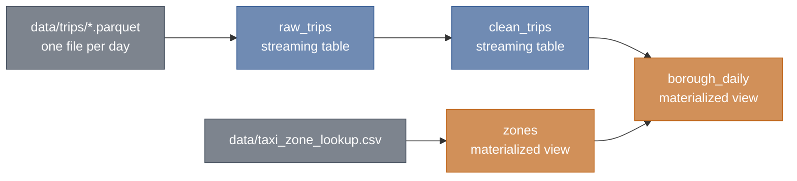
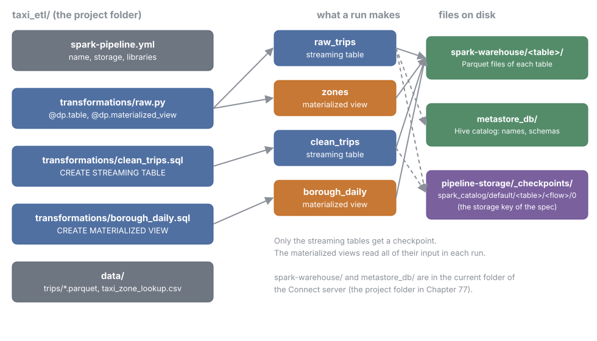
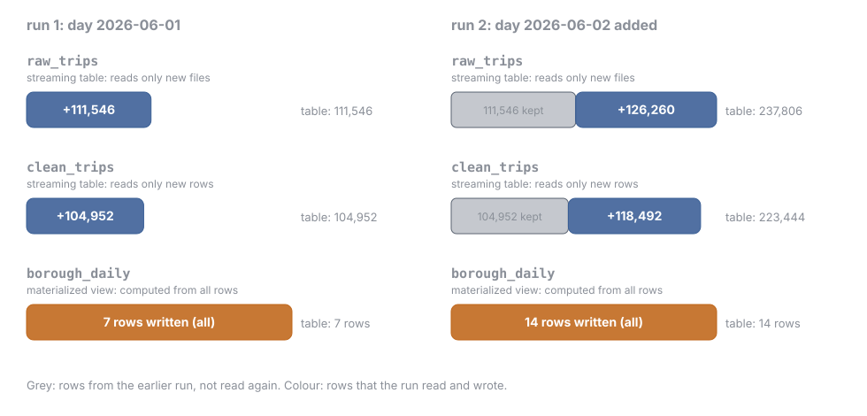
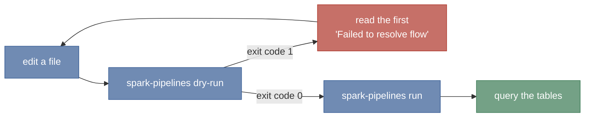

# Chapter 56: Your first ETL pipeline

This chapter is a tutorial. You start with an empty folder. At the end, you have a pipeline that reads raw taxi trips, cleans them and makes a daily summary. You run it two times and examine what each run read. Then you break one file on purpose and read the error.

**A Spark Declarative Pipelines (SDP) project is a folder with a spec file and some source files. Each source file declares tables. `spark-pipelines run` finds the order of the tables, writes them, and records the progress of each streaming table. Thus, the second run reads only the new data.**

This chapter only does the work, one short step at a time. The next chapters explain each part in more detail:

- [Chapter 57](ch57-pipelines-cli-project.md): the CLI and the project.
- [Chapter 58](ch58-configuring-pipelines.md): the configuration.
- [Chapter 59](ch59-declarative-pipelines.md): the model of tables and flows.

The code is in [`code/ch56`](https://github.com/open-lakehouse/spark-masterclass/tree/main/code/ch56). `tutorial.sh` does each step of this chapter in a new folder. It saves the commands and their output in `code/ch56/output/`. Each output block below comes from these files. The runs use `pyspark==4.3.0`, Python 3.12 and Java 17.

## What you build

The pipeline has four tables. Two tables hold the raw data, one table holds the clean trips, and one table holds the summary:



The blue boxes are *streaming tables*. A streaming table reads only the rows that are new since the last run, and adds them. The orange boxes are *materialized views*. A run computes a materialized view again from all of its input. [Chapter 59](ch59-declarative-pipelines.md) compares the types in detail.

## Step 1: Make a folder and install PySpark

Make an empty folder, and go into it. Then make a Python virtual environment, and install PySpark with the `pipelines` extra:

```text
$ python3 -m venv .venv

$ source .venv/bin/activate

$ pip install --quiet "pyspark[pipelines]==4.3.0" "pandas<3"

$ pip list 2>/dev/null | grep -i -E "^(pyspark|pyyaml|grpcio |pandas|pyarrow) "
grpcio                   1.85.3
pandas                   2.3.3
pyarrow                  26.0.1
pyspark                  4.3.0
PyYAML                   6.0.4
```

The `pipelines` extra adds PyYAML, because the spec file is YAML. It also adds the Spark Connect client packages, because a pipeline always runs on Spark Connect. PySpark 4.3.0 prints a warning with pandas 3, so this tutorial installs pandas 2. You also need Java 17 or later, as [Chapter 6](ch06-installing.md) explains.

The install gives you the command `spark-pipelines`. It has three subcommands:

```text
$ spark-pipelines --help
usage: cli.py [-h] {run,dry-run,init} ...
Pipelines CLI
positional arguments:
  {run,dry-run,init}
    run               Run a pipeline. If no refresh options specified, a
                      default incremental update is performed.
    dry-run           Launch a run that just validates the graph and checks
                      for errors.
    init              Generate a sample pipeline project, with a spec file and
                      example transformations.
options:
  -h, --help          show this help message and exit
```

## Step 2: Make the project

`spark-pipelines init` makes a project folder with a spec file and two example files:

```text
$ spark-pipelines init --name taxi_etl
Pipeline project 'taxi_etl' created successfully. To run your pipeline:
cd 'taxi_etl'
spark-pipelines run

$ cd taxi_etl

$ find . -type f | sort
./spark-pipeline.yml
./transformations/example_python_materialized_view.py
./transformations/example_sql_materialized_view.sql

$ cat spark-pipeline.yml
name: taxi_etl
storage: file://~/spark-masterclass/data/work/sdp/ch56/taxi_etl/pipeline-storage
libraries:
  - glob:
      include: transformations/**

$ rm transformations/example_*
```

The spec has three keys:

- `name` is the name of the pipeline.
- `storage` is the folder for the checkpoints of the streaming tables. `init` writes an absolute `file://` path to a `pipeline-storage` folder in the project.
- `libraries` tells the CLI which source files to load. Here, it loads all files in `transformations/`.

The last command removes the two example files, because this tutorial writes its own files. The spec stays as `init` wrote it.

## Step 3: Add the raw data

The pipeline reads two inputs: the taxi zone lookup (a CSV file) and the trips (Parquet files). Put the trips in one file for each day. Then you can add a day later and see what the next run reads.

`make_days.py` copies days from the June 2026 file that [Chapter 6](ch06-installing.md) downloads. It uses only PyArrow:

```text
$ mkdir -p data

$ cp "$BOOK_DATA/nyc-taxi/taxi_zone_lookup.csv" data/

$ python make_days.py data/trips 2026-06-01
trips_2026-06-01.parquet: 111,546 trips

$ ls -sh data data/trips
data:
total 20K
 16K taxi_zone_lookup.csv
4.0K trips
data/trips:
total 2.2M
2.2M trips_2026-06-01.parquet
```

The project now has one day of trips. Later, in Step 9, you add the second day.

## Step 4: Declare the raw tables in Python

Make the file `transformations/raw.py`:

```python
from pyspark import pipelines as dp
from pyspark.sql import DataFrame, SparkSession

spark: SparkSession   # the CLI puts the session here. This line only helps your editor.

TRIP_SCHEMA = """
    VendorID INT, tpep_pickup_datetime TIMESTAMP_NTZ, tpep_dropoff_datetime TIMESTAMP_NTZ,
    passenger_count BIGINT, trip_distance DOUBLE, PULocationID INT, DOLocationID INT,
    payment_type BIGINT, fare_amount DOUBLE, tip_amount DOUBLE, total_amount DOUBLE
"""


@dp.table(comment="Every taxi trip, as it arrived. Each run reads only the new files.")
def raw_trips() -> DataFrame:
    return spark.readStream.schema(TRIP_SCHEMA).parquet("data/trips")


@dp.materialized_view(comment="The taxi zone lookup: zone ID to borough and zone name")
def zones() -> DataFrame:
    return (spark.read.option("header", True)
            .schema("LocationID INT, Borough STRING, Zone STRING, service_zone STRING")
            .csv("data/taxi_zone_lookup.csv"))
```

Each function returns a DataFrame. The name of the function becomes the name of the table. The decorator tells SDP the type of the table:

- `@dp.table` with `spark.readStream` makes a streaming table. The stream reads each Parquet file in `data/trips` one time.
- `@dp.materialized_view` with `spark.read` makes a materialized view. Each run reads the full CSV file again.

The functions do not write data. They do not select a save mode or a checkpoint path. SDP does these things.

A streaming file source needs a schema, so the file gives one. The schema has only the columns that the pipeline uses. The Parquet reader reads only these columns from the files.

## Step 5: Clean the trips and make a summary in SQL

You can write a table in SQL, in the same project. Make the file `transformations/clean_trips.sql`:

```sql
CREATE STREAMING TABLE clean_trips
COMMENT 'Trips with a possible fare, distance and duration'
AS SELECT
  tpep_pickup_datetime                 AS pickup_ts,
  CAST(tpep_pickup_datetime AS DATE)   AS pickup_date,
  PULocationID                         AS pickup_zone,
  trip_distance,
  fare_amount,
  tip_amount,
  payment_type
FROM STREAM raw_trips
WHERE fare_amount > 0
  AND trip_distance BETWEEN 0.1 AND 100
  AND tpep_dropoff_datetime > tpep_pickup_datetime;
```

`FROM STREAM raw_trips` reads `raw_trips` as a stream. Thus, `clean_trips` also gets only the new rows in each run. The filter removes trips with no fare, an impossible distance or a negative duration. [Chapter 7](ch07-quick-start.md) shows why these rows are in the data.

Then make the file `transformations/borough_daily.sql`:

```sql
CREATE MATERIALIZED VIEW borough_daily
COMMENT 'Trips and average fare for each pickup borough and day'
AS SELECT
  c.pickup_date,
  z.Borough                     AS borough,
  count(*)                      AS trips,
  round(avg(c.fare_amount), 2)  AS avg_fare
FROM clean_trips c
JOIN zones z ON c.pickup_zone = z.LocationID
GROUP BY c.pickup_date, z.Borough;
```

This table reads `clean_trips` from SQL and `zones` from Python. The language of a file is not important. All files of the project make one graph. The project now has these files:

```text
$ find transformations -type f | sort
transformations/borough_daily.sql
transformations/clean_trips.sql
transformations/raw.py
```

<figure markdown>
  
  <figcaption>The project, and what each file becomes after a run. The names and folders come from the output of Steps 4 to 8.</figcaption>
</figure>

## Step 6: Start a Spark Connect server

The CLI is a Spark Connect client. If you do not give it a server, it starts a local server for one run, and stops the server after the run. This tutorial starts its own server one time, for three reasons:

- The server keeps a Hive metastore. Thus, the tables stay in the catalog after a run, and the second run can update them.
- You can query the tables through the same server after a run.
- Each run is faster, because the JVM is already started.

The pip install includes the scripts that start a server. Start the server in the project folder:

```text
$ SPARK_HOME=$(python -c "import os, pyspark; print(os.path.dirname(pyspark.__file__))")

$ $SPARK_HOME/sbin/start-connect-server.sh --conf spark.connect.grpc.binding.port=15104 --conf spark.sql.catalogImplementation=hive --conf spark.ui.port=4144 | sed "s#$W#.#"
starting org.apache.spark.sql.connect.service.SparkConnectServer, logging to ./run/spark-lnc-org.apache.spark.sql.connect.service.SparkConnectServer-1-systemsnull.out

$ export SPARK_REMOTE=sc://localhost:15104
```

The options do these things:

- `spark.connect.grpc.binding.port=15104` sets the port. The default port is 15002. The book uses a different port for each chapter.
- `spark.sql.catalogImplementation=hive` keeps the catalog in a Derby database, `metastore_db/`, in the current folder of the server. Without it, the catalog is in memory and forgets the tables when the server stops. Then the next run fails with `LOCATION_ALREADY_EXISTS`, because the folders of the old tables are still in `spark-warehouse/` (`code/ch59/output/run_default.txt`).
- `spark.ui.port=4144` sets the port of the Spark UI.

!!! warning "Caution: start the server in the project folder"

    The server reads relative paths, such as `data/trips`, from its own current folder. If you start it in a different folder, the run fails with `PATH_NOT_FOUND`. [Chapter 57](ch57-pipelines-cli-project.md) shows this error.

## Step 7: Check the pipeline, then run it

First, do a dry run. A dry run loads all files and checks the full graph. It does not read or write data:

```text
$ spark-pipelines dry-run --remote $SPARK_REMOTE; echo "exit code: $?"
2026-11-22 10:08:53: Loading pipeline spec from ~/spark-masterclass/data/work/sdp/ch56/taxi_etl/spark-pipeline.yml...
2026-11-22 10:08:53: Creating Spark session...
2026-11-22 10:08:54: Creating dataflow graph...
2026-11-22 10:08:58: Registering graph elements...
2026-11-22 10:08:58: Loading definitions. Root directory: '~/spark-masterclass/data/work/sdp/ch56/taxi_etl'.
2026-11-22 10:08:58: Found 3 files matching glob 'transformations/**/*'
2026-11-22 10:08:58: Registering SQL file ~/spark-masterclass/data/work/sdp/ch56/taxi_etl/transformations/borough_daily.sql...
2026-11-22 10:08:58: Registering SQL file ~/spark-masterclass/data/work/sdp/ch56/taxi_etl/transformations/clean_trips.sql...
2026-11-22 10:08:58: Importing ~/spark-masterclass/data/work/sdp/ch56/taxi_etl/transformations/raw.py...
2026-11-22 10:08:59: Starting run...
2026-11-22 18:08:59: Run is COMPLETED.
exit code: 0
```

The CLI found the spec in the current folder and the three files. The SQL file `borough_daily.sql` loaded before `clean_trips.sql`, although it reads `clean_trips`. The order of the files is not important. The server finds the order of the tables from the graph.

The time moves by eight hours at `Run is COMPLETED`. The CLI prints its own lines in the local time of your machine. It prints the events from the server in UTC (`handle_pipeline_events` in `python/pyspark/pipelines/spark_connect_pipeline.py`).

Now run the pipeline:

```text
$ spark-pipelines run --remote $SPARK_REMOTE; echo "exit code: $?"
2026-11-22 10:09:01: Loading pipeline spec from ~/spark-masterclass/data/work/sdp/ch56/taxi_etl/spark-pipeline.yml...
...
2026-11-22 10:09:01: Starting run...
2026-11-22 18:09:02: Flow spark_catalog.default.raw_trips is QUEUED.
2026-11-22 18:09:02: Flow spark_catalog.default.zones is QUEUED.
2026-11-22 18:09:02: Flow spark_catalog.default.clean_trips is QUEUED.
2026-11-22 18:09:02: Flow spark_catalog.default.borough_daily is QUEUED.
2026-11-22 18:09:02: Flow spark_catalog.default.raw_trips is STARTING.
2026-11-22 18:09:02: Flow spark_catalog.default.raw_trips is RUNNING.
2026-11-22 18:09:02: Flow spark_catalog.default.zones is PLANNING.
2026-11-22 18:09:02: Flow spark_catalog.default.zones is STARTING.
2026-11-22 18:09:02: Flow spark_catalog.default.zones is RUNNING.
2026-11-22 18:09:03: Flow spark_catalog.default.zones has COMPLETED.
2026-11-22 18:09:03: Flow spark_catalog.default.raw_trips has COMPLETED.
2026-11-22 18:09:04: Flow spark_catalog.default.clean_trips is STARTING.
2026-11-22 18:09:04: Flow spark_catalog.default.clean_trips is RUNNING.
2026-11-22 18:09:04: Flow spark_catalog.default.clean_trips has COMPLETED.
2026-11-22 18:09:05: Flow spark_catalog.default.borough_daily is PLANNING.
2026-11-22 18:09:05: Flow spark_catalog.default.borough_daily is STARTING.
2026-11-22 18:09:05: Flow spark_catalog.default.borough_daily is RUNNING.
2026-11-22 18:09:06: Flow spark_catalog.default.borough_daily has COMPLETED.
2026-11-22 18:09:07: Run is COMPLETED.
exit code: 0
```

The lines before `Starting run...` are the same as in the dry run. Each line after it is an event for one *flow*. A flow is the query that fills one table. Each flow goes through the states `QUEUED`, `STARTING`, `RUNNING` and `COMPLETED`:

- `raw_trips` and `zones` have no input in the pipeline. Thus, they start at the same time.
- `clean_trips` starts only after `raw_trips` completes.
- `borough_daily` starts last, because it reads `clean_trips` and `zones`.

The full table name is `spark_catalog.default.<name>`, because the spec gives no catalog and no database. [Chapter 58](ch58-configuring-pipelines.md) changes them.

<figure markdown>
  <video autoplay loop muted playsinline controls width="1280" height="720" poster="../../media/clips/ch56-anim-run.webp">
    <source src="../../media/clips/ch56-anim-run.mp4" type="video/mp4">
  </video>
  <figcaption>What a run does. The server resolves the graph, then starts each flow when its inputs are complete, and each table gets its rows. The order of the flows comes from the run above. The time between the events is schematic.</figcaption>
</figure>

## Step 8: Examine the tables and the files

`look.py` connects to the same server and queries the tables:

```python
spark = SparkSession.builder.remote(sys.argv[1]).getOrCreate()
spark.sql("SHOW TABLES").select("tableName").show()
for t in ["raw_trips", "clean_trips", "zones", "borough_daily"]:
    print(f"{t:14} {spark.table(t).count():>9,} rows")
print()
spark.sql("""SELECT * FROM borough_daily
             WHERE borough IN ('Manhattan', 'Queens', 'Brooklyn')
             ORDER BY pickup_date, trips DESC""").show()
```

```text
$ python look.py $SPARK_REMOTE
+-------------+
|    tableName|
+-------------+
|borough_daily|
|  clean_trips|
|    raw_trips|
|        zones|
+-------------+
raw_trips        111,546 rows
clean_trips      104,952 rows
zones                265 rows
borough_daily          7 rows
+-----------+---------+-----+--------+
|pickup_date|  borough|trips|avg_fare|
+-----------+---------+-----+--------+
| 2026-06-01|Manhattan|91226|   17.25|
| 2026-06-01|   Queens|11189|   52.88|
| 2026-06-01| Brooklyn| 1984|   32.85|
+-----------+---------+-----+--------+
```

`raw_trips` has all 111,546 trips of the first day. The filter removed 6,594 trips, so `clean_trips` has 104,952 rows. The average fare in Queens is three times the average fare in Manhattan, because the airports are in Queens.

The run also made files in the project folder:

```text
$ ls
data
derby.log
look.py
make_days.py
metastore_db
pipeline-storage
spark-pipeline.yml
spark-warehouse
transformations

$ ls spark-warehouse spark-warehouse/clean_trips
spark-warehouse:
borough_daily
clean_trips
raw_trips
zones
spark-warehouse/clean_trips:
part-00000-46f9ca43-9d27-4af3-b110-a062f6273fcb-c000.snappy.parquet
_spark_metadata
```

Three new items are in the project folder:

- `spark-warehouse/` holds the data of each table, as Parquet files. A streaming table also has a `_spark_metadata` folder, the log of the file sink of Structured Streaming.
- `metastore_db/` and `derby.log` are the Hive metastore. The catalog keeps the name, the schema and the location of each table here.
- `pipeline-storage/` holds the checkpoints. The spec gave this folder as `storage`.

```text
$ find pipeline-storage -type d | sort
pipeline-storage
pipeline-storage/_checkpoints
pipeline-storage/_checkpoints/spark_catalog
pipeline-storage/_checkpoints/spark_catalog/default
pipeline-storage/_checkpoints/spark_catalog/default/clean_trips
pipeline-storage/_checkpoints/spark_catalog/default/clean_trips/clean_trips
pipeline-storage/_checkpoints/spark_catalog/default/clean_trips/clean_trips/0
pipeline-storage/_checkpoints/spark_catalog/default/clean_trips/clean_trips/0/commits
pipeline-storage/_checkpoints/spark_catalog/default/clean_trips/clean_trips/0/offsets
pipeline-storage/_checkpoints/spark_catalog/default/clean_trips/clean_trips/0/sources
pipeline-storage/_checkpoints/spark_catalog/default/clean_trips/clean_trips/0/sources/0
pipeline-storage/_checkpoints/spark_catalog/default/raw_trips
pipeline-storage/_checkpoints/spark_catalog/default/raw_trips/raw_trips
pipeline-storage/_checkpoints/spark_catalog/default/raw_trips/raw_trips/0
pipeline-storage/_checkpoints/spark_catalog/default/raw_trips/raw_trips/0/commits
pipeline-storage/_checkpoints/spark_catalog/default/raw_trips/raw_trips/0/offsets
pipeline-storage/_checkpoints/spark_catalog/default/raw_trips/raw_trips/0/sources
pipeline-storage/_checkpoints/spark_catalog/default/raw_trips/raw_trips/0/sources/0

$ cat pipeline-storage/_checkpoints/spark_catalog/default/raw_trips/raw_trips/0/sources/0/0
v1
{"path":"file://~/spark-masterclass/data/work/sdp/ch56/taxi_etl/data/trips/trips_2026-06-01.parquet","timestamp":1795370926528,"batchId":0}
```

Only the two streaming tables have a checkpoint. The path is `_checkpoints/<catalog>/<database>/<table>/<flow>/<version>`. The file `sources/0/0` lists each input file that batch 0 read. Here, it lists the file of the first day. The materialized views have no checkpoint, because each run reads all of their input again.

## Step 9: Add a day, and run again

Add the second day of June, and run the pipeline again. The command shows only the `RUNNING` and `COMPLETED` events:

```text
$ python make_days.py data/trips 2026-06-02
trips_2026-06-02.parquet: 126,260 trips

$ spark-pipelines run --remote $SPARK_REMOTE | grep -E "Flow .*(RUNNING|COMPLETED)|Run is"
2026-11-22 18:09:12: Flow spark_catalog.default.raw_trips is RUNNING.
2026-11-22 18:09:12: Flow spark_catalog.default.zones is RUNNING.
2026-11-22 18:09:13: Flow spark_catalog.default.zones has COMPLETED.
2026-11-22 18:09:13: Flow spark_catalog.default.raw_trips has COMPLETED.
2026-11-22 18:09:13: Flow spark_catalog.default.clean_trips is RUNNING.
2026-11-22 18:09:14: Flow spark_catalog.default.clean_trips has COMPLETED.
2026-11-22 18:09:14: Flow spark_catalog.default.borough_daily is RUNNING.
2026-11-22 18:09:15: Flow spark_catalog.default.borough_daily has COMPLETED.
2026-11-22 18:09:17: Run is COMPLETED.

$ python look.py $SPARK_REMOTE
...
raw_trips        237,806 rows
clean_trips      223,444 rows
zones                265 rows
borough_daily         14 rows
+-----------+---------+------+--------+
|pickup_date|  borough| trips|avg_fare|
+-----------+---------+------+--------+
| 2026-06-01|Manhattan| 91226|   17.25|
| 2026-06-01|   Queens| 11189|   52.88|
| 2026-06-01| Brooklyn|  1984|   32.85|
| 2026-06-02|Manhattan|106387|   17.73|
| 2026-06-02|   Queens|  9727|    52.5|
| 2026-06-02| Brooklyn|  1923|    32.2|
+-----------+---------+------+--------+
```

<figure markdown>
  <video autoplay loop muted playsinline controls width="1280" height="720" poster="../../media/clips/ch56-day2.webp">
    <source src="../../media/clips/ch56-day2.mp4" type="video/mp4">
  </video>
  <figcaption>A second run after the new day. <code>raw_trips</code> adds only the new trips.</figcaption>
</figure>

The counts show what is incremental:

- `raw_trips` has 237,806 rows, which is 111,546 + 126,260. The table did not read the first file again. If it did, the table would have the first day two times.
- `clean_trips` also added only the new rows: 118,492 rows from the second day.
- `borough_daily` has 14 rows. The run computed it again from all of `clean_trips`, with 7 rows for each day.
- `zones` has 265 rows again. The run read the CSV file again and replaced the table.

The checkpoint shows how `raw_trips` knew which file was new:

```text
$ ls pipeline-storage/_checkpoints/spark_catalog/default/raw_trips/raw_trips/0/commits
0
1

$ cat pipeline-storage/_checkpoints/spark_catalog/default/raw_trips/raw_trips/0/sources/0/1
v1
{"path":"file://~/spark-masterclass/data/work/sdp/ch56/taxi_etl/data/trips/trips_2026-06-02.parquet","timestamp":1795370949362,"batchId":1}

$ ls spark-warehouse/raw_trips | grep -c parquet
2
```

The second run wrote batch 1, and batch 1 read only `trips_2026-06-02.parquet`. The file source of Structured Streaming compares the files in the folder with the files in its checkpoint. It reads only the files that are not in the checkpoint. Each batch added one Parquet file to the table.

<figure markdown>
  
  <figcaption>What each run read. In run 2, the streaming tables read only the new file. The materialized view reads all of its input in each run. The numbers come from <code>code/ch56/output/</code>.</figcaption>
</figure>

!!! warning "Caution: do not delete the storage folder"

    The checkpoints in `pipeline-storage/` are the only record of the files that each streaming table read. If you delete the folder, the next run reads all files again and adds rows that the tables already have.

## Step 10: Break a transformation

Make a mistake on purpose. Change the column `fare_amount` to `fare` in `borough_daily.sql`, and run the pipeline:

```text
$ sed -i 's/avg(c.fare_amount)/avg(c.fare)/' transformations/borough_daily.sql

$ grep -n "avg(" transformations/borough_daily.sql
7:  round(avg(c.fare), 2)  AS avg_fare

$ spark-pipelines run --remote $SPARK_REMOTE; echo "exit code: $?"
...
2026-11-22 10:09:21: Starting run...
2026-11-22 18:09:21: Failed to resolve flow: 'spark_catalog.default.borough_daily'.
Error: [UNRESOLVED_COLUMN.WITH_SUGGESTION] A column, variable, or function parameter with name `c`.`fare` cannot be resolved. Did you mean one of the following? [`z`.`Zone`, `z`.`Borough`, `c`.`fare_amount`, `c`.`pickup_date`, `c`.`pickup_ts`]. SQLSTATE: 42703; line 7 pos 12;
'Aggregate [pickup_date#748, Borough#755], [pickup_date#748, Borough#755 AS borough#698, count(1) AS trips#699L, 'round('avg('c.fare), 2) AS avg_fare#700]
+- Join Inner, (pickup_zone#749 = LocationID#754)
   :- SubqueryAlias c
   :  +- SubqueryAlias spark_catalog.default.clean_trips
   :     +- LocalRelation <empty>, [pickup_ts#747, pickup_date#748, pickup_zone#749, trip_distance#750, fare_amount#751, tip_amount#752, payment_type#753L]
   +- SubqueryAlias z
      +- SubqueryAlias spark_catalog.default.zones
         +- LocalRelation <empty>, [LocationID#754, Borough#755, Zone#756, service_zone#757]
Traceback (most recent call last):
...
pyspark.errors.exceptions.connect.AnalysisException: 
Failed to resolve flows in the pipeline.
A flow can fail to resolve because the flow itself contains errors or because it reads
from an upstream flow which failed to resolve.
Flows with errors: spark_catalog.default.borough_daily
Flows that failed due to upstream errors: 
To view the exceptions that were raised while resolving these flows, look for flow
failures that precede this log.
exit code: 1
```

Read the error from the top:

1. `Failed to resolve flow` names the flow with the problem: `borough_daily`.
2. The `UNRESOLVED_COLUMN` error names the column, and it suggests `c.fare_amount`.
3. The plan shows the inputs of the flow as `LocalRelation <empty>`. The server checked the query against the schema of each input. It did not read data.
4. The last part is a summary. It lists the flows with their own errors and the flows that failed only because an input failed. Here, no other flow reads `borough_daily`, so the second list is empty.

The exit code is 1. A scheduler or a CI job can use the exit code to stop the next step.

The error came before any flow started. Thus, the run did not change a table:

```text
$ python look.py $SPARK_REMOTE | tail -12
+-----------+---------+------+--------+
|pickup_date|  borough| trips|avg_fare|
+-----------+---------+------+--------+
| 2026-06-01|Manhattan| 91226|   17.25|
| 2026-06-01|   Queens| 11189|   52.88|
| 2026-06-01| Brooklyn|  1984|   32.85|
| 2026-06-02|Manhattan|106387|   17.73|
| 2026-06-02|   Queens|  9727|    52.5|
| 2026-06-02| Brooklyn|  1923|    32.2|
+-----------+---------+------+--------+
```

An error in the data is different. If a flow fails while it runs, the run can leave a materialized view empty. [Chapter 60](ch60-medallion.md) shows this case. A dry run finds the error of this step without a run, so do a dry run after each change.

Fix the file, and run again:

```text
$ sed -i 's/avg(c.fare)/avg(c.fare_amount)/' transformations/borough_daily.sql

$ spark-pipelines run --remote $SPARK_REMOTE | grep -E "Run is"; echo "exit code: ${PIPESTATUS[0]}"
2026-11-22 18:09:29: Run is COMPLETED.
exit code: 0
```

When you are done, stop the server:

```text
$ $SPARK_HOME/sbin/stop-connect-server.sh
stopping org.apache.spark.sql.connect.service.SparkConnectServer
```



## The whole chapter, on one page

```bash
python3 -m venv .venv && source .venv/bin/activate
pip install "pyspark[pipelines]==4.3.0" "pandas<3"
spark-pipelines init --name taxi_etl && cd taxi_etl
rm transformations/example_*
# add data/ and the three files of Steps 4 and 5 to transformations/
SPARK_HOME=$(python -c "import os, pyspark; print(os.path.dirname(pyspark.__file__))")
$SPARK_HOME/sbin/start-connect-server.sh --conf spark.connect.grpc.binding.port=15104 \
  --conf spark.sql.catalogImplementation=hive      # start it in the project folder
export SPARK_REMOTE=sc://localhost:15104
spark-pipelines dry-run --remote $SPARK_REMOTE      # check the graph, read no data
spark-pipelines run --remote $SPARK_REMOTE          # first run: all data
# add a new file to data/trips
spark-pipelines run --remote $SPARK_REMOTE          # next run: only the new file
$SPARK_HOME/sbin/stop-connect-server.sh
```

- **A project is a spec and source files.** `init` writes the spec. Python and SQL files declare tables, and all of them make one graph.
- **A function or a `CREATE` statement declares a table.** It does not write data or select a mode.
- **The server finds the order.** A flow starts only when its inputs are complete.
- **Streaming tables are incremental.** The checkpoint records each file that a table read, and the next run reads only new files.
- **Each run computes the materialized views again.**
- **Use a catalog that keeps tables**, such as the Hive metastore, and keep the `storage` folder.
- **An analysis error stops the run before any flow starts**, with exit code 1. A dry run finds the same error and writes nothing.

[Chapter 57](ch57-pipelines-cli-project.md) explains each command, flag and spec key of this chapter.

## Further reading

- [Spark Declarative Pipelines programming guide](https://spark.apache.org/docs/4.3.0/declarative-pipelines-programming-guide.html), the official guide for Spark 4.3.
- [Structured Streaming programming guide](https://spark.apache.org/docs/4.3.0/streaming/index.html), for the file source and checkpoints.
