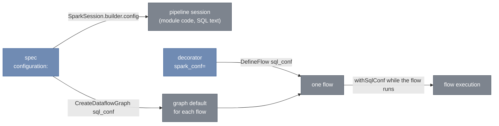
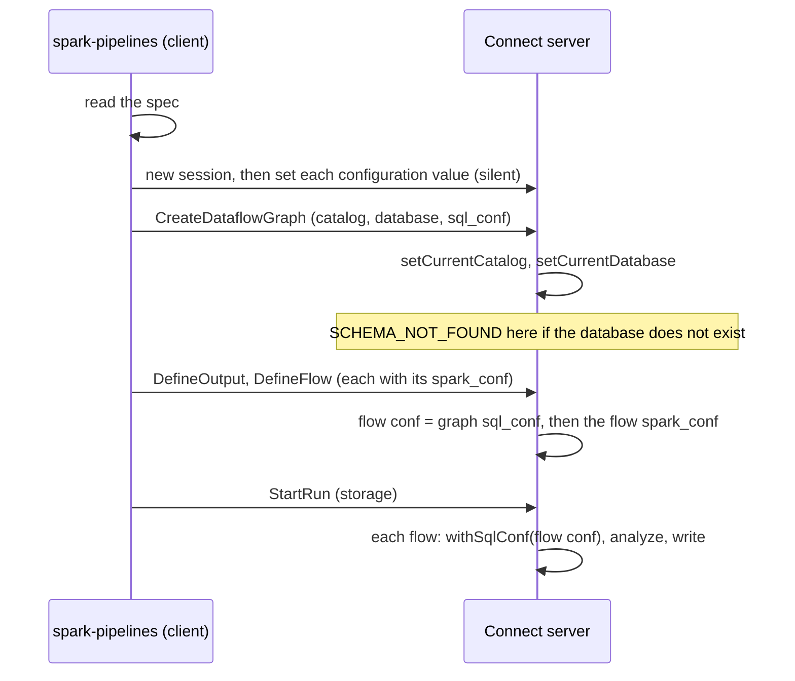
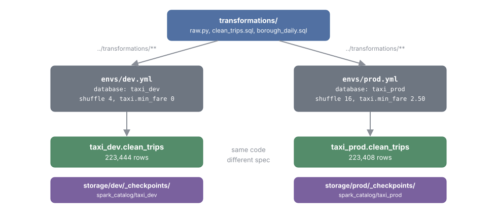
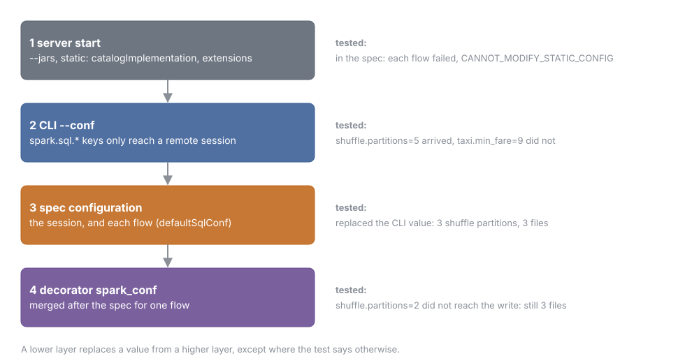

# Chapter 58: Configuring a pipeline

The `taxi_etl` project of [Chapter 56](ch56-first-etl-pipeline.md) writes to `spark_catalog.default`, keeps its checkpoints in the project folder and has its filter values in the SQL. A real pipeline runs in more than one place. A developer runs it on a laptop, CI does a dry run of it, and production runs it every hour. Each place has its own catalog, database, storage and limits. The code must stay the same.

**A pipeline gets its configuration from four layers. The Connect server gets static configurations and jars when it starts. The CLI can send `spark.sql.*` configurations to the session. The spec sets the catalog, the database, the storage and a `configuration` map that applies to the session and to each flow. A decorator can change a configuration for one flow. If each configuration is in the layer that owns it, one project runs in each environment with only a different spec.**

This chapter shows where each value goes, with real runs. It uses the session configuration rules of [Chapter 8](ch08-setting-configurations.md) and adds what is different for a pipeline.

The code is in [`code/ch58`](https://github.com/open-lakehouse/spark-masterclass/tree/main/code/ch58). `config.sh` and `iceberg.sh` run the taxi project with different specs against a Connect server on port 15104. Each output block comes from `code/ch58/output/`.

## Step 1: A file that shows what the pipeline sees

`probe/probe.py` is a pipeline file. Its module code prints the values that the pipeline session has. The CLI imports the file, so the prints appear in the CLI output. It also declares one materialized view with its own `spark_conf`:

```python
conf = spark.conf
print("probe: spark.sql.shuffle.partitions   =", conf.get("spark.sql.shuffle.partitions"))
print("probe: spark.sql.adaptive.enabled     =", conf.get("spark.sql.adaptive.enabled"))
print("probe: taxi.min_fare                  =", conf.get("taxi.min_fare", "<not set>"))
print("probe: spark.sql.catalogImplementation =", conf.get("spark.sql.catalogImplementation"))
print("probe: current catalog and database   =", spark.catalog.currentCatalog(),
      spark.catalog.currentDatabase())
print("probe: TAXI_ENV in the CLI process    =", os.environ.get("TAXI_ENV", "<not set>"))


@dp.materialized_view(spark_conf={"spark.sql.shuffle.partitions": "2"})
def zones_by_borough() -> DataFrame:
    return spark.table("zones").groupBy("Borough").count()
```

A read of a configuration does not change the session. Thus, SDP permits it in module code. [Chapter 59](ch59-declarative-pipelines.md) shows the calls that SDP blocks.

The function `files` counts the Parquet files of a table in `spark-warehouse/`. When adaptive execution is off, an aggregation writes one file for each shuffle partition. Thus, the count shows the value of `spark.sql.shuffle.partitions` that the flow used. The first run has no `configuration` key:

```text
$ spark-pipelines run --remote sc://localhost:15104 2>&1 | ev
probe: spark.sql.shuffle.partitions   = 200
probe: spark.sql.adaptive.enabled     = true
probe: taxi.min_fare                  = <not set>
probe: spark.sql.catalogImplementation = hive
probe: current catalog and database   = spark_catalog default
probe: TAXI_ENV in the CLI process    = <not set>
Run is COMPLETED.

$ files borough_daily zones_by_borough
borough_daily      1 part files
zones_by_borough   1 part files
```

The session has the defaults of the server. Adaptive execution merged the 200 shuffle partitions into one file for each table.

## Step 2: The `configuration` block

Add a `configuration` map to the spec. Each key is a Spark configuration, and each value is a string:

```text
$ cat spark-pipeline.yml
name: taxi_etl
storage: file://~/spark-masterclass/data/work/sdp/ch58/taxi_etl/pipeline-storage
libraries:
  - glob:
      include: transformations/**
configuration:
  spark.sql.shuffle.partitions: "3"
  spark.sql.adaptive.enabled: "false"
  taxi.min_fare: "2.50"

$ spark-pipelines run --remote sc://localhost:15104 2>&1 | ev
probe: spark.sql.shuffle.partitions   = 3
probe: spark.sql.adaptive.enabled     = false
probe: taxi.min_fare                  = 2.50
probe: spark.sql.catalogImplementation = hive
probe: current catalog and database   = spark_catalog default
probe: TAXI_ENV in the CLI process    = <not set>
Run is COMPLETED.

$ files borough_daily zones_by_borough
borough_daily      3 part files
zones_by_borough   3 part files
```

The session has the three values. `borough_daily` wrote 3 files, so its flow used 3 shuffle partitions. But `zones_by_borough` also wrote 3 files, not 2. The decorator asked for 2.

The cause is in two places of the source:

1. The CLI gives each key of `configuration` to `SparkSession.builder.config` before it creates the session (`run` in `cli.py`). The probe sees these values.
2. The CLI also sends the map to the server in `CreateDataflowGraph`. The server merges it into the configuration of each flow: `flowDef.withSqlConf(defaultSqlConf ++ flowDef.sqlConf)` (`GraphRegistrationContext.scala`). The value of the flow comes last, so it wins.

The source says that the decorator value wins, and the result says that it did not. `flowconf.sh` tests the decorator alone, with two materialized views that do the same aggregation. Only one of them has `spark_conf`:

```text
$ tail -2 spark-pipeline.yml
configuration:
  spark.sql.adaptive.enabled: "false"
$ spark-pipelines run --remote sc://localhost:15104 2>&1 | grep -E 'Run is|Exception'
2026-11-22 18:38:54: Run is COMPLETED.
$ files by_zone_decorator by_zone_plain
by_zone_decorator  140 part files
by_zone_plain      140 part files
$ tail -3 spark-pipeline.yml
configuration:
  spark.sql.adaptive.enabled: "false"
  spark.sql.shuffle.partitions: "3"
$ spark-pipelines run --remote sc://localhost:15104 2>&1 | grep -E 'Run is|Exception'
2026-11-22 18:39:13: Run is COMPLETED.
$ files by_zone_decorator by_zone_plain
by_zone_decorator  3 part files
by_zone_plain      3 part files
```

The two tables always have the same number of files. Without a spec value, both used the default of 200 partitions (140 of them had rows). With the spec value, both used 3. The decorator value 2 had no effect on the write.

`BatchTableWrite` in `FlowExecution.scala` shows a possible cause. It sets the flow configuration with `withSqlConf`, and it analyzes the query inside that block. But it starts the write in a `Future`. `withSqlConf` puts back the old values when the block ends, and the block can end before the write plans its query. Then the write uses the session value, and the session has only the spec values.

The notes of this part record this result as an open problem. This book did not test `spark_conf` on a streaming table.

Thus, for a materialized view in Spark 4.3.0, put a configuration that must reach the write in the spec. Examine the result when you use `spark_conf`.



## Step 3: A static configuration in the spec stops the run

Some configurations are static. Spark reads them when the server starts, and they cannot change in a session. Examples are `spark.sql.catalogImplementation`, `spark.sql.warehouse.dir` and `spark.sql.extensions` (all in `StaticSQLConf.scala`). Add one of them to `configuration`:

```text
$ echo '  spark.sql.catalogImplementation: "in-memory"' >> spark-pipeline.yml && tail -1 spark-pipeline.yml
  spark.sql.catalogImplementation: "in-memory"

$ spark-pipelines run --remote sc://localhost:15104 2>&1 | grep -E '^probe: spark.sql.catalog|Failed|Error|Exception|Run is' | sed -E 's/^[0-9-]+ [0-9:]+: //' | cut -c1-150 | uniq -c
      1 ~/spark-masterclass/data/work/sdp/venv/lib/python3.12/site-packages/pyspark/python/lib/pyspark.zip/pyspark/sql/connect/conf.py:61: UserWarning
      1 probe: spark.sql.catalogImplementation = hive
      9 Error: [CANNOT_MODIFY_STATIC_CONFIG] Cannot modify the value of the static Spark config: "spark.sql.catalogImplementation". SQLSTATE: 46110
      1 pyspark.errors.exceptions.connect.AnalysisException: [CANNOT_MODIFY_STATIC_CONFIG] Cannot modify the value of the static Spark config: "spark.sql.catalogImplementation". 

$ files borough_daily zones_by_borough
borough_daily      0 part files
zones_by_borough   0 part files
```

The two paths of Step 2 react in different ways:

1. The session path ignored the value. The builder sets the values with `silent=True`, and the client printed only a `UserWarning`. The probe still sees `hive`.
2. The flow path failed. Each flow tried to set the value while it ran and got `CANNOT_MODIFY_STATIC_CONFIG`. The run tried the flows again, and then it failed.

The run also left the materialized views empty, with 0 files. SDP clears each materialized view before its flow runs. Here, the flows failed after that. [Chapter 60](ch60-medallion.md) shows the same effect with a quality check.

!!! warning "Caution: do not put static configurations in the spec"

    A static configuration in `configuration` fails each flow of the run and can leave the materialized views empty. Give static configurations to the Connect server when it starts, with `--conf` or `spark-defaults.conf`.

## Step 4: Configurations from the CLI command line

`spark-pipelines --conf k=v` sends the configuration to `spark-submit`. With a local server, the server gets it. With a remote server, the server already runs, so the configuration must take a different path. The Python Connect client reads the `spark-submit` configurations and applies the `spark.sql.*` keys to the new session (`_apply_options` in `pyspark/sql/connect/session.py`). The spec still wins:

```text
$ spark-pipelines --remote sc://localhost:15104 --conf spark.sql.shuffle.partitions=5 --conf taxi.min_fare=9 run 2>&1 | ev
probe: spark.sql.shuffle.partitions   = 3
probe: spark.sql.adaptive.enabled     = false
probe: taxi.min_fare                  = 2.50
...
Run is COMPLETED.

$ cp spark-pipeline.yml /tmp/sdp-with-conf.yml && sed -i '/^configuration:/,$d' spark-pipeline.yml

$ spark-pipelines --remote sc://localhost:15104 --conf spark.sql.shuffle.partitions=5 --conf taxi.min_fare=9 run 2>&1 | ev
probe: spark.sql.shuffle.partitions   = 5
probe: spark.sql.adaptive.enabled     = true
probe: taxi.min_fare                  = <not set>
...
Run is COMPLETED.
```

With a `configuration` block, the spec values replaced the command-line values. Without the block, `spark.sql.shuffle.partitions` came from the command line. `taxi.min_fare` did not arrive, because its name does not start with `spark.sql.`.

Thus, use the command line for a value that one run needs, such as a test. Keep the values that define an environment in the spec.

## Step 5: Your own parameters, in Python and in SQL

A key in `configuration` does not have to be a Spark configuration. `taxi.min_fare` is a parameter of this pipeline. Python code reads it with `spark.conf.get`. SQL files can use it with variable substitution, `${taxi.min_fare}`. The server replaces the variable when it parses the SQL file, with the value from the session:

```text
$ sed -i 's/WHERE fare_amount > 0/WHERE fare_amount > ${taxi.min_fare}/' transformations/clean_trips.sql && grep -n WHERE transformations/clean_trips.sql
12:WHERE fare_amount > ${taxi.min_fare}

$ spark-pipelines run --remote sc://localhost:15104 --full-refresh clean_trips 2>&1 | grep -E 'Exception|Error|Run is' | cut -c1-200
2026-11-22 18:22:47: Run is COMPLETED.

$ python - 15104 <<'PY'
...
s.sql('SELECT count(*) AS trips, min(fare_amount) AS lowest_fare FROM clean_trips').show()
PY
+------+-----------+
| trips|lowest_fare|
+------+-----------+
|223408|       2.98|
+------+-----------+

$ sed -i 's/taxi.min_fare: "2.50"/taxi.min_fare: "30"/' spark-pipeline.yml && grep min_fare spark-pipeline.yml
  taxi.min_fare: "30"

$ spark-pipelines run --remote sc://localhost:15104 --full-refresh clean_trips 2>&1 | grep -E 'Exception|Error|Run is' | cut -c1-200
2026-11-22 18:23:00: Run is COMPLETED.

$ python - 15104 <<'PY'
...
+-----+-----------+
|trips|lowest_fare|
+-----+-----------+
|43707|      30.01|
+-----+-----------+
```

With `2.50`, `clean_trips` has 223,408 rows, and the lowest fare is 2.98. With `30`, it has 43,707 rows. The SQL file did not change. Each run used `--full-refresh clean_trips`, because a streaming table applies a new filter only to new rows ([Chapter 57](ch57-pipelines-cli-project.md)).

A variable with no value is not an error at substitution. The text `${taxi.min_fare}` stays in the SQL, and the parser fails at that position:

```text
$ sed -i '/min_fare/d' spark-pipeline.yml

$ spark-pipelines run --remote sc://localhost:15104 2>&1 | grep -E 'Exception|Error' -A3 | cut -c1-160 | head -8
pyspark.errors.exceptions.connect.ParseException: 
[PARSE_SYNTAX_ERROR] Syntax error at or near 'trip_distance'. SQLSTATE: 42601 (line 13, pos 6)
== SQL ==
```

The error names the line after the variable, not the variable. If a SQL file has a `PARSE_SYNTAX_ERROR` near a variable, make sure that the spec gives the variable a value.

A value in `configuration` must be a string in YAML. A number without quotes stops the CLI:

```text
$ sed -i 's/"3"/3/' spark-pipeline.yml && grep shuffle spark-pipeline.yml
  spark.sql.shuffle.partitions: 3

$ spark-pipelines run --remote sc://localhost:15104 2>&1 | tail -1
pyspark.errors.exceptions.base.PySparkTypeError: [PIPELINE_SPEC_DICT_VALUE_NOT_STRING] For pipeline spec field `configuration`, value for key `spark.sql.shuffle.partitions` should be a string, got int.
```

## Step 6: The catalog and the database

`catalog` and `database` set the default place of the dataset names. The CLI sends them in `CreateDataflowGraph`. The server makes them the current catalog and database of the session (`createDataflowGraph` in `PipelinesHandler.scala`). If the spec does not give them, the server uses the current catalog and database of the session.

The database must exist. SDP does not create it:

```text
$ sed -i '/^configuration:/,$d' spark-pipeline.yml; echo 'database: taxi_dev' >> spark-pipeline.yml; cat spark-pipeline.yml
name: taxi_etl
storage: file://~/spark-masterclass/data/work/sdp/ch58/taxi_etl/pipeline-storage
libraries:
  - glob:
      include: transformations/**
database: taxi_dev

$ spark-pipelines run --remote sc://localhost:15104 2>&1 | ev
pyspark.errors.exceptions.connect.AnalysisException: [SCHEMA_NOT_FOUND] The schema `spark_catalog`.`taxi_dev` cannot be found. Verify the spelling and correctness of the 
```

Create each database before the first run, for example with `CREATE DATABASE IF NOT EXISTS` in a setup step. Pipeline SQL files cannot do it, because SDP accepts only pipeline statements in them ([Chapter 62](ch62-pipeline-end-to-end.md)).



The names in your code then need no catalog or database. `spark.table("zones")` and `FROM clean_trips` resolve in the default place. The checkpoint path also includes the catalog and the database: `_checkpoints/<catalog>/<database>/<table>/<flow>`.

## Step 7: One project, two environments

Put a spec for each environment in an `envs/` folder. The globs are relative to the folder of the spec ([Chapter 57](ch57-pipelines-cli-project.md), Step 5), so each glob starts with `../`:

```text
$ cat envs/dev.yml
name: taxi_etl
storage: file://~/spark-masterclass/data/work/sdp/ch58/taxi_etl/storage/dev
database: taxi_dev
libraries:
  - glob:
      include: ../transformations/**
configuration:
  spark.sql.shuffle.partitions: "4"
  taxi.min_fare: "0"

$ diff envs/dev.yml envs/prod.yml
2,3c2,3
< storage: file://~/spark-masterclass/data/work/sdp/ch58/taxi_etl/storage/dev
< database: taxi_dev
---
> storage: file://~/spark-masterclass/data/work/sdp/ch58/taxi_etl/storage/prod
> database: taxi_prod
8,9c8,9
<   spark.sql.shuffle.partitions: "4"
<   taxi.min_fare: "0"
---
>   spark.sql.shuffle.partitions: "16"
>   taxi.min_fare: "2.50"
```

The two specs differ in four values: the storage, the database, the shuffle partitions and the minimum fare. Create the two databases, and run the project one time with each spec:

```text
$ spark-pipelines run --remote sc://localhost:15104 --spec envs/dev.yml 2>&1 | ev
probe: spark.sql.shuffle.partitions   = 4
probe: spark.sql.adaptive.enabled     = true
probe: taxi.min_fare                  = 0
probe: spark.sql.catalogImplementation = hive
probe: current catalog and database   = spark_catalog taxi_dev
probe: TAXI_ENV in the CLI process    = <not set>
Run is COMPLETED.

$ spark-pipelines run --remote sc://localhost:15104 --spec envs/prod.yml 2>&1 | ev
probe: spark.sql.shuffle.partitions   = 16
probe: spark.sql.adaptive.enabled     = true
probe: taxi.min_fare                  = 2.50
probe: spark.sql.catalogImplementation = hive
probe: current catalog and database   = spark_catalog taxi_prod
probe: TAXI_ENV in the CLI process    = <not set>
Run is COMPLETED.

$ python - 15104 <<'PY'
...
PY
taxi_dev.clean_trips: 223,444 rows   tables: ['borough_daily', 'clean_trips', 'raw_trips', 'zones', 'zones_by_borough']
taxi_prod.clean_trips: 223,408 rows   tables: ['borough_daily', 'clean_trips', 'raw_trips', 'zones', 'zones_by_borough']

$ ls storage storage/*/_checkpoints/spark_catalog
storage:
dev
prod
storage/dev/_checkpoints/spark_catalog:
taxi_dev
storage/prod/_checkpoints/spark_catalog:
taxi_prod
```

<figure markdown>
  
  <figcaption>One set of source files, two specs, two separate sets of tables and checkpoints. The row counts come from <code>code/ch58/output/envs.txt</code>.</figcaption>
</figure>

The same source files made two separate sets of tables. Each environment has its own database and its own checkpoints. The minimum fare made the only difference in the data: 223,444 rows in dev and 223,408 rows in prod. (The `clean_trips.sql` of this step still has the `${taxi.min_fare}` filter of Step 5.)

!!! warning "Caution: give each environment its own storage"

    Do not let two specs share a `storage` root and a database. The checkpoint path has the catalog, the database, the table and the flow, but not the name of the pipeline. Two specs with the same values use the same checkpoints, and each one skips the files that the other one read.

## Step 8: Paths and secrets without hard-coding

The spec is a plain YAML file. The CLI reads it with `yaml.safe_load` and does not replace environment variables. The server then refuses the text:

```text
$ printf 'name: taxi_etl\nstorage: ${PIPELINE_STORAGE}\nlibraries:\n  - glob:\n      include: transformations/**\n' > /tmp/sdp-env.yml && cat /tmp/sdp-env.yml
name: taxi_etl
storage: ${PIPELINE_STORAGE}
libraries:
  - glob:
      include: transformations/**

$ cp /tmp/sdp-env.yml ./spark-pipeline.env.yml

$ PIPELINE_STORAGE=file://~/spark-masterclass/data/work/sdp/ch58/taxi_etl/storage/env spark-pipelines run --remote sc://localhost:15104 --spec spark-pipeline.env.yml 2>&1 | grep -E 'Run is|Exception|Error' -A2 | cut -c1-160 | head -6
pyspark.errors.exceptions.connect.SparkException: [PIPELINE_STORAGE_ROOT_INVALID] Pipeline storage root must be an absolute path with a URI scheme (e.g., file:/
```

To use environment variables, make the spec from a template before the run. `envsubst` (from GNU gettext) replaces each `${NAME}` with the value of the variable:

```text
$ PIPELINE_STORAGE=file://~/spark-masterclass/data/work/sdp/ch58/taxi_etl/storage/env envsubst < /tmp/sdp-env.yml > spark-pipeline.env.yml && grep storage spark-pipeline.env.yml
storage: file://~/spark-masterclass/data/work/sdp/ch58/taxi_etl/storage/env

$ TAXI_ENV=ci spark-pipelines run --remote sc://localhost:15104 --spec spark-pipeline.env.yml 2>&1 | grep -E 'TAXI_ENV|Run is'
probe: TAXI_ENV in the CLI process    = ci
2026-11-22 18:23:46: Run is COMPLETED.

$ ls storage/env/_checkpoints/spark_catalog
default
```

The run also shows that Python pipeline code can read the environment of the CLI process: the probe printed `TAXI_ENV = ci`. Module code runs in the CLI, not on the server.

Use these rules for paths and secrets:

- **Paths.** Give each data path as one `configuration` value, for example `taxi.trips_path: "s3a://bucket/trips/"`, and read it with `spark.conf.get` in Python or `${taxi.trips_path}` in SQL. Then a new environment needs only a new spec. Use absolute paths, because the server resolves relative paths in its own folder ([Chapter 57](ch57-pipelines-cli-project.md), Step 10).
- **Secrets.** Do not put a password or a token in the spec. The spec goes into version control, and each value of `configuration` becomes a session configuration that any code in the session can read with `spark.conf.get`. Give credentials to the Connect server or the catalog when they start. Examples are a credentials provider for object storage or the token of a REST catalog.
- **Environment variables.** Read them in Python module code with `os.environ`, or put them into the spec with a template. Do not expect the CLI to expand them.

## Step 9: An Iceberg catalog

A pipeline can write to any catalog that the server knows. `iceberg.sh` runs the taxi project against an Iceberg catalog called `lake`. In November 2026, no Iceberg release supports Spark 4.3. The book uses an unreleased build of the Iceberg runtime for Spark 4.3, as [Chapter 55](ch55-iceberg.md) explains.

The runtime jar must be on the server. Give it and the catalog configurations to the server when it starts:

```text
$ echo "server options: ${LAKE[*]}" | sed "s/ --/\n  --/g"
server options:
  --jars ~/spark-masterclass/data/jars/iceberg-spark-runtime-4.3_2.13-b1eab64.jar
  --conf spark.sql.extensions=org.apache.iceberg.spark.extensions.IcebergSparkSessionExtensions
  --conf spark.sql.catalog.lake=org.apache.iceberg.spark.SparkCatalog
  --conf spark.sql.catalog.lake.type=hadoop
  --conf spark.sql.catalog.lake.warehouse=file://~/spark-masterclass/data/work/sdp/ch79i/taxi_etl/lake
```

Then add `catalog` and `database` to the spec. The first run fails, because the namespace does not exist. After `CREATE NAMESPACE`, the run completes:

```text
$ printf 'catalog: lake\ndatabase: taxi\n' >> spark-pipeline.yml && cat spark-pipeline.yml
name: taxi_etl
storage: file://~/spark-masterclass/data/work/sdp/ch79i/taxi_etl/pipeline-storage
libraries:
  - glob:
      include: transformations/**
catalog: lake
database: taxi

$ spark-pipelines run --remote sc://localhost:15104 2>&1 | grep -E 'Exception|Run is' | cut -c1-170
pyspark.errors.exceptions.connect.AnalysisException: [SCHEMA_NOT_FOUND] The schema `lake`.`taxi` cannot be found. Verify the spelling and correctness of the schema and ca

$ py <<'PY'
...
s.sql('CREATE NAMESPACE IF NOT EXISTS lake.taxi')
...
PY
namespaces: ['taxi']

$ spark-pipelines run --remote sc://localhost:15104 2>&1 | grep -E 'Flow .* is QUEUED|Exception|Run is' | sed -E 's/^[0-9-]+ //' | cut -c1-170
18:24:45: Flow lake.taxi.zones is QUEUED.
18:24:45: Flow lake.taxi.raw_trips is QUEUED.
18:24:45: Flow lake.taxi.clean_trips is QUEUED.
18:24:45: Flow lake.taxi.borough_daily is QUEUED.
18:24:51: Run is COMPLETED.
```

The flow names are now `lake.taxi.<table>`. The code did not change. Each table is an Iceberg table, with snapshots:

```text
lake.taxi.raw_trips       237,806 rows   snapshots: ['append']
lake.taxi.clean_trips     223,444 rows   snapshots: ['append']
lake.taxi.zones               265 rows   snapshots: ['append']
lake.taxi.borough_daily        14 rows   snapshots: ['append']
```

After a third day of data and one more run, the snapshots show how SDP writes each type of table:

```text
lake.taxi.raw_trips      [('append', '237806'), ('append', '140184')]
lake.taxi.borough_daily  [('append', '14'), ('delete', None), ('append', '21')]
```

- The streaming table `raw_trips` got one `append` snapshot with the 140,184 new rows.
- The materialized view `borough_daily` got a `delete` snapshot, which cleared the table, and then an `append` snapshot with all 21 rows. Iceberg keeps the old snapshot, so time travel can read the earlier version ([Chapter 55](ch55-iceberg.md)).

Iceberg also has a second advantage for pipelines: a streaming table can take more than one flow without lost rows ([Chapter 59](ch59-declarative-pipelines.md)).

The catalog configurations are runtime configurations. Thus, they can also go in the `configuration` of the spec, if the jar is on the server. `iceberg-spec-conf.txt` starts a server with only `--jars`, and puts the catalog in the spec:

```text
$ cat spark-pipeline.yml
name: taxi_etl
storage: file://~/spark-masterclass/data/work/sdp/ch79i/taxi_etl/pipeline-storage
catalog: lake
database: taxi
libraries:
  - glob:
      include: transformations/**
configuration:
  spark.sql.catalog.lake: org.apache.iceberg.spark.SparkCatalog
  spark.sql.catalog.lake.type: hadoop
  spark.sql.catalog.lake.warehouse: file://~/spark-masterclass/data/work/sdp/ch79i/taxi_etl/lake

$ spark-pipelines run --remote sc://localhost:15104 2>&1 | grep -E 'Exception|Run is' | cut -c1-170
pyspark.errors.exceptions.connect.AnalysisException: [SCHEMA_NOT_FOUND] The schema `lake`.`taxi` cannot be found. Verify the spelling and correctness of the schema and ca
...
$ spark-pipelines run --remote sc://localhost:15104 2>&1 | grep -E 'Flow .* is QUEUED|Exception|Run is' | sed -E 's/^[0-9-]+ //' | cut -c1-170
18:26:32: Flow lake.taxi.zones is QUEUED.
18:26:32: Flow lake.taxi.raw_trips is QUEUED.
18:26:32: Flow lake.taxi.clean_trips is QUEUED.
18:26:32: Flow lake.taxi.borough_daily is QUEUED.
18:26:41: Run is COMPLETED.
```

The first error is `SCHEMA_NOT_FOUND` for `lake.taxi`, not an unknown catalog. Thus, the server loaded the catalog `lake` from the spec. After a session with the same configurations created the namespace, the run completed. This run did not set `spark.sql.extensions`. Plain reads and writes need no Iceberg SQL extensions, but procedures such as `CALL` need them, and the extensions are static.

Select one place for the catalog configurations, and keep them there. Configurations on the server serve each client of the server. Configurations in the spec serve only that pipeline, and other sessions do not see the catalog.

Delta Lake is the other common table format. In November 2026, no Delta release runs on Spark 4.3.0 ([Chapter 54](ch54-tables-delta-iceberg.md)). Its setup has the same parts: a jar on the server, a static SQL extension and a catalog configuration.

## Step 10: Which layer owns which configuration

<figure markdown>
  
  <figcaption>The four layers. A lower layer replaces a value from a higher layer, with the exceptions that this chapter tested. The values come from <code>code/ch58/output/</code>.</figcaption>
</figure>

| Configuration | Layer | Why |
|---|---|---|
| `spark.sql.catalogImplementation`, `spark.sql.warehouse.dir`, `spark.sql.extensions` | server start | Static. In the spec, they fail each flow (Step 3). |
| Catalog jars (`--jars`, `--packages`) | server start | The classes must be on the server. |
| `spark.eventLog.enabled`, `spark.eventLog.dir` | server start | The server writes the event log ([Chapter 60](ch60-medallion.md)). |
| `spark.sql.catalog.<name>.*` | server start or spec | Runtime configurations. The spec works if the jar is on the server (Step 9). |
| `catalog`, `database`, `storage` | spec keys | They define the environment. The database must exist. |
| `spark.sql.shuffle.partitions`, `spark.sql.adaptive.enabled`, `spark.sql.session.timeZone` | spec `configuration` | Runtime configurations for the session and each flow. |
| `spark.sql.pipelines.maxFlowRetryAttempts` | spec `configuration` | The number of times a failed flow runs again (default 2, in `SQLConf.scala`). |
| Your own parameters, such as `taxi.min_fare` | spec `configuration` | Python reads them with `spark.conf.get`, and SQL uses `${...}` (Step 5). |
| One value for one test run | CLI `--conf` | Only `spark.sql.*` keys reach a remote session, and the spec wins (Step 4). |
| One flow that needs a different value | decorator `spark_conf` | It did not reach the write of a materialized view in 4.3.0 (Step 2). |
| Passwords and tokens | server or catalog credentials | Not in the spec. Session configurations are readable in the session (Step 8). |

Pipeline configuration differs from session configuration in three ways. [Chapter 8](ch08-setting-configurations.md) explains the session layers in detail.

- **SDP sets the values for you.** Pipeline code must not call `spark.conf.set` ([Chapter 59](ch59-declarative-pipelines.md)). The spec is the only place for a pipeline-wide value.
- **A value goes to two places.** The spec applies to the session that loads the code and to each flow while it runs. A static key fails in the second place only.
- **One run, one session.** The CLI creates the session, applies the spec, runs the graph and stops the session. Nothing from one run stays for the next run, except the tables and the checkpoints.

<figure markdown>
  <video autoplay loop muted playsinline controls width="1280" height="720" poster="../../media/clips/ch58-anim-config.webp">
    <source src="../../media/clips/ch58-anim-config.mp4" type="video/mp4">
  </video>
  <figcaption>How one value in the spec travels. The CLI gives it to the session and to the graph, and each flow applies it while it runs. A decorator value goes to one flow only.</figcaption>
</figure>

<figure markdown>
  <video autoplay loop muted playsinline controls width="1280" height="720" poster="../../media/clips/ch58-envs.webp">
    <source src="../../media/clips/ch58-envs.mp4" type="video/mp4">
  </video>
  <figcaption>A static configuration in the spec fails each flow. Then the same project runs with the dev spec and with the prod spec.</figcaption>
</figure>

## The whole chapter, on one page

```yaml
# envs/prod.yml: one spec per environment, globs relative to this folder
name: taxi_etl
storage: s3a://bucket/pipelines/taxi_etl/prod     # absolute URI, one per environment
catalog: lake                                      # the catalog must exist on the server
database: taxi_prod                                # the database must exist
libraries:
  - glob:
      include: ../transformations/**
configuration:                                     # strings only, runtime settings only
  spark.sql.shuffle.partitions: "16"
  taxi.min_fare: "2.50"                            # Python: spark.conf.get, SQL: ${taxi.min_fare}
```

```bash
# static settings and jars: on the server, when it starts
$SPARK_HOME/sbin/start-connect-server.sh --jars iceberg-spark-runtime.jar \
  --conf spark.sql.catalogImplementation=hive --conf spark.sql.catalog.lake=...
spark-pipelines run --remote sc://host:15002 --spec envs/prod.yml
```

- **Four layers:** the server start, the CLI `--conf`, the spec and the decorator.
- **Static configurations go to the server.** In the spec, they fail each flow and can empty the materialized views.
- **The spec `configuration` reaches the session and each flow.** Your own keys work as parameters in Python and in SQL.
- **`catalog` and `database` set the default place of each name.** SDP does not create the database.
- **One spec per environment**, each with its own storage and database.
- **The spec has no variable expansion.** Make it from a template, and keep secrets out of it.
- **A catalog needs its jar on the server.** Its configurations can go on the server or in the spec.

## Further reading

- [Spark Declarative Pipelines programming guide](https://spark.apache.org/docs/4.3.0/declarative-pipelines-programming-guide.html), the spec fields.
- [Spark configuration](https://spark.apache.org/docs/4.3.0/configuration.html), for static and runtime SQL configurations.
- [Iceberg Spark configuration](https://iceberg.apache.org/docs/latest/spark-configuration/), for the catalog configurations.
