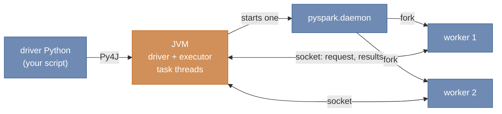
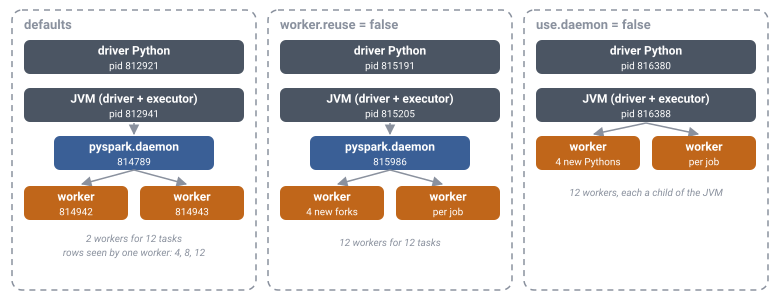
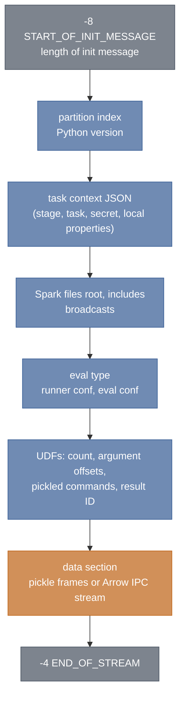
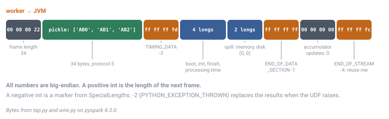
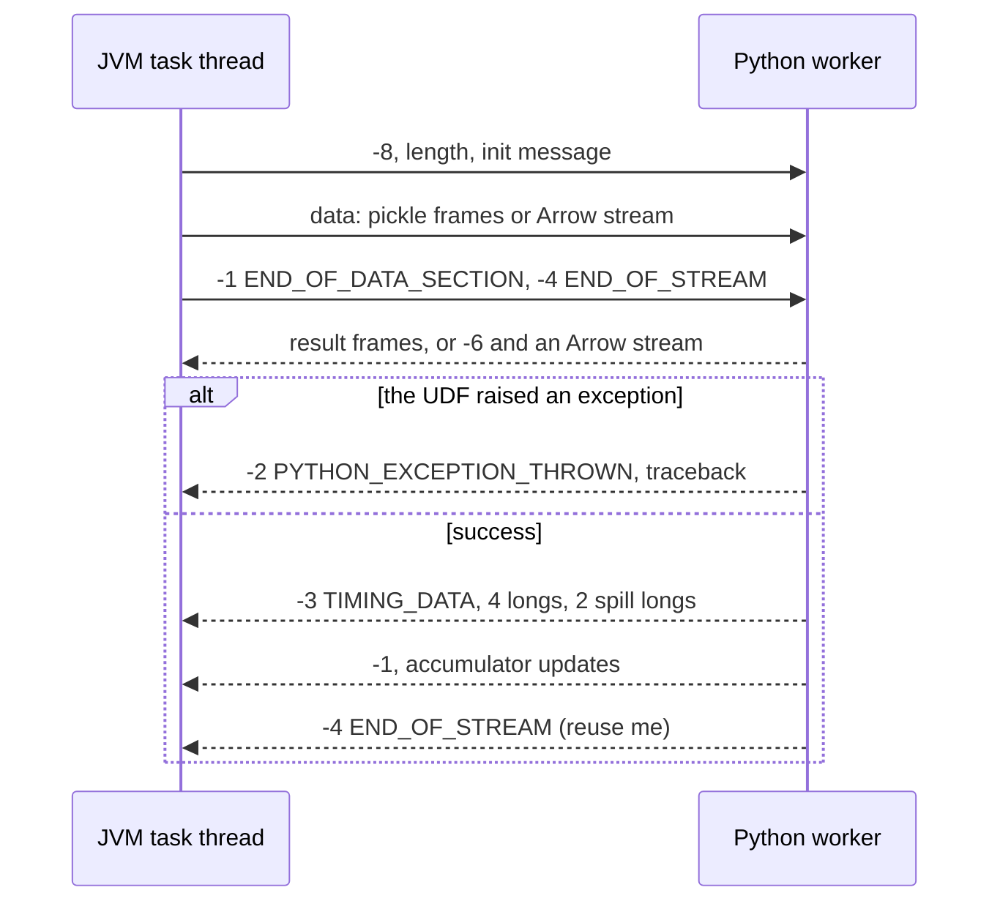
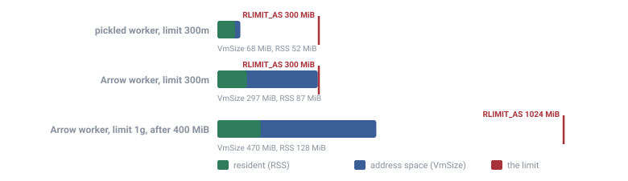

# Chapter 60: The Python worker protocol

[Chapter 59](ch59-catalyst-plans-python.md) ended at an `ArrowEvalPython` or a `BatchEvalPython` operator. That operator is a JVM object, but your function is Python. Between the two there is a process boundary, a socket and a binary protocol. Most users never see this layer. They see it only when it fails. Examples are a task that stops and does not return, a `java.io.EOFException` with no Python traceback, and a `MemoryError` in a small function.

**A Python UDF runs in a separate Python process that the JVM controls through a socket. The JVM sends one request for each task: an init message with the function and its settings, then the rows. The worker sends back the results, its timings and a code that tells the JVM if it can use the worker again. Each failure mode of a UDF is a failure at a known point in this exchange. If you can read the bytes, you can find the point.**

This chapter records those bytes and decodes them. All the code runs on a laptop against `pyspark==4.3.0`, with Python 3.12 on Linux. Each source excerpt names its file in the [apache/spark](https://github.com/apache/spark/tree/v4.3.0) repository at the `v4.3.0` tag. The scripts are in [`code/ch60`](https://github.com/lisancao/spark-masterclass/tree/main/code/ch60), and each output block comes from `code/ch60/output/`. Some scripts read `/proc` and set resource limits, so they need Linux.

## Step 1: The processes that run a UDF

A UDF query has at least four processes on one machine:

- **The driver Python.** This process runs your script. It pickles the UDF when you create it. It does not run the UDF.
- **The JVM.** In local mode, the JVM is both the driver and the executor. The task threads run in it.
- **The daemon.** The JVM starts one `python -m pyspark.daemon` process. The daemon does not run tasks. It forks a new worker each time the JVM asks for one.
- **The workers.** Each worker is a fork of the daemon. A worker reads one request, runs the UDF on the rows, and writes the results.

`processes.py` proves this structure. Its UDF returns the process ID of the worker, the process ID of the parent, and a count of rows. The count is kept on the `builtins` module, so it stays in the process from one task to the next. The script runs three jobs of four partitions on `local[2]`, in a new process for each configuration:

```text
--- defaults
driver python 812921, JVM 812941
  job 0: worker pids ['814942', '814943']  parent ['814789']  most rows seen by one worker 4
  job 1: worker pids ['814942', '814943']  parent ['814789']  most rows seen by one worker 8
  job 2: worker pids ['814942', '814943']  parent ['814789']  most rows seen by one worker 12
  distinct worker pids over 3 jobs: 2
  daemon command: -m pyspark.daemon pyspark.worker
```

There are two task slots, so there are two workers. The parent of each worker is process 814789, the daemon, and not the JVM. The same two workers ran all twelve tasks. The row count went up from 4 to 8 to 12, so module state stayed in each worker from job to job.



Why a daemon? The comment in `PythonWorkerFactory.scala` says: "forking processes from Java is expensive". A small Python process can fork new workers at a lower cost. The daemon also imports the worker module only after the fork. The comment in `python/pyspark/daemon.py` gives the reason:

```python
    # We don't know what could happen when we import the worker module. We have to
    # guarantee that no thread is spawned before we fork, so we have to import the
    # worker module after fork. For example, both pandas and pyarrow starts some
    # threads when they are imported.
    if len(sys.argv) > 1 and sys.argv[1].startswith("pyspark"):
        import importlib

        worker_module = importlib.import_module(sys.argv[1])
        worker_main = worker_module.main
    else:
        from pyspark.worker import main as worker_main
```

The `startswith("pyspark")` test is important for Step 3. The daemon accepts a different worker module only if its name starts with `pyspark`.

## Step 2: When Spark uses a worker again

Two settings change the process structure. The same script shows their effect:

```text
--- {'spark.python.worker.reuse': 'false'}
driver python 815191, JVM 815205
  job 0: worker pids ['816013', '816014', '816034', '816036']  parent ['815986']  most rows seen by one worker 2
  job 1: worker pids ['816147', '816152', '816170', '816172']  parent ['815986']  most rows seen by one worker 2
  job 2: worker pids ['816183', '816191', '816294', '816297']  parent ['815986']  most rows seen by one worker 2
  distinct worker pids over 3 jobs: 12
  daemon command: -m pyspark.daemon pyspark.worker
--- {'spark.python.use.daemon': 'false'}
driver python 816380, JVM 816388
  job 0: worker pids ['818678', '818757', '818918', '819065']  parent ['816388']  most rows seen by one worker 2
  job 1: worker pids ['819249', '819578', '819711', '819822']  parent ['816388']  most rows seen by one worker 2
  job 2: worker pids ['819914', '820017', '820240', '820332']  parent ['816388']  most rows seen by one worker 2
  distinct worker pids over 3 jobs: 12
  daemon command: none
```

- **`spark.python.worker.reuse=false`.** The daemon is still there, and it is still the parent. But each task gets a new fork: twelve tasks, twelve workers. Each worker saw only the two rows of its partition.
- **`spark.python.use.daemon=false`.** There is no daemon. The parent of each worker is the JVM (816388), and the JVM starts a full Python interpreter for each task. Without a daemon, Spark cannot use a worker again. On Windows, Spark never uses the daemon, because Windows cannot fork (`PythonWorkerFactory.scala`).

<figure markdown>
  
  <figcaption>The process tree for each configuration, from the output above. With the defaults, two forks of the daemon run all twelve tasks.</figcaption>
</figure>

The worker decides at the end of each task if the JVM can use it again. The last lines of `main` in `python/pyspark/worker.py` are:

```python
    try:
        message_receiver.get_finish_signal_from_stream()
        write_int(SpecialLengths.END_OF_STREAM, outfile)
    except Exception:
        # Write a different value to tell JVM to not reuse this worker
        write_int(SpecialLengths.END_OF_DATA_SECTION, outfile)
        sys.exit(-1)
```

The JVM reads that last integer in `core/src/main/scala/org/apache/spark/api/python/PythonRunner.scala`:

```scala
      // Check whether the worker is ready to be re-used.
      if (stream.readInt() == SpecialLengths.END_OF_STREAM) {
        if (reuseWorker && releasedOrClosed.compareAndSet(false, true)) {
          env.releasePythonWorker(
            pythonExec, workerModule, daemonModule, envVars.asScala.toMap, worker)
        }
      }
```

The worker answers `END_OF_STREAM` only if the stream ended cleanly. Thus a worker that is out of step with the JVM never goes back to the pool.

A reused worker keeps its state, and that is both good and bad:

- **Good.** An expensive object at module level, such as a model or a database client, loads once for each worker, not once for each task.
- **Bad.** Memory that a task allocates stays with the process. A module global that one task changes is visible to the next task. The worker resets the `TaskContext` after each task, but nothing else.

## Step 3: A wire tap for the worker

To see the protocol, record it. `spark.python.worker.module` tells the daemon which module to import after the fork. `code/ch60/tap/pyspark_tap.py` is a module with a `main(infile, outfile)` function. It wraps the two streams, copies each byte to a file, and calls the real `pyspark.worker.main`:

```python
class TeeIn(io.RawIOBase):
    def __init__(self, inner, log):
        self.inner, self.log = inner, log
    def readable(self):
        return True
    def readinto(self, b):
        data = self.inner.read1(len(b))      # read1: never wait for more bytes than have arrived
        b[:len(data)] = data
        self.log.write(data)
        return len(data)
```

```python
def main(infile, outfile):
    d, pid = os.environ["TAP_DIR"], os.getpid()
    with open(os.path.join(d, f"{pid}.in"), "ab") as i, open(os.path.join(d, f"{pid}.out"), "ab") as o:
        real_main(io.BufferedReader(TeeIn(infile, i), 65536), TeeOut(outfile, o))
```

Three details make the tap work:

1. **The module name starts with `pyspark`.** The daemon ignores other names (Step 1).
2. **`spark.executorEnv.PYTHONPATH` puts the folder of the tap on the path of the worker.** Spark adds its own `pyspark.zip` to that value, so the worker finds both.
3. **`read1`, not `read`.** `read(n)` waits until it has `n` bytes. The worker asks for a full buffer, but the JVM sends a short request and then waits for the answer. With `read`, the two processes wait for each other and the task never ends. `read1` returns the bytes that are already there.

`tap.py` starts a session with the tap and with reuse off, so that each task writes its own pair of files. Then it runs a three-row query with two UDFs: one pickled UDF (eval type 100) and one Arrow UDF (eval type 101). `wire.py` decodes the files. Its field order comes from `BasePythonRunner.Writer.open` and from `python/pyspark/worker_message.py` at `v4.3.0`.

!!! warning "The tap writes the task secret and the rows to disk"
    The request contains the authentication secret of the task. The data section contains the rows. Use a tap only on a laptop, with test data. `tap.py` keeps the raw files outside the Git tree, and it replaces the secret with `x` characters before it prints a byte.

## Step 4: The request, byte by byte

This is the request for the pickled UDF. The decoded summary comes first, then the bytes, with the name of each field on the line where the field starts:

```text
===== pickled UDF: Spark returned ['AB0', 'AB1', 'AB2']
request: 4633 bytes into the worker, init message 4582 bytes
  partition 0, Python 3.12, eval type 100
  task context keys: ['attemptNumber', 'connInfo', 'cpuAmount', 'cpus', 'isBarrier', 'localProperties', 'partitionId', 'resources', 'secret', 'stageId', 'taskAttemptId']
  localProperties: 31 entries; secret: 64 chars
  includes [], broadcasts []
  runner conf: {}
  eval conf:   {}
  UDFs: 1; args [(0, None)]; chained functions 1; command 625 bytes; result id 2
  the command unpickles to (<lambda>, StringType()); func('xy') = 'XY'
  data: 1 frame(s); rows (('ab0',), ('ab1',), ('ab2',))

first bytes of the request:
000000  ff ff ff f8 00 00 11 e6 00 00 00 00 00 00 00 04  ................  <- START_OF_INIT_MESSAGE (int -8); init message length (int); partition index (int); Python version (string)
000010  33 2e 31 32 00 00 0e d1 7b 22 73 65 63 72 65 74  3.12....{"secret  <- task context (string, JSON)
000020  22 3a 22 78 78 78 78 78 78 78 78 78 78 78 78 78  ":"xxxxxxxxxxxxx
000030  78 78 78 78 78 78 78 78 78 78 78 78 78 78 78 78  xxxxxxxxxxxxxxxx
...
the UDF section to the end:
000f60  00 00 00 01 00 00 00 01 00 00 00 00 00 00 00 00  ................  <- UDFs (int count, ...)
000f70  01 00 00 02 71 80 05 95 66 02 00 00 00 00 00 00  ....q...f.......
000f80  8c 1f 70 79 73 70 61 72 6b 2e 63 6c 6f 75 64 70  ..pyspark.cloudp
...
0011e0  94 73 62 86 94 2e 00 00 00 00 00 00 00 02 00 00  .sb.............  <- data section
0011f0  00 1f 80 02 58 03 00 00 00 61 62 30 85 58 03 00  ....X....ab0.X..
001200  00 00 61 62 31 85 58 03 00 00 00 61 62 32 85 87  ..ab1.X....ab2..
001210  2e ff ff ff ff ff ff ff fc                       .........         <- END_OF_STREAM (int -4)
```

All numbers are big-endian. A string is a 4-byte length and then UTF-8 bytes. Read the first line from left to right:

- `ff ff ff f8` is the integer -8, `START_OF_INIT_MESSAGE`.
- `00 00 11 e6` is 4582, the length of the init message.
- `00 00 00 00` is the partition index, 0.
- `00 00 00 04` and `33 2e 31 32` are the string `3.12`, the Python version of the driver. The worker compares it with its own version, and it fails if they are different.

The JVM writes the init message in `Writer.open`, in `PythonRunner.scala`. This is the end of that method, with the barrier socket code removed:

```scala
        // Write out the TaskContextInfo
        PythonWorkerUtils.writeTaskContext(
          context,
          if (isUnixDomainSock) Left(sockPath.getPath) else Right(boundPort),
          if (isUnixDomainSock) None else Some(authHelper.secret),
          dataOut
        )

        PythonWorkerUtils.writeSparkFiles(jobArtifactUUID, pythonIncludes, dataOut)
        PythonWorkerUtils.writeBroadcasts(broadcastVars, worker, env, dataOut)

        dataOut.writeInt(evalType)
        PythonWorkerUtils.writeConf(runnerConf, dataOut)
        PythonWorkerUtils.writeConf(evalConf, dataOut)
        writeCommand(dataOut)

        dataOut.flush()

        // The initialization message is complete, write it to the stream with its length.
        val messageBytes = buffer.toByteArray
        outputStream.writeInt(SpecialLengths.START_OF_INIT_MESSAGE)
        outputStream.writeInt(messageBytes.length)
        outputStream.write(messageBytes)
        outputStream.flush()
```



The UDF section starts at offset `0xf60`. Its layout comes from `writeUDFs` in `sql/core/src/main/scala/org/apache/spark/sql/execution/python/PythonUDFRunner.scala`:

```scala
    dataOut.writeInt(funcs.length)
    funcs.zip(argMetas).foreach { case ((chained, resultId), metas) =>
      dataOut.writeInt(metas.length)
      metas.foreach {
        case ArgumentMetadata(offset, name, _) =>
          dataOut.writeInt(offset)
          name match {
            case Some(name) =>
              dataOut.writeBoolean(true)
              PythonWorkerUtils.writeUTF(name, dataOut)
            case _ =>
              dataOut.writeBoolean(false)
          }
      }
      dataOut.writeInt(chained.funcs.length)
      chained.funcs.foreach { f =>
        PythonWorkerUtils.writePythonFunction(f, dataOut)
      }
      dataOut.writeLong(resultId)
    }
```

Match the bytes to the code. `00 00 00 01` is one UDF. `00 00 00 01` is one argument. `00 00 00 00` is its offset, column 0 of the input row, and `00` is "no name".

`00 00 00 01` is one function in the chain. A chain longer than one is the fusion of nested UDFs from Chapter 59, Step 5. Then the command follows: `00 00 02 71` is 625 bytes, and `80 05` starts a pickle of protocol 5. The script unpickled it, and it got the lambda and its return type. The JVM never reads this blob. It only moves it.

The data section of a pickled UDF is a sequence of frames, each with a length. Here there is one frame of `0x1f` = 31 bytes. It starts with `80 02`, a pickle of protocol 2. The JVM side writes this pickle with the Pyrolite library (`net.razorvine.pickle`, imported in `BatchEvalPythonExec.scala`), not with Python. `ff ff ff ff` (-1, `END_OF_DATA_SECTION`) ends the data. `ff ff ff fc` (-4, `END_OF_STREAM`) ends the request.

## Step 5: The Arrow request

The default `@udf` has eval type 101. Its request has the same frame, but three parts are different:

```text
===== arrow UDF: Spark returned ['AB0', 'AB1', 'AB2']
request: 5740 bytes into the worker, init message 5376 bytes
  partition 0, Python 3.12, eval type 101
  task context keys: ['attemptNumber', 'connInfo', 'cpuAmount', 'cpus', 'isBarrier', 'localProperties', 'partitionId', 'resources', 'secret', 'stageId', 'taskAttemptId']
  localProperties: 31 entries; secret: 64 chars
  includes [], broadcasts []
  runner conf: {'spark.sql.legacy.execution.pythonUDTF.pandas.conversion.enabled': 'false', 'spark.sql.session.timeZone': 'America/Los_Angeles', 'spark.sql.execution.pyspark.binaryAsBytes': 'true', 'spark.sql.execution.pythonUDF.pandas.preferIntExtensionDtype': 'false', 'spark.sql.execution.pandas.convertToArrowArraySafely': 'true', 'spark.sql.legacy.execution.pandas.groupedMap.assignColumnsByName': 'true', 'spark.sql.execution.arrow.useLargeVarTypes': 'false', 'spark.sql.legacy.execution.pythonUDF.pandas.conversion.enabled': 'false', 'spark.sql.execution.pythonUDF.pandas.intToDecimalCoercionEnabled': 'false', 'spark.sql.execution.pythonUDF.mapInBatch.legacy.acceptAnyIterable.enabled': 'true'}
  eval conf:   {'input_type': '{"type":"struct","fields":[{"name":"_0","type":"string","nullable":true,"metadata":{}}]}'}
  UDFs: 1; args [(0, None)]; chained functions 1; command 625 bytes; result id 5
  the command unpickles to (<lambda>, StringType()); func('xy') = 'XY'
  data: Arrow IPC stream, schema '_0: string', rows ['ab0', 'ab1', 'ab2']
```

1. **The runner conf is not empty.** The JVM sends the SQL settings that change how the worker converts values: the session time zone, the safe Arrow conversion, and others. The worker cannot read the SQL configuration of the session, so the JVM copies the settings that it needs into each request.
2. **The eval conf carries the input schema.** The key `input_type` holds the schema of the rows as JSON. Step 7 shows a bug where this schema went to a different place.
3. **The data is one Arrow IPC stream.** There are no pickle frames. The stream has a schema message and record batches, and the strings `ab0ab1ab2` sit next to each other in one buffer:

```text
001500  00 00 00 00 00 00 00 05 ff ff ff ff 88 00 00 00  ................  <- data section
...
001650  61 62 30 61 62 31 61 62 32 00 00 00 00 00 00 00  ab0ab1ab2.......
001660  ff ff ff ff 00 00 00 00 ff ff ff fc              ............      <- END_OF_STREAM (int -4)
```

The 3 rows used 5,740 bytes in the request. Most of these bytes are the task context, the settings and the function. The rows are a small part. Thus, for a small partition, the fixed cost of a request is larger than the cost of the data. That is one reason why Python UDFs are slow on many small partitions.

## Step 6: The response

The response of the pickled UDF has 102 bytes:

```text
response: 102 bytes out of the worker
000000  00 00 00 22 80 05 95 17 00 00 00 00 00 00 00 5d  ..."...........]  <- result frame (34 bytes, a pickle)
000010  94 28 8c 03 41 42 30 94 8c 03 41 42 31 94 8c 03  .(..AB0...AB1...
000020  41 42 32 94 65 2e ff ff ff fd 00 00 01 a2 02 9b  AB2.e...........  <- TIMING_DATA (int -3), then 4 longs
000030  c2 ce 00 00 01 a2 02 9b c3 19 00 00 01 a2 02 9b  ................
000040  c3 19 00 00 00 00 00 00 00 00 00 00 00 00 00 00  ................  <- memory and disk bytes spilled (2 longs)
000050  00 00 00 00 00 00 00 00 00 00 ff ff ff ff 00 00  ................  <- END_OF_DATA_SECTION (int -1), then accumulators
000060  00 00 ff ff ff fc                                ......            <- END_OF_STREAM (int -4)
  results ['AB0', 'AB1', 'AB2']; init 75 ms after boot; processing 0 ms; spill (0, 0); accumulators 0
```

<figure markdown>
  <video autoplay loop muted playsinline controls width="1280" height="720" poster="../../media/clips/ch60-tap.webp">
    <source src="../../media/clips/ch60-tap.mp4" type="video/mp4">
  </video>
  <figcaption><code>tap.py</code> records the bytes that a Python worker sends back for a pickled UDF, and names each field.</figcaption>
</figure>

The parts are in this sequence:

1. **Result frames.** One frame of 34 bytes, a pickle of protocol 5 that holds the list `['AB0', 'AB1', 'AB2']`.
2. **`TIMING_DATA` (-3) and four longs.** These are the boot time, the init time and the finish time of the worker, in milliseconds since the epoch, and the processing time. The JVM reads them in `handleTimingData`, and it writes them to the executor log at the `INFO` level.
3. **Two longs for spill.** Bytes that the worker spilled to memory and to disk. Both are 0 here.
4. **`END_OF_DATA_SECTION` (-1) and the accumulator updates.** The count is 0, because this UDF changes no accumulator. The UDF of Chapter 59, Step 7 sends its count back in this section.
5. **`END_OF_STREAM` (-4).** The worker can run another task (Step 2).


<figure markdown>
  
  <figcaption>The response above as fields. The orange fields are markers with a negative value.</figcaption>
</figure>

The Arrow response starts with `START_ARROW_STREAM` (-6) and then an Arrow IPC stream, in place of the pickle frames. The tail is the same:

```text
response: 388 bytes out of the worker
000000  ff ff ff fa ff ff ff ff 70 00 00 00 10 00 00 00  ........p.......  <- START_ARROW_STREAM (int -6), then an Arrow IPC stream
...
000120  03 00 00 00 06 00 00 00 09 00 00 00 41 42 30 41  ............AB0A
000130  42 31 41 42 32 00 00 00 00 00 00 00 ff ff ff ff  B1AB2...........
000140  00 00 00 00 ff ff ff fd 00 00 01 a2 02 9b c4 7c  ...............|  <- TIMING_DATA (int -3), then 4 longs
...
000180  ff ff ff fc                                      ....              <- END_OF_STREAM (int -4)
  results ['AB0', 'AB1', 'AB2']; init 170 ms after boot; processing 129 ms; spill (0, 0); accumulators 0
```

The Arrow worker used 170 ms to start and 129 ms to process three rows, against 75 ms and 0 ms for the pickled worker. The Arrow path imports `pyarrow` and builds Arrow arrays. That fixed cost is large for three rows. In a larger batch, all the rows share it.

<figure markdown>
  <video autoplay loop muted playsinline controls width="1280" height="720" poster="../../media/clips/ch60-anim-frames.webp">
    <source src="../../media/clips/ch60-anim-frames.mp4" type="video/mp4">
  </video>
  <figcaption>The request and the response of the pickled UDF, frame by frame. The sizes come from <code>tap.py</code>.</figcaption>
</figure>

All the negative values come from one object in `PythonRunner.scala`:

```scala
private[spark] object SpecialLengths {
  val END_OF_DATA_SECTION = -1
  val PYTHON_EXCEPTION_THROWN = -2
  val TIMING_DATA = -3
  val END_OF_STREAM = -4
  val NULL = -5
  val START_ARROW_STREAM = -6
  val END_OF_MICRO_BATCH = -7
  val START_OF_INIT_MESSAGE = -8
}
```

A length and a marker share one field. A positive number is the length of the next frame. A negative number is a marker. `PYTHON_EXCEPTION_THROWN` (-2) is the marker that Step 8 uses: the worker sends it, then the traceback as a string.



## Step 7: When the two sides disagree: SPARK-58241

The protocol has no field names. The worker reads each field at the position where it expects the field. If the JVM writes one extra field, the worker reads everything after it at the wrong position.

That happened in Spark 4.2.0. SPARK-56340 (fix version 4.2.0) moved the input schema of Arrow UDFs into the eval conf, as the key `input_type` of Step 5. The runner for columnar input, `ColumnarArrowPythonWithNamedArgumentRunner`, still wrote the schema at the start of the UDF section. A plain Arrow `@udf` directly over a vectorized Parquet scan used that runner (Chapter 59, Step 9).

The task stopped and never returned. SPARK-58241 fixed the problem in 4.2.1 and 4.3.0. The fix changed the runner in `sql/core/src/main/scala/org/apache/spark/sql/execution/python/ColumnarArrowPythonRunner.scala`:

```scala
  // The input schema travels in evalConf (key "input_type"), exactly like
  // ArrowPythonWithNamedArgumentRunner. It must NOT be written into the UDF command section:
  // the worker's WorkerInitInfo.from_stream reads that section as a UDF count followed by UDF
  // entries, so an extra UTF string there desyncs the whole init-message parse -- the worker
  // then blocks waiting for bytes past the end of the init message and the task hangs forever.
```

You cannot run 4.2.0 in this book's environment, but you can replay the bytes. `desync.py` takes the real Arrow request that `tap.py` recorded. It puts the schema string in front of the UDF section, as the 4.2.0 runner did. Then it gives the result to the parser of the 4.3 worker, `WorkerInitInfo.from_stream`, in two ways:

```text
schema JSON: 88 bytes; the worker will read that length as the number of UDFs
then the first 4 bytes of the JSON, b'{"ty' = 2,065,855,609, as the first UDF's argument count

  4.3: a finished, length-bounded message      EOFError: ZeroCopyByteStream.read() tried to read 1937011317 byte(s), however, t (1140.1 ms)
  4.2-style: an open stream, no length         still blocked after 5 s, waiting for bytes that never come

the unchanged message parses: eval type 101, 1 UDF, eval conf keys ['input_type']
```

The worker reads the length of the JSON string, 88, as the number of UDFs. Then it reads the first four characters, `{"ty`, as the number of arguments of the first UDF: more than two billion. Soon it asks for a length that is larger than the message.

What occurs next depends on the stream:

- **A finished, length-bounded buffer.** In 4.3, the JVM sends the length of the init message first (Step 4). The worker reads the full message into memory, and it marks the stream as finished. A read past the end raises `EOFError` at once.
- **An open stream.** If the stream is not marked as finished, the parser waits for more bytes. The JVM sent all its bytes, and now it waits for results. Neither side moves.

The second part of the fix is in `python/pyspark/messages/socket/spark_socket_message_receiver.py`:

```python
        # The init message is fully materialized, so mark the stream finished: a parse that
        # runs past the declared message length (e.g. a writer/reader protocol mismatch) must
        # fail fast with EOFError instead of blocking forever on a chunk that will never come.
        stream = ZeroCopyByteStream(memoryview(message_content))
        stream.finish()
```

The `EOFError` took 1.1 s in the replay, because the parser built large lists before it asked for too many bytes. A clear error after one second is much better than a task that waits forever. The lesson applies to any binary protocol: a reader that knows the length of a message can fail fast.

## Step 8: Five ways a UDF fails

`failures.py` runs six UDFs that fail in different ways. Each runs on `local[1]` as a pickled UDF, with an idle timeout of 3 seconds and with the faulthandler on. The script classifies each exception by its error condition and its text:

```text
--- raise_value: PythonException, condition PYTHON_EXCEPTION, classified 'python_exception', 10.1 s
    ValueError: bad row 0
--- raise_memory: PythonException, condition PYTHON_EXCEPTION, classified 'python_exception', 1.1 s
    MemoryError: asked for too much
--- exit_hard: Py4JJavaError, condition None, classified 'worker_crashed', 1.3 s
    Python worker exited unexpectedly (crashed): 
    java.io.EOFException
--- sigkill: Py4JJavaError, condition None, classified 'worker_crashed', 0.8 s
    Python worker exited unexpectedly (crashed): 
    java.io.EOFException
--- segfault: Py4JJavaError, condition None, classified 'worker_crashed', 1.1 s
    Python worker exited unexpectedly (crashed): Fatal Python error: Segmentation fault
    Fatal Python error: Segmentation fault
    File "/usr/lib/python3.12/ctypes/__init__.py", line 525 in string_at
    java.io.EOFException
--- sleep_long: Py4JJavaError, condition None, classified 'idle_timeout', 3.5 s
    PythonWorkerException: Python worker process terminated due to idle timeout (timeout: 3 seconds): 
```

The first query took 10.1 s because it also started the JVM work and the daemon. The times of the other queries are the cost of each failure.

<figure markdown>
  <video autoplay loop muted playsinline controls width="1280" height="720" poster="../../media/clips/ch60-failures.webp">
    <source src="../../media/clips/ch60-failures.mp4" type="video/mp4">
  </video>
  <figcaption><code>failures.py</code> runs six UDFs that fail in different ways. The driver gets a different error for each failure point in the protocol.</figcaption>
</figure>

| What the UDF does | Where the protocol stops | What the driver gets |
|---|---|---|
| raises an exception (`ValueError`, also `MemoryError`) | the worker sends -2 and the traceback | `PythonException`, condition `PYTHON_EXCEPTION`, with the Python traceback |
| calls `os._exit(3)` | the socket closes with no marker | "Python worker exited unexpectedly (crashed)" and `java.io.EOFException`, with no Python message |
| gets `SIGKILL` (for example, from the kernel OOM killer) | the same | the same, with an empty message |
| crashes in C code (segmentation fault) | the same | the same, plus the faulthandler dump if it is on (Step 9) |
| does not return | nothing more arrives | after the idle timeout, `PythonWorkerException: ... idle timeout` |

The first row is different from the others. An exception that Python can catch goes back as data, with marker -2. The JVM changes it into a `PythonException` with the full traceback.

A process that stops cannot send anything. The JVM sees only the end of the socket, so it reports `EOFException`. A `MemoryError` that Python raises is an exception, but an out-of-memory kill by the kernel is a `SIGKILL`. Thus, the same cause, too much memory, gives two different errors.

The idle timeout is not a limit on the run time of a UDF. `spark.sql.execution.pyspark.udf.idleTimeoutSeconds` (since 4.0.0) is the time that the runner waits with no bytes from the worker. With `spark.sql.execution.pyspark.udf.killOnIdleTimeout` (since 4.1.0) set to `true`, Spark kills the worker at the end of that time and fails the task. Without it, Spark only writes a warning to the log.

## Step 9: Segmentation faults and traceback dumps

A crash in C code kills the worker before Python can send a traceback. The faulthandler module of Python can still write the stack of the crash, because it writes from a signal handler. Spark sends that file back with the error. `segfault.py` runs the same crash with the faulthandler off and on:

```text
False 4.4 Python worker exited unexpectedly (crashed). Consider setting 'spark.sql.execution.pyspark.udf.faulthandler.enabled' or'spark.python.worker.faulthandler.enabled' configuration to 'true' for the better
True 5.7 Python worker exited unexpectedly (crashed): Fatal Python error: Segmentation fault |  | Current thread 0x00007bad333ad080 (most recent call first): |   File "/usr/lib/python3.12/ctypes/__init__.py", line 5
```

With the faulthandler off, the error tells you to turn it on. With it on, the error contains the C-level crash and the Python line that called it, `ctypes.string_at`. There are two settings with the same effect:

- `spark.sql.execution.pyspark.udf.faulthandler.enabled` (since 4.0.0) is a SQL setting. You can change it in a session that is open.
- `spark.python.worker.faulthandler.enabled` (since 3.2.0) is a core setting. You must set it before the session starts.

A UDF that does not return is a different problem. `spark.sql.execution.pyspark.udf.tracebackDumpIntervalSeconds` (since 4.1.0) makes the worker write the stack of each thread at an interval, while it runs. The last part of `failures.py` sets it to 2 seconds for a UDF that sleeps:

```text
--- the traceback dump: a worker stuck in time.sleep, dumped every 2 s
Timeout (0:00:02)!
Thread 0x000076652790b080 (most recent call first):
  File "ch60/failures.py", line 29 in sleep_long
  File ".../pyspark.zip/pyspark/util.py", line 158 in wrapper
  File ".../pyspark.zip/pyspark/worker.py", line 682 in <lambda>
  File ".../pyspark.zip/pyspark/worker.py", line 4146 in <genexpr>
  File ".../pyspark.zip/pyspark/serializers.py", line 208 in _batched
  File ".../pyspark.zip/pyspark/serializers.py", line 146 in dump_stream
  File ".../pyspark.zip/pyspark/serializers.py", line 212 in dump_stream
  File ".../pyspark.zip/pyspark/worker.py", line 4222 in process
  File ".../pyspark.zip/pyspark/worker.py", line 4327 in invoke_udf
  File ".../pyspark.zip/pyspark/worker.py", line 4364 in main
  File ".../pyspark.zip/pyspark/util.py", line 1025 in wrapper
  File ".../pyspark.zip/pyspark/daemon.py", line 90 in worker
  File ".../pyspark.zip/pyspark/daemon.py", line 264 in manager
  File ".../pyspark.zip/pyspark/daemon.py", line 292 in <module>
  File "<frozen runpy>", line 88 in _run_code
  File "<frozen runpy>", line 198 in _run_module_as_main
    then: PythonWorkerException: Python worker process terminated due to idle timeout (timeout: 5 seconds): 
(the same dump again every 2 s; 2 dumps in all)
```

Read the dump from the bottom to the top. It shows the full path of a task in the worker:

1. `daemon.py` forks the worker.
2. `main` in `worker.py` calls `invoke_udf`.
3. The serializer pulls the rows in batches.
4. Line 29 of the script is the `time.sleep` call.

 The dump goes to the stderr of the worker, which is the executor log on a cluster. Use it when a task is still in progress and you want to know where it is.

## Step 10: The size of the pickled function

The command in the UDF section (Step 4) is the pickled function and everything that it uses. A lambda that uses a large Python object takes that object with it. `closures.py` makes a UDF that tests if a word is in a set of 300,000 words. Then it reads the size of the command from the JVM:

```text
300,000 words, threshold default set pickles to 3,901,147 B   command        56 B   broadcast vars 1   [True, False]
300,000 words, threshold 100m    set pickles to 3,901,147 B   command 3,901,653 B   broadcast vars 0   [True, False]
   driver log: DAGScheduler: Broadcasting large task binary with size 3.7 MiB
 60,000 words, threshold default set pickles to   780,235 B   command   780,741 B   broadcast vars 0   [True, False]
300,000 words (sc.broadcast), threshold default set pickles to 3,901,147 B   command       592 B   broadcast vars 1   [True, False]
```

The set pickles to 3.9 MB. With the default settings, the command is only 56 bytes, and there is one broadcast variable. PySpark did this change automatically, in `_prepare_for_python_RDD` in `python/pyspark/core/rdd.py`:

```python
def _prepare_for_python_RDD(sc: "SparkContext", command: Any) -> Tuple[bytes, Any, Any, Any]:
    # the serialized command will be compressed by broadcast
    ser = CloudPickleSerializer()
    pickled_command = ser.dumps(command)
    assert sc._jvm is not None
    if len(pickled_command) > sc._jvm.PythonUtils.getBroadcastThreshold(sc._jsc):  # Default 1M
        # The broadcast will have same life cycle as created PythonRDD
        broadcast = sc.broadcast(pickled_command)
        pickled_command = ser.dumps(broadcast)
```

The threshold is `spark.broadcast.UDFCompressionThreshold`, 1 MiB by default (since 3.0.0). The rows of the table show its effect:

- **Above the threshold.** PySpark broadcasts the command and sends only a small reference in each task. The worker reads the command from the broadcast.
- **Threshold raised to 100m.** The full 3.9 MB command goes into the task binary of every task. The driver log warns: "Broadcasting large task binary with size 3.7 MiB".
- **Below the threshold.** A set of 60,000 words pickles to 780 KB. That is below 1 MiB, so the full 780 KB goes in every task, with no broadcast and no warning.
- **An explicit `sc.broadcast`.** The command is 592 bytes, and the broadcast variable carries the set.

An explicit broadcast gives you control, and it does not depend on a size limit. Use it for any lookup data larger than a few kilobytes.

## Step 11: The memory limit of a Python worker

`spark.executor.pyspark.memory` sets a memory limit for Python workers. Many users think that it limits the resident memory of a worker. It does not. The worker calls `setup_memory_limits` in `python/pyspark/worker_util.py`:

```python
    if memory_limit_mb > 0 and has_resource_module:
        total_memory = resource.RLIMIT_AS
        try:
            soft_limit, hard_limit = resource.getrlimit(total_memory)
            msg = "Current mem limits: {0} of max {1}\n".format(soft_limit, hard_limit)
            print(msg, file=sys.stderr)

            # convert to bytes
            new_limit = memory_limit_mb * 1024 * 1024

            if soft_limit == resource.RLIM_INFINITY or new_limit < soft_limit:
```

`RLIMIT_AS` limits the **virtual address space** of the process, not the memory that it really uses. A library can reserve a large address range and use very little of it. The value comes from the `PYSPARK_EXECUTOR_MEMORY_MB` environment variable, which the runner sets in `compute`, in `PythonRunner.scala`:

```scala
    val workerMemoryMb = BasePythonRunner.getWorkerMemoryMb(memoryMb, maxConcurrentTasks)
    if (workerMemoryMb.isDefined) {
      envVars.put("PYSPARK_EXECUTOR_MEMORY_MB", workerMemoryMb.get.toString)
    }
```

`getWorkerMemoryMb` divides the setting by the number of tasks that can run at the same time on the executor. Thus each worker gets its share of the setting, not all of it. `memory.py` runs on `local[1]`, so one worker gets the full limit. Its UDF reads its own `VmSize` (virtual size) and `VmRSS` (resident size) from `/proc/self/status`, and then it tries to allocate a block:

```text
-- 300m pickled, allocations 100,400,900 MiB
  300m pickled  VmSize 68 MiB, RSS 52 MiB, RLIMIT_AS 300 MiB | 100 MiB ok
  300m pickled  VmSize 68 MiB, RSS 52 MiB, RLIMIT_AS 300 MiB | 400 MiB MemoryError
  300m pickled  VmSize 68 MiB, RSS 52 MiB, RLIMIT_AS 300 MiB | 900 MiB MemoryError
-- 300m arrow, allocations 100,400,900 MiB
  300m Arrow    VmSize 297 MiB, RSS 87 MiB, RLIMIT_AS 300 MiB | 100 MiB MemoryError
  300m Arrow    VmSize 299 MiB, RSS 90 MiB, RLIMIT_AS 300 MiB | 400 MiB MemoryError
  300m Arrow    VmSize 299 MiB, RSS 90 MiB, RLIMIT_AS 300 MiB | 900 MiB MemoryError
-- 1g pickled, allocations 100,400,900 MiB
  1g   pickled  VmSize 68 MiB, RSS 52 MiB, RLIMIT_AS 1024 MiB | 100 MiB ok
  1g   pickled  VmSize 68 MiB, RSS 52 MiB, RLIMIT_AS 1024 MiB | 400 MiB ok
  1g   pickled  VmSize 68 MiB, RSS 52 MiB, RLIMIT_AS 1024 MiB | 900 MiB ok
-- 1g arrow, allocations 100,400,900 MiB
  1g   Arrow    VmSize 297 MiB, RSS 88 MiB, RLIMIT_AS 1024 MiB | 100 MiB ok
  1g   Arrow    VmSize 470 MiB, RSS 128 MiB, RLIMIT_AS 1024 MiB | 400 MiB ok
  1g   Arrow    VmSize 470 MiB, RSS 128 MiB, RLIMIT_AS 1024 MiB | 900 MiB MemoryError
-- 2g arrow, allocations 900 MiB
  2g   Arrow    VmSize 297 MiB, RSS 87 MiB, RLIMIT_AS 2048 MiB | 900 MiB ok
-- 2g arrow, allocations 900,900 MiB
  2g   Arrow    VmSize 297 MiB, RSS 87 MiB, RLIMIT_AS 2048 MiB | 900 MiB ok
  2g   Arrow    VmSize 1366 MiB, RSS 130 MiB, RLIMIT_AS 2048 MiB | 900 MiB MemoryError
```

Four facts come from this table:

- **The Arrow worker starts at about 297 MiB of address space, with about 87 MiB resident.** `pyarrow` reserves address space when it loads. With a limit of 300m, the Arrow worker has almost no space left, and an allocation of 100 MiB fails. The pickled worker starts at 68 MiB, and the same allocation succeeds.
- **The limit counts address space, not use.** With 1g, the Arrow worker could allocate 400 MiB but not 900 MiB. 297 + 900 is more than 1024, but the resident size was only 128 MiB.
- **A reused worker keeps its address space.** In the last group, two allocations of 900 MiB ran in sequence on the same worker. The first succeeded. After it, `VmSize` was 1366 MiB, because the freed memory stayed mapped in the process. The second allocation failed.
- **The failure is a `MemoryError`.** The limit makes `malloc` fail, and Python raises an exception that it can send back (Step 8). This is more useful than a kill from the kernel, which gives only `EOFException`.


<figure markdown>
  
  <figcaption>Three rows of the output above. The limit applies to the address space (blue), not to the resident memory (green). An Arrow worker starts near 300 MiB of address space.</figcaption>
</figure>

!!! caution "Keep 400 MiB or more for each Arrow worker"
    An Arrow worker uses about 300 MiB of address space before it runs your function. If the share of each worker is near that value, all Arrow UDFs fail with `MemoryError`. Spark divides `spark.executor.pyspark.memory` by the number of concurrent tasks.

On a cluster, the setting also changes the size of the container. On YARN, `Client.scala` adds it to the memory request of the executor (`pysparkWorkerMemory`). Without it, Python workers use the memory overhead of the executor. `spark.executor.memoryOverheadFactor` is 0.10 by default. For Python jobs on Kubernetes, the default factor is 0.40 (`NON_JVM_MEMORY_OVERHEAD_FACTOR` in the Kubernetes `Constants.scala`). The minimum overhead is 384m.

## New in 4.3: one length-prefixed init message

In Spark 4.2.0, the JVM wrote the init fields directly to the socket, and the worker read them one at a time. In 4.3.0, the JVM collects the full init message in a buffer. Then it sends the buffer as one message, after the marker `START_OF_INIT_MESSAGE` (-8) and a length (Step 4). The change is the commit "[SPARK-56324] Introducing message-based communication to Spark -> PySpark communication channel" (6bc27159eb1). It is in `v4.3.0` and not in `v4.2.0`. The worker side is the new `pyspark.messages` package and `pyspark/worker_message.py`.

The data section did not change. The comment in `spark_socket_message_receiver.py` says that data messages have no header, "to reduce the overhead, especially for small batch sizes and real-time-mode (RTM)".

Two effects are visible in this chapter:

- **A tap must decode the new frame.** A decoder for 4.2 reads the partition index first. On 4.3 it reads -8 and fails. `wire.py` follows the 4.3 layout.
- **Protocol mismatches fail fast.** The worker knows where the init message ends, so a bad parse raises `EOFError` (Step 7).

A second 4.3 change removes the protocol for some UDFs. A UDF that the 4.3 transpiler changes into a native expression ([Chapter 59](ch59-catalyst-plans-python.md#new-in-43-python-udf-transpilation)) has no Python operator. Thus no worker starts, and none of the bytes in this chapter move.

## The whole chapter, on one page

- **Four processes run a UDF.** The driver Python pickles it, the JVM schedules it, the daemon forks workers, and the workers run it. `spark.python.worker.reuse=false` gives a new fork for each task. `spark.python.use.daemon=false` removes the daemon and the reuse.
- **The worker decides reuse.** It ends a clean task with `END_OF_STREAM` (-4). A reused worker keeps module state and memory.
- **You can tap the protocol.** A module whose name starts with `pyspark`, set in `spark.python.worker.module`, can wrap `pyspark.worker.main`. Use `read1`, and never print the task secret.
- **The request is an init message and a data section.** The init message has the partition, the Python version, the task context, files, broadcasts, the eval type, two confs and the pickled UDFs. The data is pickle frames (eval type 100) or an Arrow IPC stream (eval type 101).
- **The response is results, timings, spill, accumulators and a reuse code.** Negative lengths are markers, from `SpecialLengths`.
- **A field in the wrong place breaks all later fields.** SPARK-58241 made the 4.2.0 worker wait forever. The 4.3 worker reads a length-bounded init message and fails fast.
- **Each failure stops the exchange at a known point.** A Python exception is a `PythonException` with a traceback. A dead process is an `EOFException` with no traceback. Turn on the faulthandler for crashes, the traceback dump for UDFs that do not return, and the idle timeout to stop them.
- **Large closures become broadcasts above 1 MiB.** Below that threshold, they go in every task. Use `sc.broadcast` for lookup data.
- **`spark.executor.pyspark.memory` is an `RLIMIT_AS` on address space.** Spark divides it among concurrent workers, and an Arrow worker uses about 300 MiB of address space when it starts.

To run all of the chapter, from `code/`:

```bash
uv run python ch60/processes.py
uv run python ch60/tap.py
uv run python ch60/desync.py
ch60/run_failures.sh
uv run python ch60/segfault.py nofh; uv run python ch60/segfault.py fh
uv run python ch60/closures.py
uv run python ch60/memory.py
```

The next chapter leaves Python and goes into a binary format of the JVM side: the bytes of a `VARIANT` value.

## Further reading

- [`PythonRunner.scala` at v4.3.0](https://github.com/apache/spark/blob/v4.3.0/core/src/main/scala/org/apache/spark/api/python/PythonRunner.scala), the JVM side of the protocol, with `Writer.open` and `SpecialLengths`.
- [`worker.py` at v4.3.0](https://github.com/apache/spark/blob/v4.3.0/python/pyspark/worker.py) and [`worker_message.py`](https://github.com/apache/spark/blob/v4.3.0/python/pyspark/worker_message.py), the Python side.
- [SPARK-58241](https://issues.apache.org/jira/browse/SPARK-58241), the columnar runner that wrote the schema in the wrong place.
- [PySpark debugging guide](https://spark.apache.org/docs/4.3.0/api/python/development/debugging.html), for the faulthandler, the traceback dump and the worker logs.
