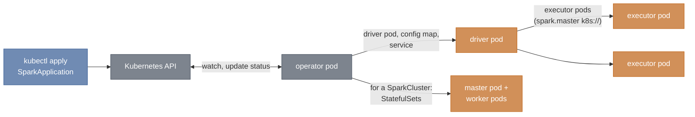
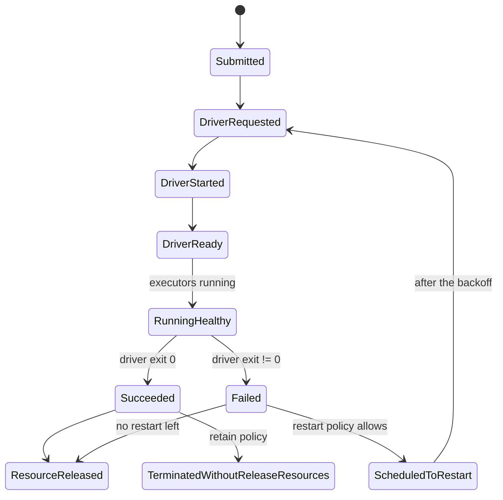
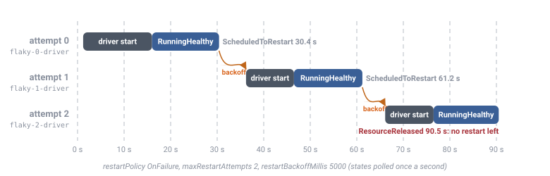
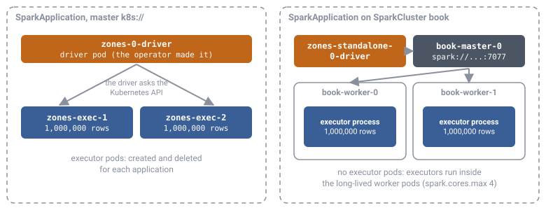
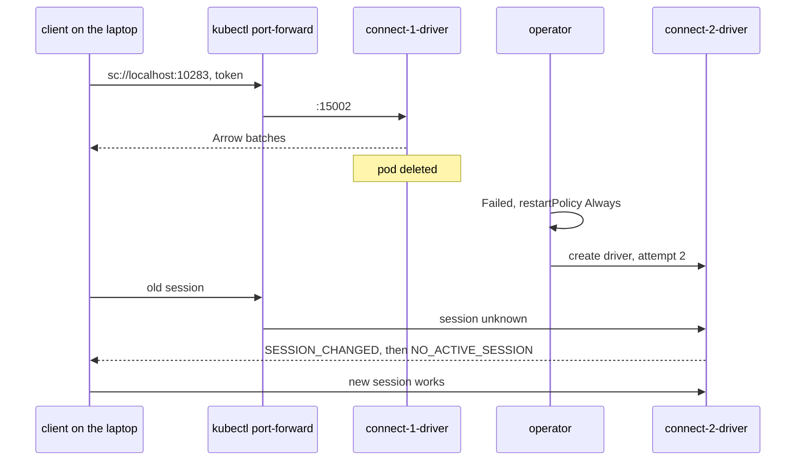

# Chapter 62: Spark on Kubernetes with the Spark Kubernetes Operator

`spark-submit --master k8s://...` can run Spark on Kubernetes without anything more. It starts a driver pod, and the driver asks the Kubernetes API for executor pods. But `spark-submit` is a command, not a record. After it returns, nothing in the cluster remembers what you asked for. Nothing restarts a driver that failed, and nothing keeps a Connect server alive. Nothing removes the pods of a finished application at the time that you choose.

**The Apache Spark Kubernetes Operator changes a Spark application into a Kubernetes resource. You declare a `SparkApplication` or a `SparkCluster` in YAML. The operator submits the driver, follows its state through a fixed state machine, restarts it by a policy that you set, and releases its resources. A Connect server becomes a `SparkApplication` that does not end, and the operator keeps it alive.**

This chapter runs everything for real on a local `kind` cluster:

- a PySpark batch application
- an application that fails and restarts
- a standalone `SparkCluster`
- a Connect server that a Python client on the laptop uses

[Chapter 63](ch63-orchestration.md) covers orchestration with Airflow, gang scheduler queues with Apache YuniKorn, and remote shuffle with Apache Celeborn.

The code for this chapter is in [`code/ch62`](https://github.com/lisancao/spark-masterclass/tree/main/code/ch62). Each output block comes from `code/ch62/output/`. The versions are:

| Part | Version |
|---|---|
| Kubernetes (kind, node image `kindest/node:v1.37.0`) | 1.37.0, one control-plane node and two worker nodes |
| Helm chart `spark-kubernetes-operator/spark-kubernetes-operator` | 1.9.0 |
| Operator image `apache/spark-kubernetes-operator` | 1.1.0 (its build file pins Spark 4.3.0) |
| Spark image | `apache/spark:4.3.0-python3`, plus PyArrow 18.1.0 and pandas 2.2.3 (the book's image) |
| Client | pyspark 4.3.0 on Python 3.12.3 |

## How the operator works



The operator is a Java program that uses the Java Operator SDK. It watches the `SparkApplication` and `SparkCluster` resources. For an application, it builds the driver spec with Spark's own submission code, and it creates the driver pod. Then it follows the driver and the executors that the driver creates. For a cluster, it creates a master and workers as `StatefulSet`s. The operator writes what it sees into the `status` of the resource, so that `kubectl get` gives the state of the application.

## Step 1: Install the operator

`cluster.sh up` creates the cluster, builds the book's image, loads the images into the nodes and installs the chart:

```bash
kind create cluster --name part08 --config kind.yaml --image kindest/node:v1.37.0
docker build -q -t spark-masterclass/spark:4.3.0-book .
kind load docker-image --name part08 apache/spark-kubernetes-operator:1.1.0 ...
helm upgrade --install spark spark-kubernetes-operator/spark-kubernetes-operator \
  --kube-context kind-part08 --version 1.9.0 --wait
```

The book's image adds PyArrow and pandas to the official Python image, and it copies the chapter's applications into `/opt/book/`:

```dockerfile
FROM apache/spark:4.3.0-python3
USER root
RUN pip3 install --no-cache-dir "pyarrow==18.1.0" "pandas==2.2.3"
COPY app/ /opt/book/
USER spark
```

[Chapter 60](ch60-shipping-dependencies.md), Step 10, explains why: the official image has Python 3.10 and no PyArrow, and a default `@udf` is an Arrow UDF. `inspect.sh` shows what the install made:

```text
--- kind nodes
part08-control-plane   v1.37.0
part08-worker          v1.37.0
part08-worker2         v1.37.0
--- helm release
spark spark-kubernetes-operator-1.9.0 1.1.0
--- CRDs
sparkapplications.spark.apache.org
sparkclusters.spark.apache.org
--- operator pod
spark-kubernetes-operator-6db444dd5d-42jwr   apache/spark-kubernetes-operator:1.1.0   Running
--- short names
sparkapplications sparkapp
sparkclusters sparkcluster
```

The chart installed two custom resource definitions, the operator `Deployment`, and the service accounts `spark` (for drivers) and `spark-operator`. The chart README requires Kubernetes 1.35 or newer and Spark 4.0 or newer. The CRDs serve the versions `v1` and `v1beta1`. This chapter uses `v1`.

## Step 2: A PySpark application as a resource

`zones.py` makes 2,000,000 trips in the executors and finds the zones with the most trips. Then it runs a default `@udf` that returns the host name of its pod. The `SparkApplication` names the file, the image, the service account and the executors:

```yaml
apiVersion: spark.apache.org/v1
kind: SparkApplication
metadata:
  name: zones
spec:
  pyFiles: "local:///opt/book/zones.py"
  runtimeVersions:
    sparkVersion: "4.3.0"
  sparkConf:
    spark.kubernetes.container.image: "spark-masterclass/spark:4.3.0-book"
    spark.kubernetes.container.image.pullPolicy: "Never"
    spark.kubernetes.authenticate.driver.serviceAccountName: "spark"
    spark.executor.instances: "2"
    spark.executor.cores: "1"
    spark.executor.memory: "1g"
    spark.driver.memory: "1g"
    spark.kubernetes.executor.podNamePrefix: "zones"
  applicationTolerations:
    resourceRetainPolicy: Always     # keep the pods after the end, to read the driver log
```

The `local://` scheme tells Spark that the file is already in the image, so nothing uploads it. `run_app.py` applies the file, reads the status every second, and prints each new state:

```text
sparkapplication.spark.apache.org/zones created
     0.1 s  attempt 0  DriverRequested                    Requested driver from resource scheduler.
     1.3 s  attempt 0  DriverReady                        Driver has reached ready state.
    15.2 s  attempt 0  RunningHealthy                     Application is running healthy.
    27.5 s  attempt 0  Succeeded                          Driver has critical container(s) exited with
    31.2 s  attempt 0  TerminatedWithoutReleaseResources  Application is terminated without releasing 
executor pods seen: ['zones-exec-1', 'zones-exec-2']
log of zones-0-driver:
  top zones: [(0, 7605, 26.99), (1, 7605, 27.0), (3, 7605, 27.0)]
  rows by executor pod: [('zones-exec-1', 1000000), ('zones-exec-2', 1000000)]
  driver pod: zones-0-driver  spark 4.3.0  python 3.10.12
```

<figure markdown>
  <video autoplay loop muted playsinline controls width="1280" height="720" poster="../../media/clips/ch62-app.webp">
    <source src="../../media/clips/ch62-app.mp4" type="video/mp4">
  </video>
  <figcaption><code>run_app.py zones-app.yaml</code>: the operator takes the application from <code>DriverRequested</code> to <code>Succeeded</code>, and the driver log shows the work of the two executor pods. The times change in each run.</figcaption>
</figure>

The application moved through the states of the operator's state machine. The operator reported `RunningHealthy` when all the executors that the application asked for ran. Each executor pod processed 1,000,000 rows. The driver ran Python 3.10.12, the Python of the image. The operator names the driver pod `<name>-<attempt>-driver`, so each attempt has a new pod.

The animation shows the same run. The state times come from the output above. The clip does not show them to scale.

<figure markdown>
  <video autoplay loop muted playsinline controls width="1280" height="720" poster="../../media/clips/ch62-anim-reconcile.webp">
    <source src="../../media/clips/ch62-anim-reconcile.mp4" type="video/mp4">
  </video>
  <figcaption>The operator makes the driver pod and writes each state into the status. The driver makes the executor pods.</figcaption>
</figure>

After `Succeeded`, the state became `TerminatedWithoutReleaseResources`, because `resourceRetainPolicy: Always` keeps the pods. The default policy releases them, and then the last state is `ResourceReleased`. For production, keep the pods only `OnFailure`, and set `ttlAfterStopMillis` to remove the resource later.

The operator also adds Spark configs to the driver. `inspect.sh` reads the driver's config map:

```text
--- configs in the driver config map of sparkapp/zones (selected)
spark.app.id=zones-0
spark.authenticate=true
spark.io.encryption.enabled=true
spark.kubernetes.container.image=spark-masterclass/spark\:4.3.0-book
spark.kubernetes.driver.annotateExitException=true
spark.kubernetes.executor.deleteOnTermination=false
spark.kubernetes.executor.useDriverPodIP=true
spark.master=k8s\://https\://$KUBERNETES_SERVICE_HOST\:$KUBERNETES_SERVICE_PORT
spark.submit.pyFiles=local\:///opt/book/zones.py
```

The YAML did not set `spark.master`, `spark.authenticate` or `spark.io.encryption.enabled`. In the operator's source (`SparkAppSubmissionWorker.java`, version 1.1.0), `setIfMissing` adds them. Spark on Kubernetes makes a secret for each application when `spark.authenticate` is `true`, so the driver and the executors authenticate each other without more configuration. Step 4 shows when this default causes a problem.



## Step 3: Failures and the restart policy

`flaky.py` runs one job and then raises an error, as an application does when it finds no input. The `SparkApplication` allows two restarts after a failure, with a backoff of 5 seconds:

```yaml
  applicationTolerations:
    restartConfig:
      restartPolicy: OnFailure
      maxRestartAttempts: 2
      restartBackoffMillis: 5000
```

```text
sparkapplication.spark.apache.org/flaky created
     1.2 s  attempt 0  DriverReady                        Driver has reached ready state.
    16.0 s  attempt 0  RunningHealthy                     Application is running healthy.
    30.4 s  attempt 1  ScheduledToRestart                 Application is configured to restart, resour
    36.2 s  attempt 1  DriverRequested                    Requested driver from resource scheduler.
    46.5 s  attempt 1  RunningHealthy                     Application is running healthy.
    61.2 s  attempt 2  ScheduledToRestart                 Application is configured to restart, resour
    66.1 s  attempt 2  DriverRequested                    Requested driver from resource scheduler.
    75.3 s  attempt 2  DriverReady                        Driver has reached ready state.
    76.5 s  attempt 2  RunningHealthy                     Application is running healthy.
    90.5 s  attempt 2  ResourceReleased                   The maximum number of restart attempts (2) h
executor pods seen: ['flaky-2e9b95a202eeda79-exec-1', 'flaky-aac648a202ef63d2-exec-1', 'flaky-c34217a202efd87f-exec-1']
log of flaky-0-driver:
  rows: 1000
  RuntimeError: the input folder is empty
log of flaky-1-driver:
  rows: 1000
  RuntimeError: the input folder is empty
log of flaky-2-driver:
  rows: 1000
  RuntimeError: the input folder is empty
```

The application ran three times: the first attempt and two restarts. Before each restart, the operator released the resources of the attempt and waited for the backoff. Each attempt had a new driver pod (`flaky-0-driver` to `flaky-2-driver`) and new executor pods. After the third failure, the operator stopped with `ResourceReleased`, and the message said that the application used all restarts. The script polls once a second, so it does not show the short states of each attempt, for example `Failed`.

<figure markdown>
  
  <figcaption>The three attempts of <code>flaky</code> on one time axis, from the output above. Each attempt has its own driver pod. A backoff of about 5 seconds comes before each restart.</figcaption>
</figure>

A restart runs the whole application again from the start. Thus the restart policy is safe only for an application that is correct when it runs again.

[Chapter 59](ch59-determinism-retries.md) shows how to write such an application. Use overwrite, not append, and give each external effect a key.

The operator has more controls in `restartConfig`:

| Field | What it does |
|---|---|
| `restartPolicy` | `Never`, `Always`, `OnFailure` or `OnInfrastructureFailure`. The last value restarts only after `DriverStartTimedOut`, `ExecutorsStartTimedOut` or `SchedulingFailure`, which usually come from the cluster, not from your code. |
| `maxRestartOnFailure` | Limits failures in sequence. A success resets the counter. |
| `restartCounterResetMillis` | Resets the counters after an attempt that ran long enough, for a streaming job or a server. |

## Step 4: A standalone cluster with `SparkCluster`

A `SparkCluster` is a Spark standalone cluster (a master and workers) in Kubernetes. Applications then use `spark://` as their master, and their executors run inside the worker pods. `book-cluster.yaml` asks for two workers:

```yaml
apiVersion: spark.apache.org/v1
kind: SparkCluster
metadata:
  name: book
spec:
  runtimeVersions:
    sparkVersion: "4.3.0"
  clusterTolerations:
    instanceConfig:
      initWorkers: 2
      minWorkers: 2
      maxWorkers: 2
  sparkConf:
    spark.kubernetes.container.image: "spark-masterclass/spark:4.3.0-book"
    spark.kubernetes.container.image.pullPolicy: "Never"
    spark.master.ui.title: "Spark Masterclass cluster"
    spark.master.rest.host: "0.0.0.0"
```

`run_cluster.py` applies it, waits, and reads the master's JSON page through the proxy of the Kubernetes API server:

```text
sparkcluster.spark.apache.org/book unchanged
state history of sparkcluster/book:
     0.0 s  Submitted                            Spark cluster has been submitted to Kubernetes Clu
     0.2 s  RunningHealthy                       Cluster has reached ready state.
what the operator made for it:
  statefulsets  ['book-master', 'book-worker']
  services      ['book-master-svc', 'book-worker-svc']
  pods          ['book-master-0', 'book-worker-0', 'book-worker-1']
master /json: {'url': 'spark://book-master-0:7077', 'status': 'ALIVE', 'aliveworkers': 2}
workers (host, cores, state): [('10.244.2.25', 16, 'ALIVE'), ('10.244.1.7', 16, 'ALIVE')]
completed applications: [('zones', 4, 'FINISHED')]
```

Each worker reported 16 cores, all the cores of the machine under kind, because nothing limits the worker. Set CPU limits in the worker pod template, or limit each application with `spark.cores.max`.

`zones-on-cluster.yaml` runs the same application on this cluster. Its first version failed:

```text
java.lang.IllegalArgumentException: requirement failed: A secret key must be specified via the spark.authenticate.secret config.
```

The operator added `spark.authenticate=true` (Step 2). On Kubernetes, Spark makes the secret. On a standalone master, the application must give `spark.authenticate.secret`, and the master and workers must know the same secret. The book's cluster has no secret, so the application sets `spark.authenticate: "false"`. For production, give the cluster and its applications one secret from a Kubernetes `Secret`, and keep the authentication on.

```yaml
  sparkConf:
    spark.master: "spark://book-master-svc:7077"
    spark.authenticate: "false"     # the operator sets true, and the standalone master has no secret
    spark.executor.cores: "1"
    spark.executor.memory: "1g"
    spark.cores.max: "4"
```

```text
sparkapplication.spark.apache.org/zones-standalone created
     1.2 s  attempt 0  DriverReady                        Driver has reached ready state.
    15.9 s  attempt 0  TerminatedWithoutReleaseResources  Application is terminated without releasing 
executor pods seen: []
log of zones-standalone-0-driver:
  top zones: [(0, 7605, 26.99), (1, 7605, 27.0), (3, 7605, 27.0)]
  rows by executor pod: [('book-worker-0', 1000000), ('book-worker-1', 1000000)]
  driver pod: zones-standalone-0-driver  spark 4.3.0  python 3.10.12
```

The driver was a pod, but there were no executor pods. The executors ran as processes in the worker pods, so the UDF reported `book-worker-0` and `book-worker-1`. The master listed the application as `zones` with 4 cores, the value of `spark.cores.max`.

<figure markdown>
  
  <figcaption>The same application in the two modes. With the k8s master, the executors are pods. On a <code>SparkCluster</code>, the executors are processes in the worker pods. The pod names come from the output above.</figcaption>
</figure>

The two modes are for different needs:

| | `SparkApplication` (k8s master) | `SparkApplication` on a `SparkCluster` |
|---|---|---|
| Executors | Pods that the driver creates and deletes | Processes in long-lived worker pods |
| Start of an application | Executor pods must get a node and start | Workers already run |
| Isolation between applications | Each executor is its own pod | Applications share the worker pods |
| Scale | Each application asks the Kubernetes scheduler | `minWorkers` and `maxWorkers`, with HPA support |
| Authentication secret | Made by Spark | You must give one |

## Step 5: A Connect server on Kubernetes

A Connect server is a Spark application whose main class is `SparkConnectServer`. It does not end, so the operator keeps it in `RunningHealthy`, and the restart policy brings it back after a failure:

```yaml
apiVersion: spark.apache.org/v1
kind: SparkApplication
metadata:
  name: connect
spec:
  mainClass: "org.apache.spark.sql.connect.service.SparkConnectServer"
  runtimeVersions:
    sparkVersion: "4.3.0"
  sparkConf:
    spark.kubernetes.container.image: "spark-masterclass/spark:4.3.0-book"
    spark.kubernetes.container.image.pullPolicy: "Never"
    spark.kubernetes.authenticate.driver.serviceAccountName: "spark"
    spark.kubernetes.executor.podNamePrefix: "connect"
    spark.executor.instances: "2"
    spark.executor.cores: "1"
    spark.executor.memory: "1g"
    spark.driver.memory: "1g"
    spark.scheduler.mode: "FAIR"
    spark.connect.authenticate.token: "book-token-123"
  applicationTolerations:
    restartConfig:
      restartPolicy: Always
      maxRestartAttempts: 3
      restartBackoffMillis: 5000
```

The driver service `connect-<attempt>-driver-svc` that Spark creates includes port 15002. `connect_k8s.py` runs on the laptop. It forwards that port with `kubectl port-forward` and connects with the token. It runs a query and a Python UDF, and it reads the 4.3 REST endpoints of the server. Then it deletes the driver pod:

```text
without the token: status = StatusCode.UNAUTHENTICATED
query over Connect, executors in pods: [(0, 7605), (1, 7605), (3, 7605)]
server: 4.3.0  client python: 3.12.3
a Python UDF from a 3.12 client: pyspark.errors.exceptions.base.PySparkRuntimeError: [PYTHON_VERSION_MISMATCH] Python in worker has different version: 3.10 than that in driver: 3.12, 
REST connect/operations on the driver pod: [('laptop', 'CLOSED', 2), ('laptop', 'CLOSED', 1)]
REST executors: 2

delete pod connect-1-driver
     0.0 s  attempt 1  RunningHealthy
    15.6 s  attempt 2  ScheduledToRestart
    20.8 s  attempt 2  DriverRequested
    31.2 s  attempt 2  RunningHealthy
the old session on the new server: SparkConnectException: [NO_ACTIVE_SESSION] No active Spark session found. Please create a new Spark session before running 
a new session on attempt 2: 3 rows
pods: ['connect-2-driver', 'connect-exec-1', 'connect-exec-2']
```

<figure markdown>
  <video autoplay loop muted playsinline controls width="1280" height="720" poster="../../media/clips/ch62-connect.webp">
    <source src="../../media/clips/ch62-connect.mp4" type="video/mp4">
  </video>
  <figcaption><code>connect_k8s.py</code>: a client on the laptop uses the Connect server in the cluster. Then the script deletes the driver pod, and the operator starts a new attempt. The attempt numbers depend on how many times the server restarted before.</figcaption>
</figure>

This run started at attempt 1, because an earlier run of the script had already deleted one driver pod. Five facts come from this output:

- **The token protects the server in the cluster.** A client without it got `UNAUTHENTICATED`. The connection used `localhost` through the port forward, so the client did not need TLS ([Chapter 24](ch24-connect-in-production.md), Step 4). Through an ingress or a load balancer, put a TLS proxy in front, as in [Chapter 24](ch24-connect-in-production.md), Step 5.
- **The DataFrame query worked from a 3.12 client.** The plan is protobuf, and the server ran it with its own JVM and executors.
- **The Python UDF failed with `PYTHON_VERSION_MISMATCH`.** The client pickled the function with Python 3.12, and the executors run the image's Python 3.10. Over Connect, the client's Python version and the image's Python version must have the same `major.minor` for each Python UDF. Build the server image with the Python version of your clients.
- **The operator replaced the driver.** About 31 seconds after the delete, attempt 2 was `RunningHealthy`. The executor pod names stayed the same, because the new driver created new executor pods with the same prefix. The new pods belong to the new driver.
- **The sessions did not survive.** The old session got `NO_ACTIVE_SESSION`, and a new session worked. The operator restarts the server, not its sessions ([Chapter 24](ch24-connect-in-production.md), Step 6). A client of a server on Kubernetes must connect again after a restart.



## Step 6: Clean up

The resources own their pods, config maps and services, so `kubectl delete sparkapp <name>` removes them. `cluster.sh down` deletes the whole kind cluster:

```bash
kubectl --context kind-part08 delete sparkapp connect zones flaky zones-standalone
kubectl --context kind-part08 delete sparkcluster book
ch62/cluster.sh down
```

## The whole chapter, on one page

```bash
ch62/cluster.sh up                                   # kind 1.37, operator 1.1.0 (chart 1.9.0), book image
uv run python ch62/run_app.py zones-app.yaml         # a PySpark SparkApplication, k8s executors
uv run python ch62/run_app.py failing-app.yaml       # OnFailure, maxRestartAttempts 2: three attempts
uv run python ch62/run_cluster.py                    # a SparkCluster: master + two workers
uv run python ch62/run_app.py zones-on-cluster.yaml  # the same app on spark://book-master-svc:7077
kubectl --context kind-part08 apply -f ch62/connect-server.yaml
uv run python ch62/connect_k8s.py                    # a laptop client, then a driver restart
ch62/cluster.sh down
```

- **A `SparkApplication` is a declared application.** The operator submits it, follows it through the state machine, and writes the state into its status.
- **The operator adds configs**: `spark.master` for Kubernetes, `spark.authenticate=true` and `spark.io.encryption.enabled=true`, unless you set them.
- **Restarts run the whole application again.** Use them only for applications that are safe to run again.
- **A `SparkCluster` is a standalone cluster in pods.** Applications on it need an authentication secret, or the authentication off.
- **A Connect server is a `SparkApplication` that does not end.** The operator restarts it, but the sessions do not survive. The server image's Python must match the clients' Python for UDFs.

## Further reading

- [Apache Spark Kubernetes Operator](https://apache.github.io/spark-kubernetes-operator/), the project site, with the CRD reference.
- [`spark_custom_resources.md`](https://github.com/apache/spark-kubernetes-operator/blob/1.1.0/docs/spark_custom_resources.md), the restart, timeout and retain settings.
- [The operator examples](https://github.com/apache/spark-kubernetes-operator/tree/1.1.0/examples), for example `spark-connect-server.yaml` and `pi-python.yaml`.
- [Running Spark on Kubernetes](https://spark.apache.org/docs/4.3.0/running-on-kubernetes.html), for the Spark configs that the operator passes on.
