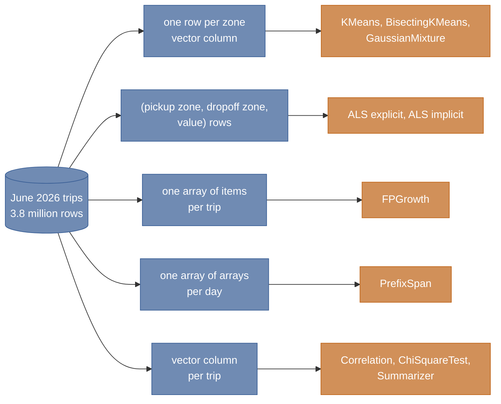
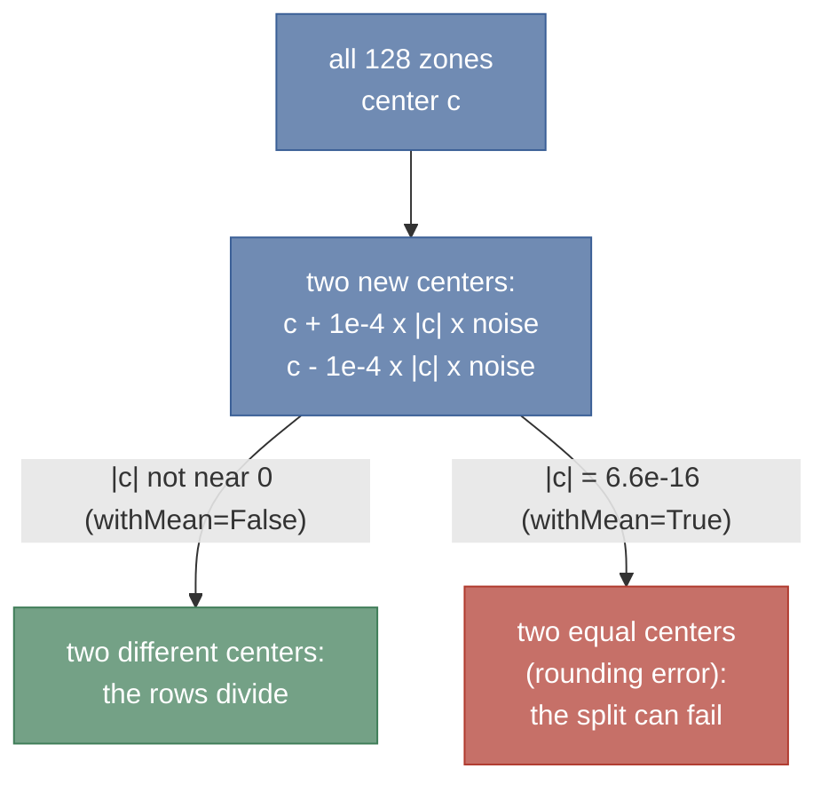
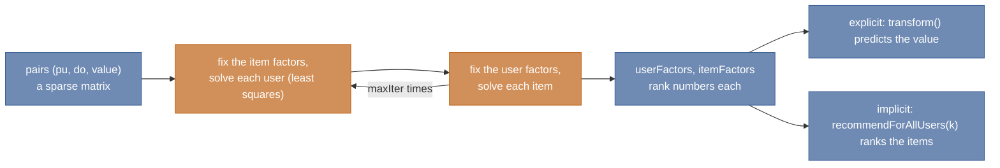
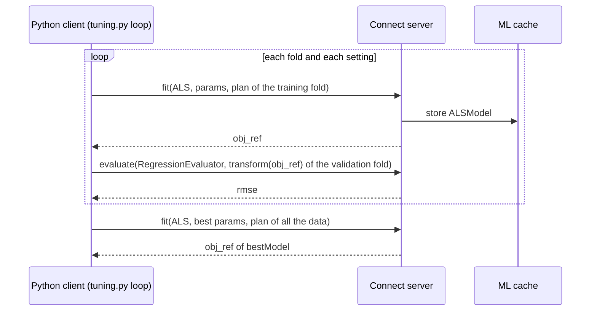

# Chapter 64: MLlib beyond regression

[Chapter 63](ch63-mllib-mlflow.md) built a fare model: a table of features, a label, and a regression. Many questions about the taxi data have no label. Which pickup zones are alike? Which destinations go with which origins?

Which items occur together in one trip? Which zones are busy in the same order each day? Is the payment type independent of the borough? MLlib has an estimator or a function for each of these questions.

**MLlib uses one pattern for each algorithm: a DataFrame goes in, and a DataFrame or a model comes out. But each algorithm expects a different input shape. Each one also has a trap that gives no error. For example, a split cannot divide centered data, a cold-start row makes the metric NaN, and a weight column removes rows. In Spark 4.3, each algorithm of this chapter also works over Spark Connect, without a change to the code.**

This chapter uses the June 2026 taxi trips again. It clusters the pickup zones (KMeans, BisectingKMeans, GaussianMixture). It recommends destinations with ALS (explicit and implicit). It finds frequent patterns (FPGrowth on trips as baskets, PrefixSpan on days as sequences). It runs the statistics functions (`Correlation`, `ChiSquareTest`, `Summarizer`).

Then it shows the feature transformers that [Chapter 63](ch63-mllib-mlflow.md) did not use, tunes ALS with `CrossValidator` and `TrainValidationSplit`, and runs each part over Spark Connect. The scripts are in [`code/ch64`](https://github.com/open-lakehouse/spark-masterclass/tree/main/code/ch64). They ran on `pyspark==4.3.0`, and each output block comes from `code/ch64/output/`.

The algorithms need different input shapes. This map shows the shape that each family expects:



## Step 1: A table of zone profiles

Clustering needs one row for each object, with a vector of numbers. `taxi93.py` makes one row for each pickup zone. It keeps the zones with 500 pickups or more, and it calculates seven numbers for each zone:

```python
p = (t.groupBy(F.col("PULocationID").alias("zone"))
      .agg(F.count("*").alias("trips"),
           F.avg("trip_distance").alias("avg_miles"),
           F.avg("minutes").alias("avg_minutes"),
           F.avg(night.cast("double")).alias("night_share"),
           F.avg(weekend.cast("double")).alias("weekend_share"),
           F.avg((F.col("payment_type") == 1).cast("double")).alias("card_share"),
           F.avg("tip_pct").alias("avg_tip_pct"))
      .where(F.col("trips") >= min_trips)
      .withColumn("log_trips", F.log10("trips")))
```

```text
zones with at least 500 pickups: 128
```

The seven columns have different units: miles, minutes, shares between 0 and 1, a percent, and a logarithm of a count. KMeans uses euclidean distance. Without scaling, the column with the largest numbers (minutes) controls the distance. Thus, `clustering.py` puts `StandardScaler` after `VectorAssembler`. Each column then has a mean of 0 and a standard deviation of 1:

```python
prep = Pipeline(stages=[VectorAssembler(inputCols=PROFILE_COLS, outputCol="raw"),
                        StandardScaler(inputCol="raw", outputCol="features", withMean=True, withStd=True)])
```

The script also sorts the profiles by zone before it caches them. The start of KMeans (the `k-means||` initialization) samples rows by partition. With a different row order, the same seed gives a different start and possibly a different result. An earlier run of the same script, with the default 200 shuffle partitions and no sort, gave different clusters for the same seeds.

## Step 2: KMeans, and how to choose k

KMeans needs the number of clusters, `k`. The usual measure for a choice of `k` is the **silhouette**. For each row, it compares two mean distances: to the other rows of the same cluster, and to the rows of the nearest other cluster. The value goes from -1 to 1, and a higher value is better. `ClusteringEvaluator` calculates it. The training cost (the sum of squared distances to the centers) always decreases when `k` increases, so the cost alone cannot choose `k`.

KMeans can stop in a local minimum. Thus, the script fits five seeds for each `k` and keeps the model with the lowest cost:

```python
for k in range(2, 9):
    runs = [KMeans(k=k, seed=s).fit(feats) for s in range(1, 6)]
    costs = [m.summary.trainingCost for m in runs]
    m = best[k] = runs[costs.index(min(costs))]
    s = ev.evaluate(m.transform(feats))
```

```text
== KMeans: for each k, the lowest-cost model of seeds 1-5
  k=2  silhouette 0.579  cost  492.1 (seeds: 492 to 493)  sizes [75, 53]
  k=3  silhouette 0.636  cost  387.0 (seeds: 387 to 431)  sizes [70, 54, 4]
  k=4  silhouette 0.560  cost  303.1 (seeds: 303 to 340)  sizes [52, 48, 24, 4]
  k=5  silhouette 0.540  cost  255.3 (seeds: 255 to 312)  sizes [49, 48, 14, 13, 4]
  k=6  silhouette 0.471  cost  220.1 (seeds: 220 to 273)  sizes [35, 34, 22, 20, 13, 4]
  k=7  silhouette 0.509  cost  198.8 (seeds: 199 to 225)  sizes [40, 39, 16, 13, 12, 4, 4]
  k=8  silhouette 0.460  cost  182.8 (seeds: 183 to 190)  sizes [38, 22, 20, 16, 12, 11, 5, 4]
```

<figure markdown>
  

  

  <figcaption>The output above as a chart. The cost decreases at each step. The silhouette is highest at k=3. The values come from <code>clustering.py</code>.</figcaption>
</figure>

The silhouette is highest at `k=3`. For `k=3`, the costs of the five seeds go from 387 to 431. Thus, one seed alone can give a worse model. Each model from `k=3` to `k=8` has a cluster of four zones. These are the three clusters, with their mean profiles in the original units:

```text
+----------+-----+-------+---------+-----------+-----------+----------+-----------+
|prediction|zones|trips  |avg_miles|avg_minutes|night_share|card_share|avg_tip_pct|
+----------+-----+-------+---------+-----------+-----------+----------+-----------+
|0         |70   |212137 |5.52     |22.78      |0.34       |0.13      |20.22      |
|1         |54   |3178167|2.89     |16.42      |0.21       |0.62      |25.61      |
|2         |4    |250094 |11.54    |38.69      |0.19       |0.76      |21.77      |
+----------+-----+-------+---------+-----------+-----------+----------+-----------+

+----------+------------------------------------------------------------+
|prediction|busiest zones                                               |
+----------+------------------------------------------------------------+
|0         |Alphabet City, Central Harlem North, Two Bridges/Seward Park|
|1         |Upper East Side South, Midtown Center, Upper East Side North|
|2         |JFK Airport, LaGuardia Airport, East Elmhurst               |
+----------+------------------------------------------------------------+
```

- **Cluster 1** is the core of Manhattan: 54 zones with 3.2 million of the trips, short trips and the highest share of card payments.
- **Cluster 0** is 70 zones outside the core. The trips are longer, a third of them are at night, and only 13% of them are card payments.
- **Cluster 2** is the airports. These are the four zones:

```text
+-----------------+-------+------+-----+----------+-------+
|zone_name        |borough|trips |miles|card_share|tip_pct|
+-----------------+-------+------+-----+----------+-------+
|Baisley Park     |Queens |1189  |11.8 |0.6       |18.7   |
|East Elmhurst    |Queens |8094  |9.4  |0.85      |24.3   |
|JFK Airport      |Queens |142192|15.2 |0.72      |19.3   |
|LaGuardia Airport|Queens |98619 |9.7  |0.88      |24.7   |
+-----------------+-------+------+-----+----------+-------+
```

East Elmhurst is next to LaGuardia Airport, and Baisley Park is near JFK Airport. The algorithm did not know where the zones are. It put these zones with the airports because their trips have the same profile: long trips with a high share of card payments.

Each iteration of KMeans moves each center to the mean of the rows that are nearest to it. This animation shows the iterations on two of the columns (`avg_miles` and `night_share`, scaled), with `k=3` and a random start:

<figure markdown>
  <video autoplay loop muted playsinline controls width="1280" height="720" poster="../../media/clips/ch64-anim-kmeans.webp">
    <source src="../../media/clips/ch64-anim-kmeans.mp4" type="video/mp4">
  </video>
  <figcaption>KMeans on two scaled columns of the 128 zones. The points and the centers after each iteration come from <code>kmeans_history.json</code>, which <code>clustering.py</code> wrote with <code>maxIter</code> from 1 to 8.</figcaption>
</figure>

```text
== 2-D KMeans history (avg_miles, night_share scaled; k=3, initMode=random)
  maxIter=1  cost  144.11  centers (+0.53,-0.12) (+0.42,+1.79) (-0.96,-0.64)
  maxIter=2  cost  102.11  centers (+0.60,-0.13) (+0.25,+1.62) (-0.91,-0.77)
  maxIter=3  cost   99.26  centers (+0.61,-0.15) (+0.25,+1.58) (-0.91,-0.77)
  maxIter=4  cost   99.17  centers (+0.63,-0.18) (+0.23,+1.52) (-0.91,-0.77)
  maxIter=5  cost   98.79  centers (+0.64,-0.19) (+0.23,+1.49) (-0.91,-0.77)
  maxIter=6  cost   98.75  centers (+0.66,-0.20) (+0.23,+1.49) (-0.90,-0.74)
  maxIter=7  cost   98.67  centers (+0.66,-0.22) (+0.24,+1.46) (-0.90,-0.74)
  maxIter=8  cost   98.63  centers (+0.66,-0.22) (+0.24,+1.46) (-0.90,-0.74)
```

Most of the decrease in cost occurs in the first two iterations. After that, the centers move by a few hundredths.

Each iteration is one pass over the data. `mllib/.../clustering/KMeans.scala` at the `v4.3.0` tag shows the pass. A `mapPartitions` calculates the partial sums for each center in each partition. `reduceByKey` adds them, and `collectAsMap` brings them to the driver. The driver then calculates the new centers. As with the iterative fits of [Chapter 63](ch63-mllib-mlflow.md#step-4-what-fit-runs), cache the input.

## Step 3: BisectingKMeans and GaussianMixture

**BisectingKMeans** starts with all rows in one cluster. It divides a cluster into two, again and again, until it has `k` clusters. The first fit on the scaled features gave this result:

```text
== BisectingKMeans k=3 (top-down splits) against KMeans
  centered features (withMean=True), 16 partition(s): sizes [47, 28, 53]
  centered features (withMean=True), repartition(2): sizes [128, 0, 0]
  centered features (withMean=True), repartition(4): sizes [55, 45, 28]
  centered features (withMean=True), repartition(8): sizes [47, 28, 53]
  centered features (withMean=True), repartition(32): sizes [53, 47, 28]
  centered features (withMean=True), repartition(200): sizes [128, 0, 0]
  norm of the mean of the centered features: 6.6e-16
```

The same data, the same seed and a different number of partitions gave four different results. With 2 and 200 partitions, the algorithm did not divide the data at all: one cluster has all 128 zones, and Spark gave no error. The cause is in `mllib/.../clustering/BisectingKMeans.scala` at the `v4.3.0` tag. To divide a cluster, the algorithm makes two new centers near the old center, with a small random difference:

```scala
val norm = center.norm
val level = 1e-4 * norm
val noise = Vectors.dense(Array.fill(d)(random.nextDouble()))
distanceMeasure.symmetricCentroids(level, noise, center.vector)
```

The size of the difference is proportional to the norm of the center. `StandardScaler` with `withMean=True` moves the center of all rows to the origin. Then the norm of the center is only a rounding error (6.6e-16 here), and the two new centers are almost the same point. The rounding error depends on the order of the sums, and that order depends on the partitions.

`repro_bisecting.py` shows the same effect on synthetic data: three groups of 100 points, far apart. With 4 and 8 partitions, it found the three groups. With 1, 2, 16, 32 and 200 partitions, one cluster had all 300 points. The part notes record this result as an open problem.



Centering does not change euclidean distances between rows. Thus, KMeans gives the same clusters with or without centering. Scale without centering (`withMean=False`) when you use BisectingKMeans:

```text
  on features scaled without centering (withMean=False):
    KMeans          silhouette 0.636  sizes [70, 54, 4]
    BisectingKMeans silhouette 0.477  sizes [55, 45, 28]
    zones per (KMeans cluster, BisectingKMeans cluster): [(0, 1, 42), (0, 2, 28), (1, 0, 54), (2, 1, 3), (2, 0, 1)]
```

KMeans gives the same silhouette (0.636) and the same sizes as on the centered features. BisectingKMeans has a lower silhouette (0.477). Both algorithms put the 54 core zones in one cluster. BisectingKMeans divides the 70 other zones into two groups (42 and 28), and it puts the four airport zones into those groups. A top-down split cannot keep a group of four zones as a cluster when the first split must divide 128 zones into two large groups.

**GaussianMixture** fits `k` normal distributions. Its output has a `probability` vector for each row: the probability of each cluster. KMeans gives each zone exactly one cluster. A mixture also shows the zones near two clusters:

```text
== GaussianMixture k=3: soft assignment
  weights [0.094, 0.348, 0.558]  log-likelihood -551.4  iterations 32
  128 zones: 115 with p_max >= 0.99, 5 with p_max < 0.9
+----------------+---------+-----+-----------------+
|zone_name       |borough  |p_max|probability      |
+----------------+---------+-----+-----------------+
|Manhattanville  |Manhattan|0.827|[0.0, 0.83, 0.17]|
|Park Slope      |Brooklyn |0.839|[0.0, 0.16, 0.84]|
|Astoria         |Queens   |0.84 |[0.0, 0.16, 0.84]|
|Brooklyn Heights|Brooklyn |0.87 |[0.0, 0.13, 0.87]|
|Fort Greene     |Brooklyn |0.878|[0.0, 0.12, 0.88]|
+----------------+---------+-----+-----------------+
```

For 115 of the 128 zones, one cluster has a probability of 0.99 or more. Five zones have no cluster with 0.9. Park Slope, Astoria, Brooklyn Heights and Fort Greene are residential zones near the core. Their trips are partly like the trips of the core. `vector_to_array` (from `pyspark.ml.functions`) changes the `probability` vector into an array, so that SQL functions such as `array_max` can read it.

| Algorithm | Output for each row | Choose it when |
|---|---|---|
| `KMeans` | one cluster | the clusters are compact groups of similar size |
| `BisectingKMeans` | one cluster, from a tree of splits | you want a hierarchy, or `k` is large (each split is a KMeans with `k=2`). Do not center the data |
| `GaussianMixture` | a probability for each cluster | a row can belong partly to two clusters, or the clusters have different shapes |
| `LDA` | a topic distribution for each document | the rows are documents of word counts ([Chapter 65](ch65-text-analytics.md) has the text side) |
| `PowerIterationClustering` | one cluster for each node of a graph | the input is a graph of weighted edges, not vectors |

## Step 4: Recommendations with ALS

ALS (alternating least squares) is the recommendation algorithm of MLlib. It takes rows of (user, item, value). It gives each user and each item a vector of `rank` numbers, the **factors**. The dot product of a user vector and an item vector approximates the value. The taxi data has no users. In `als.py`, the pickup zone is the user and the dropoff zone is the item.

ALS has two modes:

- **Explicit.** The value is a rating that the user gave. The model predicts the rating of a pair that it did not see. Here, the "rating" of a pair is the mean tip percent of its card trips.
- **Implicit** (`implicitPrefs=True`). The value is a count of events. The model reads it as confidence that the user likes the item, and it ranks the items for each user. Here, the value is the number of trips from the pickup zone to the dropoff zone.



**Explicit ALS and the cold start.** The script splits the pairs 80/20 and evaluates the RMSE on the test pairs:

```text
== explicit: 4,824 pairs with >= 20 card trips, 103 pickup zones, 221 dropoff zones
  coldStartStrategy='nan' (default): rmse nan   rows with NaN prediction: 15
  coldStartStrategy='drop':          rmse 2.215   rows scored: 950 of 965
  global mean of train       rmse 3.641
  mean of the pickup zone    rmse 3.464
  ALS rank 8                 rmse 2.215
  factors: userFactors 100 rows, itemFactors 211 rows, rank 8
```

The first RMSE is NaN. Fifteen test rows have a zone that is not in the training pairs. The model has no factors for that zone, so it predicts NaN, and one NaN makes the mean NaN. `coldStartStrategy="drop"` removes these rows from the output of `transform()`. Use `drop` for evaluation. In production, a new user or item needs another source of predictions, for example the mean of the pickup zone.

With `drop`, ALS has an RMSE of 2.215 tip percent points. The mean of the pickup zone has 3.464. The factors carry information that is in neither zone alone: some destinations get higher tips from some origins.

**Implicit ALS and a strong baseline.** The script trains on the trips of June 1 to 21 and tests on June 22 to 30. For each pickup zone, it compares the 10 recommended destinations with the 10 most frequent destinations of the test week. `RankingEvaluator` (in `pyspark.ml.evaluation`) calculates precision at 10 and the normalized discounted cumulative gain (NDCG) at 10:

```text
== implicit: trip counts as confidence (train June 1-21, test June 22-30)
  train pairs 29,447  test pairs 21,250
  most popular destinations              precision@10 0.148  ndcg@10 0.144  (251 pickup zones)
  own top destinations in train          precision@10 0.548  ndcg@10 0.608  (251 pickup zones)
  ALS implicit, counts, alpha=1          precision@10 0.245  ndcg@10 0.273  (251 pickup zones)
  ALS implicit, counts, alpha=40         precision@10 0.067  ndcg@10 0.069  (251 pickup zones)
  ALS implicit, log1p(counts), alpha=1   precision@10 0.283  ndcg@10 0.324  (251 pickup zones)
  ALS implicit, log1p(counts), alpha=40  precision@10 0.113  ndcg@10 0.114  (251 pickup zones)

  pickup zones with fewer than 100 train trips (56):
  own top destinations in train          precision@10 0.230  ndcg@10 0.303  (56 pickup zones)
  ALS implicit, log1p(counts), alpha=1   precision@10 0.221  ndcg@10 0.311  (56 pickup zones)
```

<figure markdown>
  

  

  <figcaption>NDCG at 10 from <code>als.py</code>. For all zones, the history of each zone is much better than ALS. For the 56 zones with few trips, the two are almost equal.</figcaption>
</figure>

Three results are important:

- **The history of each zone is the baseline to beat.** Taxi destinations repeat from week to week. The 10 most frequent destinations of the first three weeks give NDCG 0.608. The best ALS model gives 0.324. Always compare a recommender with "the same as before" and "the most popular", not only with another model.
- **The scale of the counts matters.** The implicit confidence is `1 + alpha * value`. Raw counts go up to thousands, so a large `alpha` gives a few pairs almost all the weight. `log1p` of the counts and `alpha=1` gave the best ALS result here, and raw counts with `alpha=40` gave the worst.
- **ALS helps where the history is thin.** For the 56 zones with fewer than 100 training trips, ALS is equal to the history (NDCG 0.311 against 0.303). The factors move information from similar zones to a zone with little data.

For LaGuardia Airport, the history of the zone and the test week name the same five zones in Midtown. ALS names zones in Queens:

```text
  pickup zone 138 (LaGuardia Airport), top 5:
    own history  Times Sq/Theatre District, Midtown Center, Midtown East, Midtown South, Murray Hill
    ALS          Kew Gardens, East New York, Jamaica, Queensbridge/Ravenswood, Outside of NYC
    test week    Times Sq/Theatre District, Midtown Center, Midtown South, Midtown East, Murray Hill
```

`recommendForUserSubset` can return items that the user already has. For a "new destination" feature, remove the pairs of the history with a left anti join after you recommend.

## Step 5: Frequent patterns: trips as baskets, days as sequences

**FPGrowth** finds sets of items that occur together in many baskets. Its input is one array of items for each row. `patterns.py` makes one basket for each trip of a 10% sample. The items describe the trip. They are the pickup zone, the dropoff zone, the payment and the JFK flat fare. They also mark night, the airport fee, a toll, a tip of 20% or more, and 10 miles or more:

```python
items = F.filter(F.array(
    F.concat(F.lit("from "), F.col("pu_name")),
    F.concat(F.lit("to "), F.col("do_name")),
    F.when(F.col("RatecodeID") == 2, "JFK flat fare"),
    F.when(F.col("payment_type") == 1, "card").when(F.col("payment_type") == 2, "cash"),
    F.when(F.col("hour").isin(22, 23, 0, 1, 2, 3, 4, 5), "night"),
    F.when(F.col("Airport_fee") > 0, "airport fee"),
    F.when(F.col("tolls_amount") > 0, "toll"),
    F.when(F.col("tip_pct") >= 20, "tip >= 20%"),
    F.when(F.col("trip_distance") >= 10, "10+ miles")), lambda x: x.isNotNull())
baskets = t.select(F.array_distinct(items).alias("items")).cache()
```

```text
== FPGrowth: 366,249 baskets (a 10% sample of the trips), one per trip
+---------------------------------------------------------------------------------------+
|items                                                                                  |
+---------------------------------------------------------------------------------------+
|[from LaGuardia Airport, to Flatiron, card, night, airport fee, toll]                  |
|[from JFK Airport, to Downtown Brooklyn/MetroTech, card, night, airport fee, 10+ miles]|
|[from Upper East Side North, to Yorkville West, card, night, tip >= 20%]               |
+---------------------------------------------------------------------------------------+
```

`F.filter` removes the NULL values of the `when` expressions that do not apply. `array_distinct` is necessary, because FPGrowth does not accept a duplicate item in a basket. The check occurs in a task, after the job starts:

```text
duplicates in a basket:
  Py4JJavaError: Items in a transaction must be unique but got ArraySeq(card, card, night).
  the job started first: True
```

`minSupport=0.01` keeps the item sets that occur in 1% of the baskets or more. `minConfidence=0.5` keeps the rules that are true in half of the baskets with the antecedent or more:

```text
frequent itemsets with support >= 1%: 339
+-------------------------+------+
|items                    |freq  |
+-------------------------+------+
|[card]                   |240363|
|[tip >= 20%]             |184174|
|[tip >= 20%, card]       |184174|
|[night]                  |76147 |
|[night, card]            |40696 |
|[cash]                   |34077 |
|[night, tip >= 20%]      |29817 |
|[night, tip >= 20%, card]|29817 |
+-------------------------+------+
association rules with confidence >= 0.5: 495; with at most 2 antecedent items, by lift:
+------------------------------+------------------+----------+-----+-------+
|antecedent                    |consequent        |confidence|lift |support|
+------------------------------+------------------+----------+-----+-------+
|[from JFK Airport, toll]      |[JFK flat fare]   |0.877     |35.98|0.015  |
|[JFK flat fare, airport fee]  |[from JFK Airport]|0.993     |25.54|0.0181 |
|[from JFK Airport, 10+ miles] |[JFK flat fare]   |0.615     |25.24|0.0186 |
|[from JFK Airport, tip >= 20%]|[JFK flat fare]   |0.599     |24.59|0.0113 |
|[from JFK Airport, card]      |[JFK flat fare]   |0.575     |23.6 |0.0162 |
|[JFK flat fare, toll]         |[from JFK Airport]|0.78      |20.06|0.015  |
|[JFK flat fare, 10+ miles]    |[from JFK Airport]|0.779     |20.03|0.0186 |
|[JFK flat fare, card]         |[from JFK Airport]|0.771     |19.81|0.0162 |
|[JFK flat fare, tip >= 20%]   |[from JFK Airport]|0.764     |19.65|0.0113 |
|[JFK flat fare]               |[from JFK Airport]|0.764     |19.63|0.0186 |
+------------------------------+------------------+----------+-----+-------+
```

<figure markdown>
  <video autoplay loop muted playsinline controls width="1280" height="720" poster="../../media/clips/ch64-rules.webp">
    <source src="../../media/clips/ch64-rules.mp4" type="video/mp4">
  </video>
  <figcaption><code>patterns.py</code>: FPGrowth on the trips as baskets, and its association rules by lift.</figcaption>
</figure>

Read the three measures of a rule:

| Measure | Meaning | In the first rule |
|---|---|---|
| support | the share of all baskets that have the antecedent and the consequent | 1.5% of the trips are from JFK, with a toll, at the flat fare |
| confidence | the share of the baskets with the antecedent that also have the consequent | 87.7% of the trips from JFK with a toll are at the flat fare |
| lift | the confidence divided by the support of the consequent | the flat fare is 36 times more frequent in these trips than in all trips |

The rules with the highest lift describe the JFK flat fare (rate code 2). That is the rule that the boosted trees learned in [Chapter 63](ch63-mllib-mlflow.md), and that the linear model could not learn. Some itemsets are true by construction. `tip >= 20%` occurs only with `card`, because the data has tips only for card payments. A rule mining tool finds the rules of the data collection too, so read each rule before you use it.

A fitted `FPGrowthModel` is also a transformer. `transform()` adds the consequents of each rule whose antecedent is in the basket. It is one `Project` with a JVM UDF, as the MLlib models of [Chapter 63](ch63-mllib-mlflow.md):

```text
transform(): the consequents of each rule whose antecedent is in the basket
+----------------------------+---------------------------------------------------------+
|items                       |prediction                                               |
+----------------------------+---------------------------------------------------------+
|[from JFK Airport, toll]    |[JFK flat fare, card, 10+ miles, airport fee, tip >= 20%]|
|[from Midtown Center, night]|[card, tip >= 20%]                                       |
+----------------------------+---------------------------------------------------------+

the plan of transform():
== Physical Plan ==
*(1) Project [items#235, UDF(items#235) AS prediction#258]
+- *(1) Scan ExistingRDD[items#235]
```

**PrefixSpan** finds frequent **sequences**. Its input is one array of itemsets for each row, in order. The script makes one sequence for each day, with 24 itemsets (one for each hour). Each itemset has the three busiest pickup zones of that hour. `PrefixSpan` is not an estimator. It has one method, `findFrequentSequentialPatterns`, which returns a DataFrame:

```python
ps = PrefixSpan(minSupport=1.0, maxPatternLength=3, sequenceCol="sequence")
pats = ps.findFrequentSequentialPatterns(seqs).cache()
```

```text
== PrefixSpan: one sequence per day, an itemset per hour (the 3 busiest pickup zones)
30 sequences (days), 24 itemsets each
patterns on all 30 days (minSupport=1.0, maxPatternLength=3): 57
patterns with an itemset of two zones in the same hour: 8
+-------------------------------------------------------------------------+----+
|sequence                                                                 |freq|
+-------------------------------------------------------------------------+----+
|[[Clinton East], [Upper East Side North, Upper East Side South]]         |30  |
|[[JFK Airport], [Upper East Side North, Upper East Side South]]          |30  |
|[[Upper East Side North, Upper East Side South], [Midtown Center]]       |30  |
|[[Upper East Side North, Upper East Side South], [Upper East Side North]]|30  |
+-------------------------------------------------------------------------+----+
three-step patterns with JFK Airport:
+-----------------------------------------------------------------+----+
|sequence                                                         |freq|
+-----------------------------------------------------------------+----+
|[[Clinton East], [JFK Airport], [Midtown Center]]                |30  |
|[[Clinton East], [JFK Airport], [Upper East Side North]]         |30  |
|[[Clinton East], [JFK Airport], [Upper East Side South]]         |30  |
|[[JFK Airport], [Penn Station/Madison Sq West], [Midtown Center]]|30  |
+-------------------------------------------------------------------------+----+
```

A pattern does not need consecutive hours. Look at `[[Clinton East], [JFK Airport], [Midtown Center]]`. On each of the 30 days, Clinton East was in the top three at some hour. JFK Airport was in the top three at a later hour, and Midtown Center at a still later hour. That is the rhythm of the city: nightlife in Clinton East after midnight, the airport in the early morning, and Midtown in the day. An itemset with two zones (`[Upper East Side North, Upper East Side South]`) means that the two zones were in the top three in the same hour.

## Step 6: Statistics: Correlation, ChiSquareTest, Summarizer

`pyspark.ml.stat` has statistics that work on a vector column. `stats.py` uses four trip columns:

```text
== Correlation over 3,610,433 trips: ['trip_distance', 'minutes', 'fare_amount', 'tip_amount']
  pearson
    trip_distance  1.000  0.773  0.888  0.491
    minutes        0.773  1.000  0.824  0.464
    fare_amount    0.888  0.824  1.000  0.465
    tip_amount     0.491  0.464  0.465  1.000
  spearman
    trip_distance  1.000  0.817  0.880  0.146
    minutes        0.817  1.000  0.912  0.220
    fare_amount    0.880  0.912  1.000  0.129
    tip_amount     0.146  0.220  0.129  1.000
  F.corr(trip_distance, minutes) = 0.773  (one pair, the same pearson number)
```

`Correlation.corr` calculates the full matrix in one pass. For one pair of columns, `F.corr` gives the same Pearson value. The two methods do not agree for the tip:

- **Pearson** measures a linear relation, and large values have a large effect. Long trips have large tips, so the Pearson correlation of distance and tip is 0.491.
- **Spearman** is the Pearson correlation of the ranks. Each trip has the same weight. Many trips have a tip of 0 (all cash trips and some card trips). Thus, the rank of the tip says little about the rank of the distance. The Spearman value is 0.146.

Spearman needs a sort of each column, so it costs more than Pearson.

**`ChiSquareTest`** tests if a label is independent of each feature. Both must be categories. The script asks if the payment type (card or cash) is independent of the pickup borough:

```text
== ChiSquareTest: is the payment type independent of the pickup borough?
  pValues [0.0]  degreesOfFreedom [3]  statistics [18115.5]
+---------+-------+------+----------+
|  borough|   card|  cash|cash_share|
+---------+-------+------+----------+
|Manhattan|2142172|277811|     0.115|
| Brooklyn|   9067|  2115|     0.189|
|   Queens| 203813| 52075|     0.204|
|    Bronx|    588|   437|     0.426|
+---------+-------+------+----------+

  on a 0.05% sample (1316 trips): pValue 0.2821  statistic 2.5
```

The p-value is 0.0: the share of cash depends on the borough, from 11.5% in Manhattan to 42.6% in the Bronx. With 2.6 million trips, a test finds even very small differences. On a sample of 1,316 trips, the same test gives a p-value of 0.28, and it cannot reject independence. A p-value tells you if a difference is real for this amount of data. The table of shares tells you if the difference is large.

**`Summarizer`** calculates many statistics of a vector column in one pass. It also takes an optional weight column:

```text
== Summarizer: many statistics of a vector column in one pass
  mean              3.42      17.63      21.30       3.05
  variance         17.02     171.01     309.14      16.11
  min               0.10       1.00       0.01       0.00
  max              99.26     179.72     500.00     333.33
  numNonZeros 3610433.00 3610433.00 3610433.00 2312599.00
  count       3610433
  rows with passenger_count > 0: 2,698,609
  mean weighted by passenger_count       3.40      17.59      20.40       4.00
  F.avg on the same rows                 3.26      17.12      19.72       3.94
```

`numNonZeros` shows that 2,312,599 of the 3,610,433 trips have a tip that is not zero. The weight column has a trap. `passenger_count` is NULL or 0 for about a quarter of the trips. A weight must be a positive number, so the script removed those rows first. A comparison of a weighted mean with the plain mean of all rows then compares two different sets of rows. Compare on the same rows, as the last two lines do.

## Step 7: Feature transformers that Chapter 63 did not use

[Chapter 63](ch63-mllib-mlflow.md#step-3-categories-become-numbers) used `StringIndexer`, `OneHotEncoder` and `VectorAssembler`. Chapters 65 and 66 use the text transformers and LSH. `features.py` runs the other frequent transformers on a 5% sample of the trips.

**`Imputer`** replaces NULL values with the mean, the median or the mode of the column:

```text
== Imputer: passenger_count is NULL for some trips
  strategy=mean   fills 44,972 NULL values with 1.256
  strategy=median fills 44,972 NULL values with 1.000
  strategy=mode   fills 44,972 NULL values with 1.000
```

A passenger count of 1.256 is not a possible value. For a count or a category, use `median` or `mode`.

**Three scalers** give different results when a column has outliers. The script scales the fare and shows five points: the minimum, the three quartiles and the maximum:

```text
== three scalers on fare_amount (5 rows: the 4 quartile points and the maximum)
  fare               0.010    10.000    15.600    26.100   490.200
  StandardScaler    -1.209    -0.640    -0.321     0.277    26.711
  MinMaxScaler       0.000     0.020     0.032     0.053     1.000
  RobustScaler       0.001     0.621     0.969     1.621    30.447
```

| Scaler | Formula | With the outlier of $490 |
|---|---|---|
| `StandardScaler` | (x - mean) / standard deviation | the outlier is at 26.7, the normal fares are between -1.2 and 0.3 |
| `MinMaxScaler` | (x - min) / (max - min) | the outlier is at 1.0, and 75% of the fares are below 0.053 |
| `RobustScaler` | (x - median) / (Q3 - Q1), without centering by default | the quartiles have a fixed spread, and the outlier is at 30.4 |

`MinMaxScaler` puts almost all values in a small part of the range. `RobustScaler` uses the quartiles, so one outlier does not change the scale of the other rows.

**`Bucketizer`** uses splits that you give. **`QuantileDiscretizer`** calculates the splits from the data, so each bucket has about the same number of rows:

```text
== Bucketizer (fixed splits) and QuantileDiscretizer (splits from the data)
  QuantileDiscretizer splits: [-inf, 9.3, 13.5, 18.94, 29.6, inf]
  rows per band: Bucketizer [41305, 74721, 31215, 26914, 9028] | QuantileDiscretizer [34513, 38610, 36669, 36353, 37038]
```

`QuantileDiscretizer` is an estimator. Its model is a `Bucketizer` with the calculated splits.

**`TargetEncoder`** (since 4.0) replaces a category with the mean of the label for that category. A zone becomes one number, not a vector with one slot for each zone:

```text
== TargetEncoder (new in 4.0): a zone becomes the mean tip percent of its trips
  OneHotEncoder: one vector of size 265 per row | TargetEncoder: one double per row
  zone 237 (  7159 card trips): smoothing=0 ->  27.42   smoothing=100 ->  27.40
  zone   3 (     1 card trips): smoothing=0 ->  28.79   smoothing=100 ->  25.62
  mean tip percent of all card trips: 25.58
```

Zone 3 has one card trip in the sample. Without smoothing, its encoding is the tip of that one trip. With `smoothing=100`, the encoding of a small category moves to the mean of all trips (25.58), and a large category keeps its own mean. Fit the encoder on the training set only. If it sees the test labels, the evaluation is too optimistic.

**`PCA`** finds the directions of largest variance. On the seven zone-profile columns of Step 1:

```text
== PCA on the 7 zone-profile columns (Step 1), after StandardScaler
  explained variance of 3 components: [0.557, 0.205, 0.121]  (sum 0.883)
  loadings of component 1: log_trips -0.44, avg_miles +0.37, avg_minutes +0.37, night_share +0.30, weekend_share +0.39, card_share -0.43, avg_tip_pct -0.33
```

The first component has 55.7% of the variance. Its negative side is busy zones with card payments and high tips. Its positive side is quiet zones with long trips at night and on weekends. That is the axis between cluster 1 and cluster 0 of Step 2.

**`RFormula`** builds the label and the feature vector from an R formula. **`SQLTransformer`** is a pipeline stage that runs a SQL statement on `__THIS__`:

```python
rf = RFormula(formula="fare_amount ~ trip_distance + minutes + rate", handleInvalid="keep")
sqlt = SQLTransformer(statement="SELECT *, CAST(RatecodeID AS STRING) AS rate FROM __THIS__")
m = Pipeline(stages=[sqlt, rf]).fit(t.where("RatecodeID IS NOT NULL"))
```

```text
== RFormula and SQLTransformer: a model input from a formula and from SQL
  features has 8 slots: ['trip_distance', 'minutes', 'rate_1', 'rate_2', 'rate_5', 'rate_3', 'rate_4', 'rate_99']
  first row: label 39.4, features (8,[0,1,2],[9.52,22.366666666666667,1.0])
```

`RFormula` indexed and one-hot encoded the string column `rate` by itself. The slot names come from the metadata of the vector column. The metadata groups the attributes by kind (`numeric`, `binary`), not by index. Thus, sort them by `idx` before you use them as names. An earlier version of the script took them in the order of the metadata and gave each slot a wrong name.

**`UnivariateFeatureSelector`** keeps the slots with the best univariate score against the label. For a continuous feature and a continuous label, the score is the F-value:

```text
== UnivariateFeatureSelector: keep the 2 slots with the highest F-value against the fare
  selected slot indexes [0, 1] -> ['trip_distance', 'minutes']
```

## Step 8: Model selection: CrossValidator and TrainValidationSplit

[Chapter 63](ch63-mllib-mlflow.md#step-8-save-load-and-tune) tuned a boosted tree and showed the trap of a parameter grid with the wrong keys. `tuning.py` tunes the explicit ALS model of Step 4 over `rank` and `regParam`, with three folds:

```python
als = ALS(userCol="pu", itemCol="do", ratingCol="tip", maxIter=10, seed=7, coldStartStrategy="drop")
grid = ParamGridBuilder().addGrid(als.rank, [4, 8, 16]).addGrid(als.regParam, [0.01, 0.1, 1.0]).build()
cv = CrossValidator(estimator=als, estimatorParamMaps=grid, evaluator=ev, numFolds=3, seed=7)
```

```text
== grid: 9 settings (rank x regParam), 3,851 training pairs
CrossValidator, 3 folds: avgMetrics (rmse) and stdMetrics
  rank  4  regParam 0.01   rmse 2.968 +- 0.191
  rank  4  regParam 0.1    rmse 2.419 +- 0.056
  rank  4  regParam 1.0    rmse 2.823 +- 0.009
  rank  8  regParam 0.01   rmse 2.870 +- 0.189
  rank  8  regParam 0.1    rmse 2.524 +- 0.158
  rank  8  regParam 1.0    rmse 2.817 +- 0.012
  rank 16  regParam 0.01   rmse 4.507 +- 0.037
  rank 16  regParam 0.1    rmse 2.949 +- 0.138
  rank 16  regParam 1.0    rmse 2.827 +- 0.011
best: rank 4, regParam 0.1  test rmse 2.322
TrainValidationSplit: best rank 4, regParam 0.1, validation rmse 2.243, test rmse 2.322
```

`coldStartStrategy="drop"` is necessary here too. A fold can have a zone that the other two folds do not have. Without `drop`, the metric of that fold is NaN. `stdMetrics` gives the spread over the folds. Rank 16 with little regularization overfits (RMSE 4.507). `TrainValidationSplit` fits each setting one time on 75% of the data, and it chose the same setting at a third of the cost.

The folds of `CrossValidator` are random rows. With `foldCol`, you give the fold of each row yourself, for example to keep the pairs of one pickup zone in one fold. For ALS, that gives no result:

```text
foldCol by pickup zone: IllegalArgumentException: requirement failed: Nothing has been added to this summarizer.
  every validation zone is new to the model, coldStartStrategy='drop' removes every row
```

Each validation zone is a cold start. `drop` removes each row, and the evaluator receives an empty DataFrame. The message comes from inside the evaluator and does not name the cause. A fold column must keep each user and each item in the training folds.

`parallelism` fits several settings at the same time. The script timed the same `CrossValidator` under the book's benchmark lock, three runs after a warmup on `local[*]` with 16 cores:

```text
== parallelism: the same CrossValidator, 3 runs each after a warmup (local[*], 16 cores)
  parallelism=1  median  37.5 s  [37.5, 50.5, 34.8]
  parallelism=4  median  21.8 s  [20.3, 24.2, 21.8]
```

Four settings at the same time cut the median from 37.5 s to 21.8 s, not to a quarter. Each ALS fit is a sequence of small Spark jobs, and the jobs of different fits share the same 16 cores.

## Step 9: Which of these work over Spark Connect in 4.3

`connect_matrix.py` fits or calls each part of this chapter on a 1% sample. It does this first in a Classic session, then in a Connect session (`ch64/server.sh` starts the server):

```text
pyspark 4.3.0                                  Classic    Connect
KMeans                                         ok         ok
BisectingKMeans                                ok         ok
GaussianMixture                                ok         ok
LDA                                            ok         ok
PowerIterationClustering                       ok         ok
ClusteringEvaluator                            ok         ok
ALS explicit                                   ok         ok
ALS implicit + recommendForAllUsers            ok         ok
RankingEvaluator                               ok         ok
FPGrowth                                       ok         ok
PrefixSpan                                     ok         ok
Correlation                                    ok         ok
ChiSquareTest                                  ok         ok
Summarizer                                     ok         ok
Imputer                                        ok         ok
StandardScaler / MinMaxScaler / RobustScaler   ok         ok
Bucketizer / QuantileDiscretizer               ok         ok
TargetEncoder                                  ok         ok
PCA                                            ok         ok
RFormula + SQLTransformer                      ok         ok
UnivariateFeatureSelector                      ok         ok
CrossValidator                                 ok         ok
KMeansModel.summary.trainingCost               ok         ok
GaussianMixtureModel.gaussiansDF               ok         ok
ALSModel.userFactors                           ok         ok
FPGrowthModel.freqItemsets                     ok         ok
CrossValidator(collectSubModels=True)          ok         ok
TrainValidationSplit                           ok         ok
```

<figure markdown>
  <video autoplay loop muted playsinline controls width="1280" height="720" poster="../../media/clips/ch64-connect.webp">
    <source src="../../media/clips/ch64-connect.mp4" type="video/mp4">
  </video>
  <figcaption><code>connect_matrix.py</code>: each algorithm of the chapter in a Classic session and over Spark Connect.</figcaption>
</figure>

Each part works over Connect. The first run of the matrix had one failure in both columns. `RFormula` writes to a column called `features` by default, and the sample table already had a `features` column. The fix was `featuresCol="rf"`. That is an error in the test, not a difference between Classic and Connect.

The server decides what the client can call. Three lists at the `v4.3.0` tag control it:

- `mllib/src/main/resources/META-INF/services/org.apache.spark.ml.Estimator` lists the estimators that the server can fit. It has `KMeans`, `BisectingKMeans`, `GaussianMixture`, `LDA`, `ALS`, `FPGrowth`, the scalers, `Imputer`, `QuantileDiscretizer`, `TargetEncoder`, `PCA`, `RFormula` and `UnivariateFeatureSelector`.
- `.../org.apache.spark.ml.Transformer` lists the transformers with no fitted state, for example `Bucketizer` and `SQLTransformer`, and the models that the server can load.
- `ALLOWED_ATTRIBUTES` in `sql/connect/server/.../ml/MLUtils.scala` lists the helper methods. `PrefixSpan`, `PowerIterationClustering`, `Correlation` and `ChiSquareTest` are not estimators. Their Python methods send a call to `prefixSpanFindFrequentSequentialPatterns`, `powerIterationClusteringAssignClusters`, `correlation` or `chiSquareTest`, and the server returns a DataFrame.

`CrossValidator` and `TrainValidationSplit` are not on the server. They are Python classes in `pyspark/ml/tuning.py`. Their loop runs in the client. Each fit and each evaluation is one request to the server, and `parallelism` runs several requests at the same time from client threads:



The rules of [Chapter 63, Step 9](ch63-mllib-mlflow.md#step-9-the-same-pipeline-over-spark-connect) apply to each model of this chapter. The fitted model is in the server's ML cache. The client holds a reference, each attribute (`trainingCost`, `userFactors`) is a round trip, and `save()` writes on the server's file system. `collectSubModels=True` keeps each sub-model, so it also keeps a reference to each one in the server's ML cache. On a shared server, use it only on small grids.

## The whole chapter, on one page

- **Clustering needs scaled vectors.** Choose `k` with the silhouette, not with the cost, and fit several seeds. Fix the row order if you need the same result again.
- **Do not center the data for BisectingKMeans.** Its split noise is proportional to the norm of the center, and centered data has a norm near zero. The split can fail without an error. KMeans does not change with centering.
- **GaussianMixture gives probabilities.** Use them to find the rows near two clusters.
- **ALS explicit predicts a value, ALS implicit ranks items.** Use `coldStartStrategy="drop"` for evaluation. Compare with the history of each user and with the most popular items. Scale the counts (`log1p`) for implicit ALS.
- **FPGrowth needs unique items in each basket.** Read support, confidence and lift together, and look for rules that are true by construction.
- **PrefixSpan finds ordered patterns** in sequences of itemsets, with gaps allowed.
- **Pearson and Spearman disagree when the data has many zeros or outliers.** A p-value on millions of rows is always small. Look at the size of the difference.
- **Pick the transformer for the data:** `median` or `mode` imputation for counts, `RobustScaler` for outliers, `QuantileDiscretizer` for equal buckets, `TargetEncoder` with smoothing for many categories. Sort metadata attributes by `idx`.
- **A fold column must not create cold starts.** `parallelism` helps, but less than its value.
- **Over Connect in 4.3, each part of this chapter works.** The server lists what it can fit, transform and call. The tuning loop runs in the client.

```python
from pyspark.ml import Pipeline
from pyspark.ml.clustering import KMeans
from pyspark.ml.evaluation import ClusteringEvaluator
from pyspark.ml.feature import VectorAssembler, StandardScaler
from pyspark.ml.fpm import FPGrowth
from pyspark.ml.recommendation import ALS
from pyspark.sql import functions as F

# zones: one row per pickup zone with PROFILE_COLS (code/ch64/taxi93.py)
feats = Pipeline(stages=[VectorAssembler(inputCols=PROFILE_COLS, outputCol="raw"),
                         StandardScaler(inputCol="raw", outputCol="features", withStd=True)]).fit(zones).transform(zones)
km = min((KMeans(k=3, seed=s).fit(feats) for s in range(1, 6)), key=lambda m: m.summary.trainingCost)
print(ClusteringEvaluator().evaluate(km.transform(feats)))

# pairs: (pu, do, trips). Recommend destinations, then score them against the history of each zone
als = ALS(userCol="pu", itemCol="do", ratingCol="trips", implicitPrefs=True, alpha=1.0, rank=16,
          coldStartStrategy="drop").fit(pairs.withColumn("trips", F.log1p("trips")))
recs = als.recommendForAllUsers(10)

# baskets: one array of distinct items per trip
rules = FPGrowth(itemsCol="items", minSupport=0.01, minConfidence=0.5).fit(baskets).associationRules
```

To run all of it, do these steps from the `code/` folder:

```bash
uv run python ch64/clustering.py
uv run python ch64/als.py
uv run python ch64/patterns.py
uv run python ch64/stats.py
uv run python ch64/features.py
flock $HOME/spark-masterclass/data/.bench.lock uv run python ch64/tuning.py
ch64/server.sh start && uv run python ch64/connect_matrix.py; ch64/server.sh stop
```

## Further reading

- [Clustering](https://spark.apache.org/docs/4.3.0/ml-clustering.html), [collaborative filtering](https://spark.apache.org/docs/4.3.0/ml-collaborative-filtering.html), [frequent pattern mining](https://spark.apache.org/docs/4.3.0/ml-frequent-pattern-mining.html) and [basic statistics](https://spark.apache.org/docs/4.3.0/ml-statistics.html) in the MLlib guide.
- [Extracting, transforming and selecting features](https://spark.apache.org/docs/4.3.0/ml-features.html) and [model selection and tuning](https://spark.apache.org/docs/4.3.0/ml-tuning.html).
- [`BisectingKMeans.scala` at v4.3.0](https://github.com/apache/spark/blob/v4.3.0/mllib/src/main/scala/org/apache/spark/mllib/clustering/BisectingKMeans.scala), with `splitCenter`.
- [`MLUtils.scala` at v4.3.0](https://github.com/apache/spark/blob/v4.3.0/sql/connect/server/src/main/scala/org/apache/spark/sql/connect/ml/MLUtils.scala), the helper methods that Connect allows.
- Hu, Koren and Volinsky, "Collaborative Filtering for Implicit Feedback Datasets" (2008), the model behind `implicitPrefs`.
