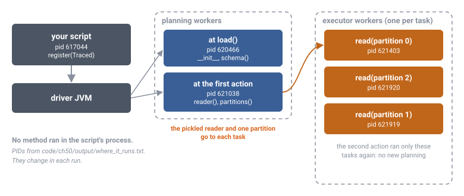
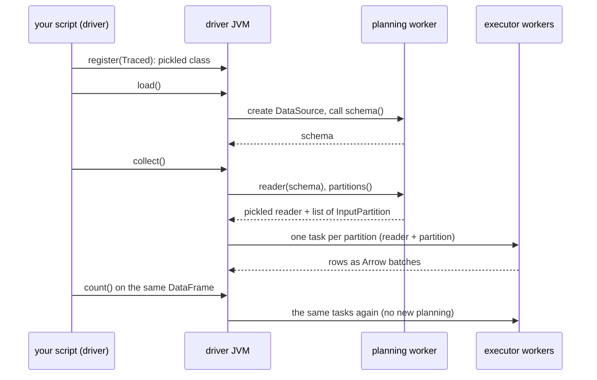
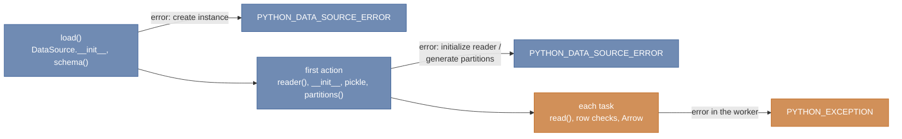
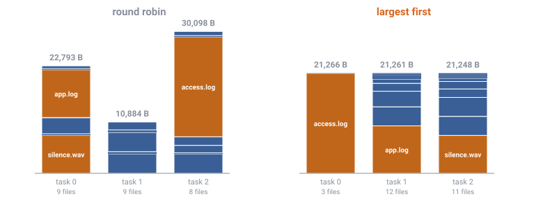
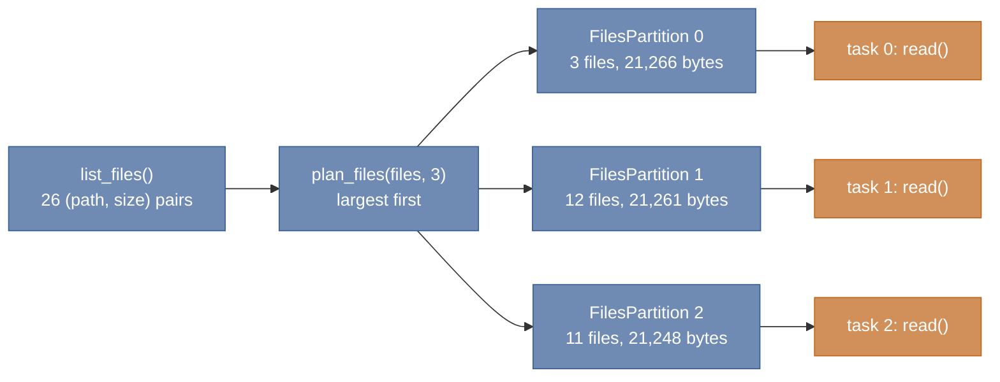

# Chapter 65: Python data sources I: readers and partition planning

Spark can read Parquet, JSON, CSV, ORC, text and JDBC tables without help. Messy data often lives in other places: a file format that has no reader, an internal API, a device, a queue. Before Spark 4.0, a connector for such a source meant Scala or Java code against the DataSource V2 interfaces, a JAR and a build. Spark 4.0 added the Python Data Source API (SPIP SPARK-44076). You write a few small Python classes and register them. After that, `spark.read.format("yourname").load()` reads your source in parallel, from DataFrames and from SQL.

**A Python data source is a planning protocol between processes. Spark calls `schema()`, `reader()` and `partitions()` in a Python worker during planning, and calls `read()` in other Python workers inside the tasks. Only the reader object and the partition objects move between these processes, as pickled data. Thus the parallelism, the cost and the correctness of a source come from what you put into the partitions and onto `self`.**

This chapter builds the protocol from the smallest source to a parallel reader for a folder of mixed files. The next four chapters add these parts:

- APIs and databases ([Chapter 66](ch66-python-data-sources-apis-databases.md)).

- Filter pushdown ([Chapter 67](ch67-python-data-sources-pushdown.md)).

- Writers and streams ([Chapter 68](ch68-python-data-sources-writers-streaming.md)).

- Packages, tests and logs ([Chapter 69](ch69-shipping-a-python-data-source.md)).

 The scripts are in [`code/ch65`](https://github.com/lisancao/spark-masterclass/tree/main/code/ch65). All output in this chapter comes from `code/ch65/output/`, from runs on `pyspark==4.3.0` in local mode on a 16-core machine.

!!! note "New in 4.3"
    The Python Data Source API in Spark 4.3.0 is the same as in Spark 4.2.0. Between the `v4.2.0` and `v4.3.0` tags, the Python data source code has only one functional change. The other change corrects docstrings. SPARK-58019 is a follow-up that converts Arrow list columns to Python rows in bulk for data source writes. Filter pushdown is from 4.1 (SPARK-51271). Admission control and `Trigger.AvailableNow` for stream readers are from 4.2 (SPARK-55304).

    Single-task execution (`spark.sql.optimizer.singleTaskExecution.enabled`, new in 4.3 and off by default) does not apply to a Python data source. The rule `MarkSingleTaskExecution` marks only file scans and local relations. `feather_check.py` turns the flag on. A Python source with three partitions still runs three tasks, and its `groupBy` still has an `Exchange`. The zones CSV file under the same flag has no `Exchange`:

    ```text
    Three  scan partitions: 3, Exchange operators in groupBy plan: 1
    One    scan partitions: 1, Exchange operators in groupBy plan: 1
    the zones CSV file, scan partitions: 1, Exchange operators in groupBy plan: 0
    ```

## Why not `createDataFrame`?

The first version of a reader is usually a loop in the driver script. The loop reads the records into a Python list and calls `spark.createDataFrame(rows)`. This works for small data, but it has four problems:

- One Python process reads all of the data, so the read has no parallelism.
- All of the rows go through the memory of the driver.
- The result is a DataFrame of this script only. Another user, a SQL query or a stream cannot use the loop by name.
- The loop has no write side. Spark cannot save to the source with `df.write.format(...)`.

A data source solves each problem. The tasks read in parallel. The rows go from each task into Spark directly. The source has a name in DataFrames and in SQL. [Chapter 66](ch66-python-data-sources-apis-databases.md) shows the driver loop against an API, and how it fails.

## The parts of a Python data source

A source has three kinds of objects. Each kind has one job:

| Class | Job | Methods that Spark calls |
|---|---|---|
| `DataSource` | Gives the format name, the schema, and a reader or writer | `name()` (a class method), `schema()`, `reader(schema)` |
| `DataSourceReader` | Plans the work and produces the rows | `partitions()`, `read(partition)` |
| `InputPartition` | Describes one share of the work, as plain data | none: Spark only pickles it |

Spark runs one task for each partition. Each task calls `read()` one time, with its partition. Thus `partitions()` sets the parallelism of the read, and `read()` sets the cost of each task.

## Step 1: The smallest source

The smallest source has a schema and a reader that yields tuples. `where_it_runs.py` starts with it:

```python
class Hello(DataSource):
    def schema(self):
        return "greeting string"

    def reader(self, schema):
        return HelloReader()


class HelloReader(DataSourceReader):
    def read(self, partition):
        yield ("hello",)
        yield ("world",)


spark.dataSource.register(Hello)
spark.read.format("Hello").load().show()
print("format('HELLO') also works:", spark.read.format("HELLO").load().count(), "rows\n")
```

```text
+--------+
|greeting|
+--------+
|   hello|
|   world|
+--------+

format('HELLO') also works: 2 rows
```

Three methods did all of the work:

- `schema()` gave the columns as a DDL string. A `StructType` is also correct.

- `reader(schema)` gave the object that produces rows.

- `read(partition)` yielded one tuple for each row, in the order of the schema. It can also yield `Row` objects or PyArrow `RecordBatch` objects ([Chapter 66](ch66-python-data-sources-apis-databases.md) uses batches).

The format name comes from `name()`. If you do not override `name()`, the name is the class name. Spark compares format names without case, so `format("HELLO")` found `Hello`. A real source overrides `name()` with a short lowercase name. `name()` must be a `@classmethod`, because Spark calls it on the class.

`Hello` has no `partitions()` method. The default `partitions()` gives one `InputPartition(None)`, so all of the rows come from one task.

## Step 2: Which process runs each method

Your script defines the classes, but most methods do not execute in your script's process. Spark pickles the class at `register()` and starts Python workers that unpickle it. `where_it_runs.py` registers a source whose methods each write one line to a log file: the method name and `os.getpid()`. Then it calls `load()`, one action, and a second action on the same DataFrame:

```python
df = spark.read.format("traced").option("log", log).option("SomeOption", 42).load()
show_log("after load()")
print(df.collect())
show_log("after the first collect()")
df.count()
show_log("after a second action on the same DataFrame")
```

```text
driver (this script)         pid 617044

--- after load()
DataSource.__init__          pid 620466
DataSource.schema            pid 620466
[Row(id=0, opt="'42'"), Row(id=1, opt="'42'"), Row(id=2, opt="'42'")]
--- after the first collect()
DataSource.reader            pid 621038
DataSourceReader.__init__    pid 621038
DataSourceReader.partitions  pid 621038
read(partition 0)            pid 621403
read(partition 2)            pid 621920
read(partition 1)            pid 621919
--- after a second action on the same DataFrame
read(partition 2)            pid 621920
read(partition 0)            pid 621919
read(partition 1)            pid 621403
```

<figure markdown>
  <video autoplay loop muted playsinline controls width="1280" height="720" poster="../../media/clips/ch65-where.webp">
    <source src="../../media/clips/ch65-where.mp4" type="video/mp4">
  </video>
  <figcaption><code>where_it_runs.py</code> on Spark 4.3.0: each method of a data source writes its process ID, and no method runs in the script's own process.</figcaption>
</figure>

None of the methods executed in the script's process. The log shows three moments:

1. **`load()`** created the `DataSource` and called `schema()` in one Python worker. Spark needs the schema to analyze the DataFrame, so a classic session calls `schema()` at `load()`.

2. **The first action** called `reader()`, the reader's `__init__` and `partitions()` in a different worker. This worker plans the read and sends the pickled reader and partitions back to the JVM.

3. **Each task** called `read()` in a Python worker of the executor, one worker for each concurrent task.

<figure markdown>
  
  <figcaption>The processes of one read, with the PIDs from the output above. The planning workers call the planning methods. The executor workers call <code>read()</code>.</figcaption>
</figure>

The second action did not call `reader()` or `partitions()` again. Spark keeps the planned read (the pickled reader and the partitions) on the DataFrame's relation, and each new action runs only the tasks again. The pids of the second action are the same as the pids of the first, because `spark.python.worker.reuse` (default `true`) keeps the workers alive between tasks. The PIDs change between runs. The file in `code/ch65/output/` is from a separate run, so its PIDs are different from the clip.

The option `SomeOption` arrived in `read()` as the string `'42'`, although the script passed the integer `42`. Step 3 explains why.



These moments give three rules that apply to every source in this part:

- **All of the state on `self` must pickle.** Spark creates the reader one time during planning and sends a pickled copy to each task. A socket, a lock or an open file on `self` stops the read at the first action (Step 6 shows the error).

- **A class in your `__main__` script travels by value.** Cloudpickle sends its code with it, so the workers do not need your file on disk. A class from an installed module travels by reference. Thus each worker must be able to import that module. [Chapter 69](ch69-shipping-a-python-data-source.md) shows this failure.

- **A change to a global variable in `read()` has no effect on your script.** Each task has its own copy of the reader. The only results that come back are rows.

The physical plan names the scan as a Python scan:

```text
== Physical Plan ==
*(1) Project [id#17, opt#18]
+- BatchScan traced[id#17, opt#18] (Python) RuntimeFilters: []
```

## Step 3: Options are strings, and keys have no case

All of the `.option(key, value)` calls arrive in `self.options`, a `CaseInsensitiveDict`. Spark converts each value to a string before it sends the options to Python. Thus `.option("rows", 10)` gives `"10"` and `.option("enabled", True)` gives `"true"`. The dictionary compares keys without case:

```python
opts = CaseInsensitiveDict({"Rows": "5"})
print("CaseInsensitiveDict:", opts["rows"], opts.get("ROWS"), "rows" in opts, opts.get("prefix", "row"), "\n")
```

```text
CaseInsensitiveDict: 5 5 True row
```

Convert and validate each option yourself. If an option is not correct, raise `ValueError` with a message that names the option and the value that you received. The user sees that message inside the Spark error, so the message is the user interface of your source. `counter_source.py` puts the checks in one helper:

```python
def whole_number(options, key, default, minimum):
    raw = options.get(key, default)
    if raw is None:
        raise ValueError(f"option '{key}' is required")
    try:
        value = int(raw)
    except ValueError:
        raise ValueError(f"option '{key}' must be a whole number, got {raw!r}") from None
    if value < minimum:
        raise ValueError(f"option '{key}' must be >= {minimum}, got {value}")
    return value
```

## Step 4: Partitions are descriptions of work

`partitions()` returns a list of `InputPartition` objects. A partition is a small, plain description of a share of the work. Examples are "IDs 0 to 3", "these four files" and "page 2 of the API". A partition is not the data. Keep the planning logic in a plain function, so that you can do a test of it without Spark:

```python
def plan_ranges(rows, partitions):
    """Split range(rows) into at most `partitions` contiguous ranges, sizes differ by at most one."""
    n = min(partitions, rows)
    if n <= 0:
        return []
    base, extra = divmod(rows, n)
    ranges, start = [], 0
    for i in range(n):
        end = start + base + (1 if i < extra else 0)
        ranges.append((start, end))
        start = end
    return ranges
```

The `counter` source (`counter_source.py`) makes `rows` numbered rows in `partitions` ranges. Its reader builds each row from the schema's column names:

```python
class CounterReader(DataSourceReader):
    def __init__(self, options, schema):
        self.rows = whole_number(options, "rows", None, 0)
        self.partition_count = whole_number(options, "partitions", "2", 1)
        self.prefix = options.get("prefix", "row")
        self.columns = [f.name for f in schema.fields]
        unknown = set(self.columns) - {"id", "label"}
        if unknown:
            raise ValueError(f"counter has no column(s) {sorted(unknown)}")

    def partitions(self):
        return [RangePartition(s, e) for s, e in plan_ranges(self.rows, self.partition_count)]

    def read(self, partition):
        if not isinstance(partition, RangePartition):   # the InputPartition(None) Spark adds
            return
        for i in range(partition.start, partition.end):
            values = {"id": i, "label": f"{self.prefix}-{i}"}
            yield tuple(values[c] for c in self.columns)
```

`spark_partition_id()` shows which task produced each row:

```text
plan_ranges: [(0, 4), (4, 7), (7, 10)] [(0, 1), (1, 2)] []
+---------+-----+----+----+
|partition|first|last|rows|
+---------+-----+----+----+
|        0|    0|   3|   4|
|        1|    4|   6|   3|
|        2|    7|   9|   3|
+---------+-----+----+----+

rows=0 (no partitions planned): 1 partition, 0 rows
```

Three partitions gave three tasks, with the sizes that `plan_ranges` calculated. The last line shows a rule that surprises many authors. An empty list does not mean "no tasks". If `partitions()` returns `[]`, `plan_data_source_read.py` replaces it with `[InputPartition(None)]`, and Spark calls `read()` one time with that partition. Thus `read()` must accept a partition that is not one of yours. The `isinstance` check in `read()` yields nothing for it.

Spark also checks the type of the return value. A generator is not correct, and neither is a list of objects that are not `InputPartition`. Both give `DATA_SOURCE_TYPE_MISMATCH` (the error table in Step 6 shows the generator case).

## Step 5: User schemas and SQL

`reader(schema)` receives the schema that Spark will use. Usually this is the return value of `schema()`. But a user can give a schema with `.schema(...)`. Then Spark does not call `schema()`, and it gives the user's schema directly to `reader()`. Spark also does not change the order of your values. Because `CounterReader` builds each tuple in the order of `self.columns`, a schema in a different order works:

```text
A user schema, in another order:
+-----+---+
|label| id|
+-----+---+
|row-0|  0|
|row-1|  1|
+-----+---+
```

A reader that always yields `(id, label)` fails on that schema. Spark tries to put a label such as `"row-2"` into the `id` column, and the task fails with `ArrowInvalid`. The last line of the error table in Step 6 shows this error. The row in the message changes between runs, because any task can fail first. If the two columns have the same type, the result is worse: swapped values and no error. `counter.py` shows this with a `names` source that always yields `(first, last)`, and a user schema of `last string, first string`:

```text
+----+--------+
|last|   first|
+----+--------+
| Ada|Lovelace|
+----+--------+
```

Thus, always build rows from the schema that you receive. Also reject a column that your source does not produce, with a clear message. Do not return `None` for it.

A user schema is also the only way to ask a Python source for fewer columns. Step 10 shows why.

A registered source is also available to SQL in the same session:

```python
spark.sql("CREATE OR REPLACE TEMPORARY VIEW five USING counter OPTIONS (rows '5', prefix 'n')")
spark.sql("SELECT * FROM five WHERE id >= 3").show()
```

```text
+---+-----+
| id|label|
+---+-----+
|  3|  n-3|
|  4|  n-4|
+---+-----+
```

The registration stays for the session only. A new session or a new `spark-submit` must register again, or must find the source in an installed package ([Chapter 69](ch69-shipping-a-python-data-source.md)).

## Step 6: When each error appears

Errors from a Python data source appear at three different moments, with different conditions. `counter.py` makes each error on purpose. The `attempt` helper records the moment of the error: when the script builds the DataFrame, or at the action. It also prints these items:

- The condition.

- The first line of the message.

- The last Python exception.

```text
schema() raises                    fails at build: PYTHON_DATA_SOURCE_ERROR
    Failed to create Python data source instance
    RuntimeError: schema() broke
required option missing            fails at action: PYTHON_DATA_SOURCE_ERROR
    Failed to initialize Python data source reader
    ValueError: option 'rows' is required
option is not a number             fails at action: PYTHON_DATA_SOURCE_ERROR
    Failed to initialize Python data source reader
    ValueError: option 'rows' must be a whole number, got 'ten'
partitions() is a generator        fails at action: PYTHON_DATA_SOURCE_ERROR
    Failed to generate Python data source read partitions
    PySparkRuntimeError: [DATA_SOURCE_TYPE_MISMATCH] Expected 'partitions' to return a lis
socket kept on the reader          fails at action: PYTHON_DATA_SOURCE_ERROR
    Failed to initialize Python data source reader
    PicklingError: Could not serialize object: TypeError: cannot pickle 'socket' object
row too short                      fails at action: PYTHON_EXCEPTION
    An exception was thrown from the Python worker
    PySparkRuntimeError: [DATA_SOURCE_RETURN_SCHEMA_MISMATCH] Return schema mismatch in th
row is a dict                      fails at action: PYTHON_EXCEPTION
    An exception was thrown from the Python worker
    PySparkRuntimeError: [DATA_SOURCE_INVALID_RETURN_TYPE] Unsupported return type ('dict'
schema asks for a column we lack   fails at action: PYTHON_DATA_SOURCE_ERROR
    Failed to initialize Python data source reader
    ValueError: counter has no column(s) ['colour']
user schema, fixed tuple order     fails at action: PYTHON_EXCEPTION
    An exception was thrown from the Python worker
    ArrowInvalid: Could not convert 'row-2' with type str: tried to convert to int64
```

<figure markdown>
  <video autoplay loop muted playsinline controls width="1280" height="720" poster="../../media/clips/ch65-errors.webp">
    <source src="../../media/clips/ch65-errors.mp4" type="video/mp4">
  </video>
  <figcaption><code>counter.py</code>: the same kinds of mistakes, and the moment and condition of each error.</figcaption>
</figure>

The output maps each error to one of the moments in Step 2:

| The bug is in | The error appears | Condition and first line |
|---|---|---|
| `DataSource.__init__` or `schema()` | at `load()` in a classic session | `PYTHON_DATA_SOURCE_ERROR`: "Failed to create Python data source instance" |
| `reader()`, the reader's `__init__`, or pickling of the reader | at the first action | `PYTHON_DATA_SOURCE_ERROR`: "Failed to initialize Python data source reader" |
| `partitions()` | at the first action | `PYTHON_DATA_SOURCE_ERROR`: "Failed to generate Python data source read partitions" |
| `read()`, or rows that do not agree with the schema | in a task | `PYTHON_EXCEPTION`: "An exception was thrown from the Python worker" |



Two results in the table need attention. First, the absent option did not fail at `load()`. The reader checks the options, and Spark creates the reader at the first action. Thus a DataFrame that will fail can still show its `columns`. To make an absent option fail earlier, check it in `DataSource.__init__` ([Chapter 66](ch66-python-data-sources-apis-databases.md) does this).

Second, the dict row failed with `DATA_SOURCE_INVALID_RETURN_TYPE`. Spark accepts tuples, lists, `Row` objects and `pyarrow.RecordBatch` objects from `read()`, and nothing else. In each case, read the last lines of the Python traceback first. They show the error in your code.

## Step 7: Do a test of a source without Spark

Each failure in Step 6 costs a JVM start and a Spark error with a long stack trace. Most of these mistakes are in plain Python code, so a plain Python test can find them first. `test_without_spark.py` imports `counter_source.py` and starts no JVM. Three facts make this possible:

- `CaseInsensitiveDict` is a plain Python class. Your test can give options to a source in the same form that Spark gives them.
- `StructType` objects need no session. But `StructType.fromDDL()` needs an active Spark session, so a test that uses it fails at once.
- `pyspark.cloudpickle` is the same serializer that Spark uses for the reader and the partitions. A round trip through it shows a pickle error in the test, not in a task.

The helper `read_without_spark()` does the work of Spark in one process. It also makes the checks that Spark makes, so the test fails for the same mistakes:

```python
def read_without_spark(source_cls, options, schema=SCHEMA):
    """Plan and read like Spark does, in this process, with the same checks Spark makes."""
    source = source_cls(CaseInsensitiveDict({k: str(v) for k, v in options.items()}))
    reader = source.reader(schema)
    parts = reader.partitions()
    if not isinstance(parts, list):
        raise TypeError(f"partitions() must return a list, got {type(parts).__name__}")
    if not all(isinstance(p, InputPartition) for p in parts):
        raise TypeError("every partition must be an InputPartition")
    parts = parts or [InputPartition(None)]                # what Spark does with []
    reader, parts = cloudpickle.loads(cloudpickle.dumps((reader, parts)))   # the trip to a task
    rows = []
    for p in parts:
        for row in reader.read(p):
            if not isinstance(row, (tuple, list, Row)):
                raise TypeError(f"read() yielded a {type(row).__name__}, not a tuple")
            if len(row) != len(schema.fields):
                raise ValueError(f"row {row!r} has {len(row)} values, schema has {len(schema.fields)}")
            rows.append(tuple(row))
    return len(parts), rows
```

```text
StructType.fromDDL without a session: [SESSION_OR_CONTEXT_NOT_EXISTS] SparkContext or SparkSession should be
plan_ranges: 3 checks pass
rows=5, partitions=2: (2, [(0, 'row-0'), (1, 'row-1'), (2, 'row-2'), (3, 'row-3'), (4, 'row-4')])
rows=0: (1, [])
user schema (label, id): [('row-0', 0), ('row-1', 1)]
options {}: ValueError: option 'rows' is required
options {'rows': 'ten'}: ValueError: option 'rows' must be a whole number, got 'ten'
options {'rows': 3, 'partitions': 0}: ValueError: option 'partitions' must be >= 1, got 0
generator partitions: TypeError: partitions() must return a list, got generator

No JVM started.
```

The results agree with the Spark runs in Steps 4 to 6:

- `rows=0` gives one partition and no rows. This is the `InputPartition(None)` rule.
- The user schema in the other order gives the values in that order.
- The three bad option sets give the same `ValueError` messages that appeared inside `PYTHON_DATA_SOURCE_ERROR`.
- The generator fails here with a clear `TypeError`. In Spark, the same mistake gave `DATA_SOURCE_TYPE_MISMATCH` at the first action.

This test does not replace a test in Spark. It cannot find a type that Arrow refuses, or a path that a task cannot open. [Chapter 69](ch69-shipping-a-python-data-source.md) puts both kinds of test into `pytest`. But the plain test starts no JVM, so you can run it after each change.

## Step 8: A reader for a custom format

The `counter` source makes its data. A real source reads something that exists. `docs_source.py` builds `docs`, a source that reads a folder of mixed files (logs, JSON, e-mails, PDFs, PNGs, WAVs) and returns one row for each file. Each row has metadata from the file system. Some fields come from the header bytes of the file: the size of a PNG and the duration of a WAV. The data is the eight sample folders from SparkTutor's messy data set (`code/data/messy`), copied into a scratch folder at the start of the run.

Why not `binaryFile` and a UDF? `binaryFile` gives you either no content or the full content of each file. To get the width of a PNG, it loads the full file into a row. A data source can choose what to open, can plan which files go to which task, and gives one name to all users. The design starts with a split of the work:

| Planning (`__init__`, `partitions()`) | Reading (`read(partition)`) |
|---|---|
| runs one time, in the planning worker | runs one time for each partition, in parallel, in executor workers |
| validates options, resolves the folder, lists the files | opens and parses files |
| returns small `InputPartition` objects that contain paths | yields one row for each file |

Only the partitions travel from planning to the tasks, inside the query plan. Put paths in them, never file contents. A partition that holds a full file goes into the plan and Spark copies it before any task starts.

```python
def list_files(root, pattern):
    """Absolute, sorted (path, size) pairs. stat() reads metadata, not the file."""
    return sorted((str(p.resolve()), p.stat().st_size) for p in Path(root).glob(pattern) if p.is_file())
```

Three details in `list_files` are important:

- `resolve()` makes each path absolute, so that a task does not depend on its own current directory. On Spark Connect, the planning worker does not run in your directory ([Chapter 69](ch69-shipping-a-python-data-source.md) shows the failure for a relative path).

- `sorted(...)` makes the list, and thus the partitions, the same on each run. Plans that you can reproduce make bugs that you can reproduce.

- The size comes from `stat()`, which reads file-system metadata, not the file.

The tasks must be able to open the paths that the planner listed. In local mode, they share your disk. On a cluster, the folder must be on storage that each executor can reach. For object stores, `pyarrow.fs` (installed with PySpark) can list and open S3 and Google Cloud Storage paths with the same split between planning and reading.

## Step 9: Balance the partitions by bytes

The 26 files are not equal. `access.log` is about one third of all the bytes:

```text
26 files, 63,775 bytes; largest: [('access.log', 21213), ('app.log', 10072), ('silence.wav', 8044)]
round robin    [(9, 22793), (9, 10884), (8, 30098)] (files, bytes) per task
largest first  [(3, 21266), (12, 21261), (11, 21248)] (files, bytes) per task
```

A round robin plan gives each task the same number of files, but very different numbers of bytes. A stage ends when its slowest task ends, so the other cores wait. A better rule is to take the largest file first, and to give each file to the group that has the smallest total:

```python
def plan_files(files, n):
    """Largest file first, each into the group with the smallest total so far."""
    groups = [[] for _ in range(max(n, 1))]
    totals = [0] * len(groups)
    for path, size in sorted(files, key=lambda f: (-f[1], f[0])):
        i = totals.index(min(totals))
        groups[i].append(path)
        totals[i] += size
    return [g for g in groups if g]
```

The animation deals the 26 files in the two ways. The file sizes come from the sample folder, and the totals agree with the output above.

<figure markdown>
  <video autoplay loop muted playsinline controls width="1280" height="720" poster="../../media/clips/ch65-anim-deal.webp">
    <source src="../../media/clips/ch65-anim-deal.mp4" type="video/mp4">
  </video>
  <figcaption>Round robin, then largest first. The height of each block shows the bytes of one file.</figcaption>
</figure>

The tasks then read almost the same number of bytes. One task gets the large log and two small files. The other two tasks share the many small files. `spark_partition_id()` confirms that Spark ran the plan as planned:

```text
Bytes per task, from spark_partition_id():
+----+-----+-----+
|task|files|bytes|
+----+-----+-----+
|   0|    3|21266|
|   1|   12|21261|
|   2|   11|21248|
+----+-----+-----+
```

<figure markdown>
  <video autoplay loop muted playsinline controls width="1280" height="720" poster="../../media/clips/ch65-balance.webp">
    <source src="../../media/clips/ch65-balance.mp4" type="video/mp4">
  </video>
  <figcaption><code>docs_source.py</code>: the same files dealt in turn, or largest first, and the bytes that each task read.</figcaption>
</figure>

<figure markdown>
  
  <figcaption>The two plans for the same files. Each block is one file. The three orange blocks are the files over 8 KB.</figcaption>
</figure>

With this greedy rule, no group is larger than another group by more than the largest single file. That is the best result possible if you do not split files. Some more rules for the number of partitions:

- Start with a small number of partitions for each core, and let an option set the maximum.

- Do not plan one partition for each file when a folder holds thousands of small files. Each task has a fixed start cost, and each partition is part of the plan.

- Never plan more partitions than files. `plan_files` removes empty groups.



## Step 10: Parse headers, and open a file only when a column needs it

The custom part of this format is the header bytes. Both formats put the necessary facts at the start of the file:

- **PNG**: 8 signature bytes, then the `IHDR` chunk. The data of `IHDR` starts with the width and the height as 4-byte big-endian integers. The first 24 bytes are sufficient.

- **WAV**: the `fmt ` and `data` chunk headers hold the sample rate and the number of frames. `wave.open()` reads the header and stops. It does not load the samples.

```python
def png_size(head):
    if head[:8] == b"\x89PNG\r\n\x1a\n" and head[12:16] == b"IHDR" and len(head) >= 24:
        return struct.unpack(">II", head[16:24])
    return None, None


def wav_seconds(path):
    try:
        with wave.open(path) as w:
            return w.getnframes() / w.getframerate()
    except (wave.Error, EOFError, ZeroDivisionError):
        return None
```

```text
png_size(red_16x8.png) = (16, 8)
png_size(corrupt.png)  = (None, None)
wav_seconds(silence.wav) = 0.5  wav_seconds(ticket_0.eml) = None
```

Both parsers return `None` for a file that is not what its name says. One bad file must not stop the read of a full folder. The extension decides the kind of a file, which costs nothing. The parser then checks the magic bytes before it trusts the file.

The file opens are the expensive part. Thus `describe()` opens a file only if the reader's schema asks for `width`, `height` or `seconds`. It also writes each path that it opens to an audit file, so the script can count the opens:

```python
def describe(path, wanted, audit):
    st = os.stat(path)
    row = {"path": path, "name": os.path.basename(path), "kind": kind_of(path), "size": st.st_size,
           "modified": datetime.datetime.fromtimestamp(st.st_mtime, tz=datetime.timezone.utc),
           "width": None, "height": None, "seconds": None}
    if wanted & HEADER_COLUMNS and row["kind"] in ("image", "audio"):
        if audit:                                   # one line per file the task opens
            with open(os.path.join(audit, f"opened-{os.getpid()}.log"), "a") as f:
                f.write(path + "\n")
        if row["kind"] == "image":
            with open(path, "rb") as f:
                row["width"], row["height"] = png_size(f.read(24))
        else:
            row["seconds"] = wav_seconds(path)
    return row
```

The `modified` value is a timezone-aware `datetime` in UTC. Spark stores an aware value as the correct instant. Python reads a naive `datetime` as local time of the Python worker. Workers on a cluster can have any time zone. [Chapter 66](ch66-python-data-sources-apis-databases.md) measures this trap.

The reader puts the pieces together. It validates the options in `__init__`, so that each mistake fails at the first action, before any task starts:

```python
class DocsReader(DataSourceReader):
    def __init__(self, options, schema):
        if "path" not in options:
            raise ValueError("option 'path' is required: the folder to read")
        self.root = os.path.abspath(options["path"])
        if not os.path.isdir(self.root):
            raise ValueError(f"option 'path' must be an existing folder, got {options['path']!r}")
        self.pattern = options.get("glob", "**/*")
        self.max_partitions = int(options.get("partitions", "2"))
        self.audit = options.get("audit_dir")
        self.columns = [f.name for f in schema.fields]
        ...

    def partitions(self):
        ...
        files = list_files(self.root, self.pattern)
        return [FilesPartition(g) for g in plan_files(files, self.max_partitions)]

    def read(self, partition):
        if not isinstance(partition, FilesPartition):
            return
        wanted = set(self.columns)
        for path in partition.files:
            row = describe(path, wanted, self.audit)
            yield tuple(row[c] for c in self.columns)
```

```text
+-----+-----+-----+
| kind|files|bytes|
+-----+-----+-----+
|audio|    3|16132|
|email|    4| 1007|
|image|    5| 2066|
| json|    3| 8907|
|  log|    2|31285|
|  pdf|    2| 1481|
| text|    6| 1228|
|  xml|    1| 1669|
+-----+-----+-----+

that query opened 8 files and planned 1 time(s)
```

That query used only `kind` and `size`, but it opened all 8 PNG and WAV files. The audit of the next queries shows the cause:

```text
select('name').count() opened 8 files
partitions() ran 0 more time(s) for the next three queries on df
ReadSchema: struct<path:string,name:string,kind:string,size:bigint,modified:timestam ...
.schema('name string, kind string, size long') then count() opened 0 files
```

The table puts the file opens of these queries side by side:

| Query on the `docs` source | Files opened |
|---|---|
| `groupBy("kind")` with the count and the bytes | 8 |
| `select("name").count()` | 8 |
| `.schema("name string, kind string, size long")`, then `count()` | 0 |

**`select()` does not prune columns for a Python data source.** For Parquet, `df.select("name")` makes Spark read one column. A Python source always receives the full schema in `reader(schema)`, and the `ReadSchema` of the plan shows all eight columns. In the 4.3.0 source, `PythonScanBuilder` implements `SupportsPushDownFilters` but not `SupportsPushDownRequiredColumns`, and `PythonScan.readSchema()` returns the full output schema.

The only way for a user to ask for less is `.schema(...)` on the reader. With a schema of `name`, `kind` and `size`, the count opened no files. Write in the documentation of your source which columns are cheap.

The query `where("kind = 'image'")` also opened 8 files, not 5. Without pushdown, the reader produces all of the rows. After the read, Spark removes the rows that it does not need. [Chapter 67](ch67-python-data-sources-pushdown.md) gives the filter to the reader.

## Step 11: The plan belongs to the DataFrame

Step 2 showed that a second action on the same DataFrame does not call `partitions()` again. For a folder, this rule has a visible effect. The script counts the files, adds a file, and counts again:

```text
count: 26; after adding late.log, same DataFrame: 26; fresh load(): 27
partitions() ran 1 time(s) for those three actions
```

The DataFrame `df` kept the list of files from its first action, so it did not see `late.log`. A new `load()` planned again and found 27 files. The planner ran once in these three actions: for the new `load()`. Spark keeps the planned read in `PythonDataSourceV2.getOrCreateReadInfo`, on the relation object that the DataFrame holds. If you need new data, call `load()` again. When filter pushdown is on, this shared plan can also give wrong results ([Chapter 67](ch67-python-data-sources-pushdown.md)).

Files can also change between planning and reading. `docs` reports the size that `os.stat` gives in the task, so a file that grew shows its new size. A deleted file makes `os.stat` raise `FileNotFoundError` in `read()`, and the task fails. The script removes `privacy.md` and counts the same DataFrame again:

```text
privacy.md removed, same DataFrame: PYTHON_EXCEPTION
   FileNotFoundError: [Errno 2] No such file or directory: '<sample>/docs/privacy.md'
fresh load(): 26 rows
```

The old plan still named the file, so its task failed. A new `load()` listed the folder again and read 26 files. For a catalog of a busy upload folder, it can be better to skip and count the files that are not there. That is a design decision for your source.

The last lines show the two edge cases. An empty folder gives no partitions, so Spark calls `read()` one time with `InputPartition(None)`, and the `isinstance` check yields nothing. A bad path fails in `__init__` with the message of the source:

```text
Empty folder: 0 rows
Bad path: ValueError: option 'path' must be an existing folder, got 'no/such/folder'
```

## Step 12: The same source over Spark Connect

All of the runs above used a classic session, where your script and the driver share a machine. With Spark Connect ([Chapter 18](ch18-spark-connect.md)), your script is a thin client. The client sends the registered class to the server, and the server runs all of the Python workers. `on_connect.py` registers a small `folder` source that traces each method, with the process ID and the current folder of the worker. Start the Connect server, then run the script:

```bash
ch65/server.sh start
uv run python ch65/on_connect.py
```

```text
client: pyspark.sql.connect.session | server: Spark 4.3.0 | client pid 608421
--- after load()
(nothing ran)
df.columns: ['name']
--- after df.columns
DataSource.schema          pid 608654  cwd /tmp/spark-<id>/userFiles-<id>/<id>
count: 2
--- after count()
DataSourceReader.__init__  pid 608788  cwd /tmp/spark-<id>/userFiles-<id>/<id>
read                       pid 608997  cwd /tmp/spark-<id>/userFiles-<id>/<id>
```

Two things are different from the classic run in Step 2:

- **`load()` does nothing on Connect.** The client only builds a plan. `schema()` runs at the first call that needs the schema, here `df.columns`. Thus an error in `schema()` or in `DataSource.__init__` appears later on Connect than in a classic session. The table in Step 6 gives the classic moment.
- **Each worker runs in a folder of the server session.** The current folder is `/tmp/spark-<id>/userFiles-<id>/<session id>`, not the folder of your script.

The second fact breaks relative paths. The script makes a folder `inbox` with two files, and then it tries the relative path `inbox` from the folder that contains it:

```text
A relative path, from the client's folder /tmp/ch65-connect-33bl8qv1
path='inbox': ValueError: no folder /tmp/spark-<id>/userFiles-<id>/<id>/inbox
absolute path, count: 3
```

The planning worker resolved `inbox` against its own folder, and found nothing. The `folder` source raises an error for a folder that does not exist. A source that returns no rows for such a folder gives an empty result and no error. Thus, resolve each path in the client, with `os.path.abspath()`, before you give it to `.option("path", ...)`. The `docs` source resolves the path in `DocsReader.__init__`. That is correct for a classic session only, because on Connect `__init__` also runs on the server.

The rule from Step 11 stays the same on Connect. The same DataFrame keeps its planned read, and a new `load()` plans again:

```text
c.txt added.
same DataFrame, count: 2
fresh load(), same options, count: 3
```

The Connect server keeps a cache of resolved plans for each session (`spark.connect.session.planCache.enabled`, with `alwaysCacheDataSourceReadsEnabled`, both internal and `true` by default in 4.3.0). In this run, the new `load()` with the same options still saw the new file. Thus the cache did not keep the old planned read for a new DataFrame. Do not depend on that cache for your source. The test above is one run, not a guarantee.

## The whole chapter, on one page

- **A source has three kinds of objects.** `DataSource` gives the name and the schema. `DataSourceReader` plans and reads. `InputPartition` describes one share of the work. Register the source with `spark.dataSource.register`. Format names have no case, and the source is also available as `USING name` in SQL.

- **Each method runs in a Python worker, not in your script.** `schema()` runs at `load()`. `reader()` and `partitions()` run at the first action. `read()` runs in each task. All of the state on `self` must pickle.

- **Options are strings with lowercase keys.** Convert them, and validate them with messages that name the option.

- **Partitions are plain descriptions of work, one task each.** `partitions()` returns a list. An empty list still gives one `read(InputPartition(None))` call.

- **Build rows from the schema that you receive.** A user schema replaces `schema()` and can change the order of the columns.

- **Plan by bytes, not by file count.** Put paths in partitions, never data, and sort the list of files.

- **Open a file only when a column needs it.** `select()` does not prune columns for a Python source. Only `.schema(...)` does.

- **The planned read belongs to the DataFrame.** Later actions run the tasks again but do not plan again, so call `load()` again for new data.

- **Do a test of the source as plain Python first.** `CaseInsensitiveDict`, `StructType` objects and a `cloudpickle` round trip need no JVM.

- **On Spark Connect, the server runs every method.** `schema()` runs when the client first needs the schema, and the workers run in a session folder. Give absolute paths.

- **Errors appear at three moments.** `PYTHON_DATA_SOURCE_ERROR` comes from planning, and `PYTHON_EXCEPTION` comes from `read()` in a task.

All of these rules come from the split at the start of the chapter. Spark plans in one process and reads in other processes. Only pickled objects go between them. [Chapter 66](ch66-python-data-sources-apis-databases.md) applies the same split to two network sources: a paginated API and a database.

## Further reading

- [Python Data Source API tutorial](https://spark.apache.org/docs/4.3.0/api/python/tutorial/sql/python_data_source.html), the official guide with readers, writers and streams.

- [`pyspark/sql/datasource.py` at v4.3.0](https://github.com/apache/spark/blob/v4.3.0/python/pyspark/sql/datasource.py), the base classes and their docstrings.

- [`plan_data_source_read.py` at v4.3.0](https://github.com/apache/spark/blob/v4.3.0/python/pyspark/sql/worker/plan_data_source_read.py), the worker that plans a read: the `InputPartition(None)` rule and the type checks.

- [SPARK-44076](https://issues.apache.org/jira/browse/SPARK-44076), the SPIP for Python data sources.
