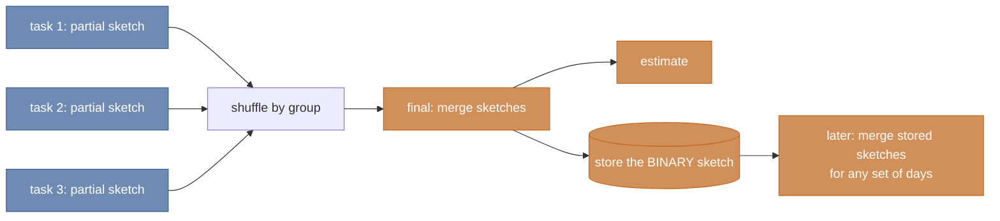
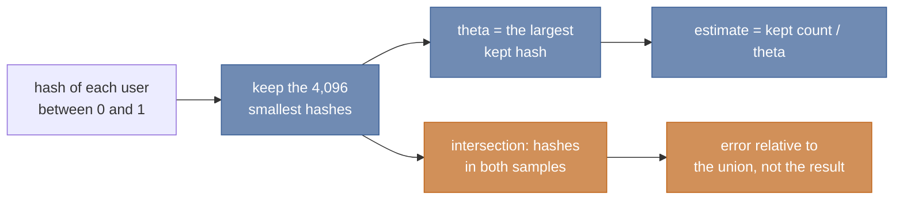

# Chapter 68: Sketches: HLL, Theta and KLL

A product team asks three questions every Monday. How many distinct users did we have last week? How many users came back on two given days? What was the 99th percentile of latency? The raw events for one week fill 15 MB of JSON here, and in production they fill terabytes. The team also wants the answers for any group of days and countries, without a new scan of the raw data.

**Distinct counts and percentiles do not add. You cannot get the weekly distinct count from seven daily counts. A sketch is a small summary that you can merge, and its error has a known bound. Spark 4.3 has HyperLogLog, theta and KLL sketches as SQL functions, and their results are BINARY columns. Thus, you can store one sketch for each day and group in a table, delete the raw data, and answer the questions from the sketches.**

The data is a generated week of app events: 40,000 possible users, about 9,000 new users each day, and users who come back. The user ids are messy. Some are in upper case, some have spaces, and some are empty or NULL. The latencies have a log-normal distribution.

The script is [`code/ch68/sketches.py`](https://github.com/open-lakehouse/spark-masterclass/tree/main/code/ch68). It ran on `pyspark==4.3.0` in local mode. The exact answers come from plain Python over the same events. Each number is from `code/ch68/output/sketches.txt`.

## Step 1: Distinct counts do not add

```text
== 270,453 events over 7 days; exact distinct users: week 33,233, daily [9000, 12140, 13207, 13675, 13892, 13768, 13805]
   sum of daily distinct counts: 89,494  (the week has 33,233)
```

The sum of the daily distinct counts is 89,494, but the week has 33,233 distinct users. A user who comes on three days counts three times in the sum. To get the weekly count, you must know which users each day had. A table of daily counts cannot give that.

<figure markdown>
  

  

  <figcaption>The daily distinct users, their sum and the distinct users of the week. The sum is 89,494, but the week has 33,233 users.</figcaption>
</figure>

The same problem applies to percentiles. The median of a week is not the average of seven daily medians. Both problems need a summary that keeps enough information to merge. That summary is a **sketch**.

## Step 2: Normalize the value before you hash it

All sketches in this chapter hash each value. Two spellings of one user give two hashes, and the sketch counts two users:

```text
== the same person, three spellings
   distinct raw ids 56,904, after lower(trim()) 33,234 (the empty string still counts as one id)
   hll_sketch_agg over 'a', '', NULL, 'A': 2 | count(DISTINCT u): 3
   one sketch over BIGINT 1, 2 and STRING '1', '2': 4
```

These lines show three rules:

- **Normalize first.** The raw ids give 56,904 distinct values. `lower(trim(user))` gives 33,234: the 33,233 users and the empty string.
- **Sketches and exact counts treat the empty string differently.** `count(DISTINCT u)` counts `''` as a value, so 'a', '', NULL and 'A' give 3. The DataSketches functions skip NULL and the empty string, so the sketch gives 2. Change the empty string to NULL before both, so the two methods agree.
- **The type is part of the value.** The BIGINT 1 and the STRING '1' have different hashes. A union of a sketch over numbers and a sketch over strings counts 4 values, not 2. Keep one type for each column in all sketches.

The script uses this expression for the user:

```python
user = F.when(F.lower(F.trim("user")) == "", None).otherwise(F.lower(F.trim("user")))
```

## Step 3: approx_count_distinct and its error

`approx_count_distinct` is the oldest sketch in Spark. It uses HyperLogLog++ (`HyperLogLogPlusPlus.scala`). Its argument `rsd` is the maximum relative standard deviation that you accept. Spark calculates the number of registers from it. The source in `HyperLogLogPlusPlusHelper.scala` uses `p = ceil(2 · log2(1.106 / rsd))` and `m = 2^p` registers, and the true relative standard deviation is `1.04 / sqrt(m)`:

```text
== approx_count_distinct (HyperLogLog++)
   rsd 0.05: p = 9, m = 2^9 = 512 registers, true rsd 1.04/sqrt(m) = 0.0460; estimate 34,279 (error +3.147%)
   rsd 0.01: p = 14, m = 2^14 = 16,384 registers, true rsd 1.04/sqrt(m) = 0.0081; estimate 33,235 (error +0.006%)
   plan: ['+- HashAggregate(keys=[day#3], functions=[approx_count_distinct(lower(trim(user#0, None)),', '+- HashAggregate(keys=[day#3], functions=[partial_approx_count_distinct(lower(trim(user#0,']
   200 groups of 20,000 distinct values, rsd 0.05: measured rsd 0.0477, worst 12.100%
   200 groups of 20,000 distinct values, rsd 0.01: measured rsd 0.0076, worst 2.065%
```

One estimate tells you little about the error. The script also measures the error over 200 groups of 20,000 distinct values each. With `rsd=0.05`, the measured relative standard deviation is 0.0477, near the 0.0460 of the theory. But the worst group is 12.1% off. The `rsd` is a standard deviation, not a maximum. About 5% of groups have an error of more than two standard deviations.

The plan shows the two-step aggregation that all sketches use. Each task builds a partial sketch (`partial_approx_count_distinct`). After the shuffle, the final step merges the partial sketches. This merge is the property that makes the sketch useful.



But `approx_count_distinct` returns only the estimate. Its sketch is internal, and you cannot store it. The DataSketches functions in the next step return the sketch itself.

## Step 4: A table of sketches

Spark has functions from the Apache DataSketches library: `hll_sketch_agg` (since 3.5), `theta_sketch_agg` (since 4.1) and `kll_sketch_agg_*` (since 4.1). Each returns a BINARY value. The script builds one row for each day and country:

```python
sk = (events.groupBy("day", "country")
      .agg(F.hll_sketch_agg(user, 14).alias("users_hll"),
           F.theta_sketch_agg(user, 12).alias("users_theta"),
           F.kll_sketch_agg_double("latency_ms", 200).alias("latency_kll"),
           F.count("*").alias("events")))
sk.write.parquet(str(SK))
```

```text
== sketch table: 35 rows; raw JSON 15.5 MB, sketches 0.88 MB
   schema: day int, country string, users_hll binary, users_theta binary, latency_kll binary, events bigint
   raw events deleted; the rollups read only: ['part-00000-c0803ac8-'] ...
```

The 35 rows (7 days × 5 countries) take 0.88 MB. The raw JSON was 15.5 MB. The script then deletes the raw events. `inputFiles()` shows that the next queries read only the sketch table.

<figure markdown>
  

  

  <figcaption>The sketch table and the answers that it gives after the script deleted the raw events. The intersection of Step 6 reads the rows of day 0 and day 1.</figcaption>
</figure>

The parameters set the size and the error of each sketch:

| Sketch | Parameter | What it sets | Default |
|---|---|---|---|
| HLL | `lgConfigK` | The log2 of the number of buckets, from 4 to 21. The sketch type is `HLL_8` (one byte for each bucket). | 12 |
| Theta | `lgNomEntries` | The log2 of the number of hashes that the sketch keeps. | 12 |
| KLL | `k` | The size of each level of the sketch. | 200 |

Keep each parameter the same for a column in all rows. Step 5 shows what occurs when the values are different.

Keep exact counts as exact counts. `events` is a plain `count(*)`. Counts add, so a sum of the column gives the exact weekly count. A sketch is necessary only for distinct counts and quantiles.

## Step 5: HLL: distinct users for any group

`hll_union_agg` merges sketches, and `hll_sketch_estimate` reads the estimate. The weekly count for all countries and the count for each country come from the same 35 rows:

```python
wk = sketches.agg(F.hll_sketch_estimate(F.hll_union_agg("users_hll")).alias("u")).first().u
by_c = sketches.groupBy("country").agg(F.hll_sketch_estimate(F.hll_union_agg("users_hll")).alias("u"))
```

```text
== distinct users from merged HLL sketches
   week: estimate 32,950, exact 33,233, error -0.852%
   CA: estimate  6,514  exact  6,546  error -0.489%
   US: estimate  6,596  exact  6,599  error -0.045%
   VN: estimate  6,611  exact  6,707  error -1.431%
   FR: estimate  6,718  exact  6,724  error -0.089%
   BR: estimate  6,662  exact  6,657  error +0.075%
   plan of the rollup: ['+- ObjectHashAggregate(keys=[], functions=[hll_union_agg(users_hll#246204, false', '+- ObjectHashAggregate(keys=[], functions=[partial_hll_union_agg(users_hll#24620']
```

<figure markdown>
  <video autoplay loop muted playsinline controls width="1280" height="720" poster="../../media/clips/ch68-rollups.webp">
    <source src="../../media/clips/ch68-rollups.mp4" type="video/mp4">
  </video>
  <figcaption>The script deleted the raw events. The weekly and per-country distinct counts, the users on two days and the latency quantiles come from the 35 stored sketches.</figcaption>
</figure>

All errors are below 1.5%. With `lgConfigK=14`, the HLL error has a relative standard deviation of about 0.8%. The rollup uses an `ObjectHashAggregate`, because the buffer of a sketch is an object, not a fixed set of numbers.

A union needs sketches with the same `lgConfigK`:

```text
   hll_union of lgConfigK 12 and 14: [HLL_UNION_DIFFERENT_LG_K]
   with allowDifferentLgConfigK=True: 1
```

`hll_union` with different values fails with `HLL_UNION_DIFFERENT_LG_K`. With `allowDifferentLgConfigK=True`, the union works, and the result has the smaller `lgConfigK`. Thus, the union has the larger error of the two. (The test merged two sketches of the same value, so the estimate is 1.)

## Step 6: Theta: users seen on two days

HLL can merge (a union), but it cannot intersect. A **theta sketch** keeps the smallest hashes of the values, up to `2^lgNomEntries` of them. These hashes are a uniform sample of the distinct values. Thus, a theta sketch supports union, intersection and difference. The question "which users came on day 0 and on day 1" is an intersection:

```python
a = sketches.where(f"day = {da}").agg(F.theta_union_agg("users_theta").alias("a"))
b = sketches.where(f"day = {db}").agg(F.theta_union_agg("users_theta").alias("b"))
est = a.crossJoin(b).select(F.theta_sketch_estimate(F.theta_intersection("a", "b"))).first()[0]
```

```text
== theta: users seen on two days (intersection)
   days 0 and 1: intersection estimate  5,229 exact  5,175 error   +54 (+1.0%) | union 16,089 exact 15,965 | intersection is 32.4% of the union
   days 0 and 6: intersection estimate  3,076 exact  3,111 error   -35 (-1.1%) | union 19,903 exact 19,694 | intersection is 15.8% of the union
```

The error of an intersection depends on the union, not on the intersection. The sketch estimates the intersection from the sample of the union. If the intersection is a small part of the union, few sampled hashes fall in it, and the relative error grows. Here, the two errors are near 1%, because the intersections are 32.4% and 15.8% of their unions. For an intersection of 0.1% of the union, expect a much larger relative error.



<figure markdown>
  <video autoplay loop muted playsinline controls width="1280" height="720" poster="../../media/clips/ch68-anim-theta.webp">
    <source src="../../media/clips/ch68-anim-theta.mp4" type="video/mp4">
  </video>
  <figcaption>A theta sketch for each day keeps the smallest hashes. The kept hashes that are on both days give the estimate of the intersection. The positions of the hashes are schematic. The result is from <code>sketches.py</code>.</figcaption>
</figure>

Spark 4.2 added tuple sketches (`tuple_sketch_agg_double` and the other `tuple_*` functions). A tuple sketch keeps a number next to each hash, for example the revenue of each user. This chapter does not measure them.

## Step 7: KLL: quantiles for the week

A **KLL sketch** keeps a sample of values in levels. When a level is full, the sketch sorts it, keeps every second value at random, and moves those values to the next level. Each value on a higher level stands for more of the original values. The guarantee is on the **rank**: the true rank of the value that the sketch returns is near the rank you asked for.

```python
merged = sketches.agg(F.kll_merge_agg_double("latency_kll").alias("k"))
row = merged.select(F.kll_sketch_get_n_double("k").alias("n"),
                    *[F.kll_sketch_get_quantile_double("k", F.lit(r)).alias(f"q{i}") for i, r in enumerate(ranks)]).first()
```

```text
== KLL: latency quantiles for the week from 35 daily sketches
   n = 270,453 values (exact 270,453)
   rank    estimate     exact   rank of the estimate
   0.5        54.58     54.46   0.5009
   0.9       153.88    152.40   0.9021
   0.99      334.48    352.74   0.9881
   0.999     790.66    655.78   0.9995
   percentile_approx is deterministic: True
```

The last column is the true rank of each estimate. All of them are within 0.002 of the rank that the query asked for.

But look at the values in the tail. For the 99.9th percentile, the estimate is 790.66 and the exact value is 655.78. A small error in rank is a large error in value where the values are far apart. Latency tails are like that. If you need the value of an extreme percentile, use a larger `k`, or keep the extreme values separately.

<figure markdown>
  

  

  <figcaption>The weekly latency at four ranks, from the merged KLL sketches. The true rank of each estimate is near the rank of the query. At rank 0.999, the value is 790.66 ms, and the exact value is 655.78 ms.</figcaption>
</figure>

KLL uses random choices. Two runs of this script gave different estimates for the tail. `percentile_approx` gives the same result in each run, but its buffer is internal, so you cannot store or merge it. `kll_merge_agg_double` came in 4.1.2 (its documentation said 4.1.0 until SPARK-57116 corrected it).

## Step 8: Count-min and top K

Two more sketches answer frequency questions over the taxi data:

```text
== count-min sketch
   count_min_sketch over 3.8 M pickup zones: 112,076 bytes
   approx_top_k(PULocationID, 3): [(237, 177610), (161, 161198), (236, 157113)]
```

`count_min_sketch(col, eps, confidence, seed)` returns a BINARY count-min sketch. It answers "how often does this value occur" with an overestimate whose error is at most `eps` times the total count, with the given confidence. Spark has no SQL function that reads an estimate from it. You read it with the `CountMinSketch` class of `common/sketch` in the JVM.

`approx_top_k` (since 4.1) returns the most frequent values and their counts. Zone 237 (Upper East Side South) has the most pickups. In 4.3.0, PySpark has no Python wrapper for it, so the script calls it with `F.expr("approx_top_k(PULocationID, 3)")`.

## The whole chapter, on one page

- **Distinct counts and quantiles do not add.** Sketches merge.
- **Normalize values before you hash them**, change the empty string to NULL, and keep one type for each column.
- **`approx_count_distinct` has an error near `1.04 / sqrt(2^p)`**, but you cannot store its sketch. The DataSketches functions return BINARY sketches that you can store.
- **Store one row of sketches for each group and day**, with fixed parameters, next to exact counts. Here, 15.5 MB of raw JSON became 0.88 MB of sketches.
- **HLL for unions, theta for intersections.** The error of an intersection depends on the size of the union.
- **KLL guarantees rank, not value.** Tails can have large value errors.

```python
from pyspark.sql import functions as F
user = F.when(F.lower(F.trim("user")) == "", None).otherwise(F.lower(F.trim("user")))
(events.groupBy("day", "country")
 .agg(F.hll_sketch_agg(user, 14).alias("users_hll"),
      F.theta_sketch_agg(user, 12).alias("users_theta"),
      F.kll_sketch_agg_double("latency_ms", 200).alias("latency_kll"),
      F.count("*").alias("events"))
 .write.parquet("sketches"))

s = spark.read.parquet("sketches")
s.groupBy("country").agg(F.hll_sketch_estimate(F.hll_union_agg("users_hll")).alias("users")).show()
s.agg(F.kll_sketch_get_quantile_double(F.kll_merge_agg_double("latency_kll"), F.lit(0.99))).show()
```

## Further reading

- [Apache DataSketches](https://datasketches.apache.org/): HLL, theta, tuple and KLL sketches, with their error bounds.
- [Aggregate functions in the SQL reference](https://spark.apache.org/docs/4.3.0/api/sql/index.html#hll_sketch_agg).
- Heule, Nunkesser and Hall, "HyperLogLog in Practice", EDBT 2013, the paper behind HyperLogLog++.
- Karnin, Lang and Liberty, "Optimal Quantile Approximation in Streams", FOCS 2016, the paper behind KLL.
