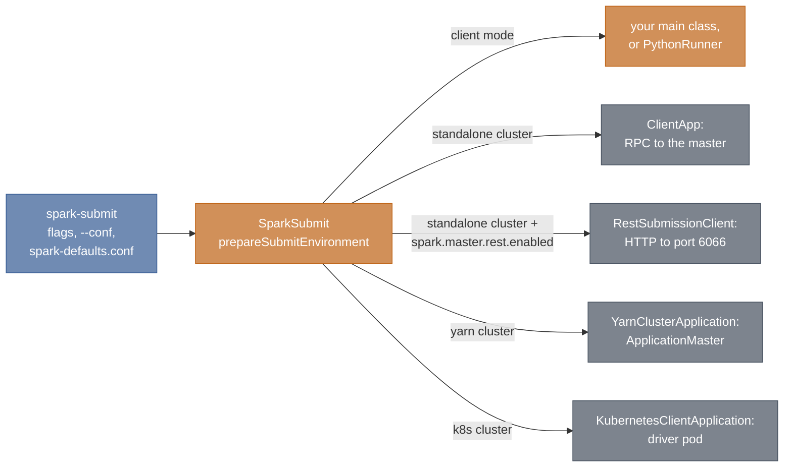
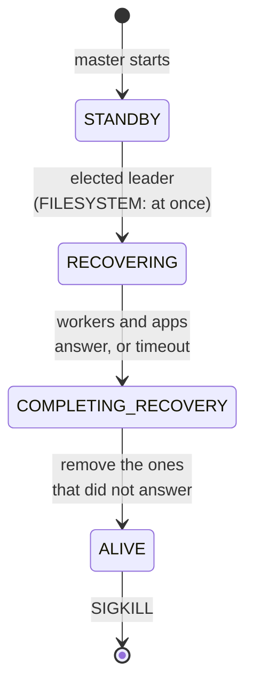
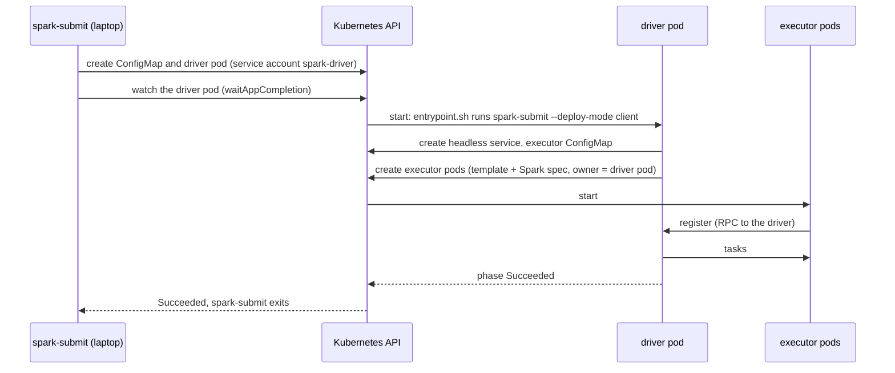
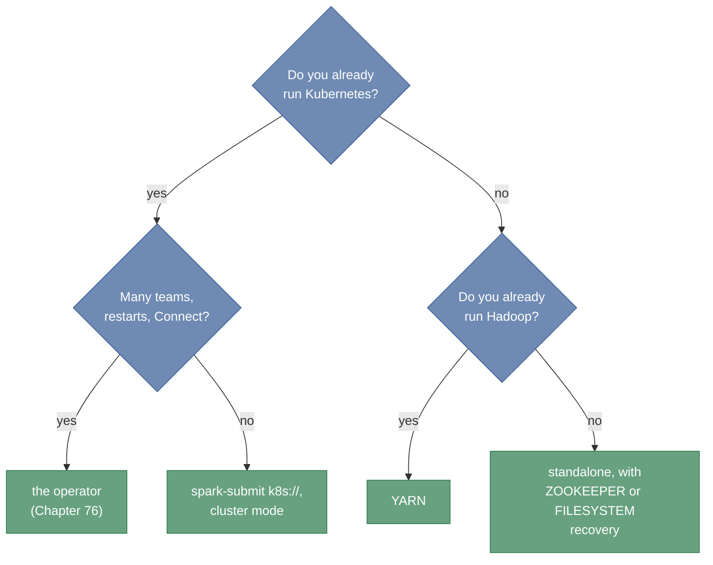

# Chapter 70: Submitting applications: spark-submit, standalone, YARN and Kubernetes

Most chapters of this book start a session in Python and let `local[*]` do the rest. A production application does not start that way. Something runs `spark-submit`, or calls the API of a cluster manager, and a driver starts somewhere. The driver then asks a cluster manager for executors.

[Chapter 2](ch02-inside-a-spark-application.md) showed what happens inside the driver after that. This chapter is about the step before it. It shows how an application gets to a cluster and where its driver runs. It also shows what each cluster manager needs from you.

**`spark-submit` is a launcher, not a part of your application. It reads the master URL and the deploy mode, and from these two values it selects a main class and a set of settings. In client mode, the `spark-submit` process becomes the driver. In cluster mode, the cluster starts the driver and `spark-submit` only reports.**

**Each cluster manager adds its own needs. Standalone needs a shared secret and a recovery folder. YARN needs the Hadoop configuration. Kubernetes needs a service account, volumes and a driver address that the executors can reach.**

This chapter runs a standalone cluster for real on one machine: a master, two workers and high availability with a recovery folder. It also runs native Kubernetes without an operator on a local `kind` cluster. YARN did not run for this chapter. The YARN step explains YARN from the source of `v4.3.0`. [Chapter 76](ch76-kubernetes-operator.md) runs the Spark Kubernetes Operator on the same kind of cluster. The last step compares the two ways.

The code is in [`code/ch70`](https://github.com/lisancao/spark-masterclass/tree/main/code/ch70). Each output block comes from `code/ch70/output/`. The versions are:

| Part | Version |
|---|---|
| Spark | the 4.3.0 tarball (`spark-4.3.0-bin-hadoop3`, from [Chapter 6](ch06-installing.md)) for `spark-submit` and `sbin/`, pyspark 4.3.0 on Python 3.12.3 for the driver |
| Java | OpenJDK 17.0.21.1 |
| Kubernetes | kind with the node image `kindest/node:v1.37.0`, one control-plane node and two worker nodes |
| Spark image in Kubernetes | `spark-masterclass/spark:4.3.0-book` (the book's image from [Chapter 76](ch76-kubernetes-operator.md): `apache/spark:4.3.0-python3` with PyArrow and pandas) |

The scripts replace the home folder with `~` and the host name with `laptop` in the saved output.

## Step 1: The master URL and the deploy mode select everything

Every submit in this chapter sends the same application, [`app.py`](https://github.com/lisancao/spark-masterclass/tree/main/code/ch70/app.py). It prints the host of its driver, its master and its deploy mode. Then it prints its executors from the REST API and one aggregation over the taxi month.

`spark-submit` takes two values that decide the rest. The master URL selects the cluster manager. The deploy mode selects the place of the driver:

| Master URL | Cluster manager | `--deploy-mode client` | `--deploy-mode cluster` |
|---|---|---|---|
| `local`, `local[N]`, `local[*]` | none, threads in one JVM | the default | refused: `Cluster deploy mode is not compatible with master "local"` |
| `spark://host:7077` (or several hosts with commas) | Spark standalone | driver in the `spark-submit` JVM | a worker starts the driver (JVM applications only) |
| `yarn` | Hadoop YARN | driver in the `spark-submit` JVM, an `ExecutorLauncher` in YARN | the driver runs inside the YARN `ApplicationMaster` |
| `k8s://https://host:port` | Kubernetes | driver where `spark-submit` runs | `spark-submit` creates a driver pod |
| `--remote sc://host:15002` | none (Spark Connect) | not applicable, the client sends plans to a server | not applicable |

The refusals in the table are in `SparkSubmit.prepareSubmitEnvironment` (`SparkSubmit.scala:299` to `312`). Cluster mode is also refused for the shells, for `spark-sql` and for the Thrift server. `--remote` cannot go together with `--master` or `--deploy-mode`.

`spark-submit --verbose` shows what the launcher did with its arguments. `submit.sh verbose` runs the application against the standalone cluster of Step 2. This is the end of the verbose output:

```text
Main class:
org.apache.spark.deploy.PythonRunner
Arguments:
file:~/spark-masterclass-parts/ops/code/ch70/app.py
null
~/spark-masterclass/data/nyc-taxi/yellow
Spark config:
(spark.app.name,ch70-verbose)
(spark.app.submitTime,1795388192788)
(spark.eventLog.enabled,false)
(spark.executor.cores,1)
(spark.executor.memory,1g)
(spark.master,spark://127.0.0.1:7151)
(spark.submit.deployMode,client)
(spark.submit.pyFiles,)
(spark.ui.port,4151)
Classpath elements:
```

A Python application does not run as a JVM main class. `spark-submit` runs `PythonRunner`, which starts your Python script and gives it a Py4J gateway. Each flag becomes a Spark configuration: `--name` became `spark.app.name`, and the `--conf` value arrived without a change. Three values came from `spark-defaults.conf` in `SPARK_CONF_DIR`.



The flags of `spark-submit --help` (saved in `submit-help.txt`) fall into groups. Most flags only set a configuration, so `--conf` can replace all of them:

| Flag | Configuration | Applies to |
|---|---|---|
| `--name` | `spark.app.name` | all |
| `--jars`, `--packages`, `--repositories`, `--exclude-packages` | `spark.jars`, `spark.jars.packages`, `spark.jars.repositories`, `spark.jars.excludes` | all ([Chapter 73](ch73-shipping-dependencies.md)) |
| `--py-files`, `--files`, `--archives` | `spark.submit.pyFiles`, `spark.files`, `spark.archives` | all ([Chapter 73](ch73-shipping-dependencies.md)) |
| `--driver-memory`, `--driver-cores` | `spark.driver.memory`, `spark.driver.cores` | `--driver-cores` only in cluster mode |
| `--executor-memory`, `--executor-cores` | `spark.executor.memory`, `spark.executor.cores` | `--executor-cores` on standalone, YARN and Kubernetes |
| `--total-executor-cores` | `spark.cores.max` | standalone only |
| `--num-executors` | `spark.executor.instances` | YARN and Kubernetes |
| `--supervise` | `spark.driver.supervise` | standalone cluster mode |
| `--queue` | `spark.yarn.queue` | YARN only |
| `--principal`, `--keytab` | `spark.kerberos.principal`, `spark.kerberos.keytab` | YARN and Kubernetes ([Chapter 71](ch71-securing-spark.md)) |
| `--kill`, `--status` | none (they call the cluster manager) | standalone and Kubernetes cluster mode |
| `--properties-file`, `--load-spark-defaults` | the file that replaces, or adds to, `spark-defaults.conf` | all |

[Chapter 8](ch08-setting-configurations.md) explains which source of a configuration wins.

## Step 2: A standalone cluster for real, and a client-mode submit

The standalone cluster manager is part of Spark. It has a master, which keeps the list of workers and applications, and workers, which start executor JVMs. The pip package of Spark has no `sbin/` folder with the start scripts. Thus `standalone.sh` uses the tarball from [Chapter 6](ch06-installing.md), and it keeps logs, PID files and state in a scratch folder:

```bash
export SPARK_CONF_DIR=$CH80_WORK/conf SPARK_LOG_DIR=$CH80_WORK/logs SPARK_PID_DIR=$CH80_WORK/pids
export SPARK_MASTER_HOST=127.0.0.1 SPARK_MASTER_PORT=7151 SPARK_MASTER_WEBUI_PORT=8151
export SPARK_WORKER_INSTANCES=2 SPARK_WORKER_CORES=2 SPARK_WORKER_MEMORY=2g
"$SPARK_HOME/sbin/start-master.sh"
"$SPARK_HOME/sbin/start-worker.sh" spark://127.0.0.1:7151      # (1)!
```

1. With `SPARK_WORKER_INSTANCES=2`, `start-worker.sh` starts two worker JVMs on this machine. Each worker gets its own web UI port, from 8152 up.

The master serves its state as JSON on `http://master:8151/json/`. `status.py` prints it. This output came during the cluster-mode submit of Step 3, so it also shows a driver on a worker:

```text
master spark://127.0.0.1:7151  status ALIVE  workers alive 2  cores 4  memory 4096 MiB
  worker 127.0.0.1:34507  ALIVE   cores 2  used 2  memory 2048 MiB
  worker 127.0.0.1:40913  ALIVE   cores 2  used 2  memory 2048 MiB
  app app-20261122145746-0003  Spark Pi  RUNNING  cores 3
  driver driver-20261122145743-0001  RUNNING  on worker-20261122144843-127.0.0.1-34507  org.apache.spark.examples.SparkPi
```

`submit.sh client` submits `app.py` in client mode with `--executor-memory 1g --total-executor-cores 4`. The script keeps the scheduler lines that show the cluster manager at work, and the lines that the application prints:

```text
StandaloneAppClient$ClientEndpoint: Connecting to master spark://127.0.0.1:7151...
StandaloneSchedulerBackend: Connected to Spark cluster with app ID app-20261122145658-0001
StandaloneAppClient$ClientEndpoint: Executor added: app-20261122145658-0001/0 on worker-20261122144846-127.0.0.1-40913 (127.0.0.1:40913) with 2 core(s)
StandaloneSchedulerBackend: Granted executor ID app-20261122145658-0001/0 on hostPort 127.0.0.1:40913 with 2 core(s), 1024.0 MiB RAM
StandaloneAppClient$ClientEndpoint: Executor added: app-20261122145658-0001/1 on worker-20261122144843-127.0.0.1-34507 (127.0.0.1:34507) with 2 core(s)
StandaloneSchedulerBackend: Granted executor ID app-20261122145658-0001/1 on hostPort 127.0.0.1:34507 with 2 core(s), 1024.0 MiB RAM
StandaloneAppClient$ClientEndpoint: Executor updated: app-20261122145658-0001/1 is now RUNNING
StandaloneAppClient$ClientEndpoint: Executor updated: app-20261122145658-0001/0 is now RUNNING
driver host   laptop  pid 4138463
master        spark://127.0.0.1:7151
deploy mode   client
app id        app-20261122145658-0001
executor driver  localhost:32843        cores 0
executor      1  127.0.0.1:45819        cores 2
executor      0  127.0.0.1:42185        cores 2
trips by payment_type: 0=1,013,500, 1=2,432,871, 2=357,804, 3=11,205, 4=21,866, 5=2
```

The master gave one executor on each worker. Each executor got two cores, because a standalone executor takes all the free cores of its worker when `spark.executor.cores` is not set. `--total-executor-cores 4` (`spark.cores.max`) is the limit for the whole application. The driver is the `spark-submit` process on this machine. If you close the terminal, the application stops.

<figure markdown>
  <video autoplay loop muted playsinline controls width="1280" height="720" poster="../../media/clips/ch70-submit.webp">
    <source src="../../media/clips/ch70-submit.mp4" type="video/mp4">
  </video>
  <figcaption>The standalone master with two workers, then a client-mode submit of <code>app.py</code>. The driver runs in the terminal, and one executor starts on each worker.</figcaption>
</figure>

## Step 3: Cluster mode on standalone, and the REST submission server

In cluster mode, the master selects a worker, and that worker starts the driver. Standalone refuses this for Python:

```text
Exception in thread "main" org.apache.spark.SparkException: Cluster deploy mode is currently not supported for python applications on standalone clusters.
	at org.apache.spark.deploy.SparkSubmit.error(SparkSubmit.scala:1068)
	at org.apache.spark.deploy.SparkSubmit.prepareSubmitEnvironment(SparkSubmit.scala:300)
```

Thus a Python application on standalone always has its driver where `spark-submit` runs. Run `spark-submit` on a machine that stays on for the life of the application, for example an edge node or a pod. A JVM application can use cluster mode. `submit.sh cluster-jar` submits `SparkPi` from the examples jar of the tarball, with `spark.standalone.submit.waitAppCompletion=true` so that `spark-submit` waits for the end:

```text
ClientEndpoint: ... waiting before polling master for driver state
ClientEndpoint: Driver successfully submitted as driver-20261122145725-0000
ClientEndpoint: State of driver-20261122145725-0000 is RUNNING
ClientEndpoint: Driver running on 127.0.0.1:40913 (worker-20261122144846-127.0.0.1-40913)
ClientEndpoint: State of driver driver-20261122145725-0000 is FINISHED, exiting spark-submit JVM.
--- driver-20261122145725-0000/stdout on the worker
Pi is roughly 3.141614557080728
```

The output of the driver is not in your terminal. It is in the work folder of the worker that ran the driver, in `driver-.../stdout`. Without `waitAppCompletion`, `spark-submit` exits as soon as the driver runs. Then `spark-submit --status driver-... --master spark://...` asks for its state, and `--kill` stops it. `--supervise` tells the worker to start the driver again if it exits with an error.

The master also runs a REST submission server. Its configuration `spark.master.rest.enabled` is `true` in 4.3.0 (`package.scala:2186`), and the server listens on `spark.master.rest.port` (6066 by default, 6151 here). But `spark-submit` reads the same key from your submit configuration with the default `false` (`SparkSubmitArguments.scala:103`). Thus it uses the RPC gateway on port 7077 unless you set the key and give the REST port in the master URL. `submit.sh rest` does both:

```text
RestSubmissionClient: Submitting a request to launch an application in spark://127.0.0.1:6151.
RestSubmissionClient: Submission successfully created as driver-20261122145743-0001. Polling submission state...
RestSubmissionClient: Submitting a request for the status of submission driver-20261122145743-0001 in spark://127.0.0.1:6151.
RestSubmissionClient: State of driver driver-20261122145743-0001 is now RUNNING.
RestSubmissionClient: Driver is running on worker worker-20261122144843-127.0.0.1-34507 at 127.0.0.1:34507.
RestSubmissionClient: Server responded with CreateSubmissionResponse:
  "action" : "CreateSubmissionResponse",
  "message" : "Driver successfully submitted as driver-20261122145743-0001",
  "serverSparkVersion" : "4.3.0",
  "submissionId" : "driver-20261122145743-0001",
  "success" : true
--- GET /v1/submissions/status/driver-20261122145743-0001
{
  "action" : "SubmissionStatusResponse",
  "driverState" : "RUNNING",
  "serverSparkVersion" : "4.3.0",
  "submissionId" : "driver-20261122145743-0001",
  "success" : true,
  "workerHostPort" : "127.0.0.1:34507",
  "workerId" : "worker-20261122144843-127.0.0.1-34507"
}
```

The REST API is plain HTTP and JSON, so any tool can submit, poll and kill drivers. That is also its risk.

!!! warning "Caution: protect the REST submission server"
    Do not open port 6066 of a master to a network that you do not trust. Anyone who can send a `CreateSubmissionRequest` can run code on your workers. Put `org.apache.spark.ui.JWSFilter` on it with `spark.master.rest.filters`, or block the port. [Chapter 71](ch71-securing-spark.md) shows the filter.

!!! note "New in 4.3: the driver environment"
    In 4.3, the RPC gateway forwards to the driver only the environment variables whose names start with `SPARK_`. The REST gateway did this before. Variables such as `JAVA_HOME`, `HADOOP_CONF_DIR` and `LD_LIBRARY_PATH` no longer get to the driver. `spark.standalone.submit.filterEnvironment=false` gives the old behavior. The source is the core migration guide, section 4.2 to 4.3.

<figure markdown>
  
  
  <figcaption>The place of the driver in the four submits of this chapter. The worker address and the pod names come from the saved output of each run.</figcaption>
</figure>

## Step 4: High availability: kill the master during a job

A standalone master keeps its state in memory by default (`spark.deploy.recoveryMode=NONE`). If it stops, it forgets the workers and the applications. The 4.3.0 master has four recovery modes (`Master.scala:178` to `191`):

| `spark.deploy.recoveryMode` | Where the state goes | Standby masters |
|---|---|---|
| `NONE` (default) | nowhere | no |
| `FILESYSTEM` | files in `spark.deploy.recoveryDirectory` | no. You start the master again on the same folder |
| `ROCKSDB` | a RocksDB database in `spark.deploy.recoveryDirectory` | no |
| `ZOOKEEPER` | ZooKeeper at `spark.deploy.zookeeper.url`, under `spark.deploy.zookeeper.dir` | yes. ZooKeeper elects one leader among several masters |
| `CUSTOM` | your `StandaloneRecoveryModeFactory` (`spark.deploy.recoveryMode.factory`) | as the factory decides |

`spark.deploy.recoveryCompressionCodec` (4.0, `FILESYSTEM` only) compresses the files, and `spark.deploy.recoveryTimeout` (4.0) limits the time of a recovery. In 4.3.0, `spark.deploy.recoverySerializationFilter` limits which classes the master reads back from ZooKeeper.

The cluster of Step 2 uses `FILESYSTEM`. `ha.sh` starts `app.py --hold 30`, which runs a small job every second after the aggregation. When the third hold line appears, the script kills the master with `SIGKILL`, waits about 10 seconds and starts the master again:

```text
   0.0s  recovery folder before: worker_worker-20261122144843-127.0.0.1-34507 worker_worker-20261122144846-127.0.0.1-40913 
  17.7s  app running; recovery folder: app_app-20261122145534-0000 worker_worker-20261122144843-127.0.0.1-34507 worker_worker-20261122144846-127.0.0.1-40913 
  17.8s  master pid 4115479 killed (SIGKILL)
  28.6s  master started again
  31.2s  master ALIVE
        master spark://127.0.0.1:7151  status ALIVE  workers alive 2  cores 4  memory 4096 MiB
          worker 127.0.0.1:34507  ALIVE   cores 2  used 2  memory 2048 MiB
          worker 127.0.0.1:40913  ALIVE   cores 2  used 2  memory 2048 MiB
          app app-20261122145534-0000  ch70-app  RUNNING  cores 4
  54.1s  app exited with code 0
--- app output (hold lines)
  hold  1s  sum=1999999000000  executors=2
  hold  6s  sum=1999999000000  executors=2
  hold 10s  sum=1999999000000  executors=2
  hold 15s  sum=1999999000000  executors=2
  hold 20s  sum=1999999000000  executors=2
  hold 25s  sum=1999999000000  executors=2
  hold 30s  sum=1999999000000  executors=2
```

The recovery folder has one file for each worker and one for each application. While the master was dead, the hold loop continued, and the application kept its two executors. The driver gives tasks to its executors directly. The master only gave out the executors. The logs show the two sides:

```text
14:55:48 WARN StandaloneAppClient$ClientEndpoint: Connection to 127.0.0.1:7151 failed; waiting for master to reconnect...
14:55:48 WARN StandaloneSchedulerBackend: Disconnected from Spark cluster! Waiting for reconnection...
14:56:01 INFO StandaloneAppClient$ClientEndpoint: Master has changed, new master is at spark://127.0.0.1:7151
--- new master log
14:56:01 INFO FileSystemRecoveryModeFactory: Persisting recovery state to directory: ~/spark-masterclass/data/work/ch70/recovery
14:56:01 INFO Master: I have been elected leader! New state: RECOVERING
14:56:01 INFO Master: Application has been re-registered: app-20261122145534-0000
14:56:01 INFO Master: Worker has been re-registered: worker-20261122144843-127.0.0.1-34507
14:56:01 INFO Master: Worker has been re-registered: worker-20261122144846-127.0.0.1-40913
14:56:01 INFO Master: Recovery complete in 392 ms - resuming operations!
```



<figure markdown>
  
  
  <figcaption>The master, the application and the executors on one time axis. The times come from <code>ha.txt</code>.</figcaption>
</figure>

<figure markdown>
  <video autoplay loop muted playsinline controls width="1280" height="720" poster="../../media/clips/ch70-anim-failover.webp">
    <source src="../../media/clips/ch70-anim-failover.mp4" type="video/mp4">
  </video>
  <figcaption>Animation: the master dies, the tasks continue, and a new master reads the recovery folder. The times and the log lines come from <code>ha.txt</code>. The clip times are not to scale.</figcaption>
</figure>

During the gap, you cannot submit new applications, and an application cannot get new executors. `FILESYSTEM` needs a person or a supervisor (systemd, Kubernetes) to start the master again. For a standby master that takes over by itself, use `ZOOKEEPER`. Start two or more masters with the same `spark.deploy.zookeeper.url`, and give all of them in the master URL: `spark://host1:7077,host2:7077`. The driver and the workers try each master in the list. This chapter did not run ZooKeeper.

<figure markdown>
  <video autoplay loop muted playsinline controls width="1280" height="720" poster="../../media/clips/ch70-ha.webp">
    <source src="../../media/clips/ch70-ha.mp4" type="video/mp4">
  </video>
  <figcaption><code>ha.sh</code>: the master gets <code>SIGKILL</code> during a job, and a new master recovers the application and the workers from the folder.</figcaption>
</figure>

## Step 5: YARN, from the source (not run)

This chapter did not run YARN. There is no Hadoop cluster in the book's setup. This step tells what the 4.3.0 source does.

- **The master URL is only `yarn`.** The address of the ResourceManager comes from the Hadoop configuration. `spark-submit` refuses to start if neither `HADOOP_CONF_DIR` nor `YARN_CONF_DIR` is set (`SparkSubmitArguments.scala:310` to `314`).
- **The YARN client uploads the Spark jars.** `Client.scala` puts the application files in a temporary folder on the cluster file system. If neither `spark.yarn.jars` nor `spark.yarn.archive` is set, it uploads the folder `$SPARK_HOME/jars` for each application, and it logs a warning (`Client.scala:708`). Put one archive of the jars on HDFS and set `spark.yarn.archive` to it.
- **The deploy mode selects the ApplicationMaster class.** In cluster mode, YARN starts `org.apache.spark.deploy.yarn.ApplicationMaster`, and the driver runs inside it. In client mode, YARN starts `ExecutorLauncher`, which only asks for executor containers. The driver stays in `spark-submit` (`Client.scala:1142` to `1147`).
- **YARN settings have their own keys:** `spark.yarn.queue` (`--queue`), `spark.yarn.am.memory`, `spark.yarn.maxAppAttempts`, `spark.yarn.dist.archives` and `spark.yarn.dist.jars`.
- **YARN is the only cluster manager for push-based shuffle.** [Chapter 77](ch77-orchestration.md) shows the check in the source.
- **Kerberos is most common on YARN.** [Chapter 71](ch71-securing-spark.md) explains delegation tokens.

The pip package and the tarball of 4.3.0 contain `spark-yarn_2.13-4.3.0.jar`. A build without `-Pyarn` does not ([Chapter 92](ch92-building-spark.md)).

## Step 6: Native Kubernetes, a service account and RBAC

On Kubernetes, `spark-submit --master k8s://https://api-server --deploy-mode cluster` creates a driver pod. The driver then calls the Kubernetes API to create executor pods, a headless service and ConfigMaps. Thus the driver pod needs a service account that may do these things. `k8s/cluster.sh up` creates a kind cluster. Each node mounts the taxi data and `code/ch70` from this machine, so that pods can use `hostPath` volumes.

The first submit uses the `default` service account of the namespace `spark-apps`. The driver starts, then it fails on its first call to the API:

```text
15:00:26 INFO Client: Deployed Spark application ch70-no-rbac with application ID spark-2ba84a418c6849328e4ab81563953dad and submission ID spark-apps:ch70-no-rbac-aaa624a2057d38fb-driver into Kubernetes
--- driver log
Failure executing: GET at: 
https://kubernetes.default.svc/api/v1/namespaces/spark-apps/pods/ch70-no-rbac-aaa624a2057d38
fb-driver.
Message: pods "ch70-no-rbac-aaa624a2057d38fb-driver" is forbidden: User 
"system:serviceaccount:spark-apps:default" cannot get resource "pods" in API group "" in 
the namespace "spark-apps".
--- driver pod: Running  service account: default
```

The driver could not even read its own pod. [`k8s/rbac.yaml`](https://github.com/lisancao/spark-masterclass/tree/main/code/ch70/k8s/rbac.yaml) creates a service account `spark-driver`, a `Role` and a `RoleBinding`:

```yaml
rules:
- apiGroups: [""]
  resources: ["pods", "services", "configmaps", "persistentvolumeclaims"]
  verbs: ["create", "get", "list", "watch", "delete", "deletecollection", "patch"]
```

Give the account to the driver with `spark.kubernetes.authenticate.driver.serviceAccountName=spark-driver`. The executors use the same account unless you set `spark.kubernetes.authenticate.executor.serviceAccountName` (3.1). Use a `Role` in the namespace of the application, not a `ClusterRole`. The driver needs no rights outside its namespace.

## Step 7: Cluster mode, volumes and a pod template

`k8s/submit.sh cluster` submits `app.py` from a `hostPath` volume with the service account and an executor pod template. The important flags are these:

```bash
spark-submit --master "k8s://$API" --deploy-mode cluster --name ch70-k8s \
  --conf spark.kubernetes.context=kind-ops80 \
  --conf spark.kubernetes.namespace=spark-apps \
  --conf spark.kubernetes.container.image=spark-masterclass/spark:4.3.0-book \
  --conf spark.kubernetes.authenticate.driver.serviceAccountName=spark-driver \
  --conf spark.kubernetes.executor.podTemplateFile=executor-template.yaml \
  --conf spark.kubernetes.driver.volumes.hostPath.code.mount.path=/opt/ch70 \
  --conf spark.kubernetes.driver.volumes.hostPath.code.options.path=/opt/ch70 \
  --conf spark.kubernetes.executor.volumes.hostPath.taxi.mount.path=/data/nyc-taxi \
  --conf spark.kubernetes.executor.volumes.hostPath.taxi.options.path=/data/nyc-taxi \
  local:///opt/ch70/app.py /data/nyc-taxi/yellow --hold 25      # (1)!
```

1. `local://` means "this path is already in the image or in a volume". Spark does not upload the file. To send a file from the machine that runs `spark-submit`, set `spark.kubernetes.file.upload.path` to a shared file system.

A volume configuration has the form `spark.kubernetes.{driver,executor}.volumes.<type>.<name>.<key>`. The types in 4.3.0 are `hostPath`, `emptyDir`, `nfs` and `persistentVolumeClaim` (`Config.scala:948` to `951`). The keys are `mount.path`, `mount.readOnly`, `mount.subPath` and the `options.*` of the type. While the application ran, the script listed what Spark created, and it read one executor pod:

```text
--- what Spark created (while the application runs)
KIND        NAME                                                ROLE       STATUS    NODE
Pod         ch70-app-a68054a20584cf38-exec-1                    executor   Running   ops80-worker
Pod         ch70-app-a68054a20584cf38-exec-2                    executor   Running   ops80-worker
Pod         ch70-k8s-01dcd7a20584affb-driver                    driver     Running   ops80-worker2
ConfigMap   ch70-k8s-01dcd7a20584affb-driver-podspec-conf-map   <none>     <none>    <none>
ConfigMap   kube-root-ca.crt                                    <none>     <none>    <none>
ConfigMap   spark-drv-af1657a20584b63f-conf-map                 <none>     <none>    <none>
ConfigMap   spark-exec-3d0deea20584d82d-conf-map                executor   <none>    <none>
ch70-k8s-01dcd7a20584affb-driver-svc   None         7078,7079,4040,15002
--- pod/ch70-app-a68054a20584cf38-exec-1: fields from the template
label book.chapter:      80
annotation book/template: executor
env BOOK_TEMPLATE:       from-the-pod-template
volume spark-local-dir-1: {"sizeLimit":"2Gi"}
--- pod/ch70-app-a68054a20584cf38-exec-1: fields that Spark set
container:        spark-executor
image:            spark-masterclass/spark:4.3.0-book
args:             ["executor"]
resources:        {"limits":{"memory":"1433Mi"},"requests":{"cpu":"500m","memory":"1433Mi"}}
SPARK_LOCAL_DIRS: /spark-local
service account:  spark-driver
owner:            Pod/ch70-k8s-01dcd7a20584affb-driver
--- spark-submit, which waits for the driver pod (spark.kubernetes.submission.waitAppCompletion=true)
	 phase: Pending
	 phase: Running
	 phase: Succeeded
15:09:32 INFO LoggingPodStatusWatcherImpl: Application ch70-k8s with application ID spark-3aca87ef7aa34af383635d8ba92262e8 and submission ID spark-apps:ch70-k8s-01dcd7a20584affb-driver finished
--- driver stdout (pod/ch70-k8s-01dcd7a20584affb-driver)
driver host   ch70-k8s-01dcd7a20584affb-driver  pid 63
master        k8s://https://127.0.0.1:40845
deploy mode   client
app id        spark-3aca87ef7aa34af383635d8ba92262e8
executor driver  10.244.1.8:7079        cores 0
executor      2  10.244.2.15:45481      cores 1
executor      1  10.244.2.14:37815      cores 1
trips by payment_type: 0=1,013,500, 1=2,432,871, 2=357,804, 3=11,205, 4=21,866, 5=2
```

The output has five points:

- **The driver ran in a pod**, and its host name is the pod name. Inside the pod, the deploy mode is `client`. The entry point of the image runs `spark-submit --deploy-mode client` in the driver pod (`entrypoint.sh:86`). Thus cluster mode on Kubernetes is "client mode in a pod that `spark-submit` created".
- **Spark merges the pod template with its own spec.** The label, the annotation, the variable and the `emptyDir` came from the template. The image, the arguments, the resources and the owner came from Spark. A volume whose name starts with `spark-local-dir-` becomes a local folder of the executor (`SPARK_LOCAL_DIRS=/spark-local`).
- **The memory request is 1433Mi for `spark.executor.memory=1g`.** The overhead factor is 0.4 for a Python or R application (`NON_JVM_MEMORY_OVERHEAD_FACTOR`, `Constants.scala:110`), and 0.1 for a JVM application. 1024 MiB times 1.4 is 1433.6 MiB.
- **The executor pods have the driver pod as their owner.** If you delete the driver pod, Kubernetes deletes the executors. The ConfigMaps with `spark-drv` and `spark-exec` names are from earlier runs. Spark did not delete them, so clean the namespace from time to time.
- **The executor pods have the name of the application from inside the driver**, `ch70-app` from `appName()` in `app.py`, not `ch70-k8s` from `--name`. The label `spark-app-name` of the executors has the same value. To find all the pods of one run, select on `spark-app-selector`, which has the application ID.

<figure markdown>
  
  
  <figcaption>The template on the left. On the right, the values in the running executor pod: green rows came from the template, blue rows came from Spark.</figcaption>
</figure>



This chapter did not run these other Kubernetes features of 4.3.0:

| Configuration | What it does |
|---|---|
| `spark.kubernetes.driver.ownPersistentVolumeClaim`, `spark.kubernetes.driver.reusePersistentVolumeClaim` | The driver owns the PVCs of its executors and gives them to new executors, so shuffle files on a PVC can survive an executor |
| `spark.kubernetes.executor.rollPolicy` (with `spark.kubernetes.executor.rollInterval`) | Decommission one executor at an interval, chosen by a policy such as `OUTLIER` (the default) or `TOTAL_GC_TIME` |
| `spark.kubernetes.executor.decommissionLabel` | A label on executors that are in decommission |
| `spark.kubernetes.{driver,executor}.secrets.<name>`, `secretKeyRef.<VAR>` | Mount a Kubernetes Secret, or put one key of it in a variable |
| `spark.kubernetes.scheduler.name` | Use another scheduler, for example YuniKorn or Volcano ([Chapter 77](ch77-orchestration.md)) |

## Step 8: Client mode, inside and outside the cluster

In client mode, the driver runs where you start it, and the executors call back to it. Thus the executor pods must reach the driver at an address and two ports: `spark.driver.port` and `spark.driver.blockManager.port`.

The first try runs the driver on the laptop. Since 4.1, `spark.kubernetes.executor.useDriverPodIP` is `true` by default (`Config.scala:168`). With a `k8s://` master, `SparkContext` then sets the driver address that it gives to executors to `spark.driver.bindAddress` (`SparkContext.scala:453` to `457`). That makes sense in a pod. On a laptop with `bindAddress=0.0.0.0`, the executors call `0.0.0.0`:

```text
15:12:36 ERROR ExecutorPodsLifecycleManager: Max number of executor failures (4) reached
15:12:36 ERROR SparkContext: Error initializing SparkContext.
--- pod/ch70-app-a40d5fa205882d03-exec-1 log
Caused by: java.io.IOException: Failed to connect to /0.0.0.0:7178
```

With `useDriverPodIP=false`, Spark gives the executors `spark.driver.host`, here the gateway of the kind network. The executors now dial the correct address. But the firewall of this laptop drops connections from the Docker network, so the call timed out:

```text
driver host   laptop  pid 333140
master        k8s://https://127.0.0.1:40845
deploy mode   client
app id        spark-3943dacc41674a03bcb136a7b759c954
executor driver  172.30.0.1:7179        cores 0
--- pod/ch70-app-b4e35ba2058cba1e-exec-1 log
23:19:30 WARN NettyRpcEnv: Ignored failure: java.io.IOException: Connecting to /172.30.0.1:7178 timed out (120000 ms)
```

That is the usual result of a laptop driver against a remote cluster: the pods have no route back. The documented form of client mode runs the driver in a pod of its own. This pod can be a notebook, a Connect server or a job runner. [`k8s/client-driver.yaml`](https://github.com/lisancao/spark-masterclass/tree/main/code/ch70/k8s/client-driver.yaml) is a bare pod that runs `spark-submit --deploy-mode client`. A headless service gives it a DNS name:

```yaml
    - --master=k8s://https://kubernetes.default.svc
    - --deploy-mode=client
    - --conf=spark.driver.host=ch70-client-driver.spark-apps.svc.cluster.local
    - --conf=spark.driver.port=7078
    - --conf=spark.driver.blockManager.port=7079
    - --conf=spark.kubernetes.driver.pod.name=ch70-client-driver
```

```text
--- pods while the driver pod runs
NAME                               ROLE       OWNER                STATUS
ch70-app-2faef1a2058bd693-exec-1   executor   ch70-client-driver   Running
ch70-app-2faef1a2058bd693-exec-2   executor   ch70-client-driver   Running
ch70-client-driver                 <none>     <none>               Running
--- driver pod Succeeded; its stdout
driver host   ch70-client-driver  pid 79
master        k8s://https://kubernetes.default.svc
deploy mode   client
app id        spark-3f0806d8aef240d08ebc781ac6ada5b1
executor driver  ch70-client-driver.spark-apps.svc.cluster.local:7079 cores 0
executor      2  10.244.1.22:42341      cores 1
executor      1  10.244.2.31:43655      cores 1
trips by payment_type: 0=1,013,500, 1=2,432,871, 2=357,804, 3=11,205, 4=21,866, 5=2
```

`spark.kubernetes.driver.pod.name` tells Spark the name of the pod that holds the driver. Spark makes that pod the owner of the executor pods, so Kubernetes deletes the executors if the driver pod goes away. Without it, executors of a crashed client-mode driver can stay in the cluster.

!!! warning "Caution: client mode needs a route back to the driver"
    Do not start a client-mode driver on a laptop against a remote Kubernetes cluster. The executor pods must open connections to the driver, and firewalls or NAT usually block them. Run the driver in a pod with a headless service. Or use Spark Connect, where only the client opens connections ([Chapter 24](ch24-spark-connect.md)).

## Step 9: `spark-submit` against the operator of Chapter 76

The native submit of Steps 6 to 8 and the operator of [Chapter 76](ch76-kubernetes-operator.md) create the same pods. The operator builds the driver spec with Spark's own submission code. The difference is what remembers the application:

| | `spark-submit --master k8s://` | Spark Kubernetes Operator ([Chapter 76](ch76-kubernetes-operator.md)) |
|---|---|---|
| What you write | a command with flags | a `SparkApplication` or `SparkCluster` resource in YAML |
| What remembers the application | nothing after `spark-submit` exits. The driver pod is the only record | the resource and its `status`, in the Kubernetes API |
| Restart of a failed driver | none. Your scheduler must run the command again | `restartPolicy` with a limit and a back-off |
| Connect server that runs all the time | a pod that you watch yourself | a `SparkApplication` that the operator keeps alive |
| Extra parts in the cluster | none, only RBAC for the driver | the operator, its CRDs and its RBAC |
| Good for | CI jobs, one-off jobs, a scheduler that already runs commands (Airflow `SparkSubmitOperator`, [Chapter 77](ch77-orchestration.md)) | a platform for many teams, GitOps, Connect servers |

Both need the same service account, the same image and the same volume settings.

## Choose a cluster manager



Apache Mesos is not in the chart. Spark 4.0 removed it ([Chapter 2](ch02-inside-a-spark-application.md)).

## The whole chapter, on one page

- **The master URL selects the cluster manager. The deploy mode selects the place of the driver.** `spark-submit --verbose` shows the main class and the configuration that it made.
- **In client mode, `spark-submit` is the driver.** In cluster mode, the cluster starts the driver. On Kubernetes, the driver pod runs `spark-submit` in client mode.
- **Standalone does not run Python in cluster mode.** JVM drivers can run on a worker, with `--supervise`, `--status` and `--kill`.
- **`spark-submit` uses the RPC gateway unless you set `spark.master.rest.enabled=true` for the submit.** The REST server on the master is on by default. Protect it.
- **A standalone master can die without loss** if it has a recovery mode. Applications keep their executors. Use `ZOOKEEPER` for standby masters.
- **YARN** needs `HADOOP_CONF_DIR` or `YARN_CONF_DIR`, and `spark.yarn.archive` saves an upload for each application. This chapter did not run YARN.
- **On Kubernetes, the driver needs a service account** that can create pods, services and ConfigMaps. Pod templates add fields, volumes mount data, and the driver pod owns the executors.
- **Client mode needs a route from the executors to the driver.** Since 4.1, `useDriverPodIP=true` makes executors dial the bind address. Run the driver in a pod with a headless service.

The commands, in order:

```bash
cd code
ch70/standalone.sh up && ch70/standalone.sh status
ch70/submit.sh verbose
ch70/submit.sh client
ch70/submit.sh cluster-python      # refused
ch70/submit.sh cluster-jar         # SparkPi on a worker
ch70/submit.sh rest                # through the REST submission server
ch70/ha.sh                         # SIGKILL the master during a job
ch70/standalone.sh down
ch70/k8s/cluster.sh up             # kind cluster "ops80", image, RBAC
ch70/k8s/submit.sh no-rbac
ch70/k8s/submit.sh cluster
ch70/k8s/submit.sh client-default  # executors dial 0.0.0.0
ch70/k8s/submit.sh client          # executors dial the laptop, blocked here
ch70/k8s/submit.sh in-cluster      # the driver in its own pod
ch70/k8s/cluster.sh down
```

## Further reading

- [Submitting Applications](https://spark.apache.org/docs/4.3.0/submitting-applications.html), with the master URLs and the `spark-submit` options.
- [Spark Standalone Mode](https://spark.apache.org/docs/4.3.0/spark-standalone.html), with high availability and the REST submission server.
- [Running Spark on YARN](https://spark.apache.org/docs/4.3.0/running-on-yarn.html).
- [Running Spark on Kubernetes](https://spark.apache.org/docs/4.3.0/running-on-kubernetes.html), with pod templates, volumes, RBAC and client mode.
- [`SparkSubmit.scala`](https://github.com/apache/spark/blob/v4.3.0/core/src/main/scala/org/apache/spark/deploy/SparkSubmit.scala) and [`Master.scala`](https://github.com/apache/spark/blob/v4.3.0/core/src/main/scala/org/apache/spark/deploy/master/Master.scala).
