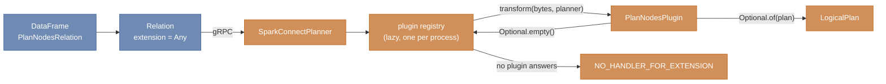
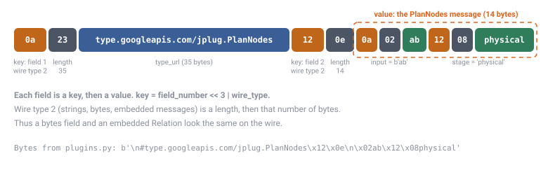
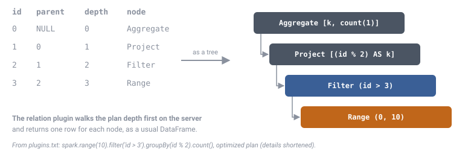
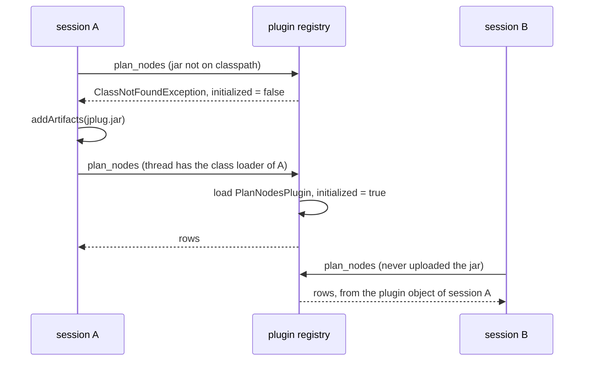

# Chapter 72: Spark Connect plugins

[Chapter 70](ch70-dsv2-connector-java.md) and [Chapter 71](ch71-catalyst-extensions.md) put Java code into the Spark JVM. Their scripts tested that code through `spark._jvm` and `df._jdf`. A Spark Connect client has neither. As [Chapter 18](ch18-spark-connect.md) showed, a Connect client sends an unresolved plan as protobuf, and the `SparkConnectPlanner` on the server changes it into a Catalyst plan. The client has no Py4J gateway.

Spark Connect has its own extension mechanism: **plugins**. A plugin is a JVM class on the server. It changes your own protobuf message into a Catalyst plan, a Catalyst expression or a side effect. This chapter builds one plugin of each type in one jar, `jplug`, and calls them from a Python client:

- `plan_nodes(df, stage)` is a **relation plugin**. It returns the analyzed, optimized or physical plan of any DataFrame as rows. Thus, a test on a Connect client can make assertions about the shape of a plan.
- `has_magic(col, b"\x89PNG")` is an **expression plugin**. It gives a typed `Column` from a custom message.
- `note(spark, text)` is a **command plugin**. It changes state on the server.

**Many server extensions work over Connect with no plugin, because the client calls them by name. You need a plugin only for a new operator, for arguments that SQL cannot express, or for a result from the server JVM. A plugin is a contract on the wire. It has a type URL, some bytes, and a JVM class on the classpath of the server. It must not come from the artifacts of one session.**

The code is in [`code/ch72`](https://github.com/lisancao/spark-masterclass/tree/main/code/ch72). The Java project is `code/ch72/jplug`. `ch72/build.sh` builds it with Maven against Spark 4.3.0. `ch72/server.sh` starts a Connect server with the jars of Chapters 70, 71 and 72. Each output block comes from `code/ch72/output/`.

## Step 1: What works with no plugin

A Connect server is a usual Spark driver. Thus, the client can use each server extension that it can call by name from the DataFrame API or from SQL. `server.sh` starts a server with the `jdocs` jar of Chapter 70 and the `jext` jar and `spark.sql.extensions=jext.Extensions` of Chapter 71. `plugins.py` connects to it and uses both by name:

```python
print("jdocs by short name:",
      spark.read.format("jdocs").option("path", IMAGES).load().select("name", "width").collect()[:2])
print(spark.sql("SELECT is_png(X'89504E470D0A1A0A') AS p").collect())
print(spark.range(1).select(F.call_function("is_png", F.lit(b"\x89PNG\r\n\x1a\n")).alias("p")).collect())
```

```text
== 2. A Connect session has no JVM
pyspark.sql.connect.session | server runs Spark 4.3.0
spark._jvm -> PySparkAttributeError: [JVM_ATTRIBUTE_NOT_SUPPORTED] Attribute `_jvm` is not supported in Spark Connect as it depends on the JVM. If you need to use this attribute, do not u

== 3. What works without a plugin: names the server knows
jdocs by short name: [Row(name='gradient_32x32.png', width=32), Row(name='gray_20x10.png', width=20)]
[Row(p=True)]
[Row(p=True)]
```

The optimizer rules and check rules of Chapter 71 also work, because they run on each plan that the server makes. Step 7 shows that `jext.PngRule` replaces a Python UDF that a Connect client sent.

The client cannot hold a JVM object. Thus, `spark._jvm` and `df._jdf` do not exist. Use a plugin in these conditions:

- You need a **new operator** that SQL does not have.
- You need **typed arguments** that SQL cannot express, for example raw bytes, nested messages or lists of structures.
- The server must calculate a result from **its own JVM state**, for example a plan, a catalog or a cache.
- A command must have a **side effect** that the API does not supply.

## Step 2: The extension points

Three protobuf messages have a field for "any other message", a `google.protobuf.Any`. The `.proto` files are in `sql/connect/common/src/main/protobuf/spark/connect/` at the `v4.3.0` tag:

| Message | Field | Plugin interface | Configuration (static) |
|---|---|---|---|
| `Relation` (`relations.proto`) | `google.protobuf.Any extension = 998;` | `RelationPlugin` | `spark.connect.extensions.relation.classes` |
| `Expression` (`expressions.proto`) | `google.protobuf.Any extension = 999;` | `ExpressionPlugin` | `spark.connect.extensions.expression.classes` |
| `Command` (`commands.proto`) | `google.protobuf.Any extension = 999;` | `CommandPlugin` | `spark.connect.extensions.command.classes` |

The interfaces are in `sql/connect/server/src/main/java/org/apache/spark/sql/connect/plugin/`:

```java
public interface RelationPlugin {
    Optional<LogicalPlan> transform(byte[] relation, SparkConnectPlanner planner);
}
public interface ExpressionPlugin {
    Optional<Expression> transform(byte[] relation, SparkConnectPlanner planner);
}
public interface CommandPlugin {
    boolean process(byte[] command, SparkConnectPlanner planner);
}
```

Spark 3.4.0 has these three plugins as Scala traits. In 4.0.0 they are Java interfaces. A Java `Optional<Void>` cannot hold a value, so a command plugin returns a `boolean`. The same folder has two more interfaces:

- `GetStatusPlugin` (configuration `spark.connect.extensions.getStatus.classes`, since 4.1.0) adds data to the `GetStatus` RPC.
- `MLBackendPlugin` (experimental, since 4.0.0, configuration `spark.connect.ml.backend.classes`) replaces the name of a Spark ML operator with the name of a different implementation.

`SparkConnectPlanner.scala` and `SparkConnectPluginRegistry.scala` show how the server uses the plugins:

- For a `Relation` of the type `EXTENSION`, the planner calls `transform(extension.toByteArray, this)` on each configured plugin, **in sequence**. It uses the first result that is not empty. `Optional.empty()` means "this message is not for me". If no plugin gives a result, the planner throws `CONNECT_INVALID_PLAN.NO_HANDLER_FOR_EXTENSION`. Expressions follow the same rules. For commands, the first plugin that returns `true` wins.
- The registry makes each plugin with its **constructor that has no arguments**. If there is no such constructor, the error is `CONNECT.PLUGIN_CTOR_MISSING`. An exception in the constructor gives `CONNECT.PLUGIN_RUNTIME_ERROR`.
- The registry is **lazy** and global. It reads the settings from `SparkEnv.get.conf` the first time that the server plans an extension. Then it keeps the plugin objects for the life of the server process. One plugin object serves all sessions. The javadoc of `RelationPlugin` says that a plugin "should not rely on internal state".



## Step 3: Bytes on the wire

Why does a plugin receive `byte[]` and not a protobuf object? Spark has its own copy of protobuf-java, with its packages relocated (shaded). In `spark-connect_2.13-4.3.0.jar` the class is `org/sparkproject/connect/protobuf/Any.class`, not `com.google.protobuf.Any`. A plugin that you compile against `com.google.protobuf` cannot link against the relocated class. Bytes keep the interface independent of the internal protobuf of Spark.

Thus, a plugin can use its own relocated copy of protobuf-java and classes from `protoc`. For small messages, it can also read the wire format itself.

The wire format is short enough to read by hand. Each field has a **key** and then a value:

- The key is a varint, with the value `field_number << 3 | wire_type`.
- For wire type 0, the value is a varint.
- For wire type 2, the value is a varint length and then that number of bytes. Strings, bytes and embedded messages use wire type 2.

The message of the relation plugin is:

```text
message PlanNodes { bytes input = 1; string stage = 2; }   // package jplug
```

`plugins.py` packs it into an `Any`:

```python
msg = MESSAGES["PlanNodes"](input=b"ab", stage="physical")
print("message:", msg.SerializeToString())
a = any_pb2.Any()
a.Pack(msg)
print("type_url:", a.type_url)
print("Any:    ", a.SerializeToString())
```

```text
== 1. Bytes on the wire: a jplug.PlanNodes inside a google.protobuf.Any
message: b'\n\x02ab\x12\x08physical'
type_url: type.googleapis.com/jplug.PlanNodes
Any:     b'\n#type.googleapis.com/jplug.PlanNodes\x12\x0e\n\x02ab\x12\x08physical'
```

This is the `Any`, byte by byte:

| Bytes | Meaning |
|---|---|
| `\n` (`0x0a`) | key: field 1 (`type_url`), wire type 2 (`1 << 3 \| 2`) |
| `#` (`0x23`) | length: 35 bytes of type URL |
| `type.googleapis.com/jplug.PlanNodes` | the type URL |
| `\x12` (`0x12`) | key: field 2 (`value`), wire type 2 (`2 << 3 \| 2`) |
| `\x0e` (`0x0e`) | length: 14 bytes, which are the `PlanNodes` message |
| `\n` `\x02` `ab` | field 1 (`input`), length 2, the bytes `ab` |
| `\x12` `\x08` `physical` | field 2 (`stage`), length 8, the string `physical` |

<figure markdown>
  
  <figcaption>The same bytes as the table above. The orange frame is the <code>PlanNodes</code> message inside the <code>value</code> field of the <code>Any</code>.</figcaption>
</figure>

`Wire.java` in `jplug` does this decode in about forty lines. `Wire.fields(byte[])` returns a map from the field number to the value. It skips the fixed-width wire types 1 and 5.

On the wire, a `bytes input = 1` field and an embedded message field `spark.connect.Relation input = 1` are **the same**. Both use wire type 2 with a length. Thus, the client can declare `input` as `bytes` and put a serialized `Relation` in it. The server can parse the bytes as a `Relation` with `ConnectProtoUtils.parseRelationWithRecursionLimit(bytes, 1024)`. That method is a `@DeveloperApi` in `sql/connect/common/src/main/scala/org/apache/spark/sql/connect/ConnectProtoUtils.scala`. The recursion limit is a guard against plans with too many levels.

## Step 4: The relation plugin

`PlanNodesPlugin` is the whole relation plugin:

```java
public class PlanNodesPlugin implements RelationPlugin {
  public static final String TYPE_URL = "type.googleapis.com/jplug.PlanNodes";

  @Override public Optional<LogicalPlan> transform(byte[] any, SparkConnectPlanner planner) {
    Map<Integer, Object> a = Wire.fields(any);                  // Any: 1 = type_url, 2 = value
    if (!TYPE_URL.equals(Wire.string(a, 1, ""))) return Optional.empty();   // not ours: next plugin
    Map<Integer, Object> msg = Wire.fields(Wire.bytes(a, 2));
    String stage = Wire.string(msg, 2, "optimized");
    Relation input = ConnectProtoUtils.parseRelationWithRecursionLimit(Wire.bytes(msg, 1), 1024);
    LogicalPlan child = planner.transformRelation(input);       // the client's DataFrame, server side
    SparkSession session = planner.session();
    QueryExecution qe = Dataset.ofRows(session, child).queryExecution();
    QueryPlan<?> root = switch (stage) {
      case "analyzed" -> qe.analyzed();
      case "optimized" -> qe.optimizedPlan();
      case "physical" -> qe.executedPlan();
      default -> throw new IllegalArgumentException(
          "stage must be analyzed, optimized or physical, got '" + stage + "'");
    };
    List<Row> rows = new ArrayList<>();
    walk(root, null, 0, rows);
    return Optional.of(session.createDataFrame(rows, SCHEMA).logicalPlan());
  }

  /** Depth-first walk. AdaptiveSparkPlanExec hides its plan from children(), so step into it. */
  static void walk(QueryPlan<?> p, Integer parent, int depth, List<Row> rows) {
    if (p instanceof AdaptiveSparkPlanExec a) p = a.executedPlan();
    int id = rows.size();
    rows.add(RowFactory.create(id, parent, depth, p.nodeName(), p.simpleString(400)));
    for (Object c : CollectionConverters.asJava(p.children())) walk((QueryPlan<?>) c, id, depth + 1, rows);
  }
}
```

Three parts of the planner API do the work:

- `planner.transformRelation(Relation)` is a `@DeveloperApi`. It changes the embedded client plan into a Catalyst `LogicalPlan`, as if the client sent it alone. Thus, the plugin can wrap any DataFrame of the user.
- `planner.session()` (`@Since("4.0.0") @DeveloperApi`) is the **Classic** `SparkSession` (`org.apache.spark.sql.classic.SparkSession`) behind the Connect session of this client. It has the configuration and the catalog of that session. Through it, the plugin has the full JVM API: `Dataset.ofRows`, `queryExecution()` and `createDataFrame`.
- The result is a `LogicalPlan`. Here it is the plan of a small DataFrame from a `java.util.List<Row>` (a `LocalRelation`). It can be any operator, also an operator of your own.

`walk` visits `children()`, depth first. One node needs special work. Under adaptive query execution, the root of a physical plan is an `AdaptiveSparkPlanExec`. It keeps its plan in `executedPlan()`, not in `children()`. Thus, `walk` goes into that plan.

## Step 5: Start a server with the plugins

The plugin settings are static, so they must be set when the server starts. There are two methods.

**A standalone server.** The pip package of `pyspark==4.3.0` contains `sbin/start-connect-server.sh`. It runs `spark-submit` with the class `org.apache.spark.sql.connect.service.SparkConnectServer`. `server.sh` gives it the jars and the plugin settings:

```bash
"$SPARK_HOME/sbin/start-connect-server.sh" \
  --jars "$JARS" \
  --conf spark.connect.grpc.binding.port=10300 \
  --conf spark.ui.port=4130 \
  --conf spark.sql.extensions=jext.Extensions \
  --conf spark.connect.extensions.relation.classes=jplug.PlanNodesPlugin \
  --conf spark.connect.extensions.expression.classes=jplug.MagicPlugin \
  --conf spark.connect.extensions.command.classes=jplug.NotePlugin >/dev/null
```

**A server in the Python process.** `SparkSession.builder.remote("local[2]")` does not connect to a server that exists. It starts a server **in your Python process** and connects to it. `_start_connect_server` in `python/pyspark/sql/connect/session.py` makes a Classic `SparkContext` from your builder options. It adds `spark.plugins=org.apache.spark.sql.connect.SparkConnectPlugin` and `spark.sql.artifact.isolation.enabled=true`. Thus, static settings get to the server.

`local_server.py` does this:

```python
spark = (SparkSession.builder.remote("local[2]")
         .config("spark.jars", str(JAR))
         .config("spark.connect.extensions.relation.classes", "jplug.PlanNodesPlugin")
         .config("spark.ui.port", "4060")
         .getOrCreate())
```

```text
something already listens on 15002: False
pyspark.sql.connect.session | server runs Spark 4.3.0
warning: Failed to set spark.jars due to [CANNOT_MODIFY_CONFIG]
warning: Failed to set spark.connect.extensions.relation.classes due to [CANNOT_MODIFY_STATIC_CONFIG]
warning: Failed to set spark.ui.port due to [CANNOT_MODIFY_CONFIG]
[Row(node='Filter', parent=None), Row(node='Range', parent=0)]
```

The output shows two traps:

- **Warnings that you can ignore.** After the server starts, the client also tries to set the builder options on the Connect session. The static settings refuse, and the client gives one warning for each. The server already has the settings, and the plugin works: the last line is the result of `plan_nodes`.
- **Port 15002.** The server in the process listens on the default Connect port, 15002. The client connects to `localhost:15002`. If a different process already listens on that port, the client can connect to **that** server, which does not have your plugin. Thus, `local_server.py` examines the port first. If a plugin "is not found" for no clear reason, find the process that has the port (`ss -ltnp`).

**New in 4.3: a local server that stays.** Each `remote("local[*]")` starts a new server, and a new JVM takes some seconds to start. PySpark 4.3.0 adds `spark.local.connect.reuse` (or the environment variable `SPARK_LOCAL_CONNECT_REUSE`). The module doc of `python/pyspark/sql/connect/local_server.py` says that this module is experimental.

With the option on, the first run starts one persistent server through `sbin/start-connect-server.sh`. That run gives the static settings to the server. It writes the host, port, authentication token, process ID and Spark version to a discovery file.

Later runs read the file and connect to the same server, each with its own session.

`spark.local.connect.server.port` sets the port. If a different process has that port, the launcher selects a free port. `reuse.py` starts two Python processes with the same builder:

```python
spark = (SparkSession.builder.remote("local[2]")
         .config("spark.local.connect.reuse", "true")
         .config("spark.local.connect.server.port", "10301")
         .config("spark.jars", str(JAR))
         .config("spark.connect.extensions.relation.classes", "jplug.PlanNodesPlugin")
         .config("spark.ui.port", "4131")
         .getOrCreate())
```

```text
run 1: session ready in  4.9 s | localhost:10301 | session 4e39b911 | plan_nodes -> ['Filter', 'Range']
discovery file keys: ['host', 'pid', 'port', 'spark_version', 'token'] | port 10301 | Spark 4.3.0
run 2: session ready in  0.3 s | localhost:10301 | session ed62dc8b | plan_nodes -> ['Filter', 'Range']
--stop: Stopped the persistent local Spark Connect server.
```

The second run connects to the server that the first run started, with a new session. Its session was ready in 0.3 s, against 4.9 s for the first run, and the plugin is ready. Only the run that starts the server can set static settings. A later run with a different jar gets the old server. Stop the server with `python -m pyspark.sql.connect.local_server --stop`, as `reuse.py` does at the end.

## Step 6: The client side in Python

The Python client of 4.3.0 has no public API for extensions. A search of `python/pyspark/sql/connect/` at the `v4.3.0` tag finds only the internal classes. You can subclass these classes: each Connect DataFrame wraps a `pyspark.sql.connect.plan.LogicalPlan`, and its `plan(session)` method returns a `proto.Relation`. The code in this step uses internal APIs. Thus, it can need changes on a Spark upgrade.

**Messages with no `protoc`.** The `google.protobuf` package comes with `pyspark[connect]`. It can make message classes from a `FileDescriptorProto` when the program runs. `jplug_client.py` makes all three messages this way:

```python
FD = descriptor_pb2.FieldDescriptorProto
fdp = descriptor_pb2.FileDescriptorProto(name="jplug/messages.proto", package="jplug", syntax="proto3")
for name, fields in [("PlanNodes", [("input", FD.TYPE_BYTES), ("stage", FD.TYPE_STRING)]),
                     ("HasMagic", [("child", FD.TYPE_BYTES), ("magic", FD.TYPE_BYTES)]),
                     ("Note", [("text", FD.TYPE_STRING)])]:
    m = fdp.message_type.add(name=name)
    for number, (fname, ftype) in enumerate(fields, start=1):
        m.field.add(name=fname, number=number, type=ftype, label=FD.LABEL_OPTIONAL)
pool = descriptor_pool.DescriptorPool()
pool.Add(fdp)
```

A real project writes a `.proto` file and generates the Python module and the Java classes with `protoc`. The bytes are the same.

**A relation.** Subclass `LogicalPlan`, make the `Relation`, pack the message into its `extension` field, and wrap the plan in a Connect `DataFrame`:

```python
class PlanNodesRelation(LogicalPlan):
    """A Relation whose rel_type is extension: Any(jplug.PlanNodes)."""

    def __init__(self, child, stage):
        super().__init__(child)
        self._stage = stage

    def plan(self, session):
        rel = self._create_proto_relation()          # sets common.plan_id
        msg = MESSAGES["PlanNodes"](input=self._child.plan(session).SerializeToString(),
                                    stage=self._stage)
        rel.extension.Pack(msg)                       # type_url type.googleapis.com/jplug.PlanNodes
        return rel

def plan_nodes(df, stage="optimized"):
    """The plan of df at a stage, as a DataFrame of (id, parent, depth, node, detail)."""
    return DataFrame(PlanNodesRelation(df._plan, stage), df.sparkSession)
```

`self._child.plan(session)` serializes the DataFrame of the user. That is how the server receives it as `input`. `_create_proto_relation()` sets `common.plan_id`. The server uses that ID to find the node that a column reference such as `df["x"]` points to.

## Step 7: Plans as rows

```python
df = spark.range(10).filter("id > 3").groupBy((F.col("id") % 2).alias("k")).count()
plan_nodes(df).show(truncate=False)
plan_nodes(df, "physical").show(truncate=False)
```

```text
+---+------+-----+---------+----------------------------------------------------------------------------------------------+
|id |parent|depth|node     |detail                                                                                        |
+---+------+-----+---------+----------------------------------------------------------------------------------------------+
|0  |NULL  |0    |Aggregate|Aggregate [_groupingexpression#22L], [_groupingexpression#22L AS k#19L, count(1) AS count#20L]|
|1  |0     |1    |Project  |Project [(id#18L % 2) AS _groupingexpression#22L]                                             |
|2  |1     |2    |Filter   |Filter (id#18L > 3)                                                                           |
|3  |2     |3    |Range    |Range (0, 10, step=1, splits=Some(16))                                                        |
+---+------+-----+---------+----------------------------------------------------------------------------------------------+

+---+------+-----+-------------+------------------------------------------------------------------------------------------+
|id |parent|depth|node         |detail                                                                                    |
+---+------+-----+-------------+------------------------------------------------------------------------------------------+
|0  |NULL  |0    |HashAggregate|HashAggregate(keys=[_groupingexpression#50L], functions=[count(1)])                       |
|1  |0     |1    |Exchange     |Exchange hashpartitioning(_groupingexpression#50L, 200), ENSURE_REQUIREMENTS, [plan_id=51]|
|2  |1     |2    |HashAggregate|HashAggregate(keys=[_groupingexpression#50L], functions=[partial_count(1)])               |
|3  |2     |3    |Project      |Project [(id#46L % 2) AS _groupingexpression#50L]                                         |
|4  |3     |4    |Filter       |Filter (id#46L > 3)                                                                       |
|5  |4     |5    |Range        |Range (0, 10, step=1, splits=16)                                                          |
+---+------+-----+-------------+------------------------------------------------------------------------------------------+

stage 'parsed' -> IllegalArgumentException: stage must be analyzed, optimized or physical, got 'parsed'
```

<figure markdown>
  <video autoplay loop muted playsinline controls width="1280" height="720" poster="../../media/clips/ch72-plugins.webp">
    <source src="../../media/clips/ch72-plugins.mp4" type="video/mp4">
  </video>
  <figcaption><code>plugins.py</code> over Spark Connect: a relation plugin returns the optimized and the physical plan of a DataFrame as rows. An unknown stage fails on the server.</figcaption>
</figure>

The result is a usual DataFrame. You can filter it, join it and make assertions on it. The `explain()` text gives the same facts, but a test must parse that text. `plugins.py` makes three assertions that a Connect test can make now:

<figure markdown>
  
  <figcaption>The first table above as a tree. The <code>parent</code> column of each row points to the node above it.</figcaption>
</figure>

The animation shows the round trip of one `plan_nodes` call, and the call with a message that no plugin knows (Step 8).

<figure markdown>
  <video autoplay loop muted playsinline controls width="1280" height="720" poster="../../media/clips/ch72-anim-plugin.webp">
    <source src="../../media/clips/ch72-anim-plugin.mp4" type="video/mp4">
  </video>
  <figcaption>The client sends a <code>jplug.PlanNodes</code> message. The planner gives it to <code>PlanNodesPlugin</code>, and the rows come back. The type URLs, the rows and the error come from <code>plugins.py</code>.</figcaption>
</figure>

```python
scan = plan_nodes(t, "physical").filter(F.col("node").startswith("Scan parquet"))
detail = scan.first().detail
print("pushed:", detail[detail.index("PushedFilters"):].split(", ReadSchema")[0])
...
for name, q in (("double(id)", spark.range(5).select(double("id"))),
                ("is_png(content), rewritten by jext.PngRule", imgs.select(is_png("content")))):
    nodes = [r.node for r in plan_nodes(q, "physical").orderBy("id").collect()]
    print(f"{name}: {nodes}")
```

```text
== 5. Plan facts a Connect test can now assert on
pushed: PushedFilters: [IsNotNull(k), EqualTo(k,3)]
double(id): ['WholeStageCodegen (2)', 'Project', 'InputAdapter', 'ArrowEvalPython', 'WholeStageCodegen (1)', 'Range']
is_png(content), rewritten by jext.PngRule: ['Project', 'Scan binaryFile ']
```

- The Parquet scan received the filter `k = 3`.
- A Python UDF that a Connect client sends becomes an `ArrowEvalPython` node, as in a Classic session.
- The Python UDF `is_png` has no Python node. `jext.PngRule` from Chapter 71 replaced it on the server. A rule in an extension works for Connect clients with no change.

The plugin itself runs no job. The driver of the server plans the input (`queryExecution().executedPlan()`), and it makes the rows. The planner calls `transform` while it plans the query of the client. Thus, keep `transform` fast, and do not put side effects in it. The server can plan one DataFrame many times: `explain()`, `schema` and `collect()` each send the plan again.

## Step 8: A message that no plugin knows

`plugins.py` packs a `jplug.Note` message into a `Relation`. `jplug.Note` is the message of the command plugin. No relation plugin knows it:

```python
class Unknown(LogicalPlan):
    def plan(self, session):
        rel = self._create_proto_relation()
        rel.extension.Pack(MESSAGES["Note"](text="not a relation"))
        return rel
```

```text
== 6. An extension nobody handles
InvalidPlanInput: [CONNECT_INVALID_PLAN.NO_HANDLER_FOR_EXTENSION] The Spark Connect plan is invalid. No handler found for extension type: type.googleapis.com/jplug.Note
```

`PlanNodesPlugin` examined the type URL, did not know it, and returned `Optional.empty()`. That is the correct answer for a message that is not yours. If a plugin throws an exception for an unknown type URL, the plugins after it in the list never see the message.

## Step 9: An expression plugin

An expression plugin returns a Catalyst `Expression`. On the client, subclass `pyspark.sql.connect.expressions.Expression` and write `to_plan(session)`. It returns a `proto.Expression` with the message in its `extension` field. A `Column` wraps it:

```python
class HasMagicExpression(Expression):
    def __init__(self, child, magic):
        super().__init__()
        self._child = child
        self._magic = magic

    def to_plan(self, session):
        import pyspark.sql.connect.proto as pb

        e = pb.Expression()
        e.extension.Pack(MESSAGES["HasMagic"](child=self._child.to_plan(session).SerializeToString(),
                                              magic=self._magic))
        return e

def has_magic(col, magic):
    """True if the binary column starts with the bytes magic."""
    return Column(HasMagicExpression(col._expr, magic))
```

On the server, `MagicPlugin` parses the child with `ConnectProtoUtils.parseExpressionWithRecursionLimit`. It resolves the child with `planner.transformExpression` and returns built-in Catalyst expressions:

```java
Expression child = planner.transformExpression(
    ConnectProtoUtils.parseExpressionWithRecursionLimit(Wire.bytes(m, 1), 1024));
byte[] magic = Wire.bytes(m, 2);
Expression prefix = new Substring(child, Literal.create(1, DataTypes.IntegerType),
    Literal.create(magic.length, DataTypes.IntegerType));
return Optional.of(new EqualTo(prefix, Literal.create(magic, DataTypes.BinaryType)));
```

```text
== 7. has_magic: an expression plugin
+-------------------+-----+
|file               |png  |
+-------------------+-----+
|corrupt.png        |true |
|gradient_32x32.png |true |
|gray_20x10.png     |true |
|logo_rgba_12x12.png|true |
|readme.txt         |false|
|red_16x8.png       |true |
+-------------------+-----+
```

The user gets a function that takes raw bytes as an argument, with no SQL string to escape. The plugin returns only built-in expressions (`Substring` and `EqualTo`). Thus, the server needs no new `Expression` class, and none of the traps of Chapter 71 apply.

## Step 10: A command plugin

A command plugin has a side effect. It returns `true` if it did the work. The client sends a `proto.Command` through `execute_command` of the client:

```python
def note(spark, text):
    """Run the jplug.Note command on the server."""
    import pyspark.sql.connect.proto as pb

    cmd = pb.Command()
    cmd.extension.Pack(MESSAGES["Note"](text=text))
    spark.client.execute_command(cmd)
```

`NotePlugin` stores the text in the configuration of the session:

```java
@Override public boolean process(byte[] any, SparkConnectPlanner planner) {
  Map<Integer, Object> a = Wire.fields(any);
  if (!"type.googleapis.com/jplug.Note".equals(Wire.string(a, 1, ""))) return false;
  String text = Wire.string(Wire.fields(Wire.bytes(a, 2)), 1, "");
  planner.session().conf().set("jplug.note", text);
  return true;
}
```

```text
== 8. note: a command plugin
spark.conf.get('jplug.note') = checked by chapter 72
```

The client reads the value with the usual configuration API. `planner.session()` is the session of this client, so the command changes the configuration of that session.

## Step 11: The record of each plugin call (4.3)

Chapter 18 showed the 4.3 REST endpoint `connect/operations` of the Spark UI. Each plugin call is an operation, so the server keeps a record of it. `plugins.py` reads the records of its session and finds the operations whose recorded statement contains a `jplug` type URL:

```text
== 9. The server's record of the plugin operations (4.3 REST API)
14 operations in this session; those whose recorded statement names a jplug type:
  jplug.PlanNodes  CLOSED   1606 ms  jobs []  ''
  jplug.PlanNodes  CLOSED    840 ms  jobs []  ''
  jplug.PlanNodes  CLOSED    239 ms  jobs []  'INTERNAL: stage must be analyzed, optimized or physical, got'
  jplug.PlanNodes  CLOSED   1104 ms  jobs ['4']  ''
  jplug.PlanNodes  CLOSED   2066 ms  jobs ['5', '6', '7']  ''
  jplug.PlanNodes  CLOSED    729 ms  jobs ['8', '9', '10']  ''
  jplug.Note       CLOSED     17 ms  jobs []  'INTERNAL: [CONNECT_INVALID_PLAN.NO_HANDLER_FOR_EXTENSION] Th'
  jplug.Note       CLOSED     21 ms  jobs []  ''
```

The table shows these facts:

- The calls of the relation plugin and of the command plugin are in the record. Their statement contains the type URL of the message, so an operator can find them. The filter did not find the call of the expression plugin (Step 9). This book did not examine why.
- The failed calls have the error text in `detail`: the `IllegalArgumentException` of Step 7 and the `NO_HANDLER_FOR_EXTENSION` of Step 8.
- Some calls ran Spark jobs, and some ran no job. `plan_nodes(...).show()` runs no job, because the rows are a local relation. The calls of Step 7 ran jobs because they used `first()` and `orderBy(...).collect()` on the result.

The times are those of one run on a laptop. They are not a measurement.

## Step 12: Artifacts cannot install a plugin safely

`spark.addArtifacts(*paths, pyfile=False, archive=False, file=False)` uploads files from the client into the artifact folder of the **session**. It can upload `.py` files and zips for Python UDFs (`pyfile=True`), archives, plain files and jars. A jar from an artifact goes on a class loader for that session only. This is sufficient for a Java UDF that the client registers.

Can an artifact deliver a plugin? `artifacts.py` does an experiment. `server.sh bare` starts a server with the plugin settings, but **without** the `jplug` jar on `spark.jars`. Session A calls `plan_nodes`, then uploads the jar and calls it again. Then a new session B, which never uploaded the jar, calls `plan_nodes`:

```text
session A, before addArtifacts: UnknownException: (java.lang.ClassNotFoundException) jplug.PlanNodesPlugin
session A, after addArtifacts:  [Row(id=0, parent=None, depth=0, node='Range', detail='Range (0, 3, step=1, splits=Some(16))')]
session B, never uploaded it:   [Row(id=0, parent=None, depth=0, node='Range', detail='Range (0, 3, step=1, splits=Some(16))')]
```

<figure markdown>
  <video autoplay loop muted playsinline controls width="1280" height="720" poster="../../media/clips/ch72-artifacts.webp">
    <source src="../../media/clips/ch72-artifacts.mp4" type="video/mp4">
  </video>
  <figcaption><code>artifacts.py</code>: one session uploads the plugin jar as an artifact, and then a different session uses the plugin too.</figcaption>
</figure>

The source of `SparkConnectPluginRegistry` at the `v4.3.0` tag explains the result:

```scala
private def withInitialize[T](f: => Seq[T]): Seq[T] = {
  synchronized {
    if (!initialized) {
      relationRegistryCache = loadRelationPlugins()
      expressionRegistryCache = loadExpressionPlugins()
      commandRegistryCache = loadCommandPlugins()
      getStatusRegistryCache = loadGetStatusPlugins()
      initialized = true
    }
  }
  f
}
```

1. The first call of session A tries to load `jplug.PlanNodesPlugin`. The class is not on the classpath, so `loadRelationPlugins()` throws `ClassNotFoundException`. `initialized` stays `false`.
2. After `addArtifacts`, the second call runs in the thread of session A. `Utils.classForName` uses the class loader of the current thread, and that class loader has the jar. The load succeeds, and `initialized` becomes `true`.
3. The registry is an `object`, so there is one for each server process. Session B gets the same plugin object, which came from the artifact of session A.



This is a side effect of a lazy registry for the full process. It is not a method to install plugins.

!!! warning "Put plugin jars on the classpath of the server"
    Do not deliver a plugin jar with `spark.addArtifacts`. The registry keeps the plugin for all sessions of the server, so a jar from one session serves every other session. Put plugin jars on `spark.jars`, on `--jars` or in the server image. Use artifacts only for code that belongs to one session.

## Step 13: The plugin project

The Maven `pom.xml` of `jplug` is the `pom.xml` of `jdocs` in Chapter 70 with one more `provided` dependency:

```xml
<dependency>
  <groupId>org.apache.spark</groupId>
  <artifactId>spark-connect_2.13</artifactId>
  <version>${spark.version}</version>
  <scope>provided</scope>
</dependency>
```

`ch72/build.sh` runs `mvn -q -B package` and writes `target/jplug-0.1.0.jar`. `jplug` reads the wire format itself, so it needs no protobuf library. If your plugin uses protobuf-java (for classes from `protoc`), put it in the jar with the `maven-shade-plugin`. Relocate it to a package of your own, so that it cannot collide with a different protobuf version on the classpath of the server. A client in a different language (Go, Rust, Scala) uses the same `.proto` file to send the same message. This is the purpose of a protocol extension.

## The whole chapter, on one page

- **A Connect client sends protobuf, not JVM objects.** It has no `_jvm` (`JVM_ATTRIBUTE_NOT_SUPPORTED`) and no `_jdf`. Jars on the server still give data sources by short name, functions from extensions, and optimizer rules.
- **`Relation`, `Expression` and `Command` each have a `google.protobuf.Any extension` field.** `RelationPlugin`, `ExpressionPlugin` and `CommandPlugin` (Java interfaces since 4.0) receive it as `byte[]`. The static settings `spark.connect.extensions.{relation,expression,command}.classes` configure them.
- **The planner asks the plugins in sequence.** `Optional.empty()` (or `false`) means "not mine". If no plugin answers, the error is `CONNECT_INVALID_PLAN.NO_HANDLER_FOR_EXTENSION`.
- **Bytes, because Spark relocates its copy of protobuf.** The wire format is keys (`field << 3 | type`) and values. `bytes` and embedded messages both use wire type 2, so a client can send a `Relation` as `bytes`.
- **On the server:** `ConnectProtoUtils.parse*WithRecursionLimit`, `planner.transformRelation` and `transformExpression`, and `planner.session()`, the Classic session with the full JVM API.
- **Start a server** with `sbin/start-connect-server.sh` or with `remote("local[2]")`. The second method warns that it cannot set static settings again, and it uses port 15002. New in 4.3: `spark.local.connect.reuse` keeps one local server for many runs.
- **On the client:** message classes from `descriptor_pb2`, a `LogicalPlan` subclass for relations, an `Expression` subclass for columns, and `client.execute_command` for commands. These are internal APIs.
- **Each plugin call is an operation** in the 4.3 `connect/operations` REST endpoint, with its type URL in the statement.
- **Put plugin jars on the classpath of the server.** The registry is lazy and global, so a plugin from an artifact serves every session.

To run all of it, do these steps from the `code/` folder:

```bash
ch72/build.sh
ch72/server.sh start
uv run python ch72/plugins.py
ch72/server.sh bare
uv run python ch72/artifacts.py
ch72/server.sh stop
uv run python ch72/local_server.py
uv run python ch72/reuse.py
```

The next chapter is the capstone of Part XIII. It builds a complete connector for a messy format: batch reads, pushdown, a writer and a stream.

## Further reading

- [`SparkConnectPluginRegistry.scala` at v4.3.0](https://github.com/apache/spark/blob/v4.3.0/sql/connect/server/src/main/scala/org/apache/spark/sql/connect/plugin/SparkConnectPluginRegistry.scala), the lazy registry of Step 12.
- [The plugin interfaces at v4.3.0](https://github.com/apache/spark/tree/v4.3.0/sql/connect/server/src/main/java/org/apache/spark/sql/connect/plugin).
- [`relations.proto` at v4.3.0](https://github.com/apache/spark/blob/v4.3.0/sql/connect/common/src/main/protobuf/spark/connect/relations.proto), with the `extension = 998` field.
- [`local_server.py` at v4.3.0](https://github.com/apache/spark/blob/v4.3.0/python/pyspark/sql/connect/local_server.py), the 4.3 server that stays.
- [The protobuf wire format](https://protobuf.dev/programming-guides/encoding/), as Step 3 uses it.
- [Chapter 18: Spark Connect](ch18-spark-connect.md), for the protocol and the `connect/operations` endpoint.
