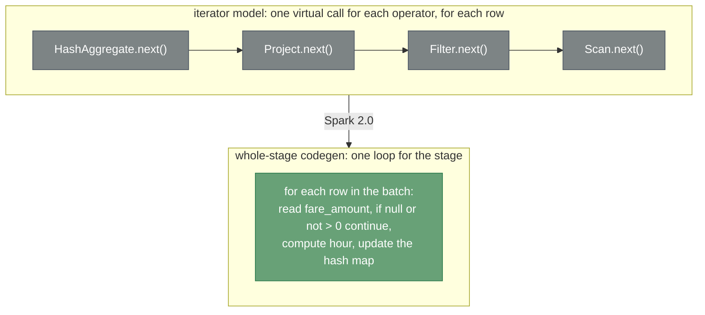

# Chapter 72: From RDDs to a SQL engine

[Chapter 70](ch70-mapreduce-to-spark.md) ended with the limit of the RDD: Spark cannot look inside a function. In the RDD API, each step is a closure, and a closure is a black box. Spark knows that a step is a `map`. But it does not know which fields the function reads, which rows it keeps, or what types it returns. Thus, Spark can only run the functions in the order that you wrote them, on objects that the language runtime makes.

**From Spark 1.3 to Spark 4.3, Spark changed from a library that runs your functions into a SQL engine that plans your query. The query is a tree of expressions that Spark can read. Catalyst rewrites the tree, Tungsten stores the rows as binary data, and code generation compiles each stage into one loop. These three changes, not the hardware, make a DataFrame query many times faster than the same logic in RDD code.**

This chapter runs one question in the two styles and measures them. Then it opens each layer: the plans, the bytes of a row and the generated Java.

Part IV teaches how to read and tune plans in depth, from [Chapter 18](ch18-query-plans.md) on. This chapter links to it, and it does not repeat it. The scripts are in [`code/ch72`](https://github.com/lisancao/spark-masterclass/tree/main/code/ch72), and each number comes from `code/ch72/output/`.

## Step 1: The history in five releases

The release notes of Spark give the order of the changes. Each line below quotes or summarizes the notes of that release:

| Release | Date | What the release notes say |
|---|---|---|
| [1.0](https://spark.apache.org/releases/spark-release-1-0-0.html) | May 2014 | "adds a new major component, Spark SQL, for loading and manipulating structured data" |
| [1.3](https://spark.apache.org/releases/spark-release-1-3-0.html) | March 2015 | "adds a new DataFrames API". Spark SQL "graduates from an alpha project". |
| [1.5](https://spark.apache.org/releases/spark-release-1-5-0.html) | September 2015 | Tungsten "is now enabled by default": "manually managed memory", a "compact binary in-memory data representation", code generation for expressions |
| [1.6](https://spark.apache.org/releases/spark-release-1-6-0.html) | January 2016 | the Dataset API, and unified memory management: "shared memory for execution and caching" |
| [2.0](https://spark.apache.org/releases/spark-release-2-0-0.html) | July 2016 | "DataFrame is just a type alias for Dataset of Row", `SparkSession`, and "2 - 10X" speedups from "whole stage code generation" |

The design of Catalyst is in the Spark SQL paper ([Armbrust et al., SIGMOD 2015](https://dl.acm.org/doi/10.1145/2723372.2742797)). The changes after 2.0 continued in the same direction: adaptive query execution in 3.0, Arrow for Python, columnar plugins and, in 4.3, Project Feather. Step 7 describes them.

## Step 2: The same question, two ways

The question is the one from [Chapter 1](ch01-how-spark-runs.md). For each pickup hour in June 2026, how many trips were there, and what was the average fare? `rdd_vs_df.py` asks it two ways:

=== "RDD"

    ```python
    def with_rdd():
        return (trips.rdd                                                       # (1)!
                .filter(lambda r: r.fare_amount is not None and r.fare_amount > 0)
                .map(lambda r: (r.tpep_pickup_datetime.hour, (r.fare_amount, 1)))
                .reduceByKey(lambda a, b: (a[0] + b[0], a[1] + b[1]))
                .mapValues(lambda s: (s[1], round(s[0] / s[1], 2)))
                .sortByKey())
    ```

    1. `trips.rdd` gives an RDD of `Row` objects. Each row has all 21 columns, because Spark cannot know which fields the lambdas read.

=== "DataFrame"

    ```python
    def with_df():
        return (trips.where(F.col("fare_amount") > 0)
                .groupBy(F.hour("tpep_pickup_datetime").alias("hour"))
                .agg(F.count("*").alias("trips"), F.round(F.avg("fare_amount"), 2).alias("avg_fare"))
                .orderBy("hour"))
    ```

The script runs each version one time to warm up, then five times, and it reports the median. It ran under the benchmark lock:

```text
same answer from both: True   hour 18: (18, (262898, 20.29))

median of 5 runs over 3,837,248 rows:
  rdd (Python lambdas)           12.71 s
  dataframe                       0.28 s    45.7x faster than rdd
  dataframe, wholeStage=false     0.29 s     1.1x slower than with codegen
```

The two versions give the same answer. The DataFrame was 45.7 times faster in this run. In three runs of the script, the ratio stayed between 20 and 46 (`rdd_vs_df-run1.txt` to `rdd_vs_df-run3.txt`). The laptop also ran other work, which explains the spread. In every run, the gap was more than an order of magnitude.

A Python RDD pays a cost that a Scala RDD does not pay. Each row goes from the JVM to a Python worker as a pickled `Row`, and the lambdas run in Python. To separate that cost from the cost of the RDD model, `RddVsDf.scala` runs the same comparison in Scala, with no Python process:

```text
scala rdd (all 21 columns)           1.28 s
scala rdd (select 2 columns first)   0.47 s
scala dataframe                      0.37 s    1.3x faster than rdd,  3.5x faster than rdd over all columns
rdd hour 18: (18,(262898,20.29))   dataframe hour 18: [18,262898,20.29]
```

<figure markdown>
  
  
  <figcaption>The same question in five forms. The bars are medians over three runs of each script, and the lines show the range. Most of the cost of the Python RDD is the boundary between the JVM and Python.</figcaption>
</figure>

The Scala numbers divide the gap into its causes:

- **The Python boundary is most of the gap.** The Scala RDD over all columns took 1.28 s, and the Python RDD took 12.71 s, with the same logic.
- **Column pruning is the next part.** The Scala RDD that selects two columns first is 2.7 times faster than the one that reads all 21 columns. In the RDD API, you must do this pruning by hand. In the DataFrame API, the optimizer does it.
- **The DataFrame is still faster than the best RDD code**, by 1.1 to 1.3 times in three runs. The DataFrame aggregates binary rows in a generated loop, and the RDD makes a JVM object for each row and each tuple.

## Step 3: What each version tells Spark

The difference in speed comes from a difference in information. `toDebugString()` shows everything that Spark knows about the RDD version:

```text
(16) PythonRDD[349] at RDD at PythonRDD.scala:59 []
 |   MapPartitionsRDD[348] at mapPartitions at PythonRDD.scala:197 []
 |   ShuffledRDD[347] at partitionBy at NativeMethodAccessorImpl.java:0 []
 +-(16) PairwiseRDD[346] at sortByKey at rdd_vs_df.py:32 []
    |   PythonRDD[345] at sortByKey at rdd_vs_df.py:32 []
    |   MapPartitionsRDD[342] at mapPartitions at PythonRDD.scala:197 []
    |   ShuffledRDD[341] at partitionBy at NativeMethodAccessorImpl.java:0 []
    +-(16) PairwiseRDD[340] at reduceByKey at rdd_vs_df.py:30 []
       |   PythonRDD[339] at reduceByKey at rdd_vs_df.py:30 []
       |   MapPartitionsRDD[7] at javaToPython at NativeMethodAccessorImpl.java:0 []
       |   MapPartitionsRDD[6] at javaToPython at NativeMethodAccessorImpl.java:0 []
       |   SQLExecutionRDD[5] at javaToPython at NativeMethodAccessorImpl.java:0 []
       |   MapPartitionsRDD[4] at javaToPython at NativeMethodAccessorImpl.java:0 []
       |   MapPartitionsRDD[3] at javaToPython at NativeMethodAccessorImpl.java:0 []
       |   FileScanRDD[2] at javaToPython at NativeMethodAccessorImpl.java:0 []
```

Spark sees `PythonRDD` nodes, which are Python functions that it cannot read, and two shuffles. The first shuffle is for `reduceByKey`, and the second is for `sortByKey`. The bottom of the graph shows a `SQLExecutionRDD` over a `FileScanRDD`. This is the DataFrame `trips`, executed by the SQL engine as RDDs of binary rows, then changed to Python objects by `javaToPython`. Every DataFrame query runs as RDDs in this way.

For the DataFrame version, Spark knows the full query. `explain("extended")` prints the four plans of Catalyst:

```mermaid
flowchart LR
  classDef code fill:#3a5f96,fill-opacity:0.72,stroke:#3a5f96,color:#ffffff
  classDef plan fill:#c0661a,fill-opacity:0.72,stroke:#c0661a,color:#ffffff
  classDef run fill:#2f7d4f,fill-opacity:0.72,stroke:#2f7d4f,color:#ffffff
  q["DataFrame calls<br/>or SQL text"]:::code --> p["parsed<br/>logical plan"]:::plan
  p -->|"analyzer:<br/>catalog, types"| a["analyzed<br/>logical plan"]:::plan
  a -->|"optimizer:<br/>rule batches"| o["optimized<br/>logical plan"]:::plan
  o -->|"planner:<br/>strategies"| ph["physical plan"]:::plan
  ph -->|"codegen,<br/>AQE at run time"| r["RDDs of<br/>binary rows"]:::run
```



```text
== Optimized Logical Plan ==
Sort [hour#527 ASC NULLS FIRST], true
+- Aggregate [_groupingexpression#553], [_groupingexpression#553 AS hour#527, count(1) AS trips#528L, round(avg(fare_amount#10), 2) AS avg_fare#529]
   +- Project [fare_amount#10, hour(tpep_pickup_datetime#1, Some(America/Los_Angeles)) AS _groupingexpression#553]
      +- Filter (isnotnull(fare_amount#10) AND (fare_amount#10 > 0.0))
         +- Relation [VendorID#0,tpep_pickup_datetime#1,...,request_source#20] parquet

== Physical Plan ==
AdaptiveSparkPlan isFinalPlan=false
+- Sort [hour#527 ASC NULLS FIRST], true, 0
   +- Exchange rangepartitioning(hour#527 ASC NULLS FIRST, 200), ENSURE_REQUIREMENTS, [plan_id=1109]
      +- HashAggregate(keys=[_groupingexpression#553], functions=[count(1), avg(fare_amount#10)], output=[hour#527, trips#528L, avg_fare#529])
         +- Exchange hashpartitioning(_groupingexpression#553, 200), ENSURE_REQUIREMENTS, [plan_id=1106]
            +- HashAggregate(keys=[_groupingexpression#553], functions=[partial_count(1), partial_avg(fare_amount#10)], output=[_groupingexpression#553, count#557L, sum#558, count#559L])
               +- Project [fare_amount#10, hour(tpep_pickup_datetime#1, Some(America/Los_Angeles)) AS _groupingexpression#553]
                  +- Filter (isnotnull(fare_amount#10) AND (fare_amount#10 > 0.0))
                     +- FileScan parquet [tpep_pickup_datetime#1,fare_amount#10] Batched: true, DataFilters: [isnotnull(fare_amount#10), (fare_amount#10 > 0.0)], ...
```

The block above shortens the column list of `Relation` and the end of `FileScan`. `rdd_vs_df.txt` has the full text, with the parsed and analyzed plans. Each phase of Catalyst adds information:

- **The analyzer** resolves each name against the schema of the Parquet file and gives each attribute an ID (`fare_amount#10`). It also inserts `cast(0 as double)`, because the column is a double and the literal is an integer.
- **The optimizer** applies batches of rules. Here it folded the cast into `0.0`, it added `isnotnull(fare_amount)`, and it computed `hour(...)` one time in a `Project`, as `_groupingexpression`.
- **The planner** chose physical operators. The aggregate became two `HashAggregate` operators with an `Exchange` between them, and the filter went into the scan as `PushedFilters`. The scan reads two columns, not 21.

<figure markdown>
  <video autoplay loop muted playsinline width="1280" height="720" poster="../../media/clips/ch72-anim-catalyst.webp">
    <source src="../../media/clips/ch72-anim-catalyst.mp4" type="video/mp4">
  </video>
  <figcaption>The DataFrame query through the four plans of Catalyst, with the new nodes of each phase in orange. The last frame shows the operators that whole-stage codegen fuses. The plan text comes from <code>rdd_vs_df.txt</code> and <code>codegen.txt</code>.</figcaption>
</figure>

None of this is possible with the RDD version. A rule cannot add a null check to a lambda. A planner cannot push a lambda into a Parquet reader.

To read each plan in detail, use [Chapter 18](ch18-query-plans.md). It also prints the optimizer rules that fired, one by one.

## Step 4: Tungsten, the row as bytes

The second change is the format of the data. An RDD of Python objects or JVM objects pays for each object: a header, pointers, boxed numbers and work for the garbage collector. Tungsten replaced objects with **binary rows** in memory that Spark manages itself. The main format is the `UnsafeRow`. `tungsten.py` takes one row of the taxi data from the JVM side of a query and prints its bytes:

```text
Row(VendorID=1, trip_distance=2.9, store_and_fwd_flag='N', fare_amount=16.3)
class: org.apache.spark.sql.catalyst.expressions.UnsafeRow
numFields=4  sizeInBytes=48
8-byte words, as UnsafeRow.toString() prints them (hex):
  word 0:                  0   null bitset
  word 1:                  1   field 0
  word 2:   4007333333333333   field 1
  word 3:         2800000001   field 2
  word 4:   40304ccccccccccd   field 3
  word 5:                 4e   variable-length data
```

<figure markdown>
  
  
  <figcaption>The six words of the row. Fixed-width values are in their slots. The slot of the string holds its offset and length, and the string bytes follow the slots.</figcaption>
</figure>

The layout is simple, and that is the point:

- **Word 0 is the null bitset**, with one bit for each field. All bits are 0, so no field is null.
- **Each field has an 8-byte slot.** `VendorID` is the integer 1 in word 1. `trip_distance` is the IEEE 754 double 2.9, which is `0x4007333333333333`. `fare_amount` is 16.3, which is `0x40304ccccccccccd`.
- **A string has its bytes after the slots.** The slot of `store_and_fwd_flag` is `0x2800000001`. The high 32 bits are `0x28`, which is offset 40, and the low 32 bits are 1, the length. At byte 40, word 5 holds `0x4e`, which is the letter `N`.

An operator can read field 3 of an `UnsafeRow` with one memory read at a known offset. It can compare, hash and copy a row as a block of bytes, with no deserialization. The shuffle in [Chapter 71](ch71-inside-a-spark-application.md) writes these bytes directly, and that is why `UnsafeRowSerializer` can move serialized records.

Tungsten also manages memory outside the JVM objects. Execution memory comes in pages from the `TaskMemoryManager`, on the heap or off the heap with `spark.memory.offHeap.enabled`. This is the "manually managed memory" of the 1.5 release notes. It is the execution side of the unified pool in [Chapter 71](ch71-inside-a-spark-application.md).

The cache uses a third format. `df.cache()` keeps a DataFrame as compressed columnar batches, not as rows. `tungsten.py` caches five columns of the trips as a Python RDD of tuples and as a DataFrame, then it sums one column over each cache:

```text
3,837,248 rows x 5 columns, cached two ways (REST: /storage/rdd):
  python rdd of tuples             72.1 MiB  (Memory Serialized 1x Replicated)
  dataframe cache (columnar)      122.1 MiB  (Disk Memory Deserialized 1x Replicated)
  parquet file, all 21 columns     62.4 MiB  (on disk, compressed)

sum(fare_amount) over each cache, median of 5 runs:
  python rdd of tuples         0.28 s
  dataframe cache              0.05 s   (5x faster)
```

The columnar cache is larger than the pickled Python cache here. Doubles and timestamps do not compress much in the cache encodings. But the DataFrame cache is five times faster to scan in all three runs, because the scan reads one column vector in the JVM. The Python scan must unpickle every tuple to read one field. Size is not the only cost of a cache, and [Chapter 19](ch19-partitions-caching-memory.md) measures the storage levels in more detail.

## Step 5: Whole-stage code generation

The third change is how the operators run. Before Spark 2.0, each physical operator was an iterator. It called the `next()` method of its child, one row at a time, through a virtual function call. Whole-stage code generation removes these calls. It fuses a chain of operators into one generated Java method, and it compiles the method at run time with Janino.



`codegen.py` prints the generated code with `explain("codegen")`. Before the query runs, there is no code, because AQE generates the code for each query stage when it makes the stage:

```text
before the run: Found 0 WholeStageCodegen subtrees.
after the run:  Found 3 WholeStageCodegen subtrees.
== Subtree 1 / 3 (maxMethodCodeSize:347; maxConstantPoolSize:350(0.53% used); numInnerClasses:1) ==
    *(1) HashAggregate(keys=[_groupingexpression#48], functions=[partial_count(1), partial_avg(fare_amount#10)
    +- *(1) Project [fare_amount#10, hour(tpep_pickup_datetime#1, Some(America/Los_Angeles)) AS _groupingexpre
       +- *(1) Filter (isnotnull(fare_amount#10) AND (fare_amount#10 > 0.0))
          +- *(1) ColumnarToRow
             +- FileScan parquet [tpep_pickup_datetime#1,fare_amount#10] Batched: true, DataFilters: [isnotnul
```

The operators with `*(1)` are one function. This is the start of the loop that reads the scan, with the filter inside it:

```text
/* 136 */   private void hashAgg_doAggregateWithKeys_0(int partitionIndex) throws java.io.IOException {
/* 137 */     if (columnartorow_mutableStateArray_1[0] == null) {
/* 138 */       columnartorow_nextBatch_0();
/* 139 */     }
/* 140 */     while ( columnartorow_mutableStateArray_1[0] != null) {
/* 141 */       int columnartorow_numRows_0 = columnartorow_mutableStateArray_1[0].numRows();
/* 142 */       int columnartorow_localEnd_0 = columnartorow_numRows_0 - columnartorow_batchIdx_0;
/* 143 */       for (int columnartorow_localIdx_0 = 0; columnartorow_localIdx_0 < columnartorow_localEnd_0; columnarto
/* 144 */         int columnartorow_rowIdx_0 = columnartorow_batchIdx_0 + columnartorow_localIdx_0;
/* 145 */         do {
/* 146 */           boolean columnartorow_isNull_1 = columnartorow_mutableStateArray_2[1].isNullAt(columnartorow_rowId
/* 147 */           double columnartorow_value_1 = columnartorow_isNull_1 ? -1.0 : (columnartorow_mutableStateArray_2[
/* 148 */
/* 149 */           boolean filter_value_2 = !columnartorow_isNull_1;
/* 150 */           if (!filter_value_2) continue;
/* 151 */
/* 152 */           boolean filter_value_3 = false;
/* 153 */           filter_value_3 = org.apache.spark.sql.catalyst.util.SQLOrderingUtil.compareDoubles(columnartorow_v
/* 154 */           if (!filter_value_3) continue;
```

Read the generated code as plain Java:

- **Line 140** loops over the column batches that the Parquet reader decodes. **Line 143** loops over the rows in a batch.
- **Lines 146 and 147** read `fare_amount` directly from column vector 1, as a primitive `double`. No `Row` object exists.
- **Lines 149 to 154** are the `Filter`. `isnotnull` and `> 0.0` became two `if` statements with `continue`.
- The rest of the method, after line 154, computes the hour and updates the hash map of the partial aggregate, in the same loop.

<figure markdown>
  <video autoplay loop muted playsinline controls width="1280" height="720" poster="../../media/clips/ch72-codegen.webp">
    <source src="../../media/clips/ch72-codegen.mp4" type="video/mp4">
  </video>
  <figcaption><code>rdd_vs_df.py</code> measures the two versions, <code>tungsten.py</code> prints the bytes of one row, and <code>codegen.py</code> prints the generated loop. The film ran without the benchmark lock, so its times are different from the text.</figcaption>
</figure>

How much does codegen save? Step 2 had a surprise. On the taxi query, `spark.sql.codegen.wholeStage=false` was only 1.1 times slower. In the three runs, the ratio stayed between 0.8 and 1.5. That query reads four row groups with four busy tasks, and most of its time is the Parquet decode, not the operators. To see the effect of codegen, the script also runs a query where the time goes to expression evaluation:

```text
range(400M), filter, sum:  codegen on  0.14 s   off  1.52 s   11.0x slower without it
```

The query has a filter and a sum over 400 million generated rows. Codegen made it 11.0 times faster in this run, and between 4.5 and 11.0 times faster in three runs. The release notes of 2.0 promised "2 - 10X". Codegen helps when the CPU evaluates many expressions on each row. It does not make a scan faster. [Chapter 18](ch18-query-plans.md) explains the limits of generated methods, such as `spark.sql.codegen.hugeMethodLimit`.

## Step 6: Adaptive query execution

Catalyst plans a query before it runs, with estimates. Adaptive query execution (AQE) plans the query again while it runs, with real sizes. It came in Spark 3.0, and it is on by default from Spark 3.2. AQE runs one query stage at a time. After each shuffle, it reads the real size of each partition and changes the rest of the plan. The final plan of the taxi query shows the result:

```text
AdaptiveSparkPlan isFinalPlan=true
+- == Final Plan ==
   ResultQueryStage 2
   +- *(3) Sort [hour#22 ASC NULLS FIRST], true, 0
      +- AQEShuffleRead coalesced
         +- ShuffleQueryStage 1
            +- Exchange rangepartitioning(hour#22 ASC NULLS FIRST, 200), ENSURE_REQUIREMENTS, [plan_id=83]
               +- *(2) HashAggregate(keys=[_groupingexpression#48], functions=[count(1), avg(fare_amount#10)])
                  +- AQEShuffleRead coalesced
                     +- ShuffleQueryStage 0
```

Each `ShuffleQueryStage` is a stage that AQE ran and measured. Each `AQEShuffleRead coalesced` replaced 200 planned partitions with fewer partitions, because the data was small. AQE can also change a sort-merge join into a broadcast join, and divide a skewed partition into smaller partitions.

The extra jobs that AQE creates are in [Chapter 1](ch01-how-spark-runs.md). One complete explanation of AQE and all its settings is in [Chapter 18](ch18-query-plans.md).

## Step 7: The direction since then

After 2.0, the changes to the engine followed one idea. Keep data in a columnar, binary form for as long as possible, and avoid a copy at every boundary.

| Change | Where it shows | Chapter |
|---|---|---|
| Vectorized Parquet and ORC readers | `Batched: true` and `ColumnarToRow` in the plan | [Chapter 22](ch22-parquet-inside.md) |
| Apache Arrow between the JVM and Python | `toPandas()`, pandas UDFs, `ArrowEvalPython` | [Chapter 20](ch20-python-udfs-arrow.md) |
| Columnar plugins and native engines | `SparkSessionExtensions.injectColumnar`, `ColumnarRule` | [Chapter 24](ch24-acceleration.md) |
| Project Feather (4.3) | single-task execution for small queries, an Arrow-native cache | [Chapter 23](ch23-project-feather.md) |

**Arrow for Python.** The release notes of 2.3 describe "fast data serialization and vectorized execution" for Python. In Spark 4.3, `spark.sql.execution.arrow.pyspark.enabled` falls back to `spark.sql.execution.arrow.enabled`, which is true by default (`SQLConf.scala:4969`). Python UDFs also use Arrow by default (`spark.sql.execution.pythonUDF.arrow.enabled`). `arrow.py` measures the boundary with `toPandas()`:

```text
spark.sql.execution.arrow.pyspark.enabled=false  toPandas() of 1,000,000 rows:  3.91 s
spark.sql.execution.arrow.pyspark.enabled=true   toPandas() of 1,000,000 rows:  0.22 s
```

Arrow made the transfer of one million rows 18 times faster. In three runs, the time stayed between 3.91 and 4.05 s without Arrow, and between 0.18 and 0.23 s with Arrow. Without Arrow, Spark pickles each row. With Arrow, it sends column batches that pandas can use with few copies.

**Native acceleration.** `SparkSessionExtensions.injectColumnar` (`SparkSessionExtensions.scala:168`) lets a plugin add a `ColumnarRule`. The rule replaces parts of the physical plan with operators that work on column batches. Apache Gluten with Velox, Apache DataFusion Comet and NVIDIA RAPIDS use these hooks. They run Spark plans in native code or on a GPU, with no change to your query.

The measurements of these engines are in [Chapter 24](ch24-acceleration.md).

!!! note "New in 4.3: Project Feather"
    The 4.3 release notes describe an opt-in single-task execution for small queries, and an opt-in Arrow-native cache for Datasets. With `spark.sql.optimizer.singleTaskExecution.enabled`, the planner runs a small query in one task and removes its shuffles. This is the same SQL engine, with less distributed overhead for data that does not need it. [Chapter 23](ch23-project-feather.md) measures the crossover.

## The whole chapter, on one page

- **An RDD is a chain of closures that Spark cannot read.** A DataFrame is a tree of expressions that Spark can analyze, rewrite and plan.
- **Measured on Spark 4.3:** the DataFrame was 20 to 46 times faster than Python RDD code. It was 1.1 to 1.3 times faster than the best Scala RDD code.
- **Catalyst** resolves names and types, applies optimizer rules, and picks physical operators. Column pruning and filter pushdown come from this information.
- **Tungsten** stores a row as bytes: a null bitset, fixed 8-byte slots, and variable-length data after the slots. Operators read fields at known offsets, and the shuffle moves the bytes as they are.
- **Whole-stage codegen** fuses a stage into one Java loop over column batches. It helps CPU-bound queries (4.5 to 11 times here), and it does little for a query that the scan limits.
- **AQE** plans the query again after each shuffle, with real sizes.
- **Since then:** Arrow at the Python boundary (18 times faster `toPandas()` here), columnar plugins for native engines, and Project Feather for small queries.

To run the measurements on your machine:

```bash
cd code
export BOOK_DATA=$HOME/spark-masterclass/data
uv run python ch72/rdd_vs_df.py
uv run spark-shell --master 'local[*]' -i ch72/RddVsDf.scala
uv run python ch72/tungsten.py
uv run python ch72/codegen.py
uv run python ch72/arrow.py
```

## Further reading

- [Spark SQL: Relational Data Processing in Spark](https://dl.acm.org/doi/10.1145/2723372.2742797), Armbrust et al., SIGMOD 2015, the design of Catalyst.
- [Spark SQL performance tuning](https://spark.apache.org/docs/4.3.0/sql-performance-tuning.html), with AQE and the settings of the cache.
- [Apache Arrow in PySpark](https://spark.apache.org/docs/4.3.0/api/python/tutorial/sql/arrow_pandas.html).
- [`UnsafeRow.java`](https://github.com/apache/spark/blob/v4.3.0/sql/catalyst/src/main/java/org/apache/spark/sql/catalyst/expressions/UnsafeRow.java) at `v4.3.0`, with the layout in its class comment.
