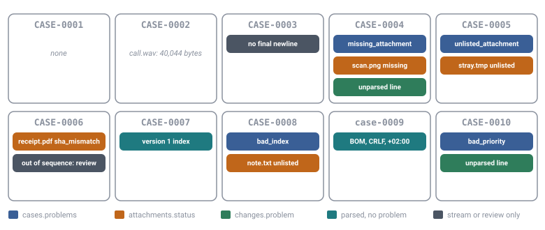
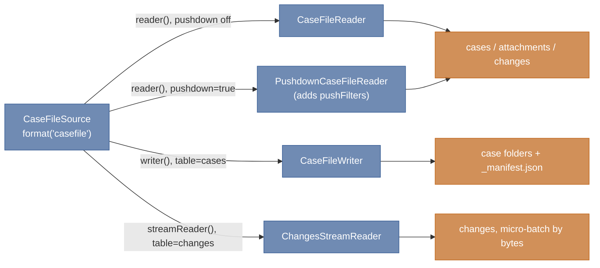
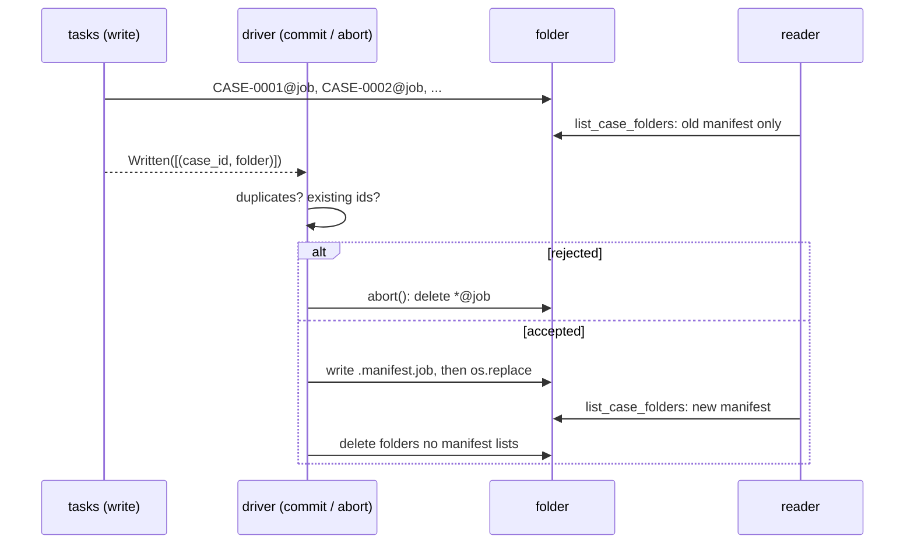
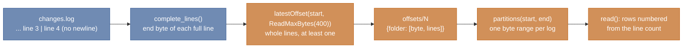
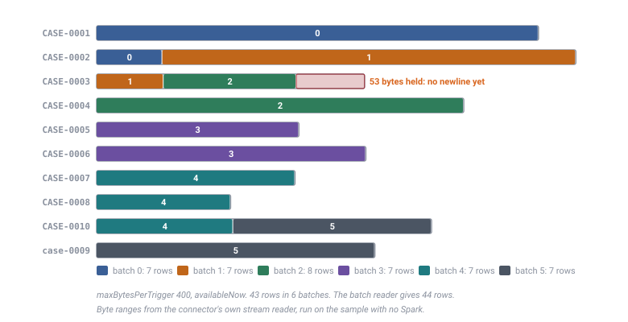

# Chapter 73: Capstone: your own connector

This chapter is the capstone of Part XIII. It builds `casefile`, a complete connector for a messy format that no Spark reader knows. The format is the export of a help desk: one folder for each case, with an index file, attachments and a change log. The export has two versions of the index and some broken files. It also has a byte order mark, CRLF line ends, and logs that grow while you read them.

The connector is a Python data source, because the Python API covers each capability that the format needs. Each part uses a chapter of this book:

| Capability | `casefile` | Where the book shows the API |
|---|---|---|
| A short name, three tables from one source | `format("casefile")`, option `table` | Chapter 65 |
| Partitions | planned by bytes, first fit decreasing | Chapter 65 |
| Filter pushdown | exact, and only when the user asks for it | Chapter 67 |
| VARIANT | loose metadata, from `VariantVal.parseJson` | Chapter 29 |
| A writer | invisible until one atomic manifest swap | Chapter 68 |
| A stream | byte offsets for each log, admission control by bytes | Chapter 68 |
| Worker logs | one warning for each problem, from `python_worker_logs()` | Chapter 69 |
| The Java path | the same connector against DSv2 | Chapter 70 |

**A connector for messy data must not crash on messy data. Each problem in the input becomes a row, a column value or a warning, not an exception.

Partitions follow the bytes that each task reads. Pushdown is exact or absent. A write is invisible until one atomic step. A stream reads only complete lines. Tests prove all of this, and tests are only as good as the broken code that they catch.**

The code is in [`code/ch73`](https://github.com/lisancao/spark-masterclass/tree/main/code/ch73):

- `casefile.py` is the connector.
- `demo.py` shows each table, plan and file of this chapter.
- `grade.py` checks each capability as a separate stage. It also has the unit tests and the design review.
- `gotchas.py` shows three traps on Spark 4.3.0.

The sample data is `code/data/messy/casefiles`. Each output block comes from `code/ch73/output/`.

## Step 1: The format

```text
casefiles/
  CASE-0001/
    case.json          the index: metadata and the list of attachments
    attachments/       request.eml, invoice_1001.pdf
    changes.log        one line for each change to the case
  CASE-0002/ ... CASE-0010/, case-0009/
  README.txt  .DS_Store  _staging/job-3f2a/CASE-0099/   (not cases)
```

A version 2 index (`CASE-0004/case.json`, start) has a `schema` key:

```json
{
  "schema": 2,
  "case_id": "CASE-0004",
  "opened": "2026-03-09T10:00:00Z",
  "status": "waiting",
  "priority": "P2",
  "tags": [
    "damaged"
  ],
  "meta": {
    "customer": {
      "id": "C021",
      "tier": "silver"
    },
    "order": 1044
  },
```

Each attachment entry of version 2 has `name`, `sha256` and `bytes`. Older cases use version 1. It has different names and types for the same data (`CASE-0007/case.json`):

```json
{
  "id": "case-0007",
  "created": 1772616600,
  "state": "OPEN",
  "prio": 2,
  "labels": "billing, vip",
  "attachments": [
    "photo.png"
  ],
  "extra": {
    "imported_from": "legacy-crm",
    "legacy_id": 7731
  }
}
```

The change log has one change on each line, `<ISO timestamp> | <field> | <old> -> <new> | <actor>` (`CASE-0006/changes.log`):

```text
2026-03-12T09:00:00Z | status | new -> open | ana
2026-03-12T09:07:00Z | status | open -> triage | ana
2026-03-12T09:14:00Z | priority | P2 -> P1 | emma
2026-03-12T08:00:00Z | status | open -> resolved | emma
```

The time of the last line is earlier than the time of the line before it. The sample has these problems on purpose:

| Case | Problem |
|---|---|
| CASE-0001 | none (a comment line and a blank line at the end of the log) |
| CASE-0002 | none, but `call.wav` has 40,044 bytes, much more than the other files |
| CASE-0003 | the last line of the log has no newline |
| CASE-0004 | the index lists `scan.png`, which is not on disk; a log line that is not a change |
| CASE-0005 | `stray.tmp` is on disk but not in the index |
| CASE-0006 | `receipt.pdf` does not agree with its `sha256`; a log line out of sequence |
| CASE-0007 | a version 1 index |
| CASE-0008 | `case.json` is cut short (it is not valid JSON) |
| case-0009 | a lowercase folder, a UTF-8 byte order mark, CRLF line ends, a `+02:00` offset |
| CASE-0010 | priority `"urgent"`; a blank line and a line with no `->` in the log |

<figure markdown>
  
  <figcaption>The problems of the sample, and where the connector reports each one. Step 5 shows the tables. Step 10 shows the stream, and Step 13 shows the design review.</figcaption>
</figure>

The byte order mark (BOM) is in the first three bytes of `case-0009/case.json` (`od -c`):

```text
0000000 357 273 277   {  \n           "   s   c   h   e   m   a   "   :
```

`list_case_folders(root)` decides what a case is. A case is a folder with a `case.json`. Its name does not start with `_` or `.`, and it is not a job folder of the writer (`name@job`, Step 9). If the folder has a manifest, the function returns only the folders that the manifest lists:

```text
== 1. What counts as a case
on disk:      ['.DS_Store', 'CASE-0001', 'CASE-0002', 'CASE-0003', 'CASE-0004', 'CASE-0005', 'CASE-0006', 'CASE-0007', 'CASE-0008', 'CASE-0010', 'README.txt', '_staging', 'case-0009']
case folders: ['CASE-0001', 'CASE-0002', 'CASE-0003', 'CASE-0004', 'CASE-0005', 'CASE-0006', 'CASE-0007', 'CASE-0008', 'CASE-0010', 'case-0009']
```

## Step 2: The contract

One data source, `format("casefile")`, gives three tables. The option `table` selects one, as the JDBC source selects a table with `dbtable`. A case, an attachment and a change line are different grains. One schema for all three would have many NULL values.

```text
cases        case_id string, folder string, schema_version int, opened timestamp,
             status string, priority int, tags array<string>, meta variant,
             attachments int, bytes long, problems array<string>
attachments  case_id string, folder string, name string, kind string, size long,
             sha256 string, expected_sha256 string, status string
changes      case_id string, line int, ts timestamp, field string, old string,
             new string, actor string, raw string, problem string
```

| Option | Default | Meaning |
|---|---|---|
| `table` | `cases` | the table |
| `maxPartitionBytes` | `16384` | the target bytes for each partition |
| `pushdown` | `false` | `true` selects the reader that pushes filters |
| `audit` | none | a folder; each task writes a marker for each case folder that it opens |
| `maxBytesPerTrigger` | `1024` | streaming: the bytes of change log in each micro-batch |

To write, use `df.write.format("casefile").mode("append" | "overwrite").save(path)`. The DataFrame must have the shape of `cases`, and the writer makes one case folder for each row. To stream, use `spark.readStream.format("casefile").option("table", "changes")`.

`CaseFileSource` is the entry point. Each method checks the option `table` and gives a clear error for a table that it cannot serve:

```python
class CaseFileSource(DataSource):
    @classmethod
    def name(cls):
        return "casefile"

    def schema(self):
        table = self.options.get("table", "cases")
        if table not in SCHEMAS:
            raise ValueError(f"casefile: option 'table' must be one of {sorted(SCHEMAS)}, got {table!r}")
        return SCHEMAS[table]

    def reader(self, schema):
        if self.options.get("pushdown", "false").lower() == "true":
            return PushdownCaseFileReader(self.options, schema)
        return CaseFileReader(self.options, schema)

    def writer(self, schema, overwrite):
        if self.options.get("table", "cases") != "cases":
            raise ValueError("casefile can only write the cases table")
        return CaseFileWriter(self.options, overwrite)

    def streamReader(self, schema):
        if self.options.get("table", "cases") != "changes":
            raise ValueError("casefile can only stream the changes table (option table=changes)")
        return ChangesStreamReader(self.options)
```



## Step 3: Two index versions, one shape

`parse_index(raw, folder)` changes the bytes of any `case.json` into one dictionary. This is the map from the two versions:

| Field | Version 2 | Version 1 |
|---|---|---|
| how to recognize it | `"schema": 2` | no `schema` key, has `id` |
| `case_id` | `case_id`, upper case | `id`, upper case |
| `opened` | ISO 8601 with `Z` or an offset, changed to UTC | `created`, seconds since the epoch |
| `status` | `status`, lower case | `state`, lower case |
| `priority` | `"P1"` to `"P4"` | `prio`, 1 to 4 |
| `tags` | a list | `labels`, comma-separated |
| `meta` | `meta` | `extra` |
| attachments | `{name, sha256, bytes}` | names only, with no checksum |

With these rules, messy input does not cause a crash:

- **Decode with `utf-8-sig`.** This codec removes a BOM if the file has one. Otherwise it is plain UTF-8. `json.loads` fails on a string that starts with a BOM.
- **A broken index is a row, not an exception.** For invalid JSON, or for a document of neither version, the row gets `case_id` from the folder name. All other fields are NULL, and `problems` is `['bad_index']`. One damaged file must not stop a query over thousands of cases.
- **An unknown value becomes NULL and a problem.** `"urgent"` is not a priority. Thus, `priority` is NULL and `problems` is `['bad_priority']`. A priority that is not there is only NULL.
- **Timestamps are aware and in UTC.** `parse_ts` replaces `Z` with `+00:00` before `datetime.fromisoformat`, and then changes the value to UTC.

```python
def parse_index(raw, folder):
    fallback = folder.split("@")[0].upper()
    base = {"case_id": fallback, "folder": folder, "schema_version": None, "opened": None,
            "status": None, "priority": None, "tags": [], "meta": None, "listed": [], "problems": []}
    try:
        doc = json.loads(raw.decode("utf-8-sig"))        # utf-8-sig drops a byte order mark
    except (UnicodeDecodeError, json.JSONDecodeError):
        return {**base, "problems": ["bad_index"]}
    if not isinstance(doc, dict):
        return {**base, "problems": ["bad_index"]}
    ...
```

The parser on four cases:

```text
== 2. Two index versions, one shape
{'case_id': 'CASE-0007', 'schema_version': 1, 'opened': datetime.datetime(2026, 3, 4, 9, 30, tzinfo=datetime.timezone.utc), 'status': 'open', 'priority': 2, 'tags': ['billing', 'vip'], 'problems': []}
{'case_id': 'CASE-0009', 'schema_version': 2, 'opened': datetime.datetime(2026, 3, 21, 8, 30, tzinfo=datetime.timezone.utc), 'status': 'open', 'priority': 2, 'tags': ['damaged', 'fr'], 'problems': []}
{'case_id': 'CASE-0008', 'schema_version': None, 'opened': None, 'status': None, 'priority': None, 'tags': [], 'problems': ['bad_index']}
{'case_id': 'CASE-0010', 'schema_version': 2, 'opened': datetime.datetime(2026, 3, 25, 9, 0, tzinfo=datetime.timezone.utc), 'status': 'open', 'priority': None, 'tags': ['vip'], 'problems': ['bad_priority']}
```

`case-0009` has a BOM and an offset of `+02:00`. Its `opened` is 08:30 UTC, which is 10:30 at `+02:00`.

`parse_change_line(line)` returns a dictionary or `None`. It removes a `\r` at the end first.

When you split a CRLF file on `\n`, each line keeps a `\r` at its end, and that `\r` would go into `actor`. A line with no `->`, or with a timestamp that does not parse, is not a change.

`change_rows` changes a block of lines into rows. Comments and blank lines give no row. A line that is not a change gives a row with `raw` and `problem = 'unparsed'`. Thus, no line of the log disappears without a record.

`attachment_status(expected_sha, actual_sha, listed, on_disk)` returns one of five values: `ok`, `sha_mismatch`, `unverified` (listed with no checksum, as in version 1), `missing` or `unlisted`.

## Step 4: Partitions by bytes

`plan_by_bytes(items, target)` puts `(key, size)` pairs into groups. Each group holds `target` bytes or fewer. The algorithm is **first fit decreasing**:

1. Sort the items by size, the largest first (and by key if two sizes are equal).
2. Put each item into the first group that has space for it.
3. If no group has space, start a new group. An item that is larger than the target gets a group of its own.

```python
def plan_by_bytes(items, target):
    groups, totals = [], []
    for key, size in sorted(items, key=lambda kv: (-kv[1], kv[0])):
        for i, total in enumerate(totals):
            if total + size <= target:
                groups[i].append(key)
                totals[i] += size
                break
        else:
            groups.append([key])
            totals.append(size)
    return groups
```

What is an item? It depends on the table, because the cost of a task is the bytes that it reads:

- **attachments**: one item for each file on disk, `((folder, name), size)`. A checksum reads each byte, so the audio file of 40,044 bytes must not share a task with all other files.
- **cases**: one item for each folder, with the size of its `case.json`. The cases table never reads the bytes of attachments. It only lists their names and sizes.
- **changes**: one item for each folder, with the size of its `changes.log`.

```text
== 3. Partitions planned by bytes (first fit decreasing)
[['big'], ['a'], ['b', 'c'], ['d']]
1 files: [('CASE-0002', 'call.wav')]
13 files: [('CASE-0001', 'invoice_1001.pdf'), ('CASE-0006', 'receipt.pdf'), ('case-0009', 'lettre.eml')]
```

With the default target of 16384 bytes, the attachments table has two partitions: one with the audio file, and one with the other 13 files. The files of one case can go to different partitions. Thus, the reader must decide which task emits the rows that have no file at all, for example `scan.png` of CASE-0004. `casefile` gives these rows to the task that holds the first file of the folder by name.

`gotchas.py` shows a trap of this step. A reader whose `partitions()` raises `NotImplementedError` does not fail:

```python
class PlaceholderReader(DataSourceReader):
    def partitions(self):
        raise NotImplementedError        # a natural placeholder while you work

    def read(self, partition):
        yield (f"{type(partition).__name__}(value={partition.value!r})",)
```

```text
== 1. partitions() that raises NotImplementedError
   rows: ['InputPartition(value=None)']
```

`python/pyspark/sql/worker/plan_data_source_read.py` at the `v4.3.0` tag catches `NotImplementedError` and plans one `InputPartition(None)`. Its comment says that this is for compatibility with an older base class. Your `read()` then receives a partition that it does not expect. Thus, do not use `NotImplementedError` as a placeholder in `partitions()`. `casefile.read()` returns no rows for a partition that is not a `CasePartition`.

## Step 5: Three tables, one reader

`CaseFileReader.read()` selects the table, makes dictionaries, and returns tuples in the column sequence of the schema that Spark gave:

```python
def read(self, partition):
    if not isinstance(partition, CasePartition):
        return
    if self.table == "cases":
        rows = (self.case_row(folder) for folder in partition.items)
    elif self.table == "attachments":
        rows = self.attachment_rows(partition.items)
    else:
        rows = (r for folder in partition.items for r in self.change_rows_of(folder))
    for row in rows:
        yield tuple(row[c] for c in self.columns)
```

This is the output for `data/messy/casefiles`, with the session time zone UTC:

```text
+---------+---------+--------------+-------------------+--------+--------+-----------------+---------------------+
|case_id  |folder   |schema_version|opened             |status  |priority|tags             |problems             |
+---------+---------+--------------+-------------------+--------+--------+-----------------+---------------------+
|CASE-0001|CASE-0001|2             |2026-03-02 09:15:00|open    |2       |[billing, refund]|[]                   |
|CASE-0002|CASE-0002|2             |2026-03-03 14:02:00|closed  |3       |[phone, audio]   |[]                   |
|CASE-0003|CASE-0003|2             |2026-03-05 08:30:00|triage  |1       |[escalation]     |[]                   |
|CASE-0004|CASE-0004|2             |2026-03-09 10:00:00|waiting |2       |[damaged]        |[missing_attachment] |
|CASE-0005|CASE-0005|2             |2026-03-11 16:45:00|open    |4       |[]               |[unlisted_attachment]|
|CASE-0006|CASE-0006|2             |2026-03-12 11:20:00|resolved|3       |[billing]        |[]                   |
|CASE-0007|CASE-0007|1             |2026-03-04 09:30:00|open    |2       |[billing, vip]   |[]                   |
|CASE-0008|CASE-0008|NULL          |NULL               |NULL    |NULL    |[]               |[bad_index]          |
|CASE-0009|case-0009|2             |2026-03-21 08:30:00|open    |2       |[damaged, fr]    |[]                   |
|CASE-0010|CASE-0010|2             |2026-03-25 09:00:00|open    |NULL    |[vip]            |[bad_priority]       |
+---------+---------+--------------+-------------------+--------+--------+-----------------+---------------------+
```

The problems of a case come from the index and from a comparison of the listed names with the files on disk (`missing_attachment`, `unlisted_attachment`). A checksum mismatch is **not** a problem of the case. The cases table never reads the bytes of attachments, so it cannot know. This is a design decision. The checksums are in the attachments table (here, only the rows whose status is not `ok`):

```text
+---------+-----------+-----+----+------------+
|case_id  |name       |kind |size|status      |
+---------+-----------+-----+----+------------+
|CASE-0004|scan.png   |image|NULL|missing     |
|CASE-0005|stray.tmp  |other|60  |unlisted    |
|CASE-0006|receipt.pdf|pdf  |472 |sha_mismatch|
|CASE-0007|photo.png  |image|75  |unverified  |
|CASE-0008|note.txt   |text |30  |unlisted    |
+---------+-----------+-----+----+------------+
```

The changes table keeps the physical line number. Thus, you can always find the line of a row, and a bad line stays visible:

```text
+----+-------------------+--------+-------+------+-----+-------------------------------------------------+--------+
|line|ts                 |field   |old    |new   |actor|raw                                              |problem |
+----+-------------------+--------+-------+------+-----+-------------------------------------------------+--------+
|1   |2026-03-25 09:00:00|status  |new    |open  |emma |NULL                                             |NULL    |
|2   |2026-03-25 09:07:00|status  |open   |triage|emma |NULL                                             |NULL    |
|4   |NULL               |NULL    |NULL   |NULL  |NULL |2026-03-25T09:30:00Z | status | open triage | dev|unparsed|
|5   |2026-03-25 09:14:00|priority|P2     |P1    |emma |NULL                                             |NULL    |
|6   |2026-03-25 09:21:00|status  |waiting|open  |ana  |NULL                                             |NULL    |
+----+-------------------+--------+-------+------+-----+-------------------------------------------------+--------+
```

Line 3 of the log of CASE-0010 is blank, so there is no row 3. In a batch read, the last line of the log of CASE-0003 is a row, although it has no newline. The batch reader sees a complete file. A stream does not read it, as Step 10 shows.

## Step 6: Loose metadata as VARIANT

`meta` has different keys in each case, and it comes from a different field in each version. That is the correct use of VARIANT (Chapter 29). A Python data source returns a VARIANT value as a `pyspark.sql.types.VariantVal`. `VariantVal.parseJson` makes one from a JSON string:

```python
"meta": VariantVal.parseJson(json.dumps(index["meta"])) if index["meta"] is not None else None,
```

You can then query the column with no schema:

```python
table("cases").select("case_id",
                      F.expr("variant_get(meta, '$.customer.tier', 'string')").alias("tier"),
                      F.expr("try_variant_get(meta, '$.sla_hours', 'int')").alias("sla_hours"),
                      F.expr("schema_of_variant(meta)").alias("meta_schema")
                      ).orderBy("case_id").show(truncate=False)
```

```text
+---------+------+---------+----------------------------------------------------------------------------------------------------+
|case_id  |tier  |sla_hours|meta_schema                                                                                         |
+---------+------+---------+----------------------------------------------------------------------------------------------------+
|CASE-0001|gold  |24       |OBJECT<channel: STRING, customer: OBJECT<id: STRING, tier: STRING>, sla_hours: BIGINT>              |
|CASE-0002|NULL  |NULL     |OBJECT<channel: STRING, recording: OBJECT<rate: BIGINT, seconds: DECIMAL(2,1)>>                     |
|CASE-0003|NULL  |NULL     |OBJECT<customer: OBJECT<id: STRING>, escalated: BOOLEAN>                                            |
|CASE-0004|silver|NULL     |OBJECT<customer: OBJECT<id: STRING, tier: STRING>, order: BIGINT>                                   |
|CASE-0005|NULL  |NULL     |OBJECT<browser: STRING, channel: STRING>                                                            |
|CASE-0006|gold  |NULL     |OBJECT<customer: OBJECT<id: STRING, tier: STRING>, refund: OBJECT<amount: STRING, currency: STRING>>|
|CASE-0007|NULL  |NULL     |OBJECT<imported_from: STRING, legacy_id: BIGINT>                                                    |
|CASE-0008|NULL  |NULL     |NULL                                                                                                |
|CASE-0009|NULL  |NULL     |OBJECT<channel: STRING, customer: OBJECT<id: STRING, name: STRING>, lang: STRING>                   |
|CASE-0010|gold  |4        |OBJECT<customer: OBJECT<id: STRING, tier: STRING>, sla_hours: BIGINT>                               |
+---------+------+---------+----------------------------------------------------------------------------------------------------+
```

`seconds: DECIMAL(2,1)` shows that the JSON value `2.5` becomes an exact decimal in VARIANT, not a double. The version 1 case, CASE-0007, has its `extra` object in the same column.

## Step 7: Pushdown: exact, and only on request

The pushdown reader accepts these filters:

| Table | Column | Filters |
|---|---|---|
| all | `case_id` | `EqualTo`, `In` |
| cases | `status` | `EqualTo`, `In` |
| cases | `opened` | `GreaterThan`, `GreaterThanOrEqual`, `LessThan`, `LessThanOrEqual` |

The reader applies them when it lists the folders. Thus, the tasks never open a case that cannot match. The folder name gives `case_id`. `status` and `opened` need the index, so the driver reads it when it plans the partitions. The reader must apply the filters **exactly** as Spark does:

- A NULL `status` matches no `EqualTo`.
- A NULL `opened` passes no comparison.
- Two filters on one column give the intersection of the two.

```python
class PushdownCaseFileReader(CaseFileReader):
    def pushFilters(self, filters):
        for f in filters:
            column = f.attribute if hasattr(f, "attribute") else None
            if column == ("case_id",) and isinstance(f, (EqualTo, In)):
                values = {f.value} if isinstance(f, EqualTo) else set(f.value)
                self.case_ids = values if self.case_ids is None else self.case_ids & values
            elif self.table == "cases" and column == ("status",) and isinstance(f, (EqualTo, In)):
                values = {f.value} if isinstance(f, EqualTo) else set(f.value)
                self.statuses = values if self.statuses is None else self.statuses & values
            elif (self.table == "cases" and column == ("opened",)
                  and isinstance(f, (GreaterThan, GreaterThanOrEqual, LessThan, LessThanOrEqual))):
                self.opened_tests.append((type(f).__name__, f.value))
            else:
                yield f
```

**Two reader classes.** A reader with `pushFilters` makes each query fail with `DATA_SOURCE_PUSHDOWN_DISABLED` when `spark.sql.python.filterPushdown.enabled` is `false`. That is the default in 4.3.0. The check is in `plan_data_source_read.py`: it examines the reader **object** that `reader()` returns, and compares its `pushFilters` with the method of the base class. Thus, `CaseFileSource.reader()` returns the pushdown reader only if the user sets `pushdown=true`. The default reader has no `pushFilters`, so it works with the flag off:

```text
== 6. Pushdown: opt-in, and what the plan shows
spark.sql.python.filterPushdown.enabled = false
default reader, flag off: 5 open cases
pushdown reader, flag off -> [DATA_SOURCE_PUSHDOWN_DISABLED] PushdownCaseFileReader implements pushFilters() but filter pushdown is disabled because configuration 'spark.sql.pytho
PushedFilters: [EqualTo(status,open), GreaterThanOrEqual(opened,2026-03-09 17:00:00.0)]
rows: ['CASE-0005', 'CASE-0009', 'CASE-0010'] | folders opened by tasks: ['CASE-0005', 'CASE-0010', 'case-0009']
JVM default time zone: America/Los_Angeles | session time zone: UTC
```

With the flag on, the query `status = 'open' AND opened >= timestamp'2026-03-10 00:00:00'` pushes both filters. The audit folder proves that the tasks opened only the three folders that match.

The `PushedFilters` line has a trap. The query asked for `opened >= 2026-03-10 00:00:00` with the session time zone UTC. The plan shows `2026-03-09 17:00:00.0`. `PushedFilters` shows the value in the **default time zone of the JVM**, not in the session time zone. Here that zone is `America/Los_Angeles`, UTC-7 on that date.

The filter is correct. Only its display is local. The value that gets to `pushFilters` is an aware `datetime` in UTC, so compare it with aware UTC values. Do not change your comparison to agree with the plan.

## Step 8: One DataFrame, used twice

`demo.py` uses one DataFrame three times: a count, a filtered count, and a count again:

```python
for opts in ({}, {"pushdown": "true"}):
    df = table("cases", **opts)
    seq = [df.count(), df.filter("status = 'open'").count(), df.count()]
    print(f"reader {'pushdown' if opts else 'default '}: count, filtered count, count again = {seq}")
c = cf.CaseFiles(spark, DATA, pushdown="true")
print("CaseFiles (a fresh load per table):",
      [c.table("cases").count(), c.table("cases").filter("status = 'open'").count(), c.table("cases").count()])
```

```text
== 7. One DataFrame used twice, 4.3.0
reader default : count, filtered count, count again = [10, 5, 10]
reader pushdown: count, filtered count, count again = [10, 5, 5]
CaseFiles (a fresh load per table):  [10, 5, 10]
```

With the pushdown reader, the third count is **5, not 10**. The filter of the second query stayed in the scan of the DataFrame, and the third query, which has no filter, received its result. This result is wrong, and it occurs on Spark 4.3.0 when `spark.sql.python.filterPushdown.enabled` is `true`. The cause is not yet confirmed, and the behavior is not yet reported to the Spark project. Until then, the book does not call it a Spark bug. Design your connector so that this behavior cannot affect it.

`casefile` has two protections:

- The default reader has no `pushFilters`. Thus, it cannot have this problem.
- `CaseFiles` is a small helper for users who want pushdown. Each `table()` call is a new `load()`, so no two scans share a DataFrame.

```python
class CaseFiles:
    def __init__(self, spark, path, **options):
        self.spark, self.path, self.options = spark, os.path.abspath(path), options

    def table(self, name, **options):
        reader = self.spark.read.format("casefile").option("table", name)
        for k, v in {**self.options, **options}.items():
            reader = reader.option(k, v)
        return reader.load(self.path)
```

!!! warning "One pushdown DataFrame, one query"
    On Spark 4.3.0, a Python data source with `pushFilters` gave a wrong count in this test. This occurred when the test used one DataFrame for more than one query, and `spark.sql.python.filterPushdown.enabled` was `true`. Make a new DataFrame with `load()` for each query, or keep pushdown off.

## Step 9: The writer: publish with one pointer swap

A writer that moves many folders into place in `commit()` is not atomic. A reader that lists the folder during the moves sees half of the write. An overwrite that deletes the old folders first shows an empty table for a short time. `casefile` never moves or renames data:

```text
write()   (each task)   CASE-0006@<job>/case.json, attachments/, changes.log
                        (job folders: invisible, list_case_folders skips name@job)
commit()  (driver)      1. reject duplicates in this job, and appends of existing ids
                        2. write the new manifest to a temporary file
                        3. os.replace(tmp, _manifest.json)        <- the commit point
                        4. delete folders the new manifest no longer lists
abort()   (driver)      delete every *@<job> folder
```

`_manifest.json` maps each `case_id` to its folder. A reader that finds a manifest reads only the folders in it. Thus, the new data comes into view all at one time, at the single `os.replace`. An overwrite never shows an empty table. This is the idea behind table formats such as Delta Lake: files that do not change, published when one small pointer changes.

```python
tmp = os.path.join(self.root, f".{MANIFEST}.{self.job}")
with open(tmp, "w") as f:
    json.dump(new, f, indent=1)
os.replace(tmp, os.path.join(self.root, MANIFEST))      # the commit point
# Only now delete folders the new manifest no longer points to.
for folder in set(old["cases"].values()) - set(cases.values()):
    shutil.rmtree(os.path.join(self.root, folder), ignore_errors=True)
```



`demo.py` writes three cases, then tries three writes that must fail, then overwrites:

```text
== 8. Writes publish by replacing one manifest
after append: ['CASE-0001@142c540f', 'CASE-0002@142c540f', 'CASE-0003@142c540f', '_manifest.json']
_manifest.json: {"version": 1, "cases": {"CASE-0001": "CASE-0001@142c540f", "CASE-0002": "CASE-0002@142c540f", "CASE-0003": "CASE-0003@142c540f"}, "jobs": [{"job": "142c540f", "mode": "append", "cases": 3}]}
a task that fails after four folders: ValueError: casefile: invalid case_id 'not a case', expected CASE-dddd
   folder unchanged: True
a duplicate case_id: ValueError: casefile: duplicate case_id in this write: ['CASE-0006']
   folder unchanged: True
an existing case_id: ValueError: casefile: case_id already exists (use overwrite): ['CASE-0001']
   folder unchanged: True
after overwrite: ['CASE-0009@bce3bb6b', 'CASE-0010@bce3bb6b', '_manifest.json']
_manifest.json: {"version": 2, "cases": {"CASE-0009": "CASE-0009@bce3bb6b", "CASE-0010": "CASE-0010@bce3bb6b"}, "jobs": [{"job": "142c540f", "mode": "append", "cases": 3}, {"job": "bce3bb6b", "mode": "overwrite", "cases": 2}]}
```

When `commit()` raises an exception, Spark logs `Data source write support ... is aborting` and calls `abort()`. Thus, `abort()` deletes the job folders, and a rejected write leaves the folder as it was.

`os.replace` is atomic on POSIX when the two paths are on one file system. On an object store such as S3, a rename is not atomic, and this design does not give the same guarantee. A production version needs a store with an atomic "put if absent", or a table format.

**A trap in the test of `abort()`.** `gotchas.py` writes with an `abort()` that does nothing. It makes the last row fail in two ways:

```text
== 3. raise_error in the input does not test abort()
   raise_error on the last row         -> USER_RAISED_EXCEPTION | job folders left by a no-op abort(): 0
   an invalid case_id on the last row  -> ValueError            | job folders left by a no-op abort(): 9
```

A `raise_error` in the input DataFrame fails the task before `write()` writes any folder, even with `spark.sql.execution.arrow.maxRecordsPerBatch` set to 2. The JVM calculates the rows that it sends to the Python writer, and the error occurs there. Thus, a test with `raise_error` passes with a broken `abort()`. A failure inside `write()`, after it writes folders, is the correct test: here, an invalid `case_id` in the last row.

## Step 10: The changes table as a stream

The changes table is also a stream, for logs that grow. The offset is a byte position for each log, with a line count so that rows keep their line numbers:

```text
{"v": 1, "pos": {"CASE-0001": [343, 8], "CASE-0002": [51, 1]}}
```

That is the end offset of the first micro-batch. It has all 343 bytes and 8 lines of the log of CASE-0001, and the first line of the log of CASE-0002. These are the rules of the design:

- **Only complete lines.** A line counts only after the writer of the log adds its newline. The writer of a log can be in the middle of a line when `latestOffset` runs. If the stream read that part, one change would become two rows. `complete_lines(path, start)` returns the end byte of each complete line after `start`.
- **Admission control by bytes.** `getDefaultReadLimit()` returns `ReadMaxBytes(maxBytesPerTrigger)`. `latestOffset(start, limit)` takes whole lines, folder by folder, while they fit in `limit.max_bytes`. It always takes at least one line, so a stream with one very long line still moves. With `ReadAllAvailable`, it takes all lines.
- **AvailableNow.** `prepareForTriggerAvailableNow` records a target byte for each log. The stream stops at those targets, also if the logs grow.
- **`read()` reads only its byte range.** It numbers the lines from the line count of the start offset.

```python
def latestOffset(self, start, limit):
    budget = None if isinstance(limit, ReadAllAvailable) else getattr(limit, "max_bytes", None)
    pos = {k: list(v) for k, v in start["pos"].items()}
    used, took = 0, False
    for folder, ends in self.pending(start).items():
        begin, lines = pos.get(folder, [0, 0])
        for end in ends:
            size = end - begin
            if budget is not None and took and used + size > budget:
                return {"v": 1, "pos": pos}
            used += size
            took = True
            begin, lines = end, lines + 1
            pos[folder] = [begin, lines]
    return {"v": 1, "pos": pos}
```



`demo.py` streams a copy of the sample with `maxBytesPerTrigger` set to 400 and `availableNow=True`:

```text
== 9. The changes table as a stream
batches (id, rows): [(0, 7), (1, 7), (2, 8), (3, 7), (4, 7), (5, 7)]
offsets/0, last line: {"v": 1, "pos": {"CASE-0001": [343, 8], "CASE-0002": [51, 1]}}
rows streamed: 43 | rows in a batch read: 44
```

The stream wrote 43 rows, one fewer than the 44 rows of the batch reader. The last line of the log of CASE-0003 has no newline yet, so the stream does not read it.

The figure shows which micro-batch read each part of each log. The byte ranges come from the stream reader of `casefile.py`, run on the sample with no Spark. Its row counts agree with the output above.

<figure markdown>
  
  <figcaption>Six micro-batches over the ten logs. A batch can end in the middle of a log. The last 53 bytes of the log of CASE-0003 have no newline, so the stream does not read them.</figcaption>
</figure>

<figure markdown>
  <video autoplay loop muted playsinline controls width="1280" height="720" poster="../../media/clips/ch73-anim-stream.webp">
    <source src="../../media/clips/ch73-anim-stream.mp4" type="video/mp4">
  </video>
  <figcaption>The same micro-batches, one after the other. Each batch takes whole lines, up to 400 bytes.</figcaption>
</figure>

<figure markdown>
  <video autoplay loop muted playsinline controls width="1280" height="720" poster="../../media/clips/ch73-stream.webp">
    <source src="../../media/clips/ch73-stream.mp4" type="video/mp4">
  </video>
  <figcaption><code>demo.py</code>: the changes table as a stream, 400 bytes of log in each micro-batch. The stream holds back the line that has no newline.</figcaption>
</figure>

The stage `streaming` of `grade.py` goes further. It appends to the log of CASE-0003. The append completes the old line, adds a full line and starts a new partial line. It also adds a new case folder.

Then it starts the stream again from the checkpoint and expects exactly 4 new rows. It completes the partial line, starts the stream again, and expects 1 row.

Its oracle is the batch reader. At the end, the Parquet sink must have the same rows as the batch reader of the same folder, with no line twice. It also reads each `offsets/<batch>` file of the checkpoint and checks that no batch used more than 400 bytes.

## Step 11: Problems as warnings from the executors

Problems are data, in the `problems` and `status` columns. An operator also wants to see them without a query. The reader logs one warning for each problem with the logger `casefile`. `demo.py` turns on `spark.sql.pyspark.worker.logging.enabled` and reads the warnings back with `spark.tvf.python_worker_logs()`. The warnings arrive asynchronously, so the script polls:

```text
== 10. Problems as warnings from the executors
WARNING CASE-0004 missing scan.png
WARNING CASE-0004 missing_attachment
WARNING CASE-0005 unlisted stray.tmp
WARNING CASE-0005 unlisted_attachment
WARNING CASE-0006 sha_mismatch receipt.pdf
WARNING CASE-0008 bad_index
WARNING CASE-0008 unlisted note.txt
WARNING CASE-0010 bad_priority
```

**A trap of the Python `logging` module.** A module-level `log = logging.getLogger("casefile")` with `log.addHandler(logging.NullHandler())` does not work in a worker. `gotchas.py` shows why:

```text
== 2. a Logger pickles by name
   pickled bytes name the logger only: True (56 bytes)
   in a new process: handlers = []
```

A `Logger` pickles **by name** only. The worker unpickles a logger with no handlers. Then the last-resort handler of Python writes each warning to the stderr of the task. Thus, get the logger where you log, and add the handler there. `get_log()` in `casefile.py` does this:

```python
def get_log():
    logger = logging.getLogger("casefile")
    if not logger.handlers:
        logger.addHandler(logging.NullHandler())
    return logger
```

The `NullHandler` stops only the output to stderr. With `spark.sql.pyspark.worker.logging.enabled` set to `true`, the records still get to `python_worker_logs()`.

## Step 12: Tests that catch broken code

`OfflineTests` in `grade.py` is a plain `unittest.TestCase` that needs no Spark. It tests the parsers, the statuses, the planner, and a reader that the test drives by hand (`partitions()`, then `read()`, with `schema=None`). Without a schema, the reader takes the column names from the DDL string, because a `StructType` from DDL needs a session that runs.

```python
def test_bom_and_offset(self):
    raw = "".encode() + b'{"schema": 2, "case_id": "C-9", "opened": "2026-03-21T10:30:00+02:00"}'
    i = parse_index(raw, "c-9")
    self.assertEqual(i["problems"], [])
    self.assertEqual(i["opened"], datetime.datetime(2026, 3, 21, 8, 30, tzinfo=datetime.timezone.utc))
```

Tests that pass are only half of the proof. A test suite is only as good as the bugs that it catches. Thus, `grade.py` also does **mutation testing**. It replaces one function with a broken version, runs the suite again, and expects at least one failure:

- a planner that ignores the byte target, and a planner that splits by count, not by bytes
- an index parser that forgets the BOM, that treats version 1 as broken, that ignores time zone offsets, or that accepts any priority
- a change parser that keeps the `\r` of CRLF lines, or that accepts lines with no `->`
- a checksum check that always says `ok`

```python
"a checksum check that always says ok": ("attachment_status", lambda real: (
    lambda expected, actual, listed, on_disk: "ok" if listed and on_disk else real(expected, actual, listed, on_disk))),
```

The grader replaces the name at module level, so a test must call each function by its name, not through a saved reference. Write each test so that it fails for one specific bug. A single test that checks all things at one time tells you less when it fails.

`grade.py` runs the plain Python stages first, before a `SparkSession` exists. Then it runs the Spark stages in one local session:

```text
PASS  parsing          0.0s  v1 and v2 indexes, BOM, offsets, bad index, priorities, change lines, statuses
PASS  planning         0.0s  2 attachment partitions, call.wav alone
PASS  offline_tests    0.1s  8 tests, 9 broken versions caught
PASS  design_review    0.0s  all sections present
PASS  batch           14.2s  10 cases, 15 attachment rows, 44 changes
PASS  variant          1.2s  meta is VARIANT and queryable
PASS  pushdown         6.9s  flag off works, pushed filters skip folders, no leak through CaseFiles
PASS  writer          10.4s  append, failed task, duplicate, clash, overwrite, round trip
PASS  streaming       18.9s  6 + 1 + 1 batches, stream == batch, 48 rows
PASS  logs             6.8s  8 distinct warnings from executors

10 of 10 stages passed
All tests passed!
```

<figure markdown>
  <video autoplay loop muted playsinline controls width="1280" height="720" poster="../../media/clips/ch73-grade.webp">
    <source src="../../media/clips/ch73-grade.mp4" type="video/mp4">
  </video>
  <figcaption><code>grade.py</code>: ten stages, from the parsers with no Spark to the stream compared with the batch reader.</figcaption>
</figure>

To run one stage while you work, set `ONLY`, for example `ONLY=parsing,planning uv run python ch73/grade.py`.

## Step 13: The design review

A connector lives longer than the time its author works on it. `DESIGN_REVIEW` in `grade.py` is a Markdown text with five sections. The stage `design_review` checks that each section is there and has 30 words or more. It also checks that "Failure modes" has four bullets or more, and that "Decisions" explains the partitions, the offsets, the manifest and VARIANT. This is the template:

```markdown
## Decisions
For each choice: what you chose, the alternatives, and why.
Tables and grain, partition planning, VARIANT for metadata, stream
offsets, the commit protocol, pushdown.

## Trade-offs
What each choice costs, and at what scale you would choose differently.

## Failure modes
- One bullet per failure: what happens, what the user sees, what is
  left on disk. Task failure, rejected commit, the driver dying at
  the worst moment, a log rewritten instead of appended, a corrupt
  index, a filter you push but apply wrongly.

## Testing
What runs without Spark, what needs a session, and what each test
would catch.

## What I would change for production
The next three things, in order.
```

These are three of the failure modes in the review of `casefile`:

```text
- The driver dies between os.replace of the manifest and the cleanup of
  replaced folders: the data is correct; old folders are left behind as
  garbage that a later overwrite or a vacuum must remove.
- A change log is rewritten instead of appended: byte offsets become
  wrong. The format must be append-only; detecting a shrink (size below
  the offset) and failing would be the next improvement.
- A corrupt or truncated index: the case still appears, with NULL
  fields and the problem bad_index, instead of failing the query.
```

One problem of the sample is not in any column: the change line of CASE-0006 that is out of sequence. The review explains why. A stream sees one micro-batch at a time, so a check of the sequence needs state for each log. The connector keeps the lines as they are, and the consumer sorts by `ts`.

## Step 14: The Java path

[Chapter 70](ch70-dsv2-connector-java.md) built `jdocs` against DSv2 in Java. The same connector maps to DSv2 part by part:

| Python data source | DSv2 (Java) | In `jdocs` |
|---|---|---|
| `DataSource.name()`, `schema()` | `TableProvider` and `DataSourceRegister.shortName()`, `inferSchema` | `DocsSource` |
| `reader()` | `Table` with `SupportsRead.newScanBuilder` | `DocsTable` |
| `pushFilters` | `SupportsPushDownV2Filters.pushPredicates` | `DocsScanBuilder`, `Filters` |
| (none in 4.3.0) | `SupportsPushDownRequiredColumns.pruneColumns` | `DocsScanBuilder` |
| `partitions()` | `Batch.planInputPartitions` | `DocsScan` |
| `read()` | `PartitionReaderFactory` and `PartitionReader<InternalRow>` | `DocsReaderFactory`, `DocsReader` |
| `writer()`, `commit()`, `abort()` | `SupportsWrite`, `BatchWrite.commit` and `abort`, `DataWriter` | not in `jdocs` |
| `DataSourceStreamReader` | `MicroBatchStream` with `SupportsAdmissionControl` | not in `jdocs` |

Java gives column pruning: the cases table could skip `meta`. It gives aggregate pushdown, for example a `COUNT(*)` from the list of folders. It gives partitioning and statistics, and no Python worker in the read path. It costs a build, a jar on each executor, and `InternalRow` and `UTF8String` values in place of tuples.

The result of Step 8 came from the Python data source path, not from DSv2. Spark makes a new scan builder for each scan. Thus, a Java connector can keep its pushdown state in its `ScanBuilder` and `Scan`, never in its `TableProvider` or `Table`. Then it does not share that state between queries.

## Taking it further

- **A catalog file.** Pushdown on `status` reads each index when Spark plans the query. Write a small summary file (case ID, status, opened) in `commit()`, and plan from that file.
- **Vacuum.** A commit that stopped before its cleanup leaves folders that no manifest lists. Add a `vacuum(root, keep_jobs=...)` function. Think about readers that still use an old manifest.
- **Logs that get shorter.** If a log is shorter than its offset, the stream must fail with a clear error. It must not read wrong data. Add the check to `latestOffset`.
- **A package.** Make `pyspark_casefile` with a `DefaultSource`, as in Chapter 69, with `OfflineTests` as its pytest suite.
- **Retries.** Run the writer with `local[2,3]` and a `write()` that fails the first time. Show that the output is the same.

## The whole chapter, on one page

- **Problems are data.** A broken index is a row with `bad_index`. An unknown value is NULL and a problem. A bad log line is a row with `raw` and `unparsed`. Each problem is also a warning from the executors.
- **Two index versions, one shape:** `utf-8-sig`, aware UTC timestamps, and a map from each version to the same fields.
- **Partitions by bytes, first fit decreasing,** over the bytes that each table reads. A `partitions()` that raises `NotImplementedError` plans one `InputPartition(None)`.
- **VARIANT for loose metadata,** from `VariantVal.parseJson`.
- **Exact pushdown, only on request.** The default reader has no `pushFilters`. `PushedFilters` shows timestamps in the JVM time zone. On 4.3.0 a pushdown DataFrame used for many queries can give a wrong result, so `CaseFiles` loads a new DataFrame for each table.
- **A write is invisible until one `os.replace` of a manifest.** `commit()` rejects duplicates and clashes, and Spark then calls `abort()`. A `raise_error` in the input does not test `abort()`.
- **The stream** uses byte offsets for each log and reads only complete lines. It admits by bytes, starts again from its checkpoint, and agrees with the batch reader row for row.
- **A `Logger` pickles by name,** so add its handler in the worker.
- **Tests are as good as the bugs they catch:** mutation testing against broken versions of the functions.

To run all of it, do these steps from the `code/` folder:

```bash
uv run python ch73/demo.py
uv run python ch73/gotchas.py
uv run python ch73/grade.py
ONLY=parsing,planning,offline_tests uv run python ch73/grade.py
```

Part XIV goes into the engine. It shows how Catalyst plans Python, the protocol of the Python worker and the bytes of VARIANT. Then it takes a wrong result from a symptom to an upstream fix.

## Further reading

- [`python/pyspark/sql/datasource.py` at v4.3.0](https://github.com/apache/spark/blob/v4.3.0/python/pyspark/sql/datasource.py), the Python data source API.
- [`python/pyspark/sql/streaming/datasource.py` at v4.3.0](https://github.com/apache/spark/blob/v4.3.0/python/pyspark/sql/streaming/datasource.py), with `ReadMaxBytes`, `ReadAllAvailable` and `SupportsTriggerAvailableNow`.
- [`plan_data_source_read.py` at v4.3.0](https://github.com/apache/spark/blob/v4.3.0/python/pyspark/sql/worker/plan_data_source_read.py), with the `NotImplementedError` fallback of Step 4.
- [Chapter 70: a DSv2 connector in Java](ch70-dsv2-connector-java.md), the Java path of Step 14.
- Chapter 77, "From wrong results to a fix", for how to reproduce, minimize and report a wrong result such as the one in Step 8.
