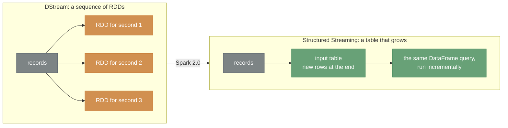

# Chapter 73: One engine for batch and streaming, and Spark's modules

The first three chapters of this part follow the engine. They describe the RDD ([Chapter 70](ch70-mapreduce-to-spark.md)), the services of an application ([Chapter 71](ch71-inside-a-spark-application.md)) and the SQL engine ([Chapter 72](ch72-rdds-to-a-sql-engine.md)). This chapter follows the platform around the engine. Spark began with one API for batch jobs. It added libraries one at a time: SQL, streaming, machine learning and graphs. For some years, each library had its own model of the data.

**Since Spark 2.0, the libraries of Spark moved onto one base: the DataFrame and the SQL engine under it. A streaming query is a DataFrame query that Spark runs again on new data. A pipeline is a set of DataFrame queries that Spark orders. Machine learning code and pandas code become DataFrame plans. Thus, a skill that you learn for one module, such as how to read a plan, applies to all of them.**

This chapter gives the timeline of Spark from 1.0 to 4.3, with each fact from the release notes. It runs the same code as a batch query and as a stream, and it shows the first streaming API that came before. Then it gives a map of the modules in Spark 4.3 and the chapters of this book that teach each one. The scripts are in [`code/ch73`](https://github.com/lisancao/spark-masterclass/tree/main/code/ch73), and each output comes from `code/ch73/output/`.

## Step 1: The timeline, from the release notes

Each row below comes from the release notes or the news page of the Apache Spark project. The dates are the dates of the release announcements.

| Release | Announced | From the release notes |
|---|---|---|
| (incubator) | June 2013 | Spark is "accepted into the Apache Incubator" ([news](https://spark.apache.org/news/index.html)) |
| [0.7](https://spark.apache.org/releases/spark-release-0-7-0.html) | 2013 | "adds a Python API called PySpark". "This release is our first alpha of Spark Streaming." |
| (top-level) | February 2014 | Spark graduates "to become a top-level Apache project" ([news](https://spark.apache.org/news/index.html)) |
| [1.0](https://spark.apache.org/releases/spark-release-1-0-0.html) | May 2014 | a new component, Spark SQL. Stability of the core API "for all 1.X releases". Notes for MLlib, GraphX and Streaming. |
| [1.3](https://spark.apache.org/releases/spark-release-1-3-0.html) | March 2015 | the DataFrames API |
| [1.5](https://spark.apache.org/releases/spark-release-1-5-0.html) | September 2015 | Tungsten "enabled by default" |
| [1.6](https://spark.apache.org/releases/spark-release-1-6-0.html) | January 2016 | the Dataset API, unified memory management |
| [2.0](https://spark.apache.org/releases/spark-release-2-0-0.html) | July 2016 | "the initial experimental release for Structured Streaming", `SparkSession`, whole-stage code generation |
| [2.2](https://spark.apache.org/releases/spark-release-2-2-0.html) | July 2017 | "The Structured Streaming APIs are now GA" |
| [2.3](https://spark.apache.org/releases/spark-release-2-3-0.html) | February 2018 | continuous processing, stream-stream joins, a Kubernetes scheduler backend ("experimental") |
| [3.0](https://spark.apache.org/releases/spark-release-3-0-0.html) | June 2020 | adaptive query execution, dynamic partition pruning, a new Structured Streaming UI |
| [3.2](https://spark.apache.org/releases/spark-release-3-2-0.html) | October 2021 | the pandas API on Spark, a RocksDB state store, AQE on by default, push-based shuffle |
| [3.4](https://spark.apache.org/releases/spark-release-3-4-0.html) | April 2023 | a Python client for Spark Connect |
| [4.0](https://spark.apache.org/releases/spark-release-4-0-0.html) | May 2025 | ANSI SQL mode by default, the VARIANT type, the Python data source API, `transformWithState`, Scala 2.13 and JDK 17 |
| [4.1](https://spark.apache.org/releases/spark-release-4.1.0.html) | December 2025 | Spark Declarative Pipelines, Real-time Mode for Structured Streaming, SQL scripting GA |
| [4.2](https://spark.apache.org/releases/spark-release-4-2-0.html) | July 2026 | `GEOMETRY` and `GEOGRAPHY` types, Auto CDC (SCD Type 1) in pipelines, the Real-time Mode trigger in PySpark |
| [4.3](https://spark.apache.org/releases/spark-release-4-3-0.html) | October 2026 | stateful Real-time Mode, pipelined shuffles, single-task execution for small queries, Connect REST endpoints, `ASOF JOIN`, Auto CDC SCD Type 2 |

There is no 3.1.0 announcement. The news page says that the release after 3.0 was 3.1.1, because of a problem in the preparation of 3.1.0. The deprecation of DStreams is in the source, not in the table. The 4.3 source of `StreamingContext` marks it as deprecated "as of Spark 3.4.0" (`python/pyspark/streaming/context.py`).

<figure markdown>
  
  
  <figcaption>Spark from the first paper to 4.3. The colors divide the changes into the core engine, the SQL engine and its APIs, and streaming and connectivity. Each label comes from the table above.</figcaption>
</figure>

Two lines of change go through the table. The engine changed from RDDs of objects into a SQL engine of binary rows, which [Chapter 72](ch72-rdds-to-a-sql-engine.md) describes. The streaming APIs changed three times, and the next step follows them.

## Step 2: Streaming, before Structured Streaming

The first streaming API of Spark was **Spark Streaming**, with discretized streams, or **DStreams** ([Zaharia et al., SOSP 2013](https://dl.acm.org/doi/10.1145/2517349.2522737)). A DStream divides a stream into small batches by time. Each batch is an RDD, and each operation on the DStream runs on each RDD. The idea reused the RDD for streaming: the same lineage gives fault tolerance, and the same scheduler runs the batches.



DStreams are still in the Spark 4.3 package. `dstream.py` runs a word count over a queue of three RDDs, one RDD for each one-second batch:

```python
batches = [sc.parallelize([161, 237, 161, 236]), sc.parallelize([237, 237]), sc.parallelize([161])]
counts = ssc.queueStream(batches).map(lambda z: (z, 1)).reduceByKey(lambda a, b: a + b)
counts.foreachRDD(lambda t, rdd: print(t.strftime("%H:%M:%S"), sorted(rdd.collect())))
```

```text
FutureWarning: DStream is deprecated as of Spark 3.4.0. Migrate to Structured Streaming.
10:26:58 [(161, 2), (236, 1), (237, 1)]
10:26:59 [(237, 2)]
10:27:00 [(161, 1)]
10:27:01 []
```

The code shows the problems of the model:

- **The batch is the time of arrival.** Each count is for the records that arrived in one second, not for the time that the records describe. Event time and late data need code that you write yourself.
- **The API is the RDD API.** The functions are lambdas that Spark cannot read. Thus, none of the optimizations of [Chapter 72](ch72-rdds-to-a-sql-engine.md) applies.
- **Batch and streaming code are different.** A batch job on RDDs or DataFrames does not run on a DStream without changes.

The [streaming programming guide](https://spark.apache.org/docs/4.3.0/streaming-programming-guide.html) of 4.3 says that Spark Streaming "is the previous generation of Spark's streaming engine" and "a legacy project". Do not start new work with DStreams.

## Step 3: The same code as batch and as a stream

**Structured Streaming** came in 2.0 and became GA in 2.2. Its model is in the paper [Structured Streaming: A Declarative API for Real-Time Applications in Apache Spark](https://dl.acm.org/doi/10.1145/3183713.3190664) (Armbrust et al., SIGMOD 2018). A stream is a table that grows. A streaming query is a DataFrame query on that table. Spark runs the query incrementally: for each new part of the input, it updates the result and keeps the necessary state.

`same_code.py` shows the idea with one function:

```python
def busiest_zones(df: DataFrame) -> DataFrame:
    """The business logic: trips and revenue for each pickup zone."""
    return (df.where(F.col("total_amount") > 0)
              .groupBy("PULocationID")
              .agg(F.count("*").alias("trips"), F.round(F.sum("total_amount"), 2).alias("revenue")))
```

The script writes the trips of 1 to 3 June into an inbox folder as one JSON file for each day. Then it gives the function two inputs:

=== "Batch"

    ```python
    batch = busiest_zones(spark.read.schema(schema).json(str(inbox)))
    top_batch = batch.orderBy(F.desc("trips")).limit(3).collect()
    ```

=== "Stream"

    ```python
    stream_in = spark.readStream.schema(schema).option("maxFilesPerTrigger", 1).json(str(inbox))
    query = (busiest_zones(stream_in).writeStream
             .format("memory").queryName("zones").outputMode("complete")
             .option("checkpointLocation", str(w / "checkpoint"))
             .trigger(availableNow=True).start())                        # (1)!
    ```

    1. `Trigger.AvailableNow` processes all the input that is there now, in micro-batches, and then stops. `maxFilesPerTrigger` makes each micro-batch read one file.

```text
inbox: ['2026-06-01.json', '2026-06-02.json', '2026-06-03.json']

batch, top three zones:
  zone 237  trips 21,559  revenue   474,331.46
  zone 161  trips 19,304  revenue   546,614.52
  zone 236  trips 19,068  revenue   430,656.29

stream, first run: 3 micro-batches
  batch 0: 111,104 input rows
  batch 1: 125,784 input rows
  batch 2: 139,672 input rows
stream, top three zones:
  zone 237  trips 21,559  revenue   474,331.46
  zone 161  trips 19,304  revenue   546,614.52
  zone 236  trips 19,068  revenue   430,656.29
same rows as the batch query: True

a fourth day lands; the same query restarts from its checkpoint:
  batch 3: 146,152 input rows
  state rows: 249  source startOffset: {"logOffset": 2}  endOffset: {"logOffset": 3}
```

<figure markdown>
  <video autoplay loop muted playsinline width="1280" height="720" poster="../../media/clips/ch73-anim-stream.webp">
    <source src="../../media/clips/ch73-anim-stream.mp4" type="video/mp4">
  </video>
  <figcaption>One function as a batch query and as a stream. The rows of each micro-batch and the result come from <code>same_code.txt</code>. The times are schematic.</figcaption>
</figure>

The function did not change, and the answer is the same. These are the important points:

- **The stream read one file in each micro-batch.** After three micro-batches, the result was the same as the result of the batch query over the three files.
- **The restart read only the new file.** The checkpoint recorded that the source had read up to log offset 2. Micro-batch 3 started from there, and it read only the 146,152 rows of 4 June.
- **The state kept the totals.** The 249 state rows are a count and a sum for each zone. Thus, Spark did not need to read the first three days again to update the result.

The plans show how Spark makes an incremental query from the same function:

```text
the physical plan of the last micro-batch:
== Physical Plan ==
WriteToDataSourceV2 MicroBatchWrite[epoch: 3, writer: org.apache.spark.sql.execution.streaming.sourc
+- *(4) HashAggregate(keys=[PULocationID#230], functions=[count(1), sum(total_amount#231)])
   +- StateStoreSave [PULocationID#230], state info [ checkpoint = file:~/spark-masterclass-
      +- *(3) HashAggregate(keys=[PULocationID#230], functions=[merge_count(1), merge_sum(total_amou
         +- StateStoreRestore [PULocationID#230], state info [ checkpoint = file:~/spark-mas
            +- *(2) HashAggregate(keys=[PULocationID#230], functions=[merge_count(1), merge_sum(tota
               +- Exchange hashpartitioning(PULocationID#230, 4), REQUIRED_BY_STATEFUL_OPERATOR, [pl
                  +- *(1) HashAggregate(keys=[PULocationID#230], functions=[partial_count(1), partia
                     +- *(1) Filter (isnotnull(total_amount#231) AND (total_amount#231 > 0.0))
                        +- FileScan json [PULocationID#230,total_amount#231] Batched: false, DataFil

the physical plan of the batch query:
== Physical Plan ==
AdaptiveSparkPlan isFinalPlan=false
+- HashAggregate(keys=[PULocationID#23], functions=[count(1), sum(total_amount#24)])
   +- Exchange hashpartitioning(PULocationID#23, 4), ENSURE_REQUIREMENTS, [plan_id=592]
      +- HashAggregate(keys=[PULocationID#23], functions=[partial_count(1), partial_sum(total_amount
         +- Filter (isnotnull(total_amount#24) AND (total_amount#24 > 0.0))
            +- FileScan json [PULocationID#23,total_amount#24] Batched: false, DataFilters: [isnotnu
```



```mermaid
flowchart LR
  classDef same fill:#3a5f96,fill-opacity:0.72,stroke:#3a5f96,color:#ffffff
  classDef inc fill:#2f7d4f,fill-opacity:0.72,stroke:#2f7d4f,color:#ffffff
  scan["FileScan json<br/>(the new files only)"]:::inc --> f["Filter"]:::same --> p["partial<br/>HashAggregate"]:::same
  p --> x["Exchange<br/>REQUIRED_BY_STATEFUL_OPERATOR"]:::same --> r["StateStoreRestore<br/>old totals"]:::inc
  r --> m["merge<br/>HashAggregate"]:::same --> s["StateStoreSave<br/>new totals"]:::inc --> o["final aggregate<br/>to the sink"]:::same
```

The bottom of the two plans is the same: a scan, the filter, a partial aggregate and an exchange. The streaming planner adds a `StateStoreRestore` to read the totals of earlier micro-batches, and a `StateStoreSave` to write the new totals. Catalyst, Tungsten and codegen also work on streaming queries. The numbered star marks are the same whole-stage codegen as in a batch plan.

For all of Structured Streaming, read [Chapter 25](ch25-structured-streaming.md). For the checkpoint and the state store, read [Chapter 29](ch29-checkpoints-and-state-store.md).

## Step 4: From micro-batches to Real-time Mode

A micro-batch has a latency floor. Spark plans and schedules a job for each micro-batch, and each record waits for the next micro-batch to start. Spark tried two times to remove this floor:

| Mode | Release | How it runs | Status in 4.3 |
|---|---|---|---|
| Micro-batch | 2.0 | one job for each trigger | the default |
| Continuous processing | 2.3 | long-running tasks, epochs by markers | experimental in the 4.3 docs |
| Real-time Mode | 4.1, stateful in 4.3 | long-running tasks, data goes between stages as it arrives | the low-latency mode of 4.3 |

The release notes of 4.1 call Real-time Mode the "first official support" for it, with "continuous, sub-second latency processing". The 4.3 notes add stateful queries ("streaming aggregation, `dropDuplicates`, and `transformWithState`") with end-to-end latency "on the order of 100 milliseconds". Under it, 4.3 adds concurrent stage scheduling and the pipelined shuffle that [Chapter 71](ch71-inside-a-spark-application.md) mentions in Step 2.

Real-time Mode is a different execution of the same API. The query is still a DataFrame query, and a change of trigger selects the mode.

[Chapter 28](ch28-real-time-mode.md) runs it against Kafka and measures the latency of the two modes.

## Step 5: The modules of Spark 4.3

The pip package of Spark 4.3 shows the modules as jars and as Python packages. `modules.py` lists them:

```text
pyspark 4.3.0

Spark module jars in pyspark/jars:
  spark-catalyst                   19.1 MiB
  spark-common-utils-java           0.1 MiB
  spark-common-utils                0.6 MiB
  spark-config                      1.8 MiB
  spark-connect                    13.8 MiB
  spark-core                       15.6 MiB
  spark-graphx                      0.4 MiB
  spark-hive-thriftserver           0.6 MiB
  spark-hive                        0.7 MiB
  spark-kubernetes                  0.6 MiB
  spark-kvstore                     0.1 MiB
  spark-launcher                    0.1 MiB
  spark-mllib-local                 0.1 MiB
  spark-mllib                       6.6 MiB
  spark-network-common              3.2 MiB
  spark-network-shuffle             0.2 MiB
  spark-pipelines                   0.8 MiB
  spark-repl                        0.0 MiB
  spark-sketch                      0.0 MiB
  spark-sql-api                     3.2 MiB
  spark-sql                        15.3 MiB
  spark-streaming                   1.1 MiB
  spark-tags                        0.0 MiB
  spark-udf-worker-core             0.1 MiB
  spark-udf-worker-proto            0.4 MiB
  spark-unsafe                      0.1 MiB
  spark-variant                     0.1 MiB
  spark-yarn                        0.4 MiB
  (plus 251 third-party jars)

Python packages in pyspark/:
  pyspark.cloudpickle
  pyspark.core
  pyspark.errors
  pyspark.logger
  pyspark.messages
  pyspark.ml
  pyspark.mllib
  pyspark.pandas
  pyspark.pipelines
  pyspark.resource
  pyspark.sql
  pyspark.streaming
  pyspark.testing
```

The jar sizes show where the code is. `spark-catalyst` and `spark-sql` together are larger than `spark-core`, because the SQL engine is now most of Spark. `spark-connect` is the server side of Spark Connect, and `spark-pipelines` is the engine of Declarative Pipelines. `spark-graphx` and `spark-streaming` (DStreams) are small, and they have not changed much in recent releases.

<figure markdown>
  
  
  <figcaption>The modules of Spark 4.3 in layers. The APIs in the blue row run on the SQL engine. GraphX and DStreams run directly on Spark Core. GraphFrames is a separate package, with a dashed border.</figcaption>
</figure>

This table gives each module, the layer that it runs on, and the chapters that teach it:

| Module | Package | Runs on | In this book |
|---|---|---|---|
| Spark SQL and DataFrames | `pyspark.sql` | the SQL engine | Parts II and III ([Chapter 5](ch05-dataframes-columns-schemas.md) to [Chapter 17](ch17-documents-images-audio.md)), plans and performance in Part IV ([Chapter 18](ch18-query-plans.md) to [Chapter 24](ch24-acceleration.md)) |
| Structured Streaming | `pyspark.sql.streaming` | the SQL engine, incrementally | Part V ([Chapter 25](ch25-structured-streaming.md) to [Chapter 29](ch29-checkpoints-and-state-store.md)) |
| MLlib (`spark.ml`) | `pyspark.ml` | DataFrames | Part VII ([Chapter 37](ch37-mllib-mlflow.md) to [Chapter 40](ch40-entity-resolution.md)) |
| MLlib (`spark.mllib`, RDD-based) | `pyspark.mllib` | RDDs | not covered: the 4.3 docs say that it "is now in maintenance mode" |
| GraphX | none (Scala and Java) | RDDs | Step 6 of this chapter |
| GraphFrames | `graphframes` (separate package) | DataFrames | Step 6 of this chapter, label propagation in [Chapter 40](ch40-entity-resolution.md) |
| pandas API on Spark | `pyspark.pandas` | DataFrames | not covered in this edition |
| PySpark | `pyspark` | the driver JVM through Py4J, or Spark Connect | Part I ([Chapter 1](ch01-how-spark-runs.md) to [Chapter 4](ch04-spark-connect.md)), Python workers in [Chapter 20](ch20-python-udfs-arrow.md) and [Chapter 60](ch60-python-worker-protocol.md) |
| Spark Connect | `pyspark.sql.connect` | a gRPC server in the driver | [Chapter 4](ch04-spark-connect.md), [Chapter 46](ch46-connect-in-production.md), [Chapter 57](ch57-connect-plugins.md) |
| Declarative Pipelines | `pyspark.pipelines` | DataFrame queries in a dataflow graph | Part VI ([Chapter 32](ch32-declarative-pipelines.md) to [Chapter 36](ch36-pipeline-end-to-end.md)) |
| Spark Streaming (DStreams) | `pyspark.streaming` | RDDs | Step 2 of this chapter only: deprecated since 3.4 |

Two notes on the table:

- **Spark Connect is a way to reach the engine, not a separate engine.** A Connect client sends unresolved plans to the same SQL engine. Thus, most modules work over Connect. The RDD-based modules (GraphX, `spark.mllib`, DStreams) do not, because Spark Connect has no RDD API. ML on Connect is GA for the Python client from 4.1, as the 4.1 release notes say.
- **SparkR is not in the table.** The 4.3 docs mark SparkR as deprecated from Apache Spark 4.0.0.

## Step 6: Graphs: GraphX and GraphFrames

Graph processing shows the move from RDDs to DataFrames in one module. Spark has two graph libraries, and they sit on different layers.

**GraphX** is part of Spark. It came with the core libraries, and the 1.0 release notes list it. A GraphX graph is a pair of RDDs, one of vertices and one of edges. It has a Pregel API and algorithms such as PageRank and connected components. It has no Python API. `GraphX.scala` builds a graph of taxi zones, with an edge for each route with ten trips or more in June:

```scala
val edges: org.apache.spark.rdd.RDD[Edge[Long]] = trips
  .where("PULocationID <> DOLocationID")
  .groupBy("PULocationID", "DOLocationID").count().where("count >= 10")
  .rdd.map(r => Edge(r.getInt(0).toLong, r.getInt(1).toLong, r.getLong(2)))
val graph = Graph.fromEdges(edges, defaultValue = 0)
```

```text
GraphX: vertices 249, edges 11636
staticPageRank, 10 iterations, top five vertex ids: 14 (3.752), 265 (3.638), 132 (3.524), 130 (2.818), 244 (2.732)
connected components: 1, largest has 249 vertices
```

**GraphFrames** is a separate open source package, not part of Apache Spark. A GraphFrame is a pair of DataFrames, and its algorithms run as DataFrame queries. Thus, it has a Python API, and its queries go through Catalyst. This is its state at the time of this chapter:

- The latest release is 0.12.3 (on [GitHub](https://github.com/graphframes/graphframes/releases) and Maven Central).
- Maven Central has artifacts for Spark 4 and Scala 2.13: `io.graphframes:graphframes-spark4_2.13`, and `graphframes-connect-spark4_2.13` for Spark Connect. The Python package on PyPI is `graphframes-py`.
- The release notes of 0.12.1 add support for `pyspark-client`. The release notes of 0.12.3 mention a fix for Spark 4.2.

The project does not list Spark 4.3 support in its release notes. `graphs.py` tested the 0.12.3 jar for Spark 4 on Spark 4.3.0 in Classic mode, with the same graph:

```bash
uv run --with graphframes-py==0.12.3 python ch73/graphs.py
```

```text
spark 4.3.0, graphframes-py 0.12.3, jar io.graphframes:graphframes-spark4_2.13:0.12.3
vertices 265, edges 11636

zones that the most other zones send trips to (inDegrees):
+---+-------------------------+--------+
|id |Zone                     |inDegree|
+---+-------------------------+--------+
|132|JFK Airport              |117     |
|37 |Bushwick South           |113     |
|79 |East Village             |106     |
|230|Times Sq/Theatre District|106     |
|42 |Central Harlem North     |105     |
+---+-------------------------+--------+

PageRank, 10 iterations, top five zones:
+---+------------------------+--------+
|id |Zone                    |pagerank|
+---+------------------------+--------+
|14 |Bay Ridge               |3.946   |
|265|Outside of NYC          |3.826   |
|132|JFK Airport             |3.706   |
|130|Jamaica                 |2.963   |
|244|Washington Heights South|2.873   |
+---+------------------------+--------+

connected components (by size):
+---------+-----+
|component|count|
+---------+-----+
|        1|  249|
|      184|    1|
|      110|    1|
|      187|    1|
|      103|    1|
+---------+-----+
only showing top 5 rows
```

<figure markdown>
  <video autoplay loop muted playsinline controls width="1280" height="720" poster="../../media/clips/ch73-graphs.webp">
    <source src="../../media/clips/ch73-graphs.mp4" type="video/mp4">
  </video>
  <figcaption><code>same_code.py</code> runs one function as a batch query and as a stream. Then <code>dstream.py</code> runs the deprecated DStream API, and <code>graphs.py</code> runs GraphFrames 0.12.3 on Spark 4.3.0.</figcaption>
</figure>

The two libraries agree, and the differences come from the input:

- **The edges are the same:** 11,636 routes in both.
- **The vertices are different.** GraphX made its vertices from the edges, so it has 249. GraphFrames took its vertices from the zone lookup file, so it has 265. Sixteen zones have no route with ten trips, and each one is a component of its own.
- **PageRank gives the same top five zones in the same order.** The values are different because the number of vertices is different.

A graph chapter can start from this step. The graph algorithms that this book uses now are in [Chapter 40](ch40-entity-resolution.md), which writes label propagation with DataFrames and measures the cost of each round.

## The whole chapter, on one page

- **The release notes give the history.** The main steps are:
    - Spark SQL in 1.0, DataFrames in 1.3 and Tungsten in 1.5
    - Structured Streaming in 2.0, GA in 2.2
    - AQE in 3.0 and Spark Connect in 3.4
    - Declarative Pipelines and Real-time Mode in 4.1
    - stateful Real-time Mode and Project Feather in 4.3
- **DStreams were streaming on RDDs.** They are still in the 4.3 package, but Spark marked them as deprecated in 3.4.
- **Structured Streaming is the DataFrame API on a table that grows.** The same function gave the same answer as a batch query and as a stream. After a restart, the stream read only the new file, and the state kept the totals.
- **The streaming plan is the batch plan with state operators.** `StateStoreRestore` and `StateStoreSave` go around the merge of the aggregate.
- **Real-time Mode changes the execution, not the API.** It is the low-latency mode of 4.3.
- **The modules sit on two layers.** Most modules run on the SQL engine and work over Spark Connect. GraphX, `spark.mllib` and DStreams run on RDDs.
- **Graphs:** GraphX is the RDD library inside Spark. GraphFrames is a separate DataFrame package, and its 0.12.3 release ran on Spark 4.3.0 in this test.

To run the examples:

```bash
cd code
export BOOK_DATA=$HOME/spark-masterclass/data
uv run python ch73/same_code.py
uv run python ch73/dstream.py
uv run python ch73/modules.py
uv run --with graphframes-py==0.12.3 python ch73/graphs.py
uv run spark-shell --master 'local[*]' -i ch73/GraphX.scala
```

## Further reading

- The [news archive](https://spark.apache.org/news/index.html) of the Apache Spark project, with a link to the release notes of each version.
- [Discretized Streams: Fault-Tolerant Streaming Computation at Scale](https://dl.acm.org/doi/10.1145/2517349.2522737), Zaharia et al., SOSP 2013.
- [Structured Streaming: A Declarative API for Real-Time Applications in Apache Spark](https://dl.acm.org/doi/10.1145/3183713.3190664), Armbrust et al., SIGMOD 2018.
- [Structured Streaming programming guide](https://spark.apache.org/docs/4.3.0/streaming/index.html) and [GraphX programming guide](https://spark.apache.org/docs/4.3.0/graphx-programming-guide.html) for Spark 4.3.
- [GraphFrames](https://github.com/graphframes/graphframes), the DataFrame graph package.
