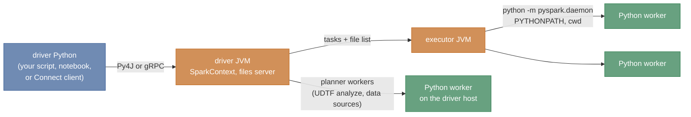
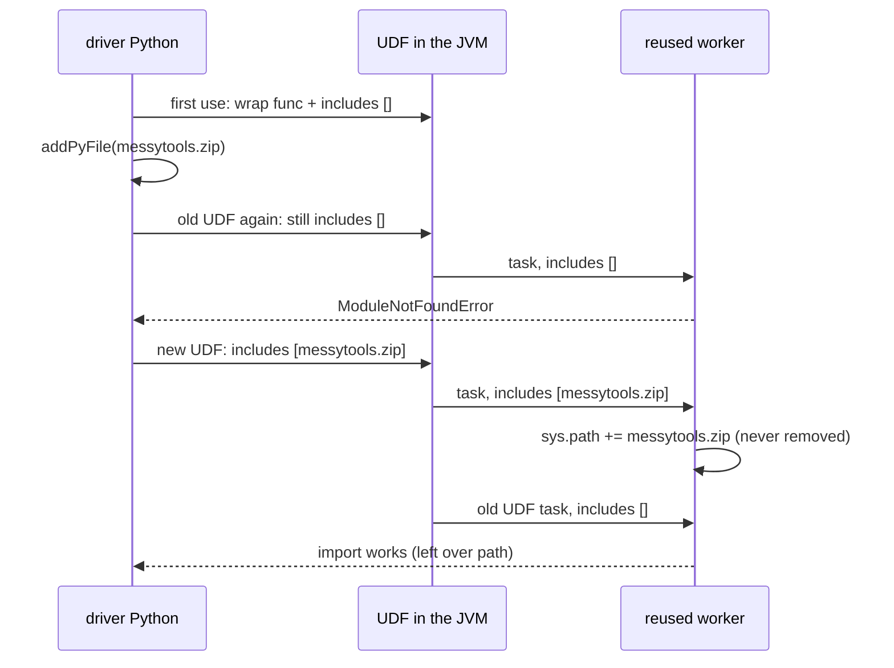
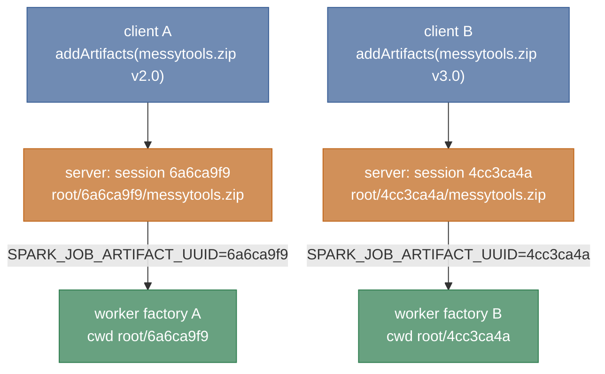

# Chapter 73: Shipping Python dependencies

On a laptop, `import tabulate` in a UDF works because the package is in the same virtual environment as your driver. On a cluster, the UDF runs in a different Python process, on a different machine, often in a container image that you did not build. That process has its own interpreter, its own `sys.path` and its own installed packages. Your driver environment does not go with your code.

**A Python UDF runs in a worker process that Spark starts with its own interpreter and its own `sys.path`. Only the files that you ship arrive in that process: py-files, archives or Connect artifacts. Local mode hides this, because the worker inherits the folder, the environment and the disk of the driver. To ship dependencies correctly, you must know three things. These are the interpreter of the worker, the folders that Spark adds to its path, and the time when Spark reads the list of files.**

The code for this chapter is in [`code/ch73`](https://github.com/open-lakehouse/spark-masterclass/tree/main/code/ch73). The scripts ran on pyspark 4.3.0, OpenJDK 17 and Python 3.12.3. Each output block comes from `code/ch73/output/`. `pkgs.py` builds the small test package `messytools` in a temporary folder (`<work>` in the output). It also builds zips, archives and site folders of that package. `<code>` is the `code/` folder of the repo.

## Three places where Python runs



Python runs in three places:

- **The driver Python.** This process runs your script. In Connect, it is the client, and it has no JVM.
- **The workers on the executors.** The executor JVM starts these processes to run UDFs, pandas UDFs, `mapInPandas` and Python data source readers.
- **The planner workers on the driver host.** The driver JVM starts these processes when it plans a query. For example, it calls the `analyze` method of a UDTF or the `partitions` method of a data source.

Each worker is a separate process. `PythonWorkerFactory` (`core/src/main/scala/org/apache/spark/api/python/PythonWorkerFactory.scala`) starts it with `ProcessBuilder(pythonExec, "-m", workerModule)`. The factory sets `PYTHONPATH` from three parts:

- the Spark Python libraries (`pyspark.zip` and the Py4J zip)
- the `PYTHONPATH` of the task environment
- the `PYTHONPATH` of the executor

 Then, for each task, `setup_spark_files` in `python/pyspark/worker_util.py` adds the files root and each shipped include to `sys.path`. This chapter examines each of these parts.

## Step 1: What a worker sees, and why local mode lies

`where.py` runs one UDF that reports what its worker sees:

```python
@F.udf("string")
def where_am_i(_):
    import os, sys
    from pyspark import SparkFiles
    try:
        import messytools
        found = f"messytools {messytools.VERSION} from {os.path.dirname(messytools.__file__)}"
    except ImportError as e:
        found = f"messytools: {type(e).__name__}"
    return "\n".join([f"executable  {sys.executable}",
                      f"version     {sys.version.split()[0]}",
                      f"cwd         {os.getcwd()}",
                      f"files root  {SparkFiles.getRootDirectory()}",
                      *[f"sys.path    {p}" for p in sys.path[:4]],
                      found])
```

`workers.py` runs `where.py` from `code/`. Then it runs the script again from a folder that contains a `messytools/` package:

```text
--- python ch73/where.py, started in code/
driver pythonExec: python3  driver python: 3.12.3
executable  <code>/.venv/bin/python3
version     3.12.3
cwd         <code>
files root  <driver tmp>/userFiles-<uuid>
sys.path    <code>
sys.path    <driver tmp>/userFiles-<uuid>
sys.path    <code>/.venv/lib/python3.12/site-packages/pyspark/python/lib/pyspark.zip
sys.path    <code>/.venv/lib/python3.12/site-packages/pyspark/python/lib/py4j-0.10.9.9-src.zip
messytools: ModuleNotFoundError

--- the same script, started in a folder that contains messytools/
driver pythonExec: python3  driver python: 3.12.3
executable  <code>/.venv/bin/python3
version     3.12.3
cwd         <work>/messytools-1.0-dxes1pyf
files root  <driver tmp>/userFiles-<uuid>
sys.path    <work>/messytools-1.0-dxes1pyf
sys.path    <driver tmp>/userFiles-<uuid>
sys.path    <code>/.venv/lib/python3.12/site-packages/pyspark/python/lib/pyspark.zip
sys.path    <code>/.venv/lib/python3.12/site-packages/pyspark/python/lib/py4j-0.10.9.9-src.zip
messytools 1.0 from <work>/messytools-1.0-dxes1pyf/messytools
```

<figure markdown>
  <video autoplay loop muted playsinline controls width="1280" height="720" poster="../../media/clips/ch73-where.webp">
    <source src="../../media/clips/ch73-where.mp4" type="video/mp4">
  </video>
  <figcaption><code>where.py</code> runs from <code>code/</code>, then from a folder that holds a <code>messytools/</code> package. In local mode, the worker starts in the folder of the driver, so the second run imports the package without a shipped file.</figcaption>
</figure>

Read the four parts of `sys.path` from the top:

1. **The current folder of the worker.** The worker starts with `python -m`, and `python -m` puts the current folder first on `sys.path`. In local mode, the worker inherits the current folder of the driver. Thus the second run found `messytools` without a shipped file, because the driver started in the folder that contains the package. On a cluster, the current folder of a worker is a work folder of the executor. Your project folder is not there. This is the most frequent cause of "it works locally".
2. **The files root.** `SparkFiles.getRootDirectory()` returns `SparkEnv.get.driverTmpDir` when that value exists, and `.` when it does not (`core/src/main/scala/org/apache/spark/SparkFiles.scala`). In local mode, it is the `userFiles-<uuid>` folder of the driver. On an executor, it is the current folder of the executor. `setup_spark_files` adds it with `add_path`, which inserts at position 1.
3. **`pyspark.zip`.** This is the PySpark code of the worker. It comes from the Spark install, not from your environment.
4. **The Py4J zip.**

<figure markdown>
  

  

  <figcaption>The first entries of <code>sys.path</code> in a worker. The local column comes from the output of <code>where.py</code>. The cluster column comes from the source paths that this step gives.</figcaption>
</figure>

The `site-packages` folder of the interpreter comes after these entries. The interpreter is `python3` from the `PATH`, unless you set it (Step 2). In this run, the `PATH` came from `uv run`, so `python3` was the project venv. In a terminal without the venv, the same script started `/usr/bin/python3`.

## Step 2: Which interpreter the workers run

The driver Python decides the interpreter of the workers. In `python/pyspark/core/context.py`, line 341, the `SparkContext` reads `os.environ.get("PYSPARK_PYTHON", "python3")` into `pythonExec`, and it records its own `major.minor` version in `pythonVer`. Each task carries the two values. The worker compares its version with `pythonVer` in `check_python_version` (`worker_util.py`) and stops when they are different.

```text
--- builder .config('spark.pyspark.python', python3.11)
driver pythonExec: python3  driver python: 3.12.3
executable  <code>/.venv/bin/python3
...
--- PYSPARK_PYTHON=python3.11 with a 3.12 driver
driver pythonExec: python3.11  driver python: 3.12.3
task failed: pyspark.errors.exceptions.base.PySparkRuntimeError: [PYTHON_VERSION_MISMATCH] Python in worker has different version: 3.11 than that in driver: 3.12, PySpark cannot run with different minor versions.

--- spark-submit --conf spark.pyspark.python=/usr/bin/python3.12
driver pythonExec: /usr/bin/python3.12  driver python: 3.12.3
executable  /usr/bin/python3.12
```

Three facts come from these runs:

| How you set the interpreter | Effect on the workers |
|---|---|
| `spark.pyspark.python` in the builder of `python app.py` | None |
| `spark.pyspark.python` with `spark-submit` | `PythonRunner` copies it into `PYSPARK_PYTHON` |
| `PYSPARK_PYTHON` in the environment of the driver | The workers start this interpreter |

- **`spark.pyspark.python` in the builder has no effect.** The `SparkContext` reads the environment variable, not the config. The builder sets the config after the Python process started, and nothing copies the config into the environment.
- **`spark-submit` reads the config.** `PythonRunner` (`core/src/main/scala/org/apache/spark/deploy/PythonRunner.scala`, line 109) copies `spark.pyspark.python` into `PYSPARK_PYTHON` before it starts the driver Python. Thus the config works with `spark-submit` and in cluster mode, but not in `python app.py`.
- **Only `major.minor` must agree.** A 3.12.3 driver with a 3.12.8 worker works. A 3.12 driver with a 3.11 worker fails on the first task, with `PYTHON_VERSION_MISMATCH`.

## Step 3: A thin worker environment and Arrow UDFs

In Spark 4.x, a plain `@udf` is an Arrow UDF, because `spark.sql.execution.pythonUDF.arrow.enabled` is `true` by default. The driver and the workers check for PyArrow at different times. `workers.py` points the workers at a new venv that has only `tabulate`:

```text
--- PYSPARK_PYTHON=<thin venv> (tabulate only), default settings
driver pythonExec: <work>/thin/bin/python  driver python: 3.12.3
task failed: ModuleNotFoundError: No module named 'pyarrow'

--- the same, spark.sql.execution.pythonUDF.arrow.enabled=false
driver pythonExec: <work>/thin/bin/python  driver python: 3.12.3
executable  <work>/thin/bin/python
...
--- the thin venv plus pyarrow 26.0.1 (pandas installed: False), default settings
driver pythonExec: <work>/thin/bin/python  driver python: 3.12.3
executable  <work>/thin/bin/python
```

The driver had PyArrow, so it built an Arrow UDF. The workers did not have PyArrow, so each task failed.

When the driver does not have PyArrow, PySpark gives a `RuntimeWarning` and makes a plain pickled UDF. Step 10 shows this case in the official image. Thus, if the driver does not have PyArrow, the job is safe. If the workers do not have PyArrow, the job stops.

The last run shows that the workers need PyArrow but not pandas for a plain Arrow `@udf`. A pandas UDF needs the two packages. `python/packaging/classic/setup.py` gives the minimum versions for 4.3.0:

- `pandas>=2.2.0`
- `pyarrow>=18.0.0`
- `numpy>=1.23.2`

**New in 4.3: a transpiled UDF needs no Python worker.** Spark 4.3 can rewrite a simple Python UDF as a Catalyst expression (`spark.sql.experimental.optimizer.transpilePyUDFs`). [Chapter 43](ch43-python-udfs-arrow.md) explains the transpiler. For this chapter, the important result is that a transpiled UDF does not start a Python worker at all. `transpile.py` sets `PYSPARK_PYTHON` to a path that does not exist:

```python
os.environ["PYSPARK_PYTHON"] = "/nonexistent/bin/python3"     # no Python on the "executors"
...
for flag in ("false", "true"):
    spark.conf.set("spark.sql.experimental.optimizer.transpilePyUDFs", flag)
    plain = F.udf(add_one, "long", useArrow=False)   # the transpiler runs here, when the UDF is made
```

```text
transpilePyUDFs=false: failed: Cannot run program "/nonexistent/bin/python3": error=2, No such file or directory
transpilePyUDFs=true: [1, 2, 3]
   top of the physical plan: *(1) Project [(id#4L + 1) AS y#6L]
```

The transpiled plan contains `(id#4L + 1)` and no Python operator. Three conditions apply, and all three come from `python/pyspark/sql/udf.py`:

- The UDF must be a batched UDF (`useArrow=False`, eval type 100), and it must be deterministic.
- `spark.sql.ansi.enabled` must be `true`.
- The transpiler runs when Python makes the UDF object, not when the query runs. Thus a UDF that you made before you set the flag is not transpiled. The first version of `transpile.py` made this mistake, and the two runs failed.

Do not use transpilation as a packaging method. A UDF that imports a package is never transpiled, so it always needs the package on the workers.

## Step 4: py-files, and the layout of a zip

The first method to ship code is a py-file: a `.py`, `.zip` or `.egg` file that Spark copies to each executor and puts on `sys.path`. There are three interfaces for the same mechanism:

- `spark-submit --py-files a.zip,b.py`
- the config `spark.submit.pyFiles`
- `spark.sparkContext.addPyFile(path)` (Classic only)

```text
zip entries: ['messytools/__init__.py']
driver imports: <userFiles>/messytools.zip/messytools/__init__.py
tasks import:   ['142159 1.0 <userFiles>/messytools.zip/messytools/__init__.py', '142160 1.0 <userFiles>/messytools.zip/messytools/__init__.py']
```

The zip must contain the package folder at its top level (`messytools/__init__.py`). Python imports from a zip with `zipimport`, which treats the zip as one more folder on `sys.path`. A zip of the *contents* of the package folder does not import.

`addPyFile` also changes the `sys.path` of the driver. Thus `import messytools` worked in the driver after the call. `context.py` (line 1989) adds the file to the include list only when its last four characters are in `PACKAGE_EXTENSIONS`, which is `(".zip", ".egg", ".jar")`. Spark copies other files, but it does not put them on the path. A `.whl` file is the frequent example:

```text
messytools-1.0-py3-none-any.whl via addPyFile: ['146318 ModuleNotFoundError', '146320 ModuleNotFoundError']
```

`spark.submit.pyFiles` in the builder of a plain `python app.py` also works in 4.3. The driver and the task import from the copy in the files root:

```text
spark.submit.pyFiles in the builder:
driver: <userFiles>/messytools.zip/messytools/__init__.py
task:   <userFiles>/messytools.zip/messytools/__init__.py
```

## Step 5: A UDF records its include list one time

A UDF does not read the include list of the context when each task runs. The UDF records the list when Python first changes it into a JVM object. Python does this when the UDF first makes a column. `pyfiles.py` makes a UDF, uses it, then adds a zip, and uses the old UDF and a new UDF:

```python
old = where_udf()
print("\nbefore addPyFile:     ", import_in_tasks(spark, old))
print("  captured includes:", list(old._unwrapped._judf.func().pythonIncludes()))
spark.sparkContext.addPyFile(pkgs.zip_package("1.0", "messytools.zip"))
print("old udf, after:       ", import_in_tasks(spark, old))
...
new = where_udf()
```

```text
before addPyFile:      ['142738 ModuleNotFoundError', '142740 ModuleNotFoundError']
  captured includes: []
old udf, after:        ['142738 ModuleNotFoundError', '142740 ModuleNotFoundError']
  captured includes: []
new udf, after:        ['142738 1.0 <userFiles>/messytools.zip/messytools/__init__.py', '142740 1.0 <userFiles>/messytools.zip/messytools/__init__.py']
  captured includes: ['messytools.zip']
old udf, again:        ['142738 1.0 <userFiles>/messytools.zip/messytools/__init__.py', '142740 1.0 <userFiles>/messytools.zip/messytools/__init__.py']
```

<figure markdown>
  <video autoplay loop muted playsinline controls width="1280" height="720" poster="../../media/clips/ch73-includes.webp">
    <source src="../../media/clips/ch73-includes.mp4" type="video/mp4">
  </video>
  <figcaption><code>pyfiles.py</code> makes a UDF, uses it, then calls <code>addPyFile</code>. The old UDF keeps its empty include list. The process IDs change in each run.</figcaption>
</figure>

The old UDF still had an empty include list after `addPyFile`, and its tasks did not find the module. The new UDF recorded `['messytools.zip']`, and its tasks found the module.

The last line shows a second trap. The old UDF found the module on the third run, but its include list did not change. The process IDs show the reason: the same two workers ran all the tasks. The new UDF put the zip on the `sys.path` of these workers, and `add_path` never removes a path. Thus the old UDF works only when a worker that ran a newer UDF runs its task. On a cluster with many workers, it works on some tasks and fails on others.



<figure markdown>
  <video autoplay loop muted playsinline controls width="1280" height="720" poster="../../media/clips/ch73-anim-includes.webp">
    <source src="../../media/clips/ch73-anim-includes.mp4" type="video/mp4">
  </video>
  <figcaption>The old UDF keeps an empty include list after <code>addPyFile</code>. A new UDF puts the zip on the path of the two reused workers, and then the old UDF also works on them. The process IDs and the results come from <code>pyfiles.py</code>.</figcaption>
</figure>

Add all py-files before you make any UDF. If you add a file later, make the UDFs again. Spark Connect does not have this trap: the server reads the includes of the session from its `ArtifactManager` (`getPythonIncludes`) for each plan.

## Step 6: A module never loads again in a reused worker

A Python worker that Spark reuses keeps its `sys.modules`. The second `import messytools` returns the module from the first import, even when a new version of the zip arrived:

```text
spark.python.worker.reuse=true: after v1 ['1.0', '1.0'], after v2 ['1.0', '1.0']

spark.python.worker.reuse=false: after v1 ['1.0', '1.0'], after v2 ['2.0', '2.0']
```

With the default `spark.python.worker.reuse=true`, the workers kept version 1.0 after the second zip arrived. With reuse off, each task starts a new worker, and the tasks got version 2.0. But a new worker for each task costs a Python start for each task. Thus, the correct fix is to give a new version a new session, not to turn reuse off. A new session is a new application or a new Connect session.

Spark also refuses a changed file with the same name. Step 9 shows the error.

## Step 7: Native code does not import from a zip

`zipimport` can load `.py` files, but it cannot load extension modules (`.so` files). Most packages that matter for data work have native code: NumPy, PyArrow, pandas, `ujson`. `pkgs.site_folder` installs `tabulate` (pure Python) and `ujson` (native) for the platform of the executors, with wheels only:

```python
subprocess.run(["uv", "pip", "install", "--quiet", "--target", target,
                "--python-platform", "x86_64-manylinux2014", "--python-version", py,
                "--only-binary", ":all:", *packages], check=True)
```

Then `pyfiles.py` ships the same site folder two times: as a zip with `addPyFile`, and as a `.tar.gz` archive with `addArchive`. Inside one task, it imports each module from each copy:

```text
tabulate-0.10.0.dist-info    py3-none-any
ujson-6.1.0.dist-info        cp312-cp312-manylinux_2_17_x86_64, cp312-cp312-manylinux2014_x86_64
zip     tabulate deps.zip/tabulate/__init__.py
zip     ujson    ModuleNotFoundError: No module named 'ujson'
archive tabulate deps/site-packages/tabulate/__init__.py
archive ujson    deps/site-packages/ujson.cpython-312-x86_64-linux-gnu.so
```

`tabulate` imported from the zip. `ujson` did not, because its code is in a `.so` file. From the archive, the two modules imported, because Spark unpacked the archive into a real folder.

<figure markdown>
  

  

  <figcaption>The same site folder as a zip and as an archive. <code>ujson</code> has native code, and it imports only from the archive.</figcaption>
</figure>

The wheel tags tell you the contract. `cp312` means CPython 3.12 only. `manylinux2014_x86_64` means x86-64 Linux with glibc 2.17 or newer. A site folder that you build on a Mac or for Python 3.11 does not import on these executors. Build it with the `--python-platform` and `--python-version` of the executors, as above.

## Step 8: Archives, and the packed venv that fails in local mode

An archive is a `.zip`, `.tar.gz`, `.tgz` or `.tar` file that Spark unpacks on each executor. The interfaces are `spark-submit --archives`, `spark.archives` and `addArchive`. The part after `#` names the folder: `deps.tar.gz#deps` unpacks into `deps/` under the files root. `Executor.updateDependencies` (`core/src/main/scala/org/apache/spark/executor/Executor.scala`, line 1444) fetches each new archive and unpacks it with `Utils.unpack` into that folder.

The cluster recipe in the PySpark packaging guide ships a full venv:

1. Pack a venv with `venv-pack`.
2. Ship it with `spark.archives=pyspark_venv.tar.gz#environment`.
3. Set `PYSPARK_PYTHON=./environment/bin/python`.

`archives.py` tries the recipe in local mode:

```text
venv-pack: 61 MB; bin/python -> python3.12; bin/python3 -> python3.12; bin/python3.12 -> /usr/bin/python3.12
PYSPARK_PYTHON=./environment/bin/python, spark.archives=pyspark_venv.tar.gz#environment:
files root: <userFiles> ['environment']
org.apache.spark.SparkException: Job aborted due to stage failure: Task 0 in stage 0.0 failed 1 times, most recent failure: Lost task 0.0 in stage 0.0 (TID 0) (localhost executor driver): java.io.IOException: Cannot run program "./environment/bin/python": error=2, No such file or directory
```

Spark unpacked the archive correctly, into `environment/` under the files root. But `./environment/bin/python` is a relative path, and the worker process starts in the current folder of the executor. On a cluster, that folder is the files root, so the path is correct. In local mode, the executor is the driver, and its current folder is the folder where you started the script. The recipe thus works on YARN and Kubernetes, but you cannot test it on a laptop.

The `venv-pack` output also shows a second limit. `bin/python3.12` is a link to `/usr/bin/python3.12`. The archive does not contain an interpreter. It contains packages and a link to an interpreter that must be at the same path, with the same version, on each executor.

A more portable method is to ship only the packages, and to put them on `sys.path` inside the task:

```python
spark.sparkContext.addArchive("deps.tar.gz#deps")

@F.udf("string")
def uses_deps(_):
    import os, sys
    from pyspark import SparkFiles
    site = os.path.join(SparkFiles.get("deps"), "site-packages")
    if site not in sys.path:
        sys.path.insert(0, site)
    import tabulate
    return tabulate.__file__
```

```text
a site folder shipped with addArchive:
task imports: <userFiles>/deps/site-packages/tabulate/__init__.py
```

This method works in local mode and on a cluster, because `SparkFiles.get` returns the correct folder in the two cases. The interpreter stays the one on the executor, so build the site folder for its version and platform.

The 4.3 packaging guide also gives a `uv run` recipe: a wrapper script `uv_run` that contains `exec uv run "$@"`, and `PYSPARK_PYTHON=./uv_run`. The dependencies go in the PEP 723 block at the top of the script. `archives.py` runs it two times:

```text
PYSPARK_PYTHON=./uv_run, uv run --script app.py (uv 0.11.10), local mode, executors inherit the driver's environment:
driver: ~/.cache/uv/environments-v2/<hash>/bin/python tabulate 0.9.0
VIRTUAL_ENV in the driver: ~/.cache/uv/environments-v2/<hash>
worker: ~/.cache/uv/environments-v2/<hash>/bin/python3 tabulate 0.9.0

PYSPARK_PYTHON=./uv_run, uv run --script app.py (uv 0.11.10), spark.executorEnv.VIRTUAL_ENV='' (an executor on another host):
driver: ~/.cache/uv/environments-v2/<hash>/bin/python3 tabulate 0.9.0
VIRTUAL_ENV in the driver: ~/.cache/uv/environments-v2/<hash>
worker: ~/.local/share/uv/python/cpython-3.14-linux-x86_64-gnu/bin/python3.14 ModuleNotFoundError("No module named 'tabulate'")
```

In local mode, the workers inherited `VIRTUAL_ENV` from the driver, so `uv run` in the worker used the environment of the script. When the second run removed `VIRTUAL_ENV` from the executor environment, `uv run` in the worker had no script and no environment. It started a plain interpreter that uv manages, without `tabulate`. On a cluster, an executor does not inherit the environment of the driver. Thus the recipe works on a laptop, but this test did not show that it ships the dependencies to a remote executor. The part notes record this as an open issue.

## Step 9: Spark Connect artifacts

Over Connect, the client has no `SparkContext`, so `addPyFile` does not exist. The interface is `spark.addArtifacts(path, pyfile=True)`, `archive=True` or `file=True`. The client streams the bytes over gRPC. The server stores them in a folder for the session, and it adds them to the session's own include list. `artifacts.py` opens two sessions on one server. Session A ships version 2.0 of `messytools` and an archive. Session B ships version 3.0:

```python
a = ConnectSession.builder.remote(URL).create()
b = ConnectSession.builder.remote(URL).create()
...
a.addArtifacts(zip_a, pyfile=True)
a.addArtifacts(site_archive("1.1") + "#deps", archive=True)
b.addArtifacts(zip_b, pyfile=True)
```

```text
client session_id   A: 1c0adae9  B: 24307367
before addArtifacts A: pid=173434 cwd=<root>/6a6ca9f9 root=<root>/6a6ca9f9 zip=missing archive=missing
after                A: pid=173414 cwd=<root>/6a6ca9f9 root=<root>/6a6ca9f9 zip=2.0 archive=<root>/6a6ca9f9/deps/site-packages/messyarch/__init__.py
after                B: pid=174279 cwd=<root>/4cc3ca4a root=<root>/4cc3ca4a zip=3.0 archive=missing
A adds the same bytes again: accepted
A adds changed bytes: SparkRuntimeException [ARTIFACT_ALREADY_EXISTS] The artifact pyfiles/messytools.zip already exists. Please choose a different name for the new artifact because it cannot be overwritt
s3 path  -> PySparkRuntimeError [UNSUPPORTED_OPERATION] s3 scheme is not supported.
wheel    -> PySparkRuntimeError [UNSUPPORTED_OPERATION] <work>/messytools-1.0-py3-none-any.whl file format is not supported.
```

<figure markdown>
  <video autoplay loop muted playsinline controls width="1280" height="720" poster="../../media/clips/ch73-artifacts.webp">
    <source src="../../media/clips/ch73-artifacts.mp4" type="video/mp4">
  </video>
  <figcaption><code>artifacts.py</code>: two sessions on one Connect server ship two versions of the same module. The session IDs, folders and process IDs change in each run.</figcaption>
</figure>

The output shows how the server isolates sessions:

- **Each session has its own folder.** The folder name (`6a6ca9f9`, `4cc3ca4a`) is the UUID of the session on the server, not the session ID of the client. The worker of each session starts in that folder, and the files root of the worker is that folder.
- **Each session has its own workers.** A and B imported different versions of the same module name at the same time. `PythonRunner` puts the session UUID in the worker environment as `SPARK_JOB_ARTIFACT_UUID`. `SparkEnv` keeps one worker factory for each `(pythonExec, module, envVars)` key. Thus a different session gets a different factory, and `PythonWorkerFactory` (line 272) starts its workers in the folder of the session. Session A also got a new worker process after it added artifacts, because its environment changed.
- **An artifact cannot change.** The server accepts the same bytes again. Different bytes with the same name fail with `ARTIFACT_ALREADY_EXISTS`. To ship a new version, use a new file name or a new session.
- **The client accepts only local files**, and it refuses a `.whl`.
- **The interpreter is the server's.** An artifact cannot change `PYSPARK_PYTHON`. The workers run the Python of the server, so a package with native code must match the platform and the version of the server.

Classic has `addArtifacts` too, since 4.0. In Classic, it is a front for `addPyFile`, and it refuses changed bytes with a different error:

```text
Classic addArtifacts: ['147356 1.0 <userFiles>/messytools.zip/messytools/__init__.py', '147358 1.0 <userFiles>/messytools.zip/messytools/__init__.py']
Classic addArtifacts, same bytes again: accepted
Classic addArtifacts, changed bytes: PySparkRuntimeError [DUPLICATED_ARTIFACT] Duplicate Artifact: <work>/c2/messytools.zip. Artifacts cannot be overwritten.
addPyFile, changed bytes, same file name: File <userFiles>/messytools.zip exists and does not match contents of file:<work>/c2/messytools.zip
```



## Step 10: The official Spark image

On Kubernetes, the workers run the Python of the container image. `image.sh` examines the official `apache/spark:4.3.0-python3` image, and it runs a default `@udf` inside it:

```text
os       Ubuntu 22.04.5 LTS
python   Python 3.10.12
java     openjdk version "21.0.13" 2026-10-20 LTS
user     spark (185)
pyarrow  ModuleNotFoundError: No module named 'pyarrow'
pandas   ModuleNotFoundError: No module named 'pandas'
pythonpath libs: py4j-0.10.9.9-src.zip PY4J_LICENSE.txt pyspark.zip 

python 3.10.12
/opt/spark/python/lib/pyspark.zip/pyspark/sql/udf.py:120: RuntimeWarning: Arrow optimization failed to enable because PyArrow or Pandas is not installed. Falling back to a non-Arrow-optimized UDF.
pythonUDF.arrow.enabled=true: [1, 2, 3]
pythonUDF.arrow.enabled=false: [1, 2, 3]
```

The image has these properties:

- **Python 3.10.12.** The pip package `pyspark==4.3.0` requires Python 3.11 or newer (`python_requires=">=3.11"` in `setup.py`). The image runs the PySpark code from `/opt/spark/python/lib/pyspark.zip`, not from a pip install, so the version check of pip does not apply. The part notes record this difference as an open issue.
- **No PyArrow and no pandas.** Inside the image, the driver also has no PyArrow, so the UDF falls back to a pickled UDF and runs. But a driver outside the image with PyArrow (client mode, or a Connect server in a different image) makes Arrow UDFs. Then the executors fail as in Step 3.
- **A driver on Python 3.12 cannot use these executors.** The worker check from Step 2 fails, because 3.12 and 3.10 are different minor versions.

For production, build your own image from the official image. Install the interpreter version of your driver, PyArrow, pandas and your packages. Use the same image for the driver and the executors (`spark.kubernetes.container.image`). [Chapter 76](ch76-kubernetes-operator.md) builds and runs such an image on a local Kubernetes cluster. Dependencies that are in the image need no py-files and no archives. A file that is already in the image uses the `local://` scheme, so that Spark does not upload it.

## Step 11: ADD FILE, ADD ARCHIVE, ADD JAR and LIST in SQL

The Python methods of the steps above have SQL forms. They are useful from `spark-sql`, from the Thrift server and from SQL files. Each statement calls the same `SparkContext` method as its API partner (`resources.scala` in 4.3.0):

| Statement | Calls | The executors get |
|---|---|---|
| `ADD FILE path` (also `ADD FILES`) | `sparkContext.addFile` | the file in the `SparkFiles` root. `SparkFiles.get(name)` gives its path |
| `ADD ARCHIVE path` (`.zip`, `.tar`, `.tar.gz`, `.tgz`, `.jar`) | `sparkContext.addArchive` | the archive unpacked into a folder with the name of the archive, in the working folder of the task |
| `ADD JAR path` | `sessionState.resourceLoader.addJar` | the jar on the class path of the driver and the executors. An `ivy://group:artifact:version` path resolves Maven coordinates |
| `LIST FILES`, `LIST ARCHIVES`, `LIST JARS` | `listFiles`, `listArchives`, `listJars` | nothing. They return the URLs that the driver serves |

`sql_resources.py` makes a small CSV file, a zip with one text file and a jar with one Java UDF (`book.Shout`, compiled with `javac`). It runs on `local-cluster[2,1,1024]`, so that the executors are separate JVMs:

```text
spark-sql> ADD FILE $W/rates.csv
spark-sql> ADD ARCHIVE $W/lookup.zip
spark-sql> ADD JAR $W/shout.jar
spark-sql> LIST FILES
  spark://localhost:36227/files/rates.csv
spark-sql> LIST ARCHIVES
  spark://localhost:36227/files/lookup.zip
spark-sql> LIST JARS
  spark://localhost:36227/jars/shout.jar

on the executors:
  pid 452954  SparkFiles.get -> 2,JFK  ./lookup.zip/zones -> Manhattan
  pid 452959  SparkFiles.get -> 2,JFK  ./lookup.zip/zones -> Manhattan
spark-sql> SELECT shout(borough) FROM VALUES ('queens') AS t(borough)
  QUEENS!

new session: LIST JARS -> 1 jar(s), LIST FILES -> 1 file(s)
driver: SparkFiles root /tmp/..., rates.csv there: True
```

The output shows four facts:

- **The driver serves each resource over its own RPC file server.** The `LIST` statements give `spark://` URLs, not the local paths. The executors download from these URLs.
- **Both executor processes got the file and the unpacked archive.** The UDF read `rates.csv` through `SparkFiles.get`, and `zones/boroughs.txt` from the folder `./lookup.zip`.
- **`ADD JAR` put the class on the class path,** so `spark.udf.registerJavaFunction` found `book.Shout` without a restart.
- **The resources belong to the application, not to the session.** A new session from `spark.newSession()` lists the same jar and the same file.

Thus, on a Connect server, `ADD JAR` and `ADD FILE` change the `SparkContext` that all sessions share. For one session only, use the artifacts of Step 9. SQL has no statement that removes a resource.

## Choose a method

| You need | Use | Limits |
|---|---|---|
| Pure Python modules of your own project | A zip with `--py-files`, `spark.submit.pyFiles` or `addPyFile` | Add before you make UDFs. No native code. A changed file needs a new name. |
| Packages with native code, one application | A site folder from `pip install --target` for the executor platform, shipped as an archive, put on `sys.path` in the task | Build for the Python version and the platform of the executors. |
| A full environment on YARN or Kubernetes | `venv-pack` or `conda-pack` with `spark.archives` and `PYSPARK_PYTHON=./environment/bin/python` | The same interpreter path on each executor. Does not work in local mode. |
| A file, an archive or a jar from SQL | `ADD FILE`, `ADD ARCHIVE`, `ADD JAR` | For the whole application, not one session. No removal. |
| Dependencies for each Connect session | `spark.addArtifacts(..., pyfile=True)` or `archive=True` | Local files only, no `.whl`, no change of interpreter. |
| The same dependencies for each application | A custom container image | A new image for each change. The most reliable method. |

When an import fails on the workers, do these checks in this sequence:

1. Print `sys.executable` and the Python version from inside a UDF, as `where.py` does.
2. Compare the Python `major.minor` of the driver and of the workers.
3. Print `sys.path` from inside a UDF, and find your package on it.
4. If the package has native code, make sure that it arrived in an archive, not in a zip.
5. If you added a file after you made a UDF, make the UDF again.
6. If you shipped a new version, start a new session.

## The whole chapter, on one page

- **A worker is a new process** with `pythonExec`, the Spark Python libraries, and the files root on `sys.path`. In local mode, it also inherits the folder and the environment of the driver, and this hides files that you did not ship.
- **`PYSPARK_PYTHON` chooses the interpreter of the workers.** The builder config `spark.pyspark.python` works only through `spark-submit`. The `major.minor` versions must agree.
- **A default `@udf` is an Arrow UDF.** The workers need PyArrow even when the driver works without it. A transpiled 4.3 UDF needs no worker at all.
- **py-files are zips on `sys.path`.** The package folder must be at the top level. A UDF records the include list one time. A reused worker never loads a module again. A zip cannot load native code.
- **Archives unpack into real folders**, so native code works. The packed venv recipe uses a relative interpreter path that works only on a cluster.
- **Connect artifacts belong to one session**, with their own folder and their own workers. They cannot change, and they cannot change the interpreter.
- **`ADD FILE`, `ADD ARCHIVE` and `ADD JAR` are the SQL forms** of `addFile`, `addArchive` and `addJar`. `LIST` shows what the driver serves. They apply to the whole application.
- **The official 4.3.0 Python image has Python 3.10 and no PyArrow.** Build your own image for production.

The next chapter looks at what these workers and executors report while they run: listeners, event logs, metrics and profilers.

## Further reading

- [Python Package Management](https://spark.apache.org/docs/4.3.0/api/python/tutorial/python_packaging.html), the PySpark guide with the `venv-pack`, `conda-pack`, PEX and `uv run` recipes.
- [Running Spark on Kubernetes](https://spark.apache.org/docs/4.3.0/running-on-kubernetes.html), for container images, `local://` and `spark.kubernetes.file.upload.path`.
- [`worker_util.py`](https://github.com/apache/spark/blob/v4.3.0/python/pyspark/worker_util.py) and [`PythonWorkerFactory.scala`](https://github.com/apache/spark/blob/v4.3.0/core/src/main/scala/org/apache/spark/api/python/PythonWorkerFactory.scala), where the worker gets its path and its folder.
