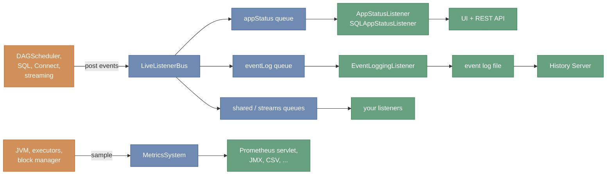
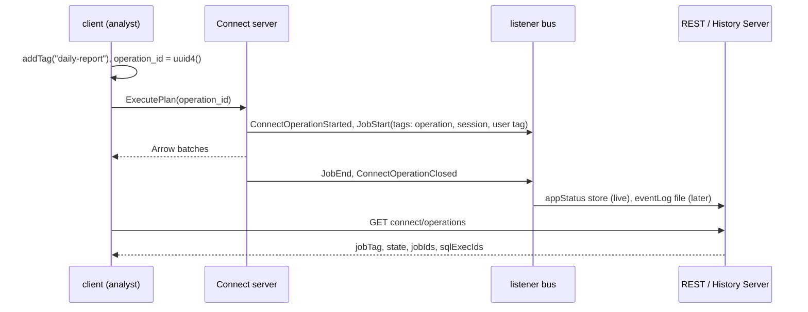
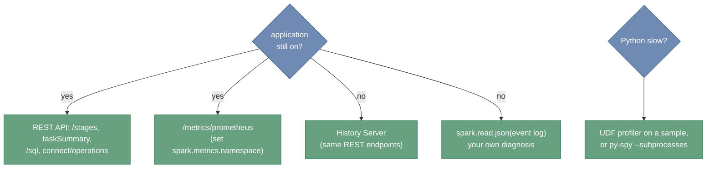

# Chapter 74: Observability: listeners, event logs, metrics and profilers

A job that ran slowly yesterday leaves no trace in your terminal today. The Spark UI that showed its stages stopped with the driver. Your `print` lines ran in a different process. To know what a Spark application did, you need the records that Spark keeps about itself, and you must know where each record comes from.

**Each number that Spark shows comes from one of two systems. The listener bus carries events (jobs, stages, tasks, SQL executions, Connect operations) to the UI, to the event log and to your listeners. The metrics system samples counters and gauges for Prometheus and other sinks. The REST API, the History Server and the event log are three views of the same events. Learn to read the events directly, and you can examine an application that stopped hours ago with Spark itself.**

The code for this chapter is in [`code/ch74`](https://github.com/lisancao/spark-masterclass/tree/main/code/ch74). The scripts ran on pyspark 4.3.0, OpenJDK 17 and Python 3.12.3 on a 16-core Linux machine. Each output block comes from `code/ch74/output/`. The workload in Steps 1 to 6 is the SparkTutor exercise for this chapter. It has a skewed aggregation through a slow Python UDF, and a sort that Spark must spill.

## Where the numbers come from



The listener bus (`core/src/main/scala/org/apache/spark/scheduler/LiveListenerBus.scala`) contains these named queues: `appStatus`, `executorManagement`, `eventLog`, `shared` and `streams`. Each queue is an `AsyncEventQueue` with its own thread. The capacity of each queue is `spark.scheduler.listenerbus.eventqueue.capacity` (default 10000). When a queue is full, Spark drops events and increments the metric `queue.<name>.numDroppedEvents`. A slow listener thus loses events, and the UI of a very busy application can show gaps.

<figure markdown>
  <video autoplay loop muted playsinline controls width="1280" height="720" poster="../../media/clips/ch74-anim-bus.webp">
    <source src="../../media/clips/ch74-anim-bus.mp4" type="video/mp4">
  </video>
  <figcaption>The listener bus copies each event into the queue of each consumer. A slow listener fills its queue, and then Spark drops events and counts them. The number of slots and the speed are schematic.</figcaption>
</figure>

The metrics system is a different mechanism. It does not use events. It samples Dropwizard metrics from sources (the DAG scheduler, the block manager, the JVM, the executors) and sends them to sinks.

## Step 1: A workload to observe

`observed_app.py` starts a Classic session with the event log on and AQE off, so that the stage layout stays the same. It also sets an internal config that forces the sorter to spill after 2000 rows:

```python
spark = (SparkSession.builder.master("local[2]").appName("observed")
         .config("spark.eventLog.enabled", "true")
         .config("spark.eventLog.dir", str(LOGS))
         .config("spark.sql.adaptive.enabled", "false")        # a fixed stage layout
         .config("spark.sql.shuffle.partitions", "4")
         .config("spark.shuffle.spill.numElementsForceSpillThreshold", "2000")   # internal: spill early
         ...
```

The first job sends 90% of 60,000 events to one key, `bot-7`, and runs a slow UDF on each row after the shuffle. The second job sorts 30,000 rows in two partitions. Each job has a description from `setJobDescription`, so that you can find its stages later.

## Step 2: The REST API while the application runs

The UI server has a JSON API under `/api/v1/applications/<app-id>/`. [Chapter 5](ch05-how-spark-runs.md) used it for jobs. The stage list gives a total for each stage:

```text
REST /stages:
  stage 0  skewed_scoring  tasks 2  run   450 ms  in  60000 rows  spill       0 B
  stage 1  skewed_scoring  tasks 4  run  9227 ms  in  60000 rows  spill       0 B
  stage 2  skewed_scoring  tasks 4  run   124 ms  in     98 rows  spill       0 B
  stage 3  spilling_sort   tasks 2  run   145 ms  in  30000 rows  spill       0 B
  stage 4  spilling_sort   tasks 2  run   571 ms  in  30000 rows  spill  367016 B
```

Stage 1 ran the UDF, and it took most of the time. Stage 4 spilled 367,016 bytes to disk. But a total does not show skew. The `taskSummary` endpoint does. It returns quantiles over the tasks of one stage try (`attemptId` 0):

```python
q = get(f"/api/v1/applications/{app}/stages/{udf_stage['stageId']}/0/taskSummary"
        "?quantiles=0.0,0.25,0.5,0.75,1.0")
```

```text
REST taskSummary for stage 1 (quantiles 0, .25, .5, .75, 1):
  shuffle records read: [1360, 1607, 1669, 55364, 55364]
  executor run time ms: [214, 242, 1449, 7322, 7322]
```

One task read 55,364 rows, and the median task read 1,669 rows. That task also ran for 7,322 ms of the 9,227 ms total. Compare the record counts, not the times, to find skew. The record counts are the cause. The times change with the load on the machine.

The `/sql` endpoint gives the SQL metrics of each plan node. These are different from the task metrics: each one is an accumulator that a physical operator updates (`SQLMetric`).

```text
REST /sql execution 0 (skewed_scoring): nodes with metrics
  Range            number of output rows        60,000
  ArrowEvalPython  time to execute Python code  6.8 s (184 ms, 302 ms, 6.2 s (stage 1.0: tas
  ArrowEvalPython  data sent to Python workers  1000.4 KiB (20.4 KiB, 24.8 KiB, 931.3 KiB (s
  ArrowEvalPython  number of output rows        60,000
  HashAggregate    number of output rows        98
  ...
```

The `ArrowEvalPython` node shows the time in Python and the bytes that it sent to the Python workers. The time is 6.8 s in total, and 6.2 s in the slowest task. The value has the form `total (min, med, max (stageId: taskId))`, so the slowest task is part of the metric. The names of the Python metrics are in `sql/core/src/main/scala/org/apache/spark/sql/execution/python/PythonSQLMetrics.scala`.

## Step 3: The metrics system and Prometheus

The REST API is good for questions about one application. A monitor system needs numbers in a standard format from all applications. The metrics system supplies them. `observed_app.py` turns on the Prometheus servlet with two configs, and it sets a namespace:

```python
         .config("spark.metrics.conf.*.sink.prometheusServlet.class",
                 "org.apache.spark.metrics.sink.PrometheusServlet")
         .config("spark.metrics.conf.*.sink.prometheusServlet.path", "/metrics/prometheus")
         .config("spark.metrics.namespace", "observed")
         .config("spark.ui.prometheus.enabled", "true")
```

```text
/metrics/prometheus: 337 lines, for example
   metrics_observed_driver_BlockManager_memory_maxMem_MB_Value{type="gauges"} 434
   metrics_observed_driver_DAGScheduler_job_allJobs_Value{type="gauges"} 2
/metrics/executors/prometheus: 42 lines, for example
   metrics_executor_diskUsed_bytes{application_id="local-1795343055903", application_name="observed", executor_id="driver"} 0
   metrics_executor_totalTasks_total{application_id="local-1795343055903", application_name="observed", executor_id="driver"} 14
/metrics/json keys: ['counters', 'gauges', 'histograms', 'meters', 'timers'] version 4.0.0
```

Three details cause problems in production:

- **The metric name contains the namespace.** By default, the namespace is the application ID (`local-1795343055903` here). Thus, each run has new metric names, and a dashboard cannot follow them. Set `spark.metrics.namespace` to a fixed value, as the script does (`metrics_observed_driver_...`).
- **There are two endpoints with two formats.** `/metrics/prometheus` comes from the metrics system, and it gives the driver metrics. `/metrics/executors/prometheus` comes from the status store, and it gives one series for each executor, with the application ID as a label. `spark.ui.prometheus.enabled` controls the second endpoint. It is internal, and its default is `true` (`UI.scala`).
- **`/metrics/json` is always available** when the UI is on, through the default `MetricsServlet`. Its `version` field is the version of the Dropwizard JSON format (4.0.0), not the Spark version.

## Step 4: The event log on disk

The event log is one JSON object for each listener event, in a file. When the application stops, the file is all that remains. Since Spark 4.0, two defaults changed (`docs/core-migration-guide.md`):

- `spark.eventLog.rolling.enabled` is `true`. The log is a folder, and Spark starts a new file at `spark.eventLog.rolling.maxFileSize` (default 128m).
- `spark.eventLog.compress` is `true`. The codec is `spark.eventLog.compression.codec`, with the default `zstd`.

`eventlog.py` lists the folder:

```text
eventlog_v2_local-1795343055903/
  .appstatus_local-1795343055903.crc                          8 bytes
  appstatus_local-1795343055903                               0 bytes
  events_1_local-1795343055903.zstd                       53888 bytes
first bytes of the events file: 28 b5 2f fd
```

The `appstatus_*` file holds no events. It is a marker. While the application runs, its name ends in `.inprogress`, and `spark.stop()` renames it. The History Server uses the marker to decide if an application is complete. The bytes `28 b5 2f fd` are the magic number of a Zstandard frame.

Spark can read this file as JSON directly. `HadoopCodecStreams.scala` maps the `.zstd` and `.zst` extensions to the Zstandard codec, so `spark.read.json` decompresses the file without a separate tool:

```python
events = spark.read.json(str(folder / "events_*"))      # Spark 4.x reads the .zstd file directly
events.groupBy("Event").count().orderBy(F.desc("count"), "Event").show(30, truncate=False)
```

```text
60 events, 49 top-level fields (the union of all event types)
+--------------------------------------------+-----+
|Event                                       |count|
+--------------------------------------------+-----+
|SparkListenerTaskEnd                        |14   |
|SparkListenerTaskStart                      |14   |
|o.a.s.s.e.ui.SparkListenerDriverAccumUpdates|7    |
|SparkListenerStageCompleted                 |5    |
|SparkListenerStageSubmitted                 |5    |
|SparkListenerJobEnd                         |2    |
|SparkListenerJobStart                       |2    |
|o.a.s.s.e.ui.SparkListenerSQLExecutionEnd   |2    |
|o.a.s.s.e.ui.SparkListenerSQLExecutionStart |2    |
|SparkListenerApplicationEnd                 |1    |
|SparkListenerApplicationStart               |1    |
|SparkListenerBlockManagerAdded              |1    |
|SparkListenerEnvironmentUpdate              |1    |
|SparkListenerExecutorAdded                  |1    |
|SparkListenerLogStart                       |1    |
|SparkListenerResourceProfileAdded           |1    |
+--------------------------------------------+-----+
```

The two jobs ran 14 tasks in 5 stages, and each task has a start event and an end event. The schema has 49 top-level fields because JSON inference makes one schema for all event types. Each event fills only its own fields. The SQL events have the full class name (`o.a.s.s.e.` is `org.apache.spark.sql.execution.` in this output).

## Step 5: The event log is messy JSON

The events use the JSON format of `JsonProtocol`, and that format was not designed for queries. One `TaskEnd` event shows the problems:

```text
one TaskEnd event:
  keys: ['Event', 'Stage ID', 'Stage Attempt ID', 'Task Type', 'Task End Reason', 'Task Info', 'Task Executor Metrics', 'Task Metrics']
  Task Metrics keys: ['Executor Deserialize Time', 'Executor Deserialize CPU Time', 'Executor Run Time', 'Executor CPU Time', 'Peak Execution Memory', 'Peak On Heap Execution Memory'] ...
  accumulable: {"ID": 64, "Name": "time to execute Python code", "Update": "302", "Value": "302", "Internal": true, "Count Failed Values": true, "Metadata": "sql"}
  Executor Run Time: 1449
```

- **The field names have spaces.** In Spark SQL, each one needs backticks: ``F.col("`Task Metrics`.`Executor Run Time`")``.
- **Property names have dots.** `spark.job.description` is a single key in the `Properties` map, so it also needs backticks.
- **The type of a value changes with its source.** `Executor Run Time` is a JSON number. The `Update` of a SQL accumulator is a JSON string (`"302"`). JSON inference reads it as a string, so you must cast it before you add it.
- **SQL metrics are accumulables.** The time in Python is not a task metric. It is in the `Accumulables` array of `Task Info`, under its display name.

`eventlog.py` makes one row for each successful task. It uses the higher-order functions `filter` and `aggregate` to sum the Python time from the array:

```python
python_ms = F.aggregate(F.filter("`Task Info`.Accumulables", lambda a: a["Name"] == PYTHON_TIME),
                        F.lit(0).cast("long"), lambda s, a: s + a["Update"].cast("long"))
tasks = (events.where((F.col("Event") == "SparkListenerTaskEnd")
                      & (F.col("`Task End Reason`.Reason") == "Success"))
         .select(F.col("`Stage ID`").cast("long").alias("stage_id"),
                 F.col("`Task Info`.`Task ID`").cast("long").alias("task_id"),
                 F.col(f"{tm}.`Executor Run Time`").cast("long").alias("run_ms"),
                 (F.col(f"{tm}.`Input Metrics`.`Records Read`")
                  + F.col(f"{srm}.`Total Records Read`")).cast("long").alias("records_in"),
                 F.col(f"{tm}.`Disk Bytes Spilled`").cast("long").alias("disk_spill"),
                 python_ms.alias("python_ms")))
```

## Step 6: Diagnose a stopped application from its log

The script groups the tasks by stage. It joins the job description from the `StageSubmitted` events, and it marks each stage with three flags:

- `skew` when the largest task read 4 or more times the median.
- `spill` when the stage spilled to disk.
- `python` when the Python time is half of the run time or more.

```text
+--------+--------------+-----+------+-------+--------+-----------+----+------+---------+--------------+
|stage_id|description   |tasks|run_ms|rows_in|max_rows|median_rows|skew|spill |python_ms|flags         |
+--------+--------------+-----+------+-------+--------+-----------+----+------+---------+--------------+
|0       |skewed_scoring|2    |450   |60000  |30000   |30000      |1.0 |0     |0        |[]            |
|1       |skewed_scoring|4    |9227  |60000  |55364   |1638       |33.8|0     |6840     |[skew, python]|
|2       |skewed_scoring|4    |124   |98     |27      |24         |1.1 |0     |0        |[]            |
|3       |spilling_sort |2    |145   |30000  |15000   |15000      |1.0 |0     |0        |[]            |
|4       |spilling_sort |2    |571   |30000  |15163   |15000      |1.0 |367016|0        |[spill]       |
+--------+--------------+-----+------+-------+--------+-----------+----+------+---------+--------------+

event log totals equal the REST API totals: True
```

The diagnosis finds the two problems that the workload has. Stage 1 has a skew of 33.8 and spends most of its time in Python. Stage 4 spilled.

<figure markdown>
  

  

  <figcaption>The diagnosis of each stage from the event log. Stage 1 has the flags <code>skew</code> and <code>python</code>, and stage 4 has the flag <code>spill</code>.</figcaption>
</figure>

The task counts, run times, record counts and spill bytes are the same as the REST API gave while the application ran. The median here (1,638) is different from the median of `taskSummary` (1,669). The reason is that `percentile` interpolates between the two middle values of four tasks, and the REST API does not.

The events in the log are the events that the UI used. Thus, for each question that the UI answers, you can get the same answer from the log after the application stops.

## Step 7: Connect sessions and operations in the REST API (new in 4.3)

A Connect server runs the queries of many clients in one application. Before 4.3, the job list of that application was a mix of all clients. Spark 4.3 adds Connect endpoints to the REST API (SPARK-57941), in `sql/connect/server/src/main/scala/org/apache/spark/status/api/v1/connect/ConnectResource.scala`:

| Endpoint | Returns |
|---|---|
| `connect/sessions` | One record for each session: user, start and finish times, number of operations |
| `connect/sessions/<id>?userId=<base64url>` | One session. The user ID is required, because a session is keyed by user and session. |
| `connect/operations` | One record for each operation: job tag, state, job IDs, SQL execution IDs, times, statement, error |
| `connect/operations/detail?jobTag=<tag>` | One operation, found by its job tag |

`connect_obs.py` starts the Part XII Connect server with the event log on. Two clients connect with different user IDs. The analyst adds the tag `daily-report` and runs a query. The agent runs a query with an error, then a correct query:

```python
a = SparkSession.builder.remote(url + "/;user_id=analyst").create()
b = SparkSession.builder.remote(url + "/;user_id=agent").create()
trips = a.read.parquet(str(TRIPS))
a.addTag("daily-report")
top = trips.groupBy("PULocationID").count().orderBy(F.desc("count")).limit(3)
top.collect()
op_ok = top.executionInfo.operation_id
try:
    b.read.parquet(str(TRIPS)).select("revenue").collect()
except Exception as e:
    op_failed = e.operation_id
```

```text
client operation IDs: ok 4bcca073  failed 63a9c4dd

live server local-1795343084699, /connect/sessions and /connect/operations:
  session 04690712  user agent  operations 2  finished False
  session b5c2f72d  user analyst  operations 1  finished False
  operation 4bcca073  session b5c2f72d  CLOSED   jobs ['0', '1', '2']  sql ['0']  2349 ms
  operation 63a9c4dd  session 04690712  CLOSED   jobs ['3']  sql ['1']  201 ms
  operation 3fbe2e6d  session 04690712  CLOSED   jobs ['4', '5']  sql ['2']  159 ms

/connect/operations/detail?jobTag=... for the failed operation:
  jobTag: SparkConnect_OperationTag_User_agent_Session_04690712-baa9-46d0-82e4-39f...
  statement: common { plan_id: 5 } project { input { common { plan_id: 4 } read { data_source
  detail: INTERNAL: [UNRESOLVED_COLUMN.WITH_SUGGESTION] A column, variable, or function parame
jobs with the client tag 'daily-report': [0, 1, 2]
  the tag as the server stores it: SparkConnect_SessionTag_User_analyst_Session_b5c2f72d-1ebb-46c3-80fd-ee7463b682ba_Tag_daily-report
  other tags on the job: 3
```

Each operation ID that a client printed is in the list, with the jobs and the SQL executions that it caused. These facts are in the output:

- **An operation with an error can have jobs.** The failed operation has job 3. This job read the Parquet footers to get the schema, before the analyzer found that `revenue` does not exist. In [Chapter 24](ch24-spark-connect.md), the same error had no jobs, because the server had the schema of that file already.
- **The statement is the protobuf plan as text**, not the Python code. The `detail` field has the error.
- **The job tag is the key.** It contains the user, the session and the operation. The `detail` endpoint takes it as a query parameter, because a user ID can contain a `/`.
- **Client tags become server tags with a prefix.** `addTag("daily-report")` became `SparkConnect_SessionTag_User_analyst_Session_<id>_Tag_daily-report`. Thus a tag from one session cannot match the jobs of a different session. To find the jobs of one client tag, match the end of the tag. The script does this with the `jobTags` field of the jobs endpoint.

<figure markdown>
  

  

  <figcaption>The sessions and operations of the live server, from the 4.3 Connect endpoints. Each operation lists the jobs that it ran.</figcaption>
</figure>



## Step 8: The History Server, after the server stopped

The Connect events also go to the event log. `connect_obs.py` stops the Connect server. Then it starts a History Server from the pip install, on the same log folder, and it reads the same endpoints:

```python
env = dict(os.environ, SPARK_HISTORY_OPTS=f"-Dspark.history.fs.logDirectory={LOGS} "
                                          f"-Dspark.history.ui.port={HISTORY}")
hs = subprocess.Popen([f"{spark_home}/bin/spark-class", "org.apache.spark.deploy.history.HistoryServer"],
                      env=env, ...)
```

```text
History Server on port 18028, applications:
  local-1795343084699      Spark Connect server     completed True
  local-1795343055903      observed                 completed True

History Server, the Connect records of local-1795343084699 after the server stopped:
  session 04690712  user agent  operations 2  finished True
  session b5c2f72d  user analyst  operations 1  finished True
  operation 4bcca073  session b5c2f72d  CLOSED   jobs ['0', '1', '2']  sql ['0']  2349 ms
  operation 63a9c4dd  session 04690712  CLOSED   jobs ['3']  sql ['1']  201 ms
  operation 3fbe2e6d  session 04690712  CLOSED   jobs ['4', '5']  sql ['2']  159 ms
```

<figure markdown>
  <video autoplay loop muted playsinline controls width="1280" height="720" poster="../../media/clips/ch74-connect.webp">
    <source src="../../media/clips/ch74-connect.mp4" type="video/mp4">
  </video>
  <figcaption><code>connect_obs.py</code>: two Connect sessions, the 4.3 Connect endpoints of the live server, then the same records from the History Server after the server stopped. The IDs and times change in each run.</figcaption>
</figure>

The History Server replayed the two event logs into its own status store. The Connect records are the same as on the live server. The only change is that the two sessions are now finished.

The pip install also contains `sbin/start-history-server.sh`, which starts the server as a daemon. The script starts the class with `bin/spark-class` instead, so that it can stop the process by its PID. The settings go in `SPARK_HISTORY_OPTS`, because the History Server is a separate JVM that does not read your session configs.

## Step 9: Streaming listeners in Python

Python has a listener API for streaming queries only: `StreamingQueryListener`, with `onQueryStarted`, `onQueryProgress`, `onQueryIdle` and `onQueryTerminated`. `stream_listener.py` reads SparkTutor's three event files as a stream, one file for each micro-batch. The files drift: the first file has `user_id` and no `user`, and the third file renames `event` to `event_type`. An `observe()` call counts the nulls in each batch:

```python
q = (spark.readStream.schema(schema).option("maxFilesPerTrigger", 1).json(EVENTS)
     .observe("quality", F.count(F.lit(1)).alias("rows"),
              F.sum(F.col("user").isNull().cast("int")).alias("null_user"),
              F.sum(F.col("event").isNull().cast("int")).alias("null_event"))
     .writeStream.format("noop").option("checkpointLocation", ck)
     .trigger(availableNow=True).queryName("events_q").start())
```

```text
classic: this process is PID 633407
   ('started', 'events_q', 633407)
  progress batch 0: 20 rows, quality={'rows': 20, 'null_user': 20, 'null_event': 0}, pid 633407
      durationMs: {'addBatch': 943, 'commitOffsets': 33, 'getBatch': 65, 'latestOffset': 45, 'queryPlanning': 385, 'triggerExecution': 1527, 'walCommit': 31}
  progress batch 1: 20 rows, quality={'rows': 20, 'null_user': 0, 'null_event': 0}, pid 633407
      durationMs: {'addBatch': 66, 'commitOffsets': 20, 'getBatch': 8, 'latestOffset': 24, 'queryPlanning': 18, 'triggerExecution': 165, 'walCommit': 21}
  progress batch 2: 21 rows, quality={'rows': 21, 'null_user': 1, 'null_event': 21}, pid 633407
      durationMs: {'addBatch': 57, 'commitOffsets': 31, 'getBatch': 7, 'latestOffset': 21, 'queryPlanning': 15, 'triggerExecution': 153, 'walCommit': 27}
   ('terminated', None, 633407)
json.dumps(q.lastProgress): TypeError Object of type UUID is not JSON serializable
q.lastProgress.json starts: {"id": "05050c33-bc79-41e6-bfe1-29dd6c447e94", "runId": "da6
```

<figure markdown>
  <video autoplay loop muted playsinline controls width="1280" height="720" poster="../../media/clips/ch74-listener.webp">
    <source src="../../media/clips/ch74-listener.mp4" type="video/mp4">
  </video>
  <figcaption><code>stream_listener.py</code>: a Python <code>StreamingQueryListener</code> reads the observed null counts of each micro-batch. The process IDs change in each run.</figcaption>
</figure>

The observed metrics show the drift in each batch before anyone examines the data. Batch 0 has no `user` values. Batch 2 has no `event` values, because the file calls the field `event_type`.

`durationMs` divides a trigger into phases. `addBatch` is the work of the sink. `walCommit` and `commitOffsets` are the writes to the checkpoint. The first batch also pays for the query plan and the start of the Python workers.

`onQueryIdle` did not occur, because an `availableNow` query stops when it has no more data. `json.dumps(q.lastProgress)` fails, because the progress is a `dict` that contains `UUID` objects. Use `q.lastProgress.json`.

The same script with `--connect` runs against the Connect server:

```text
connect: this process is PID 636646
   ('started', 'events_q', 636646)
  progress batch 0: 20 rows, quality={'rows': 20, 'null_user': 20, 'null_event': 0}, pid 636646
...
   ('terminated', None, 636646)
```

Each callback ran in the client process. The Connect client has a `StreamingQueryListenerBus` (`python/pyspark/sql/connect/streaming/query.py`, line 267). The server sends the events to the client over a long gRPC stream, and the client calls your listener.

Thus a listener on Connect can write to the files and services of the client. But it sees the events later than a listener on the server. Remove the listener before `spark.stop()`, because the removal needs the session.

For batch events, the listener API is in the JVM. Write a class that extends `SparkListener` or implements `QueryExecutionListener`, and register it with `spark.extraListeners` or `spark.sql.queryExecutionListeners`. Spark ships one listener that you can use without code: `org.apache.spark.scheduler.StatsReportListener` logs the task statistics of each stage. Over Connect, these listeners run on the server.

## Step 10: Profilers

The UDF profiler (since 4.0) runs `cProfile` or `memory_profiler` around each UDF call in the workers. The workers send the results to the driver, and `spark.profile.show()` prints them. `profilers.py` measures what the profiler costs. It runs three UDFs on 200,000 rows, with the profiler off and with `spark.sql.pyspark.udf.profiler=perf`. Each time is the median of 5 runs after a warmup, with a lock that keeps the other book scripts off the machine:

```text
200,000 rows, 4 partitions; median wall time of 5 runs after a warmup
udf           profiler off     perf  ratio
cheap                0.28s    5.94s   21.4
slow                 1.49s    6.20s    4.2
pandas               0.16s    0.13s    0.8
```

The profiler made the cheap UDF 21.4 times slower, and the slow UDF 4.2 times slower. The pandas UDF did not change. The profiler adds a large fixed cost to each call of a row UDF.

<figure markdown>
  

  

  <figcaption>The wall time of the three UDFs with the profiler off and with <code>perf</code>. The times are medians of 5 runs after a warmup.</figcaption>
</figure>

For a row UDF, `wrap_perf_profiler` (`python/pyspark/worker.py`, line 519) puts each call in its own `WorkerPerfProfiler` block, which enables and disables `cProfile` for that call. For a cheap UDF, the profiler costs much more than the function, and the result is useless. For a pandas UDF, the cost is small, because one call processes a full Arrow batch. The profile itself shows the cost:

```text
spark.profile.show(type='perf') for the slow UDF, first lines:
  Profile of UDF<id=289>
           800000 function calls in 9.774 seconds
     ncalls  tottime  percall  cumtime  percall filename:lineno(function)
           800000 function calls in 9.774 seconds
     200000    6.056    0.000    6.056    0.000 profilers.py:30(slow)
     200000    3.497    0.000    3.497    0.000 {method 'disable' of '_lsprof.Profiler' objects}
     200000    0.142    0.000    3.639    0.000 profiler.py:147(stop)
```

The function itself took 6.056 s. The `disable` call of the profiler took 3.497 s, once for each of the 200,000 rows. The profile ID is the ID of the UDF expression in the plan, not the Python name of the function.

Use the perf profiler on a sample of the data, and compare the function time with the time of `disable`. The memory profiler needs the `memory_profiler` package on the workers.

**The Python data source profiler** (`spark.sql.pyspark.dataSource.profiler`, since 4.2) profiles the Python code of a data source. This includes the code that runs in the planner workers on the driver host, not only the readers on the executors:

```text
data source profiler: sum = 19999900000
  Profile of create_data_source      1716 function calls in 0.002 seconds
  ...
  Profile of plan_data_source_read   4654 function calls (4649 primitive calls) in 0.003 seconds
  ...
  Profile of UDF<id=306>             350167 function calls (350128 primitive calls) in 0.152 seconds
  ...
  Profile of UDF<id=315>             350167 function calls (350128 primitive calls) in 0.166 seconds
```

`create_data_source` and `plan_data_source_read` ran in the planner workers. They made the source object and called `partitions()`. The four `UDF<id=...>` profiles are the four `read()` calls, one for each partition. Spark runs a Python data source reader as a special UDF, so its profile has a UDF ID.

**py-spy** samples Python processes while they run, without changes to the code. On Linux with `kernel.yama.ptrace_scope=1`, a process can read only its own descendants. Thus, start the driver under py-spy, and use `--subprocesses`, so that py-spy also follows the JVM, the daemon and the workers:

```bash
py-spy record --subprocesses --format raw --rate 100 -o "$out/stacks.txt" \
  -- .venv/bin/python ch74/pyspy_app.py
```

```text
ptrace_scope: 1
samples by process command line:
   1456  python3 -m pyspark.daemon pyspark.worker
    348  .venv/bin/python ch74/pyspy_app.py
top leaf frames in the forked Python workers:
    926  slow (pyspy_app.py:11)
    192  slow (pyspy_app.py:10)
     30  _compile_source (<frozen zipimport>:637)
     25  _call_with_frames_removed (<frozen importlib._bootstrap>:488)
     22  _compile_bytecode (<frozen importlib._bootstrap_external>:753)
```

The workers are processes that `pyspark.daemon` forks, so they have the command line of the daemon. Most samples are in the two lines of the loop of `slow`. The `zipimport` frames are the workers that compile PySpark from `pyspark.zip` when they start. On Kubernetes, py-spy needs the `SYS_PTRACE` capability in the container.

## Step 11: Structured logging

Spark 4.0 added JSON logs for the JVM side (`spark.log.structuredLogging.enabled`, default `false`). The config applies when the JVM starts, so give it to `spark-submit` or to the server, not to a session that already runs. PySpark has its own JSON logger, `PySparkLogger`. `logs.sh` runs one application two times:

```text
--- spark.log.structuredLogging.enabled=false
26/11/22 02:31:59 WARN NativeCodeLoader: Unable to load native-hadoop library for your platform... using builtin-java classes where applicable
{"ts": "2026-11-22 02:32:09.843", "level": "WARNING", "logger": "ch74", "msg": "python side", "context": {"rows": 5}}
--- spark.log.structuredLogging.enabled=true
{"ts":"2026-11-22T10:32:15.792Z","level":"WARN","msg":"Unable to load native-hadoop library for your platform... using builtin-java classes where applicable","logger":"NativeCodeLoader"}
{"ts": "2026-11-22 02:32:26.245", "level": "WARNING", "logger": "ch74", "msg": "python side", "context": {"rows": 5}}
```

The two loggers write JSON, but the JSON is not the same:

| Field | JVM | Python (`PySparkLogger`) |
|---|---|---|
| Time | UTC with a `Z` | The local time without a zone |
| Level | `WARN` | `WARNING` |
| `context` | The MDC values, for example the task name | The keyword arguments of the call |

Make the two formats the same in your log pipeline before you join them. The time zone is the important difference.

### Read a JSON log as a DataFrame

If `spark.log.structuredLogging.enabled` is `true`, the JVM writes each line through the log4j `JsonTemplateLayout`, with the template `org/apache/spark/SparkLayout.json`. The template `conf/log4j2-json-layout.properties.template` of the tarball shows the layout. Copy it to `conf/log4j2.properties` to change the levels or the target. The configuration is not used by the shells (`spark-shell`, `spark-sql`, the PySpark shell), as its description in `package.scala` says.

Each line has the fields `ts`, `level`, `msg` and `logger`. It also has `context` with the MDC values, and `exception` with the stack trace if there is one. Spark ships the schema of these lines, so that Spark can read its own logs: `SPARK_LOG_SCHEMA` in `pyspark.logger`, and `org.apache.spark.util.LogUtils.SPARK_LOG_SCHEMA` for Scala. `logs_df.sh` runs `logs_df_app.py` at INFO level with `spark.log.structuredLogging.enabled=true`. The application runs one shuffle and one task that fails one time, then works. The script keeps the driver log, then `logs_df.py` reads it:

```text
driver.log: 205 lines; a WARN line as written:
{"ts":"2026-11-22T23:59:51.603Z","level":"WARN","msg":"Unable to load native-hadoop library for your platform... using builtin-java classes where applicable","logger":"NativeCodeLoader"}
SPARK_LOG_SCHEMA = ts TIMESTAMP, level STRING, msg STRING, context map<STRING, STRING>, exception STRUCT<class STRING, msg STRING, stacktrace ARRAY<STRUCT<class STRING, method STRING, file STRING, line STRING>>>, logger STRING
rows 205, rows that are not JSON (all fields null) 2

levels and the loggers with the most lines:
+-----+-----+
|level|count|
+-----+-----+
| INFO|  200|
| WARN|    2|
|ERROR|    1|
+-----+-----+

+---------------+-----+
|logger         |count|
+---------------+-----+
|DAGScheduler   |47   |
|Executor       |28   |
|TaskSetManager |22   |
|SecurityManager|15   |
|SparkContext   |12   |
+---------------+-----+

MDC keys in context, and how many lines carry each:
+--------------------+-----+
|key                 |count|
+--------------------+-----+
|task_name           |68   |
|host                |25   |
|executor_id         |23   |
|size                |19   |
|num_tasks           |18   |
|stage               |18   |
|total_time          |14   |
|call_site_short_form|12   |
+--------------------+-----+

the failed task, with its MDC context and the exception struct:
+------------+-----+--------+-----------------------------+----------------------------------------+------+
|          ts|level|  logger|                    task_name|                         exception_class|frames|
+------------+-----+--------+-----------------------------+----------------------------------------+------+
|23:59:55.558|ERROR|Executor|task 1.0 in stage 6.0 (TID 7)|org.apache.spark.api.python.PythonExc...|    24|
+------------+-----+--------+-----------------------------+----------------------------------------+------+
```

The log answers questions that a text log answers only with `grep` and regular expressions:

- **Two lines are not JSON.** They are the `WARNING: Using incubator modules` line of the JVM and the line `Using Spark's default log4j profile: org/apache/spark/log4j2-json-layout.properties`. With an explicit schema, the JSON reader keeps them as rows with all fields `null` (mode `PERMISSIVE`). Filter on `ts IS NOT NULL`.
- **The MDC keys are columns of the map.** `task_name` is on 68 lines, so you can collect every line of one task with `context['task_name']`.
- **The failure is one row.** It has the task, the class of the exception and the 24 frames of its stack trace as an array of structs.
- **The time is UTC.** The file has `Z` times. `logs_df.py` sets `spark.sql.session.timeZone=UTC`, so that the shown times match the file.

On a cluster, the logs of each executor go to the work folder of its worker or to the log of its pod. Collect them in one place, then read them all with the same schema.

## The whole chapter, on one page



- **The listener bus carries events** to the UI, the event log and your listeners. A full queue drops events.
- **The REST API gives totals and quantiles.** Use `taskSummary` record counts to find skew, and `/sql` for the metrics of each operator.
- **The metrics system is a separate path.** Set `spark.metrics.namespace`, or each run gets new metric names.
- **The event log is a zstd folder of JSON events** that Spark can read directly. Mind the spaces in names and the string values in accumulables.
- **Spark 4.3 adds Connect sessions and operations** to the REST API, live and in the History Server. The job tag joins an operation to its jobs.
- **Python streaming listeners run in the driver Python**, and on Connect in the client.
- **The row UDF profiler costs more than a cheap UDF.** Profile on a sample, or use py-spy.
- **JVM and Python JSON logs are different** in level names and time zones. `spark.read.schema(SPARK_LOG_SCHEMA).json(...)` reads the JVM log as a DataFrame, with the MDC values in a map.

[Chapter 30](ch30-connect-in-production.md) takes the Connect server from this chapter into production. It examines one server or many, sessions and isolation, authentication, and a sandbox for each agent.

## Further reading

- [Monitoring and Instrumentation](https://spark.apache.org/docs/4.3.0/monitoring.html), with the REST API, the metrics system and the History Server settings.
- [Debugging PySpark](https://spark.apache.org/docs/4.3.0/api/python/development/debugging.html), with the UDF profiler and the data source profiler.
- [`JsonProtocol.scala`](https://github.com/apache/spark/blob/v4.3.0/core/src/main/scala/org/apache/spark/util/JsonProtocol.scala), the format of each event in the log.
- [`ConnectResource.scala`](https://github.com/apache/spark/blob/v4.3.0/sql/connect/server/src/main/scala/org/apache/spark/status/api/v1/connect/ConnectResource.scala), the 4.3 Connect endpoints.
