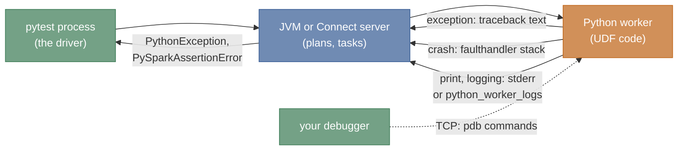
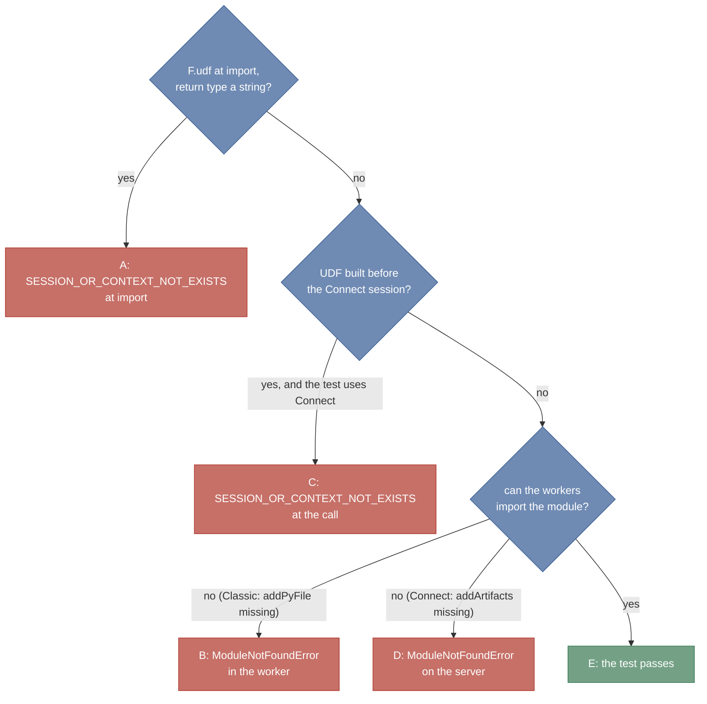
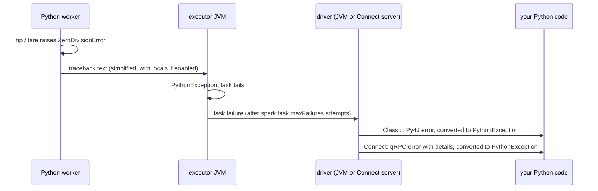

# Chapter 75: Testing and debugging PySpark

A PySpark job is Python code in two places. The driver code builds plans. The UDF code runs in Python workers on the executors, in other processes and often on other machines. A test must run both parts. A failure can start in either part, and the message that reaches you has gone through the JVM on its way.

**Test PySpark code with small DataFrames and one session for the whole run, and compare results with `pyspark.testing`. The traps are not in the asserts. They are in where Python code runs: a UDF that is built before the session exists, and a module that the workers cannot import. To debug a worker, use the settings that move its information to you. They give you short tracebacks, the local variables (new in 4.3) and `faulthandler` for a crash. They also give you a periodic stack dump for a hang, the worker log table, and a breakpoint that you can reach over TCP.**

The scripts are in [`code/ch75`](https://github.com/open-lakehouse/spark-masterclass/tree/main/code/ch75). They ran on `pyspark==4.3.0` with `pytest==9.2.0`, in Classic sessions and against a Connect server (`ch64/server.sh`, on `sc://localhost:15118`). Each output block comes from `code/ch75/output/`.



## Step 1: The code under test

`fares.py` has three things to test: two DataFrame functions and one UDF. The UDF has a plain Python function under it:

```python
def band(fare):
    """Plain Python: the fare band of one fare. Test it without Spark."""
    if fare is None or fare < 0:
        return "invalid"
    if fare < 10:
        return "under $10"
    return "$10 to $30" if fare <= 30 else "over $30"


def fare_band(col):
    """The UDF, built when it is called: then it belongs to the session of the caller."""
    return F.udf(band, StringType())(col)


def zone_summary(trips: DataFrame) -> DataFrame:
    """Trips, mean fare and mean tip percent of card trips, per pickup zone."""
    tip_pct = F.when(F.col("payment_type") == 1, 100 * F.col("tip_amount") / F.col("fare_amount"))
    return (trips.groupBy(F.col("PULocationID").alias("zone"))
                 .agg(F.count("*").alias("trips"),
                      F.round(F.avg("fare_amount"), 2).alias("avg_fare"),
                      F.avg(tip_pct).alias("avg_tip_pct")))
```

Keep the logic of a UDF in a plain function. Then most tests of the logic do not need Spark at all. `fare_band` builds the UDF object when your code calls it, not when Python imports the module. Step 4 shows why.

## Step 2: assertDataFrameEqual and assertSchemaEqual

`pyspark.testing` (since 3.5) exports two asserts. In 4.3.0, `assertDataFrameEqual` has these parameters:

| Parameter | Default | Effect |
|---|---|---|
| `checkRowOrder` | `False` | `False` sorts the rows of both sides by their string form before it compares them |
| `rtol`, `atol` | `1e-5`, `1e-8` | the tolerance for floats |
| `ignoreNullable` | `True` | the nullability of a column does not count |
| `ignoreColumnOrder` | `False` | `True` compares the columns by name |
| `ignoreColumnName` | `False` | `True` compares the columns by position |
| `ignoreColumnType` | `False` | `True` casts each column to a string before it compares (see the caution below) |
| `maxErrors` | `None` | stop the diff after this number of different rows |
| `showOnlyDiff` | `False` | the message shows only the different rows |
| `includeDiffRows` | `False` | the exception also carries the different rows as data |

`actual` and `expected` can each be a DataFrame, a list of `Row`, a pandas DataFrame or a pandas-on-Spark DataFrame. For a Spark DataFrame, the assert calls `collect()`. Thus, both sides come to the driver. Use it on small results.

`asserts.py` makes a DataFrame of three zones and compares it with different expected values. The default ignores the order of the rows:

```text
== rows in another order (checkRowOrder=False, the default)
passed

== rows in another order, checkRowOrder=True
PySparkAssertionError [DIFFERENT_ROWS]: 11 lines
  [DIFFERENT_ROWS] Results do not match: ( 66.66667 % )
  *** actual ***
    Row(zone='JFK', trips=142192, avg_fare=70.31)
  - Row(zone='LGA', trips=98619, avg_fare=49.12)
    Row(zone='Midtown', trips=120511, avg_fare=17.4)


  *** expected ***
  + Row(zone='LGA', trips=98619, avg_fare=49.12)
    Row(zone='JFK', trips=142192, avg_fare=70.31)
    Row(zone='Midtown', trips=120511, avg_fare=17.4)
```

A Spark result has no order unless the query sorts it. Leave `checkRowOrder=False` unless the code under test has an `orderBy`. The failure is a `PySparkAssertionError` with the condition `DIFFERENT_ROWS`. The message marks each different row with `!` (a changed row) or `-` and `+` (a row in one side only). The terminal also shows them in red.

Floats compare with a tolerance. A difference in the seventh digit passes. Two wrong values fail, and `showOnlyDiff=True` removes the equal rows from the message:

```text
== a float that differs in the 7th digit (rtol=1e-5)
passed

== two wrong values, showOnlyDiff=True
PySparkAssertionError [DIFFERENT_ROWS]: 9 lines
  [DIFFERENT_ROWS] Results do not match: ( 66.66667 % )
  *** actual ***
  ! Row(zone='LGA', trips=98619, avg_fare=49.12)
  ! Row(zone='Midtown', trips=120511, avg_fare=17.4)


  *** expected ***
  ! Row(zone='LGA', trips=98620, avg_fare=49.12)
  ! Row(zone='Midtown', trips=120511, avg_fare=17.41)
```

The schemas must also be equal. A column of type `INT` against `BIGINT` fails with `DIFFERENT_SCHEMA` before the assert compares any row:

```text
== a column of another type (trips as int)
PySparkAssertionError [DIFFERENT_SCHEMA]: 8 lines
  [DIFFERENT_SCHEMA] Schemas do not match.
  --- actual
  +++ expected
  - StructType([StructField('zone', StringType(), True), StructField('trips', LongType(), True), S
  ?                                                                           ^^

  + StructType([StructField('zone', StringType(), True), StructField('trips', IntegerType(), True)
  ?                                                                           ^ ++ ++
```

!!! caution "ignoreColumnType=True fails on a string column with ANSI mode on"
    Look at `pyspark/testing/utils.py` at the `v4.3.0` tag. With `ignoreColumnType=True`, the assert casts each column to `float` to find whole numbers. With ANSI mode on (the default in 4.x), the cast of a string such as `'LGA'` fails. Do not use `ignoreColumnType=True` on a DataFrame with a string column. Cast the columns in the test instead.

```text
== the same, ignoreColumnType=True
NumberFormatException [CAST_INVALID_INPUT]: [CAST_INVALID_INPUT] The value 'LGA' of the type "STRING" cannot be cast to "FLOAT" because it is malformed. Correct the value as per the syntax, or c

== the same, ignoreColumnType=True, spark.sql.ansi.enabled=false
passed
```

The part notes record this as an open problem, with a minimal repro.

`assertSchemaEqual` compares two `StructType` values. By default it ignores the nullability:

```text
== assertSchemaEqual, nullable differs (ignoreNullable=True, the default)
passed

== assertSchemaEqual, ignoreNullable=False
PySparkAssertionError [DIFFERENT_SCHEMA]: 8 lines
  [DIFFERENT_SCHEMA] Schemas do not match.
  --- actual
  +++ expected
  - StructType([StructField('zone', StringType(), True), StructField('trips', LongType(), True), S
  ?                                                                           ^^^
```

`asserts.py` gives the same results in a Connect session. Only the session class in the first line is different (`pyspark.sql.connect.session.SparkSession`). The asserts are pure Python. They work on both kinds of DataFrame.

## Step 3: A session fixture for Classic and Connect

A Spark session takes seconds to start. Start one session for the whole test run, with a pytest fixture of scope `session`. `tests/conftest.py` makes a Classic or a Connect session, from the environment variable `MODE`:

```python
@pytest.fixture(scope="session")
def spark():
    mode = os.environ.get("MODE", "classic")
    if mode == "connect":
        url = os.environ.get("SPARK_CONNECT_URL", "local[2]")
        b = SparkSession.builder.remote(url)
    else:
        b = (SparkSession.builder.master("local[2]")
             .config("spark.ui.enabled", "false"))
    s = (b.appName("ch75-tests")
          .config("spark.sql.shuffle.partitions", "2")
          .config("spark.sql.session.timeZone", "UTC")
          .getOrCreate())
    fares_py = str(Path(__file__).resolve().parents[1] / "fares.py")
    if mode == "connect":
        s.addArtifacts(fares_py, pyfile=True)     # the server's Python workers import fares
    else:
        s.sparkContext.addPyFile(fares_py)        # the executors' Python workers import fares
    yield s
    s.stop()
```

Each setting has a reason:

- **`local[2]`** has two task slots. That is enough to find code that works only with one partition. `local[*]` starts one slot for each core, which the tests do not need.
- **`spark.sql.shuffle.partitions=2`**. The default is 200. A test with ten rows then runs 200 tasks after each shuffle.
- **`spark.ui.enabled=false`** does not start the web UI. Many test processes on one machine then do not compete for port 4040.
- **`spark.sql.session.timeZone=UTC`** makes timestamp tests give the same result on each machine.
- **`.remote("local[2]")`** starts a Spark Connect server inside the test process. **`.remote("sc://...")`** connects to a server that is already in operation.
- **`addPyFile` and `addArtifacts`** send `fares.py` to the Python workers. Step 4 shows what occurs without them.

The tests use the fixture. A second fixture, `trips`, builds four hand-made trips. One of them has a distance of 0 and one has a negative fare, so that `clean_trips` has rows to remove:

```python
def test_clean_trips_rows(trips):
    out = clean_trips(trips).select("PULocationID", "fare_amount", "minutes")
    assertDataFrameEqual(out, [Row(PULocationID=132, fare_amount=70.0, minutes=30.0),   # any order
                               Row(PULocationID=132, fare_amount=12.5, minutes=12.0)])


def test_zone_summary_schema(trips):
    expected = StructType([StructField("zone", IntegerType()), StructField("trips", LongType()),
                           StructField("avg_fare", DoubleType()), StructField("avg_tip_pct", DoubleType())])
    assertSchemaEqual(zone_summary(clean_trips(trips)).schema, expected)    # nullability ignored
```

The same ten tests ran with three kinds of session:

```text
$ MODE=classic pytest -q --durations=2 ch75/tests
..........                                                               [100%]
============================= slowest 2 durations ==============================
6.71s setup    ch75/tests/test_fares.py::test_fare_band_udf
3.56s call     ch75/tests/test_fares.py::test_fare_band_udf
10 passed in 12.80s

$ MODE=connect SPARK_CONNECT_URL=local[2] pytest -q --durations=2 ch75/tests
..........                                                               [100%]
============================= slowest 2 durations ==============================
5.22s setup    ch75/tests/test_fares.py::test_fare_band_udf
3.63s call     ch75/tests/test_fares.py::test_fare_band_udf
10 passed in 11.40s

$ MODE=connect SPARK_CONNECT_URL=sc://localhost:15118 pytest -q --durations=2 ch75/tests
..........                                                               [100%]
============================= slowest 2 durations ==============================
1.39s call     ch75/tests/test_fares.py::test_fare_band_udf
0.15s call     ch75/tests/test_fares.py::test_zone_summary_values
10 passed in 2.16s
```

<figure markdown>
  

  

  <figcaption>The time of each test run from the output above. The session start (setup) and the first call of the UDF are most of the time. Against a server that is already in operation, the whole run takes 2.16 s.</figcaption>
</figure>

The first test that uses the `spark` fixture pays for the session start (setup, 5 to 7 s). The first UDF call starts the Python workers (3.6 s). Against a Connect server that is already in operation, both costs are gone, and the ten tests take 2.16 s. These are single runs, without the benchmark lock. They show the size of the costs, not exact values.

## Step 4: Four ways a correct UDF test fails

`traps.py` changes a copy of `fares.py` or `conftest.py` in one place, and it runs the UDF test in a new process:

```text
== A. module-level F.udf(band, 'string') (MODE=classic)
   1 error in 0.59s
   PySparkRuntimeError: [SESSION_OR_CONTEXT_NOT_EXISTS] SparkContext or SparkSession should be created first.

== B. module-level UDF, fares.py not shipped to the workers (MODE=classic)
   1 failed, 9 deselected in 12.56s
   ModuleNotFoundError: No module named 'fares'

== C. module-level UDF, Connect session (MODE=connect)
   1 failed, 9 deselected in 0.56s
   PySparkRuntimeError: [SESSION_OR_CONTEXT_NOT_EXISTS] SparkContext or SparkSession should be created first.

== D. UDF built at call time, Connect, no addArtifacts (MODE=connect)
   1 failed, 9 deselected in 1.62s
   ModuleNotFoundError: No module named 'fares'

== E. as in the book: built at call time, shipped (MODE=connect)
   1 passed, 9 deselected in 2.43s
```

<figure markdown>
  <video autoplay loop muted playsinline controls width="1280" height="720" poster="../../media/clips/ch75-pytest.webp">
    <source src="../../media/clips/ch75-pytest.mp4" type="video/mp4">
  </video>
  <figcaption>The tests against a Connect server, then <code>traps.py</code>: four changes that break a correct test, and the version that passes.</figcaption>
</figure>

**A. A UDF with a DDL string, at import time.** `fare_band = F.udf(band, "string")` at the top of the module fails when pytest imports the test file, before any fixture runs. In `pyspark/sql/udf.py` at the `v4.3.0` tag, `F.udf` reads the return type when it builds the UDF. The JVM must parse a return type that is a string, and no session exists yet. A `DataType` object (`StringType()`) does not need the JVM.

**B. The workers cannot import the module.** With `StringType()`, the import works. Then the UDF test fails in the worker.

`cloudpickle` sends a function of an importable module by reference: "the function `band` of the module `fares`". The Python worker must then import `fares`. The test process found `fares` through `sys.path`, which `conftest.py` changed. The workers are other processes, and they do not have that change. `sc.addPyFile` sends the file to each executor.

**C. A UDF object belongs to one kind of session.** The wrapper `try_remote_functions` (`pyspark/sql/utils.py`) surrounds `F.udf` in `pyspark/sql/functions`. The wrapper calls the Connect version only if `is_remote()` is true at the time of the call. That is true only after a Connect session starts.

A UDF built at import time is a Classic UDF. Its use in a Connect session asks for a `SparkContext`, and the test fails.

**D. The Connect server's workers cannot import the module.** The UDF is now built at call time, so it is a Connect UDF. But the Python workers run on the server. `addPyFile` is a `SparkContext` method, and a Connect session has none. `spark.addArtifacts(path, pyfile=True)` uploads the file to the server for this session.

**E** is the version in the book: build the UDF at call time, and send the module to the workers.



In a test with a `local` master, the workers run on the same machine. On a cluster, the same four failures occur, and B and D also occur when the code is a package. Ship the package the way [Chapter 73](ch73-shipping-dependencies.md) shows.

## Step 5: Read a Python traceback from an executor

When a UDF raises an exception, the Python worker sends the traceback text to the JVM. The JVM fails the task, and the driver raises an exception in your code. `tracebacks.py` uses a UDF that divides by zero for one row:

```python
@F.udf("double")
def tip_share(tip, fare):
    rate = tip / fare            # fare = 0.0 raises ZeroDivisionError
    return round(rate, 3)
```

```text
Classic: a UDF divides by zero in a task

== defaults (simplifiedTraceback on, jvmStacktrace off)
   class pyspark.errors.exceptions.captured.PythonException, condition PYTHON_EXCEPTION, sqlState 38000
   6 lines in str(e), 0 JVM 'at ...' frames, 'File "' lines: 1
   An exception was thrown from the Python worker:
   Traceback (most recent call last):
     File "tracebacks.py", line 20, in tip_share
       rate = tip / fare            # fare = 0.0 raises ZeroDivisionError
              ~~~~^~~~~~
   ZeroDivisionError: float division by zero
```

The exception is a `PythonException` with the condition `PYTHON_EXCEPTION` and the SQL state `38000`. The traceback has one frame: the line of your UDF. Spark removed the frames of the worker itself, because `spark.sql.execution.pyspark.udf.simplifiedTraceback.enabled` is `true` by default. With it off, the traceback has nine frames, eight of them in `worker.py`, `serializers.py` and `util.py`:

```text
== simplifiedTraceback.enabled=false
   class pyspark.errors.exceptions.captured.PythonException, condition PYTHON_EXCEPTION, sqlState 38000
   26 lines in str(e), 0 JVM 'at ...' frames, 'File "' lines: 9
```

Turn it off only when you suspect PySpark itself.

**New in 4.3: the local variables.** `spark.sql.execution.pyspark.udf.tracebackWithLocals.enabled` (version `4.3.0` in `SQLConf.scala`) adds the local variables of each frame to the traceback:

```text
== tracebackWithLocals.enabled=true (new in 4.3)
   class pyspark.errors.exceptions.captured.PythonException, condition PYTHON_EXCEPTION, sqlState 38000
   8 lines in str(e), 0 JVM 'at ...' frames, 'File "' lines: 1
     File "tracebacks.py", line 20, in tip_share
       rate = tip / fare            # fare = 0.0 raises ZeroDivisionError
       fare = 0.0
       tip = 1.0
```

The bad row is now in the message: `fare = 0.0`. Without this setting, you must find the row yourself.

!!! warning "The local variables can contain secrets"
    The doc of `tracebackWithLocals.enabled` says that it prints each local variable in the call stack, sensitive data included. Do not turn it on for a job whose UDFs hold passwords, API keys or personal data. The traceback goes into logs, the Spark UI and error reports.

**`spark.sql.pyspark.jvmStacktrace.enabled`** adds the JVM stack trace to the message of a PySpark exception. It has no effect on a `PythonException` in a Classic session, because `PythonException.__str__` in `pyspark/errors/exceptions/captured.py` returns only the Python message and traceback. It applies to errors from the JVM:

```text
== jvmStacktrace.enabled=true
   class pyspark.errors.exceptions.captured.PythonException, condition PYTHON_EXCEPTION, sqlState 38000
   6 lines in str(e), 0 JVM 'at ...' frames, 'File "' lines: 1

== a JVM error (SELECT 1 / 0), defaults
   class pyspark.errors.exceptions.captured.ArithmeticException, condition DIVIDE_BY_ZERO, sqlState 22012
   4 lines in str(e), 0 JVM 'at ...' frames, 'File "' lines: 0
   [DIVIDE_BY_ZERO] Division by zero. Use `try_divide` to tolerate divisor being 0 and return N

== a JVM error (SELECT 1 / 0), jvmStacktrace.enabled=true
   class pyspark.errors.exceptions.captured.ArithmeticException, condition DIVIDE_BY_ZERO, sqlState 22012
   187 lines in str(e), 173 JVM 'at ...' frames, 'File "' lines: 0
   JVM stacktrace:
   	at org.apache.spark.sql.errors.QueryExecutionErrors$.divideByZeroError(QueryExecutionErrors
```

The same script against the Connect server shows three differences:

| | Classic | Connect |
|---|---|---|
| exception class | `pyspark.errors.exceptions.captured.PythonException` | `pyspark.errors.exceptions.connect.PythonException` |
| `getCondition()`, `getSqlState()` of the UDF error | `PYTHON_EXCEPTION`, `38000` | `None`, `None` (the message text has `[PYTHON_EXCEPTION]` and `SQLSTATE: 38000`) |
| JVM frames for `SELECT 1 / 0`, by default | 0 | 89 |
| JVM frames with `spark.sql.connect.serverStacktrace.enabled=false` | (not a Classic setting) | 0 |

The Connect client shows the server's stack trace by default. `_display_server_stack_trace` in `pyspark/sql/connect/client/core.py` returns true if `spark.sql.connect.serverStacktrace.enabled` is true (its default) or if `spark.sql.pyspark.jvmStacktrace.enabled` is true. The absent condition of the Connect `PythonException` matters for code that catches errors by condition. Examine the message as well. The part notes record it as an open problem.



<figure markdown>
  <video autoplay loop muted playsinline controls width="1280" height="720" poster="../../media/clips/ch75-anim-traceback.webp">
    <source src="../../media/clips/ch75-anim-traceback.mp4" type="video/mp4">
  </video>
  <figcaption>The path of a UDF error from the Python worker to your code, and what each setting changes. The line counts come from <code>tracebacks.py</code>. The motion is schematic.</figcaption>
</figure>

## Step 6: A worker that crashes, and a worker that hangs

A Python exception gives a traceback. A crash in C code (a segmentation fault in a native library) gives none: the process stops at once. `crash.py` reads address 0 with `ctypes` for one row:

```python
@F.udf("long")
def parse_blob(n):
    import ctypes
    if n == 3:
        ctypes.string_at(0)           # read address 0: SIGSEGV in C code, no Python exception
    return n
```

```text
== faulthandler.enabled=false: Py4JJavaError, 127 lines
   org.apache.spark.SparkException: Python worker exited unexpectedly (crashed). Consider
   setting 'spark.sql.execution.pyspark.udf.faulthandler.enabled'
   or'spark.python.worker.faulthandler.enabled' configuration to 'true' for the better Python

== faulthandler.enabled=true: Py4JJavaError, 163 lines
   org.apache.spark.SparkException: Python worker exited unexpectedly (crashed): Fatal Python
   error: Segmentation fault
   ... 16 Python frames after it, the first two:
     File "/usr/lib/python3.12/ctypes/__init__.py", line 525 in string_at
     File "crash.py", line 24 in parse_blob
```

Without `faulthandler`, Spark knows only that the worker exited. With it, the worker installs Python's `faulthandler` module, which writes the stack of each thread when the process receives a fatal signal. Spark reads it and puts it in the error. Two settings control it:

| Setting | Since | Scope |
|---|---|---|
| `spark.python.worker.faulthandler.enabled` | 3.2.0 | all Python workers (RDD functions too). Set it before the session starts |
| `spark.sql.execution.pyspark.udf.faulthandler.enabled` | 4.0.0 | Python execution of DataFrames and SQL. You can change it at runtime, as `crash.py` does |

A worker that **hangs** does not fail at all. `spark.sql.execution.pyspark.udf.tracebackDumpIntervalSeconds` (since 4.1.0, with `spark.python.worker.tracebackDumpIntervalSeconds` for all workers) makes the worker write its stack every N seconds while a UDF runs. The stack goes to the worker's stderr, not to the driver:

```text
worker stderr during the slow UDF (paths shortened):
Timeout (0:00:02)!
Thread 0x00007772f4316080 (most recent call first):
  File "crash.py", line 49 in slow
  File "worker.py", line 2884 in _evaluate_batch_udf
  File "util.py", line 158 in wrapper
  File "worker.py", line 2914 in func
  File "serializers.py", line 96 in _write_stream_start
```

The UDF slept for 5 s, and the dump came after 2 s. It shows the line where the worker waits (`crash.py`, line 49, `time.sleep`). On a cluster, read it in the stderr log of the executor, in the **Executors** tab of the Spark UI.

## Step 7: Worker logs: print, logging and the log table

`worker_logs.py` has a UDF that calls `print()` and `logging` for a negative fare. By default, both go to the stderr of the Python worker:

```text
print: negative fare -8.0
negative fare -8.0
```

In local mode, that is the terminal of the driver. On a cluster, it is the stderr log of each executor, one file for each executor. Since 4.1.0, `spark.sql.pyspark.worker.logging.enabled` collects the log records of the workers into a table, and `spark.tvf.python_worker_logs()` reads it:

```text
== spark.sql.pyspark.worker.logging.enabled=true
   the same DataFrame object again: 0 log rows
   a new DataFrame:                 2 log rows
   spark.tvf.python_worker_logs() columns: ['ts', 'level', 'msg', 'context', 'exception', 'logger']
+-------+------+-------------------------+--------------------------------------------+
|  level|logger|                      msg|                                     context|
+-------+------+-------------------------+--------------------------------------------+
|   INFO|stdout|print: negative fare -8.0|             {func_name -> context_provider}|
|WARNING| fares|       negative fare -8.0|{func_name -> warning, class_name -> Logger}|
+-------+------+-------------------------+--------------------------------------------+
```

The table has the `logging` record (logger `fares`, level `WARNING`) and the `print()` output (logger `stdout`, level `INFO`).

The first line is a trap. The script turned the setting on, then ran the DataFrame of the first run again. The table had no rows. A Classic DataFrame keeps its physical plan after its first action, and the setting from the first time stays in it. A new DataFrame with the same query gave the two rows. In a Connect session, each action sends the plan again, and the same DataFrame gave two rows:

```text
== spark.sql.pyspark.worker.logging.enabled=true
   the same DataFrame object again: 2 log rows
   a new DataFrame:                 4 log rows
```

This trap also occurs with other runtime settings. Change the setting first, then build the DataFrame. [Chapter 85](ch85-catalyst-extensions.md#step-11-measure-without-errors) shows the same effect in a benchmark.

On the driver, `pyspark.logger.PySparkLogger` (since 4.0) writes JSON lines, with the keyword arguments as a `context` object:

```python
log = PySparkLogger.getLogger("ch75")
log.warning("zone summary written", zone_count=128, path="/data/zones")
```

```text
{"ts": "2026-11-22 15:47:22.369", "level": "WARNING", "logger": "ch75", "msg": "zone summary written", "context": {"zone_count": 128, "path": "/data/zones"}}
```

`log.exception(...)` also writes the class, the message and the stack of the exception as JSON fields. A log tool can then search the logs by `context` keys.

## Step 8: A breakpoint inside a Python worker

A debugger in your IDE stops the driver process. A UDF runs in a worker process, so a breakpoint in the IDE does not stop it. The worker needs a debugger that waits for a connection. `remote_debug.py` uses the open source package `remote-pdb`. The environment of the driver tells Python's `breakpoint()` to call it:

```python
os.environ["PYTHONBREAKPOINT"] = "remote_pdb.set_trace"    # (the workers inherit the environment
os.environ["REMOTE_PDB_HOST"] = "127.0.0.1"                #  of the local JVM, which inherits ours)
os.environ["REMOTE_PDB_PORT"] = str(PORT)

@F.udf("double")
def tip_share(tip, fare):
    if fare == 0:
        breakpoint()                   # stop here, only for the bad row
    return round(tip / fare, 3) if fare else None
```

When the worker gets to `breakpoint()`, it opens a TCP port and waits. A thread of the script connects to it, as a person with `nc 127.0.0.1 4444` does, and sends `pdb` commands:

```text
driver pid 738565: run the query; the worker stops at breakpoint()
   [debugger] connected to the worker on port 4444
   > ch75/remote_debug.py(33)tip_share()
   -> return round(tip / fare, 3) if fare else None
   (Pdb)
   (Pdb) p tip, fare
     (1.0, 0.0)
   (Pdb) p __import__('os').getpid()
     739761
   (Pdb) w 3
       pyspark/worker.py(4146)<genexpr>()
     -> return (f(*[row[offset] for offset in arg_offsets]) for row in data)
       pyspark/worker.py(682)<lambda>()
     -> return args_kwargs_offsets, lambda *a: func(*a)
       pyspark/util.py(158)wrapper()
     -> return f(*args, **kwargs)
     > ch75/remote_debug.py(33)tip_share()
     -> return round(tip / fare, 3) if fare else None
   (Pdb) c
result after 'c': [0.24, None]
```

<figure markdown>
  <video autoplay loop muted playsinline controls width="1280" height="720" poster="../../media/clips/ch75-debugger.webp">
    <source src="../../media/clips/ch75-debugger.mp4" type="video/mp4">
  </video>
  <figcaption><code>remote_debug.py</code>: the worker stops at <code>breakpoint()</code>, and <code>pdb</code> commands go to it over TCP.</figcaption>
</figure>

The worker has its own process id (739761), not the driver's (738565). The stack shows where Spark calls your function: `pyspark/worker.py` reads the rows of a batch and calls the UDF for each one. After `c`, the query continues and returns its result.

Three rules make this work:

- **Use one task slot** (`local[1]`) and a condition on the bad row. Each worker that gets to `breakpoint()` waits on the same port.
- **Use the pickled UDF** (`useArrow=False`, or `spark.sql.execution.pythonUDF.arrow.enabled=false`), so that the function sees one row at a time.
- **The worker waits until you connect.** The task does not finish, and a stage timeout or speculation can stop it.

On a cluster, the worker is on an executor host, and the port must be open from your machine. The PySpark debugging guide shows another hook for IDE debuggers: a module given in `spark.python.daemon.module` that wraps `pyspark.daemon.worker_main` and calls `pydevd_pycharm.settrace` in each worker. This chapter did not run that hook.

For the cost of a UDF, not its errors, use the profilers: `spark.sql.pyspark.udf.profiler` set to `perf` or `memory`. [Chapter 74](ch74-observability.md) runs them.

<figure markdown>
  

  

  <figcaption>The debugging tools of this chapter, from the symptom to the setting. Each row is a setting or a tool that ran in <code>code/ch75</code>.</figcaption>
</figure>

## The whole chapter, on one page

- **Test the logic of a UDF as plain Python.** Test the Spark part with small DataFrames and `assertDataFrameEqual`, which ignores the row order by default and compares floats with a tolerance.
- **Do not use `ignoreColumnType=True` on string columns with ANSI mode on** in 4.3.0. Cast in the test instead.
- **One session for the whole run**, as a pytest fixture of scope `session`, with `local[2]`, two shuffle partitions, no UI and a fixed time zone. The same fixture can make a Classic session, a local Connect session (`.remote("local[2]")`) or a session on a server that is already in operation.
- **Build UDF objects at call time**, not at import time. Give a `DataType`, not a DDL string, if you must build one at import.
- **Send your modules to the workers:** `sc.addPyFile` in Classic, `spark.addArtifacts(..., pyfile=True)` over Connect.
- **Read the last frame of a `PythonException`.** In 4.3, turn on `tracebackWithLocals.enabled` to see the bad row, but not when the UDF holds secrets.
- **A crash needs `faulthandler`, a hang needs `tracebackDumpIntervalSeconds`.** The hang dump goes to the stderr of the executor.
- **Collect worker logs into a table** with `spark.sql.pyspark.worker.logging.enabled` and `spark.tvf.python_worker_logs()`. In Classic, change the setting before you build the DataFrame.
- **Stop a worker with `breakpoint()` and `remote-pdb`** on one task slot, and connect over TCP.

```python
# tests/conftest.py
@pytest.fixture(scope="session")
def spark():
    b = (SparkSession.builder.remote(os.environ["SPARK_CONNECT_URL"]) if os.environ.get("MODE") == "connect"
         else SparkSession.builder.master("local[2]").config("spark.ui.enabled", "false"))
    s = b.config("spark.sql.shuffle.partitions", "2").config("spark.sql.session.timeZone", "UTC").getOrCreate()
    if os.environ.get("MODE") == "connect":
        s.addArtifacts("fares.py", pyfile=True)
    else:
        s.sparkContext.addPyFile("fares.py")
    yield s
    s.stop()

# tests/test_fares.py
def test_fare_band_udf(spark):
    df = spark.createDataFrame([(9.99,), (30.0,), (None,)], "fare double")
    assertDataFrameEqual(df.select(fare_band("fare").alias("band")),
                         [Row(band="under $10"), Row(band="$10 to $30"), Row(band="invalid")])

# when a UDF fails on an executor
spark.conf.set("spark.sql.execution.pyspark.udf.tracebackWithLocals.enabled", "true")   # 4.3
spark.conf.set("spark.sql.execution.pyspark.udf.faulthandler.enabled", "true")          # crashes
spark.conf.set("spark.sql.execution.pyspark.udf.tracebackDumpIntervalSeconds", "60")    # hangs
spark.conf.set("spark.sql.pyspark.worker.logging.enabled", "true")                      # logs table
```

To run all of it, do these steps from the `code/` folder:

```bash
uv run python ch75/asserts.py
MODE=classic uv run --with pytest pytest -q ch75/tests
ch64/server.sh start
MODE=connect SPARK_CONNECT_URL=sc://localhost:15118 uv run --with pytest pytest -q ch75/tests
uv run --with pytest python ch75/traps.py
uv run python ch75/tracebacks.py
SPARK_REMOTE=sc://localhost:15118 uv run python ch75/tracebacks.py
uv run python ch75/crash.py
uv run python ch75/worker_logs.py
uv run --with remote-pdb python ch75/remote_debug.py
ch64/server.sh stop
```

## Further reading

- [Testing PySpark](https://spark.apache.org/docs/4.3.0/api/python/getting_started/testing_pyspark.html) and the [`pyspark.testing` API](https://spark.apache.org/docs/4.3.0/api/python/reference/pyspark.testing.html).
- [Debugging PySpark](https://spark.apache.org/docs/4.3.0/api/python/development/debugging.html), with the remote debugger, the profilers and the common errors.
- [`pyspark/testing/utils.py` at v4.3.0](https://github.com/apache/spark/blob/v4.3.0/python/pyspark/testing/utils.py), the source of the asserts.
- [`remote-pdb`](https://pypi.org/project/remote-pdb/), the debugger that Step 8 uses.
- [Chapter 73](ch73-shipping-dependencies.md) for packages on the workers, and [Chapter 74](ch74-observability.md) for the profilers.
