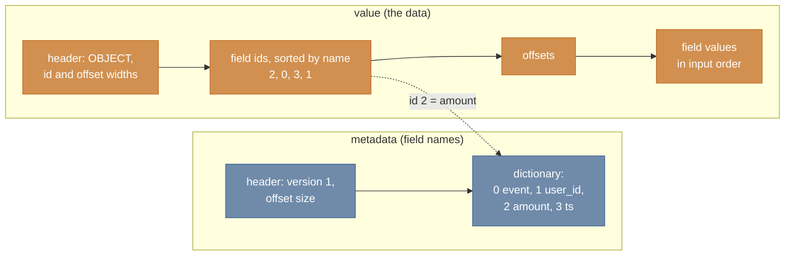
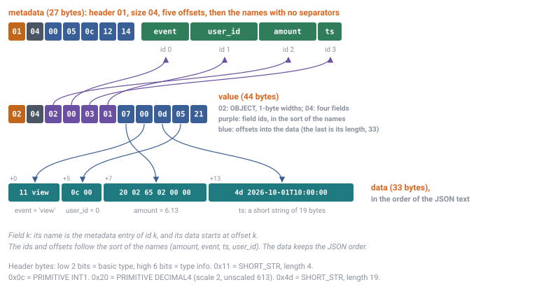
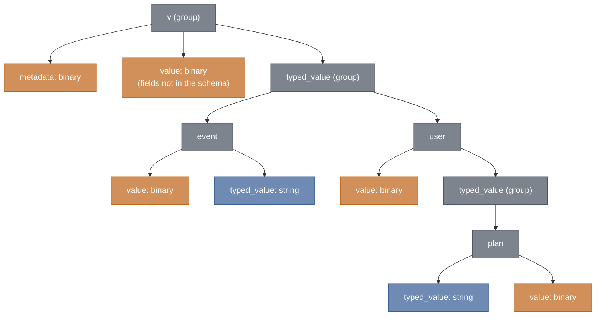
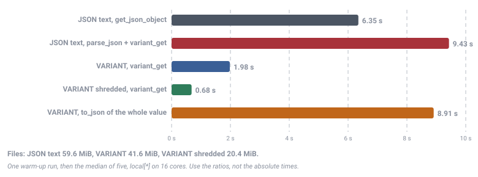

# Chapter 76: The VARIANT binary format

A `VARIANT` column holds semi-structured data: JSON objects with fields that change from row to row. Most users see it through `parse_json`, `variant_get` and `to_json`, and they think of it as JSON text with a different name. It is not text. Spark parses each value one time and keeps it in a binary format. Every later read uses those bytes and never parses the text again.

**A VARIANT value is two byte strings: a metadata dictionary of field names and a value that refers to the names by number. Each value starts with a one-byte header that tells a reader its type and the width of each number that follows. Objects keep their field IDs sorted by name, so a reader can find a field without a scan of the whole value. When Spark writes a VARIANT column to Parquet, Spark 4.3 also splits it into typed columns by default ("shredding"). Each detail of the behavior of VARIANT comes from these bytes.**

This chapter reads the bytes with a small Python reader, [`code/ch76/variant_codec.py`](https://github.com/lisancao/spark-masterclass/tree/main/code/ch76). Spark makes the bytes, the Python code decodes them, and Spark checks the result. Each source excerpt names its file in the [apache/spark](https://github.com/apache/spark/tree/v4.3.0) repository at the `v4.3.0` tag. The format follows the Parquet VariantEncoding and VariantShredding specifications. The README of the module, `common/variant/README.md`, names the exact version of the specification that Spark implements. All the code runs on `pyspark==4.3.0`, and each output block comes from `code/ch76/output/`.

The data is the event log of the SparkTutor course: three days of JSON events whose shape changes each day. Day 1 has flat events with `user_id`. Day 2 adds a nested `user` object and an `items` array. Day 3 renames `event` to `event_type` and makes `amount` an object with a currency. The last line of day 3 is cut short, so it is not valid JSON.

## Step 1: A VARIANT is two binaries

`layout.py` reads the three files into one VARIANT column with the `singleVariantColumn` option, and it looks at the Python objects that come back:

```text
schema: struct<v:variant>
61 rows from 3 files; Python type of one value: VariantVal
rows with a NULL variant (the broken last line of day 3): 1
value bytes: min 44, max 104; metadata bytes: min 27, max 78
distinct metadata blobs among 60 rows: 3
```

In Python, each value is a `VariantVal` with two `bytes` fields, `value` and `metadata`. The line that is not valid JSON became a NULL, not an error, because the JSON reader runs in `PERMISSIVE` mode by default.

The last line is important. 60 rows have only 3 different metadata blobs, one for each shape of event. Each row carries its own metadata, but the rows of one shape carry the same bytes.



## Step 2: The metadata dictionary

The metadata holds each distinct field name of the value one time. This is the metadata of the first event of day 1, `{"event": "view", "user_id": 0, "amount": 6.13, "ts": "2026-10-01T10:00:00"}`:

```text
--- metadata of {"event", "user_id", "amount", "ts"}: 27 bytes
0000  01 04 00 05 0c 12 14 65 76 65 6e 74 75 73 65 72  .......eventuser  <- header: version, sorted_strings, offset_size; dictionary size (1 byte); 5 offsets; UTF-8 strings, no separators
0010  5f 69 64 61 6d 6f 75 6e 74 74 73                 _idamountts     
header 0x01: version 1, sorted_strings 0, offset_size 1
size 4, offsets [0, 5, 12, 18, 20], keys ['event', 'user_id', 'amount', 'ts']
```

Read it byte by byte:

- **`01`, the header.** The low 4 bits are the version, 1. Bit 4 is `sorted_strings`, 0. The top 2 bits give the width of each offset minus one: 0, so each offset is 1 byte.
- **`04`, the size.** There are 4 names. The size has the same width as the offsets.
- **`00 05 0c 12 14`, the offsets.** There are size + 1 offsets. Name *i* is the bytes from offset *i* to offset *i* + 1. The last offset, `0x14` = 20, is the total length of the strings.
- **The strings.** `eventuser_idamountts` with no separators. The offsets give the boundaries.

The names are in the sequence of their first appearance in the JSON text, not in alphabetical sequence. Spark never sets `sorted_strings`. The builder writes the dictionary in `result()`, in `common/variant/src/main/java/org/apache/spark/types/variant/VariantBuilder.java`:

```java
    int offsetSize = getIntegerSize((int)maxSize);

    int offsetStart = 1 + offsetSize;
    int stringStart = offsetStart + (numKeys + 1) * offsetSize;
    long metadataSize = stringStart + dictionaryStringSize;

    if (metadataSize > SIZE_LIMIT) {
      throw new VariantSizeLimitException();
    }
    byte[] metadata = new byte[(int) metadataSize];
    int headerByte = VERSION | ((offsetSize - 1) << 6);
    writeLong(metadata, 0, headerByte, 1);
    writeLong(metadata, 1, numKeys, offsetSize);
```

`getIntegerSize` returns the smallest width, from 1 to 4 bytes, that can hold the largest offset. A small object uses 1-byte offsets, and only a very large dictionary uses 4-byte offsets. The size field uses the same width (`writeLong(metadata, 1, numKeys, offsetSize)`).

## Step 3: The value header and an object

The value of the same event has 44 bytes:

```text
--- value: 44 bytes
0000  02 04 02 00 03 01 07 00 0d 05 21 11 76 69 65 77  ..........!.view  <- header; size; field ids; field offsets; field data
0010  0c 00 20 02 65 02 00 00 4d 32 30 32 36 2d 31 30  .. .e...M2026-10
0020  2d 30 31 54 31 30 3a 30 30 3a 30 30              -01T10:00:00    
header 0x02 = 0b00000010: basic type 2 (OBJECT), is_large 0, id size 1, offset size 1
size 4; ids [2, 0, 3, 1] = ['amount', 'event', 'ts', 'user_id']; offsets [7, 0, 13, 5, 33]
  amount   at data+7   20 02 65 02 00 00                             DECIMAL4  Decimal('6.13')
  event    at data+0   11 76 69 65 77                                SHORT_STR 'view'
  ts       at data+13  4d 32 30 32 36 2d 31 30 2d 30 31 54 31 30 3a 30 30 3a 30 30 SHORT_STR '2026-10-01T10:00:00'
  user_id  at data+5   0c 00                                         INT1      0
```

Every value starts with a header byte. The low 2 bits are the **basic type**, and the high 6 bits are the **type info**. The constants are in `common/variant/src/main/java/org/apache/spark/types/variant/VariantUtil.java`:

```java
  // Below is all possible basic type values.
  // Primitive value. The type info value must be one of the values in the below section.
  public static final int PRIMITIVE = 0;
  // Short string value. The type info value is the string size, which must be in `[0,
  // kMaxShortStrSize]`.
  // The string content bytes directly follow the header byte.
  public static final int SHORT_STR = 1;
```

```java
  // We use 5 bits in the type info to specify the integer type of the object header: it should
  // be 0_b4_b3b2_b1b0 (MSB is 0), where:
  // - b4 specifies the type of size. When it is 0/1, `size` is a little-endian 1/4-byte
  // unsigned integer.
  // - b3b2/b1b0 specifies the integer type of id and offset. When the 2 bits are  0/1/2, the
  // list contains 1/2/3-byte little-endian unsigned integers.
  public static final int OBJECT = 2;
```

The header `0x02` is `OBJECT` with type info 0. Thus the size is 1 byte, each field ID is 1 byte, and each offset is 1 byte. Then:

- **`04`.** The object has 4 fields.
- **`02 00 03 01`, the field IDs.** The IDs point into the metadata dictionary: 2 = `amount`, 0 = `event`, 3 = `ts`, 1 = `user_id`. The IDs are in the alphabetical sequence of the names, not in the sequence of the dictionary.
- **`07 00 0d 05 21`, the offsets.** Offset *i* is where the value of field *i* starts, counted from the start of the data. The last offset, `0x21` = 33, is the length of the data.
- **The data.** The values are in the sequence of the JSON text: `event` at 0, `user_id` at 5, `amount` at 7, `ts` at 13.

<figure markdown>
  <video autoplay loop muted playsinline controls width="1280" height="720" poster="../../media/clips/ch76-anim-decode.webp">
    <source src="../../media/clips/ch76-anim-decode.mp4" type="video/mp4">
  </video>
  <figcaption>A reader walks the value above with its metadata. For each field, the id gives the name and the offset gives the data.</figcaption>
</figure>

Two sequences are in one object. The IDs and the offsets follow the sort of the names, so a reader can search them. The data stays in the input sequence, so the writer does not move bytes. The builder does this in `finishWritingObject`, in `VariantBuilder.java`. It sorts the field entries by key, and it keeps the offset that each field got when the builder wrote it:

```java
  public void finishWritingObject(int start, ArrayList<FieldEntry> fields) {
    int size = fields.size();
    Collections.sort(fields);
```

```java
    int dataSize = writePos - start;
    boolean largeSize = size > U8_MAX;
    int sizeBytes = largeSize ? U32_SIZE : 1;
    int idSize = getIntegerSize(maxId);
    int offsetSize = getIntegerSize(dataSize);
```

Each object chooses its own widths. The ID width comes from the largest ID in that object. The offset width comes from the size of its data. A small object inside a large one uses 1-byte offsets, even if the outer object uses 2-byte offsets.

The field values show three primitive encodings:

- **`11 76 69 65 77`.** The header `0x11` is `0b000100_01`: basic type 1 (`SHORT_STR`), type info 4. A short string stores its length in the header, so `view` costs 5 bytes. A string of up to 63 bytes (`MAX_SHORT_STR_SIZE = 0x3F`) is a short string.
- **`0c 00`.** The header `0x0c` is `0b000011_00`: basic type 0 (`PRIMITIVE`), type info 3 (`INT1`). One byte of data, 0.
- **`20 02 65 02 00 00`.** Type info 8 (`DECIMAL4`): one byte of scale (2) and a 4-byte little-endian integer (`0x0265` = 613). The value is 6.13, exact.


<figure markdown>
  
  <figcaption>The first event of day 1. The purple arrows go from the field ids to the names. The blue arrows go from the offsets to the data.</figcaption>
</figure>

The full list of primitive IDs in `VariantUtil.java`:

| ID | Name | Data after the header |
|---|---|---|
| 0, 1, 2 | `NULL`, `TRUE`, `FALSE` | none |
| 3, 4, 5, 6 | `INT1`, `INT2`, `INT4`, `INT8` | 1, 2, 4 or 8 bytes, little-endian, signed |
| 7 | `DOUBLE` | 8 bytes, IEEE |
| 8, 9, 10 | `DECIMAL4`, `DECIMAL8`, `DECIMAL16` | 1 byte of scale, then 4, 8 or 16 bytes of unscaled value |
| 11 | `DATE` | 4 bytes, days since 1970-01-01 |
| 12, 13 | `TIMESTAMP`, `TIMESTAMP_NTZ` | 8 bytes, microseconds since the epoch |
| 14 | `FLOAT` | 4 bytes, IEEE |
| 15 | `BINARY` | 4-byte length, then the bytes |
| 16 | `LONG_STR` | 4-byte length, then UTF-8 bytes |
| 20 | `UUID` | 16 bytes, big-endian |

The README says that Spark "does not yet support Variant values containing UUID, Time, or nanosecond-precision Timestamp". The constant for `UUID` is in the code, but you cannot make a UUID value from SQL in 4.3.0.

## Step 4: Nested objects and arrays

Day 2 adds nested objects. `layout.py` parses a smaller example with one nested object and an array of two objects:

```text
--- a nested value: 49 bytes; keys ['user', 'id', 'plan', 'items', 'sku', 'qty']
0000  02 02 03 00 0d 00 2a 02 02 01 02 00 02 06 0c 02  ......*.........  <- object: 2 fields; data of field 'user' (an object)
0010  0d 70 72 6f 03 02 00 0c 18 02 02 05 04 03 00 05  .pro............
0020  09 50 39 0c 03 02 02 05 04 03 00 05 09 50 36 0c  .P9..........P6.
0030  02                                               .               
'items' at 0x0014: header 0x03 (ARRAY), size 2, offset size 1, offsets [0, 12, 24]
decoded: {'items': [{'qty': 3, 'sku': 'P9'}, {'qty': 2, 'sku': 'P6'}], 'user': {'id': 2, 'plan': 'pro'}}
one dictionary for all levels: 'sku' and 'qty' appear once in the metadata, used by 2 objects
```

The nested object at offset `0x07` has the same layout as the outer object, with its own header `02`. The array starts at `0x14` with the header `0x03`: basic type 3 (`ARRAY`). An array is an object without the ID list: a size, size + 1 offsets, and the elements.

There is one metadata dictionary for the whole value. Both objects in the array refer to `sku` as ID 4 and to `qty` as ID 5. The value stores each name one time, also in an array of many objects with the same fields.

The last line of `layout.py` checks the reader against Python's own JSON parser on every line of the three files:

```text
reader vs json.loads on every line: 60 equal, 0 different, 1 not JSON (try_parse_json gave NULL)
```

## Step 5: How parse_json chooses a type

JSON has one kind of number. VARIANT has nine number types. `encodings.py` gives a list of JSON texts to `parse_json` and prints the type that Spark chose. The last column compares the bytes with the Python writer (`encode_json`), which follows the same rules:

```text
JSON text                                  type       bytes                      schema_of_variant matches Spark
1                                          INT1       0c 01                      BIGINT            True
-128                                       INT1       0c 80                      BIGINT            True
128                                        INT2       10 80 00                   BIGINT            True
40000                                      INT4       14 40 9c 00 00             BIGINT            True
3000000000                                 INT8       18 00 5e d0 b2 00 00 00 ... BIGINT            True
9223372036854775807                        INT8       18 ff ff ff ff ff ff ff ... BIGINT            True
9223372036854775808                        DECIMAL16  28 00 00 00 00 00 00 00 ... DECIMAL(19,0)     True
123456789012345678901234567890123456789    DOUBLE     1c 80 05 58 69 3a 38 d7 ... DOUBLE            True
1.0                                        DECIMAL4   20 01 0a 00 00 00          DECIMAL(1,0)      True
1.50                                       DECIMAL4   20 02 96 00 00 00          DECIMAL(2,1)      True
6.13                                       DECIMAL4   20 02 65 02 00 00          DECIMAL(3,2)      True
0.000000001                                DECIMAL4   20 09 01 00 00 00          DECIMAL(9,9)      True
12345678901.5                              DECIMAL8   24 01 17 1a 99 be 1c 00 ... DECIMAL(12,1)     True
1e2                                        DOUBLE     1c 00 00 00 00 00 00 59 ... DOUBLE            True
1.5E-3                                     DOUBLE     1c fa 7e 6a bc 74 93 58 ... DOUBLE            True
"x"                                        SHORT_STR  05 78                      STRING            True
true                                       TRUE       04                         BOOLEAN           True
null                                       NULL       00                         VOID              True
```

The rules come from `buildJson` and `appendLong` in `VariantBuilder.java`:

- **An integer gets the narrowest integer type.** -128 fits in one byte, 128 does not. `appendLong` tries `(byte) l`, then `(short) l`, then `(int) l`.
- **An integer larger than a `long` becomes a decimal with scale 0**, if it has 38 digits or fewer. With more digits, it becomes a `DOUBLE`, and it loses precision.
- **A number with a fraction and no exponent becomes the narrowest decimal, with the scale as written.** `1.50` keeps scale 2: the bytes are scale `02` and unscaled value `0x96` = 150.
- **A number with an exponent becomes a `DOUBLE`.** `1e2` is 100.0, not the integer 100.

Two columns hide information:

- **`schema_of_variant` hides widths.** All integers show as `BIGINT`, whatever their width in the bytes.
- **`schema_of_variant` hides zeros at the end of a decimal.** `1.50` shows as `DECIMAL(2,1)`, but the bytes have scale 2. `1.0` shows as `DECIMAL(1,0)`.

These rules decide how two rows combine. `schema_of_variant_agg` gives the type of one field over all rows:

```text
Two rows of one field: what schema_of_variant_agg says
  x = 1    and x = 2.5         -> OBJECT<x: DECIMAL(21,1)>
  x = 1    and x = 2.5e0       -> OBJECT<x: DOUBLE>
  x = 1    and x = 3000000000  -> OBJECT<x: BIGINT>
  x = 1.5  and x = 1.25        -> OBJECT<x: DECIMAL(3,2)>
```

`2.5` and `2.5e0` are the same number in JSON. But one is a decimal and the other is a double. Thus an integer with `2.5` gives a decimal type, and an integer with `2.5e0` gives `DOUBLE`. Step 7 shows that this difference also decides whether a field shreds.

A value that is not from JSON keeps its SQL type. A cast to VARIANT writes the primitive of the same type:

```text
Typed values cast to VARIANT (not from JSON text)
  date           DATE           2c f7 50 00 00                 to_json "2026-10-01"             back: datetime.date(2026, 10, 1)
  timestamp      TIMESTAMP      30 00 84 9b 58 ca 5c 06 00     to_json "2026-10-01 10:00:00-07:00" back: datetime.datetime(2026, 10, 1, 17, 0, tzinfo=datetime.timezone.utc)
  timestamp_ntz  TIMESTAMP_NTZ  34 00 08 92 7a c4 5c 06 00     to_json "2026-10-01 10:00:00"    back: datetime.datetime(2026, 10, 1, 10, 0)
  float          FLOAT          38 00 00 c0 3f                 to_json 1.5                      back: 1.5
  double         DOUBLE         1c 00 00 00 00 00 00 f8 3f     to_json 1.5                      back: 1.5
  binary         BINARY         3c 02 00 00 00 ca fe           to_json "yv4="                   back: b'\xca\xfe'
  smallint       INT1           0c 07                          to_json 7                        back: 7
  bigint         INT1           0c 07                          to_json 7                        back: 7
  decimal(10,2)  DECIMAL4       20 02 96 00 00 00              to_json 1.5                      back: Decimal('1.50')
```

- **`TIMESTAMP` and `TIMESTAMP_NTZ` have the same 8 bytes of layout.** Only the ID is different (12 or 13). The session time zone of the script was `America/Los_Angeles`, so `TIMESTAMP '2026-10-01 10:00:00'` is 17:00 UTC.
- **A cast also chooses the narrowest integer.** A `SMALLINT` 7 and a `BIGINT` 7 both become `INT1`.
- **`to_json` loses types.** A date becomes a string, and binary becomes Base64 text.

`to_json` and `parse_json` do not make a round trip:

```text
to_json loses the type: the text goes back through parse_json as a different type
  DATE'2026-10-01'       DATE      -> to_json -> parse_json -> SHORT_STR
  X'CAFE'                BINARY    -> to_json -> parse_json -> SHORT_STR
  CAST(1.5 AS DOUBLE)    DOUBLE    -> to_json -> parse_json -> DECIMAL4
  CAST(7 AS BIGINT)      INT1      -> to_json -> parse_json -> INT1
```

Keep VARIANT data as VARIANT between steps of a pipeline. If you write it as JSON text and parse it again, dates and binary values become strings, and doubles become decimals.

## Step 6: Hand-made bytes, and what Spark checks

The Python writer in `variant_codec.py` follows the rules of Steps 2 to 5. On every event of the three files, it gives the same bytes as `parse_json`:

```text
Python writer vs parse_json: 60 of 60 rows byte-identical
```

Thus you can make VARIANT values outside Spark. `handmade.py` gives hand-made bytes to Spark as `VariantVal` objects in `createDataFrame`. Spark reads them:

```text
hand-made value 02 02 00 01 00 05 07 11 76 69 65 77 0c 07
  to_json: {"event":"view","user_id":7}; variant_get user_id: 7
  value cut after 5 bytes    -> [MALFORMED_VARIANT] Variant binary is malformed. Please check the data source is valid. 
  primitive id 31 (unused)   -> [UNKNOWN_PRIMITIVE_TYPE_IN_VARIANT] Unknown primitive type with id 31 was found in a var
  metadata version 2         -> [MALFORMED_VARIANT] Variant binary is malformed. Please check the data source is valid. 
```

Spark finds a value that ends too early, an unknown primitive ID and a bad metadata version. These checks are bounds checks. Each read goes through `checkIndex`, in `VariantUtil.java`:

```java
  // Check the validity of an array index `pos`. Throw `MALFORMED_VARIANT` if it is out of bound,
  // meaning that the variant is malformed.
  static void checkIndex(int pos, int length) {
    if (pos < 0 || pos >= length) throw malformedVariant();
  }
```

Spark does not check every rule of the specification when it reads. The rule about the sort of field IDs is an example. `handmade.py` builds objects with the IDs in reverse sequence, which the specification does not allow, and looks up two fields:

```text
An object whose field ids are NOT sorted by key (the spec requires sorted ids):
   5 fields   sorted ids: k00=0 k03=3        reverse-order ids: k00=0 k03=3
  31 fields   sorted ids: k00=0 k03=3        reverse-order ids: k00=0 k03=3
  32 fields   sorted ids: k00=0 k03=3        reverse-order ids: k00=None k03=None
  40 fields   sorted ids: k00=0 k03=3        reverse-order ids: k00=None k03=None
```

<figure markdown>
  <video autoplay loop muted playsinline controls width="1280" height="720" poster="../../media/clips/ch76-handmade.webp">
    <source src="../../media/clips/ch76-handmade.mp4" type="video/mp4">
  </video>
  <figcaption><code>handmade.py</code> gives Spark VARIANT bytes made in Python. Below 32 fields, a lookup finds a field in an object with unsorted IDs. From 32 fields, the same lookup returns NULL.</figcaption>
</figure>

With fewer than 32 fields, the lookup finds the fields. With 32 or more fields, it returns NULL, with no error. The reason is in `getFieldByKey`, in `common/variant/src/main/java/org/apache/spark/types/variant/Variant.java`:

```java
      // Use linear search for a short list. Switch to binary search when the length reaches
      // `BINARY_SEARCH_THRESHOLD`.
      final int BINARY_SEARCH_THRESHOLD = 32;
      if (size < BINARY_SEARCH_THRESHOLD) {
        for (int i = 0; i < size; ++i) {
          int id = readUnsigned(value, idStart + idSize * i, idSize);
          if (key.equals(getMetadataKey(metadata, id))) {
```

A linear search finds a field in any sequence. A binary search depends on the sort. Spark never writes unsorted IDs, so its own values are always correct. But a VARIANT from another writer (a different engine, or a file that you made by hand) must obey the sort rule. If it does not, `variant_get` returns NULL from 32 fields up, and the query does not fail.

The sort uses Java's `String.compareTo`, which compares UTF-16 code units, not UTF-8 bytes. For names with characters outside the Basic Multilingual Plane, the two orders can be different. The Python writer sorts by UTF-16 for this reason (`f[0].encode("utf-16-be")`).

The last check is for duplicate keys, which JSON allows and VARIANT does not:

```text
Duplicate keys in the JSON text:
  allowDuplicateKeys=false parse_json -> [MALFORMED_RECORD_IN_PARSING.WITHOUT_SUGGESTION] Malformed records are detected in recor
                           try_parse_json IS NULL -> True
  allowDuplicateKeys=true  parse_json -> {"a":2}
                           try_parse_json IS NULL -> False
```

By default, `parse_json` fails and `try_parse_json` returns NULL. With the internal setting `spark.sql.variant.allowDuplicateKeys`, the builder keeps the last value of each key.

A value and its metadata each have a size limit. `VariantUtil.java` sets it:

```java
  // Both variant value and variant metadata need to be no longer than 128MiB.
  // Note: to make tests more reliable, we set the max size to 16Mib to avoid OOM in tests.
  public static final int SIZE_LIMIT =
    JavaUtils.isTesting() ? U24_MAX + 1 : 128 * 1024 * 1024;
```

The limit is 128 MiB outside tests. This chapter did not build a value of that size.

## Step 7: Shredding

A VARIANT column in Parquet can be one binary column for `value` and one for `metadata`. Then each query reads the full value of each row, also for one field. **Shredding** stores the fields that most rows share as typed Parquet columns. In 4.3.0, `spark.sql.variant.writeShredding.enabled` and `spark.sql.variant.inferShreddingSchema` are both `true` by default. Thus Spark looks at the data, chooses a shredding schema, and writes it, with no action from the user. `shredding.py` writes the 60 events and reads the file with pyarrow:

```text
spark.sql.variant.writeShredding.enabled = true
spark.sql.variant.inferShreddingSchema   = true

--- the Parquet columns of v (inferred from the 60 events):
v
  metadata: binary
  value: binary
  typed_value
    amount
      value: binary
    event
      value: binary
      typed_value: string
    event_type
      value: binary
      typed_value: string
    items
      value: binary
      typed_value: list of
        element
          value: binary
          typed_value
            qty
              value: binary
              typed_value: int64
            sku
              value: binary
              typed_value: string
    ts
      value: binary
      typed_value: string
    user
      value: binary
      typed_value
        geo
          value: binary
          typed_value
            country
              value: binary
              typed_value: string
        id
          value: binary
          typed_value: int64
        plan
          value: binary
          typed_value: string
    user_id
      value: binary
      typed_value: int64
```

Each field is a group with two columns: `value` (VARIANT bytes) and `typed_value` (a Parquet type). The schema follows the data of all three days: `event` and `event_type`, `user_id` and the nested `user`, and the array of `items`. The field `amount` has no `typed_value`. It is a decimal on day 1, a string on day 2, and an object on day 3, so no one type fits.

Each row uses the two columns in one of four ways:

```text
--- three rows, field by field (value / typed_value):
day 1: top-level value = None, metadata 27 bytes
    amount      value = 20 02 65 02 00 00
    event       typed_value = 'view'
    event_type  missing
    items       missing
    ts          typed_value = '2026-10-01T10:00:00'
    user        missing
    user_id     typed_value = 0
day 2: top-level value = None, metadata 46 bytes
    amount      value = 15 33 32 2e 38 33
    event       typed_value = 'purchase'
    event_type  missing
    items       typed_value = [{'value': None, 'typed_va
    ts          typed_value = '2026-10-02T11:00:00'
    user        typed_value = {'geo': {'value': None, 't
    user_id     missing
```

- **`typed_value` is set.** The field has the type of the schema. `event` is the string `view`.
- **`value` is set.** The field exists, but its type is different. `amount` on day 2 is `15 33 32 2e 38 33`: a short string of 5 bytes, `32.83`. Day 2 wrote the amount as text.
- **Both are NULL.** The field is not in this row. Day 1 has no `items`.
- **Both are set.** Only for an object: `typed_value` holds the fields of the schema, and `value` holds the other fields. The specification calls it a partially shredded object.

The reconstruction rule is in `ShreddingUtils.rebuild`, in `common/variant/src/main/java/org/apache/spark/types/variant/ShreddingUtils.java`. For each field of a shredded object:

```java
          // If the field doesn't have non-null `typed_value` or `value`, it is missing.
          if ((fieldSchema.typedIdx >= 0 && !fieldValue.isNullAt(fieldSchema.typedIdx)) ||
              (fieldSchema.variantIdx >= 0 && !fieldValue.isNullAt(fieldSchema.variantIdx))) {
```

`from_shredded()` in `shredding.py` follows the same rule in Python, and it gets the same rows as Spark:

```text
from_shredded() vs Spark's own read of the file: 60 of 60 rows equal
```

A JSON `null` and a missing field are different, and shredding keeps the difference. The script writes three rows for one field and reads the columns:

```text
  int, JSON null, missing  x -> value: binary, typed_value: int64
      {"x": 1}       value=None                                         typed_value=1
      {"x": null}    value=b'\x00'                                      typed_value=None
      {}             value=None                                         typed_value=None
```

The JSON `null` is the VARIANT byte `00` (`NULL`) in `value`. The missing field has both columns NULL.

The types of Step 5 decide whether a field shreds:

```text
--- what one field shreds to, for a few mixes of values:
  int, decimal             x -> value: binary, typed_value: decimal128(18, 1)
      {"x": 1}       value=None                                         typed_value=Decimal('1.0')
      {"x": 2.5}     value=None                                         typed_value=Decimal('2.5')
  int, double              x -> value: binary
      {"x": 1}       value=b'\x0c\x01'                                  typed_value=None
      {"x": 2.5e0}   value=b'\x1c\x00\x00\x00\x00\x00\x00\x04@'         typed_value=None
  int, string              x -> value: binary
      {"x": 1}       value=b'\x0c\x01'                                  typed_value=None
      {"x": "a"}     value=b'\x05a'                                     typed_value=None
      {"x": "b"}     value=b'\x05b'                                     typed_value=None
```

An integer and a decimal shred into one decimal column. An integer and a double do not shred at all, and both rows keep their VARIANT bytes in `value`. If you produce the JSON yourself, write fractions without an exponent, and the field can shred.



Shredding pays off on the read side. A query for one field reads only the leaf columns of that field. The plan shows it:

```text
--- the read side: a query for one field reads one leaf
  ReadSchema: struct<v:struct<0:string>>
  rows: [None, 'free', 'pro']
```

The rule `PushVariantIntoScan` (`spark.sql.variant.pushVariantIntoScan`, `true` by default) replaced the VARIANT column in the scan with a struct of the requested fields. Here that is one string, `$.user.plan`.

Shredding has a cost on small data. For the same 60 rows:

```text
--- the same 60 rows with writeShredding.enabled = false:
v
  value: binary
  metadata: binary
file size: shredded 7,403 B, not shredded 2,564 B
```

The shredded file is larger, because each typed column has its own Parquet metadata, and there are only 60 rows to fill them. Step 8 measures a large file.

## Step 8: What the binary format buys

`bench.py` stores the same field of one million taxi trips in three ways and computes `sum(total_amount)` from each. It uses one warm-up run, then the median of five runs:

```text
1,000,000 trips as JSON text (one object of up to 21 fields each; to_json drops NULL fields); local[*] on 16 cores

files: JSON text 59.6 MiB, VARIANT 41.6 MiB, VARIANT shredded 20.4 MiB

  JSON text, get_json_object             median   6.35 s   result 29767512.71
  JSON text, parse_json + variant_get    median   9.43 s   result 29767512.71
  VARIANT, variant_get                   median   1.98 s   result 29767512.71
  VARIANT shredded, variant_get          median   0.68 s   result 29767512.71
  VARIANT, to_json of the whole value    median   8.91 s   result 440622194
```

<figure markdown>
  
  <figcaption>The output above as bars. A query on stored VARIANT values is faster than a query on JSON text, and a query on shredded VARIANT values is faster again.</figcaption>
</figure>

All five queries read the same data, and the four sums are equal. The results show four effects:

- **The binary format is smaller than the text.** The VARIANT files use 41.6 MiB against 59.6 MiB for the JSON text. The value stores numbers as binary and each object refers to field names by ID. The shredded files use 20.4 MiB. For this data, the typed columns take less space than the binary values.
- **`variant_get` on stored VARIANT is about 3 times faster than `get_json_object` on text** (1.98 s against 6.35 s). `get_json_object` reads each JSON text from its start. `variant_get` reads the header of the object, finds the field ID, and jumps to the offset.
- **Shredding makes the same query about 3 times faster again** (0.68 s). The scan reads one typed column of doubles, not the full value of each row.
- **A parse on each query costs the most.** `parse_json` and then `variant_get` on the text took 9.43 s, slower than `get_json_object` alone. Parse the text one time, when you write the data, and store the VARIANT.

`to_json` of the whole value (8.91 s) costs more than one extraction from the text. Use `to_json` for output, not inside a query that only needs some fields.

These numbers come from one laptop with 16 cores. The run held the benchmark lock of the book. Other processes that do not take the lock could run at the same time, for example film renders. Thus use the ratios, not the absolute times.

## New in 4.3: functions that edit a VARIANT

Spark 4.3 adds four functions that change a VARIANT value: `variant_set`, `try_variant_set`, `variant_delete` and `variant_strip_nulls`. `DESCRIBE FUNCTION EXTENDED variant_set` shows "Since: 4.3.0". A VARIANT value has no free space, and its offsets point into its data. Thus an edit cannot change bytes in place. Each edit writes a new value and a new metadata blob. `edits.py` shows the result of each function on one event:

```text
--- one event, then each 4.3 edit function on it
  original                       {"event":"view","note":null,"user_id":7}
                                 keys ['event', 'user_id', 'note']; value 17 B (id size 1, offset size 1); metadata 22 B
  variant_set $.user_id = 8      {"event":"view","note":null,"user_id":8}
                                 keys ['event', 'note', 'user_id']; value 17 B (id size 1, offset size 1); metadata 22 B
  variant_set $.plan (new key)   {"event":"view","note":null,"plan":"pro","user_id":7}
                                 keys ['event', 'note', 'user_id', 'plan']; value 23 B (id size 1, offset size 1); metadata 27 B
  variant_delete $.event         {"note":null,"user_id":7}
                                 keys ['note', 'user_id']; value 10 B (id size 1, offset size 1); metadata 16 B
  variant_strip_nulls            {"event":"view","user_id":7}
                                 keys ['event', 'user_id']; value 14 B (id size 1, offset size 1); metadata 17 B
  set $.plan, create_if_missing  {"event":"view","note":null,"user_id":7}
                                 keys ['event', 'note', 'user_id']; value 17 B (id size 1, offset size 1); metadata 22 B
```

Four facts come from this output:

- **An edit writes a new dictionary.** After `variant_set` on `user_id`, the keys are in the sequence `event`, `note`, `user_id`, not the original sequence of the JSON text. A new key goes at the end.
- **A delete makes the dictionary smaller.** After `variant_delete` on `event`, the metadata has only two keys. The dictionary holds only the names that the new value uses.
- **`variant_strip_nulls` removes the fields whose value is JSON `null`.**
- **`create_if_missing` set to `false` leaves the value unchanged** when the field is not there.

The bytes show the rewrite of the data:

```text
--- the edited bytes: set $.user_id = 8
  before 02 03 00 02 01 00 07 05 08 11 76 69 65 77 0c 07 00
  after  02 03 00 01 02 00 05 06 08 11 76 69 65 77 00 0c 08
```

Before the edit, the data was in the sequence of the JSON text: `view`, then `7` (`0c 07`), then `null` (`00`). After it, the data is in the sequence of the names: `view`, `null`, `8`. The edit wrote the whole value again, also the fields that did not change.

An edit can also change the widths of the whole object:

```text
--- an edit can change the widths of the whole object
  three strings of 60 bytes      {"a":"xxxxxxxxxxxxxxxxxxxxxxxxxxxxxxxxxxxxxxxxxxxxxxxxxxx...
                                 keys ['a', 'b', 'c']; value 192 B (id size 1, offset size 1); metadata 9 B
  variant_set $.d = 80 bytes     {"a":"xxxxxxxxxxxxxxxxxxxxxxxxxxxxxxxxxxxxxxxxxxxxxxxxxxx...
                                 keys ['a', 'b', 'c', 'd']; value 284 B (id size 1, offset size 2); metadata 11 B
```

Three strings of 60 bytes fit in 255 bytes of data, so the offsets are 1 byte. A fourth string makes the data longer than 255 bytes. Every offset of the object becomes 2 bytes. The cost of an edit is the size of the whole value, not the size of the change. Do many edits of one row in one expression, not in a sequence of queries.

The functions give errors for paths that cannot work:

```text
--- errors and try_
  variant_set(parse_json('{"event": "view", "user_id": 7, "not   -> [VARIANT_PATH_TYPE_MISMATCH] The path '$.event.name' is incompatible w
  try_variant_set(parse_json('{"event": "view", "user_id": 7,    -> None
  variant_set(parse_json('{"event": "view", "user_id": 7, "not   -> [INVALID_VARIANT_PATH] The path '$' is not a valid `variant_set` targe
```

`$.event.name` goes into a string, which has no fields. `variant_set` fails, and `try_variant_set` returns NULL. The root path `$` is not a valid target.

## The whole chapter, on one page

- **Two binaries.** The metadata is a dictionary of field names, in the sequence of their first appearance. The value refers to names by ID.
- **One header byte for each value.** The low 2 bits are the basic type (primitive, short string, object, array). The high 6 bits give the primitive ID, the string length, or the widths of the object or array.
- **The IDs of an object follow the sort of the names, but the data does not.** IDs and offsets follow the sort of the names. The data stays in the input sequence. Each object chooses its own widths.
- **`parse_json` chooses the narrowest type.** Integers become `INT1` to `INT8`. A fraction becomes a decimal with its written scale. An exponent makes a `DOUBLE`. `schema_of_variant` hides widths and zeros at the end of a decimal. `to_json` loses dates, binary values and doubles.
- **Spark checks bounds, not every rule.** An object from another writer with unsorted IDs returns NULL from 32 fields up.
- **4.3 shreds by default.** Spark infers typed columns from the data. Each field is a `value` and a `typed_value`. A query for one field reads one leaf.
- **New in 4.3: edits write a new value.** `variant_set`, `try_variant_set`, `variant_delete` and `variant_strip_nulls` rebuild the dictionary and the data, and they can change the widths of the whole object.

To run all of the chapter, from `code/`:

```bash
uv run python ch76/layout.py
uv run python ch76/encodings.py
uv run python ch76/handmade.py
uv run python ch76/shredding.py
uv run python ch76/edits.py
flock $BOOK_DATA/.bench.lock uv run python ch76/bench.py
```

## Further reading

- [VariantEncoding.md](https://github.com/apache/parquet-format/blob/master/VariantEncoding.md) and [VariantShredding.md](https://github.com/apache/parquet-format/blob/master/VariantShredding.md), the Parquet specifications. `common/variant/README.md` names the exact commit that Spark implements.
- [`VariantUtil.java` at v4.3.0](https://github.com/apache/spark/blob/v4.3.0/common/variant/src/main/java/org/apache/spark/types/variant/VariantUtil.java), with the constants of Step 3.
- [`VariantBuilder.java` at v4.3.0](https://github.com/apache/spark/blob/v4.3.0/common/variant/src/main/java/org/apache/spark/types/variant/VariantBuilder.java), the writer that `parse_json` uses.
