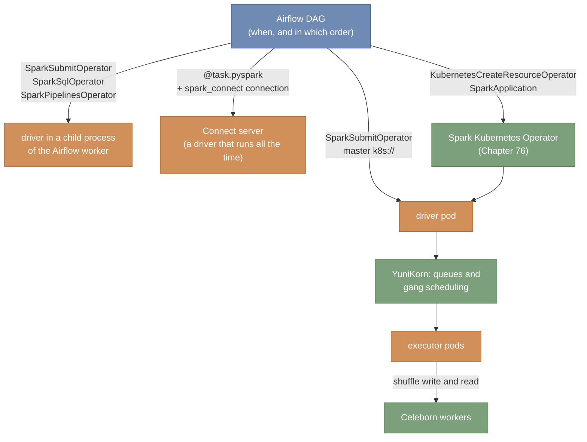
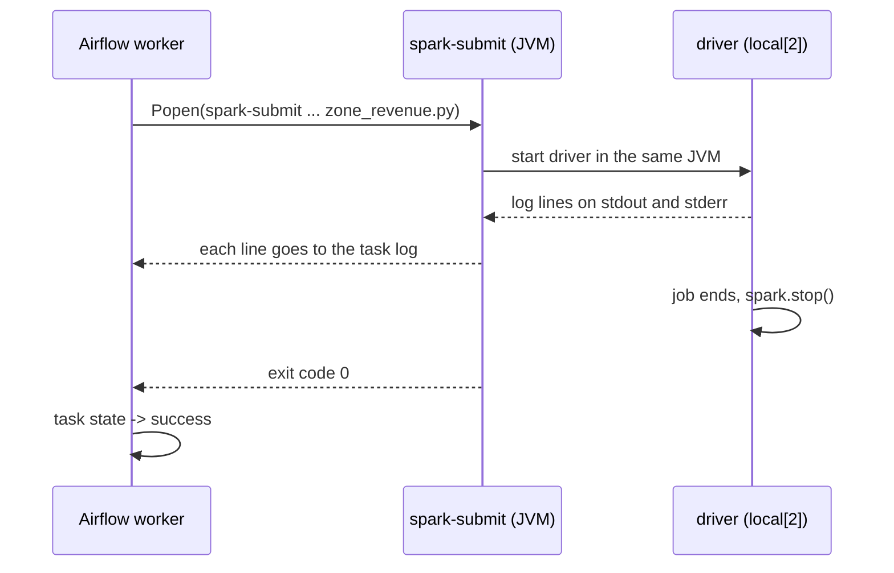
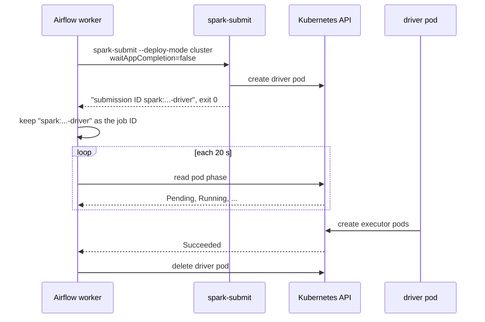
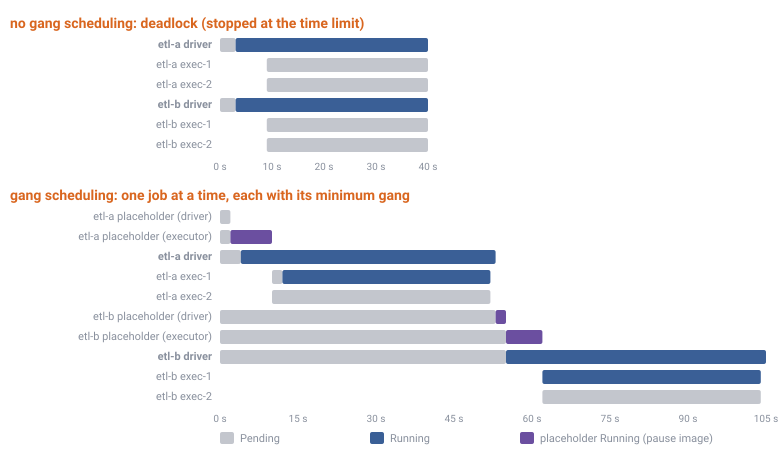
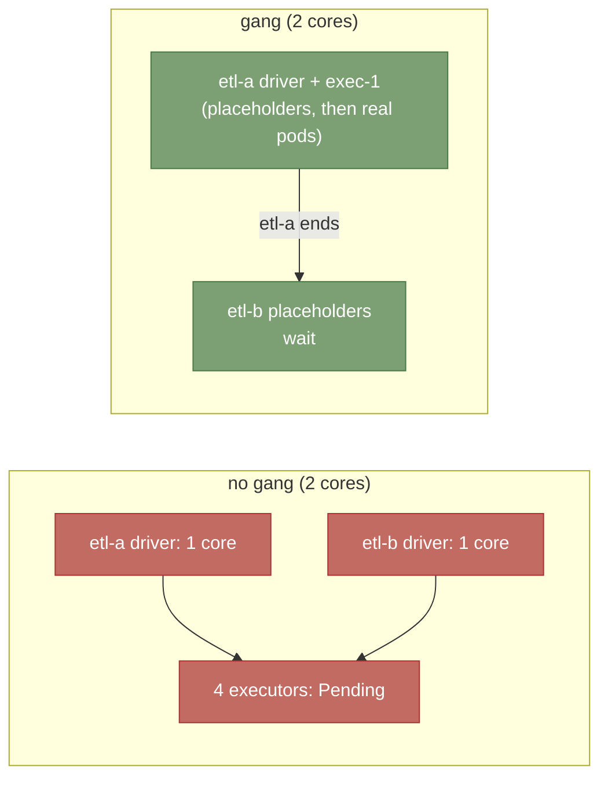
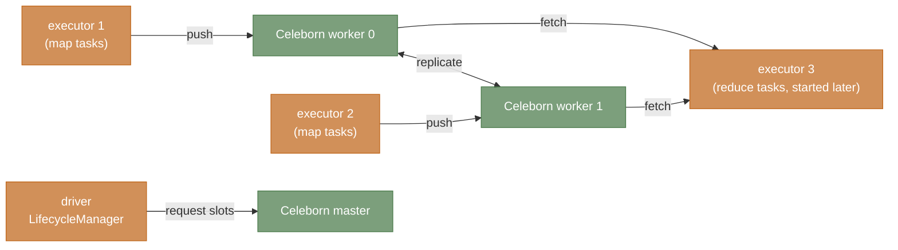
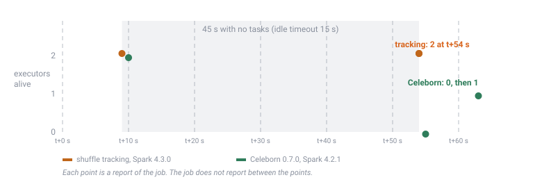
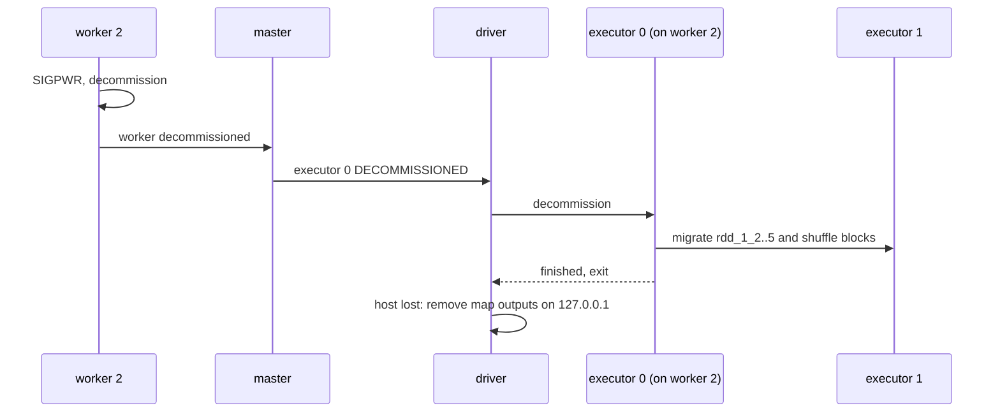

# Chapter 77: Orchestrating Spark: Airflow, operators, YuniKorn and Celeborn

A Spark job that runs once from a terminal is easy. A Spark job that runs each night, after its inputs arrive, on a cluster that other teams also use, is a different problem. Three systems help with this problem, and each system has a different job:

- **An orchestrator** (in this chapter, Apache Airflow) decides when a job runs and what runs after it.
- **A batch scheduler for Kubernetes** (Apache YuniKorn or Volcano) decides which pods get CPU and memory, and in which order.
- **A remote shuffle service** (Apache Celeborn) keeps shuffle data outside the executors, so that executors can stop before the job ends.

**Airflow does not run Spark. It starts a Spark driver, or sends a plan to a driver that already runs, and then it waits. Each Airflow operator puts the driver in a different location. The location controls what the Airflow worker must contain. It also controls what occurs when a task fails.**

**On Kubernetes, the default scheduler and the default shuffle are not sufficient for Spark. A driver can start and then wait forever for executors, and an executor that holds shuffle data cannot stop. YuniKorn and Celeborn correct these two problems. Celeborn 0.7.0 does not support Spark 4.3.0.**

This chapter runs each part for real. A local Airflow 3.4.0 runs DAGs against Spark 4.3.0, on the laptop and on a kind cluster with three nodes. YuniKorn schedules Spark pods on that cluster, and Celeborn holds the shuffle data of a Spark job. [Chapter 76](ch76-kubernetes-operator.md) explains the Apache Spark Kubernetes Operator. This chapter only uses that operator from Airflow.

The code is [`code/ch77`](https://github.com/lisancao/spark-masterclass/tree/main/code/ch77).

## The layers



The versions in this chapter:

```text
apache-airflow                             3.4.0
apache-airflow-providers-apache-spark      6.3.4
apache-airflow-providers-cncf-kubernetes   10.25.0
pyspark-client                             4.3.0
kubernetes                                 36.0.3

RELEASE                    NAMESPACE       CHART                            APP_VERSION
celeborn                   celeborn        celeborn-0.1.0                   0.7.0
spark-kubernetes-operator  spark-operator  spark-kubernetes-operator-1.9.0  1.1.0
yunikorn                   yunikorn        yunikorn-1.10.0                  -

NAME                STATUS  VERSION
ch77-control-plane  Ready   v1.37.0
ch77-worker         Ready   v1.37.0
ch77-worker2        Ready   v1.37.0
```

- Apache Airflow 3.4.0, released on 6 November 2026, with its official constraints file for Python 3.12.
- The Apache Spark provider, `apache-airflow-providers-apache-spark==6.3.4`, released on 24 October 2026. It is the current release on PyPI (6.3.5 is a release candidate).
- The Kubernetes provider, `apache-airflow-providers-cncf-kubernetes==10.25.0`. This version is the version in the Airflow 3.4.0 constraints file. Version 11.0.0 is also on PyPI, but it is not in the constraints file.
- Apache YuniKorn 1.10.0 (Helm chart 1.10.0), Apache Celeborn 0.7.0, and the Apache Spark Kubernetes Operator 1.1.0 (Helm chart 1.9.0).
- kind 0.33.0 with Kubernetes 1.37.0: one control plane and two workers.

## Step 1: Install Airflow next to Spark, not inside it

`code/ch77/airflow_env.sh` makes a separate virtual environment for Airflow. It installs Airflow and the provider with the constraints file of the Airflow release:

```bash
VIRTUAL_ENV="$WORK/airflow-venv" uv pip install -q \
  "apache-airflow==$AIRFLOW_VERSION" \
  "apache-airflow-providers-apache-spark[cncf-kubernetes]" \
  --constraint "$WORK/constraints-$PY.txt"
```

The `[cncf-kubernetes]` extra adds the Kubernetes provider. Step 5 uses it. The provider requires `pyspark-client>=4.0.0`, the thin Connect client from [Chapter 24](ch24-spark-connect.md). The provider does not require `pyspark` (that is the `[pyspark]` extra). Thus, the Airflow environment does not contain a JVM or the Spark jars.

The operators that start `spark-submit` or `spark-sql` need these commands on the `PATH` of the Airflow worker. In this chapter, they come from the Spark 4.3.0 tarball of [Chapter 6](ch06-installing.md). `code/ch77/af.sh` runs each `airflow` command with this environment. It also gives Airflow its connections as environment variables, so the metadata database contains no secrets:

```bash
# Connections, in Airflow's JSON form.
export AIRFLOW_CONN_SPARK_LOCAL='{"conn_type": "spark", "host": "local[2]"}'
export AIRFLOW_CONN_SPARK_SQL_LOCAL='{"conn_type": "spark_sql", "host": "local[2]"}'
export AIRFLOW_CONN_SPARK_CONNECT_CH48='{"conn_type": "spark_connect", "host": "localhost", "port": 15064, "login": "airflow"}'
```

This Airflow uses its own `AIRFLOW_HOME` and port 8148. The chapter runs each DAG with `airflow dags test`. This command runs all the tasks of one DAG run in one process, with no scheduler and no web server. Each task still runs through the Task SDK, with the same operator code as in production.

## Step 2: See the command that each operator builds

Each operator in the provider is a thin layer over a hook, and each hook builds a command line or a URL. `code/ch77/commands.py` calls only the methods that build these commands. Thus, it needs no Spark and no Airflow database:

```text
# SparkSubmitOperator, conn spark_local
spark-submit --master local[2] --conf spark.sql.shuffle.partitions=8 --driver-memory \
    1g --name ch77-zone-revenue jobs/zone_revenue.py

# SparkSubmitOperator, conn spark_k8s, track_driver_via_k8s_api=True
spark-submit --master k8s://https://127.0.0.1:6443 --conf \
    spark.kubernetes.scheduler.name=yunikorn --conf \
    spark.kubernetes.namespace=spark-jobs --name ch77-zone-revenue --deploy-mode \
    cluster --conf spark.kubernetes.submission.waitAppCompletion=false \
    local:///opt/ch77/jobs/zone_revenue.py

# SparkSqlOperator, conn spark_sql_local
spark-sql -e SELECT 1 --master local[2] --name ch77-top-zones --queue default

# SparkPipelinesOperator, pipeline_command='dry-run', conn spark_local
spark-pipelines dry-run --spec pipeline.yml --master local[2] --name default-name

# SparkPipelinesOperator, pipeline_command='dry-run', conn spark_connect_ch48
python -m pyspark.pipelines.cli dry-run --spec pipeline.yml

# SparkConnectHook('spark_connect_ch48').get_connection_url()
sc://localhost:15064/

# SparkConnectHook('spark_connect_prod').get_connection_url()
sc://spark.example.com:443/;user_id=etl;token=s3cret;use_ssl=True

# SparkConnectHook('spark_connect_path').get_connection_url()
ValueError: Path {url.path} is not supported in Spark Connect connection URL

# Jinja on a template field (the DAG's own template environment)
'{{APP_ID}}'             -> UndefinedError: 'APP_ID' is undefined
"{{ '{{APP_ID}}' }}"     -> '{{APP_ID}}'
```

These are the important points in this output:

- **`SparkSubmitOperator`** builds a `spark-submit` command. The `--master` value and the deploy mode come from the connection. The other arguments (`conf`, `driver_memory`, `name`) come from the operator.
- With a `k8s://` master and `track_driver_via_k8s_api=True`, the hook adds `spark.kubernetes.submission.waitAppCompletion=false`. Thus, `spark-submit` exits when the driver pod exists, and Airflow polls the pod. Step 5 shows this mode.
- **`SparkSqlOperator`** builds a `spark-sql -e` command. It adds `--queue default`, which is a YARN option. The local master ignores it.
- **`SparkPipelinesOperator`** runs Spark Declarative Pipelines. `pipeline_command` is `run` or `dry-run`. With a Spark connection, the hook starts the `spark-pipelines` launcher. With a Spark Connect connection, it runs `python -m pyspark.pipelines.cli` in the interpreter of the Airflow worker, and it sets `SPARK_REMOTE` from the connection. A `dry-run` task is a good first task in a pipeline DAG: it finds broken references and unresolved columns before Spark reads any data.
- **`SparkConnectHook`** makes an `sc://` URL from a `spark_connect` connection. The login becomes `user_id`, the password becomes `token`, and the extra field `use_ssl` becomes a URL parameter. The token is in clear text in the URL. Thus, do not log this URL.
- A host that contains a path gives a `ValueError`. In provider 6.3.4, the message shows the literal text `{url.path}` and not the path, because the string has no `f` prefix. A later provider release can correct this message.
- **Jinja renders every template field.** The `conf` of `SparkSubmitOperator` and the `yaml_conf` of `KubernetesCreateResourceOperator` are template fields. Spark uses `{{APP_ID}}` as its own placeholder in some config values. Airflow 3 renders templates with `StrictUndefined`, so this placeholder stops the task with `UndefinedError`. The Jinja string literal `{{ '{{APP_ID}}' }}` gives the text to Spark without a change.

## Step 3: A DAG that runs `spark-submit`, then `spark-sql`

The first DAG has two tasks. The first task runs a batch job that writes the revenue of June 2026 by pickup borough to Parquet. The second task queries that Parquet output with SQL:

```python
revenue = SparkSubmitOperator(
    task_id="zone_revenue",
    conn_id="spark_local",
    application=f"{CH48}/jobs/zone_revenue.py",
    application_args=[TAXI, OUT, "{{ run_id }}"],
    name="ch77-zone-revenue",
    conf={"spark.ui.port": "4064", "spark.sql.shuffle.partitions": "8"},
    driver_memory="1g",
)

top3 = SparkSqlOperator(
    task_id="top_zones",
    conn_id="spark_sql_local",
    sql="top_zones.sql",          # a file in template_searchpath, rendered with Jinja
    conf={"spark.ui.port": "4064"},
    name="ch77-top-zones",
    verbose=False,
)

```

`top_zones.sql` is a file in `template_searchpath`. Airflow renders it with Jinja before the task starts, so `{{ params.out }}` becomes the output path:

```sql
SELECT Borough, trips, CAST(revenue AS BIGINT) AS revenue
FROM parquet.`{{ params.out }}`
ORDER BY revenue DESC
LIMIT 3;
```

The output of `af.sh dags test ch77_taxi_submit`, shortened by `airflow_log.py` to the lines that matter:

```text
09:53:11  running task zone_revenue
09:53:17  Spark-Submit cmd: spark-submit --master local[2] --conf spark.ui.port=4064 --conf spark.sql.shuffle.partitions=8 --driver-memory 1g --name ch77-zone-revenue …/zone_revenue.py ~/spark-masterclass/data/nyc-taxi …/zone_revenue manual__<run>
09:53:41  ZONE_REVENUE run=manual__<run> spark=4.3.0 master=local[2]
09:53:41  ZONE_REVENUE Manhattan       3,374,269 trips  $    90,000,789
09:53:41  ZONE_REVENUE Queens            319,164 trips  $    22,374,570
09:53:41  ZONE_REVENUE Brooklyn          106,652 trips  $     4,107,067
09:53:41  ZONE_REVENUE Bronx              14,955 trips  $       533,102
09:53:41  ZONE_REVENUE N/A                 2,355 trips  $       258,590
09:53:41  ZONE_REVENUE Unknown             4,109 trips  $       155,703
09:53:41  ZONE_REVENUE EWR                   565 trips  $        67,976
09:53:41  ZONE_REVENUE Staten Island         236 trips  $        12,809
09:53:41  ZONE_REVENUE 8 rows written to …/out/zone_revenue in 8.9 s
09:53:41  task state -> success
09:53:41  running task top_zones
09:54:04  Manhattan	3374269	90000789
09:54:04  Queens	319164	22374570
09:54:04  Brooklyn	106652	4107067
09:54:04  Time taken: 6.062 seconds, Fetched 3 row(s)
09:54:05  task state -> success
09:54:05  DagRun Finished: run_duration=54.307048, state=success
```



Each task starts a JVM in a child process of the Airflow worker. In client mode, the driver runs in that JVM. These are the results of this design:

- The Airflow worker must have Java and a Spark installation of the correct version. The provider does not install them.
- The driver uses the memory of the Airflow worker. `driver_memory="1g"` gives the driver JVM 1 GB of heap on the worker.
- The hook reads each line of the `spark-submit` output and sends it to the task log. If Airflow stops the task, the hook kills the `spark-submit` process.
- Each task is a new Spark application. The second task cannot use a DataFrame of the first task. It reads the Parquet files that the first task wrote. Between tasks, data moves through storage, not through Airflow.

The animation shows this DAG run. The task times and the log lines come from the output above.

<figure markdown>
  <video autoplay loop muted playsinline controls width="1280" height="720" poster="../../media/clips/ch77-anim-handoff.webp">
    <source src="../../media/clips/ch77-anim-handoff.mp4" type="video/mp4">
  </video>
  <figcaption>Each task starts its own JVM on the Airflow worker. The first task writes Parquet files, and the second task reads them.</figcaption>
</figure>

## Step 4: A task with no JVM, over Spark Connect

The second DAG asks a question over Spark Connect. The `@task.pyspark` decorator gives the function a `SparkSession`. With a `spark_connect` connection, that session is a thin Connect client, and the driver is the Connect server on `sc://localhost:15064`:

```python
@task.pyspark(conn_id="spark_connect_ch48")
def busiest_zones(spark=None):
    from pyspark.sql import functions as F

    trips = spark.read.parquet(f"{TAXI}/yellow")
    rows = (trips.where(F.col("tpep_pickup_datetime") >= "2026-06-01")
                 .groupBy("PULocationID").count()
                 .orderBy(F.desc("count")).limit(3).collect())
    print("CONNECT session:", type(spark).__module__, "server", spark.version)
    return [(r.PULocationID, r["count"]) for r in rows]       # an XCom: plain data, not a DataFrame

@task
def report(zones):
    for zone, n in zones:
        print(f"CONNECT zone {zone:>3}: {n:,} pickups")

report(busiest_zones())
```

`code/ch77/connect_server.sh` starts the server from the pip install of Spark 4.3.0, with gRPC on port 15064 and the UI on port 4064. The DAG run:

```text
09:56:10  running task busiest_zones
          CONNECT session: pyspark.sql.connect.session server 4.3.0
09:56:20  Done. Returned value was: [(237, 177610), (161, 161198), (236, 157113)]
09:56:20  task state -> success
09:56:20  running task report
          CONNECT zone 237: 177,610 pickups
          CONNECT zone 161: 161,198 pickups
          CONNECT zone 236: 157,113 pickups
09:56:20  task state -> success
09:56:20  DagRun Finished: run_duration=10.221635, state=success
```

<figure markdown>
  <video autoplay loop muted playsinline controls width="1280" height="720" poster="../../media/clips/ch77-connect.webp">
    <source src="../../media/clips/ch77-connect.mp4" type="video/mp4">
  </video>
  <figcaption>An Airflow task with no JVM sends its query to a Connect server. Then the 4.3 REST API of the server shows the session of the task and its one operation.</figcaption>
</figure>

The provider code that makes this session is `PySparkOperator.execute_callable`. It does these steps:

1. It reads the connection. If the connection type is `spark_connect`, it makes the `sc://` URL with `SparkConnectHook` and sets `spark.remote`. For other connection types, it sets `spark.master` (the default is `local[*]`).
2. It copies the extra fields of the connection, and then `config_kwargs`, into the session config.
3. It calls `getOrCreate()`, and it gives the session to the function as `spark`.
4. It calls `spark.stop()` in a `finally` block, also when the function fails.

The function returns a list of tuples. Airflow keeps the return value as an XCom in its metadata database. Thus, return small, plain data, such as counts, paths or IDs. Do not return a DataFrame or many rows.

Spark 4.3 adds sessions and operations to the monitoring REST API of the server ([Chapter 24](ch24-spark-connect.md#step-5-find-the-failure-on-the-server-new-in-43)). `code/ch77/connect_rest.py` reads these records after the DAG run:

```text
# GET .../connect/sessions
session 96d207f9  user=airflow  started 09:56:15  finished 09:56:20  operations=1

# GET .../connect/operations
operation eb52e92f  session 96d207f9  state=CLOSED  jobs=0,1,2  sql=0
  call site: ch77/dags/taxi_connect.py:28
```

The record shows these facts about the task:

- The user is `airflow`, from the login of the connection.
- The session has a finish time, because the operator stopped the session at the end of the task. Without this stop, the server keeps the session until its idle timeout.
- The call site is the line in the DAG file that built the query. When a Connect server runs queries for many DAGs, this field tells you which task sent which query.

## Step 5: Spark on Kubernetes from Airflow, in two ways

For production, the driver usually runs on the cluster, not on the Airflow worker. On Kubernetes, there are two methods to start it from Airflow:

- **`SparkSubmitOperator` with a `k8s://` master in cluster mode.** `spark-submit` creates the driver pod. The driver creates its executor pods.
- **A `SparkApplication` resource of the Apache Spark Kubernetes Operator.** Airflow creates the resource with `KubernetesCreateResourceOperator`. The Spark operator submits the application and records its state in the resource. [Chapter 76](ch76-kubernetes-operator.md) explains the operator and its resource.

`code/ch77/dags/taxi_k8s.py` does the two methods, one after the other, with the same job file. The first task:

```python
submit = SparkSubmitOperator(
    task_id="zone_revenue_submit",
    # master k8s://..., deploy-mode cluster, namespace spark. CH48_SUBMIT_CONN=spark_k8s_jobs uses the
    # namespace spark-jobs, where provider 6.3.4 cannot find the driver pod (see the chapter).
    conn_id=os.environ.get("CH48_SUBMIT_CONN", "spark_k8s"),
    application="local:///opt/ch77/jobs/zone_revenue.py",
    application_args=["/data/nyc-taxi", "-", "{{ run_id }}"],
    name="ch77-submit",
    conf={
        f"{K}.container.image": "apache/spark:4.3.0-python3",
        f"{K}.container.image.pullPolicy": "Never",
        f"{K}.authenticate.driver.serviceAccountName": "spark",
        "spark.executor.instances": "2", "spark.executor.cores": "1",
        "spark.executor.memory": "1g", "spark.driver.memory": "1g",
        **YUNIKORN, **VOLUMES,
    },
    track_driver_via_k8s_api=True,             # spark-submit exits; Airflow polls the driver pod
    status_poll_interval=20,
)
```

`YUNIKORN` and `VOLUMES` are two dictionaries at the top of the file. They send the pods to the YuniKorn queue `root.etl` (Step 8) and mount the taxi data and the job file from each node. The second and third tasks create the `SparkApplication` and wait for it:

```python
create_app = KubernetesCreateResourceOperator(
    task_id="zone_revenue_app",
    yaml_conf=manifest,                        # rendered with Jinja: name, run_id
    custom_resource_definition=True,
)

@task.sensor(poke_interval=10, timeout=600, mode="poke")
def wait_for_app(ts_nodash=None):
    hook = KubernetesHook()
    name = f"zone-revenue-{ts_nodash.lower()}"
    app = hook.get_custom_object(group="spark.apache.org", version="v1", plural="sparkapplications",
                                 name=name, namespace="spark-apps")
    status = app.get("status", {})
    history = [h["currentStateSummary"] for _, h in sorted(
        status.get("stateTransitionHistory", {}).items(), key=lambda kv: int(kv[0]))]
    print(f"APP {name} state {status.get('currentState', {}).get('currentStateSummary', '-')}")
    end = next((s for s in history if s in ("Succeeded", "Failed", "SchedulingFailure")), None)
    if end:
        print("APP history:", " > ".join(history))
        return PokeReturnValue(is_done=True, xcom_value=end)
    return PokeReturnValue(is_done=False)
```

The resource is in `code/ch77/k8s/zone-revenue-app.yaml`. Airflow renders the file with Jinja, so that the resource name and the `run_id` change for each DAG run. `resourceRetainPolicy: Always` keeps the driver pod after the application ends, so that the last task can read its log. The DAG run:

```text
10:21:10  running task zone_revenue_submit
10:21:19  Identified spark driver pod: ch77-submit-42aae2a202c6409d-driver
10:21:19  Spark K8s driver pod submitted: spark:ch77-submit-42aae2a202c6409d-driver
10:21:19  Application status for ch77-submit-42aae2a202c6409d-driver (phase: Pending)
10:21:39  Application status for ch77-submit-42aae2a202c6409d-driver (phase: Running)
10:21:59  Application status for ch77-submit-42aae2a202c6409d-driver (phase: Running)
10:22:19  Application status for ch77-submit-42aae2a202c6409d-driver (phase: Succeeded)
10:22:19  Deleting driver pod ch77-submit-42aae2a202c6409d-driver on Kubernetes
10:22:19  Deleted driver pod ch77-submit-42aae2a202c6409d-driver
10:22:19  task state -> success
10:22:19  running task zone_revenue_app
10:22:19  task state -> success
10:22:19  running task wait_for_app
          APP zone-revenue-20261122t102108 state -
          APP zone-revenue-20261122t102108 state DriverRequested
          APP zone-revenue-20261122t102108 state RunningHealthy
          APP zone-revenue-20261122t102108 state RunningHealthy
          APP zone-revenue-20261122t102108 state RunningHealthy
          APP zone-revenue-20261122t102108 state TerminatedWithoutReleaseResources
          APP history: Submitted > DriverRequested > DriverStarted > DriverReady > RunningHealthy > Succeeded > TerminatedWithoutReleaseResources
10:23:10  task state -> success
10:23:10  running task driver_log
          APP driver pod zone-revenue-20261122t102108-0-driver, scheduler yunikorn, yunikorn app-id zone-revenue-20261122t102108-0
          ZONE_REVENUE run=manual__<run> spark=4.3.0 master=k8s://https://$KUBERNETES_SERVICE_HOST:$KUBERNETES_SERVICE_PORT
          ZONE_REVENUE Manhattan       3,374,269 trips  $    90,000,789
          ZONE_REVENUE Queens            319,164 trips  $    22,374,570
          ZONE_REVENUE Brooklyn          106,652 trips  $     4,107,067
          ZONE_REVENUE Bronx              14,955 trips  $       533,102
          ZONE_REVENUE N/A                 2,355 trips  $       258,590
          ZONE_REVENUE Unknown             4,109 trips  $       155,703
          ZONE_REVENUE EWR                   565 trips  $        67,976
          ZONE_REVENUE Staten Island         236 trips  $        12,809
          ZONE_REVENUE 8 rows in 7.9 s
10:23:10  task state -> success
10:23:10  DagRun Finished: run_duration=120.662846, state=success
```



With `track_driver_via_k8s_api=True`, the Airflow worker does not keep a `spark-submit` JVM for the full job. It polls the phase of the driver pod each 20 seconds (the minimum). On success, the hook deletes the driver pod.

The operator also has the parameter `durable`. Its default is `True`. With Airflow 3.3 or later, the operator saves the job ID (here, `spark:ch77-submit-...-driver`) in the task state store before it polls. If the Airflow worker stops and Airflow tries the task again, the new try finds the saved ID and polls the same driver pod. It does not submit a second copy of the job.

The same mechanism uses the driver ID in standalone cluster mode and the YARN application ID in YARN cluster mode. This chapter did not stop a worker to test this behavior.

!!! warning "Use a namespace named `spark` with `track_driver_via_k8s_api` in provider 6.3.4"
    Provider 6.3.4 finds the driver pod only in the namespace `spark`. In other namespaces, the task fails, and the driver pod continues to run.

The first run of this DAG used the namespace `spark-jobs`. To get this run again, set `CH48_SUBMIT_CONN=spark_k8s_jobs`:

```text
10:14:25  running task zone_revenue_submit
10:14:34  Deployed Spark application ch77-submit with application ID 
spark-c0bad92164d448bdb599ae89696f7c50 and submission ID 
spark-jobs:ch77-submit-ce4807a202c014c2-driver into Kubernetes
          raise RuntimeError("spark-submit did not capture a K8s driver pod name")
          RuntimeError: spark-submit did not capture a K8s driver pod name
10:14:34  task state -> failed
10:14:36  DagRun Finished: run_duration=11.450465, state=failed

$ kubectl -n spark-jobs get pods -l spark-role=driver
NAME                                  READY   STATUS    RESTARTS   AGE
ch77-submit-ce4807a202c014c2-driver   1/1     Running   0          47s
```

The cause is a regular expression in `SparkSubmitHook._process_spark_submit_log`. In cluster mode with `waitAppCompletion=false`, Spark logs only one line about the driver pod: `submission ID <namespace>:<pod name>`. The hook looks for `submission ID spark:(.+?-driver)`. Thus, it matches only when the namespace is the literal text `spark`. The unit test of the provider also uses a namespace named `spark`, so the test cannot find this problem.

This failure has two bad results. The Airflow task fails, but the Spark job continues on the cluster. If the task has retries, each retry submits one more copy of the job. The notes of this chapter record this problem as an open problem. Until a provider release corrects it, use one of these workarounds:

- Run the Spark pods in a namespace named `spark`, as this chapter does.
- Set `track_driver_via_k8s_api=False`. Then `spark-submit` waits for the application, and the hook looks for the `pod name:` lines that Spark logs during the wait. This chapter did not test this mode on Kubernetes.
- Use a `SparkApplication` and a sensor, as in the second half of this DAG.

**Which method to use.** `SparkSubmitOperator` keeps all the Spark settings in the DAG, and it needs only the Spark tarball and access to the Kubernetes API. A `SparkApplication` keeps the settings in a Kubernetes resource that `kubectl` can read and change. The Spark operator can also try a failed application again and remove its pods. Thus, Airflow does less, and the cluster does more. With a `SparkApplication`, the Airflow worker needs no Spark installation.

## Step 6: `SparkKubernetesOperator` is for the Kubeflow operator

The Kubernetes provider has an operator with a name that seems correct for the second method: `SparkKubernetesOperator`. But it is not the correct operator.

The docstring of this operator links to the API of the Kubeflow Spark operator (`sparkoperator.k8s.io/v1beta2`). Its code reads `spec.driver` and `status.applicationState.state`. These fields are in the Kubeflow resource. The resource of the Apache operator (`spark.apache.org/v1`) has `driverSpec` and `status.currentState`. `code/ch77/dags/wrong_operator.py` gives the `pi-python` example of the Apache operator to `SparkKubernetesOperator`:

```text
10:23:49  running task apache_app_with_kubeflow_operator
10:23:53  Creating sparkApplication.
          labels=self.spark_obj_spec["spec"]["driver"].get("labels"),
          KeyError: 'driver'
10:23:53  task state -> failed
10:23:53  DagRun Finished: run_duration=4.00715, state=failed

$ kubectl -n spark-apps get sparkapplications
NAME                 AGE   CURRENT STATE
pi-python-udtf08cz   14s   DriverReady
```

The operator created the resource first, and then it failed when it read `spec.driver`. Thus, the Spark application runs on the cluster after the Airflow task fails. With retries, each retry starts one more application.

There are two Kubernetes operators for Spark. Their resources have the same kind name, `SparkApplication`, but they are not compatible:

| | Kubeflow Spark operator | Apache Spark Kubernetes Operator |
|---|---|---|
| Project | [kubeflow/spark-operator](https://github.com/kubeflow/spark-operator), latest release v2.6.0 (11 November 2026) | [apache/spark-kubernetes-operator](https://github.com/apache/spark-kubernetes-operator), latest release 1.1.0 |
| Resource | `sparkoperator.k8s.io/v1beta2` `SparkApplication`, `ScheduledSparkApplication` | `spark.apache.org/v1` `SparkApplication`, `SparkCluster` |
| How it submits | The operator (in Go) runs `spark-submit` in its own pod. The image of v2.6.0 has Spark 4.2.1. | The operator (in Java) submits through the Spark Kubernetes client in its own JVM ([Chapter 76](ch76-kubernetes-operator.md)) |
| Pod changes | A mutating admission webhook changes driver and executor pods | Pod templates and `sparkConf` |
| From Airflow | `SparkKubernetesOperator` and `SparkKubernetesSensor` (cncf.kubernetes provider) | `KubernetesCreateResourceOperator` and a sensor that reads `status.currentState` (Step 5) |

For a new installation on Spark 4.3, this book uses the Apache operator. It is a subproject of Apache Spark, and the examples of its 1.1.0 release use Spark 4.3.0. If a cluster already runs the Kubeflow operator, `SparkKubernetesOperator` is the operator to use with it.

## Step 7: Why Spark needs a batch scheduler on Kubernetes

The default Kubernetes scheduler places one pod at a time. It does not know that a driver pod is useless without executor pods. This test sends two Spark jobs at the same time to a queue with a maximum of 2 cores. Each job asks for one driver and two executors, with 1 core each. `code/ch77/yunikorn_demo.sh plain` sends the two jobs and prints each change of pod phase:

```text
t+   0s  etl-a driver                   Pending
t+   0s  etl-b driver                   Pending
t+   3s  etl-a driver                   Running
t+   3s  etl-b driver                   Running
t+   9s  etl-a exec-1                   Pending
t+   9s  etl-a exec-2                   Pending
t+   9s  etl-b exec-1                   Pending
t+   9s  etl-b exec-2                   Pending
yunikorn  etl-b  Running    cores used 1, cores waiting 2
yunikorn  etl-a  Running    cores used 1, cores waiting 2
yunikorn  queue root.etl  cores used 2 of max 2
Request <exec-1> does not fit in queue 'root.etl' (requested map[memory:1502609408 pods:1 
vcore:1000], available map[memory:5584715776 pods:328 vcore:0])
WARN TaskSchedulerImpl: Initial job has not accepted any resources; check your cluster UI 
to ensure that workers are registered and have sufficient resources
```

<figure markdown>
  <video autoplay loop muted playsinline controls width="1280" height="720" poster="../../media/clips/ch77-plain.webp">
    <source src="../../media/clips/ch77-plain.mp4" type="video/mp4">
  </video>
  <figcaption>Two drivers start and use the two cores of the queue. Their four executors stay `Pending`, so no job can make progress.</figcaption>
</figure>

Each driver started, and each driver used 1 core. Thus, the queue had no free cores for executors. The two drivers wait for executors that cannot start, and the scheduler waits for cores that the drivers do not release. Neither job can end. The driver log says only that the job "has not accepted any resources". The script stops the two jobs after the time limit.

This test uses a YuniKorn queue without gang scheduling, so that the limit is small and easy to see. The same deadlock can occur with the default scheduler when the cluster or a namespace quota is full of driver pods.

## Step 8: Gang scheduling and queues with YuniKorn

Gang scheduling starts an application only when the scheduler can place a minimum set of its pods together. YuniKorn does this with placeholder pods. Before the real pods start, YuniKorn creates placeholder pods that request the same resources. When it can place all the placeholders, it replaces each placeholder with a real pod.

`code/ch77/yunikorn.sh` installs YuniKorn 1.10.0 with Helm. The admission controller is off, as in the Spark 4.3 docs. Thus, only the pods that ask for the scheduler `yunikorn` go to YuniKorn. The Helm values also define the queues:

```yaml
yunikornDefaults:
  queues.yaml: |
    partitions:
      - name: default
        placementrules:
          - name: provided       # the queue that the pod names in its "queue" label
            create: false
          - name: fixed          # all other pods
            value: root.default
        queues:
          - name: root
            submitacl: "*"
            queues:
              - name: default
              - name: etl        # a small queue: 2 cores in total, for driver and executor pods
                resources:
                  max: {vcore: "2", memory: 8Gi}
```

The `provided` placement rule puts each pod in the queue that its `queue` label names. A Spark job selects YuniKorn with three settings. The `{{APP_ID}}` annotation gives the driver and its executors one application ID in YuniKorn:

```bash
# YuniKorn: the scheduler name, the queue, and one application ID for the driver and its executors
--conf $K.scheduler.name=yunikorn
--conf $K.driver.label.queue="$QUEUE" --conf $K.executor.label.queue="$QUEUE"
--conf $K.driver.annotation.yunikorn.apache.org/app-id='{{APP_ID}}'
--conf $K.executor.annotation.yunikorn.apache.org/app-id='{{APP_ID}}'
```

For gang scheduling, the driver pod also carries the task groups of the application. In this test, the minimum is one driver and one executor:

```bash
# One driver and MIN_EXEC executors, each 1 CPU and 1433Mi (1g of heap plus 40%: the overhead factor for Python jobs).
groups='[{"name":"driver","minMember":1,"minResource":{"cpu":"1","memory":"1433Mi"}},
         {"name":"executor","minMember":'$MIN_EXEC',"minResource":{"cpu":"1","memory":"1433Mi"}}]'
args+=(
  --conf $K.driver.annotation.yunikorn.apache.org/task-group-name=driver
  --conf $K.driver.annotation.yunikorn.apache.org/task-groups="$(echo $groups | tr -d ' ')"
  --conf $K.driver.annotation.yunikorn.apache.org/schedulingPolicyParameters="placeholderTimeoutInSeconds=120 gangSchedulingStyle=Hard"
  --conf $K.executor.annotation.yunikorn.apache.org/task-group-name=executor
)
```

The memory of each task group is 1433Mi: 1 GB of heap plus 40%. 40% is the memory overhead factor that Spark uses for Python applications on Kubernetes. If the task group asks for less than the real pod, the real pod does not fit in the space of its placeholder. `gangSchedulingStyle=Hard` fails the application if YuniKorn cannot place all the placeholders before the timeout. The default style, `Soft`, changes to normal scheduling after the timeout ([YuniKorn gang scheduling guide](https://yunikorn.apache.org/docs/user_guide/gang_scheduling)).

This is one of the placeholder pods that YuniKorn made. It runs the `pause` image and requests the resources of its task group:

```json
{
  "name": "tg-spark-716f3c872a014860b7b3b8-executor-36t62efbg3",
  "labels": {
    "yunikorn.apache.org/app-id": "spark-716f3c872a014860b7b3b88057c9454c",
    "yunikorn.apache.org/queue": "root.etl"
  },
  "scheduler": "yunikorn",
  "annotations": {
    "internal.yunikorn.apache.org/placeholder": "true",
    "yunikorn.apache.org/schedulingPolicyParameters": "placeholderTimeoutInSeconds=120 gangSchedulingStyle=Hard",
    "yunikorn.apache.org/task-group-name": "executor"
  },
  "image": "registry.k8s.io/pause:3.7",
  "requests": {
    "cpu": "1",
    "memory": "1433Mi"
  }
}
```

The same two jobs, now with gang scheduling:

```text
t+   0s  etl-a driver                   Pending
t+   0s  etl-a placeholder (driver)     Pending
t+   0s  etl-a placeholder (executor)   Pending
t+   0s  etl-b driver                   Pending
t+   0s  etl-b placeholder (driver)     Pending
t+   0s  etl-b placeholder (executor)   Pending
t+   2s  etl-a placeholder (executor)   Running
t+   2s  etl-a placeholder (driver)     deleted
t+   4s  etl-a driver                   Running
t+  10s  etl-a exec-1                   Pending
t+  10s  etl-a exec-2                   Pending
t+  10s  etl-a placeholder (executor)   deleted
t+  12s  etl-a exec-1                   Running
t+  52s  etl-a exec-2                   deleted
t+  52s  etl-a exec-1                   deleted
t+  53s  etl-a driver                   Completed
t+  53s  etl-b placeholder (driver)     Running
t+  55s  etl-b driver                   Running
t+  55s  etl-b placeholder (executor)   Running
t+  55s  etl-b placeholder (driver)     deleted
t+  62s  etl-b exec-1                   Running
t+  62s  etl-b exec-2                   Pending
t+  62s  etl-b placeholder (executor)   deleted
t+ 104s  etl-b exec-1                   deleted
t+ 104s  etl-b exec-2                   deleted
t+ 105s  etl-b driver                   Completed
yunikorn  etl-b  Completing cores used 0, cores waiting 0
yunikorn  queue root.etl  cores used 0 of max 2
```

<figure markdown>
  <video autoplay loop muted playsinline controls width="1280" height="720" poster="../../media/clips/ch77-gang.webp">
    <source src="../../media/clips/ch77-gang.mp4" type="video/mp4">
  </video>
  <figcaption>With gang scheduling, YuniKorn reserves a driver and an executor for one job. The other job waits, and it starts when the first job ends. In this video, etl-b got its gang first. The order of two jobs that arrive at the same time can change from run to run.</figcaption>
</figure>

YuniKorn reserved the two cores of the queue for `etl-a`: one placeholder for the driver and one for an executor. The real driver replaced its placeholder, and `exec-1` replaced the executor placeholder. `exec-2` stayed `Pending`, because the gang reserves the minimum, not all the executors that the job asks for. The job ran with one executor.

The placeholders of `etl-b` waited until `etl-a` ended. Then `etl-b` ran in the same way. The two jobs ran one after the other. The figure shows the pods of the two runs on time axes, from the outputs above.

<figure markdown>
  
  <figcaption>Top: without gang scheduling, the two drivers run, and the four executors wait. Bottom: with gang scheduling, the placeholders of <code>etl-b</code> wait until <code>etl-a</code> ends.</figcaption>
</figure>

Each job completed with the same result:

```text
ZONE_REVENUE run=etl-a spark=4.3.0 master=k8s://https://127.0.0.1:40611
ZONE_REVENUE Manhattan       3,374,269 trips  $    90,000,789
ZONE_REVENUE Queens            319,164 trips  $    22,374,570
ZONE_REVENUE Brooklyn          106,652 trips  $     4,107,067
ZONE_REVENUE Bronx              14,955 trips  $       533,102
ZONE_REVENUE N/A                 2,355 trips  $       258,590
ZONE_REVENUE Unknown             4,109 trips  $       155,703
ZONE_REVENUE EWR                   565 trips  $        67,976
ZONE_REVENUE Staten Island         236 trips  $        12,809
ZONE_REVENUE 8 rows in 9.9 s
```



If a gang is larger than the maximum of its queue, YuniKorn rejects the application. It does not let the application wait forever. Here, each job asks for a gang of one driver and two executors (3 cores) in a queue of 2 cores:

```text
NAME                            READY   STATUS                RESTARTS   AGE
etl-a-e673f3a202b39895-driver   0/1     ApplicationRejected   0          12s
etl-b-8f32b3a202b39b3f-driver   0/1     ApplicationRejected   0          12s
Application spark-1b24c0d907ca42e0a37bbfc9357e0a15 scheduling failed, reason: 
ApplicationRejected: queue root.etl cannot fit application 
spark-1b24c0d907ca42e0a37bbfc9357e0a15: task group request map[memory:4507828224 pods:3 
vcore:3000] larger than max queue allocation map[memory:8589934592 vcore:2000]
```

YuniKorn queues also give each team a share of the cluster. A queue has a guaranteed and a maximum share of resources, and the queues have a hierarchy (`root.etl`, `root.default`). The scheduler sorts the applications in a queue by a policy, for example FIFO or fair. The gang scheduling guide recommends a FIFO policy with gangs. With a different policy, the scheduler can reserve part of the resources for many applications at the same time.

## Step 9: Volcano

[Volcano](https://volcano.sh/en) is a batch scheduler for Kubernetes from the CNCF. It also gives queues, gang scheduling (with a `PodGroup` resource), and priorities. Spark supports Volcano with a feature step in its Kubernetes client, since Spark 3.3.0 and Volcano 1.7.0 ([running on Kubernetes, Volcano section](https://spark.apache.org/docs/4.3.0/running-on-kubernetes.html#using-volcano-as-customized-scheduler-for-spark-on-kubernetes)). The release tarball of Spark 4.3.0 contains this feature step: `spark-kubernetes_2.13-4.3.0.jar` has the class `VolcanoFeatureStep`, and `jars/` has `volcano-client-7.6.1.jar`. A Spark job selects Volcano with these settings, from the Spark 4.3 docs:

```bash
--conf spark.kubernetes.scheduler.name=volcano
--conf spark.kubernetes.scheduler.volcano.podGroupTemplateFile=/path/to/podgroup-template.yaml
--conf spark.kubernetes.driver.pod.featureSteps=org.apache.spark.deploy.k8s.features.VolcanoFeatureStep
--conf spark.kubernetes.executor.pod.featureSteps=org.apache.spark.deploy.k8s.features.VolcanoFeatureStep
```

The feature step creates a `PodGroup` for each application from the template. The template sets the minimum resources, the queue and the priority. YuniKorn and Volcano solve the same problem with different methods:

| | YuniKorn | Volcano |
|---|---|---|
| How it reserves a gang | Placeholder pods and annotations on the driver pod | Its own `PodGroup` resource, which Spark creates through the feature step |
| Change to the Spark pods | Only labels and annotations | A feature step on the driver and the executors |

This chapter ran only YuniKorn. The Volcano facts in this section come from the Spark 4.3 docs and the release jars, not from a run.

## Step 10: Remote shuffle with Celeborn

Dynamic allocation adds executors when tasks wait, and it removes executors that have no tasks. But an executor that wrote shuffle files holds data that a later stage needs. Spark cannot remove that executor unless the shuffle data is in a different location. `ExecutorAllocationManager.validateSettings` in Spark 4.3 accepts dynamic allocation only with one of these four conditions:

1. An external shuffle service (`spark.shuffle.service.enabled`).
2. Shuffle tracking (`spark.dynamicAllocation.shuffleTracking.enabled`, `true` by default).
3. Shuffle block decommission, which moves shuffle blocks to other executors before an executor stops.
4. A shuffle plugin (`spark.shuffle.sort.io.plugin.class`) whose driver part tells Spark that its storage is reliable.

On YARN, the usual choice is the external shuffle service, which runs in each NodeManager. The Spark 4.3 docs say that "Kubernetes doesn't support an external shuffle service at this time". Thus, on Kubernetes, dynamic allocation usually uses shuffle tracking. Shuffle tracking keeps an executor alive while it holds shuffle data that a job can need. The default timeout for that data, `spark.dynamicAllocation.shuffleTracking.timeout`, has no limit.

Celeborn is a remote shuffle service. Executors push their shuffle data to Celeborn workers, and reducers read it from them. The executors do not keep the data. Celeborn implements condition 4 with `CelebornShuffleDataIO`. Thus, Spark can remove an executor and keep its shuffle output.



`code/ch77/celeborn.sh` installs Celeborn 0.7.0 from the Helm chart in its source release. The cluster has one master and two workers, one worker on each kind node (values in `code/ch77/k8s/celeborn-values.yaml`). The client jar is `org.apache.celeborn:celeborn-client-spark-4-shaded_2.13:0.7.0` from Maven Central. `kind_up.sh` downloads it and checks its SHA-1.

**Celeborn 0.7.0 supports Spark 4.0, 4.1 and 4.2 with Java 17 and Scala 2.13** (the compatibility table of its README). It does not support Spark 4.3. Thus, the run in this step uses Spark 4.2.1, in the image `apache/spark:4.2.1-scala2.13-java17-python3-ubuntu`. This is the only part of the book that does not run on Spark 4.3. Step 11 shows what happens on 4.3.0.

The test job, `code/ch77/jobs/shuffle_idle.py`, runs one aggregation with a shuffle. Then it waits 45 seconds with no tasks, and it runs the same action on the same DataFrame again. Dynamic allocation can use 0 to 2 executors, and an idle executor stops after 15 seconds. `code/ch77/celeborn_job.sh` adds the Celeborn settings from the Celeborn README:

```bash
# the Celeborn client jar on the driver and executor class paths (a hostPath volume on every node)
--conf $K.driver.volumes.hostPath.jars.mount.path=/opt/ch77/jars
--conf $K.driver.volumes.hostPath.jars.options.path=/opt/ch77/jars
--conf $K.executor.volumes.hostPath.jars.mount.path=/opt/ch77/jars
--conf $K.executor.volumes.hostPath.jars.options.path=/opt/ch77/jars
--conf spark.driver.extraClassPath=$JAR --conf spark.executor.extraClassPath=$JAR
# the settings from the Celeborn 0.7.0 README
--conf spark.shuffle.manager=org.apache.spark.shuffle.celeborn.SparkShuffleManager
--conf spark.serializer=org.apache.spark.serializer.KryoSerializer
--conf spark.celeborn.master.endpoints=celeborn-master-0.celeborn-master-svc.celeborn.svc.cluster.local:9097
--conf spark.shuffle.service.enabled=false
--conf spark.celeborn.client.push.replicate.enabled=true
--conf spark.sql.adaptive.localShuffleReader.enabled=false
--conf spark.shuffle.sort.io.plugin.class=org.apache.spark.shuffle.celeborn.CelebornShuffleDataIO
--conf spark.dynamicAllocation.shuffleTracking.enabled=false
```

First, the same job without Celeborn, with Spark's own shuffle and shuffle tracking (the default). On Spark 4.2.1:

```text
SHUFFLE t+  0s  spark 4.2.1, shuffle manager sort, shuffle tracking true
SHUFFLE t+  9s  action 1 done: busiest zone 237, 177,610 trips; executors alive: 2
SHUFFLE t+ 54s  after 45 s with no tasks: executors alive: 2
SHUFFLE t+ 55s  action 2 done: 39 zones over $1M; executors alive: 2
SHUFFLE t+ 55s  stage  0 COMPLETE  tasks=1   shuffle write=        0 B  read=        0 B
SHUFFLE t+ 55s  stage  1 COMPLETE  tasks=2   shuffle write=   10,547 B  read=        0 B
SHUFFLE t+ 55s  stage  2 SKIPPED   tasks=2   shuffle write=        0 B  read=        0 B
SHUFFLE t+ 55s  stage  3 COMPLETE  tasks=1   shuffle write=        0 B  read=   10,547 B
SHUFFLE t+ 55s  stage  4 SKIPPED   tasks=2   shuffle write=        0 B  read=        0 B
SHUFFLE t+ 55s  stage  5 COMPLETE  tasks=1   shuffle write=        0 B  read=   10,547 B
SHUFFLE t+ 55s  executor  1 active=True  removed: -
SHUFFLE t+ 55s  executor  2 active=True  removed: -
```

And on Spark 4.3.0, with the same result:

```text
SHUFFLE t+  0s  spark 4.3.0, shuffle manager sort, shuffle tracking true
SHUFFLE t+  9s  action 1 done: busiest zone 237, 177,610 trips; executors alive: 2
SHUFFLE t+ 54s  after 45 s with no tasks: executors alive: 2
SHUFFLE t+ 54s  action 2 done: 39 zones over $1M; executors alive: 2
SHUFFLE t+ 55s  stage  0 COMPLETE  tasks=1   shuffle write=        0 B  read=        0 B
SHUFFLE t+ 55s  stage  1 COMPLETE  tasks=2   shuffle write=   10,547 B  read=        0 B
SHUFFLE t+ 55s  stage  2 SKIPPED   tasks=2   shuffle write=        0 B  read=        0 B
SHUFFLE t+ 55s  stage  3 COMPLETE  tasks=1   shuffle write=        0 B  read=   10,547 B
SHUFFLE t+ 55s  stage  4 SKIPPED   tasks=2   shuffle write=        0 B  read=        0 B
SHUFFLE t+ 55s  stage  5 COMPLETE  tasks=1   shuffle write=        0 B  read=   10,547 B
SHUFFLE t+ 55s  executor  1 active=True  removed: -
SHUFFLE t+ 55s  executor  2 active=True  removed: -
```

After 45 seconds with no tasks, the 2 executors were still alive. The idle timeout is 15 seconds, but shuffle tracking kept the executors, because they held the shuffle output of stage 1. Stages 2 and 4 are `SKIPPED`. The second action read the shuffle output of the first action, so Spark did not run the map stage again. Thus, the job got the shuffle data, but it kept 2 executors for no work.

Now the same job on Spark 4.2.1 with Celeborn:

```text
SHUFFLE t+  0s  spark 4.2.1, shuffle manager SparkShuffleManager, shuffle tracking false
SHUFFLE t+ 10s  action 1 done: busiest zone 237, 177,610 trips; executors alive: 2
SHUFFLE t+ 55s  after 45 s with no tasks: executors alive: 0
SHUFFLE t+ 63s  action 2 done: 39 zones over $1M; executors alive: 1
SHUFFLE t+ 63s  stage  0 COMPLETE  tasks=1   shuffle write=        0 B  read=        0 B
SHUFFLE t+ 63s  stage  1 COMPLETE  tasks=2   shuffle write=   10,467 B  read=        0 B
SHUFFLE t+ 63s  stage  2 SKIPPED   tasks=2   shuffle write=        0 B  read=        0 B
SHUFFLE t+ 63s  stage  3 COMPLETE  tasks=1   shuffle write=        0 B  read=   10,467 B
SHUFFLE t+ 63s  stage  4 SKIPPED   tasks=2   shuffle write=        0 B  read=        0 B
SHUFFLE t+ 63s  stage  5 COMPLETE  tasks=1   shuffle write=        0 B  read=   10,467 B
SHUFFLE t+ 63s  executor  1 active=False removed: Executor killed by driver.
SHUFFLE t+ 63s  executor  2 active=False removed: Executor killed by driver.
SHUFFLE t+ 63s  executor  3 active=True  removed: -
CELEBORN 10:13:11  Master: Successfully offered slots for 8 reducers of spark-47cdf7fc…-0 on 2 workers, primary types: Map(HDD -> 8).
CELEBORN 10:14:08  Master: Removed application spark-47cdf7fc…
```

<figure markdown>
  <video autoplay loop muted playsinline controls width="1280" height="720" poster="../../media/clips/ch77-celeborn.webp">
    <source src="../../media/clips/ch77-celeborn.mp4" type="video/mp4">
  </video>
  <figcaption>With Celeborn, the two executors stop when they become idle. A new executor reads the shuffle output from the Celeborn workers, and Spark skips the map stage.</figcaption>
</figure>

These are the results:

- After the gap, 0 executors were alive. Executors 1 and 2 stopped with the reason "Executor killed by driver" (the idle timeout).
- The second action started a new executor, 3. Spark still skipped the map stage (stage 4 is `SKIPPED`), and stage 5 read the same 10,467 bytes that stage 1 wrote. The data came from the Celeborn workers, because executors 1 and 2 no longer existed.
- The Celeborn master gave slots to one shuffle (`-0`) of this application, for 8 reducers on 2 workers. The second action did not register a second shuffle.

<figure markdown>
  
  <figcaption>The executors that were alive at each report of <code>shuffle_idle.py</code>. With shuffle tracking, the two executors stayed for the full gap. With Celeborn, they stopped, and one new executor did the second action.</figcaption>
</figure>

The difference matters most on a shared cluster. A job with a long tail, or a pipeline that waits between stages, does not keep idle executors. On Kubernetes, these executors are pods that hold CPU and memory that other jobs cannot use. Celeborn also keeps the shuffle data when an executor pod stops for a different reason. For example, Kubernetes can remove a pod from a node.

The shuffle in this test is small. The test shows the behavior of dynamic allocation. It does not measure the speed of Celeborn compared to Spark's own shuffle, and this chapter does not claim a speed difference.

## Step 11: Celeborn on Spark 4.3.0 (not supported)

The same Celeborn 0.7.0 client, with the same settings, on Spark 4.3.0 (`apache/spark:4.3.0-scala2.13-java17-python3-ubuntu`). The driver stops before the job starts:

```text
java.lang.IllegalArgumentException: spark.shuffle.manager must be a BlockingShuffleManager, 
but org.apache.spark.shuffle.celeborn.SparkShuffleManager is not. A blocking manager serves 
regular, materialized shuffles and resolves blocks by id; configure a pipelined manager via 
spark.shuffle.manager.incremental instead.
```

Spark 4.3 changed the shuffle manager API (SPARK-58185). `ShuffleManager` now has two kinds:

- `BlockingShuffleManager`: materialized shuffle output that the block manager serves. `SortShuffleManager` is this kind. `spark.shuffle.manager` must name a manager of this kind.
- `PipelinedShuffleManager`: output that a later stage can read while the earlier stage still runs. `spark.shuffle.manager.incremental` names this manager.

`SparkEnv.initializeShuffleManager` rejects a `spark.shuffle.manager` that does not extend `BlockingShuffleManager`. The Celeborn 0.7.0 client was built for Spark 4.2 and does not extend this trait. Thus, Celeborn needs a new client release for Spark 4.3. On 22 November 2026, no Celeborn release supports Spark 4.3, and the `pom.xml` of the Celeborn main branch has profiles only up to `spark-4.2`. The core migration guide of Spark 4.3 does not list this change. Other shuffle plugins that set `spark.shuffle.manager` can have the same problem.

!!! warning "Do not upgrade a Celeborn cluster to Spark 4.3 yet"
    Celeborn 0.7.0 does not work with Spark 4.3.0. The driver stops at start. Keep Spark 4.2 for jobs that use Celeborn until a Celeborn release supports Spark 4.3.

## Step 12: The external shuffle service, without Kubernetes

Steps 10 and 11 moved shuffle data out of the executors with Celeborn. Spark has its own service for the same problem on standalone and YARN: the **external shuffle service**. It runs in the worker (standalone) or in the NodeManager (YARN), not in the executor. When an executor writes a shuffle file, the service of its node can serve the file later. Thus dynamic allocation can remove an idle executor and keep its shuffle output.

On Kubernetes, Spark has no such service. That is why Step 10 needed shuffle tracking or Celeborn.

`ops/ess.sh` uses the standalone cluster of [Chapter 70](ch70-submitting-applications.md). The first try starts two workers on one machine, each with the service:

```text
--- two workers on one host, each with a shuffle service
requirement failed: Starting multiple workers on one host is failed because we may launch 
no more than one external shuffle service on each host, please set 
spark.shuffle.service.enabled to false or set SPARK_WORKER_INSTANCES to 1 to resolve the 
conflict.
--- one worker with 4 cores and the shuffle service on port 7351
worker shuffle service: Starting shuffle service on port 7351 (auth enabled = false)
```

A worker refuses to start a second service on the same host, because the port can have only one service. With the service, run one worker on each host. The script runs `ess_app.py` with `spark.dynamicAllocation.enabled=true`, `spark.shuffle.service.enabled=true`, `spark.shuffle.service.port=7351`, `spark.dynamicAllocation.minExecutors=0` and an idle timeout of 5 seconds:

```text
  6.0s  action 1: 258 zones   executors ['0']
 22.8s  idle timeout passed            executors []
 22.8s  action 2: 258 zones   executors ['1', '2']
        stage 0  COMPLETE  tasks  1  shuffle read       0 B  write       0 B
        stage 1  COMPLETE  tasks  2  shuffle read       0 B  write   4,703 B
        stage 2  COMPLETE  tasks  8  shuffle read   4,703 B  write       0 B
        stage 3  SKIPPED   tasks  2  shuffle read       0 B  write       0 B
        stage 4  COMPLETE  tasks  8  shuffle read   4,703 B  write       0 B
        executors removed during the run: 1, reasons: ['Executor killed by driver.']
```

Action 1 wrote the shuffle files (stage 1, 4,703 bytes). Then the application waited until dynamic allocation removed its only executor (`Executor killed by driver.`). Action 2 started new executors. Spark skipped the map stage (stage 3, `SKIPPED`), and the reduce tasks of stage 4 read the 4,703 bytes that executor 0 wrote. That executor was gone, so the shuffle service of the worker served the files.

The rules of Spark 4.3.0 for dynamic allocation are these:

| Cluster manager | What lets an idle executor go without a loss of shuffle data |
|---|---|
| standalone | `spark.shuffle.service.enabled=true` on the workers and in the application, one worker on each host |
| YARN | the `spark_shuffle` auxiliary service in the NodeManager (`spark-*-yarn-shuffle.jar`) |
| Kubernetes | no service. `spark.dynamicAllocation.shuffleTracking.enabled=true` keeps executors that hold shuffle data, or a remote shuffle service such as Celeborn (Step 10) |

## Step 13: Push-based shuffle is for YARN only

Push-based shuffle (`spark.shuffle.push.enabled`, 3.2) makes map tasks push their blocks to the shuffle services of other nodes, which merge the blocks for each reduce partition. Reduce tasks then read a few large blocks instead of many small ones. `Utils.isPushBasedShuffleEnabled` of 4.3.0 allows it only when four conditions are true:

- the master is `yarn`
- the external shuffle service is on
- I/O encryption is off
- the serializer supports relocation of serialized objects

`ess.sh` asks for it on standalone:

```text
(4 times) WARN Utils: Push-based shuffle can only be enabled when the application is submitted to run in YARN mode, with external shuffle service enabled, IO encryption disabled, and relocation of serialized objects supported.
ch77-push: ok, 10 groups, executors 2
```

Spark logs the warning and runs the job with the normal shuffle. On YARN, the NodeManager service also needs a merged shuffle file manager (`spark.shuffle.push.server.mergedShuffleFileManagerImpl`). This chapter did not run YARN, so it did not measure push-based shuffle.

## Step 14: Graceful decommission

A node can leave a cluster on purpose. Examples are a spot instance that the cloud takes back, a node that an autoscaler removes, and a node that gets maintenance. **Graceful decommission** lets the executors on that node move their blocks to other executors before they exit. Then Spark does not recompute cached data. The configurations of 4.3.0:

| Configuration | Effect |
|---|---|
| `spark.decommission.enabled` | the worker and the executors react to the decommission signal (`SIGPWR` by default, `spark.worker.decommission.signal`, `spark.executor.decommission.signal`) |
| `spark.storage.decommission.enabled` | the block manager of the executor migrates blocks |
| `spark.storage.decommission.rddBlocks.enabled` | migrate cached RDD blocks |
| `spark.storage.decommission.shuffleBlocks.enabled` | migrate shuffle files |
| `spark.storage.decommission.fallbackStorage.path` | a shared storage path for blocks that no executor can take |
| `spark.executor.decommission.forceKillTimeout` | stop the executor after this time, even if it did not finish |

`ops/decom.sh` restarts the two workers of [Chapter 70](ch70-submitting-applications.md) with `spark.decommission.enabled=true`. `decom_app.py` caches an RDD on disk and runs one shuffle. An accumulator counts the rows that the map function computed. Then the script sends `SIGPWR` to worker 2, as `sbin/decommission-worker.sh` does:

```text
sent SIGPWR to worker 2 (pid 914615)
 54.8s  cache 400,000 rows, shuffle 50 keys, rows computed 400,000
        executors ['0', '1']  cached partitions per executor {'0': 4, '1': 4}
 86.5s  one executor left ['1']  cached partitions per executor {'1': 8}
 86.9s  again: cache 400,000 rows, shuffle 50 keys, rows computed 400,000
        stage 0.0  COMPLETE tasks 8/8  count         shuffle write      0 B
        stage 1.0  COMPLETE tasks 8/8  reduceByKey   shuffle write  5,495 B
        stage 2.0  COMPLETE tasks 4/4  count         shuffle write      0 B
        stage 3.0  COMPLETE tasks 8/8  count         shuffle write      0 B
        stage 4.0  COMPLETE tasks 8/8  reduceByKey   shuffle write  5,495 B
        stage 5.0  COMPLETE tasks 4/4  count         shuffle write      0 B
```

The cached partitions moved from executor 0 to executor 1. The second `count()` did not compute the rows again, because the accumulator stayed at 400,000. The logs show the migration:

```text
--- driver log
16:08:17 StandaloneAppClient$ClientEndpoint: Executor updated: app-20261122160720-0000/0 is now DECOMMISSIONED (worker decommissioned)
16:08:17 StandaloneSchedulerBackend: Asked to decommission executor app-20261122160720-0000/0
16:08:17 StandaloneSchedulerBackend: Decommission executors: 0
16:08:17 StandaloneSchedulerBackend: Notify executor 0 to decommission.
16:08:17 BlockManagerMasterEndpoint: Mark BlockManagers (BlockManagerId(0, 127.0.0.1, 45375, None)) as being decommissioning.
16:08:17 StandaloneSchedulerBackend: Executor app-20261122160720-0000/0 decommissioned: ExecutorDecommissionInfo(worker decommissioned,Some(127.0.0.1)
16:08:47 TaskSchedulerImpl: Executor 0 on 127.0.0.1 is decommissioned after 30.0 s.
16:08:47 DAGScheduler: Shuffle files lost for host: 127.0.0.1 (epoch 2
--- log of the decommissioned executor (0)
16:08:17 CoarseGrainedExecutorBackend: Decommission executor 0.
16:08:17 CoarseGrainedExecutorBackend: Will exit when finished decommissioning
16:08:17 BlockManagerDecommissioner: Attempting to migrate all RDD blocks
16:08:17 BlockManagerDecommissioner: 4 of 4 local shuffles are added. In total, 4 shuffles are remained.
16:08:17 BlockManagerDecommissioner: Need to replicate 4 RDD blocks for block manager decommissioning
16:08:17 BlockManagerDecommissioner: Block rdd_1_4 migrated successfully, Removing block now
16:08:17 BlockManagerDecommissioner: Migrated migrate_shuffle_0_8 (size: 727.0 B) to BlockManagerId(1, 127.0.0.1, 42845,
16:08:17 BlockManagerDecommissioner: Block rdd_1_5 migrated successfully, Removing block now
16:08:18 BlockManagerDecommissioner: Block rdd_1_2 migrated successfully, Removing block now
16:08:18 BlockManagerDecommissioner: Block rdd_1_3 migrated successfully, Removing block now
16:08:47 BlockManagerDecommissioner: 0 of 4 local shuffles are added. In total, 0 shuffles are remained.
16:08:47 CoarseGrainedExecutorBackend: Executor self-exiting due to : Finished decommissioning
```

The shuffle did not survive here. Executor 0 migrated its shuffle files to executor 1, but the map stage ran again. Stage 4 wrote the 5,495 bytes again.

The driver log says why: `Shuffle files lost for host: 127.0.0.1`. When a whole worker goes into decommission, the `DAGScheduler` expects that the host goes away. It removes the map output of every executor on that host (`DAGScheduler.scala:4188` to `4197`). In this test, both workers have the host `127.0.0.1`, so the output of executor 1 also went. On a cluster with one worker on each host, the outputs on other hosts stay. The migrated shuffle files then save the rerun.



On Kubernetes, `spark.kubernetes.executor.rollPolicy` uses the same decommission path to replace executors at an interval ([Chapter 70](ch70-submitting-applications.md)).

## Step 15: Stage-level scheduling with a ResourceProfile

Some stages need other resources than the rest of the job, for example a GPU for one model step. A `ResourceProfile` asks for executors and tasks with other resources for one RDD and the stages that compute it. Spark 4.3.0 allows a profile other than the default on YARN, Kubernetes and standalone, with dynamic allocation (`ResourceProfileManager.isSupported`). A `TaskResourceProfile`, which changes only the task resources, also works without dynamic allocation on these three.

Spark finds GPUs with a **discovery script** that prints one JSON object, such as `{"name": "gpu", "addresses": ["0", "1"]}`. This laptop has no GPU for Spark, so `ops/getGpus.sh` reports two pretend addresses. `ops/stage_level.sh` starts the workers with `spark.worker.resource.gpu.amount=2` and the script, then runs `stage_level.py` with dynamic allocation and shuffle tracking:

```python
ereq = ExecutorResourceRequests().cores(2).memory("1g").resource("gpu", 2, "/opt/getGpus.sh")
treq = TaskResourceRequests().cpus(1).resource("gpu", 1)
gpu_profile = ResourceProfileBuilder().require(ereq).require(treq).build
rdd.withResources(gpu_profile).mapPartitions(where).collect()
```

```text
worker 1 log: gpu -> [name: gpu, addresses: 0,1]
stage A, default profile:
    stage 0  partition 0  cpus 1  gpu addresses []
    stage 0  partition 1  cpus 1  gpu addresses []
    stage 0  partition 2  cpus 1  gpu addresses []
    stage 0  partition 3  cpus 1  gpu addresses []
profile 1: executor {'cores': 2, 'memory': 1024, 'gpu': 2}  task {'cpus': 1.0, 'gpu': 1.0}
stage B, GPU profile:
    stage 1  partition 0  cpus 1  gpu addresses ['0']
    stage 1  partition 1  cpus 1  gpu addresses ['1']
    stage 1  partition 2  cpus 1  gpu addresses ['0']
    stage 1  partition 3  cpus 1  gpu addresses ['1']
executor 0  profile 0  cores 2  resources {}  active True
executor 1  profile 0  cores 2  resources {}  active True
executor 2  profile 1  cores 2  resources {'gpu': ['0', '1']}  active True
executor 3  profile 1  cores 2  resources {'gpu': ['0', '1']}  active True
```

Stage 0 ran on the default executors without GPUs. For stage 1, Spark started two new executors with profile 1. Each one got the two GPU addresses of its worker, and each task got one address. An executor with two cores and two GPUs can run two tasks at the same time, one for each GPU address. In a real task, give `TaskContext.get().resources()["gpu"].addresses[0]` to the GPU library.

The executors of profile 0 cannot run tasks of profile 1. Spark keeps the executors of each profile apart, so the idle timeout must remove the old executors before their resources are free. Plan the size of the cluster for both profiles. Spark 4.3 also accepts a fractional `spark.task.cpus` (core migration guide, 4.2 to 4.3), for tasks that share a core.

## When to use which

| You need | Use | The driver runs |
|---|---|---|
| A batch job on a small cluster, or a laptop, with Spark installed on the Airflow worker | `SparkSubmitOperator`, client mode | in the Airflow worker |
| A SQL file as a task | `SparkSqlOperator` | in the Airflow worker |
| A Spark Declarative Pipeline (`dry-run` in CI, then `run`) | `SparkPipelinesOperator` | in the Airflow worker, or on a Connect server |
| Short queries from many DAGs, no JVM on the workers | `@task.pyspark` with a `spark_connect` connection | on a Connect server that runs all the time |
| A job on Kubernetes, with all the settings in the DAG | `SparkSubmitOperator`, `k8s://` master, cluster mode, `track_driver_via_k8s_api=True` | in a pod |
| A job on Kubernetes, with the settings in a resource and retries in the cluster | `KubernetesCreateResourceOperator` with a `SparkApplication` of the Apache operator, and a sensor | in a pod that the Spark operator creates |
| A cluster that already runs the Kubeflow Spark operator | `SparkKubernetesOperator` | in a pod that the Kubeflow operator creates |

On a Kubernetes cluster that many Spark jobs share, add a batch scheduler. Use YuniKorn or Volcano for queues, and use gang scheduling so that drivers cannot use all the resources. Add Celeborn when you use dynamic allocation and want idle executors to stop. Make sure that the Celeborn release supports your Spark version. On standalone and YARN, use the external shuffle service instead (Step 12).

## The whole chapter, on one page

- **Airflow starts or calls a driver, then it waits.** The operator controls the location of the driver:
    - the Airflow worker (`spark-submit`, `spark-sql`, `spark-pipelines`)
    - a Connect server (`@task.pyspark`)
    - a pod (cluster mode, or a `SparkApplication`)
- **Each operator is a hook that builds a command.** `commands.py` prints them. Read them when a task does something that you did not expect.
- **Template fields are Jinja.** Use `{{ '{{APP_ID}}' }}` for Spark's own placeholder.
- **Data moves between tasks through storage.** An XCom is for small, plain values.
- **Over Connect, the task has no JVM.** The 4.3 REST API shows the session, the user and the call site of each task.
- **`track_driver_via_k8s_api` releases the `spark-submit` JVM** and polls the driver pod. In provider 6.3.4, it works only in a namespace named `spark`.
- **`SparkKubernetesOperator` is for the Kubeflow operator.** For the Apache operator, create the `SparkApplication` and poll `status.currentState`.
- **The default Kubernetes scheduler can deadlock Spark.** Drivers use the resources, and executors wait. YuniKorn gang scheduling reserves a driver and its minimum executors together, and it rejects a gang that cannot fit in its queue.
- **On Kubernetes, dynamic allocation keeps executors that hold shuffle data.** Celeborn moves the shuffle data to its own workers, so idle executors stop and Spark still skips the finished map stage.
- **Celeborn 0.7.0 supports Spark up to 4.2.** Spark 4.3.0 rejects its shuffle manager.
- **On standalone and YARN, the external shuffle service keeps shuffle files** after dynamic allocation removes an executor. One worker on each host. Push-based shuffle works only on YARN.
- **Graceful decommission migrates cached blocks and shuffle files** before an executor exits. A worker decommission removes all map outputs of its host.
- **A `ResourceProfile` gives one stage other executors**, for example with GPUs that a discovery script reports. It needs dynamic allocation.

The commands, in order:

```bash
cd code
ch77/airflow_env.sh                      # Airflow 3.4.0 + provider 6.3.4 in a separate venv
ch77/af.sh db migrate
ch77/af.sh dags test ch77_taxi_submit    # spark-submit, then spark-sql
ch77/connect_server.sh start
ch77/af.sh dags test ch77_taxi_connect   # @task.pyspark over Spark Connect
SPARK_UI_PORT=4064 uv run python ch77/connect_rest.py
ch77/kind_up.sh                          # kind cluster "ch77", images, Celeborn client jar
ch77/yunikorn.sh && ch77/celeborn.sh && ch77/spark_operator.sh
ch77/af.sh dags test ch77_taxi_k8s       # cluster mode, then a SparkApplication
ch77/yunikorn_demo.sh plain 40           # deadlock without gang scheduling
ch77/yunikorn_demo.sh gang 240           # gang scheduling
ch77/celeborn_job.sh tracking 4.3.0      # dynamic allocation with shuffle tracking
ch77/celeborn_job.sh celeborn 4.2.1      # dynamic allocation with Celeborn
ch77/kind_up.sh delete
ch77/ops/ess.sh                          # external shuffle service, push-based shuffle (standalone, Chapter 70)
ch77/ops/decom.sh                        # graceful decommission of a worker
ch77/ops/stage_level.sh                  # a GPU ResourceProfile for one stage
```

## Further reading

- [Apache Spark provider for Airflow](https://airflow.apache.org/docs/apache-airflow-providers-apache-spark/6.3.4/), the operators, hooks and connection types of the provider version in this chapter.
- [Running Spark on Kubernetes](https://spark.apache.org/docs/4.3.0/running-on-kubernetes.html), with the YuniKorn and Volcano sections and the note about the external shuffle service.
- [Dynamic resource allocation](https://spark.apache.org/docs/4.3.0/job-scheduling.html#dynamic-resource-allocation), the four conditions of Step 10.
- [YuniKorn gang scheduling](https://yunikorn.apache.org/docs/user_guide/gang_scheduling) and [YuniKorn with Spark](https://yunikorn.apache.org/docs/user_guide/workloads/run_spark).
- [Apache Celeborn](https://celeborn.apache.org/), and the compatibility table in its [README](https://github.com/apache/celeborn/blob/v0.7.0/README.md).
- [Kubeflow Spark operator](https://github.com/kubeflow/spark-operator) and the [Apache Spark Kubernetes Operator](https://github.com/apache/spark-kubernetes-operator).
- [Volcano](https://volcano.sh/en).
