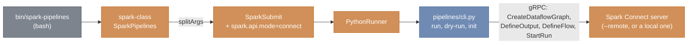
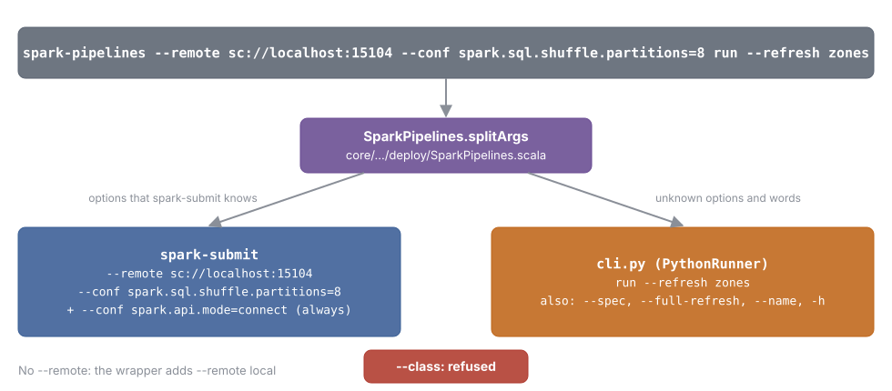
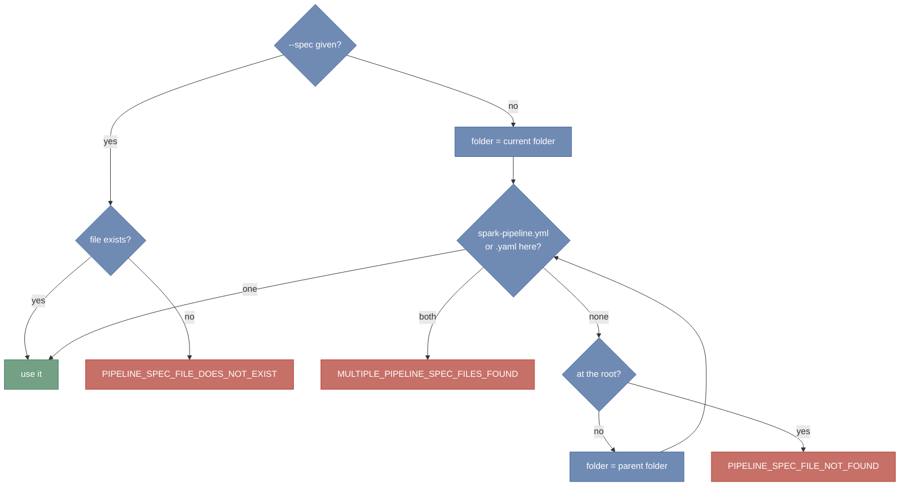
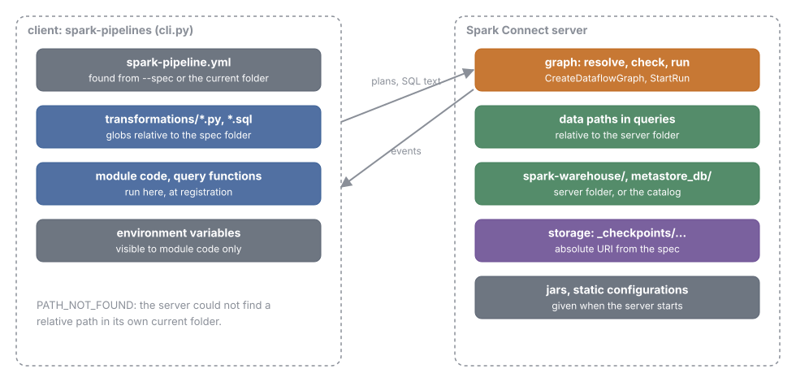

# Chapter 78: The spark-pipelines CLI and the project

[Chapter 77](ch77-first-etl-pipeline.md) used five commands and one spec file. Each command has more options, and the spec accepts more keys. Each option has rules that the tutorial did not show. Many errors in SDP come from these rules, not from the queries. Examples are a spec in the wrong folder, a bad glob and a relative path on a remote server.

**`spark-pipelines` is a small shell script around `spark-submit`. It sends the Spark options to `spark-submit` and the pipeline options to a Python CLI. The Python CLI reads the spec and loads the source files on your machine. Then it sends the graph to a Spark Connect server. The server reads the data, writes the tables and keeps the checkpoints. To use the CLI well, know which side does each part of the work.**

This chapter takes each part from the source of Spark 4.3.0 and tests it. The CLI source is `python/pyspark/pipelines/cli.py` and `init_cli.py`. The wrapper is `bin/spark-pipelines` and `core/src/main/scala/org/apache/spark/deploy/SparkPipelines.scala`.

The code is in [`code/ch78`](https://github.com/lisancao/spark-masterclass/tree/main/code/ch78). The scripts use the `taxi_etl` project of Chapter 77, with two days of data, and a Connect server with a Hive metastore on port 15104. Each output block comes from `code/ch78/output/`.

## Step 1: What the command runs

`bin/spark-pipelines` is a bash script. It finds the path of `pyspark/pipelines/cli.py`, and then it runs one command:

```bash
exec "${SPARK_HOME}"/bin/spark-class org.apache.spark.deploy.SparkPipelines "$SDP_CLI_PY_FILE_PATH" "$@"
```

`SparkPipelines` is a small Scala object. It puts each argument into one of two lists, and then it calls `SparkSubmit.main` with the two lists. `--verbose` makes `spark-submit` print what it got:

```text
$ spark-pipelines --remote sc://localhost:15104 --conf spark.sql.shuffle.partitions=8 --verbose dry-run 2>&1 | grep -A6 -E '^Main class:' | cut -c1-120
Main class:
org.apache.spark.deploy.PythonRunner
Arguments:
file:~/spark-masterclass/data/work/sdp/venv/lib/python3.12/site-packages/pyspark/pipelines/cli.py
null
dry-run
Spark config:
```

`spark-submit` runs `cli.py` with `PythonRunner`, the same class that runs any Python application. Only `dry-run` reached the Python CLI. The `--remote` and `--conf` options stayed with `spark-submit`.



<figure markdown>
  
  <figcaption>How <code>SparkPipelines</code> sorts the arguments. The rules come from <code>splitArgs</code> in <code>SparkPipelines.scala</code>. The position of an option on the command line is not important.</figcaption>
</figure>

The rules of `splitArgs` are these:

- An option that `spark-submit` knows, such as `--conf`, `--jars`, `--packages`, `--master` or `--driver-memory`, goes to `spark-submit`.
- `--name`, `-h` and `--help` go to the Python CLI. These are the only `spark-submit` options that the wrapper gives to the CLI.
- An option that `spark-submit` does not know, such as `--spec` or `--refresh`, goes to the Python CLI. So do the words that are not options, such as `run`.
- `--class` stops the command. A `--conf spark.api.mode` with a value other than `connect` also stops it.
- The wrapper always adds `--conf spark.api.mode=connect` and a `--remote`. If you give no `--remote`, the value is `local`.

The wrapper refuses the two options that do not agree with a pipeline:

```text
$ spark-pipelines --remote sc://localhost:15104 --class Foo run 2>&1 | grep -E 'ERROR|class'; echo "exit code: ${PIPESTATUS[0]}"
26/11/22 10:13:08 ERROR SparkPipelines: --class argument not supported.
exit code: 1

$ spark-pipelines --remote sc://localhost:15104 --conf spark.api.mode=classic run 2>&1 | grep -E 'ERROR'; echo "exit code: ${PIPESTATUS[0]}"
26/11/22 10:13:09 ERROR SparkPipelines: spark.api.mode must be 'connect' (was 'classic'). Declarative Pipelines currently only supports Spark Connect.
exit code: 1

$ spark-pipelines --remote sc://localhost:15104 run --name nightly 2>&1 | tail -1; echo "exit code: ${PIPESTATUS[0]}"
cli.py: error: unrecognized arguments: --name nightly
exit code: 2
```

`--name` is an option of `init` only. The wrapper gives it to the Python CLI, and `run` does not accept it. Thus, you cannot give a pipeline run an application name with `--name`. The exit code 2 comes from `argparse`, the parser of the Python CLI.

## Step 2: The subcommands and their flags

The Python CLI has three subcommands:

```text
$ spark-pipelines run --help
usage: cli.py run [-h] [--spec SPEC] [--full-refresh FULL_REFRESH]
                  [--full-refresh-all] [--refresh REFRESH]
options:
  -h, --help            show this help message and exit
  --spec SPEC           Path to the pipeline spec.
  --full-refresh FULL_REFRESH
                        List of datasets to reset and recompute (comma-
                        separated).
  --full-refresh-all    Perform a full graph reset and recompute.
  --refresh REFRESH     List of datasets to update (comma-separated).

$ spark-pipelines dry-run --help
usage: cli.py dry-run [-h] [--spec SPEC]
options:
  -h, --help   show this help message and exit
  --spec SPEC  Path to the pipeline spec.

$ spark-pipelines init --help
usage: cli.py init [-h] --name NAME
options:
  -h, --help   show this help message and exit
  --name NAME  Name of the project. A directory with this name will be created
               underneath the current directory.
```

This table has each flag of Spark 4.3.0, and the `spark-submit` options that pipelines use most:

| Flag | Subcommand | Goes to | What it does | Step |
|---|---|---|---|---|
| `--name NAME` | `init` (required) | CLI | Makes the folder `NAME` with a spec and two example files. | 3 |
| `--spec PATH` | `run`, `dry-run` | CLI | Uses this spec file. Without it, the CLI looks for the spec in the current folder and its parents. | 5 |
| `--refresh A,B` | `run` | CLI | Updates only these datasets. You can give the flag more than one time. | 8 |
| `--full-refresh A,B` | `run` | CLI | Clears these datasets and their checkpoints, and computes them again from all input. | 8 |
| `--full-refresh-all` | `run` | CLI | Does a full refresh of all datasets. Not with `--refresh` or `--full-refresh`. | 8 |
| `-h`, `--help` | all | CLI | Prints the help. | 2 |
| `--remote sc://host:port` | all | `spark-submit` | Uses this Connect server. The default is `local`: a new local server for one run. | 10 |
| `--conf k=v` | all | `spark-submit` | Sets a Spark configuration. For a local server, the server gets it. For a remote server, only `spark.sql.*` keys reach the session ([Chapter 79](ch79-configuring-pipelines.md)). | 10 |
| `--jars`, `--packages` | all | `spark-submit` | Adds jars to the local server. A remote server needs the jars when it starts. | 10 |
| `--driver-memory`, `--master` | all | `spark-submit` | Sizes and places the local server. | 10 |
| `--verbose` | all | `spark-submit` | Prints the parsed arguments. | 1 |
| `--class` | none | refused | Stops the command with exit code 1. | 1 |

A list flag takes one value. The value is a list with commas between the names, and the CLI removes the spaces around each name (`parse_table_list`). The flag must have a value:

```text
$ spark-pipelines --remote sc://localhost:15104 run --refresh 2>&1 | tail -1
cli.py run: error: argument --refresh: expected one argument
```

The exit codes are these:

| Result | Exit code | Example |
|---|---|---|
| The run or dry run completed | 0 | `Run is COMPLETED.` |
| An error in the spec, the files, the graph or a flow | 1 | `PIPELINE_SPEC_MISSING_REQUIRED_FIELD`, `UNRESOLVED_COLUMN` |
| The wrapper refused an option | 1 | `--class` |
| `argparse` refused the command line | 2 | `--name` with `run` |

The scripts of this chapter recorded each of these codes (`exit-codes.txt`, `wrapper.txt`, `init.txt`). One case has no exit code. If the server is not there, the CLI does not stop:

```text
$ spark-pipelines run --remote sc://localhost:1 > /dev/null 2>&1 & p=$!; sleep 20; kill -0 $p 2>/dev/null && echo 'no server: still waiting after 20 s' && pkill -P $p; kill $p 2>/dev/null; wait $p 2>/dev/null
no server: still waiting after 20 s
```

!!! warning "Caution: give a scheduled run a time limit"

    If the Connect server is not available, the CLI continues to try the connection. A scheduler must stop a run that takes too long, for example with `timeout` or the time limit of the task.

## Step 3: `init`

`init` writes a project into a new folder in the current folder:

```text
$ spark-pipelines init --name demo
Pipeline project 'demo' created successfully. To run your pipeline:
cd 'demo'
spark-pipelines run

$ spark-pipelines init --name demo 2>&1 | tail -1; echo "exit code: ${PIPESTATUS[0]}"
FileExistsError: Directory 'demo' already exists. Please choose a different name or remove the existing directory.
exit code: 1

$ spark-pipelines init 2>&1 | tail -1
cli.py init: error: the following arguments are required: --name
```

`init` never writes into a folder that exists. It makes these items (`init` in `init_cli.py`):

- `spark-pipeline.yml`, with `name`, `storage` and one `libraries` glob, `transformations/**`.
- An empty folder `pipeline-storage/`. The spec gives it as `storage`, with an absolute `file://` path. If you move the project, change this path.
- `transformations/example_python_materialized_view.py`, a materialized view of `spark.range(10)`.
- `transformations/example_sql_materialized_view.sql`, a materialized view that reads the Python one.

`init` does not need a server. The wrapper still starts `spark-submit`, but the CLI makes no Spark session for `init`.

## Step 4: The spec file

The spec is a YAML file. `unpack_pipeline_spec` in `cli.py` reads it. It accepts these keys, and no others:

| Key | Required | Type | What it does |
|---|---|---|---|
| `name` | yes | string | The name of the pipeline. |
| `storage` | yes | string | The root of the checkpoints. The server requires an absolute path with a URI scheme, such as `file://`, `s3a://` or `hdfs://`. |
| `libraries` | no | list of `glob: include:` | The source files to load (Step 6). Without it, the CLI loads no file, and the server finds no dataset. |
| `catalog` | no | string | The default catalog of the dataset names. |
| `database` | no | string | The default database (namespace) of the dataset names. It must exist. |
| `schema` | no | string | Another name for `database`. If the spec has both, `database` wins. |
| `configuration` | no | map of string to string | Spark configurations for the session and for each flow ([Chapter 79](ch79-configuring-pipelines.md)). |

The official programming guide lists `libraries` as required. The source does not require it (`REQUIRED_FIELDS = ["name", "storage"]`). A spec without `libraries` passes the check of the CLI, and the server then refuses the empty graph.

`spec.sh` gives the CLI one spec for each rule. It runs a dry run of each spec. A small file in the project prints the current database:

```text
== the smallest spec
  | name: taxi_etl
  | storage: file://~/spark-masterclass/data/work/sdp/ch78s/taxi_etl/pipeline-storage
  | libraries:
  |   - glob:
  |       include: transformations/**
current database: default
Run is COMPLETED.
== no name
  ...
pyspark.errors.exceptions.base.PySparkException: [PIPELINE_SPEC_MISSING_REQUIRED_FIELD] Pipeline spec missing required field `name`.
== no storage
  ...
pyspark.errors.exceptions.base.PySparkException: [PIPELINE_SPEC_MISSING_REQUIRED_FIELD] Pipeline spec missing required field `storage`.
== an unknown key
  | name: taxi_etl
  | owner: data-team
  ...
pyspark.errors.exceptions.base.PySparkException: [PIPELINE_SPEC_UNEXPECTED_FIELD] Pipeline spec field `owner` is unexpected.
== a relative storage path
  | name: taxi_etl
  | storage: pipeline-storage
  ...
current database: default
pyspark.errors.exceptions.connect.SparkException: [PIPELINE_STORAGE_ROOT_INVALID] Pipeline storage root must be an absolute path with a URI scheme (e.g., file://, s3a://, hdfs://). Got: `pipeline-stor
== schema, another name for database
  ...
  | schema: taxi_dev
  ...
current database: taxi_dev
Run is COMPLETED.
== database and schema together
  ...
  | database: default
  | schema: taxi_dev
  ...
current database: default
Run is COMPLETED.
== configuration as a list
  ...
  | configuration:
  |   - spark.sql.shuffle.partitions=8
  ...
pyspark.errors.exceptions.base.PySparkTypeError: [PIPELINE_SPEC_FIELD_NOT_DICT] Pipeline spec field `configuration` should be a dict, got list.
== a key that is not a string
  ...
  |   8: spark.sql.shuffle.partitions
  ...
pyspark.errors.exceptions.base.PySparkTypeError: [PIPELINE_SPEC_DICT_KEY_NOT_STRING] For pipeline spec field `configuration`, key should be a string, got int.
== libraries with no glob key
  ...
  | libraries:
  |   - transformations/**
TypeError: string indices must be integers, not 'str'
== no libraries
  ...
pyspark.errors.exceptions.connect.AnalysisException: [RUN_EMPTY_PIPELINE] Pipelines are expected to have at least one non-temporary dataset defined (tables, persisted views) but no non-temporary datas
```

The class of each error tells you where the check occurred:

- `exceptions.base` errors come from the CLI, before it connects to the server. These are the checks of keys and types.
- `exceptions.connect` errors come from the server. The relative storage path passed the CLI, and the module code ran (`current database: default`). Then the server refused the path at the start of the run. The empty graph is also a server error.
- A list item in `libraries` without `glob:` and `include:` gives a plain Python `TypeError`, with no error class. If you get `string indices must be integers`, examine the `libraries` key.

A value in `configuration` must be a YAML string. Put quotes around numbers and booleans, for example `"8"` and `"false"`. [Chapter 79](ch79-configuring-pipelines.md) shows the error for a number without quotes.

## Step 5: How the CLI finds the spec

With `--spec`, the CLI uses that file. Without `--spec`, it looks for `spark-pipeline.yml` or `spark-pipeline.yaml`, first in the current folder and then in each parent folder (`find_pipeline_spec`):



`discovery.txt` tests each path of this diagram:

```text
$ mkdir -p transformations/sub && cd transformations/sub

$ spark-pipelines dry-run --remote sc://localhost:15104 2>&1 | grep -E 'Loading pipeline spec|Run is'
2026-11-22 10:12:34: Loading pipeline spec from ~/spark-masterclass/data/work/sdp/ch78/taxi_etl/spark-pipeline.yml...
2026-11-22 18:12:39: Run is COMPLETED.

$ cd ../..

$ cd /tmp

$ spark-pipelines dry-run --remote sc://localhost:15104 2>&1 | tail -1; echo "exit code: ${PIPESTATUS[0]}"
pyspark.errors.exceptions.base.PySparkException: [PIPELINE_SPEC_FILE_NOT_FOUND] No spark-pipeline.yaml or spark-pipeline.yml file provided in arguments or found in directory `/` or readable ancestor directories.
exit code: 1

$ cd -
~/spark-masterclass/data/work/sdp/ch78/taxi_etl

$ cp spark-pipeline.yml spark-pipeline.yaml

$ spark-pipelines dry-run --remote sc://localhost:15104 2>&1 | tail -1
pyspark.errors.exceptions.base.PySparkException: [MULTIPLE_PIPELINE_SPEC_FILES_FOUND] Multiple pipeline spec files found in the directory `~/spark-masterclass/data/work/sdp/ch78/taxi_etl`. Please remove one or choose a particular one with the --spec argument.

$ rm spark-pipeline.yaml

$ spark-pipelines dry-run --remote sc://localhost:15104 --spec nothing/here.yml 2>&1 | tail -1
pyspark.errors.exceptions.base.PySparkException: [PIPELINE_SPEC_FILE_DOES_NOT_EXIST] The pipeline spec file `nothing/here.yml` does not exist.
```

The folder of the spec is the *root directory* of the project, and the spec is the important thing, not your current folder. Before it loads the source files, the CLI changes its current folder to the root directory (`change_dir` in `register_definitions`). The globs in `libraries` are relative to the root directory. A spec in a different folder thus finds different files:

```text
$ mkdir -p ../specs && cp spark-pipeline.yml ../specs/dev.yml

$ spark-pipelines dry-run --remote sc://localhost:15104 --spec ../specs/dev.yml 2>&1 | grep -E 'Loading pipeline spec|Root directory|Found|Run is|Exception' | cut -c1-200
2026-11-22 10:15:57: Loading pipeline spec from ../specs/dev.yml...
2026-11-22 10:16:02: Loading definitions. Root directory: '~/spark-masterclass/data/work/sdp/ch78x/specs'.
2026-11-22 10:16:02: Found 0 files matching glob 'transformations/**/*'
pyspark.errors.exceptions.connect.AnalysisException: [RUN_EMPTY_PIPELINE] Pipelines are expected to have at least one non-temporary dataset defined (tables, persisted views) but no non-temporary datas

$ sed -i 's#include: transformations/\*\*#include: ../taxi_etl/transformations/**#' ../specs/dev.yml && tail -2 ../specs/dev.yml
  - glob:
      include: ../taxi_etl/transformations/**

$ spark-pipelines dry-run --remote sc://localhost:15104 --spec ../specs/dev.yml 2>&1 | grep -E 'Root directory|Found|Run is|Exception' | cut -c1-200
2026-11-22 10:16:06: Loading definitions. Root directory: '~/spark-masterclass/data/work/sdp/ch78x/specs'.
2026-11-22 10:16:06: Found 3 files matching glob '../taxi_etl/transformations/**'
2026-11-22 18:16:07: Run is COMPLETED.
```

The copied spec found 0 files, because `specs/transformations/` does not exist. With the glob `../taxi_etl/transformations/**`, the same spec found the 3 files. Thus, if you keep a spec for each environment in a separate folder, write each glob relative to that folder. [Chapter 79](ch79-configuring-pipelines.md) uses this layout.

## Step 6: The project layout and the `libraries` globs

A project has a spec and source files. The CLI needs nothing more. The layout that `init` makes is a good default, and Chapter 77 added to it:

```text
taxi_etl/
  spark-pipeline.yml          the spec: name, storage, libraries
  transformations/            each .py and .sql file here is loaded
    raw.py                    raw_trips (streaming table), zones (materialized view)
    clean_trips.sql           clean_trips (streaming table)
    borough_daily.sql         borough_daily (materialized view)
  data/                       input files (relative paths start on the server, Step 10)
  pipeline-storage/           checkpoints (the storage key)
```

Each entry in `libraries` is a `glob` with an `include` pattern. `validate_patch_glob_pattern` accepts two forms only:

- A file path with no wildcard, such as `transformations/raw.py`.
- A folder path that ends in `/**`, such as `transformations/**`. The CLI adds `/*` to it, so it matches each file in the folder and in its subfolders. This is why the log says `transformations/**/*`.

Any other pattern stops the CLI:

```text
$ cat spark-pipeline.yml | tail -3
libraries:
  - glob:
      include: transformations/**/*.sql

$ spark-pipelines dry-run --remote sc://localhost:15104 2>&1 | tail -1
pyspark.errors.exceptions.base.PySparkException: [PIPELINE_SPEC_INVALID_GLOB_PATTERN] Invalid glob pattern `transformations/**/*.sql` in libraries. Only file paths, or folder paths ending with /** are allowed.

$ cat spark-pipeline.yml | tail -5
libraries:
  - glob:
      include: transformations/raw.py
  - glob:
      include: transformations/clean_trips.sql

$ spark-pipelines dry-run --remote sc://localhost:15104 2>&1 | grep -E 'Found|Run is|Exception' | cut -c1-200
2026-11-22 10:12:59: Found 1 files matching glob 'transformations/raw.py'
2026-11-22 10:12:59: Found 1 files matching glob 'transformations/clean_trips.sql'
2026-11-22 18:12:59: Run is COMPLETED.
```

A list of file paths selects part of a project. Here, the spec left out `borough_daily.sql`, and the graph had three datasets.

A folder glob loads each file in the folder. The CLI accepts only `.py` and `.sql` files. Any other file stops it, also a README:

```text
$ echo "# Taxi pipeline" > transformations/README.md

$ spark-pipelines dry-run --remote sc://localhost:15104 2>&1 | grep -E 'Found|Exception'
2026-11-22 10:13:02: Found 4 files matching glob 'transformations/**/*'
    raise PySparkException(
pyspark.errors.exceptions.base.PySparkException: [PIPELINE_UNSUPPORTED_DEFINITIONS_FILE_EXTENSION] Pipeline definitions file `~/spark-masterclass/data/work/sdp/ch78/taxi_etl/transformations/README.md` has an unsupported extension.
```

Keep notes and other files outside the folder that a glob loads. The CLI ignores files in `__pycache__`, so the bytecode that Python writes there does no harm.

### Python and SQL files together

The CLI loads the files in the order that the glob returns them. It sends each SQL file to the server as text (`DefineSqlGraphElements`). It imports each Python file as a module, with the session as `spark`, and each decorator sends one dataset and its flow. The order of the files is not important, because the server resolves the graph only at the start of the run. In Chapter 77, `borough_daily.sql` loaded first, before the tables that it reads.

A name that a Python file declares is a name for SQL, and the opposite is also true. Do not declare one dataset in two files. [Chapter 32](ch32-declarative-pipelines.md) explains the datasets and flows that each language can declare.

### Helper modules

Put shared Python code, such as constants or column lists, in a module outside `transformations/`. Otherwise, the glob loads the module as a pipeline file. Then import it from a pipeline file. `helpers.txt` adds `lib/rules.py` to the project root and imports it in `raw.py`:

```text
$ mkdir -p lib && printf "MIN_FARE = 0\n" > lib/rules.py

$ sed -i "s/^from pyspark import pipelines as dp/&\nfrom lib.rules import MIN_FARE/" transformations/raw.py

$ spark-pipelines dry-run --remote sc://localhost:15104 2>&1 | grep -E 'Error|Run is'
2026-11-22 18:16:09: Run is COMPLETED.

$ PYTHONPATH=/opt/other spark-pipelines dry-run --remote sc://localhost:15104 2>&1 | grep -E 'Error|Run is'
ModuleNotFoundError: No module named 'lib.rules'

$ PYTHONPATH=$PWD spark-pipelines dry-run --remote sc://localhost:15104 2>&1 | grep -E 'Error|Run is'
2026-11-22 18:16:14: Run is COMPLETED.
```

The import works without `PYTHONPATH`, but it fails when `PYTHONPATH` has another value. The cause is in `bin/spark-pipelines`. The script adds the PySpark folders before your `PYTHONPATH`, with a colon between them:

```bash
export PYTHONPATH="${SPARK_HOME}/python/:$PYTHONPATH"
```

If `PYTHONPATH` is empty, the result ends with a colon. Python reads the empty entry after the colon as the current folder. The CLI changes the current folder to the root directory before it imports your files, so `lib` is found. If `PYTHONPATH` has a value, the empty entry is not there. Thus, set `PYTHONPATH` to the project root yourself, as the last command does. Then the import does not depend on the environment.

## Step 7: `dry-run`

`dry-run` does all of a run until the flows start. The CLI reads the spec, loads the files and sends `StartRun` with `dry` set to `true`. The server then calls `dryRunPipeline` in place of `runPipeline` (`PipelinesHandler.scala`). It resolves the graph and does all graph checks, and then it stops.

`dry-run.txt` moves the output folders away first, to show what a dry run writes:

```text
$ mv pipeline-storage pipeline-storage.keep; mv spark-warehouse spark-warehouse.keep

$ sed -i 's/avg(c.fare_amount)/avg(c.fare)/' transformations/borough_daily.sql

$ spark-pipelines dry-run --remote sc://localhost:15104 2>&1 | grep -E 'Failed to resolve flow:|Error:' | cut -c1-150; echo "exit code: ${PIPESTATUS[0]}"
2026-11-22 18:14:18: Failed to resolve flow: 'spark_catalog.default.borough_daily'.
Error: [UNRESOLVED_COLUMN.WITH_SUGGESTION] A column, variable, or function parameter with name `c`.`fare` cannot be resolved. Did you mean one of the 
exit code: 1

$ sed -i 's/avg(c.fare)/avg(c.fare_amount)/' transformations/borough_daily.sql

$ spark-pipelines dry-run --remote sc://localhost:15104 2>&1 | tail -1; echo "exit code: ${PIPESTATUS[0]}"
2026-11-22 18:14:22: Run is COMPLETED.
exit code: 0

$ ls -d pipeline-storage spark-warehouse 2>&1
ls: cannot access 'pipeline-storage': No such file or directory
ls: cannot access 'spark-warehouse': No such file or directory
```

The dry run found the wrong column and gave exit code 1. After the fix, it gave exit code 0. In the two dry runs, no folder came back. A dry run does not create tables, write checkpoints or read data. Thus, it cannot find an error in the data, such as a cast that fails on one value.

A dry run finds these errors:

- Errors in the spec and in the files (Steps 4 to 6).
- Errors in Python code at module scope, because the CLI imports each file.
- Names of tables and columns that do not resolve.
- Cycles in the graph and other graph errors. [Chapter 32](ch32-declarative-pipelines.md) shows the order in which the server reports them.

A dry run needs a Connect server and each catalog and database that the spec names. It does not need the data. Run it after each change, and in continuous integration before a change goes to production.

## Step 8: `run`, and how to select what it updates

With no selection, `run` updates each dataset. Each streaming table reads its new input, and the run computes each materialized view again. Three flags select a part of the graph. `refresh.txt` uses each flag on the taxi project after its first run. The shell function `ev` keeps only the selection events and the end of each run, and removes `spark_catalog.default.` from the names. The function `q` prints the row count of each table:

```text
$ spark-pipelines run --remote sc://localhost:15104 --refresh borough_daily 2>&1 | ev
18:13:26: Flow borough_daily is QUEUED.
18:13:26: Flow 'raw_trips' is EXCLUDED.
18:13:26: Flow 'zones' is EXCLUDED.
18:13:26: Flow 'clean_trips' is EXCLUDED.
18:13:27: Flow borough_daily has COMPLETED.
18:13:28: Run is COMPLETED.

$ spark-pipelines run --remote sc://localhost:15104 --refresh zones,borough_daily 2>&1 | ev
18:13:31: Flow zones is QUEUED.
18:13:31: Flow borough_daily is QUEUED.
18:13:31: Flow 'raw_trips' is EXCLUDED.
18:13:31: Flow 'clean_trips' is EXCLUDED.
18:13:32: Flow zones has COMPLETED.
18:13:33: Flow borough_daily has COMPLETED.
18:13:34: Run is COMPLETED.

$ spark-pipelines run --remote sc://localhost:15104 --full-refresh raw_trips 2>&1 | ev
18:13:38: Flow raw_trips is QUEUED.
18:13:38: Flow 'zones' is EXCLUDED.
18:13:38: Flow 'clean_trips' is EXCLUDED.
18:13:38: Flow 'borough_daily' is EXCLUDED.
18:13:40: Flow raw_trips has COMPLETED.
18:13:42: Run is COMPLETED.

$ q
raw_trips        237,806 rows
clean_trips      223,444 rows
zones                265 rows
borough_daily         14 rows

$ ls pipeline-storage/_checkpoints/spark_catalog/default/raw_trips/raw_trips
0
1
```

Each flow outside the selection is `EXCLUDED`:

- `--refresh borough_daily` ran one flow. It read `clean_trips` and `zones` from the catalog, as the earlier run left them.
- `--full-refresh raw_trips` cleared the table and read both files again. The table has 237,806 rows, not two times that number. The flow got a new checkpoint folder, `1`, next to the old folder `0`.

A full refresh does not refresh the datasets that read the selected dataset. Here, `clean_trips` did not run. Its checkpoint still points to the old data of `raw_trips`. Select each dataset that must start again:

```text
$ spark-pipelines run --remote sc://localhost:15104 --full-refresh clean_trips --refresh borough_daily 2>&1 | ev
18:13:51: Flow clean_trips is QUEUED.
18:13:51: Flow borough_daily is QUEUED.
18:13:51: Flow 'raw_trips' is EXCLUDED.
18:13:51: Flow 'zones' is EXCLUDED.
18:13:52: Flow clean_trips has COMPLETED.
18:13:53: Flow borough_daily has COMPLETED.
18:13:54: Run is COMPLETED.

$ spark-pipelines run --remote sc://localhost:15104 --full-refresh-all 2>&1 | ev
18:14:00: Flow raw_trips is QUEUED.
18:14:00: Flow zones is QUEUED.
18:14:00: Flow clean_trips is QUEUED.
18:14:00: Flow borough_daily is QUEUED.
18:14:01: Flow zones has COMPLETED.
18:14:01: Flow raw_trips has COMPLETED.
18:14:02: Flow clean_trips has COMPLETED.
18:14:03: Flow borough_daily has COMPLETED.
18:14:04: Run is COMPLETED.

$ ls pipeline-storage/_checkpoints/spark_catalog/default/*/*
pipeline-storage/_checkpoints/spark_catalog/default/clean_trips/clean_trips:
0
1
2
pipeline-storage/_checkpoints/spark_catalog/default/raw_trips/raw_trips:
0
1
2
```

`--full-refresh` and `--refresh` work together, for different datasets. `--full-refresh-all` cleared each table and gave each streaming flow a new checkpoint folder. After three full refreshes, `raw_trips` has the folders `0`, `1` and `2`. SDP does not delete an old checkpoint folder (`State.reset` in the server source). Remove old folders yourself when you no longer need them.

<figure markdown>
  <video autoplay loop muted playsinline controls width="1280" height="720" poster="../../media/clips/ch78-anim-refresh.webp">
    <source src="../../media/clips/ch78-anim-refresh.mp4" type="video/mp4">
  </video>
  <figcaption>Three selections on the taxi graph. <code>--refresh</code> runs only the selected flows. <code>--full-refresh</code> also starts a new checkpoint folder. The data comes from <code>refresh.txt</code>.</figcaption>
</figure>

The CLI and the server refuse selections that conflict. They do not refuse a name that is not in the graph:

```text
$ spark-pipelines run --remote sc://localhost:15104 --refresh no_such_table 2>&1 | tail -2 | cut -c1-200
2026-11-22 18:14:09: Flow 'spark_catalog.default.borough_daily' is EXCLUDED.
2026-11-22 18:14:09: Run is COMPLETED.

$ spark-pipelines run --remote sc://localhost:15104 --refresh zones --full-refresh zones 2>&1 | tail -2 | cut -c1-200
  File "~/spark-masterclass/data/work/sdp/venv/lib/python3.12/site-packages/pyspark/python/lib/pyspark.zip/pyspark/sql/connect/client/core.py", line 2443, in _handle_rpc_error
pyspark.errors.exceptions.connect.IllegalArgumentException: Datasets specified for refresh and full refresh cannot overlap: `spark_catalog`.`default`.`zones`

$ spark-pipelines run --remote sc://localhost:15104 --full-refresh-all --full-refresh zones 2>&1 | tail -3
pyspark.errors.exceptions.base.PySparkException: [CONFLICTING_PIPELINE_REFRESH_OPTIONS] --full-refresh-all option conflicts with --full_refresh
The --full-refresh-all option performs a full refresh of all datasets, 
so specifying individual datasets with --full_refresh is not allowed.
```

!!! warning "Caution: examine the names in a selection"

    The CLI accepts a name that is not in the graph. Then the run excludes each flow, ends as `COMPLETED` and gives exit code 0. Nothing tells you that the run did no work. In a script, make sure that each selected name is a dataset of the pipeline.

The rules of the selection are these (`run` in `cli.py`, `createTableFilters` in `PipelinesHandler.scala`):

| Flags | Result |
|---|---|
| none | Each dataset is updated. |
| `--refresh A` | `A` is updated. All other flows are `EXCLUDED`. |
| `--full-refresh A` | `A` is cleared and computed again, with a new checkpoint folder. All other flows are `EXCLUDED`. |
| `--refresh A --full-refresh B` | `A` is updated and `B` is cleared. The two lists must not share a name. |
| `--full-refresh-all` | Each dataset is cleared and computed again. Not with the other two flags. |

Do a full refresh of a streaming table after you change its query. An incremental run applies the new query only to new input. The old rows stay as the old query wrote them.

## Step 9: Where the outputs go

A run writes to three places, and the server does all three writes:

- **The tables** go to the catalog. In the session catalog with a Hive metastore, the data goes to `spark-warehouse/<table>` and the metadata goes to `metastore_db/`. Both folders are in the current folder of the server, unless the server configuration gives other paths.
- **The checkpoints** go to the `storage` root of the spec, in the path `_checkpoints/<catalog>/<database>/<table>/<flow>/<version>`. Only streaming flows and sinks have a checkpoint. The version folder starts at `0`, and each full refresh adds one.
- **The events** go back to the CLI, which prints them. The `PipelineEvent` message of Spark 4.3 has only a time and a text (`pipelines.proto`). Open source SDP does not keep the events in a table. If you need them after the run, save the output of the CLI. For a record of each query, enable the Spark event log of the server with `spark.eventLog.enabled`. [Chapter 33](ch33-medallion.md) reads it.

```text
$ find pipeline-storage -maxdepth 5 -type d | sort
pipeline-storage
pipeline-storage/_checkpoints
pipeline-storage/_checkpoints/spark_catalog
pipeline-storage/_checkpoints/spark_catalog/default
pipeline-storage/_checkpoints/spark_catalog/default/clean_trips
pipeline-storage/_checkpoints/spark_catalog/default/clean_trips/clean_trips
pipeline-storage/_checkpoints/spark_catalog/default/raw_trips
pipeline-storage/_checkpoints/spark_catalog/default/raw_trips/raw_trips
```

A checkpoint is the normal checkpoint of Structured Streaming. Chapter 77 shows the files inside it. [Chapter 29](ch29-checkpoints-and-state-store.md) explains each file.

## Step 10: The CLI and a remote server

The CLI and the server can be on different machines. The CLI reads the spec and the source files from its own disk. The server reads the data and writes the tables and checkpoints on its own disks. A path in a query is text in a plan, and the server resolves it.

<figure markdown>
  
  <figcaption>Which side reads and writes each part of a project. Relative paths in queries start at the current folder of the server.</figcaption>
</figure>

`extra.sh` starts the server in an empty folder, `elsewhere/`, and runs the taxi project against it:

```text
$ spark-pipelines run --remote sc://localhost:15104 2>&1 | grep -v -E '^  File|^    ' | tail -8 | cut -c1-200; echo "exit code: ${PIPESTATUS[0]}"
2026-11-22 10:16:31: Registering graph elements...
2026-11-22 10:16:31: Loading definitions. Root directory: '~/spark-masterclass/data/work/sdp/ch78x/taxi_etl'.
2026-11-22 10:16:31: Found 3 files matching glob 'transformations/**/*'
2026-11-22 10:16:31: Registering SQL file ~/spark-masterclass/data/work/sdp/ch78x/taxi_etl/transformations/borough_daily.sql...
2026-11-22 10:16:31: Registering SQL file ~/spark-masterclass/data/work/sdp/ch78x/taxi_etl/transformations/clean_trips.sql...
2026-11-22 10:16:31: Importing ~/spark-masterclass/data/work/sdp/ch78x/taxi_etl/transformations/raw.py...
Traceback (most recent call last):
pyspark.errors.exceptions.connect.AnalysisException: [PATH_NOT_FOUND] Path does not exist: data/trips. SQLSTATE: 42K03
exit code: 1

$ ls ../elsewhere
connect-server.log
derby.log
metastore_db
```

The CLI found the files, because it reads them from the spec folder. But the server looked for `data/trips` in `elsewhere/`, its own current folder. The error came when the CLI imported `raw.py`: the server checks a file path when it gets the plan of a file source. With absolute paths, the same project runs:

```text
$ grep -n "data/" transformations/raw.py
15:    return spark.readStream.schema(TRIP_SCHEMA).parquet("~/spark-masterclass/data/work/sdp/ch78x/taxi_etl/data/trips")
22:            .csv("~/spark-masterclass/data/work/sdp/ch78x/taxi_etl/data/taxi_zone_lookup.csv"))

$ spark-pipelines run --remote sc://localhost:15104 2>&1 | grep -E 'Run is'; echo "exit code: ${PIPESTATUS[0]}"
2026-11-22 18:16:45: Run is COMPLETED.
exit code: 0

$ ls ../elsewhere ../elsewhere/spark-warehouse
../elsewhere:
connect-server.log
derby.log
metastore_db
spark-warehouse
../elsewhere/spark-warehouse:
borough_daily
clean_trips
raw_trips
zones
```

The tables went to `spark-warehouse/` in the folder of the server, not in the project. (The output shows `~` in place of the home folder in the paths. The real file has the full path.)

The same rule applies to the local server. Without `--remote`, the CLI starts a server in its own process. The current folder of that server is the folder where you typed the command, not the root directory. `local-cwd.txt` runs the project from a subfolder, with no `--remote`:

```text
$ mkdir -p transformations/sub && cd transformations/sub

$ spark-pipelines --conf spark.ui.port=4144 run 2>&1 | grep -E 'Loading pipeline spec|Exception|Run is' | cut -c1-160
2026-11-22 10:17:03: Loading pipeline spec from ~/spark-masterclass/data/work/sdp/ch78l/taxi_etl/spark-pipeline.yml...
pyspark.errors.exceptions.connect.AnalysisException: [PATH_NOT_FOUND] Path does not exist: data/trips. SQLSTATE: 42K03

$ cd ../..

$ spark-pipelines --conf spark.ui.port=4144 --conf spark.sql.catalogImplementation=hive run 2>&1 | grep -E 'Exception|Run is' | cut -c1-160
2026-11-22 18:18:02: Run is COMPLETED.

$ ls
data
derby.log
metastore_db
pipeline-storage
spark-pipeline.yml
spark-warehouse
transformations
```

The CLI found the spec from the subfolder (Step 5). But the server read `data/trips` from the subfolder, and the run failed. From the project folder, the run completed, and `metastore_db/` and `spark-warehouse/` are in the project folder.

These rules follow:

- **Run the CLI from the project folder**, or start the server there.
- **For a remote server, use absolute paths or URIs** that the server can read, for example `s3a://bucket/trips/`. Do not hard-code them in each file. [Chapter 79](ch79-configuring-pipelines.md) passes them through the configuration.
- **Give the remote server what the pipeline needs when it starts:** the jars of each catalog and the static configurations. `--jars` and `--packages` on the CLI reach only a local server.
- **The local server uses port 15002.** Two local runs at the same time on one machine collide. In the tests of this book, `--conf spark.connect.grpc.binding.port` with a local server made the CLI wait with no progress. The notes of this part record it. Use `--remote` with your own server to use a different port.

A remote server keeps the session of each run separate. Two chapters show more:

- [Chapter 46](ch46-connect-in-production.md) runs a Connect server for many clients.
- [Chapter 36](ch36-pipeline-end-to-end.md) runs a pipeline against one long-lived server, as production does.

<figure markdown>
  <video autoplay loop muted playsinline controls width="1280" height="720" poster="../../media/clips/ch78-cli.webp">
    <source src="../../media/clips/ch78-cli.mp4" type="video/mp4">
  </video>
  <figcaption>The CLI from a subfolder, a glob that the CLI refuses, and a README in the transformations folder. Each error comes from the CLI before the server does work.</figcaption>
</figure>

## The whole chapter, on one page

```bash
spark-pipelines init --name NAME                    # a new folder: spec + 2 examples
spark-pipelines dry-run [--spec PATH]               # load and check, write nothing
spark-pipelines run [--spec PATH]                   # update each dataset
spark-pipelines run --refresh a,b                   # update a and b only
spark-pipelines run --full-refresh a                # clear a, new checkpoint folder
spark-pipelines run --full-refresh a --refresh b    # both, no name in both lists
spark-pipelines run --full-refresh-all              # clear everything
spark-pipelines --remote sc://host:15002 run        # a server that you started
PYTHONPATH=$PWD spark-pipelines run                 # import helper modules reliably
```

- **The wrapper splits the arguments.** Spark options go to `spark-submit`, and pipeline options go to `cli.py`. The wrapper refuses `--class` and a Classic API mode.
- **The spec accepts seven keys.** It must contain `name` and `storage`. `storage` must be an absolute URI. Configuration values must be strings.
- **The folder of the spec is the root.** Globs are relative to it. Without `--spec`, the CLI looks up through the parent folders.
- **A glob is a file path or a folder path that ends in `/**`.** A folder glob loads every file. The CLI accepts only `.py` and `.sql` files.
- **A dry run checks everything except the data.** Use the exit code in CI.
- **A full refresh starts a new checkpoint folder** and does not refresh what reads the dataset. A name that is not in the graph is not an error.
- **The server reads the data paths.** Relative paths start at the current folder of the server.

[Chapter 79](ch79-configuring-pipelines.md) uses the `configuration`, `catalog` and `database` keys to run one project in more than one environment.

## Further reading

- [Spark Declarative Pipelines programming guide](https://spark.apache.org/docs/4.3.0/declarative-pipelines-programming-guide.html), the section about the CLI.
- [Submitting applications](https://spark.apache.org/docs/4.3.0/submitting-applications.html), for the `spark-submit` options that the wrapper accepts.
- `python/pyspark/pipelines/cli.py`, `init_cli.py` and `core/src/main/scala/org/apache/spark/deploy/SparkPipelines.scala` in the Spark source (tag `v4.3.0`).
