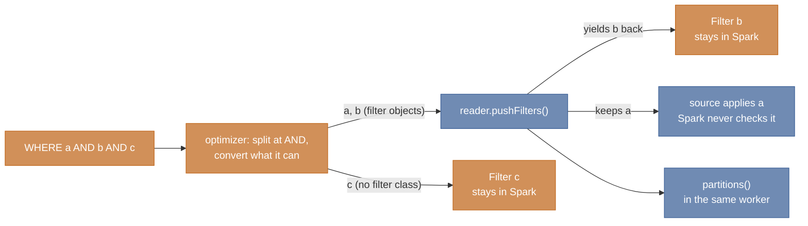
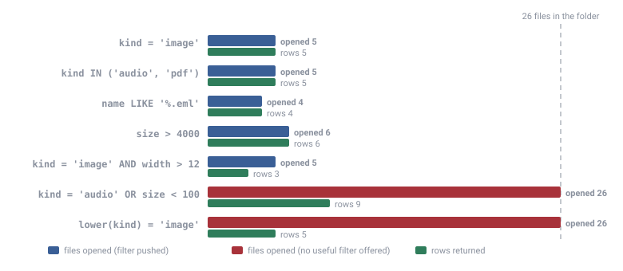
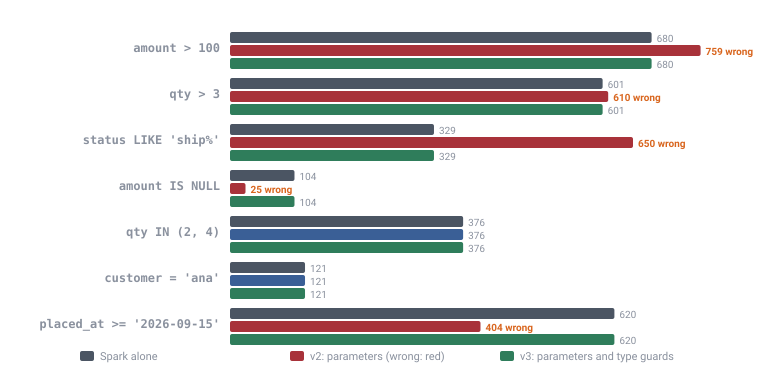

# Chapter 81: Python data sources III: filter pushdown

In [Chapter 79](ch79-python-data-sources-readers.md), the query `where("kind = 'image'")` opened all of the images and sounds in the folder, not only the five images. The reader produced every row, and then Spark removed the rows that it did not need. For a folder of 26 files, that cost is small. For an API with a million records or a database table with a billion rows, the cost is the full source for each query.

Filter pushdown gives the `WHERE` clause to the source. Spark 4.1 added it to the Python Data Source API (SPARK-51271). The method is short: `pushFilters(filters)` on the reader. The contract around it is not short.

**Filter pushdown moves a filter from Spark into your source, and with the filter it moves the duty to give the correct answer. Spark does not check a filter that the source accepts. Thus a source that accepts a filter and applies it differently from Spark gives wrong results with no error. And in Spark 4.3.0, every query on the same relation uses the planned read that pushdown makes. Thus a correct source can also give wrong results.**

The scripts are in [`code/ch81`](https://github.com/lisancao/spark-masterclass/tree/main/code/ch81). All output comes from `code/ch81/output/`, from runs on `pyspark==4.3.0` in local mode.

!!! note "New in 4.3"
    Nothing in filter pushdown changed between 4.2.0 and 4.3.0. The flag `spark.sql.python.filterPushdown.enabled` is still internal and `false` by default (`SQLConf.scala` at `v4.3.0`). Python sources still get no column pruning, no limit pushdown and no aggregate pushdown. The planned-read problem in Step 8 is still in 4.3.0. A limit pushdown API for Python sources (SPARK-58551) is on the master branch, but it is not in 4.3.0. SPARK-59909 corrected PySpark errors with undefined conditions, and it is in 4.3.0.

    Step 3 shows the corrected `DATA_SOURCE_EXTRANEOUS_FILTERS` message.

## Step 1: Turn on the flag

In 4.3.0, filter pushdown for Python sources is off by default. The flag has a strange effect. If your reader has a `pushFilters()` method and the flag is off, every query on the source fails, also a query with no `WHERE` clause. `what_arrives.py` registers a `probe` source with a `pushFilters()` method that records what it receives:

```text
spark.sql.python.filterPushdown.enabled = false (default)
  SELECT * FROM t: [PYTHON_DATA_SOURCE_ERROR] Failed to initialize Python data source reader
    [DATA_SOURCE_PUSHDOWN_DISABLED] ProbeReader implements pushFilters() but filter
    pushdown is disabled because configuration
    'spark.sql.python.filterPushdown.enabled' is false. Set it to true to enable
    filter pushdown.
spark.sql.python.filterPushdown.enabled = true
```

Thus a source that implements `pushFilters()` must tell its users to set the flag. Set it when you build the session:

```python
spark = session("ch81-files", spark_sql_python_filterPushdown_enabled="true")
```

The flag is a session configuration. On Spark Connect, a client can set it with `spark.conf.set()`.

## Step 2: What Spark offers, for each condition

The optimizer divides the `WHERE` clause at each `AND`. It tries to change each part into a filter object of `pyspark.sql.datasource`. Then it calls `pushFilters()` one time, during planning, with the parts that it could change. The `probe` reader records the filters and accepts none of them. The table shows what arrived for each condition:

```text
WHERE                              filters offered to pushFilters()
kind = 'image'                     IsNotNull(kind), EqualTo(kind, 'image')
kind <> 'image'                    IsNotNull(kind), Not(EqualTo(kind, 'image'))
kind <=> 'image'                   EqualNullSafe(kind, 'image')
id > 3                             IsNotNull(id), GreaterThan(id, int:3)
NOT (id > 3)                       IsNotNull(id), LessThanOrEqual(id, int:3)
id BETWEEN 2 AND 5                 IsNotNull(id), GreaterThanOrEqual(id, int:2), LessThanOrEqual(id, int:5)
id IN (1, 2, 3)                    In(id, list:[1, 2, 3])
kind IS NULL                       IsNull(kind)
kind LIKE 'im%'                    IsNotNull(kind), StringStartsWith(kind, 'im')
kind LIKE '%age'                   IsNotNull(kind), StringEndsWith(kind, 'age')
kind LIKE '%ma%'                   IsNotNull(kind), StringContains(kind, 'ma')
kind LIKE 'i%e'                    IsNotNull(kind), StringStartsWith(kind, 'i'), StringEndsWith(kind, 'e')
lower(kind) = 'image'              IsNotNull(kind)
id + 1 > 3                         IsNotNull(id)
id > 1.5                           IsNotNull(id), GreaterThan(id, int:1)
amount > 100                       IsNotNull(amount), GreaterThan(amount, Decimal:Decimal('100.00'))
ts >= '2026-10-01 10:00:00'        IsNotNull(ts), GreaterThanOrEqual(ts, datetime:2026-10-01T10:00:00+00:00 (ZoneInfo UTC))
info.city = 'Hanoi'                IsNotNull(info.city), EqualTo(info.city, 'Hanoi')
array_contains(tags, 'x')          IsNotNull(tags)
kind = 'a' OR id = 1               pushFilters() not called
id > 1 AND (kind = 'a' OR id = 2)  IsNotNull(id), GreaterThan(id, int:1)
```

<figure markdown>
  <video autoplay loop muted playsinline controls width="1280" height="720" poster="../../media/clips/ch81-offered.webp">
    <source src="../../media/clips/ch81-offered.mp4" type="video/mp4">
  </video>
  <figcaption><code>what_arrives.py</code> on Spark 4.3.0: the filter objects that Spark gives to <code>pushFilters()</code> for each condition.</figcaption>
</figure>

The filters are not the SQL that you wrote. They are what remains after the optimizer:

- **Spark adds `IsNotNull`.** A comparison is never true for `NULL`, so the optimizer adds `IsNotNull` to most conditions. `IsNull`, `In` and `<=>` do not get it.
- **Spark rewrites conditions.** `<>` became `Not(EqualTo)`. `NOT (id > 3)` became `LessThanOrEqual`. `BETWEEN` became two comparisons. A `LIKE` pattern became `StringStartsWith`, `StringEndsWith` or `StringContains`, or two of them.
- **Values have Spark types.** A `decimal` column gives a `Decimal`. A `timestamp` gives an aware `datetime` in UTC. `id > 1.5` on an `int` column became `GreaterThan(id, 1)`, because there is no integer between 1 and 1.5.
- **A function or a calculation on a column is not offered.** `lower(kind)`, `id + 1` and `array_contains` gave only `IsNotNull` of the column.
- **`OR` is never offered.** The condition `kind = 'a' OR id = 1` gave no call at all. In an `AND` with an `OR` inside it, only the parts outside the `OR` arrive.
- **A field of a struct arrives as a path.** `attribute` is a tuple of names: `("info", "city")`.

The full list of classes is `EqualTo`, `EqualNullSafe`, `GreaterThan`, `GreaterThanOrEqual`, `LessThan`, `LessThanOrEqual`, `In`, `IsNull`, `IsNotNull`, `Not`, `StringStartsWith`, `StringEndsWith` and `StringContains`.

`pushFilters()` runs during planning, so `explain()` alone calls it:

```text
explain() alone: pushFilters() calls: 1
```

## Step 3: The contract

`pushFilters()` receives a list of filters, and it yields the filters that it does **not** apply. Spark keeps a `Filter` operator above the scan for each filter that comes back. Spark does not check a filter that does not come back.



The `files` source in `files_pushdown.py` lists a folder like the `docs` source of [Chapter 79](ch79-python-data-sources-readers.md). Its reader takes the filters that it can decide from the file listing (the kind, the name and the size), and yields every other filter:

```python
def pushFilters(self, filters):
    """Take over the filters that the file listing can decide. Yield every other one back."""
    for f in filters:
        if isinstance(f, EqualTo) and f.attribute == ("kind",):
            self.kinds = {f.value} if self.kinds is None else self.kinds & {f.value}
        elif isinstance(f, In) and f.attribute == ("kind",):
            self.kinds = set(f.value) if self.kinds is None else self.kinds & set(f.value)
        elif isinstance(f, StringStartsWith) and f.attribute == ("name",):
            self.prefixes.append(f.value)
        elif isinstance(f, StringEndsWith) and f.attribute == ("name",):
            self.suffixes.append(f.value)
        elif type(f) in SIZE_TESTS and f.attribute == ("size",):
            self.size_tests.append((type(f), f.value))
        else:
            yield f
```

Three details of this method are important:

- **It changes `self`.** Spark calls `pushFilters()` on the reader before `partitions()`, in the same worker. Then Spark pickles the reader for the tasks. Thus the state on `self` must pickle, as always.
- **Two filters on the same column intersect.** `kind = 'a' AND kind IN ('a', 'b')` must give the files that match both. The method keeps the intersection of the sets. It does not replace the first set.
- **It yields the objects that it received.** Spark finds the yielded filters by object identity (`FilterRef` in `data_source_pushdown_filters.py` compares `id()`). An equal copy fails:

```text
yield a copy of a filter:
    [DATA_SOURCE_EXTRANEOUS_FILTERS] CopyReader.pushFilters() returned filters that
    are not part of the input. Make sure that each returned filter is one of the input
    filters by reference. Input filters:
    [FilterRef(filter=IsNotNull(attribute=('id',)), id=134871703285216),
    FilterRef(filter=EqualTo(attribute=('id',), value=7), id=134871703280944)].
    Extraneous filters: [FilterRef(filter=EqualTo(attribute=('id',), value=7),
    id=134871703282960), FilterRef(filter=IsNotNull(attribute=('id',)),
    id=134871703279648)].
```

The reader applies the accepted filters in `partitions()`, before it plans any file. A file that cannot match does not get into a partition, and no task opens it.

The animation follows one query of Step 4 through this contract.

<figure markdown>
  <video autoplay loop muted playsinline controls width="1280" height="720" poster="../../media/clips/ch81-anim-pushdown.webp">
    <source src="../../media/clips/ch81-anim-pushdown.mp4" type="video/mp4">
  </video>
  <figcaption>The <code>files</code> source keeps <code>EqualTo(kind, 'image')</code> and yields the other filters back. Spark applies them above the scan. The counts come from <code>files_pushdown.py</code>.</figcaption>
</figure>

## Step 4: Prove that the filter worked

A result with the correct count does not prove that pushdown worked. Spark gives the same count if it applies the filter itself. Two records give the proof. The tasks write an audit file for each file that they open. And the plan shows which filters Spark kept:

```text
26 files under the sample root

query                              rows opened  Spark's Filter
kind = 'image'                        5      5  isnotnull(kind)
kind IN ('audio', 'pdf')              5      5  -
name LIKE '%.eml'                     4      4  isnotnull(name)
size > 4000                           6      6  isnotnull(size)
kind = 'image' AND width > 12         3      5  ((isnotnull(kind) AND isnotnull(width)) AND (width > 12))
kind = 'audio' OR size < 100          9     26  ((kind = audio) OR (size < 100))
lower(kind) = 'image'                 5     26  (isnotnull(kind) AND (lower(kind) = image))
```

<figure markdown>
  <video autoplay loop muted playsinline controls width="1280" height="720" poster="../../media/clips/ch81-opened.webp">
    <source src="../../media/clips/ch81-opened.mp4" type="video/mp4">
  </video>
  <figcaption>For each query, the rows, the files that the tasks opened, and the filter that Spark kept above the scan.</figcaption>
</figure>

Read the table row by row:

- **`kind = 'image'` opened 5 files, not 26.** The source took the `EqualTo`. Spark kept only `isnotnull(kind)`, which the source yielded back. The source never makes a `NULL` kind, so that filter costs almost nothing.
- **`kind IN (...)` left no `Filter` in Spark.** `In` arrives without `IsNotNull`, and the source took it.
- **`kind = 'image' AND width > 12` opened the 5 images and returned 3 rows.** The source took the kind. It cannot know the width before it opens a file, so it yielded `width > 12` back, and Spark applied it.
- **`OR` and `lower()` opened all 26 files.** Spark offered no useful filter, so the source read everything.

<figure markdown>
  
  <figcaption>The table above as bars. A pushed filter decreases the files that the tasks open. Without a useful filter, the tasks open all 26 files.</figcaption>
</figure>

`explain("formatted")` shows the accepted filters in `PushedFilters`. The `ReadSchema` still has all the columns, because Python sources get no column pruning ([Chapter 79](ch79-python-data-sources-readers.md), Step 10):

```text
explain('formatted') of the mixed query:
  +- BatchScan files (1)
  (1) BatchScan files
  PushedFilters: [EqualTo(kind,image)]
  ReadSchema: struct<path:string,name:string,kind:string,size:bigint,width:int,height:in
```

Use both records in a test of a source that pushes filters. One record is the audit of what the source read. The other record is the `Filter` operator in the plan. `plan()` in `code/common/book.py` captures `explain()` output with `contextlib.redirect_stdout`, which works in a classic session and on Connect.

## Step 5: A filter that you accept and do not apply

The danger in the contract is a reader that accepts more than it applies. `AcceptsAll` uses the same logic as `files`, but it yields nothing back:

```python
class AcceptsAll(FilesReader):
    def pushFilters(self, filters):
        list(super().pushFilters(filters))      # takes the ones it can apply...
        return iter([])                         # ...and claims the rest too
```

```text
A reader that yields nothing back, but applies only what it understands:
  kind = 'image' AND width > 12    correct:  3  lying:  5  lying plan's Filter: -
  lower(kind) = 'image'            correct:  5  lying:  5  lying plan's Filter: (lower(kind) = image)
```

The first query gave 5 rows, not 3, and no error. The reader took `width > 12`, did not apply it, and Spark removed its own `Filter`. The second query was correct only by chance: `lower(kind)` was never offered, so Spark kept it.

There is a safe pattern for a source that can do only a coarse filter. **Push and return**: apply a coarse filter in the source, and yield the filter back so that Spark also applies the exact filter. The `coarse` source keeps only the first letter of a name prefix, like a coarse index:

```text
push and return, name LIKE 'tick%': 4 rows, 6 files opened, Spark's Filter: (isnotnull(name) AND StartsWith(name, tick))
```

The source opened the 6 files whose names start with `t`, not 26. Spark then kept the 4 files that start with `tick`. The result is correct, and the source did less work.

## Step 6: Push filters into a database, safely

The `sqlite` source of [Chapter 80](ch80-python-data-sources-apis-databases.md) builds a SQL query for each task. A filter that becomes SQL makes SQLite do the work, and only the rows that match come back. `sqlite_pushdown.py` shows three versions of the translation. Version 1 puts the value into the SQL text:

```python
def naive_literal(f, types):
    """Version 1: paste the value into the SQL text. Never do this."""
    if type(f) in OPS and len(f.attribute) == 1:
        return f"{quote_ident(f.attribute[0])} {OPS[type(f)]} '{f.value}'", []
    return None
```

The `orders` table has a customer with the name `x' OR '1'='1` (order 777) and a customer with the name `O'Brien`:

```text
Version 1, values pasted into the SQL text:
  customer = 'Ana'            Spark alone:  120   pushed: 120
  customer = "x' OR '1'='1"   Spark alone:    1   pushed: 1207
  customer = "O'Brien"        Spark alone:  121   pushed: fails: OperationalError: near "Brien": syntax error
```

The second line is SQL injection from your own data. The value of the filter came from the user's query, and it became part of the SQL. The query returned all 1,207 rows. An attacker does not need access to your code. A value in a `WHERE` clause is sufficient.

Version 2 uses bound parameters (`?`) for each value. Column names cannot be parameters, so `quote_ident()` puts them in double quotes. The `sqlite` source also checks the table name against `sqlite_master` in `table_columns()`.

## Step 7: A pushed filter must give the result of Spark

Version 2 is safe. But its results are wrong:

```text
WHERE                        Spark alone  v2 params  v3 guarded
amount > 100                         680        759         680
qty > 3                              601        610         601
status LIKE 'ship%'                  329        650         329
amount IS NULL                       104         25         104
qty IN (2, 4)                        376        376         376
customer = 'ana'                     121        121         121
placed_at >= '2026-09-15'            620        404         620

Why: stored values that Spark reads as NULL
  amount: [('N/A', 'text', 34), ('', 'text', 33), (None, 'null', 25), ('12,50', 'text', 12)]
  qty: [(2.5, 'real', 15), ('two', 'text', 9)]
  SQLite: 'N/A' > 100 is 1 | 'Shipped' LIKE 'ship%' is 1
```

The source converts each stored value in Python ([Chapter 80](ch80-python-data-sources-apis-databases.md), Step 10), and SQLite compares the stored values with its own rules. The two answers are different:

- **`amount > 100`**: in SQLite, any text is larger than any number. Thus `'N/A' > 100` is true. The source changes `'N/A'` to `NULL`, and `NULL > 100` is not true in Spark.
- **`amount IS NULL`**: SQLite found only the 25 real `NULL` values. Spark also counts the 79 values that the source changed to `NULL`.
- **`status LIKE 'ship%'`**: `LIKE` in SQLite ignores case for ASCII letters, so it also matched `Shipped` and `SHIPPED`. `StartsWith` in Spark compares case.
- **`placed_at >= ...`**: the column has three formats. SQLite compares the text and the numbers, not the instants.

The rule is this. **A source may accept a filter only if the backend gives exactly the result of Spark on the rows that the source produces.** Version 3 adds a guard to each filter. The guard is true exactly when `to_spark_value()` keeps the stored value:

```python
def guard(column, t):
    """SQL that is true exactly when to_spark_value() keeps the stored value (else it becomes NULL)."""
    q = quote_ident(column)
    if t == "bigint":
        return f"typeof({q}) = 'integer'"
    if t == "double" or t.startswith("decimal"):
        return f"typeof({q}) IN ('integer', 'real')"
    return f"typeof({q}) = 'text'"


def guarded(f, types):
    """Version 3: push a filter only where SQLite gives the answer Spark would give."""
    a = getattr(f, "attribute", None)
    if a is None or len(a) != 1 or types.get(a[0]) not in ("bigint", "string", "double") \
            and not str(types.get(a[0])).startswith("decimal"):
        return None                    # booleans, timestamps, untyped columns: leave them to Spark
    col, t = a[0], types[a[0]]
    q, g = quote_ident(col), guard(col, t)
    if type(f) in OPS:
        return f"({g} AND {q} {OPS[type(f)]} ?)", [param(f.value)]
    if isinstance(f, In):
        vals = [param(v) for v in f.value if v is not None]
        return (f"({g} AND {q} IN ({', '.join('?' * len(vals))}))", vals) if vals else ("0", [])
    if isinstance(f, IsNull):
        return f"(NOT ({g}) OR {q} IS NULL)", []
    if isinstance(f, IsNotNull):
        return f"({g})", []
    if isinstance(f, StringStartsWith) and t == "string":
        return f"({g} AND substr({q}, 1, ?) = ?)", [len(f.value), f.value]   # LIKE ignores case
    return None
```

<figure markdown>
  
  <figcaption>The seven filters of the table above. Version 2 gave four wrong counts and no error. Version 3 gave the counts of Spark.</figcaption>
</figure>

All seven results of version 3 agree with Spark. Version 3 also refuses some filters:

- **Timestamps.** The column has three formats, and no SQL comparison gives the instant of each. Spark applies these filters.
- **Booleans and columns with no declared type.** Their conversion has too many cases.
- **`Not`, `EqualNullSafe` and `StringContains`.** `Not` of a guarded filter also selects the rows that the guard excluded, and those rows are `NULL` in Spark. The other two are not necessary for this table.

A refused filter is not a failure. Spark applies it, and the result is correct. A wrong filter that the source accepts is the failure.

The audit shows the SQL of one task, and the plan shows what Spark kept:

```text
status LIKE 'ship%' AND amount > 100 AND gift: 78 rows
  one task's SQL:
    SELECT "order_id", "customer", "status", "amount", "qty", "placed_at", "gift",
    "note" FROM "orders" WHERE 1 = 1 AND rowid <= ? AND (typeof("status") = 'text')
    AND (typeof("amount") IN ('integer', 'real')) AND (typeof("status") = 'text' AND
    substr("status", 1, ?) = ?) AND (typeof("amount") IN ('integer', 'real') AND
    "amount" > ?)
  params: [100006, 4, 'ship', 100.0]
  +- *(1) Filter (isnotnull(gift) AND gift)
```

The two `IsNotNull` filters became type guards. The `LIKE` and the amount became guarded comparisons with parameters. The boolean `gift` stayed in Spark. The `SELECT` still names all eight columns, because the reader always receives the full schema.

The JDBC source of Spark does more. It pushes columns, limits and some aggregates, and its `PushedFilters` show which filters it translated. Python sources in 4.3.0 get only filters.

## Step 8: Queries share the planned read, and pushdown makes it wrong

[Chapter 79](ch79-python-data-sources-readers.md) showed that Spark keeps the planned read (the pickled reader and the partitions) on the relation of a DataFrame. Later actions use it again. With pushdown, this shared plan gives wrong results. `files_pushdown.py` runs three queries on one DataFrame:

```text
One DataFrame, a pushed filter first, then other queries on the same DataFrame:
  df.filter(kind = 'image').count(): 5
  df.count():                        5 (the folder has 26 files)
  df.filter(kind = 'audio').count(): 3
  partitions() calls for the three:  2
  fresh load(), count():             26
  fresh d, d.union(d.filter(kind = 'image')).count(): 10 (right answer: 31)
```

<figure markdown>
  <video autoplay loop muted playsinline controls width="1280" height="720" poster="../../media/clips/ch81-shared.webp">
    <source src="../../media/clips/ch81-shared.mp4" type="video/mp4">
  </video>
  <figcaption>One DataFrame on Spark 4.3.0: after a filtered query, <code>df.count()</code> returns 5, not 26. A self-union is wrong on the first query.</figcaption>
</figure>

`df.count()` returned 5, the number of images. The union of a fresh DataFrame with a filtered copy of itself returned 10. The correct answer is 26 + 5 = 31. The 4.3.0 source shows why:

- `PythonDataSourceV2` holds one `readInfo` for the relation. `getOrCreateReadInfo()` returns it if it exists, and plans only if it does not.
- `PythonScanBuilder.pushFilters()` plans again with the filters, and it calls `ds.setReadInfo(result.readInfo)`. This replaces the shared `readInfo`.
- A scan with no filters to push does not call `pushFilters()`. Its `PythonBatch` calls `getOrCreateReadInfo()` and gets the last `readInfo` that a filtered query stored.

Thus `df.count()` after the image query read the image partitions. The audio query pushed its own filter and planned again, so it was correct. In the union, the two scans share one relation. The filtered scan replaced the `readInfo` during planning, before either scan read, so both scans read the five images.

```mermaid
sequenceDiagram
  participant Q1 as df.filter(kind = image)
  participant DS as PythonDataSourceV2 (one per relation)
  participant Q2 as df.count()
  Q1->>DS: pushFilters(): plan with kind = image
  DS->>DS: setReadInfo(5 image files)
  Q1-->>Q1: reads 5 rows
  Q2->>DS: no filters: getOrCreateReadInfo()
  DS-->>Q2: the stored readInfo (5 image files)
  Q2-->>Q2: returns 5, not 26
```

A temporary view has the same problem, because each query on the view uses the same relation:

```text
A temporary view over the source, three queries:
  SELECT count(*) FROM orders_v WHERE status = 'shipped'   329
  SELECT count(*) FROM orders_v                            329
  SELECT count(*) FROM orders_v WHERE qty > 3              601
  the right answers: [329, 1207, 601]
```

!!! warning "Wrong results in Spark 4.3.0"
    If a Python source accepts filters, run only one query on each DataFrame or view. Do not use the DataFrame two times in one query. A self-join and a self-union are examples. Call `load()` again for each query. If you cannot control how users query the source, do not accept filters.

The part notes record this behavior as a possible bug, with the minimal repro above. It is not a documented limit.

## Step 9: Design notes for your own pushdown

- **Accept only what you can apply exactly.** Compare the results of each accepted filter with `pushdown` off, on data with `NULL` values, strange types and mixed case. `sqlite_pushdown.py` does this for each condition.
- **Translate values with parameters.** Never put a value into a query string, a URL or a shell command. For an API, use the functions of `urllib.parse` that encode values.
- **Know the types of the values.** A `Decimal` cannot bind in `sqlite3` (the source converts it to `float`). A timestamp is an aware `datetime` in UTC.
- **Intersect, do not replace.** Two filters on one column must both apply.
- **`Not` and `NULL` values.** `Not(EqualTo(a, 1))` in Spark is not true for a `NULL` `a`. Many backends agree, but a guard or a default value can change the answer.
- **Planning has a cost.** `pushFilters()` runs in one more Python worker call during planning. The documentation of the flag in `SQLConf.scala` says this. A filter that saves no reads is not worth that cost.
- **Stream readers get no filters.** In 4.3.0, `pushFilters()` exists only on `DataSourceReader`, not on `DataSourceStreamReader`.

## The whole chapter, on one page

- **Set `spark.sql.python.filterPushdown.enabled=true`.** With the flag off, a reader that has `pushFilters()` fails every query.
- **Spark offers simple filters only.** It splits at `AND`, adds `IsNotNull`, rewrites `NOT`, `BETWEEN` and `LIKE`, and does not offer `OR` or functions of a column.
- **Yield back each filter that you do not apply.** Spark does not check a filter that you keep. Yield the same objects, not copies.
- **Apply accepted filters in `partitions()`.** A file or a range that cannot match does not become a task.
- **Prove pushdown with an audit and the plan.** The count alone proves nothing.
- **Push and return** is safe for a coarse filter: the source does less work, and Spark checks the exact condition.
- **Use parameters, never pasted values.** A value in a `WHERE` clause is enough for SQL injection.
- **A pushed filter must give the result of Spark.** Guard each filter with the conversion rules of your source, or leave the filter to Spark.
- **In 4.3.0, all queries on a relation use one planned read.** After pushdown, other queries on the same DataFrame or view can read the filtered partitions. Call `load()` for each query.

[Chapter 82](ch82-python-data-sources-writers-streaming.md) goes from reads to writes, and from batches to streams.

## Further reading

- [`pyspark/sql/datasource.py` at v4.3.0](https://github.com/apache/spark/blob/v4.3.0/python/pyspark/sql/datasource.py), the filter classes and the `pushFilters()` docstring.
- [`data_source_pushdown_filters.py` at v4.3.0](https://github.com/apache/spark/blob/v4.3.0/python/pyspark/sql/worker/data_source_pushdown_filters.py), the worker that calls `pushFilters()` and matches the yielded filters.
- [`PythonScanBuilder.scala` at v4.3.0](https://github.com/apache/spark/blob/v4.3.0/sql/core/src/main/scala/org/apache/spark/sql/execution/datasources/v2/python/PythonScanBuilder.scala), where `setReadInfo()` replaces the shared planned read.
- [SPARK-51271](https://issues.apache.org/jira/browse/SPARK-51271), filter pushdown for Python data sources.
