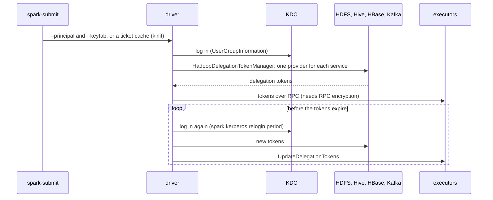
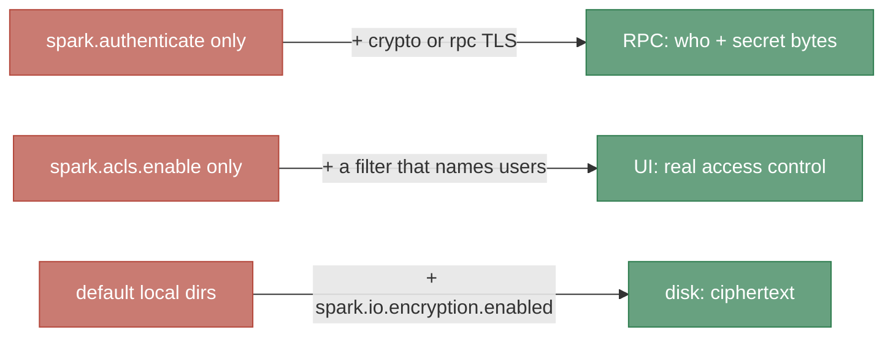

# Chapter 81: Securing Spark

A Spark application talks on several channels. The driver and the executors exchange tasks and shuffle blocks over RPC. A browser reads the UI. Executors write shuffle and spill files to local disks. The event log keeps the configuration.

On a Hadoop cluster, the application also talks to HDFS and the Hive metastore with Kerberos. Spark protects none of these channels by default.

The security page of the 4.3.0 docs starts with that fact: "Security features like authentication are not enabled by default."

**Spark security is a set of separate switches, one for each channel. `spark.authenticate` proves that a process has the shared secret, but the RPC bytes stay readable until you also turn on encryption. UI ACLs do nothing until a servlet filter tells Spark who the user is. Redaction hides secrets from the UI and the event log, but not from the code of the application. Turn on each switch for its channel, and test each one. If a switch is off, Spark gives no error.**

Each step of this chapter turns on one switch and shows what changes. The evidence goes from the bytes on the wire to the first bytes of a shuffle file. Every configuration in this chapter comes from the source of `v4.3.0`. The steps use the standalone cluster of [Chapter 80](ch80-submitting-applications.md) and its kind cluster for Kubernetes. Kerberos did not run, because the book's setup has no KDC. Step 7 explains it from the source and shows the checks that run without a KDC.

The code is in [`code/ch81`](https://github.com/lisancao/spark-masterclass/tree/main/code/ch81). Each output block comes from `code/ch81/output/`. The versions are the same as in Chapter 80: the Spark 4.3.0 tarball, pyspark 4.3.0, OpenJDK 17.0.21.1, and kind with `kindest/node:v1.37.0`.

<figure markdown>
  
  
  <figcaption>The channels of an application and the configuration for each one. Schematic.</figcaption>
</figure>

## Step 1: `spark.authenticate` on a standalone cluster

`spark.authenticate=true` makes each RPC connection start with a check. Both sides must know the same secret. Where the secret comes from depends on the cluster manager (`SecurityManager.initializeAuth`, `SecurityManager.scala:346`):

| Cluster manager | Source of the secret |
|---|---|
| `local`, `local[N]`, YARN | Spark makes a new secret for each application and keeps it in the Hadoop credentials of the user |
| Kubernetes | Spark makes a new secret for each application. Step 2 shows where it goes |
| standalone | you must set `spark.authenticate.secret` on the master, the workers and every application. All of them use the same secret |

On Kubernetes, you can also read the secret from files: `spark.authenticate.secret.file`, or the pair `spark.authenticate.secret.driver.file` and `spark.authenticate.secret.executor.file` (3.0). The source allows files only with a `k8s://` master.

`auth.sh` restarts the cluster of Chapter 80 with a secret in `spark-defaults.conf`. The master and the workers read this file when they start. The file has mode `600`, and the secret is not on any command line:

```text
cluster: master and workers read spark.authenticate=true and the secret from spark-defaults.conf
secret in a daemon command line? 0
```

The same file turns on AES-based encryption for the cluster (Step 2). Then the script sends `probe.py`, a small job with one shuffle, four times. The driver connects to the master through `proxy.py`, a TCP proxy that records every byte that the driver sends:

```text
no-secret                          FAILED (driver gave up after 60 s, exit 124)
                                   master log: Exception: Expected SaslMessage, received something else (maybe your client does not have SASL enabl
                                   573 bytes to the master, app name visible: 0, "spark." strings: 3
wrong-secret                       FAILED (driver gave up after 60 s, exit 124)
                                   master log: Exception: javax.security.sasl.SaslException: DIGEST-MD5: digest response format violation. Mismatch
                                   1617 bytes to the master, app name visible: 0, "spark." strings: 0
secret-no-crypto                   ch81-secret-no-crypto: ok, 10 groups, executors 2
                                   7707 bytes to the master, app name visible: 1, "spark." strings: 21
secret-aes-gcm                     ch81-secret-aes-gcm: ok, 10 groups, executors 2
                                   13713 bytes to the master, app name visible: 0, "spark." strings: 0
```

The first two runs show authentication:

- **Without a secret,** the driver sends its first message without a check. The master expects an authentication message, so it refuses. The driver does not fail fast. It tries again until the script stops it after 60 seconds.
- **With a wrong secret,** the check fails. The driver used the older SASL (`DIGEST-MD5`) protocol here, because its configuration had no `spark.network.crypto.enabled`. The master accepted SASL because `spark.network.crypto.saslFallback` is `true` by default (`TransportConf.java:237`).

The third run shows the limit of authentication alone. The master accepted the driver, and the job ran. But the proxy read 21 strings with `spark.` in them, and the name of the application:

```text
--- what the eavesdropper read in the secret-no-crypto run (printable strings, first lines)
=org.apache.spark.rpc.netty.RpcEndpointVerifier$CheckExistenceJ
:org.apache.spark.deploy.DeployMessages$RegisterApplication
.org.apache.spark.deploy.ApplicationDescription
org.apache.spark.deploy.Commandt
-Dspark.driver.port=41149t
-Dspark.authenticate=truet
*-Dspark.network.crypto.authEngineVersion=2t
$-Dspark.network.crypto.enabled=falset
(the shared secret itself in those bytes: 0 times)
```

These are Java-serialized RPC messages: the registration of the application, with the command that starts each executor. The secret itself was not in the bytes. A standalone executor gets the secret from its worker, not from the driver. But anything that the application sends later over this channel is also readable: task results, broadcast data and shuffle blocks.

## Step 2: RPC encryption, AES and TLS

Spark 4.3.0 has two ways to encrypt RPC. The docs call TLS the "preferred method" and the AES-based way the "legacy" one. If you turn on both, TLS wins, and Spark logs a warning.

| | AES-based | TLS (`spark.ssl.rpc.*`, 4.0) |
|---|---|---|
| Turn it on | `spark.authenticate=true` and `spark.network.crypto.enabled=true` | `spark.ssl.rpc.enabled=true`, plus a key store and a trust store |
| Needs `spark.authenticate` | yes, the secret derives the session keys | no |
| Cipher | `spark.network.crypto.cipher`, default `AES/CTR/NoPadding`. Use `AES/GCM/NoPadding`, which is authenticated | the TLS cipher suites of the JVM or OpenSSL |
| Key agreement | `spark.network.crypto.authEngineVersion`, default `1`. Use `2`, which applies a key derivation function | the TLS handshake |
| Library | Apache Commons Crypto (`spark.network.crypto.config.*` reaches it) | Netty TLS |

The defaults in the table are in `TransportConf.java` (lines 222 and 229) of 4.3.0. The docs recommend `AES/GCM/NoPadding` and version `2`, but the defaults stay at the old values for compatibility. Set both values on every process of the cluster, because the two sides must agree.

The fourth run of Step 1 used the cluster defaults: `AES/GCM/NoPadding` and version `2`. The proxy read no `spark.` strings at all:

```text
--- the same bytes with AES/GCM
sparkSaslUser
+("z&8-jN
x[1WHEJx
(printable strings of 8+ chars: 6)
```

<figure markdown>
  <video autoplay loop muted playsinline controls width="1280" height="720" poster="../../media/clips/ch81-anim-wire.webp">
    <source src="../../media/clips/ch81-anim-wire.mp4" type="video/mp4">
  </video>
  <figcaption>Animation: the same registration message, through the proxy, with <code>spark.authenticate</code> only and then with AES/GCM. The strings and counts come from <code>auth.txt</code>.</figcaption>
</figure>

`ssl_acl.sh` turns on TLS for RPC on `local-cluster[2,1,1024]`, with a self-signed key pair that `keytool` makes for `localhost`. `spark.ssl.enabled=true` alone does not turn on RPC TLS. The docs say that this keeps the upgrade from older versions safe. The `SecurityManager` log line tells which mode is on:

```text
--- RPC with spark.ssl.rpc.enabled=true (not inherited, must be set) on local-cluster
ch81-ssl-rpc: ok, 10 groups, executors 2
RPC SSL enabled
Successfully created connection to /127.0.0.1:35369 after 150 ms (0 ms spent in bootstraps)
Successfully created connection to /127.0.0.1:35369 after 171 ms (0 ms spent in bootstraps)
```

On Kubernetes, `spark.authenticate=true` needs no secret from you. `k8s_auth.sh env` submits Chapter 80's application with authentication and AES encryption, and it reads the spec of an executor pod:

```text
mode: env
executor pod env, as anyone with 'get pods' in the namespace reads it:
  _SPARK_AUTH_SECRET = e21815... (64 chars, in clear text in the pod spec)
executor volumes: spark-conf-volume-exec taxi spark-local-dir-1 kube-api-access-2knx4 
driver: trips by payment_type: 0=1,013,500, 1=2,432,871, 2=357,804, 3=11,205, 4=21,866, 5=2   (pod Succeeded)
```

The driver put the secret of the application into the executor pod spec as the plain variable `_SPARK_AUTH_SECRET` (`BasicExecutorFeatureStep.scala:138` to `142`). Any account that can read pods in the namespace can read the secret.

!!! warning "Caution: the secret is in the pod spec"
    Do not give `get pods` in a Spark namespace to accounts that must not join the application. Anyone who can read the executor pod spec can read `_SPARK_AUTH_SECRET`. Use TLS for RPC (`spark.ssl.rpc.enabled`), or one namespace for each tenant.

The file variant puts the secret in a Kubernetes Secret and mounts it in both pods. `k8s_auth.sh file` tried it. The executor pod had no secret variable, but the executors could not start.

 Their logs said `A secret key must be specified via the spark.authenticate.secret config`. The source shows why. The executor starts with only the configurations that `SparkConf.isExecutorStartupConf` lets through, and `spark.master` is not one of them. `secretKeyFromFile` reads the file only when `spark.master` is a `k8s://` URL (`SecurityManager.scala:386` to `400`). The notes of this book record this result as an open item. The book did not find a fix that works. `spark.executor.extraJavaOptions` cannot set `spark.master`, because Spark refuses Spark options in that key.

## Step 3: TLS for the UI

The UI is a Jetty server. `spark.ssl.enabled=true` turns on TLS for every namespace that inherits from `spark.ssl`: `spark.ssl.ui`, `spark.ssl.standalone` and `spark.ssl.historyServer`. RPC is the exception. The HTTPS port is the HTTP port plus 400, unless you set `spark.ssl.ui.port` (`JettyUtils.scala:435`). `ssl_acl.sh` starts an application with the key store and the trust store of Step 2, and it calls the UI with `curl`:

```text
--- UI with spark.ssl.enabled=true (the ui namespace inherits it)
http://localhost:4151/jobs/      -> 302 https://localhost:4551/jobs/
https://localhost:4551/jobs/     -> 200 (trusted with spark.pem)
https, no trust store            -> 000 curl exit 60
subject=CN = localhost
issuer=CN = localhost
New, TLSv1.3, Cipher is TLS_AES_256_GCM_SHA384
RPC SSL disabled
```

The HTTP port still answers, but only with a redirect to HTTPS (`HttpsRedirectFilter`). `curl` without the certificate refused the self-signed key (exit 60). The last line shows that the UI configuration did not turn on TLS for RPC.

The steps used these SSL configurations. Replace `spark.ssl` with `spark.ssl.ui` or `spark.ssl.rpc` to set them for one namespace only:

| Configuration | Value in `ssl_acl.sh` |
|---|---|
| `spark.ssl.enabled` | `true` |
| `spark.ssl.keyStore`, `spark.ssl.keyStoreType` | `keystore.p12`, `PKCS12` |
| `spark.ssl.keyStorePassword`, `spark.ssl.keyPassword` | a password from the script |
| `spark.ssl.trustStore`, `spark.ssl.trustStoreType`, `spark.ssl.trustStorePassword` | `truststore.p12`, `PKCS12`, the same password |
| `spark.ssl.rpc.enabled` | `true` only in the RPC run |

Spark does not send the passwords to executors as startup configurations (`SparkConf.isExecutorStartupConf` skips names with `Password`). They also match the redaction pattern of Step 6.

## Step 4: UI ACLs need a filter that names the user

`spark.acls.enable=true` turns on access control for the UI and the REST API. `spark.ui.view.acls` lists the users who may read, `spark.modify.acls` the users who may kill jobs and stages, and `spark.admin.acls` the users who may do both. Each list has a `.groups` partner. The user who started the application is always on the view and modify lists.

Spark does not know who sends an HTTP request. A servlet filter in `spark.ui.filters` must set the remote user. Spark 4.3.0 ships one filter, `org.apache.spark.ui.JWSFilter`. It checks an `Authorization: Bearer` token signed with HS256, but it does not set a user. Thus `ssl_acl.sh` adds a toy filter, [`HeaderUserFilter.java`](https://github.com/lisancao/spark-masterclass/tree/main/code/ch81/filter/book/HeaderUserFilter.java), that takes the user from a header:

```java
final String user = http.getHeader(header);              // X-Book-User
chain.doFilter(new HttpServletRequestWrapper(http) {
  @Override
  public String getRemoteUser() {
    return user;
  }
}, res);
```

The script compiles the filter against the Jakarta servlet API of the pip package and puts it in a jar. Then it starts an application with these configurations:

- `--jars book-filter.jar` and `spark.ui.filters=book.HeaderUserFilter`
- `spark.acls.enable=true`
- `spark.ui.view.acls=alice` and `spark.admin.acls=ops`

The script calls two paths as each user:

```text
--- UI ACLs: spark.acls.enable=true, view: alice, admin: ops, a header filter for the user
(no user)      GET /jobs/                 -> 200
(no user)      GET /api/v1/applications/  -> 200
alice          GET /jobs/                 -> 200
alice          GET /api/v1/applications/  -> 200
bob            GET /jobs/                 -> 403
bob            GET /api/v1/applications/  -> 403
ops            GET /jobs/                 -> 200
ops            GET /api/v1/applications/  -> 200
owner          GET /jobs/                 -> 200
owner          GET /api/v1/applications/  -> 200
ui acls enabled; users with view permissions: ops, <owner>, alice groups with view permissions: EMPTY; users with modify permissions: ops, <owner>
```

`bob` got 403, as expected. But a request with no user got 200. The ACL check passes when the user is `null`: `isUserInACL` returns `true` for `user == null` (`SecurityManager.scala:406`). The comment above it says that a `null` user means "authentication isn't turned on". Thus ACLs without a filter that always sets a user, or refuses the request, protect nothing.

!!! warning "Caution: an ACL without authentication lets everyone in"
    Do not turn on `spark.acls.enable` without a filter that names every user. A request without a remote user passes every ACL check. Use a filter that refuses a request when it cannot find the user. The toy filter of this step trusts a header, so use it only in a test.

A filter takes parameters from the configuration `spark.<filter class>.param.<name>`. For `JWSFilter`, set `spark.org.apache.spark.ui.JWSFilter.param.secretKey` to a Base64URL key. The 4.3.0 filter also reads `requireExpiration`, which refuses tokens without an `exp` claim. The same filter protects the REST submission server of the standalone master with `spark.master.rest.filters`.

Other HTTP configurations of the UI are `spark.ui.allowFramingFrom`, `spark.ui.xXssProtection` and `spark.ui.strictTransportSecurity`. The History Server has its own ACL keys: `spark.history.ui.acls.enable` and `spark.history.ui.admin.acls`.

## Step 5: Local disk I/O encryption

Shuffle files, spill files and blocks that the block manager writes to disk are not encrypted by default. `spark.io.encryption.enabled=true` encrypts them. `io_encryption.py` runs one shuffle and one `DISK_ONLY` cache, then it reads the first bytes of two files in `spark.local.dir` while the application still runs:

```text
spark.io.encryption.enabled=false
  shuffle data  shuffle_0_7_0.data         3,414 B  4c5a3442 6c6f636b 25d00200 00cc0500 00e6d71f 0c530000  |LZ4Block%............S..|
  cached block  rdd_13_0                  51,613 B  4c5a3442 6c6f636b 25c42900 00008000 00b76cdc 0ef029ac  |LZ4Block%.).......l...).|
spark.io.encryption.enabled=true
  shuffle data  shuffle_0_7_0.data         3,478 B  54f13743 549b4724 0b5ad27f 3df723ce 3a4b0768 0c5e26d0  |T.7CT.G$.Z..=.#.:K.h.^&.|
  cached block  rdd_13_0                  51,629 B  f6d28dfd c924a92b 511aec01 1e91e4ff cb6cc135 4fd13b3e  |.....$.+Q........l.5O.;>|
```

Without encryption, each file starts with the magic bytes of an LZ4 block, `LZ4Block`. LZ4 compresses the data, but it does not protect it. Anyone who reads the disk can decompress it. With encryption, the bytes have no pattern. The encrypted shuffle file is 64 bytes longer, and the cached block 16 bytes longer. That fits one initialization vector of 16 bytes for each encrypted stream, and this map task wrote four partitions.

<figure markdown>
  
  
  <figcaption>Top: the four runs of <code>auth.sh</code>. Bottom: the first bytes of a shuffle file and a cached block, without and with <code>spark.io.encryption.enabled</code>.</figcaption>
</figure>

The other keys are `spark.io.encryption.keySizeBits` (128, 192 or 256, default 128) and `spark.io.encryption.keygen.algorithm`. The key exists only in memory for the life of the application. I/O encryption does not cover the output files that your application writes. Encrypt those with the storage system. Also, push-based shuffle does not work with I/O encryption ([Chapter 63](ch63-orchestration.md)). The docs recommend RPC encryption together with I/O encryption, because shuffle blocks travel over RPC after Spark reads them from disk.

<figure markdown>
  <video autoplay loop muted playsinline controls width="1280" height="720" poster="../../media/clips/ch81-disk.webp">
    <source src="../../media/clips/ch81-disk.mp4" type="video/mp4">
  </video>
  <figcaption><code>io_encryption.py</code> with encryption off and on. The first bytes <code>4c5a3442 6c6f636b</code> (<code>LZ4Block</code>) disappear.</figcaption>
</figure>

## Step 6: Redaction in the UI, the event log and SQL

Configurations often hold secrets: a storage key, a token, a password in a URL. `spark.redaction.regex` decides which values Spark hides. The default is `(?i)secret|password|token|access[.]?key|credential` (`package.scala:1333`). The pattern applies to the key and to the value. `redaction.py` sets three secrets and one plain value:

```text
1. REST /environment (the Environment tab reads the same store)
   spark.hadoop.fs.s3a.secret.key   *********(redacted)
   spark.book.api.token             *********(redacted)
   spark.book.endpoint              *********(redacted)
   spark.book.region                ca-central-1
2. the event log, SparkListenerEnvironmentUpdate
   spark.hadoop.fs.s3a.secret.key   *********(redacted)
   spark.book.api.token             *********(redacted)
   spark.book.endpoint              *********(redacted)
   spark.book.region                ca-central-1
3. the application itself still reads the real values
   spark.conf.get('spark.hadoop.fs.s3a.secret.key') = s3-SECRET-1234
   spark.conf.get('spark.book.api.token') = tok-SECRET-5678
4. table options in DESCRIBE TABLE EXTENDED (spark.sql.redaction.options.regex)
   Location: file:$TAXI/taxi_zone_lookup.csv
   Storage Properties: [header=true, password=*********(redacted), url=*********(redacted)]
5. plan strings with spark.sql.redaction.string.regex (a runtime SQL config)
   before: *(1) Filter (isnotnull(Zone#49) AND (Zone#49 = acct-SECRET-42))
   after:  *(1) Filter (isnotnull(Zone#49) AND (Zone#49 = *********(redacted)))
```

The output shows four rules:

- **The key or the value can match.** `spark.book.endpoint` has a plain key, but its value has `password=`, so Spark hid it.
- **Spark also hides the values in the event log on disk.** The History Server and anyone with the log files see the same mask.
- **Redaction applies only to what Spark shows.** Code in the application reads the real value. So does anyone who can run code in the application, for example through a Connect session.
- **SQL has two more patterns.** `spark.sql.redaction.options.regex` (default `(?i)url`) hides the options of a table or a data source whose keys match. The global pattern hid `password`. `spark.sql.redaction.string.regex` hides parts of plan strings, for example a literal in a filter. It falls back to `spark.redaction.string.regex`, which is a static configuration. The SQL key is a runtime configuration, so `spark.conf.set` can change it.

<figure markdown>
  <video autoplay loop muted playsinline controls width="1280" height="720" poster="../../media/clips/ch81-redaction.webp">
    <source src="../../media/clips/ch81-redaction.mp4" type="video/mp4">
  </video>
  <figcaption><code>redaction.py</code>: Spark hides three secrets in the REST API and the event log, but the application reads them in clear text.</figcaption>
</figure>

## Step 7: Kerberos and delegation tokens (from the source)

On a Hadoop cluster with Kerberos, the driver logs in as a principal and gets **delegation tokens** for each service. Executors never see the keytab. They get the tokens, and the driver gives them new tokens before the old ones expire. The book's setup has no KDC, so this step did not run a login. It explains the 4.3.0 source and the docs.



The parts, from the source:

| Part | 4.3.0 |
|---|---|
| Login | `spark.kerberos.principal` and `spark.kerberos.keytab` (`--principal`, `--keytab`), or the ticket cache of the user after `kinit` |
| Token providers | `hadoopfs` (the file system of the home folder, plus `spark.kerberos.access.hadoopFileSystems`), `hive` (if `hive.metastore.uris` is set), `hbase`, `kafka` |
| Turn a provider off | `spark.security.credentials.<service>.enabled=false` |
| Renewal | `spark.kerberos.renewal.credentials`: `keytab` (the default) or `ccache` |
| Custom providers | implement `org.apache.spark.security.HadoopDelegationTokenProvider` and list the class in `META-INF/services` |
| Cluster managers | local, YARN and Kubernetes. Standalone has no delegation token support |
| Impersonation | `--proxy-user`: the driver logs in as itself and gets tokens for the proxy user |

!!! note "New in 4.3: token providers without Kerberos"
    `spark.security.directCredentialProviders.enabled` (default `false`) calls the registered token providers without a Kerberos login. Their tokens use the same renewal and distribution as Kerberos tokens. The docs require RPC encryption for it: `spark.ssl.rpc.enabled=true`, or `spark.authenticate=true` together with `spark.network.crypto.enabled` or `spark.authenticate.enableSaslEncryption`. It works on YARN, Kubernetes and local mode, not on standalone.

`kerberos.sh` shows the checks that run before any login:

```text
--- --principal without --keytab
k: ok, 10 groups, executors 0
--- a keytab file that does not exist
java.lang.IllegalArgumentException: requirement failed: Keytab file: /nonexistent.keytab does not exist
--- --proxy-user together with --principal
org.apache.spark.SparkException: Only one of --proxy-user or --principal can be provided.
--- no Kerberos at all: Hadoop security is off, no tokens
ch81-krb: ok, 10 groups, executors 0
```

A principal without a keytab gives no error. `spark-submit` ignores it, and the application runs as the local user. Thus check the log of the driver for the login line on a real cluster. A keytab that does not exist stops `spark-submit` at once. `--proxy-user` and `--principal` cannot go together.

## Step 8: Spark Connect

A Connect server is a driver that accepts plans from clients over gRPC ([Chapter 18](ch18-spark-connect.md)). Its port is a new channel, with its own switches. [Chapter 24](ch24-connect-in-production.md) runs them. In short:

| Need | 4.3.0 |
|---|---|
| Refuse clients without the token | `spark.connect.authenticate.token` on the server, or the variable `SPARK_CONNECT_AUTHENTICATE_TOKEN`. The client sends `token=` in the `sc://` URL |
| Encryption on the wire | the server has no TLS of its own. Put a TLS proxy in front of it. The Python client requires TLS for a token to any host except `localhost` |
| Identity of a user | the `user_id` in the URL is a claim, not a proof. Use a proxy that authenticates users, or one server for each identity |
| Bind address | `spark.connect.grpc.binding.address`, so that the server does not listen on all interfaces |

The server behind the proxy is still a Spark driver. It needs the switches of Steps 1 to 6 for its executors, its UI and its disks.

## Choose your switches

| Channel | Minimum for a shared network | Configuration |
|---|---|---|
| RPC between the processes | authentication and encryption | `spark.authenticate`, `spark.network.crypto.enabled` with `AES/GCM/NoPadding` and version `2`, or `spark.ssl.rpc.enabled` |
| UI and REST API | TLS and a filter that names every user, then ACLs | `spark.ssl.ui.*`, `spark.ui.filters`, `spark.acls.enable` |
| Standalone REST submission server | a filter, or a closed port | `spark.master.rest.filters=org.apache.spark.ui.JWSFilter` |
| Local disks | encryption | `spark.io.encryption.enabled` |
| Event log and UI Environment | redaction that matches your secret names | `spark.redaction.regex` |
| Hadoop services | Kerberos and delegation tokens | `spark.kerberos.*` |
| Connect | a token and TLS at a proxy | `spark.connect.authenticate.token` (Chapter 24) |



## The whole chapter, on one page

- **No security switch is on by default.** If a switch is off, Spark gives no error.
- **`spark.authenticate` checks the secret.** On standalone, set the same secret on every process, in `spark-defaults.conf`, not on a command line. Without encryption, the RPC bytes stay readable: 21 `spark.` strings in `auth.txt`.
- **Encrypt RPC** with `spark.network.crypto.enabled` (set `AES/GCM/NoPadding` and version `2`, not the defaults) or with `spark.ssl.rpc.enabled`. TLS for RPC is not inherited from `spark.ssl.enabled`.
- **On Kubernetes, the per-application secret is in the executor pod spec.** The file variant did not start executors in this test.
- **UI TLS** redirects HTTP to the port plus 400. **UI ACLs** pass every request without a user, so they need a filter that names every user.
- **`spark.io.encryption.enabled`** removes the `LZ4Block` bytes from shuffle files and cached blocks.
- **Redaction** hides values in the UI, the REST API, the event log and SQL output, not from the application.
- **Kerberos** gives the driver a login and the executors delegation tokens. 4.3 adds token providers without Kerberos.
- **Connect** needs a token and a TLS proxy (Chapter 24).

The commands, in order:

```bash
cd code
ch81/auth.sh                     # standalone: secret, wrong secret, no crypto, AES/GCM
ch81/k8s_auth.sh env             # kind cluster from ch80/k8s/cluster.sh up
ch81/k8s_auth.sh file
ch81/ssl_acl.sh                  # UI TLS, RPC TLS, UI ACLs with a header filter
uv run python ch81/io_encryption.py false
uv run python ch81/io_encryption.py true
uv run python ch81/redaction.py
ch81/kerberos.sh
```

## Further reading

- [Spark Security](https://spark.apache.org/docs/4.3.0/security.html), the page that this chapter follows, with every configuration and its default.
- [`SecurityManager.scala`](https://github.com/apache/spark/blob/v4.3.0/core/src/main/scala/org/apache/spark/SecurityManager.scala), for the secret, the ACL checks and the `null` user.
- [`TransportConf.java`](https://github.com/apache/spark/blob/v4.3.0/common/network-common/src/main/java/org/apache/spark/network/util/TransportConf.java), for the RPC crypto defaults.
- [`JWSFilter.scala`](https://github.com/apache/spark/blob/v4.3.0/core/src/main/scala/org/apache/spark/ui/JWSFilter.scala), the filter that Spark ships.
- [Chapter 24](ch24-connect-in-production.md), for the Connect token and a TLS proxy.
