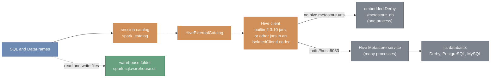
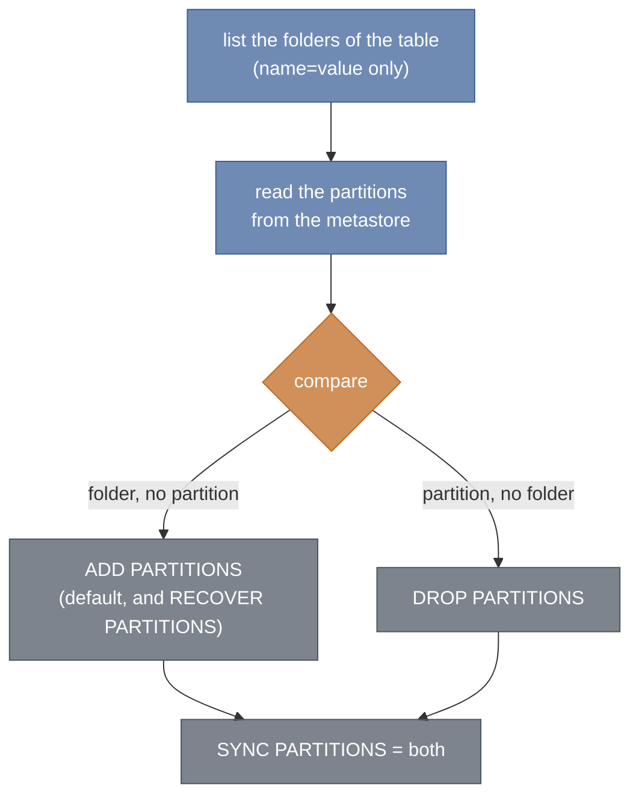
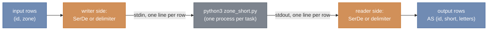
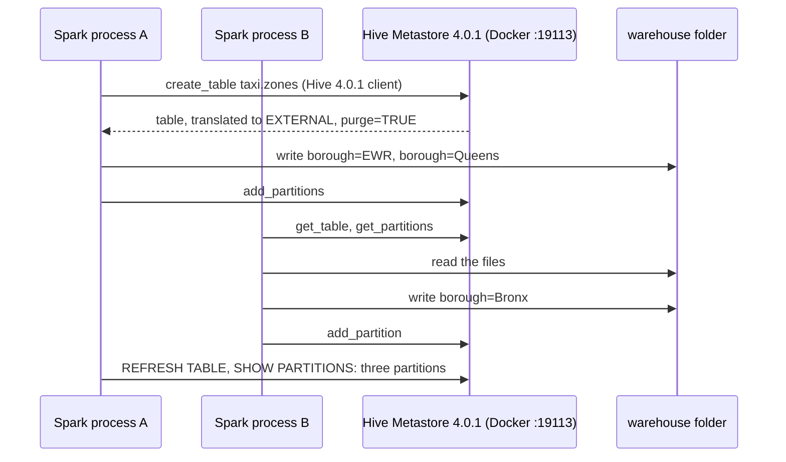

# Chapter 85: Hive tables and the metastore

Spark carries a Hive client, Hive's SerDes and Hive's UDF interfaces inside it. The `spark-sql` shell and the Thrift server use the Hive catalog by default ([Chapter 12](ch12-spark-sql.md)). Many companies keep their table definitions in a Hive Metastore that other engines also read. Old pipelines have tables `STORED AS TEXTFILE`, partitions that another job writes, `LOAD DATA` statements and Hive UDFs in jars.

**`enableHiveSupport()` connects Spark to a Hive Metastore through a Hive client inside Spark. The metastore keeps names, columns, partitions, SerDes and functions. The files stay in the warehouse. Spark reads most Hive tables with its own Parquet and ORC readers, and uses a Hive SerDe only when it must. Each of these facts is visible: in the plan, in the folder of the table, and in the rows of the metastore database. To use Hive tables well, know which part keeps which fact, and what makes the two parts disagree.**

This chapter continues [Chapter 84](ch84-tables-ddl-writes.md), which used the in-memory catalog. Here each script turns on Hive support, and each step looks at the metastore and at the files.

The scripts are in [`code/ch85`](https://github.com/lisancao/spark-masterclass/tree/main/code/ch85), and each output block below comes from `code/ch85/output/`.

| Script | What it shows |
|---|---|
| `hive_session.py` | What `enableHiveSupport()` puts on disk, the Hive client, the Derby lock |
| `metastore_versions.py` | The metastore versions of each release, the built-in client, two bad settings |
| `serde_tables.py` | `STORED AS` and `ROW FORMAT` against `USING`, readers and writers in the plan, `SHOW CREATE TABLE` |
| `partitions.py` | Static and dynamic inserts, `MSCK REPAIR TABLE`, `RECOVER PARTITIONS`, partition DDL, `INSERT OVERWRITE` |
| `derby_rows.sh` | The rows that `partitions.py` left in the Derby metastore, read with Derby's `ij` tool |
| `load_and_dirs.py` | `LOAD DATA`, `INSERT OVERWRITE DIRECTORY` |
| `hive_udf/`, `hive_udf.py` | Two Hive UDFs in Java, `CREATE FUNCTION ... USING JAR`, Hive's own UDAF and UDTF classes |
| `transform.py`, `zone_short.py` | Script `TRANSFORM` with and without Hive support |
| `standalone_metastore.sh`, `remote_metastore.py` | A Hive Metastore 4.0.1 in Docker, two Spark processes on it |

## Spark, the Hive client and the metastore



The catalog is metadata only. The executors read and write the files of the warehouse directly. The metastore never sees a row.

## Step 1: Turn on Hive support

`hive_session.py` starts a session with `enableHiveSupport()` in an empty folder. The helper `hive_session()` in `ch85/hive.py` sets the warehouse folder and makes the folder the working directory:

```python
os.chdir(folder)
b = (SparkSession.builder.master("local[2]").appName(name)
     .config("spark.ui.port", ui_port())
     .config("spark.sql.warehouse.dir", str(Path(folder) / "warehouse")))
...
spark = b.enableHiveSupport().getOrCreate()
```

After the first statements, the folder has three things:

```text
== 2. a table, and the folder after the first statement
> CREATE DATABASE taxi
> CREATE TABLE taxi.zones (id INT, borough STRING) STORED AS PARQUET
> INSERT INTO taxi.zones VALUES (1, 'EWR'), (2, 'Queens')
  top level: ['derby.log', 'metastore_db', 'warehouse']
  warehouse:
    taxi.db/zones/_SUCCESS  (0 B)
    taxi.db/zones/part-00000-<uuid>-c000.snappy.parquet  (684 B)
    taxi.db/zones/part-00001-<uuid>-c000.snappy.parquet  (706 B)
  metastore_db: a Derby database, 174 files, for example ['README_DO_NOT_TOUCH_FILES.txt', 'db.lck', 'dbex.lck', 'log', 'seg0']
```

- `warehouse/` has the data, one folder for each database (`taxi.db`) and each table.
- `metastore_db/` is an embedded Apache Derby database. The Hive client made it, because no `hive-site.xml` and no `hive.metastore.uris` told it to use another metastore. It is in the working directory.
- `derby.log` is the log of Derby.

The Hive configurations exist only after the first statement that uses Hive, because Spark loads its Hive classes lazily. Then `SET` shows them:

```text
== 3. the catalog, and the Hive client that Spark uses
  spark.sql.catalogImplementation              hive
  spark.sql.hive.metastore.version             2.3.10
  spark.sql.hive.metastore.jars                builtin
  spark.sql.hive.convertMetastoreParquet       true
  spark.sql.hive.convertMetastoreOrc           true
  spark.sql.legacy.createHiveTableByDefault    false
  external catalog class: HiveExternalCatalog
```

Embedded Derby accepts one process. The script starts a second Python process on the same folder while the first session runs:

```text
== 4. a second process on the same Derby folder, while this one runs
  ERROR XSDB6: Another instance of Derby may have already booted the database <folder>/metastore_db.
  exit code: 1
```

!!! warning "CAUTION"
    Do not put the embedded Derby metastore in a shared folder, and do not use it for more than one Spark process. A second process fails at the first catalog statement. If more than one process must see the tables, use a Hive Metastore service (Step 10) or a different catalog ([Chapter 45](ch45-iceberg.md)).

!!! note
    `metastore_db` and `derby.log` go into the working directory. A job that starts in a different folder gets a new, empty metastore, and its tables seem to be gone. Set `javax.jdo.option.ConnectionURL` (as `spark.hadoop.javax.jdo.option.ConnectionURL`) to a fixed path, as [Chapter 12](ch12-spark-sql.md) does for `spark-sql`.

## Step 2: Metastore versions and the Hive client

Spark compiles against one Hive version, and it ships those jars: the built-in client. The pyspark 4.3.0 wheel has Hive 2.3.10:

```text
== 2. the Hive jars inside the pyspark 4.3.0 wheel (the 'builtin' client)
  hive-beeline-2.3.10.jar
  hive-cli-2.3.10.jar
  hive-common-2.3.10.jar
  hive-exec-2.3.10-core.jar
  hive-jdbc-2.3.10.jar
  hive-metastore-2.3.10.jar
  hive-serde-2.3.10.jar
  hive-service-rpc-4.0.0.jar
  ...
```

To talk to a metastore of another version, Spark loads a second set of Hive jars in an isolated class loader. `spark.sql.hive.metastore.version` names the version. The list of versions that Spark knows is the set of `HiveVersion` objects in `sql/hive/.../client/package.scala`. `metastore_versions.py` reads it at each release tag:

```text
== 1. HiveVersion objects in sql/hive/.../client/package.scala at each tag
  v3.5.0  0.12.0 0.13.1 0.14.0 1.0.1 1.1.1 1.2.2 2.0.1 2.1.1 2.2.0 2.3.9 3.0.0 3.1.3
  v4.0.0  2.0.1 2.1.1 2.2.0 2.3.10 3.0.0 3.1.3 4.0.1
  v4.1.0  2.0.1 2.1.1 2.2.0 2.3.10 3.0.0 3.1.3 4.0.1 4.1.0
  v4.2.0  2.0.1 2.1.1 2.2.0 2.3.10 3.0.0 3.1.3 4.0.1 4.1.0
  v4.3.0  2.0.1 2.1.1 2.2.0 2.3.10 3.0.0 3.1.3 4.0.1 4.1.0
```

Spark 4.0 removed each version below 2.0. The SQL migration guide gives the reason: those clients need JDK 8, and Spark 4 does not run on JDK 8. Spark 4.0 added 4.0.1, and Spark 4.1 added 4.1.0. The docs of `spark.sql.hive.metastore.version` at v4.3.0 give the same ranges: `2.0.0` through `2.3.10`, `3.0.0` through `3.1.3`, and `4.0.0` through `4.1.0`.

These are static configurations, so the script starts one process for each value:

```text
== 3. a session for each setting (one process each: these are static configurations)
  version=2.3.10  jars=builtin  ok, databases: ['default']
  version=1.2.1   jars=builtin  IllegalArgumentException: [INVALID_CONF_VALUE.REQUIREMENT] The value '1.2.1' in the config "spark.sql.hive.metastore.version" is invalid. Unsupported Hive Metastore version SQLSTATE: 22022
  version=3.1.3   jars=builtin  IllegalArgumentException: Builtin jars can only be used when hive execution version == hive metastore version. Execution: 2.3.10 != Metastore: 3.1.3. Specify a valid path to the correct hive jars using spark.sql.hive.metastore.jars or change spark.sql.hive
```

| `spark.sql.hive.metastore.jars` | Where the client jars come from | Use it when |
|---|---|---|
| `builtin` (default) | the Hive 2.3.10 jars of Spark | the metastore speaks the 2.3 protocol (Step 10 shows one that does not) |
| `maven` | downloaded from Maven for `spark.sql.hive.metastore.version` | a test or a laptop, with network access |
| `path` | the jars in `spark.sql.hive.metastore.jars.path` | production with a version other than 2.3.10 |
| a classpath | a JVM classpath with Hive and Hadoop | the same, the older form |

The version of the client is for metadata only. Spark always runs Hive SerDes and Hive UDFs with its built-in Hive 2.3.10 classes. The Hive tables page of the docs says so.

## Step 3: SerDe tables and data source tables

A Hive SerDe table keeps three class names in the metastore: an input format, an output format and a SerDe (serializer and deserializer). `STORED AS` and `ROW FORMAT` set them. A data source table keeps a Spark provider name, such as `parquet`. `USING` sets it. `serde_tables.py` makes each kind:

```sql
CREATE TABLE z_text (id INT, borough STRING, zone STRING)
  ROW FORMAT DELIMITED FIELDS TERMINATED BY ','
  STORED AS TEXTFILE;
CREATE TABLE z_hive_pq (id INT, borough STRING, zone STRING) STORED AS PARQUET;
CREATE TABLE z_hive_orc (id INT, borough STRING, zone STRING) STORED AS ORC;
CREATE TABLE z_csv_serde (id STRING, borough STRING, zone STRING)
  ROW FORMAT SERDE 'org.apache.hadoop.hive.serde2.OpenCSVSerde'
  WITH SERDEPROPERTIES ('separatorChar' = ',', 'quoteChar' = '"')
  STORED AS TEXTFILE;
CREATE TABLE z_ds_pq (id INT, borough STRING, zone STRING) USING parquet;
CREATE TABLE z_default (id INT, borough STRING, zone STRING);
```

```text
== 2. what the metastore keeps for each table
  table        Provider  Serde Library                                          
  z_text       hive      org.apache.hadoop.hive.serde2.lazy.LazySimpleSerDe
  z_hive_pq    hive      org.apache.hadoop.hive.ql.io.parquet.serde.ParquetHiveSerDe
  z_hive_orc   hive      org.apache.hadoop.hive.ql.io.orc.OrcSerde
  z_csv_serde  hive      org.apache.hadoop.hive.serde2.OpenCSVSerde
  z_ds_pq      parquet   org.apache.hadoop.hive.ql.io.parquet.serde.ParquetHiveSerDe
  z_default    parquet   org.apache.hadoop.hive.ql.io.parquet.serde.ParquetHiveSerDe
```

`Provider` tells the two kinds apart. A data source table also has a SerDe in the metastore. Spark writes a Hive SerDe that matches the format when one exists, so that Hive can also read a Parquet or ORC data source table. A table with no clause is a data source table since Spark 4.0 ([Chapter 84](ch84-tables-ddl-writes.md)).

The files show the SerDe at work. `LazySimpleSerDe` wrote plain comma-separated text. `OpenCSVSerde` put each value in quotes:

```text
  one file of z_text: '1,EWR,Newark Airport\n'
  one file of z_csv_serde: '"1","EWR","Newark Airport"\n'
```

### The reader and the writer that Spark picks

For a Hive table in Parquet or ORC, Spark does not use the Hive SerDe. `spark.sql.hive.convertMetastoreParquet` and `spark.sql.hive.convertMetastoreOrc` (both `true`) change the table into a Spark data source relation in the plan:

```text
== 4. the reader and the writer in the physical plan
  table        scan node        write command
  z_text       Scan hive        InsertIntoHiveTable
  z_hive_pq    FileScan parquet InsertIntoHadoopFsRelationCommand
  z_hive_orc   FileScan orc     InsertIntoHadoopFsRelationCommand
  z_ds_pq      FileScan parquet InsertIntoHadoopFsRelationCommand
  with spark.sql.hive.convertMetastoreParquet=false:
  z_hive_pq    Scan hive        InsertIntoHiveTable
```

<figure markdown>
  
  
  <figcaption>The provider, scan node and write command of each table, from <code>serde_tables.txt</code>.</figcaption>
</figure>

`Scan hive` reads each row through the SerDe, row by row. `FileScan parquet` is the vectorized reader of [Chapter 36](ch36-parquet-inside.md), with column pruning and filter pushdown. Only the text table still needs the Hive path.

### SHOW CREATE TABLE

`SHOW CREATE TABLE` gives Spark DDL for each table, also for a Hive table. `AS SERDE` gives Hive DDL:

```text
> SHOW CREATE TABLE z_text
  CREATE TABLE taxi.z_text (
    id INT,
    borough STRING COLLATE UTF8_BINARY,
    zone STRING COLLATE UTF8_BINARY)
  USING text
> SHOW CREATE TABLE z_text AS SERDE
  CREATE TABLE taxi.z_text (
    id INT,
    borough STRING,
    zone STRING)
  ROW FORMAT SERDE 'org.apache.hadoop.hive.serde2.lazy.LazySimpleSerDe'
  WITH SERDEPROPERTIES (
    'field.delim' = ',',
    'serialization.format' = ',')
  STORED AS
    INPUTFORMAT 'org.apache.hadoop.mapred.TextInputFormat'
    OUTPUTFORMAT 'org.apache.hadoop.hive.ql.io.HiveIgnoreKeyTextOutputFormat'
```

The Spark DDL of the delimited text table is not correct. The `text` data source has one string column, and it has no field separator. The script runs the DDL under a new name, and it fails:

```text
  run the Spark DDL under a new name, and it fails:
> CREATE TABLE taxi.z_text_copy (
     id INT,
     borough STRING COLLATE UTF8_BINARY,
     zone STRING COLLATE UTF8_BINARY)
     USING text
  AnalysisException: [UNSUPPORTED_DATA_TYPE_FOR_DATASOURCE] The Text datasource doesn't
  support the column `id` of the type "INT". SQLSTATE: 0A000
```

!!! warning "CAUTION"
    Do not copy a Hive SerDe table with the output of `SHOW CREATE TABLE`. Use `SHOW CREATE TABLE ... AS SERDE`. The Spark DDL can lose the SerDe properties, such as the field separator.

`USING hive OPTIONS (fileFormat '...')` is the Spark syntax for a Hive table. `spark.sql.legacy.createHiveTableByDefault=true` makes a statement with no clause a Hive text table again, as before 4.0:

```text
> CREATE TABLE z_using_hive (id INT) USING hive OPTIONS (fileFormat 'orc')
  {'Provider': 'hive', 'Serde Library': 'org.apache.hadoop.hive.ql.io.orc.OrcSerde'}
> CREATE TABLE z_legacy (id INT)
  {'Provider': 'hive', 'Serde Library': 'org.apache.hadoop.hive.serde2.lazy.LazySimpleSerDe'}
```

| | Hive SerDe table | Data source table |
|---|---|---|
| Clause | `STORED AS`, `ROW FORMAT`, `USING hive` | `USING parquet`, `orc`, `csv`, `json`, ... |
| `Provider` | `hive` | the format |
| Reader | `Scan hive`, or Spark's reader for Parquet and ORC | Spark's reader |
| Writer | `InsertIntoHiveTable`, or Spark's writer for Parquet and ORC | `InsertIntoHadoopFsRelationCommand` |
| Other engines (Hive, Trino) can read it | yes | yes for Parquet and ORC through the SerDe that Spark writes |
| `LOAD DATA` | yes | no (Step 7) |
| `INSERT OVERWRITE` of partitions | only the partitions in the data (Step 5) | `spark.sql.sources.partitionOverwriteMode` |

## Step 4: Partitions in the metastore

A partitioned Hive table has one metastore row for each partition. Each row has its own location and storage descriptor. `partitions.py` writes one static partition and two dynamic ones from the zone lookup file:

```text
> CREATE TABLE zones (id INT, zone STRING)
     PARTITIONED BY (borough STRING)
     STORED AS PARQUET
> INSERT INTO zones PARTITION (borough = 'EWR') SELECT LocationID, Zone FROM zl WHERE Borough = 'EWR'
> INSERT INTO zones PARTITION (borough)
     SELECT LocationID, Zone, Borough FROM zl WHERE Borough IN ('Bronx', 'Queens')
> SHOW PARTITIONS zones
+--------------+
|partition     |
+--------------+
|borough=Bronx |
|borough=EWR   |
|borough=Queens|
+--------------+

> SELECT borough, count(*) AS zones FROM zones GROUP BY borough ORDER BY borough
+-------+-----+
|borough|zones|
+-------+-----+
|Bronx  |43   |
|EWR    |1    |
|Queens |69   |
+-------+-----+

  the partition value is in the folder name, not in the files:
    ['id', 'zone']
  DESCRIBE ... PARTITION (borough = 'Bronx') Location: taxi.db/zones/borough=Bronx
```

A dynamic insert into a Hive text table, which goes through `InsertIntoHiveTable`, follows the Hive rule `hive.exec.dynamic.partition.mode`. Its default is `strict`, and strict mode needs at least one static partition value:

```text
> INSERT OVERWRITE TABLE zones_txt PARTITION (borough) SELECT LocationID, Zone, Borough FROM zl WHERE Borough IN ('Bronx', 'Queens', 'EWR')
  Py4JJavaError: An error occurred while calling o32.sql. :
  org.apache.spark.SparkException: Dynamic partition strict mode requires at least one ...
> SET hive.exec.dynamic.partition.mode = nonstrict
```

The Parquet table `zones` took the dynamic insert with no `SET`, because Spark's own writer did the insert.

## Step 5: MSCK REPAIR TABLE, RECOVER PARTITIONS and REFRESH TABLE

The metastore and the folder can disagree. Another job can write a partition folder, or delete one. Spark reads only the partitions in the metastore. `partitions.py` copies the Bronx folder to `borough=Bronx2` and writes a `borough=Manhattan` folder, as another job would:

```text
== 2. another job writes a folder: the metastore does not know it
  folders: ['borough=Bronx', 'borough=Bronx2', 'borough=EWR', 'borough=Manhattan', 'borough=Queens']
> SHOW PARTITIONS zones
+--------------+
|partition     |
+--------------+
|borough=Bronx |
|borough=EWR   |
|borough=Queens|
+--------------+

> SELECT count(*) AS rows FROM zones
+----+
|rows|
+----+
|113 |
+----+

> MSCK REPAIR TABLE zones
> SHOW PARTITIONS zones
+-----------------+
|partition        |
+-----------------+
|borough=Bronx    |
|borough=Bronx2   |
|borough=EWR      |
|borough=Manhattan|
|borough=Queens   |
+-----------------+

> SELECT count(*) AS rows FROM zones
+----+
|rows|
+----+
|159 |
+----+
```

`MSCK REPAIR TABLE` lists the folders of the table, and adds a metastore partition for each folder that has a `name=value` form and no partition. The 46 new rows are the 43 Bronx zones in `Bronx2` and the 3 rows in `Manhattan`.

<figure markdown>
  <video autoplay loop muted playsinline controls width="1280" height="720" poster="../../media/clips/ch85-msck.webp">
    <source src="../../media/clips/ch85-msck.mp4" type="video/mp4">
  </video>
  <figcaption><code>partitions.py</code> adds two folders with no metastore entry. <code>SHOW PARTITIONS</code> does not list them until <code>MSCK REPAIR TABLE</code> runs.</figcaption>
</figure>

When a folder goes away, the plain command does not remove its partition. The first read also fails, because Spark keeps a list of the files of the table from the last read:

```text
== 3. a folder goes away: DROP or SYNC PARTITIONS
  folders: ['borough=Bronx', 'borough=EWR', 'borough=Manhattan', 'borough=Queens']
> SELECT count(*) AS rows FROM zones
  Py4JJavaError: An error occurred while calling o105.showString. :
  org.apache.spark.SparkException: [FAILED_READ_FILE.FILE_NOT_EXIST] Encountered error ...
> REFRESH TABLE zones
> SELECT count(*) AS rows FROM zones
+----+
|rows|
+----+
|116 |
+----+

> MSCK REPAIR TABLE zones
> SHOW PARTITIONS zones
+-----------------+
|partition        |
+-----------------+
|borough=Bronx    |
|borough=Bronx2   |
|borough=EWR      |
|borough=Manhattan|
|borough=Queens   |
+-----------------+

> MSCK REPAIR TABLE zones SYNC PARTITIONS
> SHOW PARTITIONS zones
+-----------------+
|partition        |
+-----------------+
|borough=Bronx    |
|borough=EWR      |
|borough=Manhattan|
|borough=Queens   |
+-----------------+
```

- `REFRESH TABLE` drops the cached file list. After it, the query reads 116 rows, and the empty `Bronx2` partition adds none.
- `MSCK REPAIR TABLE` is `ADD PARTITIONS` by default. It did not remove `Bronx2`.
- `SYNC PARTITIONS` adds and drops. `DROP PARTITIONS` only drops.

<figure markdown>
  <video autoplay loop muted playsinline controls width="1280" height="720" poster="../../media/clips/ch85-anim-msck.webp">
    <source src="../../media/clips/ch85-anim-msck.mp4" type="video/mp4">
  </video>
  <figcaption>The folders on disk and the partitions in the metastore drift apart, and each mode of <code>MSCK REPAIR TABLE</code> brings them back together. The names and row counts come from <code>partitions.txt</code>.</figcaption>
</figure>



`ALTER TABLE ... RECOVER PARTITIONS` is the Spark statement for the `ADD` mode:

```text
== 4. ALTER TABLE ... RECOVER PARTITIONS is the Spark name for ADD PARTITIONS
> ALTER TABLE zones RECOVER PARTITIONS
> SHOW PARTITIONS zones
+-----------------+
|partition        |
+-----------------+
|borough=Bronx    |
|borough=Brooklyn |
|borough=EWR      |
|borough=Manhattan|
|borough=Queens   |
+-----------------+
```

| Statement | Adds partitions for new folders | Drops partitions with no folder |
|---|---|---|
| `MSCK REPAIR TABLE t` | yes | no |
| `MSCK REPAIR TABLE t ADD PARTITIONS` | yes | no |
| `MSCK REPAIR TABLE t DROP PARTITIONS` | no | yes |
| `MSCK REPAIR TABLE t SYNC PARTITIONS` | yes | yes |
| `ALTER TABLE t RECOVER PARTITIONS` | yes | no |
| `REFRESH TABLE t` | no (it drops the cached file list) | no |

## Step 6: Partition DDL and INSERT OVERWRITE on a Hive table

`ADD PARTITION ... LOCATION` can point a partition to a folder outside the warehouse. On a managed table, `DROP PARTITION` deletes the folder of the partition, also outside the warehouse:

```text
== 5. partition DDL: a partition outside the warehouse, and DROP on a managed table
> ALTER TABLE zones ADD PARTITION (borough = 'Staten Island') LOCATION '~/spark-masterclass-parts/sql-ddl/data/work/ch85-partitions/landing/si'
> SELECT borough, count(*) AS zones FROM zones GROUP BY borough ORDER BY borough
+-------------+-----+
|borough      |zones|
+-------------+-----+
|Bronx        |43   |
|Brooklyn     |69   |
|EWR          |1    |
|Manhattan    |3    |
|Queens       |69   |
|Staten Island|20   |
+-------------+-----+

> ALTER TABLE zones DROP PARTITION (borough = 'Brooklyn')
> ALTER TABLE zones DROP PARTITION (borough = 'Staten Island')
  folders in the table: ['borough=Bronx', 'borough=EWR', 'borough=Manhattan', 'borough=Queens']
  the folder outside the warehouse: gone
```

!!! warning "CAUTION"
    Do not add a partition with `LOCATION` to a managed table if other jobs own that folder. `DROP PARTITION` on a managed table deletes the folder, also when it is outside the warehouse. For folders that other jobs own, use an external table.

`INSERT OVERWRITE` on a Hive table replaces only the partitions that the new rows have. `spark.sql.sources.partitionOverwriteMode` is `STATIC` in this run, and the documentation of that configuration says that it does not apply to Hive SerDe tables. The script writes only EWR again into a Hive text table, a Hive Parquet table and a data source table:

```text
  zones_txt  before ['borough=Bronx', 'borough=EWR', 'borough=Queens']
             after  ['borough=Bronx', 'borough=EWR', 'borough=Queens']
...
  zones      before ['borough=Bronx', 'borough=EWR', 'borough=Manhattan', 'borough=Queens']
             after  ['borough=Bronx', 'borough=EWR', 'borough=Manhattan', 'borough=Queens']
...
  zones_ds (data source table, STATIC) before ['borough=Bronx', 'borough=EWR']
                                     after  ['borough=EWR']
```

The Hive Parquet table `zones` uses Spark's writer (Step 3), but it keeps the Hive rule. Only the data source table lost the Bronx partition. Thus, the same statement on two Parquet tables can delete data on one and keep it on the other. `DESCRIBE TABLE EXTENDED` shows the difference in the `Provider` row.

A partitioned data source table also keeps its partitions in the metastore, because `spark.sql.hive.manageFilesourcePartitions` is `true`:

```text
> CREATE TABLE zones_ds (id INT, zone STRING, borough STRING) USING parquet PARTITIONED BY (borough)
> INSERT INTO zones_ds SELECT LocationID, Zone, Borough FROM zl WHERE Borough IN ('Bronx', 'EWR')
  {'Provider': 'parquet', 'Partition Provider': 'Catalog'}
```

## Step 7: What the metastore database holds

The metastore is a relational database. After `partitions.py` stops, `derby_rows.sh` opens its Derby folder with Derby's `ij` tool, from the `derbytools` jar that pyspark ships. The tables have the names of the Hive Metastore schema:

```text
-- 1. databases and tables
DB      |TBL       |TYPE          
----------------------------------
taxi    |zones     |MANAGED_TABLE 
taxi    |zones_ds  |MANAGED_TABLE 
taxi    |zones_txt |MANAGED_TABLE 
3 rows selected
-- 3. one row per partition, each with its own storage descriptor and location
TBL       |PART_NAME         |LOCATION                                
----------------------------------------------------------------------
zones     |borough=Bronx     |taxi.db/zones/borough=Bronx             
zones     |borough=EWR       |taxi.db/zones/borough=EWR               
zones     |borough=Manhattan |taxi.db/zones/borough=Manhattan         
zones     |borough=Queens    |taxi.db/zones/borough=Queens            
zones_ds  |borough=EWR       |taxi.db/zones_ds/borough=EWR            
zones_txt |borough=Bronx     |taxi.db/zones_txt/borough=Bronx         
zones_txt |borough=EWR       |taxi.db/zones_txt/borough=EWR           
zones_txt |borough=Queens    |taxi.db/zones_txt/borough=Queens        
8 rows selected
```

A data source table is a Hive table to the metastore. Spark keeps what Hive cannot express as table parameters, with keys that start with `spark.sql.`:

```text
-- 4. what Spark adds for a data source table: its provider and schema, as table parameters
PARAM_KEY                               |PARAM_VALUE                                 
-------------------------------------------------------------------------------------
spark.sql.create.version                |4.3.0                                       
spark.sql.partitionProvider             |catalog                                     
spark.sql.sources.provider              |parquet                                     
spark.sql.sources.schema                |{"type":"struct","fields":[{"name":"id","typ
spark.sql.sources.schema.numPartCols    |1                                           
spark.sql.sources.schema.partCol.0      |borough                                     
6 rows selected
```

<figure markdown>
  
  
  <figcaption>How the metastore rows of <code>derby_rows.txt</code> point to each other and to the folders of the warehouse.</figcaption>
</figure>

`spark.sql.sources.schema` holds the Spark schema as JSON. That is how a data source table keeps Spark types that Hive does not have, such as collations or `VARIANT`.

!!! warning "CAUTION"
    Do not change the metastore database with SQL. Use Spark or Hive statements. The script reads the Derby folder only after the Spark process stops, because Derby accepts one process.

## Step 8: LOAD DATA

`LOAD DATA` moves or copies files into the folder of a Hive table. It does not read the files. `load_and_dirs.py` loads three small CSV files into a Hive text table:

```text
== 1. LOAD DATA LOCAL INPATH copies a file into the table folder
> LOAD DATA LOCAL INPATH '~/spark-masterclass-parts/sql-ddl/data/work/ch85-load/inbox/zones_1.csv' INTO TABLE zones
  inbox:
    zones_1.csv  (42 B)
    zones_2.csv  (58 B)
    zones_3.csv  (30 B)
  table folder:
    zones_1.csv  (42 B)
...
== 2. LOAD DATA INPATH (no LOCAL) moves the file
> LOAD DATA INPATH '~/spark-masterclass-parts/sql-ddl/data/work/ch85-load/inbox/zones_2.csv' INTO TABLE zones
  inbox:
    zones_1.csv  (42 B)
    zones_3.csv  (30 B)
  table folder:
    zones_1.csv  (42 B)
    zones_2.csv  (58 B)
```

- `LOCAL` copies a file from the local file system of the driver.
- With no `LOCAL`, the path is on the default file system (here also local), and Spark **moves** the file. `zones_2.csv` is gone from the inbox.
- `OVERWRITE` deletes the old files of the table first.
- `PARTITION (...)` loads into the folder of one partition.

!!! warning "CAUTION"
    Do not use `LOAD DATA INPATH` (with no `LOCAL`) on files that you must keep. Spark moves them into the table folder. If you drop a managed table, Spark deletes the files.

Because `LOAD DATA` does not read the files, it does not check their format. A CSV file loaded into a Parquet Hive table makes the table unreadable. A data source table refuses `LOAD DATA`:

```text
> CREATE TABLE zones_ds (id INT, borough STRING, zone STRING) USING csv
> LOAD DATA LOCAL INPATH '~/spark-masterclass-parts/sql-ddl/data/work/ch85-load/inbox/zones_1.csv' INTO TABLE zones_ds
  AnalysisException: LOAD DATA is not supported for datasource tables:
  `spark_catalog`.`taxi`.`zones_ds`.
> CREATE TABLE zones_pq (id INT, borough STRING, zone STRING) STORED AS PARQUET
> LOAD DATA LOCAL INPATH '~/spark-masterclass-parts/sql-ddl/data/work/ch85-load/inbox/zones_1.csv' INTO TABLE zones_pq
> SELECT * FROM zones_pq
  Py4JJavaError: An error occurred while calling o93.showString. :
  org.apache.spark.SparkException: [FAILED_READ_FILE.NO_HINT] Encountered error while ...
```

## Step 9: INSERT OVERWRITE DIRECTORY

`INSERT OVERWRITE [LOCAL] DIRECTORY` writes the result of a query to a folder, with no table. It has a Hive form (`ROW FORMAT`, `STORED AS`) and a data source form (`USING`):

```text
> INSERT OVERWRITE LOCAL DIRECTORY '~/spark-masterclass-parts/sql-ddl/data/work/ch85-load/export/hive_delimited'
     ROW FORMAT DELIMITED FIELDS TERMINATED BY '|'
     SELECT * FROM zones_p
  command: InsertIntoHiveDirCommand
...
> INSERT OVERWRITE LOCAL DIRECTORY '~/spark-masterclass-parts/sql-ddl/data/work/ch85-load/export/hive_parquet'
     STORED AS PARQUET
     SELECT * FROM zones_p
  command: InsertIntoDataSourceDirCommand
...
> INSERT OVERWRITE DIRECTORY '~/spark-masterclass-parts/sql-ddl/data/work/ch85-load/export/ds_json'
     USING json OPTIONS (compression 'none')
     SELECT * FROM zones_p
  command: InsertIntoDataSourceDirCommand
...
  one file of hive_delimited: '1|EWR|Newark Airport|2026-06-01\n2|Queens|Jamaica Bay|2026-06-01\n'
  with spark.sql.hive.convertMetastoreInsertDir=false, STORED AS PARQUET runs: InsertIntoHiveDirCommand
```

`STORED AS PARQUET` ran Spark's data source writer, not the Hive writer. Since Spark 3.3, `spark.sql.hive.convertMetastoreInsertDir` (default `true`) does this for Parquet and ORC, as the migration guide says. The delimited text form still needs the Hive writer and Hive support.

## Step 10: Hive UDFs

A Hive UDF is a Java class in a jar. Spark can call it with no change, when Hive support is on. `hive_udf/` has two classes, compiled against the Hive jars of pyspark by `build.sh`:

- `BoroughCode` extends `GenericUDF`, the current Hive interface. It gives the two-letter code of a borough.
- `Initials` extends `UDF`, the old interface with an `evaluate` method. It gives the first letter of each word.

```java
public class Initials extends UDF {
  public Text evaluate(Text s) {
    if (s == null) return null;
    StringBuilder b = new StringBuilder();
    for (String w : s.toString().split("[\\s/-]+")) {
      if (!w.isEmpty()) b.append(Character.toUpperCase(w.charAt(0)));
    }
    return new Text(b.toString());
  }
}
```

`CREATE TEMPORARY FUNCTION ... USING JAR` adds the jar to the session and registers the class:

```text
> CREATE TEMPORARY FUNCTION borough_code AS 'book.udf.BoroughCode' USING JAR '~/spark-masterclass-parts/sql-ddl/code/ch85/hive_udf/book-hive-udf.jar'
> CREATE TEMPORARY FUNCTION initials AS 'book.udf.Initials' USING JAR '~/spark-masterclass-parts/sql-ddl/code/ch85/hive_udf/book-hive-udf.jar'
> SELECT id, borough, borough_code(borough) AS code, zone, initials(zone) AS short FROM taxi.zones ORDER BY id
+---+---------+----+---------------------+-----+
|id |borough  |code|zone                 |short|
+---+---------+----+---------------------+-----+
|1  |EWR      |NULL|Newark Airport       |NA   |
|4  |Manhattan|MN  |Alphabet City        |AC   |
|7  |Queens   |QN  |Astoria              |A    |
|24 |Manhattan|MN  |Bloomingdale         |B    |
|238|Manhattan|MN  |Upper West Side North|UWSN |
+---+---------+----+---------------------+-----+

  wrapper in the physical plan:
    borough_code -> ['HiveGenericUDF']
    initials     -> ['HiveSimpleUDF']
```

Spark wraps each Hive class in an expression: `HiveGenericUDF` for a `GenericUDF`, `HiveSimpleUDF` for a `UDF`. Hive's own aggregate and table functions in `hive-exec` work in the same way:

```text
> SELECT borough, round(hive_std(id), 2) AS std_id, round(stddev_pop(id), 2) AS spark_std FROM taxi.zones GROUP BY borough ORDER BY borough
+---------+------+---------+
|borough  |std_id|spark_std|
+---------+------+---------+
|EWR      |0.0   |0.0      |
|Manhattan|105.91|105.91   |
|Queens   |0.0   |0.0      |
+---------+------+---------+

> SELECT hive_stack(2, 'Bronx', 'BX', 'Brooklyn', 'BK') AS (borough, code)
...
  wrapper in the physical plan:
    hive_std   -> ['ObjectHashAggregate']
    hive_stack -> ['HiveGenericUDTF']
```

A Hive UDAF runs in an `ObjectHashAggregate`, because its buffer is a Java object, not a Spark row.

`CREATE FUNCTION` with no `TEMPORARY` stores the class name and the jar path in the metastore. A new process can call the function with no `CREATE`, and Spark adds the jar from the metastore entry. The temporary function `initials` of the first process does not exist in the second:

```text
== 4. a new process: the persistent function works with no CREATE in this session
> SELECT id, taxi.borough_code(borough) AS code FROM taxi.zones ORDER BY id
+---+----+
|id |code|
+---+----+
|1  |NULL|
|4  |MN  |
|7  |QN  |
|24 |MN  |
|238|MN  |
+---+----+

> SELECT initials('Upper West Side')
  AnalysisException: [UNRESOLVED_ROUTINE] Cannot resolve routine `initials` on search
  path [`system`.`builtin`, `system`.`session`, `spark_catalog`.`default`]. SQLSTATE: ...
  jars that the session added for the function: ['book-hive-udf.jar']
```

!!! note
    The metastore keeps the jar path as text. Put the jar where each process can read it, such as HDFS or object storage. A path on the laptop of one user works only for that user.

With no Hive support, Spark cannot run a Hive UDF class. The error names a UDAF, also for this UDF:

```text
== 5. a session without Hive support (the in-memory catalog)
> CREATE TEMPORARY FUNCTION borough_code AS 'book.udf.BoroughCode' USING JAR '~/spark-masterclass-parts/sql-ddl/code/ch85/hive_udf/book-hive-udf.jar'
> SELECT borough_code('Queens') AS code
  AnalysisException: [NO_HANDLER_FOR_UDAF] No handler for UDAF 'book.udf.BoroughCode'.
  Use sparkSession.udf.register(...) instead. SQLSTATE: 42000; line 1 pos 7
```

For new code, a SQL function ([Chapter 14](ch14-procedural-sql.md)) or a Python UDF ([Chapter 34](ch34-python-udfs-arrow.md)) does not need Hive. A Hive UDF is the path for jars that already exist.

## Step 11: Script TRANSFORM

`SELECT TRANSFORM (...) USING '<command>'` sends rows to an external program on its standard input, and reads rows from its standard output. Each task starts one process. `zone_short.py` reads lines with tab-separated fields and writes three fields back:

```python
for line in sys.stdin:
    fields = line.rstrip("\n").split("\t")
    zone = fields[1]
    short = "".join(w[0] for w in zone.replace("/", " ").split() if w)
    print(f"{fields[0]}\t{short.upper()}\t{len(zone)}")
```

`ADD FILE` sends the script to each executor. In a Hive session, a `TRANSFORM` with no `ROW FORMAT` uses `LazySimpleSerDe` with a tab between fields:

```text
== 1. no ROW FORMAT clause in a Hive session: LazySimpleSerDe, fields split by a tab
> SELECT TRANSFORM (id, zone)
     USING 'python3 zone_short.py'
     AS (id INT, short STRING, letters INT)
     FROM zones
+---+-----+-------+
|id |short|letters|
+---+-----+-------+
|4  |AC   |13     |
|24 |B    |12     |
|238|UWSN |21     |
|3  |APG  |23     |
+---+-----+-------+

  physical node: HiveScriptTransformation
```



With no `AS` clause, the output has two columns: `key` is the first field, and `value` is the rest of the line. When the program fails, the task fails with its exit code:

```text
== 5. a script that fails
> SELECT TRANSFORM (id, zone) USING 'python3 -c "import sys; sys.exit(3)"' AS (a STRING) FROM zones
  Py4JJavaError: An error occurred while calling o68.showString. :
  org.apache.spark.SparkException: Subprocess exited with status 3. Error: . at org.apac ...
```

`TRANSFORM` also works with no Hive support, as `SparkScriptTransformation`. Then the default field separator is `\u0001`, not a tab (`BaseScriptTransformationExec.scala`), so the same script fails until `ROW FORMAT DELIMITED` sets a tab. `ROW FORMAT SERDE` needs Hive support:

```text
== 6. a session without Hive support: the default field separator is \u0001
  physical node: SparkScriptTransformation
> SELECT TRANSFORM (id, zone) USING 'python3 zone_short.py' AS (id INT, short STRING, letters INT) FROM zones
  Py4JJavaError: An error occurred while calling o42.showString. :
  org.apache.spark.SparkException: Subprocess exited with status 1. Error: Traceback ...
> SELECT TRANSFORM (id, zone)
     ROW FORMAT DELIMITED FIELDS TERMINATED BY '\t'
     USING 'python3 zone_short.py'
     AS (id INT, short STRING, letters INT)
     ROW FORMAT DELIMITED FIELDS TERMINATED BY '\t'
     FROM zones
+---+-----+-------+
|id |short|letters|
+---+-----+-------+
|4  |AC   |13     |
...
  ParseException: [UNSUPPORTED_FEATURE.TRANSFORM_NON_HIVE] The feature is not supported:
  TRANSFORM with SERDE is only supported in hive mode. SQLSTATE: 0A000 == SQL (line 1, ...
```

!!! warning "CAUTION"
    Write `ROW FORMAT DELIMITED FIELDS TERMINATED BY` on the two sides of each `TRANSFORM`. With no clause, the separator is a tab in a Hive session and `\u0001` with no Hive support. The same query then gives different results in the two sessions.

## Step 12: A standalone Hive Metastore

A Hive Metastore service lets many processes and many engines share one catalog. `standalone_metastore.sh up` starts the `apache/hive:4.0.1` image in metastore mode on port 19113. It mounts the warehouse folder at the same path inside the container. Thus, a path that the metastore keeps is the same path that Spark writes:

```bash
docker run -d --name "$NAME" -p "$PORT:9083" \
  -e SERVICE_NAME=metastore \
  -e SERVICE_OPTS="-Dhive.metastore.warehouse.dir=$W/warehouse" \
  -v "$W/warehouse:$W/warehouse" apache/hive:4.0.1
```

Spark finds the service through `hive.metastore.uris`, as `spark.hadoop.hive.metastore.uris`. With the built-in 2.3.10 client, `SHOW DATABASES` works, and the first table statement fails:

```text
== 1. the builtin client (Hive 2.3.10) against the 4.0.1 metastore at thrift://localhost:19113
> SHOW DATABASES
+---------+
|namespace|
+---------+
|default  |
+---------+

> CREATE TABLE default.probe (id INT) STORED AS PARQUET
  AnalysisException: org.apache.hadoop.hive.ql.metadata.HiveException: Unable to fetch
  table probe. Invalid method name: 'get_table'
```

The 2.3 client calls the Thrift method `get_table`, and the 4.0.1 service does not have it. The fix is a client of the same version: `spark.sql.hive.metastore.version=4.0.1` with `spark.sql.hive.metastore.jars=maven`. The first run downloads the Hive 4.0.1 jars into the Ivy cache. Later runs use the cache:

```text
== 2. spark.sql.hive.metastore.version=4.0.1, spark.sql.hive.metastore.jars=maven
> CREATE DATABASE IF NOT EXISTS taxi
  first statement done (cached client jars)
...
> SHOW PARTITIONS taxi.zones
+--------------+
|partition     |
+--------------+
|borough=EWR   |
|borough=Queens|
+--------------+

  Type              EXTERNAL
  Provider          hive
  Table Properties  [TRANSLATED_TO_EXTERNAL=TRUE, bucketing_version=2, external.table.purge=TRUE, transient_lastDdlTime=1795390224]
  Location          file:<ch85-hms>/warehouse/taxi.db/zones
```

The table is `EXTERNAL`, not `MANAGED`. The Hive 4.0.1 service changed the table that Spark asked for, and added `TRANSLATED_TO_EXTERNAL=TRUE` and `external.table.purge=TRUE`. With `purge`, a `DROP TABLE` still deletes the folder:

```text
== 4. DROP TABLE: the table was translated to EXTERNAL, with external.table.purge=TRUE
  folder before: exists
> DROP TABLE taxi.zones
  folder after:  gone
```

!!! warning "CAUTION"
    Do not decide from `Type: EXTERNAL` alone that `DROP TABLE` keeps the files. A Hive 4 metastore can mark a table external with `external.table.purge=TRUE`, and then `DROP TABLE` deletes the folder. Read the table properties before you drop a table.

Two Spark processes can use the service at the same time, which embedded Derby refused in Step 1. While the first process holds its session, a second process reads the table and adds a partition:

```text
== 3. a second Spark process, while this one still runs
> SELECT borough, count(*) AS zones FROM taxi.zones GROUP BY borough ORDER BY borough
+-------+-----+
|borough|zones|
+-------+-----+
|EWR    |1    |
|Queens |2    |
+-------+-----+

> INSERT INTO taxi.zones PARTITION (borough = 'Bronx') VALUES (3, 'Allerton/Pelham Gardens')
> REFRESH TABLE taxi.zones
> SHOW PARTITIONS taxi.zones
+--------------+
|partition     |
+--------------+
|borough=Bronx |
|borough=EWR   |
|borough=Queens|
+--------------+
```

<figure markdown>
  <video autoplay loop muted playsinline controls width="1280" height="720" poster="../../media/clips/ch85-hms.webp">
    <source src="../../media/clips/ch85-hms.mp4" type="video/mp4">
  </video>
  <figcaption><code>remote_metastore.py</code> connects to Hive Metastore 4.0.1 in Docker. The built-in client fails, the 4.0.1 client works, and a second process adds a partition that the first process sees.</figcaption>
</figure>



When you are done, `standalone_metastore.sh down` removes the container. For production, the metastore service needs its own database, such as PostgreSQL or MySQL. Each Spark application needs the client jars of the service version through `spark.sql.hive.metastore.jars=path`.

## What changed in 4.x for Hive

| Release | Change | Where |
|---|---|---|
| 4.0 | Metastore clients below 2.0 removed (they need JDK 8) | Step 2 |
| 4.0 | Hive Metastore 4.0.1 client support | Step 2, Step 12 |
| 4.0 | `CREATE TABLE` with no clause makes a data source table, not a Hive table | Step 3 |
| 4.0 | `hive-llap-common` removed from the distribution (migration guide) | not shown |
| 4.1 | Hive Metastore 4.1.0 client support | Step 2 |
| 4.1 | The Thrift server gives 1-based `ORDINAL_POSITION` in `GetColumns` (migration guide) | [Chapter 12](ch12-spark-sql.md) |
| 4.3 | The Thrift server refuses `set:system:` overlays | [Chapter 12](ch12-spark-sql.md) |

## The whole chapter, on one page

- **`enableHiveSupport()`** puts `metastore_db`, `derby.log` and `warehouse` into the working directory. Embedded Derby accepts one process.
- **The client is Hive 2.3.10.** Spark 4.3 can talk to metastores 2.0 to 4.1. Other versions need `spark.sql.hive.metastore.jars` (`maven` or `path`). Versions below 2.0 are gone since 4.0.
- **`Provider` tells a Hive SerDe table from a data source table.** Parquet and ORC Hive tables use Spark's readers and writers. Text and other SerDes use `Scan hive` and `InsertIntoHiveTable`.
- **Use `SHOW CREATE TABLE ... AS SERDE`** to copy a Hive table.
- **The metastore keeps one row for each partition.** `MSCK REPAIR TABLE` adds partitions for new folders, `SYNC PARTITIONS` also drops them, and `REFRESH TABLE` drops the cached file list.
- **`INSERT OVERWRITE` on a Hive table replaces only the partitions in the data**, also a Hive Parquet table. A data source table follows `partitionOverwriteMode`.
- **`DROP PARTITION` on a managed table deletes the folder, also outside the warehouse.**
- **`LOAD DATA` moves or copies files with no check.** `INPATH` with no `LOCAL` moves.
- **Hive UDFs run as `HiveSimpleUDF`, `HiveGenericUDF` and `HiveGenericUDTF`.** `CREATE FUNCTION` keeps the jar path in the metastore.
- **`TRANSFORM` separates fields with a tab in a Hive session and with `\u0001` without one.** Write the `ROW FORMAT`.
- **Many processes can share a metastore service.** Its client must match its version. A Hive 4 metastore can make a table external with `purge`.

```bash
# The scripts of this chapter, in order. Run from code/.
uv run python ch85/hive_session.py
uv run python ch85/metastore_versions.py
uv run python ch85/serde_tables.py
uv run python ch85/partitions.py && ch85/derby_rows.sh
uv run python ch85/load_and_dirs.py
ch85/hive_udf/build.sh && uv run python ch85/hive_udf.py
uv run python ch85/transform.py
ch85/standalone_metastore.sh up && uv run python ch85/remote_metastore.py; ch85/standalone_metastore.sh down
```

## Further reading

- [Hive tables](https://spark.apache.org/docs/4.3.0/sql-data-sources-hive-tables.html), with the metastore version and jars configurations.
- [CREATE TABLE with Hive format](https://spark.apache.org/docs/4.3.0/sql-ref-syntax-ddl-create-table-hiveformat.html) and [REPAIR TABLE](https://spark.apache.org/docs/4.3.0/sql-ref-syntax-ddl-repair-table.html).
- [LOAD DATA](https://spark.apache.org/docs/4.3.0/sql-ref-syntax-dml-load.html) and [INSERT OVERWRITE DIRECTORY](https://spark.apache.org/docs/4.3.0/sql-ref-syntax-dml-insert-overwrite-directory.html).
- [Hive UDFs](https://spark.apache.org/docs/4.3.0/sql-ref-functions-udf-hive.html) and [TRANSFORM](https://spark.apache.org/docs/4.3.0/sql-ref-syntax-qry-select-transform.html).
- [The SQL migration guide](https://spark.apache.org/docs/4.3.0/sql-migration-guide.html), for the Hive changes in 4.0.
