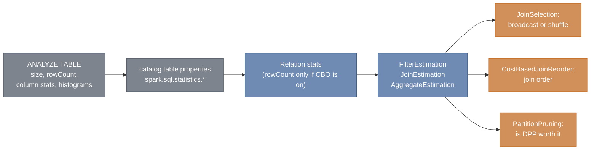
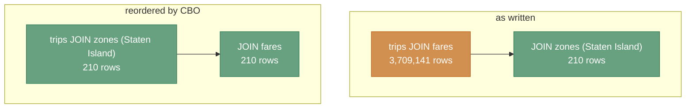

# Chapter 86: Statistics, the cost-based optimizer and partition pruning

[Chapter 32](ch32-query-plans.md) showed that Spark makes most plan decisions before it reads any data. It selects a join strategy, a join order and the files to read from estimates. [Chapter 11](ch11-joins.md) showed what happens when an estimate is wrong: a broadcast that does not fit, or a shuffle that was not necessary. This chapter is about the inputs to those estimates, and about the layouts that let Spark skip work completely.

**The optimizer knows only what the catalog and the files tell it. Without statistics, it knows the size of each table and nothing about its rows, so a filter does not change any estimate. `ANALYZE TABLE` stores row counts, column statistics and histograms, and the cost-based optimizer uses them to select a broadcast and to reorder joins. Partitioned, bucketed and storage-partitioned tables carry their layout into the plan, and Spark uses that layout to skip partitions and to remove shuffles. Hints are for the cases where you know more than all of these.**

The scripts are in [`code/ch86`](https://github.com/lisancao/spark-masterclass/tree/main/code/ch86), and each output block comes from `code/ch86/output/`. The tables are the June 2026 taxi trips (3,709,141 rows after the cleaning in `c86.py`), a second table `fares` with the money columns of the same trips, the 265 zones, and six months of trips partitioned by day. The tables are in a Hive metastore in Derby under `data/work/`, so that their statistics stay between scripts. All runs use Spark 4.3.0 in `local[*]` mode on 16 cores. Each timing is a median after a warm-up run, measured under the bench lock while no other benchmark of the book ran. Other processes ran on the machine at the same time, so compare timings only inside one output block.

| Script | Steps | What it shows |
|---|---|---|
| `stats.py` | 1, 2, 3 | what the catalog knows, `ANALYZE TABLE`, estimates against real rows |
| `cbo_join.py` | 4, 5 | the estimate selects the join strategy and the join order |
| `dpp.py` | 6 | dynamic partition pruning, measured |
| `bucketing.py` | 7 | bucketed tables, joins and aggregates without a shuffle, bucket pruning |
| `spj.py` | 8 | a storage-partitioned join of two Iceberg tables |
| `hints.py` | 9 | join hints and partitioning hints |

## Step 1: What the optimizer knows without statistics

`stats.py` writes the three tables with `saveAsTable` and asks the catalog what it knows:

```text
=== 1. what the catalog knows before ANALYZE
  trips  Statistics: 49377402 bytes, 0 rows
  fares  Statistics: 32114470 bytes, 0 rows
  zones  Statistics: 5956 bytes, 0 rows
  cost of fares WHERE total_amount > 500:
    Relation: Statistics(sizeInBytes=30.6 MiB)
    Filter:   Statistics(sizeInBytes=30.6 MiB)
```

- **The catalog has the size of the files.** The write recorded the total size of the Parquet files of each table. The "0 rows" is the value that the Hive metastore keeps before the first `ANALYZE`. The plan does not use it: the `Relation` node has no `rowCount`.
- **A filter does not change the estimate.** The filter `total_amount > 500` keeps 82 rows of 3,709,141 (Step 3 counts them). The estimate of the `Filter` node is still 30.6 MiB, the size of the whole table.

Without statistics, Spark estimates each node with the visitor `SizeInBytesOnlyStatsPlanVisitor`. A `Filter`, a `Project` and most other nodes keep the size of their child, or scale it by the width of the columns. Only a `Limit`, an `Aggregate` without keys and a few other nodes can make an estimate smaller. The estimate is a size in bytes, never a count of rows.

This has one large result. The broadcast threshold (`spark.sql.autoBroadcastJoinThreshold`, 10 MB) compares a size estimate with a number. A small result of a selective filter on a large table never looks small to the planner.

## Step 2: ANALYZE TABLE

`ANALYZE TABLE` reads a table and writes statistics into the catalog. It has three forms, and each form stores more:

```text
=== 2. ANALYZE TABLE, three forms
  NOSCAN              -> 32114470 bytes, 0 rows
  COMPUTE STATISTICS  -> 32114470 bytes, 3709141 rows
  FOR COLUMNS         -> 32114470 bytes, 3709141 rows
  DESC EXTENDED fares total_amount:
    data_type       double
    min             -1815.18
    max             7053.5
    num_nulls       0
    distinct_count  18226
    avg_col_len     8
    max_col_len     8
    histogram       NULL
  DESC EXTENDED fares payment_type:
    data_type       bigint
    min             0
    max             5
    num_nulls       0
    distinct_count  6
    avg_col_len     8
    max_col_len     8
    histogram       NULL
```

| Statement | Reads | Stores |
|---|---|---|
| `ANALYZE TABLE t COMPUTE STATISTICS NOSCAN` | the file listing | the size in bytes |
| `ANALYZE TABLE t COMPUTE STATISTICS` | all rows | the size and the row count |
| `ANALYZE TABLE t COMPUTE STATISTICS FOR COLUMNS a, b` | all rows | the above, and for each column: minimum, maximum, null count, distinct count, average and maximum length |
| `... FOR ALL COLUMNS` | all rows | the same for each column |
| `ANALYZE TABLES IN db COMPUTE STATISTICS` | all rows of each table | the size and the row count of each table in `db` |
| `... FOR COLUMNS` with `spark.sql.statistics.histogram.enabled=true` | all rows | the above, and an equi-height histogram for each numeric, date and timestamp column |

The distinct count is an estimate from HyperLogLog++. `spark.sql.statistics.ndv.maxError` (0.05) sets its relative error. The last statement of `stats.py` analyzes every column of `trips`, and every table of the database:

```text
=== 5. ANALYZE for every column, and for every table in a database
  trips  Statistics: 49377402 bytes, 3709141 rows
  fares  Statistics: 32114470 bytes, 3709141 rows
  zones  Statistics: 5956 bytes, 265 rows
  trips.trip_distance: min 0.01, max 311565.39, num_nulls 0, distinct_count 5036
```

The catalog keeps these values as table properties with the prefix `spark.sql.statistics.`. Statistics do not follow the data. If you append rows, the row count and the column statistics stay old. With `spark.sql.statistics.size.autoUpdate.enabled=true`, Spark updates the size after each write, but not the other values. Run `ANALYZE` again after large changes.

!!! caution "Statistics that are out of date are worse than none"
    Run `ANALYZE TABLE` again after a large write. The optimizer trusts the stored row count and column ranges. If they are old, its estimates can be wrong by orders of magnitude, and it can broadcast a table that is now large.

## Step 3: How statistics reach the plan

Statistics in the catalog are not enough. The plan uses only the size until you turn on the cost-based optimizer (CBO) with `spark.sql.cbo.enabled`. The same filter, before and after:

```text
=== 3. the same filter, CBO off and on
  spark.sql.cbo.enabled=false
    Relation: Statistics(sizeInBytes=30.6 MiB)
    Filter:   Statistics(sizeInBytes=30.6 MiB)
  spark.sql.cbo.enabled=true
    Relation: Statistics(sizeInBytes=169.8 MiB, rowCount=3.71E+6)
    Filter:   Statistics(sizeInBytes=125.5 MiB, rowCount=2.74E+6)
```

Two things changed:

- **The `Relation` has a row count, and a larger size.** With CBO, Spark calculates the size as the row count multiplied by the size of one row in memory, from `avg_col_len` of each column and a row overhead. Thus 30.6 MiB of compressed Parquet becomes 169.8 MiB. This is closer to what a broadcast must hold in memory ([Chapter 11](ch11-joins.md), Step 6 showed a broadcast that did not fit).
- **The `Filter` has its own estimate.** `FilterEstimation` uses the column statistics. Without a histogram, it assumes that the values spread evenly between the minimum and the maximum. The range of `total_amount` is -1815.18 to 7053.5, and 500 is near the bottom of it. So the estimate is that 74% of the rows pass: 2.74 million rows. The real answer is 82 rows.

A histogram fixes this. `stats.py` estimates six filters without and with a histogram, and counts the real rows:

```text
=== 4. estimated rows against real rows, without and with a histogram
  predicate                          real rows  no histogram   histogram
  total_amount > 500                        82     2,740,000      13,800
  total_amount > 100                    70,952     2,910,000      69,000
  total_amount < 10                     55,427       763,000      55,900
  total_amount BETWEEN 15 AND 25     1,500,703         4,180   1,500,000
  payment_type = 2                     348,204       618,000     358,000
  payment_type = 4                      19,269       618,000      21,900
  histogram of total_amount: height: 14602.917322834646, num_of_bins: 254
    bin_0    lower_bound: -1815.18, upper_bound: 5.9, distinct_count: 1701
    bin_1    lower_bound: 5.9, upper_bound: 8.7, distinct_count: 254
    bin_2    lower_bound: 8.7, upper_bound: 9.61, distinct_count: 91
    bin_252  lower_bound: 108.51, upper_bound: 126.87, distinct_count: 1681
    bin_253  lower_bound: 126.87, upper_bound: 7053.5, distinct_count: 6555
```

<figure markdown>
  
  
  <figcaption markdown="span">The rows from `stats.txt`, on a log scale. Without a histogram, the estimates are wrong by up to four orders of magnitude, in both directions. With a histogram, five of six estimates are within 15% of the real count.</figcaption>
</figure>

- **The histogram is equi-height.** Each of its 254 bins (`spark.sql.statistics.histogram.numBins`) holds the same number of rows, 14,603. Narrow bins are where the data is dense: bin 1 covers only $5.90 to $8.70. The last bin covers $126.87 to $7,053.50, because few trips cost more than $127.
- **Without a histogram, the error goes in both directions.** The estimate for `BETWEEN 15 AND 25` is 4,180 rows, because $10 is a small part of a range of $8,869. The real count is 1.5 million, because most fares are in that interval.
- **For `payment_type`, the distinct count alone gives 1/6 of the rows** for each value (618,000). The histogram knows that type 4 is rare.
- **The histogram is coarse at the edges.** The last bin holds all trips above $126.87, so the estimate for `> 500` is 13,800 rows, not 82. That is still close enough for the decision in Step 4.

The path from the catalog to a decision:



## Step 4: The estimate selects the join strategy

`cbo_join.py` joins all trips to the fares above $500. The filtered side has 82 rows, so a broadcast is the obvious plan. The planner sees it only with CBO:

```text
=== 1. one filter on the small side: the strategy follows the estimate
  spark.sql.cbo.enabled=false
    estimate of the filtered fares: Statistics(sizeInBytes=30.6 MiB)
    planned join: ['SortMergeJoin'], hash exchanges planned: 2
    final plan after AQE: ['SortMergeJoin']; median 0.58 s
  spark.sql.cbo.enabled=true
    estimate of the filtered fares: Statistics(sizeInBytes=647.7 KiB, rowCount=1.38E+4)
    planned join: ['BroadcastHashJoin'], hash exchanges planned: 0
    final plan after AQE: ['BroadcastHashJoin']; median 0.27 s
  rows: 82
```

- **CBO off.** The filtered `fares` is 30.6 MiB to the planner, above the 10 MB threshold. It plans a sort-merge join with two hash exchanges, so it shuffles all 3.7 million trips.
- **CBO on.** The histogram estimate is 13,800 rows, 647.7 KiB. The planner selects a broadcast hash join and plans no exchange for the join.
- **AQE did not fix the plan without CBO.** After the shuffle, AQE knows that the filtered side is small. But the 82 rows fill only a few of the 200 shuffle partitions, and the rule `DemoteBroadcastHashJoin` keeps the sort-merge join for this case ([Chapter 32](ch32-query-plans.md), Step 7 explains the rule). AQE can only correct a plan after a stage ran, and here the expensive stage was the shuffle itself.

## Step 5: Join reorder

The order of the joins in a query is the order that you wrote, unless CBO reorders them. With `spark.sql.cbo.joinReorder.enabled`, the rule `CostBasedJoinReorder` lists the inner joins of a query and searches the join orders with dynamic programming. The cost of a plan is a weighted sum of the rows and the bytes of all intermediate results (`spark.sql.cbo.joinReorder.card.weight`, 0.7 for rows).

`cbo_join.py` turns the broadcast off, so that each join is a sort-merge join and the order decides how much data moves. The query joins trips to fares, and then to the zones of Staten Island:

```text
=== 2. join reorder: three tables, broadcast off so that order decides the shuffle size
  spark.sql.cbo.joinReorder.enabled=false: optimized join tree
    Join Inner
          Join Inner
                   Relation trips
                   Relation fares
             Relation zones
    rows out of the two SortMergeJoin nodes: 3,709,141 and 210
    median 1.60 s
  spark.sql.cbo.joinReorder.enabled=true: optimized join tree
    Join Inner
          Join Inner
                   Relation trips
                   Relation zones
             Relation fares
    rows out of the two SortMergeJoin nodes: 210 and 210
    median 1.07 s
  result rows: 16
  speed-up from reorder: 1.5x
```



As written, the first join makes 3.7 million rows, and the second join shuffles them again. Reordered, the first join keeps only the 210 trips that start in Staten Island, and the join with `fares` gets a small left side.

The cost model is only as good as its estimates. The third block of `cbo_join.txt` adds histograms on the join keys and runs the same query:

```text
=== 3. the same query after histograms on the join keys
    Join Inner
          Join Inner
                   Relation trips
                   Relation fares
             Relation zones
    estimate of the zones join: Statistics(sizeInBytes=378.3 MiB, rowCount=7.63E+6)
    real rows of trips JOIN zones (Staten Island): 210
```

With histograms on `PULocationID` and `LocationID`, the estimate for the join with the 38 zones of Staten Island is 7.63 million rows, more than the 3.7 million trips. The real join has 210 rows. With this estimate, the written order looks cheaper, and CBO keeps it. The join estimate uses the histograms of both keys. The filter `Borough = 'Staten Island'` is on another column, and the histogram of `LocationID` still describes all 265 zones. This book does not say that this is a defect. It is a limit of the estimate that you can see in `explain("cost")`, so read the estimates before you trust a reorder.

The CBO settings in Spark 4.3.0:

| Setting | Default | What it does |
|---|---|---|
| `spark.sql.cbo.enabled` | false | use row counts and column statistics in the estimates |
| `spark.sql.cbo.planStats.enabled` | false | get row counts and column statistics from the catalog for the logical plan, also when `spark.sql.cbo.enabled` is false |
| `spark.sql.cbo.joinReorder.enabled` | false | reorder inner joins by cost (needs `spark.sql.cbo.enabled`) |
| `spark.sql.cbo.joinReorder.dp.threshold` | 12 | the largest number of joined tables for the search |
| `spark.sql.cbo.joinReorder.card.weight` | 0.7 | the weight of the rows against the bytes in the cost |
| `spark.sql.cbo.joinReorder.dp.star.filter` | false | apply the star-join heuristic inside the search |
| `spark.sql.cbo.starSchemaDetection` | false | reorder star joins (a fact table and its dimensions) without a cost search |
| `spark.sql.cbo.starJoinFTRatio` | 0.9 | how much smaller than the largest fact table another table can be and still count as a fact table |
| `spark.sql.statistics.histogram.enabled` | false | write histograms in `ANALYZE ... FOR COLUMNS` |
| `spark.sql.statistics.histogram.numBins` | 254 | the bins of each histogram |

<<DPP>>

<<BUCKET>>

## Step 8: Storage-partitioned joins

Bucketing is a feature of Spark's own file tables. A table format such as Apache Iceberg has its own partition transforms, for example `bucket(16, PULocationID)`. A DataSource V2 table can report its partitioning to Spark through the interface `SupportsReportPartitioning`. If both sides of a join report a compatible partitioning on the join keys, Spark can join them partition by partition, without a shuffle. This is a **storage-partitioned join** (SPJ). The 4.3.0 tuning guide calls it a generalization of the bucket join.

!!! note "The Iceberg runtime in this step is not a release"
    No released Iceberg runtime supports Spark 4.3 yet ([Chapter 45](ch45-iceberg.md), Step 1). `spj.py` uses the same jar as Chapter 45: `iceberg-spark-runtime-4.3_2.13`, built from apache/iceberg pull request 18749 (commit `b1eab64`). The Spark side of SPJ is in Spark 4.3.0. The Iceberg side can change before a release.

`spj.py` makes three Iceberg tables in a Hadoop catalog. `trips` and `zstats` are partitioned by `bucket(16, PULocationID)`, and `zstats8` by `bucket(8, PULocationID)`. Then it runs one join with five sets of settings:

```sql
CREATE TABLE lake.db.trips (PULocationID INT, DOLocationID INT, total_amount DOUBLE, tip_amount DOUBLE)
USING iceberg PARTITIONED BY (bucket(16, PULocationID))
```

```text
Spark 4.3.0, Iceberg jar iceberg-spark-runtime-4.3_2.13-b1eab64.jar
  lake.db.trips    data files 16
  lake.db.zstats   data files 16
  lake.db.zstats8  data files 8

=== the same join, with each set of settings (broadcast off)
  defaults                                 SortMergeJoin  Exchange nodes 2  0.53 s
      +- Project (8)
         +- SortMergeJoin Inner (7)
            :- Sort (3)
            :  +- Exchange (2)
            :     +- BatchScan lake.db.trips (1)
            +- Sort (6)
               +- Exchange (5)
                  +- BatchScan lake.db.zstats (4)
  preserve-data-grouping                   SortMergeJoin  Exchange nodes 0  0.28 s
      +- Project (6)
         +- SortMergeJoin Inner (5)
            :- Sort (2)
            :  +- BatchScan lake.db.trips (1)
            +- Sort (4)
               +- BatchScan lake.db.zstats (3)
  16 x 8 buckets, preserve-data-grouping   SortMergeJoin  Exchange nodes 2  0.46 s
  16 x 8, + allowCompatibleTransforms      SortMergeJoin  Exchange nodes 0  0.32 s
  v2 bucketing off                         SortMergeJoin  Exchange nodes 2  0.42 s
```

- **With the defaults, the plan has two `Exchange` nodes.** Spark's side of SPJ (`spark.sql.sources.v2.bucketing.enabled`) is on by default since Spark 3.3. But Iceberg reports its partitioning only if `spark.sql.iceberg.planning.preserve-data-grouping` is true, and that setting is false by default.
- **With `preserve-data-grouping`, the `Exchange` nodes are gone.** Each `BatchScan` delivers the rows of one bucket to one task, and the sort-merge join reads them in place. The join took 0.28 s against 0.53 s.
- **16 buckets against 8 buckets needs one more setting.** `bucket(16, x)` and `bucket(8, x)` are different transforms, so Spark shuffled both sides. With `spark.sql.sources.v2.bucketing.allowCompatibleTransforms.enabled`, Spark asks the bucket function for a reducer. Iceberg's `BucketFunction` (a `ReducibleFunction`) returns one that maps 16 buckets to their greatest common divisor with 8, so Spark groups the 16 buckets into 8, and the join has no `Exchange` again.
- **With `spark.sql.sources.v2.bucketing.enabled=false`**, Spark ignores the reported partitioning.

The settings for SPJ in Spark 4.3.0, from the tuning guide and `SQLConf.scala`:

| Setting | Default | What it does |
|---|---|---|
| `spark.sql.sources.v2.bucketing.enabled` | true | use the partitioning that a V2 source reports |
| `spark.sql.sources.v2.bucketing.pushPartValues.enabled` | true | if one side has partition values that the other side does not have, add empty partitions instead of a shuffle |
| `spark.sql.requireAllClusterKeysForCoPartition` | true | require that the join keys are the same as the partition keys, in the same order |
| `spark.sql.sources.v2.bucketing.partiallyClusteredDistribution.enabled` | false | split the partitions of the larger side and replicate the matching partitions of the other side, for skew |
| `spark.sql.sources.v2.bucketing.allowKeysSubsetOfPartitionKeys.enabled` | false | allow a join on a subset of the partition keys (needs `requireAllClusterKeysForCoPartition=false`) |
| `spark.sql.sources.v2.bucketing.allowCompatibleTransforms.enabled` | false | allow transforms that are compatible but not the same, such as two bucket counts |
| `spark.sql.sources.v2.bucketing.shuffle.enabled` | false | shuffle only the side that does not report a partitioning |
| `spark.sql.iceberg.planning.preserve-data-grouping` | false | an Iceberg setting: report the partitioning of the table to Spark |

In 4.3.0, the main name of the subset setting is `spark.sql.sources.v2.bucketing.allowKeysSubsetOfPartitionKeys.enabled`, and `allowJoinKeysSubsetOfPartitionKeys` is its alternative name. The tuning guide of 4.3.0 still uses the old name. Both names work.

## Step 9: Hints

A hint tells the planner what you know and the statistics do not. Spark has two kinds: join hints select the strategy of one join, and partitioning hints add or change an exchange. [Chapter 11](ch11-joins.md), Step 4 measured each join strategy on the same query. This step shows what each hint puts in the plan, which hint wins, and what happens to a hint that cannot apply. `hints.py` reads the Parquet folders of the tables as temporary views.

### Join hints

```text
=== 1. join hints in SQL (trips JOIN zones; zones is 6 KB, so the default is a broadcast)
  (no hint)                  BroadcastHashJoin BuildRight
  BROADCAST(t)               BroadcastHashJoin BuildLeft
  MERGE(z)                   SortMergeJoin
  SHUFFLE_MERGE(z)           SortMergeJoin
  SHUFFLE_HASH(z)            ShuffledHashJoin BuildRight
  SHUFFLE_REPLICATE_NL(z)    CartesianProduct
  MAPJOIN(z)                 BroadcastHashJoin BuildRight
```

=== "SQL"

    ```sql
    SELECT /*+ SHUFFLE_HASH(z) */ z.Borough, count(*)
    FROM trips t JOIN zones z ON t.PULocationID = z.LocationID
    GROUP BY z.Borough
    ```

=== "Python"

    ```python
    t.join(z.hint("shuffle_hash"), t.PULocationID == z.LocationID)
    t.join(F.broadcast(z), t.PULocationID == z.LocationID)   # the same as z.hint("broadcast")
    ```

```text
=== 2. the same hints on a DataFrame
  z.hint('broadcast')        BroadcastHashJoin BuildRight
  z.hint('merge')            SortMergeJoin
  z.hint('shuffle_hash')     ShuffledHashJoin BuildRight
  z.hint('shuffle_replicate_nl') CartesianProduct
  F.broadcast(t)             BroadcastHashJoin BuildRight
```

| Hint | Other names | Strategy | Needs |
|---|---|---|---|
| `BROADCAST(t)` | `BROADCASTJOIN`, `MAPJOIN` | broadcast hash join, or broadcast nested loop join without an equality | `t` must be a side that the join type lets Spark build |
| `MERGE(t)` | `SHUFFLE_MERGE`, `MERGEJOIN` | sort-merge join | an equality, sortable keys |
| `SHUFFLE_HASH(t)` | | shuffled hash join, with `t` as the build side | an equality |
| `SHUFFLE_REPLICATE_NL(t)` | | Cartesian product (a nested loop on each pair of partitions) | an inner join |

A hint names a table or an alias, not a side. `BROADCAST(t)` on the trips made Spark build a hash table of 3.7 million trips (`BuildLeft`), because the hint is stronger than the size estimate. A hint is an order, not a suggestion. Make sure that it stays correct when the data grows.

### Two hints, and hints that cannot apply

```text
=== 3. two hints in one query: which one wins
  BROADCAST(t), MERGE(z)                     BroadcastHashJoin BuildLeft
  MERGE(t), SHUFFLE_HASH(z)                  SortMergeJoin
  SHUFFLE_HASH(t), SHUFFLE_REPLICATE_NL(z)   ShuffledHashJoin BuildLeft
  BROADCAST(t), BROADCAST(z)                 BroadcastHashJoin BuildRight
  SHUFFLE_HASH(t), SHUFFLE_HASH(z)           ShuffledHashJoin BuildRight
```

When the two sides have different hints, the order of precedence is `BROADCAST`, then `MERGE`, then `SHUFFLE_HASH`, then `SHUFFLE_REPLICATE_NL`. When both sides have the same `BROADCAST` or `SHUFFLE_HASH` hint, the planner selects the build side from the join type and the sizes: here the zones (`BuildRight`).

```text
=== 4. hints that the planner cannot use (it ignores them and logs a warning)
  BROADCAST(t) on a full outer join:   SortMergeJoin
  SHUFFLE_HASH(z) on a non-equi join:  BroadcastNestedLoopJoin BuildRight
  BROADCAST(x), no table x:            BroadcastHashJoin BuildRight
  BROADKAST(z), a misspelled name:     BroadcastHashJoin BuildRight
--- warnings in the log (stderr):
WARN HintErrorLogger: Hint (strategy=broadcast) is not supported in the query: build left for full outer join.
WARN HintErrorLogger: Hint (strategy=shuffle_hash) is not supported in the query: no equi-join keys.
WARN HintErrorLogger: Count not find relation 'x' specified in hint 'BROADCAST(x)'.
WARN HintErrorLogger: Unrecognized hint: BROADKAST(z)
```

The planner never fails a query because of a hint. It ignores a hint that cannot apply, and writes a warning from the logger `HintErrorLogger`:

- **A full outer join cannot broadcast a side**, because each row of both sides must stay in the result. The planner used a sort-merge join.
- **A hash join needs an equality.** For `t.PULocationID < z.LocationID`, the planner used its default for a non-equi join, a broadcast nested loop join.
- **A hint on a name that is not in the query, and a misspelled hint, have no effect.** The plan is the default plan.

These warnings go to the driver log at level WARN. A typing error in a hint is silent at the default log level of the book's scripts (ERROR). Read `explain()` after you add a hint, and make sure that the plan changed.

### Partitioning hints

Partitioning hints are the SQL form of `repartition`, `coalesce` and `repartitionByRange` ([Chapter 33](ch33-partitions-caching-memory.md), Step 3). `REBALANCE` has no DataFrame method. `hints.py` writes the trips once with each hint and counts the files:

```text
=== 5. partitioning hints: the Exchange that each one adds, and the files of a write
  (no hint)                                  files   5  MB min   0.0 max  13.1
                                             (no Exchange)
  COALESCE(2)                                files   2  MB min  12.9 max  34.4
                                             Coalesce 2
  REPARTITION(4)                             files   4  MB min  14.2 max  14.2
                                             Exchange RoundRobinPartitioning(4), REPARTITION_BY_NUM
  REPARTITION(4, PULocationID)               files   4  MB min   8.2 max  16.7
                                             Exchange hashpartitioning(PULocationID, 4), REPARTITION_BY_NUM
  REPARTITION(PULocationID)                  files  21  MB min   0.8 max   3.0
                                             Exchange hashpartitioning(PULocationID, 200), REPARTITION_BY_COL
  REPARTITION_BY_RANGE(4, trip_distance)     files   4  MB min  10.9 max  13.9
                                             Exchange rangepartitioning(trip_distance ASC NULLS FIRST, 4), REPARTITION_BY_NUM
  REBALANCE                                  files  17  MB min   2.3 max   3.4
                                             Exchange RoundRobinPartitioning(200), REBALANCE_PARTITIONS_BY_NONE
  REBALANCE(PULocationID)                    files  21  MB min   0.8 max   3.0
                                             Exchange hashpartitioning(PULocationID, 200), REBALANCE_PARTITIONS_BY_COL
  REBALANCE, parallelismFirst off            files   2  MB min  21.0 max  36.0
                                             Exchange RoundRobinPartitioning(200), REBALANCE_PARTITIONS_BY_NONE
  REBALANCE, parallelismFirst off, 16 MB     files   7  MB min   4.0 max   8.8
                                             Exchange RoundRobinPartitioning(200), REBALANCE_PARTITIONS_BY_NONE
```

```text
=== 6. the DataFrame forms
  t.coalesce(2)                              Coalesce 2
  t.repartition(4, 'PULocationID')           Exchange hashpartitioning(PULocationID, 4), REPARTITION_BY_NUM
  t.repartitionByRange(4, 'trip_distance')   Exchange rangepartitioning(trip_distance ASC NULLS FIRST, 4), REPARTITION_BY_NUM
  t.hint('rebalance', 'PULocationID')        Exchange hashpartitioning(PULocationID, 200), REBALANCE_PARTITIONS_BY_COL
```

| Hint | Exchange | Number of output partitions | AQE can change it |
|---|---|---|---|
| `COALESCE(n)` | none (`Coalesce n`) | n, by merging the input partitions | no |
| `REPARTITION(n)` | round robin | n | no |
| `REPARTITION(n, col)` | hash on `col` | n | no |
| `REPARTITION(col)` | hash on `col` | `spark.sql.shuffle.partitions`, then coalesced | yes, coalesce |
| `REPARTITION_BY_RANGE(n, col)` | range on `col` | n, sorted ranges | no |
| `REBALANCE` | round robin | coalesced to the advisory size | yes, coalesce and split skew |
| `REBALANCE(col)` | hash on `col` | coalesced to the advisory size | yes, coalesce and split skew |

- **A number fixes the result.** `REPARTITION(4)` made four files of 14.2 MB each. AQE does not change a partition count that you gave.
- **Without a number, AQE decides.** `REPARTITION(PULocationID)` and `REBALANCE(PULocationID)` both started with 200 shuffle partitions, and AQE coalesced them to 21.
- **`REBALANCE` follows the advisory size only if parallelism comes second.** With the default `spark.sql.adaptive.coalescePartitions.parallelismFirst=true`, AQE keeps at least as many partitions as the default parallelism (16 here), so `REBALANCE` made 17 files of about 3 MB. With `parallelismFirst=false`, AQE coalesced to the 64 MB advisory size (`spark.sql.adaptive.advisoryPartitionSizeInBytes`), and made 2 files. With an advisory size of 16 MB, it made 7 files. The advisory size counts shuffle bytes, not Parquet bytes, so the files are smaller than the advisory size.
- **`REBALANCE` is the hint for the last step before a write.** It gives files of a useful size, and AQE splits a skewed partition into several files. It does not guarantee that all rows of one key are in one file.
