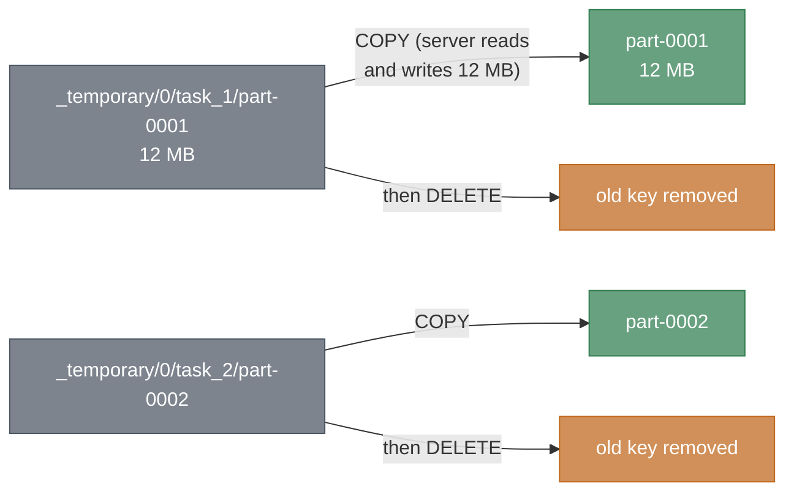
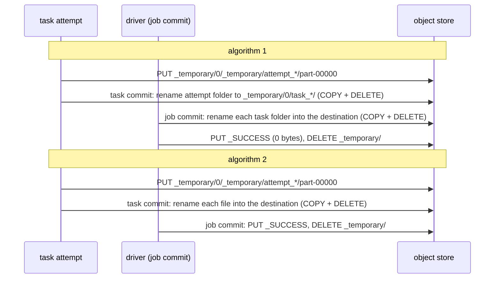
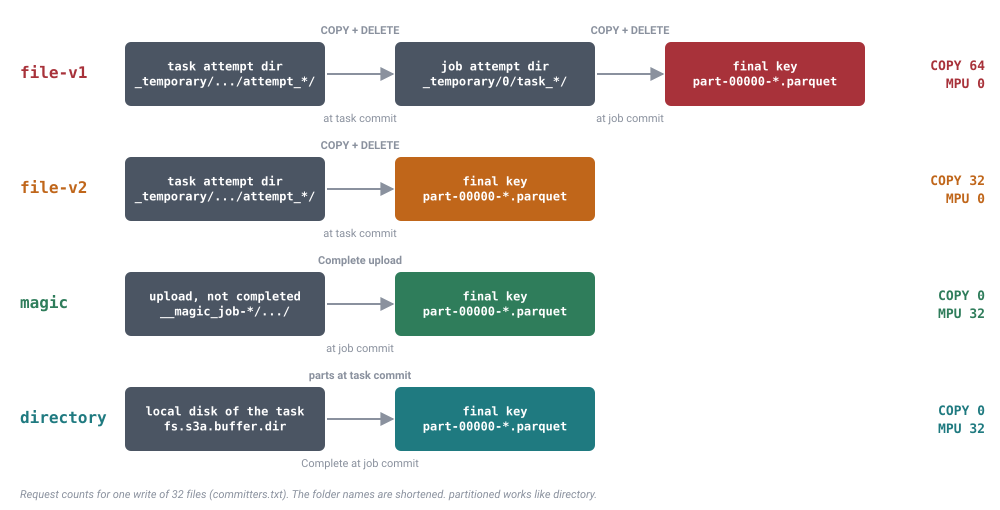
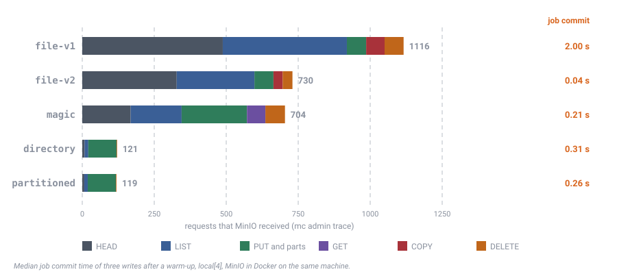
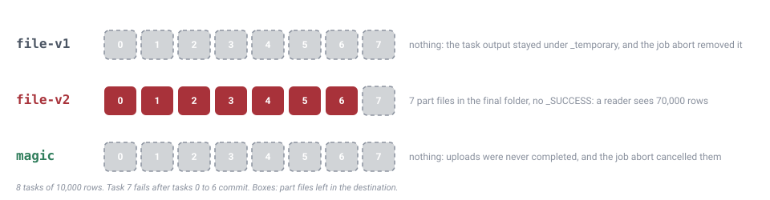
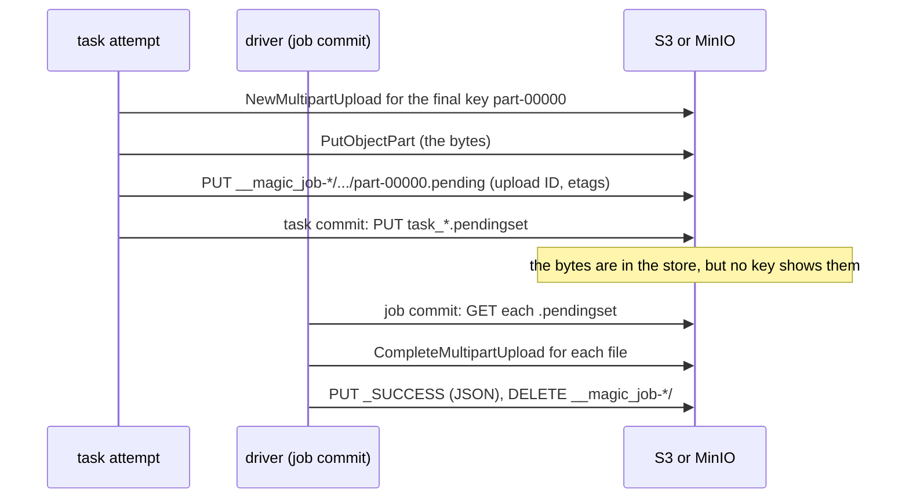

# Chapter 87: Spark on object storage: S3A, ABFS, GCS and the output committers

Most Spark data in the cloud is in an object store: Amazon S3, Azure Data Lake Storage Gen2 (ABFS) or Google Cloud Storage (GCS). Spark does not talk to these stores directly. It uses Hadoop file system connectors, which make a bucket look like a folder tree. The look is not complete:

- A folder is only a prefix of object names.
- A listing is a paged HTTP request.
- A rename is a copy of each byte, then a delete.

**The weak point of Spark on an object store is the commit, not the read. Spark's classic output commit protocol makes the output of a job visible with renames. On S3, each rename copies the data again, and a failure in the middle can leave part of the output where readers see it. The S3A committers and the manifest committer replace the renames with operations that each store does well. Since Spark 4.1, Spark selects the S3A magic committer for you when the `hadoop-cloud` module is on the classpath.**

This chapter installs the `hadoop-cloud` module, connects Spark to an S3-compatible store, and then writes the same table with each committer. It counts the S3 requests that each committer sends, and it breaks a job on purpose to see what each committer leaves behind.

The code is in [`code/ch87/`](https://github.com/lisancao/spark-masterclass/tree/main/code/ch87). The scripts run on `pyspark==4.3.0` in local mode. Each output block below comes from a file in `code/ch87/output/`.

!!! note "What ran, and what comes only from documentation"
    The S3 parts ran for real against [MinIO](https://min.io/) in Docker (`minio/minio:RELEASE.2025-04-08T15-41-24Z`). MinIO implements the S3 API, and the S3A connector cannot see a difference. MinIO runs on the same machine as Spark, so each request is fast. On Amazon S3, each request has more latency, and a copy runs at the speed of the service. Thus, the request counts in this chapter transfer to S3, but the seconds do not.

    The ABFS and GCS parts did not run. This chapter uses no cloud account and no money. Those parts come from the Spark and Hadoop documentation, and from the classes and default configurations in the Hadoop 3.5.0 jars that Spark 4.3.0 resolves. Each such part says so.

## Step 1: An object store is not a file system

A file system keeps a tree of directories. A rename of a directory changes one entry in the tree, and the operation is atomic. An object store keeps a flat map from a name (the key) to the bytes (the object). The connector makes folders from the `/` characters in the keys. The Spark documentation ([Integration with Cloud Infrastructures](https://spark.apache.org/docs/4.3.0/cloud-integration.html)) lists the differences that matter:

- A directory is an emulation, so work with directories can be slow.
- A rename can be very slow. If a rename fails in the middle, the store can be in an unknown state.
- A seek inside a file can need a new HTTP request.

The S3A connector cannot rename an object on S3. It copies the object to the new key and then deletes the old key. A rename of a folder does this for each object under the prefix:



The documentation gives the rename cost for each store and connector:

| Store | Connector | Directory rename is safe | Rename cost |
|---|---|---|---|
| Amazon S3 | `s3a` | No | O(data) |
| Azure Storage | `wasb` | Yes | O(files) |
| Azure Data Lake Gen 2 | `abfs` | Yes | O(1) |
| Google Cloud Storage | `gs` | Mixed | O(files) |

Consistency is no longer the problem. The same page says that S3, GCS and the Azure stores are all consistent as of 2021. A new object is visible to a listing and to a read immediately. The problem that stays is the rename.

## Step 2: The hadoop-cloud module

The `pyspark` package does not contain the cloud connectors. Its `jars/` folder has `hadoop-client-api-3.5.0.jar` and `hadoop-client-runtime-3.5.0.jar`, the Hadoop client of Spark 4.3.0 (`hadoop.version` is `3.5.0` in the Spark `pom.xml` at `v4.3.0`). The connectors come from one Maven artifact:

```text
org.apache.spark:spark-hadoop-cloud_2.13:4.3.0
```

The module has three Spark classes (`hadoop-cloud/src/main/scala/.../io/cloud/` at `v4.3.0`):

| Class | What it does |
|---|---|
| `PathOutputCommitProtocol` | A commit protocol that asks Hadoop's `PathOutputCommitterFactory` for the committer of the destination's scheme (`s3a`, `abfs`, `gs`, `file`) |
| `BindingParquetOutputCommitter` | A Parquet committer that forwards each call to that committer |
| `AbortableStreamBasedCheckpointFileManager` | A checkpoint file manager for Structured Streaming on S3A that writes without a rename |

The rest of the module is dependencies. When `spark.jars.packages` resolved the artifact, Ivy downloaded these connector jars, among others:

| Jar | Scheme | Store |
|---|---|---|
| `hadoop-aws-3.5.0` and `software.amazon.awssdk:bundle:2.35.4` | `s3a://` | Amazon S3 and S3-compatible stores |
| `hadoop-azure-3.5.0` | `abfs://`, `abfss://`, `wasb://` | Azure Storage and ADLS Gen2 |
| `hadoop-gcp-3.5.0` | `gs://` | Google Cloud Storage |
| `hadoop-aliyun-3.5.0`, `hadoop-huaweicloud-3.5.0` | `oss://`, `obs://` | Alibaba and Huawei object stores |
| `analyticsaccelerator-s3-1.3.1` | | A newer input stream for S3A |

The `hadoop-gcp` jar is a GCS connector inside Hadoop itself. In Hadoop 3.5.0, `core-default.xml` maps `fs.gs.impl` to `org.apache.hadoop.fs.gs.GoogleHadoopFileSystem`. Earlier Spark setups used Google's own `gcs-connector` jar for `gs://`. This chapter did not test either of them against GCS.

The AWS SDK bundle is a large jar, 686 MB on disk. Plan for it in container images.

!!! info "The magic committer is the default with hadoop-cloud, since Spark 4.1"
    `SparkContext.enableMagicCommitterIfNeeded` (at `v4.3.0`) runs when a `SparkContext` starts. If the two classes of the module are on the classpath, it sets these configurations, unless you set them first:

    | Configuration | Value |
    |---|---|
    | `spark.hadoop.fs.s3a.committer.magic.enabled` | `true` |
    | `spark.hadoop.fs.s3a.committer.name` | `magic` |
    | `spark.hadoop.mapreduce.outputcommitter.factory.scheme.s3a` | `org.apache.hadoop.fs.s3a.commit.S3ACommitterFactory` |
    | `spark.sql.parquet.output.committer.class` | `org.apache.spark.internal.io.cloud.BindingParquetOutputCommitter` |
    | `spark.sql.sources.commitProtocolClass` | `org.apache.spark.internal.io.cloud.PathOutputCommitProtocol` |

    The core migration guide has an entry for this change in Spark 4.1. It says that Spark "uses Apache Hadoop Magic Committer for all S3 buckets by default". To go back to `FileOutputCommitter`, set `spark.hadoop.fs.s3a.committer.magic.enabled=false`. The values apply when the `SparkContext` starts, so set them before the session exists.

## Step 3: Connect S3A to MinIO

`code/ch87/minio.sh up` starts MinIO on port 19055 and makes a bucket named `book`. The keys are test keys for this container only. `code/ch87/s3.py` has the configuration that each script uses:

```python
CLOUD = "org.apache.spark:spark-hadoop-cloud_2.13:4.3.0"

S3A = {
    "spark.jars.packages": CLOUD,
    "spark.hadoop.fs.s3a.endpoint": ENDPOINT,               # http://localhost:19055
    "spark.hadoop.fs.s3a.path.style.access": "true",        # (1)!
    "spark.hadoop.fs.s3a.endpoint.region": "us-east-1",
    "spark.hadoop.fs.s3a.access.key": ACCESS,
    "spark.hadoop.fs.s3a.secret.key": SECRET,
}
```

1. MinIO serves a bucket as a path (`http://host/book/key`). Amazon S3 uses the bucket name in the host name by default. Thus, set path-style access for MinIO and for most other S3-compatible stores.

Each key that starts with `spark.hadoop.` goes into the Hadoop configuration without the prefix. Thus, `spark.hadoop.fs.s3a.endpoint` becomes `fs.s3a.endpoint`. [Chapter 8](ch08-setting-configurations.md) describes this rule for all Hadoop configurations.

`connect.py conf` writes the taxi month to `s3a://book/trips/` and reads it back:

```text
== keys in the Spark configuration
  fs.s3a.endpoint = http://localhost:19055
      source: Set by Spark from keys starting with 'spark.hadoop'
  fs.s3a.access.key = bookadmin
      source: Set by Spark from keys starting with 'spark.hadoop'
  fs.s3a.secret.key = ****
      source: Set by Spark from keys starting with 'spark.hadoop'
  fs.s3a.path.style.access = true
      source: Set by Spark from keys starting with 'spark.hadoop'

== write the taxi month to s3a://book/trips/
  wrote 3,837,248 rows in 12.8 s (not a benchmark)

== what MinIO holds (mc ls)
  /   0B
  _SUCCESS   12KiB
  part-00000-94330bd4-d5ae-42ed-815d-7cb747b3701f-c000.snappy.parquet   11MiB
  part-00001-94330bd4-d5ae-42ed-815d-7cb747b3701f-c000.snappy.parquet   11MiB
  ...

== read it back through S3A, with a filter
  trips longer than 20 miles: 28,496
  file system class: org.apache.hadoop.fs.s3a.S3AFileSystem
```

The output shows three things:

- `getPropertySources` tells you where each Hadoop value came from. Use it when a value is not the value that you expect.
- The `_SUCCESS` object is 12 KiB, not empty. The magic committer wrote it (Step 9).
- The `/` object with 0 bytes is a directory marker. S3A writes it so that an empty folder exists in a listing.

## Step 4: Where the credentials come from

S3A asks a chain of credential providers for the keys. The first provider that has keys wins. The default chain is in `core-default.xml` of Hadoop 3.5.0:

```text
== the default credential provider chain (core-default.xml)
  org.apache.hadoop.fs.s3a.TemporaryAWSCredentialsProvider
  org.apache.hadoop.fs.s3a.SimpleAWSCredentialsProvider
  software.amazon.awssdk.auth.credentials.EnvironmentVariableCredentialsProvider
  org.apache.hadoop.fs.s3a.auth.IAMInstanceCredentialsProvider
```

| Provider | Where it finds the keys | Use it for |
|---|---|---|
| `TemporaryAWSCredentialsProvider` | `fs.s3a.access.key`, `fs.s3a.secret.key` and `fs.s3a.session.token` | Session credentials from AWS STS |
| `SimpleAWSCredentialsProvider` | `fs.s3a.access.key` and `fs.s3a.secret.key` | Fixed keys, such as the MinIO keys of this chapter |
| `EnvironmentVariableCredentialsProvider` | The `AWS_ACCESS_KEY_ID` and `AWS_SECRET_ACCESS_KEY` variables of the JVM | Keys that a scheduler puts into the environment |
| `IAMInstanceCredentialsProvider` | The instance metadata service of EC2 or the container role of ECS | Production on AWS, with no keys in any file |

Spark also copies AWS variables into the Hadoop configuration itself. `SparkHadoopUtil` (at `v4.3.0`) reads `AWS_ENDPOINT_URL`, `AWS_ACCESS_KEY_ID`, `AWS_SECRET_ACCESS_KEY` and `AWS_SESSION_TOKEN`, and it sets the `fs.s3a.*` keys from them. `connect.py env` starts a session with no keys in its configuration, and the variables set:

```text
== keys from AWS_ENDPOINT_URL, AWS_ACCESS_KEY_ID and AWS_SECRET_ACCESS_KEY
  fs.s3a.endpoint = http://localhost:19055
      source: Set by Spark on <host> from AWS_ENDPOINT_URL
  fs.s3a.access.key = bookadmin
      source: Set by Spark on <host> from AWS_ACCESS_KEY_ID
  fs.s3a.secret.key = ****
      source: Set by Spark on <host> from AWS_SECRET_ACCESS_KEY
  rows read: 3,837,248
```

A wrong key fails at the first request, with HTTP status 403:

```text
== a wrong secret key
  : java.nio.file.AccessDeniedException: s3a://book/trips: getFileStatus on s3a://book/trips: software.amazon.awssdk.services.s3.model.S3Exception: Forbidden (Service: S3, Status Code: 403, Request ID: 18EA811ED627FAAD, Ex
```

S3A also reads each `fs.s3a.*` key for one bucket from `fs.s3a.bucket.<bucket>.*`. For example, `fs.s3a.bucket.book.endpoint` sets the endpoint for the bucket `book` only. Thus, one session can read a MinIO bucket and an AWS bucket with different keys.

!!! caution
    Do not put secret keys in source code or in a notebook. Anyone who can read the code can use the keys. Use an instance role, environment variables that your scheduler sets, or a Hadoop credential store (`hadoop.security.credential.provider.path`).

## Step 5: Why a rename-based commit is slow and unsafe

Spark writes the output of a job with a commit protocol. The default protocol, `SQLHadoopMapReduceCommitProtocol`, uses Hadoop's `FileOutputCommitter`. That committer has two algorithms, and the configuration `mapreduce.fileoutputcommitter.algorithm.version` selects one of them. If you do not set it, `SparkHadoopUtil` sets it to `1`.

Each task writes its files under a temporary folder in the destination. Then the commits move the files:



On HDFS, each rename is one atomic change of metadata. Thus, both algorithms are fast and safe there:

- **Algorithm 1** moves the data two times. Task commit moves the attempt folder to the committed-task folder. Job commit moves each committed task into the destination. Until the job commit, the destination has no part files. On S3, the job commit is a serial copy of all the output.
- **Algorithm 2** moves the data one time, at task commit, directly into the destination. The job commit has almost no work. But each committed task is visible in the destination before the job ends. If the job fails, the files of the committed tasks stay.

The Spark documentation recommends algorithm 2 "for performance" and algorithm 1 "for safety". It calls the rename-based commit on S3 "potentially both slow and unreliable". Steps 6 and 7 measure both claims.

<figure markdown>
  
  <figcaption>The path of one output file for each committer. The algorithms of <code>FileOutputCommitter</code> copy each file one or two times. The S3A committers write each file to its final key with a multipart upload, and the job commit completes the uploads. The request counts come from <code>committers.txt</code>.</figcaption>
</figure>

## Step 6: Five committers, measured on MinIO

`committers.py` writes the same DataFrame to MinIO with each committer. The DataFrame is the taxi month in 32 partitions, so each write makes 32 Parquet files. Each committer runs in its own process, because the committer defaults apply when the `SparkContext` starts. The script uses these configurations (`s3.py`):

| Name in the output | Configuration |
|---|---|
| `file-v1` | `spark.hadoop.fs.s3a.committer.magic.enabled=false` and `mapreduce.fileoutputcommitter.algorithm.version=1` |
| `file-v2` | `spark.hadoop.fs.s3a.committer.magic.enabled=false` and `mapreduce.fileoutputcommitter.algorithm.version=2` |
| `magic` | nothing (the default with `hadoop-cloud`) |
| `directory` | `spark.hadoop.fs.s3a.committer.name=directory` |
| `partitioned` | `spark.hadoop.fs.s3a.committer.name=partitioned` |

Each process writes one warm-up copy and three timed copies. The task and job commit times come from two metrics of the write node, `task commit time` and `job commit time`. The script reads them from the REST API of the Spark UI. During the last copy, `mc admin trace` records each request that MinIO receives. The script ran under the book's benchmark lock:

```text
32 files of the taxi month (3,837,248 rows), MinIO in Docker, local[4]
median of 3 writes after a warm-up; requests from the last write

committer     wall s  task commit  job commit   PUT  COPY  DELETE  LIST  HEAD   MPU  _SUCCESS
file-v1         7.28        2.50s       2.00s    67    64      66   431   488     0       0 B
file-v2         3.25        2.30s       0.04s    66    32      34   270   328     0       0 B
magic           4.37        2.00s       0.21s   131     0      68   175   168    32   14739 B
directory       3.91        2.70s       0.31s     2     0       2    11     8    32   13235 B
partitioned     3.58        2.50s       0.26s     2     0       2    10     7    32   13301 B
```

The full list of requests by S3 API is in `committers.txt`. Each part of the table has a cause:

- **`file-v1` sends 64 `CopyObject` requests for 32 files.** The committer copies each file two times, one time at task commit and one time at job commit. The job commit takes 2.00 s, and the driver does it alone, after all tasks end.
- **`file-v2` sends 32 copies, and its job commit takes 0.04 s.** The copies moved into the task commits. That is the speed that the documentation promises. Step 7 shows the cost.
- **`magic` sends no copies.** It sends 32 `NewMultipartUpload`, 32 `PutObjectPart` and 32 `CompleteMultipartUpload` requests. Its other requests are small `PUT` and `GET` requests for the `.pending` and `.pendingset` files that it keeps in the `__magic_job-*` folder.
- **`directory` and `partitioned` send almost nothing else.** These staging committers keep their temporary files on the local disk of the task and in the cluster file system, not in the bucket.
- **HEAD and LIST requests come from the rename emulation.** `file-v1` sends 488 `HeadObject` and 431 `ListObjectsV2` requests, because a rename on S3A must find the type of each path before it copies it.

<figure markdown>
  
  <figcaption>The requests that MinIO received for one write of 32 files, by type. The numbers at the right are the median job commit times.</figcaption>
</figure>

The seconds are small because MinIO is on the same machine. On S3, a `CopyObject` request copies the bytes on the server, and the time grows with the size of the object. Thus, the job commit of `file-v1` grows with the size of the output. The job commit of `magic` grows only with the number of files.

<figure markdown>
  <video autoplay loop muted playsinline width="1280" height="720" poster="../../media/clips/ch87-anim-commit.webp">
    <source src="../../media/clips/ch87-anim-commit.mp4" type="video/mp4">
  </video>
  <figcaption>An animation of one job with algorithm 1 and with the magic committer. With algorithm 1, the files move two times, and the second move waits for the job commit. With the magic committer, the files go to their final keys, and the job commit only completes the uploads. The request counts come from <code>committers.txt</code>, and the timing is schematic.</figcaption>
</figure>

## Step 7: A job that fails in its last task

Algorithm 2 is fast because each task publishes its own files. `failure.py` shows what that means when a job fails. It writes 8 partitions of 10,000 rows with `local[4]` and `spark.task.maxFailures=1`. A UDF makes task 7 wait for 6 seconds and then fail. Thus, tasks 0 to 6 commit before the job fails:

```text
8 tasks of 10,000 rows. Task 7 fails after tasks 0 to 6 commit.

committer   objects  part files  temp objects  pending uploads  _SUCCESS  rows a reader sees
file-v1           1           0             0                0     False       no data files
file-v2           7           7             0                0     False               70000
magic             1           0             0                0     False       no data files

what is left under each destination (first keys):
  file-v1:
    /
  file-v2:
    part-00000-e022d416-ac2f-4214-bd48-e342afc0b96c-c000.snappy.parquet
    part-00001-e022d416-ac2f-4214-bd48-e342afc0b96c-c000.snappy.parquet
    part-00002-e022d416-ac2f-4214-bd48-e342afc0b96c-c000.snappy.parquet
    part-00003-e022d416-ac2f-4214-bd48-e342afc0b96c-c000.snappy.parquet
    part-00004-e022d416-ac2f-4214-bd48-e342afc0b96c-c000.snappy.parquet
  magic:
    /
```

<figure markdown>
  
  <figcaption>The part files in the destination after the failed job, from <code>failure.txt</code>. Only algorithm 2 leaves output that a reader can find.</figcaption>
</figure>

The job failed in all three cases, but the results are different:

- **`file-v1`** left only the directory marker. The committed tasks were in `_temporary`, and the job abort deleted the folder.
- **`file-v2`** left 7 part files and no `_SUCCESS`. `spark.read.parquet` read them with no error and returned 70,000 rows. A downstream job that does not look for `_SUCCESS` reads a partial table.
- **`magic`** left only the directory marker and no pending uploads. The data of tasks 0 to 6 went to MinIO as multipart uploads. But an upload is not visible until a `CompleteMultipartUpload` request. The job abort cancelled the uploads.

<figure markdown>
  <video autoplay loop muted playsinline controls width="1280" height="720" poster="../../media/clips/ch87-failure.webp">
    <source src="../../media/clips/ch87-failure.mp4" type="video/mp4">
  </video>
  <figcaption><code>failure.py</code> runs the failed job with each committer, on Spark 4.3.0 and MinIO.</figcaption>
</figure>

!!! caution
    Do not use `mapreduce.fileoutputcommitter.algorithm.version=2` for output that other jobs read while you write it. If the job fails, the files of the committed tasks stay in the destination, with no `_SUCCESS` file.

## Step 8: The S3A committers: magic and staging

The S3A committers use one feature of S3: a multipart upload is not visible until a `CompleteMultipartUpload` request. A task can upload all the bytes of a file to its final key and still keep the file invisible. The job commit then completes the uploads of all committed tasks. There are three S3A committers, which `fs.s3a.committer.name` selects:

| `fs.s3a.committer.name` | Where the task writes | What task commit does | What job commit does |
|---|---|---|---|
| `file` | `_temporary` in the bucket | rename (`FileOutputCommitter`) | rename |
| `magic` | a path under `__magic_job-<id>/` that S3A changes to the final key | saves the list of its uploads in a `.pendingset` file in the bucket | reads the `.pendingset` files and completes the uploads |
| `directory` | the local disk of the task (`fs.s3a.buffer.dir`) | uploads the parts to the final keys, and saves the upload list in the cluster file system | completes the uploads |
| `partitioned` | as `directory` | as `directory` | as `directory`, but it checks for conflicts only in the partitions that the job writes |

The magic committer works because the S3A file system knows the `__magic` path. When a task creates a file under it, S3A starts a multipart upload to the final key. In the `__magic` folder, it writes only a small `.pending` file. `magic_log.py` writes one file and keeps the INFO lines of the committer:

```text
INFO AbstractS3ACommitterFactory: Using committer magic to output data to s3a://book/magic-log
INFO MagicCommitTracker: File __magic_job-.../00/tasks/attempt_..._0000_m_000000_0/__base/part-00000-......parquet is written as magic file to path magic-log/pa
INFO MagicCommitTracker: Uncommitted data pending to file __magic_job-.../00/tasks/attempt_..._0000_m_000000_0/__base/part-00000-......parquet; commit metadata 
INFO MagicS3GuardCommitter: Saving work of attempt_..._0000_m_000000_0 to __magic_job-.../00/task_..._0000_m_000000.pendingset
INFO MagicS3GuardCommitter: Task attempt_..._0000_m_000000_0 committed 1 files
INFO AbstractS3ACommitter: Starting: Task committer attempt_..._0000_m_000000_0: commitJob((no job ID))
INFO CommitOperations: Starting: Writing success file _SUCCESS
INFO CommitOperations: Writing success file _SUCCESS: duration 0:00.033s
```



The staging committers have a conflict mode, `fs.s3a.committer.staging.conflict-mode`. Its default is `append` (`CommitConstants` in `hadoop-aws-3.5.0`). The other values are `fail` and `replace`.

The S3A committers have one limit in Spark. Dynamic partition overwrite (`spark.sql.sources.partitionOverwriteMode=dynamic`, Chapter 44) writes to a staging folder and then renames partitions into place. `PathOutputCommitProtocol` allows it only for a committer that declares the capability. `dpo.py` overwrites one partition of a table in that mode:

```text
== INSERT OVERWRITE of one partition (partitionOverwriteMode=dynamic)
  magic    : java.io.IOException: PathOutputCommitter does not support dynamicPartitionOverwrite: MagicCommitter{AbstractS3ACommitter{role=Task committer attempt
  file-v1  overwrite of day=2 worked: day=1 v=a, day=2 v=B, day=3 v=c
```

<figure markdown>
  <video autoplay loop muted playsinline controls width="1280" height="720" poster="../../media/clips/ch87-dpo.webp">
    <source src="../../media/clips/ch87-dpo.mp4" type="video/mp4">
  </video>
  <figcaption><code>dpo.py</code>: the magic committer refuses dynamic partition overwrite, and <code>FileOutputCommitter</code> does it with renames.</figcaption>
</figure>

If a job needs dynamic partition overwrite on S3, the documentation gives one solution: use a table format. A table format replaces partitions with a new snapshot, not with renames ([Chapter 44](ch44-tables-delta-iceberg.md) and [Chapter 45](ch45-iceberg.md)).

!!! caution
    Do not let failed uploads stay in a bucket. A multipart upload that a crashed driver never completed or cancelled still uses storage, and the store charges for it. Add a lifecycle rule to the bucket that removes incomplete multipart uploads after some days.

## Step 9: `_SUCCESS` files

`FileOutputCommitter` writes an empty `_SUCCESS` object at the end of the job commit. The S3A committers and the manifest committer write a JSON document with the same name. `success.py` reads the two files from Step 6:

```text
== file-v1: _SUCCESS is 0 bytes
== magic: _SUCCESS is 14739 bytes
  name: org.apache.hadoop.fs.s3a.commit.files.SuccessData/1
  committer: magic
  jobId: 16e990f1-ff0e-487f-a0b1-7d82ffa20d91
  jobIdSource: spark.sql.sources.writeJobUUID
  description: Task committer attempt_202611221510434481329383131574812_0000_m_000000
  filenames: 32, the first: /commit/magic/run3/part-00000-0bfe0609-fecf-4980-b9f7-e6685d3c
  metrics: 211 counters, for example object_copy_requests=0, committer_magic_files_created=128
  diagnostics: ['fs.s3a.committer.threads', 'fs.s3a.connection.maximum', 'fs.s3a.max.total.tasks']
```

The JSON file has three uses:

- **A downstream job can wait for it.** An orchestrator ([Chapter 63](ch63-orchestration.md)) can poll for `_SUCCESS` before it starts the next job. This is also true for the empty file.
- **It lists the files of the job.** `filenames` has the 32 part files. A reader can compare that list with a listing and find files that a different job left in the folder.
- **It tells you which committer ran.** If you expect `magic` and the file is empty, the session did not have `hadoop-cloud`, or a configuration turned the magic committer off.

The metrics are counters of the S3A file system instance, not of one job. The value 128 for `committer_magic_files_created` is four writes of 32 files in the same process.

<figure markdown>
  <video autoplay loop muted playsinline controls width="1280" height="720" poster="../../media/clips/ch87-success.webp">
    <source src="../../media/clips/ch87-success.mp4" type="video/mp4">
  </video>
  <figcaption><code>success.py</code> reads the empty <code>_SUCCESS</code> of <code>FileOutputCommitter</code> and the JSON <code>_SUCCESS</code> of the magic committer.</figcaption>
</figure>

## Step 10: ABFS and GCS, and the manifest committer

Hadoop 3.5.0 binds a committer factory to each scheme in `mapred-default.xml`. The jar shows these defaults:

| Key | Value in Hadoop 3.5.0 |
|---|---|
| `mapreduce.outputcommitter.factory.scheme.s3a` | `org.apache.hadoop.fs.s3a.commit.S3ACommitterFactory` |
| `mapreduce.outputcommitter.factory.scheme.abfs` | `org.apache.hadoop.fs.azurebfs.commit.AzureManifestCommitterFactory` |
| `mapreduce.outputcommitter.factory.scheme.gs` | `org.apache.hadoop.mapreduce.lib.output.committer.manifest.ManifestCommitterFactory` |

With `PathOutputCommitProtocol` in place (the default with `hadoop-cloud`, Step 2), a write to `abfs://` or `gs://` uses the **manifest committer**. Spark's documentation describes it as follows.

Each task commit writes a JSON manifest that lists the files of the task. The job commit loads all manifests and renames the files into the destination, in parallel. A manifest is one small file that the store can write atomically. Thus, the committer does not need an atomic rename of a directory, which GCS does not have. 

The documentation says that the committer is "not critical for job correctness" on Azure, but that it scales better for large jobs. For GCS, the documentation recommends the manifest committer where it is available.

This machine has no Azure or Google account. `manifest.py` first tries the manifest committer on S3A. Then it runs the same committer class on the local file system, where the committer works:

```text
== the manifest committer on s3a://
  : org.apache.hadoop.fs.PathIOException: `s3a://book/manifest': This committer does not work with the filesystem of type s3a

== the manifest committer on file://
  _SUCCESS: 20971 bytes, name=org.apache.hadoop.fs.s3a.commit.files.SuccessData/1
  committer: org.apache.hadoop.mapreduce.lib.output.committer.manifest.ManifestCommitter
  files listed: 8, success=True
    counter committer_bytes_committed = 95,122,684
    counter committer_files_committed = 8
    counter committer_task_manifest_file_size = 155,499
    counter job_stage_rename_files = 1
    counter op_create_directories = 1
    counter op_load_all_manifests = 1
    maximum committer_task_manifest_file_size = 19,443
    maximum job_stage_rename_files.max = 37
    maximum op_create_directories.max = 1
    maximum op_load_all_manifests.max = 81
  job commit stages that ran (counters in _SUCCESS):
    job_stage_create_target_dirs = 1
    job_stage_load_manifests = 1
    job_stage_rename_files = 1
    job_stage_setup = 1

== one task manifest (a copy from the diagnostics directory)
  manifests saved: 8
  task_202611221520152641591826080396864_0004_m_000000-manifest.json
    type: org.apache.hadoop.mapreduce.lib.output.committer.manifest.files.TaskManifest/1
    taskID: task_202611221520152641591826080396864_0004_m_000000
    files: 1
      source: manifest-out/_temporary/6cb0454a-39d6-438e-ae4e-51c51f413a44/00/tasks/attempt_202611221520152641591826080396864_0004_m_000000_9/part-00000-bdbd9148-a912-4cc7-ae02-df7f3e53c4cc-c000.snappy.parquet
      dest:   manifest-out/part-00000-bdbd9148-a912-4cc7-ae02-df7f3e53c4cc-c000.snappy.parquet
      size:   11894468
    directories: 0

  summary reports: .summary-6cb0454a-39d6-438e-ae4e-51c51f4, summary-6cb0454a-39d6-438e-ae4e-51c51f41
```

The output shows the design of the committer:

- **It refuses S3A.** It still uses renames, and a rename on S3 is a copy. Use the S3A committers for S3.
- **Each task manifest names a source and a destination for each file.** The job commit does not list the task folders. It loads the manifests (`op_load_all_manifests`) and renames each file once (`job_stage_rename_files`).
- **The job commit has stages.** Setup, load manifests, create target directories, rename files. The `_SUCCESS` file has a counter and timing for each stage. `mapreduce.manifest.committer.summary.report.directory` saves a copy of each `_SUCCESS` report to a folder that you choose, for later analysis.

The connection settings for ABFS and GCS are in their connector documentation. This chapter did not test them. The keys below exist in the Hadoop 3.5.0 jars (`ConfigurationKeys` in `hadoop-azure`, `HadoopCredentialsConfiguration` in `hadoop-gcp`):

For ABFS (Azure), with OAuth and a service principal:

```python
# From the hadoop-azure documentation. Not run in this book
acct = "myaccount.dfs.core.windows.net"
conf = {
    f"spark.hadoop.fs.azure.account.auth.type.{acct}": "OAuth",
    f"spark.hadoop.fs.azure.account.oauth.provider.type.{acct}":
        "org.apache.hadoop.fs.azurebfs.oauth2.ClientCredsTokenProvider",
    f"spark.hadoop.fs.azure.account.oauth2.client.id.{acct}": "<application id>",
    f"spark.hadoop.fs.azure.account.oauth2.client.secret.{acct}": "<from a secret store>",
    f"spark.hadoop.fs.azure.account.oauth2.client.endpoint.{acct}":
        "https://login.microsoftonline.com/<tenant>/oauth2/token",
}
# path: abfss://<container>@myaccount.dfs.core.windows.net/trips/
```

For GCS, with the `hadoop-gcp` connector and a service account key file:

```python
# From the hadoop-gcp classes in Hadoop 3.5.0. Not run in this book
conf = {
    "spark.hadoop.fs.gs.project.id": "<project>",
    "spark.hadoop.fs.gs.auth.type": "SERVICE_ACCOUNT_JSON_KEYFILE",   # (1)!
    "spark.hadoop.fs.gs.auth.service.account.json.keyfile": "/secrets/sa.json",
}
# path: gs://<bucket>/trips/
```

1. The other values of the enum `AuthenticationType` are `APPLICATION_DEFAULT`, `COMPUTE_ENGINE`, `USER_CREDENTIALS`, `WORKLOAD_IDENTITY_FEDERATION_CREDENTIAL_CONFIG_FILE` and `UNAUTHENTICATED`.

This table gives the committer to use for each store, from the Spark documentation and the defaults above:

| Store | Scheme | Committer | Why |
|---|---|---|---|
| Amazon S3, MinIO and other S3-compatible stores | `s3a://` | `magic` (the default with `hadoop-cloud`), or `directory` and `partitioned` | No rename, no copy of the data |
| ADLS Gen2 | `abfs://`, `abfss://` | manifest committer (the default binding) | Rename is safe, the manifest committer scales better |
| Google Cloud Storage | `gs://` | manifest committer (the default binding) | Directory rename is not atomic |
| HDFS, local disk | `hdfs://`, `file://` | `FileOutputCommitter` algorithm 1 | Rename is atomic and cheap |

## Step 11: The read side: listings and requests

Reads are safer than writes, but each listing and each open is a request. `listing.py` writes the taxi month in one folder for each pickup day, and traces four reads:

```text
== spark.read.parquet(path): list the folders, read one footer for the schema
   result: 22 columns
   requests: HeadObject 4, ListObjectsV2 4, GetObject 1
   bytes sent by GetObject: 2,341,914

== count the trips of one day (partition pruning)
   result: 109,514 rows
   requests: HeadObject 1, GetObject 1
   bytes sent by GetObject: 2,320,442

== sum one column over the whole month (column pruning)
   result: 82,269,208 dollars
   requests: GetObject 32, HeadObject 30
   bytes sent by GetObject: 75,435,248

== count every row (footers only)
   result: 3,837,231 rows
   requests: GetObject 60, HeadObject 30
   bytes sent by GetObject: 34,016,496

the table: 30 folders, 31 files, 77,809,567 bytes
```

The requests show what Spark does on an object store:

- **The first read lists the table.** Four `ListObjectsV2` requests found 30 folders and their files. S3A lists a prefix recursively with paged requests. It does not walk the folders one at a time.
- **Partition pruning saves requests, not only bytes.** The count of one day sent one `HEAD` and one `GET`, for the one file of that day.
- **A small file comes back in one request.** `ranges.py` records the `Range` header of that `GET` with `mc admin trace -v`:

```text
rows on 2026-06-15: 109514
GET /book/trips_by_day/pickup_day%3D2026-06-15/part-00003-196a703f-b994-41a2-ab2e-36643c5379be.c000.snappy.parquet
Range: bytes=0-2320441
Content-Range: bytes 0-2320441/2320442
```

The file is 2,320,442 bytes, and S3A asked for all of it in one `GET`, although `count()` needs only the Parquet footer. For a file of this size, one request costs less than many small requests. The column and row group pruning of [Chapter 36](ch36-parquet-inside.md) reads less from larger files. In this table, the sum of one column received 75 MB of the 78 MB table. The count of all rows received 34 MB.

Many small files make a slow table on an object store. Each file costs at least one `HEAD` and one `GET`, and S3 has a latency for each request. Write fewer, larger files ([Chapter 33](ch33-partitions-caching-memory.md)), or let a table format compact them ([Chapter 45](ch45-iceberg.md)).

## Step 12: When to use a table format

The committers in this chapter solve one problem: they publish the files of one job, all together or not at all. They do not solve the other problems of a folder of files:

| Problem | Committers | Delta Lake or Iceberg |
|---|---|---|
| Publish the output of one job atomically | Yes (S3A committers, algorithm 1 on HDFS) | Yes (one commit to the log or the catalog) |
| Readers see the old or the new table, never a mix | No: a reader that lists the folder during the job commit can see part of the files | Yes |
| Overwrite one partition on S3 | No (Step 8) | Yes |
| Find the files without a listing | No | Yes (the log or the manifests list them) |
| Two writers at the same time | No | Yes, with conflict checks |

Thus, use the S3A committers for plain Parquet output, such as an export or a stage of a pipeline. Use a table format for tables that other jobs read and change. For the transaction log of each format, see [Chapter 44](ch44-tables-delta-iceberg.md). For the Iceberg commit as one change of a pointer, see [Chapter 45](ch45-iceberg.md).

## The whole chapter, on one page

- **An object store is a flat map of keys to bytes.** S3A makes a folder tree from the keys. A rename on S3 is a copy and a delete of each object.
- **The `hadoop-cloud` module brings the connectors and two committer bindings.** Add `org.apache.spark:spark-hadoop-cloud_2.13:4.3.0`. Since Spark 4.1, Spark then uses the magic committer for S3A by default.
- **Credentials come from a chain of providers.** Prefer an instance role or environment variables. Spark copies `AWS_*` variables into `fs.s3a.*`.
- **`FileOutputCommitter` commits with renames.** On MinIO, algorithm 1 copied each file two times, and its job commit took 2.00 s. Algorithm 2 copied each file one time, with a job commit of 0.04 s.
- **Algorithm 2 is unsafe on failure.** After a failed job, it left 7 of 8 part files, and a reader saw 70,000 rows.
- **The S3A committers make no copies.** They upload to the final key and complete the uploads in the job commit. A failed job left nothing.
- **`_SUCCESS` tells you which committer ran.** It is empty for `FileOutputCommitter` and JSON for the S3A and manifest committers.
- **ABFS and GCS use the manifest committer by default.** It refuses S3A. Its task manifests replace the listings of the job commit.
- **On the read side, count requests.** Partition pruning removes requests. Many small files add requests.
- **A table format solves what a committer cannot:** isolation for readers, partition overwrite on S3, and many writers.

To run the chapter on your machine:

```bash
cd code
ch87/minio.sh up
export BOOK_DATA=$HOME/spark-masterclass/data SPARK_UI_PORT=4155
uv run python ch87/connect.py
uv run python ch87/committers.py
uv run python ch87/failure.py
uv run python ch87/dpo.py
uv run python ch87/magic_log.py
uv run python ch87/success.py
uv run python ch87/manifest.py
uv run python ch87/listing.py
uv run python ch87/ranges.py
ch87/minio.sh down
```

## Further reading

- [Integration with Cloud Infrastructures](https://spark.apache.org/docs/4.3.0/cloud-integration.html), the Spark 4.3.0 documentation for object stores and committers.
- [Committing work to S3 with the S3A Committers](https://hadoop.apache.org/docs/current/hadoop-aws/tools/hadoop-aws/committers.html), the Hadoop documentation for the magic and staging committers.
- [The Manifest Committer for Azure and Google Cloud Storage](https://github.com/apache/hadoop/blob/trunk/hadoop-mapreduce-project/hadoop-mapreduce-client/hadoop-mapreduce-client-core/src/site/markdown/manifest_committer.md), the Hadoop design document.
- [Hadoop-AWS module](https://hadoop.apache.org/docs/current/hadoop-aws/tools/hadoop-aws/index.html), every `fs.s3a.*` option.
- [A Zero-rename committer](https://github.com/steveloughran/zero-rename-committer/releases/), the paper behind the S3A committers.
