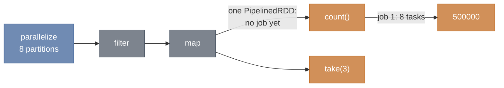
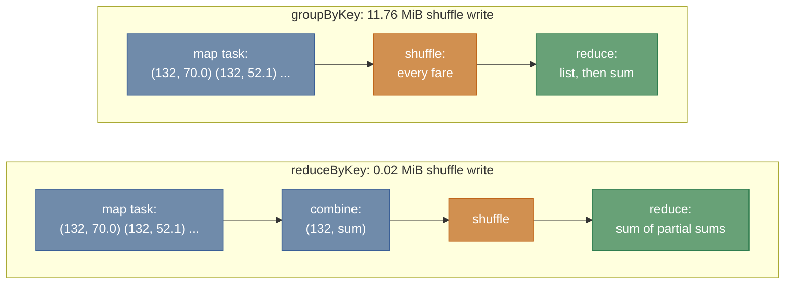
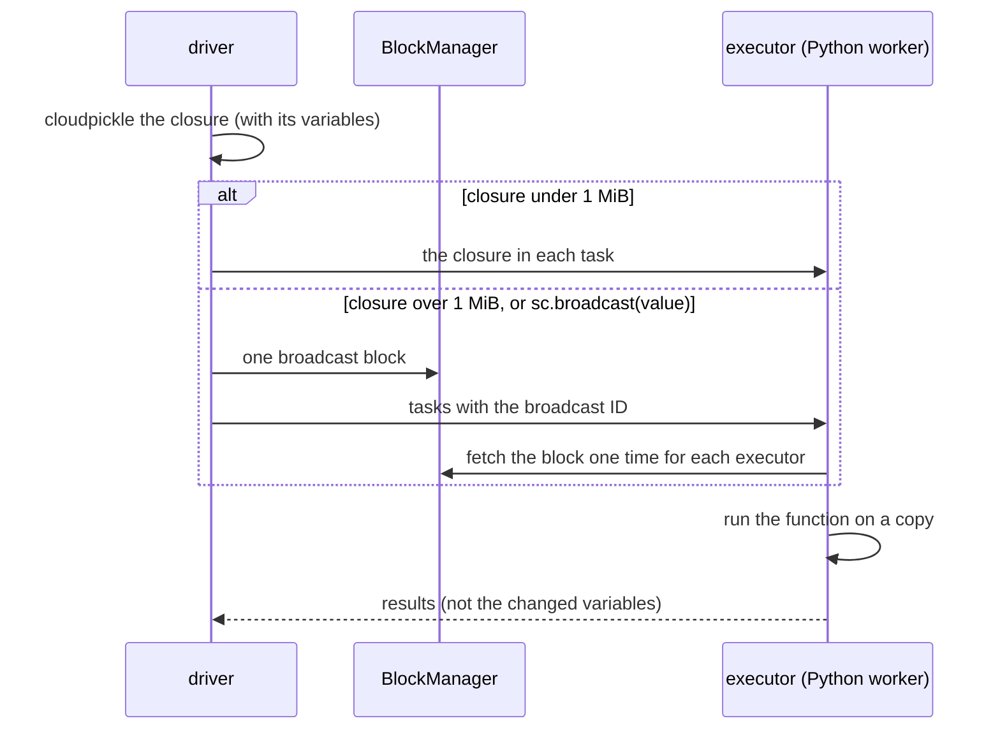
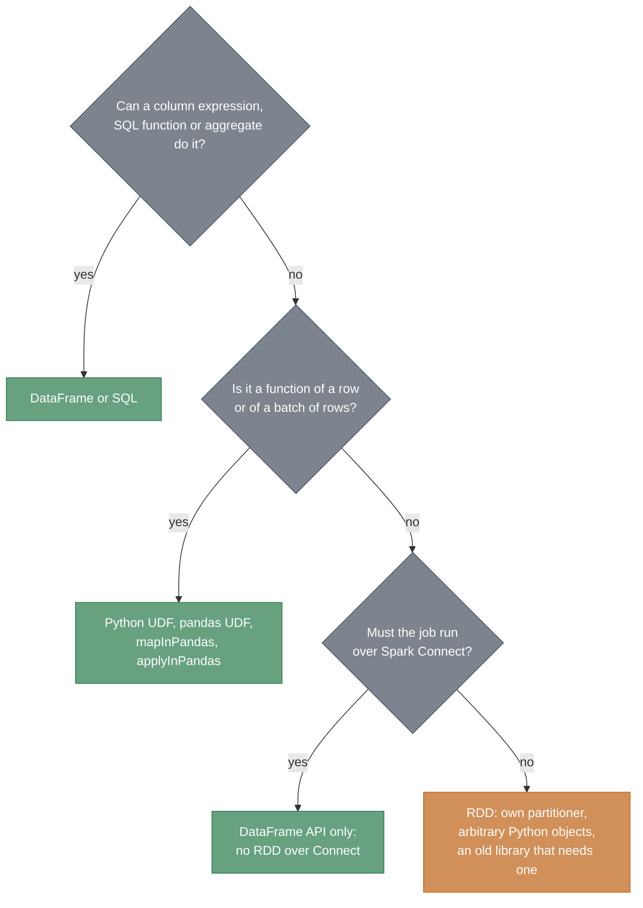

# Chapter 90: RDDs today

[Chapter 1](ch01-mapreduce-to-spark.md) and [Chapter 3](ch03-rdds-to-a-sql-engine.md) tell the history of the RDD. The RDD came first, and the SQL engine replaced it for most work. But the RDD API is still part of Spark 4.3. Every DataFrame query runs as RDDs, and the RDD programming guide is still in the docs. Old code, libraries and some jobs still use it.

**In Spark 4.3, the RDD is the low-level API under the DataFrame. Use it when you must control partitions, keys or Python objects directly. Know what each call costs: what goes through the shuffle, what goes into the closure, and where the data stays. Spark Connect has no RDD API, so each RDD feature in this chapter has a DataFrame equivalent that also works over Connect.**

This chapter is the RDD programming guide of 4.3, run and measured. It shows transformations and actions, the key-value operations, partitioners, closures, broadcast variables, accumulators, persistence and checkpoints. Each step ends with the DataFrame equivalent.

The scripts are in [`code/ch90`](https://github.com/lisancao/spark-masterclass/tree/main/code/ch90), and each output block comes from `code/ch90/output/`. All scripts except `connect.py` use Spark Classic, because RDDs are not available over Connect.

## Step 1: Make an RDD, transform it, and run an action

An RDD is a collection of elements in partitions. You make one from a collection in the driver with `parallelize`, from files with `textFile`, or from a DataFrame with `df.rdd`. `basics.py` does all three:

```python
nums = sc.parallelize(range(1, 1_000_001), 8)
lines = sc.textFile(str(ZONES))
evens = nums.filter(lambda x: x % 2 == 0).map(lambda x: x * x)   # (1)!
print("count():", evens.count())
```

1. `filter` and `map` are transformations. They return a new RDD and run nothing.

```text
== 1. two ways to make an RDD
parallelize: 8 partitions, PipelinedRDD
textFile:    2 partitions, first line: "LocationID","Borough","Zone","service_zone"

== 2. transformations are lazy, actions run jobs
filter + map defined in 0.06 ms, jobs run: 0
count(): 500000  jobs run: 1
take(3): [4, 16, 36]  reduce(add): 166667166667000000
```

The definition took 0.06 ms and ran no job. `count()` ran the first job. The RDD API has two kinds of operations, and the difference is the same as for DataFrames:

| Kind | Returns | Runs a job | Examples |
|---|---|---|---|
| Transformation | a new RDD | no | `map`, `filter`, `flatMap`, `mapPartitions`, `distinct`, `union`, `reduceByKey`, `join`, `sortByKey`, `repartition` |
| Action | a value in the driver, or a write | yes | `count`, `collect`, `take`, `first`, `reduce`, `fold`, `aggregate`, `foreach`, `countByKey`, `lookup`, `saveAsTextFile` |

The type is `PipelinedRDD`. PySpark joins a chain of narrow Python transformations, such as `filter` then `map`, into one Python function. Thus each element goes through the chain in one Python call, not in one call for each step.



## Step 2: Key-value operations

Most RDD work uses pairs. A Python tuple `(key, value)` is a pair, and the pair functions use the first element as the key. `basics.py` makes pairs from the zone file and from the trips:

```python
pairs = trips.rdd.map(lambda r: (r.PULocationID, r.fare_amount))
sum_count = pairs.aggregateByKey((0.0, 0),                      # (1)!
                                 lambda acc, v: (acc[0] + v, acc[1] + 1),
                                 lambda a, b: (a[0] + b[0], a[1] + b[1]))
avg = sum_count.mapValues(lambda s: round(s[0] / s[1], 2))
mx = pairs.combineByKey(lambda v: v, max, max)                   # (2)!
```

1. A zero value, a function that adds one value to the accumulator in a partition, and a function that merges two accumulators from different partitions.
2. `combineByKey` is the general form. `reduceByKey` and `aggregateByKey` call it.

```text
== 3. the zone file as key-value pairs
first pairs: [('EWR', 'Newark Airport'), ('Queens', 'Jamaica Bay'), ('Bronx', 'Allerton/Pelham Gardens')]
reduceByKey: [('Queens', 69), ('Manhattan', 69), ('Brooklyn', 61), ('Bronx', 43), ('Staten Island', 20), ('Unknown', 1), ('N/A', 1), ('EWR', 1)]

== 4. trips as pairs: (PULocationID, fare)
an RDD from a DataFrame: 16 partitions
aggregateByKey avg fare, zones 132, 138, 161: [(132, 60.84), (138, 46.01), (161, 18.47)]
combineByKey max fare, zone 132: [1683.7]
lookup() in this driver: PYTHON_HASH_SEED_NOT_SET
join with zone names, top 3: [(177610, 'Upper East Side South'), (161198, 'Midtown Center'), (157113, 'Upper East Side North')]
countByKey is an action that returns a dict: defaultdict
```

The pair operations that you will use most:

| Operation | What it does | Shuffle |
|---|---|---|
| `mapValues`, `flatMapValues` | change the value, keep the key | no |
| `reduceByKey(f)` | merge the values of a key with `f` | yes, with a combine before it |
| `aggregateByKey(zero, seq, comb)` | like `reduceByKey`, but the result type can differ from the value type | yes, with a combine |
| `combineByKey(create, merge, mergeCombiners)` | the general form of the two above | yes, with a combine |
| `groupByKey()` | collect all values of a key into one list | yes, all values |
| `join`, `leftOuterJoin`, `cogroup` | match two pair RDDs by key | yes, unless the two have the same partitioner (Step 4) |
| `sortByKey` | sort by key, with range partitions | yes |
| `countByKey`, `lookup(k)` | actions that return to the driver | `lookup` uses the partitioner if there is one |

`lookup()` failed with `PYTHON_HASH_SEED_NOT_SET`. The RDD has a partitioner after `combineByKey`, so `lookup` calls the hash function in the driver to find the one partition to read. Python gives a string a different hash in each process. Thus PySpark does not hash in a process that has no `PYTHONHASHSEED` (`portable_hash` in `pyspark/core/rdd.py`).

The executors get the seed from the driver environment, or `0` if the driver has none (`context.py`). Set `PYTHONHASHSEED=0` before you start the driver if you use `lookup` or `partitionBy` from the driver. Step 4 does this.

## Step 3: reduceByKey against groupByKey, measured

The RDD guide gives one rule for pairs. For a sum or an average for each key, use `reduceByKey` or `aggregateByKey`, not `groupByKey`, because they "will yield much better performance". `keyvalue.py` measures the rule. It computes the total fare for each pickup zone three ways, over 3.8 million cached pairs:

```python
by_reduce = lambda: pairs.reduceByKey(add).collect()
by_group = lambda: pairs.groupByKey().mapValues(sum).collect()
by_aggregate = lambda: pairs.aggregateByKey(0.0, add, add).collect()
```

It reads the shuffle metrics of each job from the REST API (`/stages`). It ran under the benchmark lock:

```text
3,837,248 (zone, fare) pairs in 16 partitions, cached
same totals from all three: True   zones: 258

                   median       min-max  shuffle write  records out
reduceByKey         0.59s  0.57- 0.74 s       0.02 MiB          128
aggregateByKey      0.75s  0.65- 0.88 s       0.02 MiB          128
groupByKey          1.01s  0.85- 1.08 s      11.76 MiB          128

median of 5 runs after a warmup, local[*], 16 cores
```

<figure markdown>
  
  
  <figcaption>The same totals three ways. The <code>groupByKey</code> call wrote about 600 times more shuffle data than <code>reduceByKey</code>, and it took 1.7 times as long. Numbers from <code>keyvalue.txt</code>.</figcaption>
</figure>

The three operations give the same totals. The difference is in the shuffle:

- **`reduceByKey` and `aggregateByKey` combine before the shuffle.** Each map task adds the fares of each zone in its partition. Then it writes at most one partial sum for each zone. 16 tasks times 258 zones is a small number, and the shuffle wrote 0.02 MiB.
- **`groupByKey` sends every value.** Each map task writes all of its fares, in lists for each zone. The shuffle wrote 11.76 MiB. The sum occurs only after the shuffle, in the reduce task.
- **The JVM counted 128 records for each operation.** PySpark does not shuffle one record for each pair. It sends pickled batches, one or more for each target partition. Thus use the bytes, not the record count, to compare Python shuffles.

On this laptop, the shuffle stays on a local disk, and `groupByKey` was only 1.7 times slower (1.01 s against 0.59 s). On a cluster, the 11.76 MiB goes over the network. With more values for each key, the list for one key must also fit in the memory of one reduce task.

<figure markdown>
  <video autoplay loop muted playsinline width="1280" height="720" poster="../../media/clips/ch90-anim-combine.webp">
    <source src="../../media/clips/ch90-anim-combine.mp4" type="video/mp4">
  </video>
  <figcaption>Animation: <code>reduceByKey</code> adds the values in each map task, then the shuffle moves one partial sum for each key. <code>groupByKey</code> moves every value. The shuffle sizes are from <code>keyvalue.txt</code>. The rows on screen are schematic.</figcaption>
</figure>



The DataFrame equivalent is `groupBy("PULocationID").agg(F.sum("fare_amount"))`. The planner always adds a partial aggregate before the shuffle, so a DataFrame has no `groupByKey` trap. [Chapter 3](ch03-rdds-to-a-sql-engine.md) shows the two `HashAggregate` operators.

## Step 4: Partitioners

A pair RDD can have a partitioner. The partitioner says which partition holds each key. `partitionBy(n)` shuffles the RDD so that each key goes to partition `portable_hash(key) % n`. `partitions.py` runs with `PYTHONHASHSEED=0`:

```text
== 1. a new RDD has no partitioner
fares.partitioner: None

== 2. partitionBy(8): key -> portable_hash(key) % 8
  key 132: portable_hash = 132, partition 4
  key 138: portable_hash = 138, partition 2
  key 161: portable_hash = 161, partition 1
  key 237: portable_hash = 237, partition 5
partitioner: 8 partitions, portable_hash
rows per partition: [223057, 467721, 728887, 299179, 713132, 424708, 508386, 472178]
keys in partition 4: [4, 12, 20, 28, 36, 44, 52, 60] ...

== 3. mapValues keeps the partitioner, map drops it
mapValues(...).partitioner: True
map(...).partitioner:       False
```

<figure markdown>
  
  
  <figcaption>The trips after <code>partitionBy(8)</code>. The hash of an integer is the integer, so partition 4 holds the zones 4, 12, 20 and so on. The busy zones make the partitions unequal. Numbers from <code>partitions.txt</code>.</figcaption>
</figure>

The hash of a Python integer is the integer. Thus zone 132 goes to partition 132 % 8 = 4. The partitions are not equal: partition 2 has 728,887 rows and partition 0 has 223,057. A few zones have most of the trips, and a hash partitioner puts all rows of a key in one partition. This is the skew that [Chapter 11](ch11-joins.md) handles for joins.

`mapValues` keeps the partitioner, because it cannot change a key. `map` drops the partitioner, because Spark cannot know if the function changed the key. This fact matters for the next result. A join of two RDDs with the same partitioner does not shuffle again:

```text
== 4. a join of two RDDs with the same partitioner
result partitions: 8  sample: [(132, 9014928, 1332845), (138, 4638595, 987905)]
(8) PythonRDD[24] at RDD at PythonRDD.scala:59 []
 |  PartitionerAwareUnionRDD[20] at union at NativeMethodAccessorImpl.java:0 []
 |  PythonRDD[18] at RDD at PythonRDD.scala:59 []
 |  MapPartitionsRDD[11] at mapPartitions at PythonRDD.scala:197 []
 |      CachedPartitions: 8; MemorySize: 16.1 MiB; DiskSize: 0.0 B
 |  ShuffledRDD[10] at partitionBy at NativeMethodAccessorImpl.java:0 []
 +-(16) PairwiseRDD[9] at partitionBy at partitions.py:28 []
 ...
 |  PythonRDD[19] at RDD at PythonRDD.scala:59 []
 |  MapPartitionsRDD[17] at mapPartitions at PythonRDD.scala:197 []
 |      CachedPartitions: 8; MemorySize: 16.1 MiB; DiskSize: 0.0 B
 |  ShuffledRDD[16] at partitionBy at NativeMethodAccessorImpl.java:0 []
 +-(16) PairwiseRDD[15] at partitionBy at partitions.py:41 []
 ...
```

The lineage has two `ShuffledRDD` nodes, one for each `partitionBy`. The `reduceByKey` calls and the `join` added no shuffle. `reduceByKey` used the partitioner that the RDD had. Then the join read partition *i* of each side with a `PartitionerAwareUnionRDD`, because the same keys are in the same partition on the two sides. Partition an RDD one time, cache it, and then join it many times with no new shuffle.

A partition function can also be your own function. It must return an integer for each key:

```python
airports = {1: 0, 132: 1, 138: 2}                             # EWR, JFK, LaGuardia; the rest -> 3
custom = fares.partitionBy(4, lambda k: airports.get(k, 3))
```

```text
== 5. a custom partition function: one partition for each airport
rows per partition (EWR, JFK, LGA, other): [569, 148172, 100818, 3587689]
```

The DataFrame equivalents are `repartition(n, col)` (hash partitions on a column) and `repartitionByRange`. A DataFrame also avoids a second shuffle if the two sides of a join have hash partitions on the key. The planner makes this decision for you. Bucketed tables keep this partitioning in storage.

## Step 5: Closures, and what goes to the executors

A function that you give to `map` or `foreach` is a closure. PySpark serializes the function with `cloudpickle`, together with each variable that the function uses. Each task gets a copy. `shared.py` shows the consequences:

```python
counter = 0


def bump(x):
    global counter
    counter += 1


ids.foreach(bump)
```

```text
== 1. a closure gets a copy of the variable, not the variable
counter after foreach over 3,837,248 ids: 0

== 2. what the closure takes with it
pickled function with zone_names (265 entries):        6,127 bytes
pickled function with big dict (200,000 entries):   20,678,098 bytes
spark.broadcast.UDFCompressionThreshold: 1,048,576 bytes (above it, PySpark broadcasts the command)
5 jobs, big dict in the closure: 0.74 s per job;  as one broadcast: 0.64 s per job
closure with a threading.Lock: PicklingError Could not serialize object: TypeError: cannot pickle '_thread.lock' ob
closure that uses sc: PicklingError | Could not serialize object: PySparkRuntimeError: [CONTEXT_ONLY_VALID_ON_DRIVER
```

Each line shows one rule:

- **A closure changes its copy, not your variable.** Each Python worker added 1 to its own `counter`. The `counter` in the driver stayed 0. Use an accumulator (Step 6) to count across tasks.
- **A closure takes each object that it uses.** A function that reads a dictionary of 265 zone names pickled to 6,127 bytes. A function that reads a dictionary of 200,000 strings pickled to 20,678,098 bytes. PySpark pickles the closure again for each job.
- **A large closure becomes a broadcast.** Above `spark.broadcast.UDFCompressionThreshold` (1 MiB by default), PySpark puts the pickled command into a broadcast (`_prepare_for_python_RDD` in `rdd.py`). Thus the gap to an explicit broadcast was small in this run. Each job still pickled and sent 20 MB, and the explicit broadcast sent it one time. It ran under the benchmark lock.
- **A closure must be picklable.** Pickle cannot serialize a lock, an open file, a database connection or a client object. Make such objects in the function, or one time for each partition in `mapPartitions`.
- **A closure cannot use the `SparkContext`.** PySpark stops the job with `CONTEXT_ONLY_VALID_ON_DRIVER` (SPARK-5063). You cannot start a job from inside a task.



## Step 6: Broadcast variables and accumulators

The RDD guide names two kinds of shared variables. A broadcast variable sends a read-only value to each executor one time. An accumulator collects additions from tasks into one value in the driver.

```python
bc = sc.broadcast(zone_names)
named = ids.map(lambda z: bc.value.get(z, "?"))                 # (1)!
bc.unpersist()                                                  # (2)!
bc.destroy()                                                    # (3)!
```

1. Read the value with `.value` in the task.
2. Delete the copies on the executors. The driver keeps the value, so a later job can send it again.
3. Delete the value everywhere. A later use fails.

```text
== 3. a broadcast variable: one copy per executor, read with .value
type: Broadcast  id: 22  top zone: ('Upper East Side South', 177610)
after unpersist(), value in driver: 265 entries
after destroy(): [INTERNAL_ERROR_BROADCAST] Attempted to use Broadcast(22) after it was destroyed

== 4. accumulators: tasks add, only the driver reads
fares <= 0 or null: 16,815   sum of good fares: 82,599,574.36
accumulator inside map(), two actions on an uncached RDD: 7,674,496 (= 2 x 3,837,248)
```

The accumulators counted 16,815 fares that are zero, negative or null, in the same pass that added the good fares. Tasks can only add to an accumulator. Only the driver can read `.value`.

The last line shows the rule about accumulators in transformations. The update was in a `map`, and two actions ran the `map` two times. The count is 7,674,496, two times the number of rows. The guide says that Spark applies each task update one time only for updates "inside actions only". In a transformation, Spark can apply an update more than one time. [Chapter 59](ch59-determinism-retries.md) shows what retries and failed tasks do to accumulators.

!!! warning "CAUTION"
    Do not use an accumulator inside a transformation for a count that must be exact. Put the update in an action such as `foreach`, or use `DataFrame.observe()`. A second action, or a stage that runs again, adds the updates again.

The DataFrame API has an equivalent for each shared variable:

| RDD feature | DataFrame equivalent | Works over Connect |
|---|---|---|
| `sc.broadcast(dict)` and a lookup in `map` | a join with `F.broadcast(df)`, or a map literal (`F.create_map`) for a small dictionary | yes |
| an accumulator for counts and sums | `df.observe(Observation, ...)`, with aggregate expressions | yes |
| a closure over a Python object | a Python UDF or `mapInPandas` ([Chapter 34](ch34-python-udfs-arrow.md)) | yes |

```text
== 5. the DataFrame equivalents
F.broadcast(df) join: +- BroadcastHashJoin [cast(PULocationID#7 as bigint)], [cast(LocationI
a small map as a literal column: Row(z='Newark Airport')
Observation after one action: {'bad': 16815, 'total': 82599574.36}
```

The `Observation` gave the same 16,815 bad fares and the same total as the two accumulators. It computes them as aggregate expressions on the plan, so Spark can optimize them and count them one time for each successful action.

## Step 7: Persistence levels

`rdd.persist(level)` keeps the partitions after the first action that computes them. `persist.py` prints the levels that PySpark defines, then it persists the same RDD of 3.8 million `(zone, fare, tip)` tuples at four levels:

```text
== 1. the levels that PySpark defines
  MEMORY_ONLY            disk=False memory=True  offHeap=False deserialized=False replication=1
  MEMORY_AND_DISK        disk=True  memory=True  offHeap=False deserialized=False replication=1
  MEMORY_AND_DISK_DESER  disk=True  memory=True  offHeap=False deserialized=True  replication=1
  DISK_ONLY              disk=True  memory=False offHeap=False deserialized=False replication=1
  MEMORY_ONLY_2          disk=False memory=True  offHeap=False deserialized=False replication=2
  OFF_HEAP               disk=True  memory=True  offHeap=True  deserialized=False replication=1
rdd.cache() uses: Memory Serialized 1x Replicated

== 2. the same RDD at four levels (REST /storage/rdd)
  level                      memory       disk  cached    scan
  no persist (from file)                                 4.48s
  MEMORY_ONLY               29.8 MiB     0.0 MiB  16/16    0.44s
  MEMORY_AND_DISK           29.8 MiB     0.0 MiB  16/16    0.44s
  DISK_ONLY                  0.0 MiB    29.8 MiB  16/16    0.30s
  MEMORY_ONLY_2             29.8 MiB     0.0 MiB  16/16    0.46s
  (local mode has one executor, so _2 cannot place a second copy)
```

Three facts are specific to Python:

- **PySpark always keeps a Python RDD as pickled bytes.** The guide says this in its note on the storage levels. Thus `deserialized=False` for each level except `MEMORY_AND_DISK_DESER`, and the `_SER` levels of Scala and Java do not exist in PySpark. The JVM keeps pickled bytes that it cannot read.
- **The size is the same at each level.** The 29.8 MiB of pickled batches go to memory or to disk with no change.
- **Each scan still unpickles in Python.** A scan of the cache took 0.30 to 0.46 s, and a scan from the Parquet file took 4.48 s, under the benchmark lock. On this machine, the disk level was as fast as the memory levels. The files stayed in the page cache of the operating system, and the unpickle took most of the time. Other work ran on the machine during the run, so read these times as an order of size.

`rdd.cache()` is `persist(MEMORY_ONLY)`. A DataFrame `cache()` uses `MEMORY_AND_DISK_DESER` and a columnar format. [Chapter 33](ch33-partitions-caching-memory.md) measures the DataFrame storage levels.

## Step 8: Checkpoints

A persisted RDD keeps its lineage, so Spark can compute a lost partition again. A checkpoint writes the partitions to reliable storage and cuts the lineage. Use it when the lineage is long, for example in an iterative job:

```python
sc.setCheckpointDir(str(ckdir))
loop = rows.map(lambda x: (x[0], x[1] or 0.0))
for i in range(3):
    loop = loop.mapValues(lambda v: v * 1.01).reduceByKey(lambda a, b: a + b)
loop.checkpoint()                                                # (1)!
loop.count()
```

1. `checkpoint()` only marks the RDD. The next action computes it and writes the files.

```text
== 3. checkpoint() cuts the lineage and writes files
before, lineage lines: 11
isCheckpointed before an action: False
isCheckpointed after count():   True
(16) PythonRDD[41] at RDD at PythonRDD.scala:59 []
 |   ReliableCheckpointRDD[43] at count at persist.py:61 []
files: 16 part files, for example rdd-41/part-00000

== 4. localCheckpoint() keeps the blocks on the executors instead
localCheckpoint(), then count():           isCheckpointed = False
cache(), localCheckpoint(), then count():  isCheckpointed = True
(16) PythonRDD[54] at RDD at PythonRDD.scala:59 [Disk Memory Serialized 1x Replicated]
 |        CachedPartitions: 16; MemorySize: 3.3 KiB; DiskSize: 0.0 B
 |   LocalCheckpointRDD[56] at count at persist.py:72 [Disk Memory Serialized 1x Replicated]
```

After the action, the lineage of 11 lines became two lines over a `ReliableCheckpointRDD`. The checkpoint directory has one part file for each partition. If an executor stops, Spark reads the files and does not compute the three shuffles again.

`localCheckpoint()` keeps the blocks in the block storage of the executors. It is faster, but a lost executor loses its blocks.

In this run, `localCheckpoint()` on an uncached pair RDD did not take effect: after `count()`, `isCheckpointed()` was `False`. The PySpark `checkpoint()` method marks the Python RDD, and then the next action does not join it into a new pipeline. `localCheckpoint()` does not set this mark. With `cache()` before `localCheckpoint()`, the next action computed the RDD itself, and the lineage became a `LocalCheckpointRDD`. Call `cache()` first, and read `isCheckpointed()` after the action.

The DataFrame equivalents are `df.checkpoint()` and `df.localCheckpoint()`. [Chapter 56](ch56-entity-resolution.md) uses them to cut a plan that doubles in each round of an iterative job. `df.localCheckpoint()` also works over Connect.

## Step 9: RDDs and Spark Connect

A Spark Connect client sends unresolved plans to the server ([Chapter 18](ch18-spark-connect.md)). An RDD is a JVM object with Python closures inside it, and the Connect protocol has no message for it. `connect.py` runs against a Connect server:

```text
session: pyspark.sql.connect.session  server: 4.3.0
== 1. the RDD entry points
  spark.sparkContext                 PySparkAttributeError: JVM_ATTRIBUTE_NOT_SUPPORTED
                                     Attribute `sparkContext` is not supported in Spark Connect
  trips.rdd                          PySparkNotImplementedError: NOT_IMPLEMENTED
                                     rdd is not implemented.
  trips.foreachPartition(f)          ok: None
  trips.mapInPandas(f, schema)       ok: 2

== 2. the DataFrame equivalents run over Connect
  join(F.broadcast(zones))           ok: 3837248
  observe() + Observation            ok: {'bad': 16815}
  persist(StorageLevel.DISK_ONLY)    ok: Disk Serialized 1x Replicated
  localCheckpoint()                  ok: 258
  repartition(8, col) partitions     ok: 8
  zipWithIndex() (DataFrame, 4.2+)   ok: [Row(i=0), Row(i=1), Row(i=2)]
```

<figure markdown>
  <video autoplay loop muted playsinline controls width="1280" height="720" poster="../../media/clips/ch90-rdds.webp">
    <source src="../../media/clips/ch90-rdds.mp4" type="video/mp4">
  </video>
  <figcaption><code>basics.py</code> shows a lazy chain and its first job. <code>keyvalue.py</code> compares the three pair operations. <code>connect.py</code> shows the RDD entry points that fail over Connect. Then it runs the DataFrame equivalents. The film ran without the benchmark lock, so its times are different from the text.</figcaption>
</figure>

There is no `sparkContext` and no `df.rdd`. Thus there is no `sc.broadcast` and no `sc.accumulator`. But `foreachPartition` and `mapInPandas` work. Each of them sends a Python function to the server as part of a DataFrame plan, not as an RDD. `DataFrame.zipWithIndex` (since 4.2.0) also works, and it gives the consecutive IDs of `RDD.zipWithIndex`. The table in [Chapter 18](ch18-spark-connect.md) lists the Connect replacement for each `SparkContext` call.

## Step 10: When to drop to RDDs

Use the DataFrame API first. It gives the optimizer the information that an RDD hides ([Chapter 3](ch03-rdds-to-a-sql-engine.md)), and it works over Connect. The RDD API is the correct tool in a small number of cases:



| Use the RDD API when | Example | DataFrame alternative to try first |
|---|---|---|
| you must place each key in a partition that you choose | a custom `partitionBy` for a downstream system with one file for each key | `repartition(n, col)`, `repartitionByRange`, bucketed tables |
| the elements are not rows | graphs of Python objects, binary blobs that only a Python library can parse | `binaryFile` source, `mapInPandas`, Python data sources ([Chapter 65](ch65-python-data-sources-readers.md)) |
| an old library takes an RDD | `spark.mllib` (in maintenance mode), GraphX in Scala ([Chapter 4](ch04-one-engine-batch-and-streaming.md)) | `spark.ml`, GraphFrames |
| you need exact consecutive IDs over all partitions | `zipWithIndex`, which runs one job to count each partition | `DataFrame.zipWithIndex()` (since 4.2.0, also over Connect), `monotonically_increasing_id` (not consecutive) |

Code that keeps an RDD stays on Spark Classic. It also pays the Python cost of [Chapter 3](ch03-rdds-to-a-sql-engine.md) for each element: a pickled object for each row, and Python functions that Spark cannot read.

## The whole chapter, on one page

- **Transformations are lazy, actions run jobs.** PySpark joins narrow Python steps into one `PipelinedRDD`.
- **Use `reduceByKey` or `aggregateByKey` for an aggregate, not `groupByKey`.** Measured: 0.02 MiB against 11.76 MiB of shuffle write, and 0.59 s against 1.01 s. The DataFrame planner always combines before the shuffle.
- **A partitioner puts each key in a known partition.** `mapValues` keeps it, `map` drops it. Two RDDs with the same partitioner join with no new shuffle. Set `PYTHONHASHSEED` in the driver to use `lookup` or `partitionBy` there.
- **A closure gets a copy of each variable that it uses.** It must be picklable, and it cannot use the `SparkContext`. Above 1 MiB, PySpark broadcasts the command for you.
- **Broadcast variables send a value one time for each executor.** Accumulators count across tasks, but only updates in actions count exactly one time. The DataFrame equivalents are `F.broadcast`, map literals and `observe()`.
- **PySpark always persists pickled bytes.** `cache()` is `MEMORY_ONLY`. A scan of the cache still unpickles each row.
- **`checkpoint()` writes files and cuts the lineage.** Call `cache()` before `localCheckpoint()` in PySpark, and read `isCheckpointed()`.
- **Spark Connect has no RDDs.** Each feature has a DataFrame equivalent that works over Connect.

To run the chapter:

```bash
cd code
export BOOK_DATA=$HOME/spark-masterclass/data PYTHONHASHSEED=0
uv run python ch90/basics.py
flock $BOOK_DATA/.bench.lock uv run python ch90/keyvalue.py
uv run python ch90/partitions.py
uv run python ch90/shared.py
uv run python ch90/persist.py
ch90/connect_server.sh start
SPARK_REMOTE=sc://localhost:15117 uv run python ch90/connect.py
ch90/connect_server.sh stop
```

## Further reading

- [RDD Programming Guide](https://spark.apache.org/docs/4.3.0/rdd-programming-guide.html), with the shared variables, the storage levels and the rules for closures.
- [PySpark RDD API](https://spark.apache.org/docs/4.3.0/api/python/reference/pyspark.html), every method of `RDD`, `Broadcast` and `Accumulator`.
- [`rdd.py`](https://github.com/apache/spark/blob/v4.3.0/python/pyspark/core/rdd.py) at `v4.3.0`, with `portable_hash`, `partitionBy` and `_prepare_for_python_RDD`.
- [Resilient Distributed Datasets](https://www.usenix.org/conference/nsdi12/technical-sessions/presentation/zaharia), Zaharia et al., NSDI 2012.
