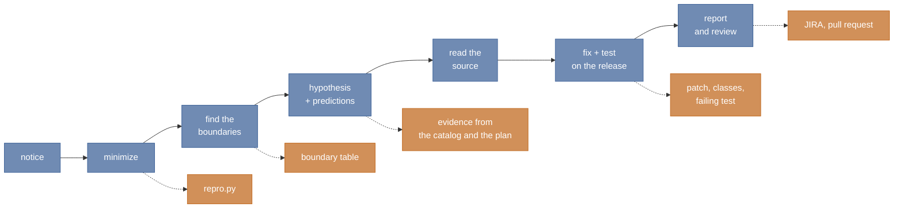
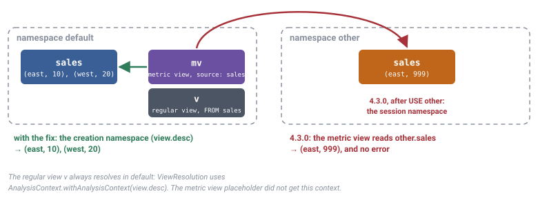
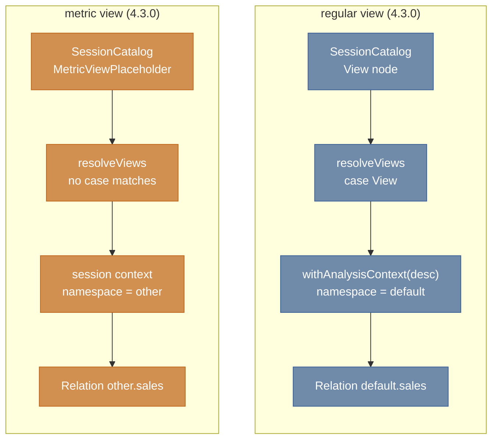
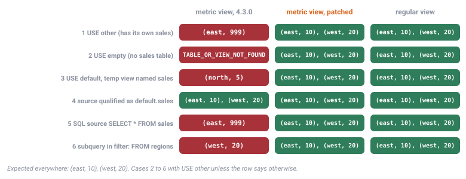

# Chapter 91: From wrong results to a fix: an upstream case study

The earlier chapters of this part read Spark's source to explain behavior that is correct. This chapter reads the source to explain behavior that is wrong. The bug is [SPARK-60206](https://issues.apache.org/jira/browse/SPARK-60206), which the author of this book reported in October 2026. Its fix is the open pull request [apache/spark#59416](https://github.com/apache/spark/pull/59416). Both are public. The bug gives wrong rows with no error, and that is the most dangerous kind of bug in a data system.

**A wrong result becomes a fix when each step of the investigation leaves an artifact that another person can run again. The artifacts are a minimal reproduction, a table of boundaries and a hypothesis with predictions. Then come the lines of source that explain it, a fix that you can test on the release, and a report. A committer who reads the report can check each claim without your help.**

All the code runs against `pyspark==4.3.0`. The scripts are in [`code/ch91`](https://github.com/open-lakehouse/spark-masterclass/tree/main/code/ch91), and each output block comes from `code/ch91/output/`. Each source excerpt names its file in the [apache/spark](https://github.com/apache/spark/tree/v4.3.0) repository at the `v4.3.0` tag, except the excerpts from the pull request, which say so. The JIRA and pull request states are a snapshot from 2026-11-22.

## Step 1: The investigation loop

An investigation goes through the same stages each time. Each stage has an output, and the next stage starts from that output:



Do not go to the source before you have a minimal reproduction and its boundaries. If you read the source first, you find code that looks wrong, and you can spend a day on code that is not the cause.

## Step 2: Notice, then minimize

A **metric view** is a view that Spark 4.2 added (SPARK-54119). It holds a YAML definition with a source, dimensions and measures. A query asks for a measure with `measure(...)`, and Spark builds the aggregation. The symptom was simple: the same query on the same metric view gave different numbers in two sessions. The difference between the sessions was one `USE` statement.

A good minimal reproduction obeys these rules:

- **No files and no external data.** Build each table from `VALUES` in the script.
- **The smallest data that shows the problem.** Here, two rows and one row.
- **A control.** A regular view with the same query, which gives the correct answer.
- **The expected answer, printed next to the real answer.** The reader does not have to know what is correct.

`repro.py` has about 20 lines of Spark code. It makes `default.sales` with two rows and `other.sales` with one different row. Then it makes a metric view and a regular view in `default`. Both use the unqualified name `sales`:

```python
spark.sql("USE default")
spark.sql(metric_view_sql("default.mv", "sales"))                       # source: sales (unqualified)
spark.sql("CREATE VIEW default.v AS SELECT region, sum(amount) AS total FROM sales GROUP BY region")
```

```text
Spark 4.3.0
expected everywhere: (east, 10), (west, 20)

USE default  metric view: (east, 10), (west, 20)   regular view: (east, 10), (west, 20)
USE other    metric view: (east, 999)              regular view: (east, 10), (west, 20)
```

<figure markdown>
  <video autoplay loop muted playsinline controls width="1280" height="720" poster="../../media/clips/ch91-repro.webp">
    <source src="../../media/clips/ch91-repro.mp4" type="video/mp4">
  </video>
  <figcaption><code>repro.py</code> queries one metric view from two namespaces. After <code>USE other</code>, it reads a different table. The regular view stays correct.</figcaption>
</figure>

After `USE other`, the metric view read `other.sales`. The query returned one row, `(east, 999)`, and no error. The regular view returned the correct rows from both namespaces. The bug is real on 4.3.0, and the control proves that the cause is in the metric view path, not in views in general.

<figure markdown>
  <video autoplay loop muted playsinline controls width="1280" height="720" poster="../../media/clips/ch91-anim-resolve.webp">
    <source src="../../media/clips/ch91-anim-resolve.mp4" type="video/mp4">
  </video>
  <figcaption>The name <code>sales</code> in the metric view, after <code>USE other</code>. On 4.3.0 it reads <code>other.sales</code>. With the fix of Step 7, it reads <code>default.sales</code>.</figcaption>
</figure>

## Step 3: Find the boundaries

A boundary is a change to the reproduction that changes the result. A table of boundaries tells you where the bug lives before you read a line of source. `boundaries.py` changes one thing in each row:

```text
expected: (east, 10), (west, 20)

case                                           metric view                     regular view
1 USE other (has its own sales)                (east, 999)                     (east, 10), (west, 20)
2 USE empty (no sales table)                   error TABLE_OR_VIEW_NOT_FOUND   (east, 10), (west, 20)
3 USE default, temp view named sales           (north, 5)                      (east, 10), (west, 20)
4 source qualified as default.sales, USE other (east, 10), (west, 20)          (east, 10), (west, 20)
5 SQL source SELECT * FROM sales, USE other    (east, 999)                     (east, 10), (west, 20)
6 subquery in filter: FROM regions, USE other  (west, 20)                      (east, 10), (west, 20)
```

Each row teaches one thing:

1. **A table with the same name in the current namespace replaces the source.** This is the wrong result of Step 2.
2. **A namespace without the table gives an error.** The metric view is unusable from that namespace. This is a second symptom of the same cause.
3. **A temporary view with the same name replaces the source, also from `default`.** A regular view never reads a temporary view of the session. The metric view does.
4. **A qualified name is safe.** With `source: default.sales`, the metric view is correct from `other`. This row is also the workaround.
5. **A SQL source has the same problem.** The bug is not in one type of source.
6. **A subquery in the `filter` has the same problem.** `other.regions` has only `west`, so the filter dropped `east`.

Rows 4 to 6 are important for the hypothesis. The problem follows every unqualified name in the definition, and it disappears when the definition qualifies the name.

## Step 4: A hypothesis that makes predictions

A hypothesis is useful only if it predicts results that you did not see yet. From the table:

> **Hypothesis.** When Spark reads a metric view, it resolves the names in the definition against the current catalog and namespace of the session. It does not use the namespace where the user created the metric view.

Predictions, and how to test each one:

- **The catalog stores the creation namespace, the same as for a regular view.** If it did not, the bug would be "the namespace is lost" and not "the namespace is not used". Test: read the catalog entry.
- **The analyzed plan contains the wrong relation.** The resolution happens in the analyzer, so the analyzed plan must name `other.sales`. Test: read the analyzed plan through Py4J.
- **The regular view resolves under a context that the metric view does not get.** Test: read the source (Step 5).

The second half of `boundaries.py` tests the first two predictions:

```text
Evidence 1: the catalog stores the creation namespace of both views
  mv_asset  type METRIC_VIEW  viewCatalogAndNamespace [spark_catalog, default]
  v         type VIEW         viewCatalogAndNamespace [spark_catalog, default]

Evidence 2: the relations in the analyzed plans, after USE other
  metric view   ['Relation spark_catalog.other.sales']
  regular view  ['Relation spark_catalog.default.sales']
```

Both predictions are correct. The metric view has the correct namespace in the catalog, `[spark_catalog, default]`. But its analyzed plan reads `spark_catalog.other.sales`. Thus the information is there, and some code does not use it.

<figure markdown>
  
  <figcaption>The tables and the views of <code>repro.py</code>. The catalog stores <code>default</code> for both views, but on 4.3.0 the metric view resolves its source in the namespace of the session.</figcaption>
</figure>

## Step 5: Read the source

The analyzer has a comment above `resolveViews` that describes how it keeps a view in its own namespace. The excerpt is from `sql/catalyst/src/main/scala/org/apache/spark/sql/catalyst/analysis/Analyzer.scala`:

```scala
    // resolve the view logical plan here, with the catalog and namespace stored in view metadata.
    // This is done by keeping the catalog and namespace in `AnalysisContext`, and analyzer will
    // look at `AnalysisContext.catalogAndNamespace` when resolving relations with single-part name.
    // If `AnalysisContext.catalogAndNamespace` is non-empty, analyzer will expand single-part names
    // with it, instead of current catalog and namespace. For views/functions with persisted frozen
    // PATH, `AnalysisContext.resolutionPathEntries` drives unqualified relation lookup order.
    private def resolveViews(
        plan: LogicalPlan,
        options: CaseInsensitiveStringMap): LogicalPlan = plan match {
      case view: View if !view.child.resolved =>
        ViewResolution
          .resolve(view, options, resolveChild = executeSameContext, checkAnalysis = checkAnalysis)
      // V2Reference is a placeholder for DSv2 tables or changelogs that must be resolved to
      // DataSourceV2Relation on each view access. Only dataframe temp view may contain it
      // as it stores resolved plans directly.
      case view: View if view.isTempViewStoringAnalyzedPlan =>
        view.copy(child = resolveTableReferencesInTempView(view.child))
      case p @ SubqueryAlias(_, view: View) =>
        p.copy(child = resolveViews(view, options))
      case _ => plan
    }
```

Every case matches a `View` node. `ViewResolution.resolve`, in `ViewResolution.scala` in the same folder, resolves the child of the view inside `AnalysisContext.withAnalysisContext(view.desc)`:

```scala
    // Resolve all the UnresolvedRelations and Views in the child.
    val newChild = AnalysisContext.withAnalysisContext(view.desc) {
```

`withAnalysisContext` copies the stored namespace into the context, and it copies the names of the temporary objects that the view can use:

```scala
    val context = AnalysisContext(
      isDefault = false,
      catalogAndNamespace = viewDesc.viewCatalogAndNamespace,
```

```scala
      referredTempViewNames = viewDesc.viewReferredTempViewNames,
```

This one context explains rows 1, 2 and 3 of the table for a regular view. An unqualified name expands with `catalogAndNamespace`, and the view can see a temporary view only if it referred to it when someone created it.

Now the metric view. The catalog builds its plan in `parseMetricViewDefinition`, in `sql/catalyst/src/main/scala/org/apache/spark/sql/catalyst/catalog/SessionCatalog.scala`:

```scala
  private def parseMetricViewDefinition(metadata: CatalogTable): LogicalPlan = {
    val viewDefinition = metadata.viewText.getOrElse {
      throw SparkException.internalError("Invalid view without text.")
    }
    val viewConfigs = metadata.viewSQLConfigs
    val origin = CurrentOrigin.get.copy(
      objectType = Some("METRIC VIEW"),
      objectName = Some(metadata.qualifiedName)
    )
    SQLConf.withExistingConf(
      View.effectiveSQLConf(
        configs = viewConfigs,
        isTempView = false,
        createSparkVersion = metadata.createVersion
      )
    ) {
      CurrentOrigin.withOrigin(origin) {
        MetricViewPlanner.planRead(metadata, viewDefinition, parser, metadata.schema)
      }
    }
  }
```

The method applies the stored SQL configs while it parses the YAML. It returns a `MetricViewPlaceholder` node, not a `View` node. No case in `resolveViews` matches a `MetricViewPlaceholder`. Thus the analyzer resolves the child of the placeholder like any other part of the query, in the default context of the session. The source confirms the hypothesis.



## Step 6: Which releases have the bug

The fix must go to every maintained branch that has the bug. Thus you must know where the code came from. `history.sh` counts the mentions of `MetricView` in `SessionCatalog.scala` at each release tag, and it shows a trap:

```text
lines that mention MetricView in SessionCatalog.scala, per release tag:
  v4.0.0  0
  v4.1.0  0
  v4.2.0  5
  v4.3.0  5

is the clone shallow? true
the oldest commit it has: 9ca391927d1 2026-04-25 [SPARK-56615][SQL] Clarify `KeyedPartitioning` `satisfies0()` and `nonGroupedSatisfies()`/`groupedSatisfies()` contract

git log -S 'parseMetricViewDefinition' v4.3.0 (oldest first):
  9ca391927d1 2026-04-25 [SPARK-56615][SQL] Clarify `KeyedPartitioning` `satisfies0()` and `nonGroupedSatisfies()`/`groupedSatisfies()` contract
```

The tags give the answer: the read path is in 4.2.0 and 4.3.0, and not in 4.1.0. The pickaxe search (`git log -S`) gives a wrong answer. It names a commit about `KeyedPartitioning`. That commit did not add the method. It is the oldest commit in the clone, because the clone is shallow. In a shallow clone, every line that existed before the cut seems to come from the first commit after the cut.

!!! warning "Do not trust git log -S or git blame in a shallow clone"
    Run `git rev-parse --is-shallow-repository` first. If it prints `true`, run `git fetch --unshallow` before you search history. Or compare release tags, as `history.sh` does.

The JIRA lists 4.2.0 as the affected version, because the report came before 4.3.0. The runs in this chapter show that 4.3.0 also has the bug.

## Step 7: The fix

The fix in the pull request gives the metric view the same context as a regular view. It moves the body of `ViewResolution.resolve` into a shared method, and it adds a second entry point. The excerpt is from `ViewResolution.scala` on the branch of apache/spark#59416:

```scala
  /**
   * Resolves the source of a metric view read from the catalog. Like a view's child, it resolves
   * in the catalog and namespace the metric view was created in, with its captured SQL configs.
   */
  def resolveMetricView(
      metricView: MetricViewPlaceholder,
      resolveChild: LogicalPlan => LogicalPlan,
      checkAnalysis: LogicalPlan => Unit): MetricViewPlaceholder = {
    val newChild = resolveInViewContext(
      metricView.metadata, isTempView = false, metricView, metricView.child, resolveChild)
    checkAnalysis(newChild)
    metricView.copy(child = newChild)
  }
```

`resolveViews` gets one new case:

```scala
      case mv: MetricViewPlaceholder if !mv.isCreate && !mv.child.resolved =>
        ViewResolution.resolveMetricView(
          mv, resolveChild = executeSameContext, checkAnalysis = checkAnalysis)
```

The condition `!mv.isCreate` is important. When a user creates a metric view, Spark must resolve the source in the namespace of the user. That is the namespace that Spark stores. Only the read path changes.

The pull request is against `master`. Its six files also include tests and a migration guide note. They also add a check that rejects temporary functions in a metric view source (Step 10 explains why). For a test on 4.3.0, `code/ch91/fix/narrow-fix-v4.3.0.diff` keeps only the two changes above and the import that they need. It applies to the `v4.3.0` text of `Analyzer.scala` and `ViewResolution.scala`.

## Step 8: Test the fix without a build of Spark

A full build of Spark takes a long time. But the pyspark wheel contains every Spark jar, and it also contains the Scala compiler (`scala-compiler-2.13.18.jar`). You can compile two changed source files against the other jars, and put the new classes first on the class path of the driver. `test_fix.sh` does this:

```bash
java -Xss8m -Xmx3g -cp "$scala" scala.tools.nsc.Main -nowarn -release 17 -classpath "$cp" \
  -d "$work/classes" "${files[@]/#/$work/src/}"
```

```python
    if os.environ.get("PATCHED_CLASSES"):
        b = b.config("spark.driver.extraClassPath", os.environ["PATCHED_CLASSES"])
```

```text
patched: Analyzer.scala ViewResolution.scala
compiled with scala-compiler-2.13.18.jar in 9 s: 169 class files

Spark 4.3.0  (patched classes first on the class path)
expected everywhere: (east, 10), (west, 20)

USE default  metric view: (east, 10), (west, 20)   regular view: (east, 10), (west, 20)
USE other    metric view: (east, 10), (west, 20)   regular view: (east, 10), (west, 20)

expected: (east, 10), (west, 20)

case                                           metric view                     regular view
1 USE other (has its own sales)                (east, 10), (west, 20)          (east, 10), (west, 20)
2 USE empty (no sales table)                   (east, 10), (west, 20)          (east, 10), (west, 20)
3 USE default, temp view named sales           (east, 10), (west, 20)          (east, 10), (west, 20)
4 source qualified as default.sales, USE other (east, 10), (west, 20)          (east, 10), (west, 20)
5 SQL source SELECT * FROM sales, USE other    (east, 10), (west, 20)          (east, 10), (west, 20)
6 subquery in filter: FROM regions, USE other  (east, 10), (west, 20)          (east, 10), (west, 20)
```

<figure markdown>
  <video autoplay loop muted playsinline controls width="1280" height="720" poster="../../media/clips/ch91-fix.webp">
    <source src="../../media/clips/ch91-fix.mp4" type="video/mp4">
  </video>
  <figcaption><code>test_fix.sh</code> patches two Scala files, compiles them with the compiler in the pyspark wheel, and runs the reproduction again. All cases give the correct rows.</figcaption>
</figure>

All six rows are now correct, also the error of row 2 and the temporary view of row 3. The compile took 9 seconds.

<figure markdown>
  
  <figcaption>The boundary table of Step 3 before and after the fix. Red cells are wrong results or errors. With the patched classes, all six cases give the expected rows.</figcaption>
</figure>

This method has limits. Know them before you trust a result:

- **Compile the complete file.** A Scala file compiles to many classes (169 here, because `Analyzer.scala` holds many rules as inner objects). All of them must come from the same source, or the JVM loads a mix of old and new classes.
- **Do not change a signature that other files call.** The compiler built the classes in the jars against the old signatures. If you change a constructor or a public method, the first call from an old class fails with `NoSuchMethodError`. This fix adds methods and changes no signature.
- **`spark.driver.extraClassPath` covers the driver only.** The analyzer runs on the driver, so that is enough here. A fix in executor code also needs `spark.executor.extraClassPath`.
- **It is a test, not a release.** Use it to prove a fix on the release that users run. The pull request still goes through the full build and the test suites of the project.

## Step 9: A regression test that fails for the right reason

The pull request adds tests to `MetricViewSuite` and `MetricViewV2CatalogSuite`. This test, from the branch of the pull request, checks rows 1 and 2 of the boundary table for both source types:

```scala
  test("metric view resolves its source in the namespace it was created in") {
    val assetSource = MetricView(
      "0.1", AssetSource(testTableName), None, testMetricViewColumns)
    val sqlSource = MetricView(
      "0.1", SQLSource(s"SELECT * FROM $testTableName"), None, testMetricViewColumns)
    withMetricView("mv_asset_source", assetSource) {
      withMetricView("mv_sql_source", sqlSource) {
        withDatabase("other_db", "empty_db") {
          sql("CREATE DATABASE other_db")
          sql("CREATE DATABASE empty_db")
          sql(s"CREATE TABLE other_db.$testTableName USING parquet AS " +
            "SELECT 'region_9' AS region, 'product_9' AS product, 1000 AS count, 1.0 AS price")
          val expected = sql(s"SELECT sum(count) FROM default.$testTableName")
          // A table with the same name in the current namespace, and no such table at all.
          Seq("other_db", "empty_db").foreach { db =>
            activateDatabase(db) {
              checkAnswer(sql("SELECT measure(count_sum) FROM default.mv_asset_source"), expected)
              checkAnswer(sql("SELECT measure(count_sum) FROM default.mv_sql_source"), expected)
            }
          }
        }
      }
    }
  }
```

A regression test must fail without the fix, and it must fail on its assertion, not on an unrelated error. The description of the pull request states that the new tests "fail on master without this change". This book did not run the Scala suites. To run them, build Spark from the branch and use the project's own commands, for example `build/sbt "sql/testOnly *MetricViewSuite"`.

The test has the same structure as the boundary table. That is not an accident. Each row of a boundary table is a candidate test, and the rows that the fix changes are the tests that you must add.

## Step 10: Report, review and triage

The report is the JIRA issue. `jira.py` reads its fields from the public REST API:

```text
SPARK-60206: Metric views resolve unqualified names in the reader's current namespace instead of the creation namespace
  type Bug, priority Major, status Open, created 2026-10-12
  affects ['4.2.0'], fix [], components ['SQL'], labels ['pull-request-available']
```

```text
apache/spark#59416: [SPARK-60206][SQL] Resolve metric view sources in the namespace they were created in
  state open, merged False, 6 files, +252 -15, base master
```

A good report has these parts, and SPARK-60206 has all of them:

1. **A title that states the wrong behavior**, not the place in the code that you suspect.
2. **A reproduction in SQL** that a committer can paste into `spark-sql`, with the wrong and the correct answer as comments.
3. **The boundaries:** the other shapes that fail (SQL sources, filter subqueries, temporary views, v2 catalogs) and the error from a namespace without the table.
4. **The versions and environments that you tested.** Put in "Affects Version/s" only the versions that you reproduced.
5. **The cause, if you found it,** with the names of the methods. Here: the catalog stores the namespace, but `parseMetricViewDefinition` applies only the SQL configs.
6. **A workaround:** qualify the names in the definition (row 4).

Review then tests the fix in ways that the author did not. Two comments from the review of apache/spark#59416 show the kind of check that a reviewer makes:

- The first comment: "The new captured-config test creates the metric view with default configs, so it would still pass if the captured configs were ignored."
  A test that cannot fail proves nothing. The author changed the test to create the metric view under a time zone that is not the default.
- The second comment: "That holds for temporary views and variables, but not for temporary functions."
  After the fix, a metric view source cannot see the temporary functions of the reader. A metric view that used one would fail. The author added a check that rejects temporary functions when a user creates a metric view. A regular view has the same check. The author also added a note to the migration guide.

The second comment shows why a fix for wrong results can be a behavior change. Some users can depend on the wrong behavior. The migration guide note tells them what changes.

The [contributing guide](https://spark.apache.org/contributing.html) of Spark asks for one more field on a bug of this kind. It says that a data correctness bug must have the label `correctness`. It also says: "Correctness and data loss issues should be considered Blockers for their target versions". At the time of the snapshot, SPARK-60206 had the priority Major and only the label `pull-request-available`. When you report wrong rows, add the `correctness` label.

Triage decides where the fix goes. A correctness fix is a candidate for the maintenance branches of each affected release, here `branch-4.2` and `branch-4.3`. The committers decide that when they merge. At the time of the snapshot, the pull request was open, and the JIRA had no fix version.

## The whole chapter, on one page

- **Minimize first.** No files, the smallest data, a control, and the expected answer printed. `repro.py` shows the wrong rows on 4.3.0 in about 20 lines.
- **Find the boundaries.** Change one thing for each row. The table showed that every unqualified name in a metric view follows the session namespace, and that qualified names are safe.
- **Make predictions, then test them.** The catalog had the correct namespace. The analyzed plan had the wrong relation.
- **Read the source last, with a question.** Regular views resolve inside `withAnalysisContext(view.desc)`. The metric view placeholder did not match any case in `resolveViews`.
- **Compare tags, not pickaxe results, in a shallow clone.** The read path is in 4.2.0 and 4.3.0.
- **Test the fix on the release.** Compile the changed files with the Scala compiler from the pyspark wheel, and put the classes first on `spark.driver.extraClassPath`.
- **Write the report so that a committer can check each claim.** Then let review find the cases that you missed.

To run all of the chapter, from `code/`:

```bash
uv run python ch91/repro.py
uv run python ch91/boundaries.py
SPARK_SRC=~/spark ch91/history.sh      # any clone of apache/spark with its tags
ch91/test_fix.sh                              # downloads the two v4.3.0 files if SPARK_SRC is not set
uv run python ch91/jira.py                    # needs network
```

## Further reading

- [SPARK-60206](https://issues.apache.org/jira/browse/SPARK-60206), the report, and [apache/spark#59416](https://github.com/apache/spark/pull/59416), the fix and its review.
- [`ViewResolution.scala` at v4.3.0](https://github.com/apache/spark/blob/v4.3.0/sql/catalyst/src/main/scala/org/apache/spark/sql/catalyst/analysis/ViewResolution.scala), how a regular view keeps its namespace.
- [Contributing to Spark](https://spark.apache.org/contributing.html), the project's guide to JIRA, pull requests and review.
