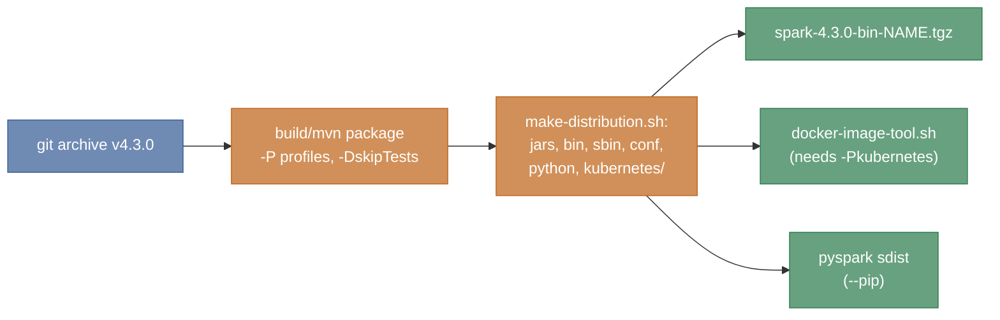

# Chapter 92: Building Spark from source

Most users never build Spark. The pip package, the tarball and the Docker image of [Chapter 6](ch06-installing.md) cover most needs. Three needs send you to the source: a distribution without Hadoop jars, for a cluster that has its own Hadoop. A distribution with fewer modules, for a smaller image. And a change of your own to Spark, for a test before a pull request ([Chapter 91](ch91-upstream-case-study.md)).

**A Spark build is a Maven build of the tag, with profiles that add or remove modules and dependencies. `dev/make-distribution.sh` runs that build and copies the jars into a folder that looks like the official tarball. A `hadoop-provided` build leaves out Hadoop and its libraries, and it starts only when `SPARK_DIST_CLASSPATH` gives them back.**

This short chapter built the `v4.3.0` tag for real in a Docker container, with the profiles `-Phadoop-provided -Pkubernetes`. Then it compared the result with the official tarball, and it ran the result. The code is in [`code/ch92`](https://github.com/open-lakehouse/spark-masterclass/tree/main/code/ch92). Each output block comes from `code/ch92/output/`.

## Step 1: The profiles

The root `pom.xml` of 4.3.0 sets Java 17 (`<java.version>17</java.version>`) and Maven 3.9.15. The build docs say "Maven 3.9.15 and Java 17/21/25". `build/mvn` reads `<maven.version>` from the POM and downloads that Maven if your Maven has a different version.

A profile adds a module or changes the scope of a set of dependencies. These are the profiles of the 4.3.0 POMs that change what a distribution contains:

| Profile | Effect | In the official tarball |
|---|---|---|
| `-Pyarn` | builds `spark-yarn` and the YARN shuffle service | yes |
| `-Pkubernetes` | builds `spark-kubernetes` and copies the Dockerfiles into `kubernetes/` | yes |
| `-Phive`, `-Phive-thriftserver` | builds Hive support, `spark-sql` with a metastore, and the Thrift server | yes |
| `-Psparkr` | builds SparkR (deprecated since 4.0) | yes |
| `-Phadoop-cloud` | adds the cloud object store connectors (`hadoop-aws`, `hadoop-azure`, `hadoop-cloud-storage`) | no |
| `-Phadoop-provided` | sets `hadoop.deps.scope=provided` in `assembly/pom.xml`, so Hadoop and its libraries stay out | no |
| `-Phive-provided`, `-Porc-provided`, `-Pparquet-provided` | the same for Hive, ORC and Parquet | no |
| `-Pjvm-profiler`, `-Pkinesis-asl`, `-Pspark-ganglia-lgpl` | optional modules, some under other licenses | no |

The `RELEASE` file of a distribution records its flags. The official 4.3.0 tarball has `Build flags: -B -Pyarn -Pkubernetes -Psparkr -Phadoop-3 -Phive -Phive-thriftserver`.

## Step 2: The build in Docker

[`build.sh`](https://github.com/open-lakehouse/spark-masterclass/tree/main/code/ch92/build.sh) exports the tag with `git archive v4.3.0`, and it runs `make-distribution.sh` in a JDK 17 container as your user:

```bash
docker run --rm --user "$(id -u):$(id -g)" \
  -e HOME=/work -e MAVEN_OPTS="-Xss64m -Xmx4g -XX:ReservedCodeCacheSize=1g" \
  -v "$S/src:/work/spark" -v "$S/m2:/work/.m2" -w /work/spark \
  ops80/spark-build:jdk17 \
  ./dev/make-distribution.sh --name book --tgz -Phadoop-provided -Pkubernetes -DskipTests \
    -Dmaven.repo.local=/work/.m2/repository      # (1)!
```

1. The flags before the first `-P` belong to `make-distribution.sh`: `--name` is the suffix of the distribution, and `--tgz` packs it. The other flags are `--pip`, `--r`, `--connect`, `--mvn` and `--sbt-enabled`. Everything from the first `-` flag on goes to Maven.

The first try used the image `maven:3.9-eclipse-temurin-17`. Maven succeeded, then the script stopped:

```text
+ '[' -f $SPARK_SRC/dist/jars/datasketches-memory-3.0.2.jar ']'
+ zip -d $SPARK_SRC/dist/jars/datasketches-memory-3.0.2.jar org/apache/datasketches/memory/internal/ResourceImpl.class
./dev/make-distribution.sh: line 223: zip: command not found
[INFO] Total time:  27:21 min
```

`make-distribution.sh` removes one class from `datasketches-memory-3.0.2.jar` after the build. Spark has its own copy of that class, which works on Java 25 (SPARK-53327, in a comment in the script). The removal uses `zip`, and the Maven image has no `zip`. The [`Dockerfile`](https://github.com/open-lakehouse/spark-masterclass/tree/main/code/ch92/Dockerfile) adds it:

```text
FROM maven:3.9-eclipse-temurin-17
RUN apt-get update && apt-get install -y --no-install-recommends zip && rm -rf /var/lib/apt/lists/*
```

!!! warning "Caution: install zip before you run make-distribution.sh"
    Install `zip` in the build image before the build. Without it, `make-distribution.sh` stops after a full Maven build, and you lose that build time.

The second try finished. Maven reported `Total time:  26:43 min` for 41 modules, on a machine with 16 cores, with an empty Maven repository at the start. `build.sh` measured 1659 seconds for the whole script, with the tgz. The time of each module is in `reactor.txt`:

```text
Spark Project Core ................................. SUCCESS [03:01 min]
Spark Project Catalyst ............................. SUCCESS [02:23 min]
Spark Project SQL .................................. SUCCESS [04:09 min]
Spark Project ML Library ........................... SUCCESS [01:49 min]
Spark Project Kubernetes ........................... SUCCESS [ 39.217 s]
Spark Project Assembly ............................. SUCCESS [  3.552 s]
```

These times are from one run, with the Maven downloads in them. They are not a benchmark. A second build with a full Maven repository downloads nothing.

<figure markdown>
  
  
  <figcaption>The twelve slowest modules of the build, and the other 29 together. The times come from <code>reactor.txt</code>.</figcaption>
</figure>

<figure markdown>
  <video autoplay loop muted playsinline controls width="1280" height="720" poster="../../media/clips/ch92-anim-build.webp">
    <source src="../../media/clips/ch92-anim-build.mp4" type="video/mp4">
  </video>
  <figcaption>Animation: the Maven reactor builds the 41 modules in order, then <code>make-distribution.sh</code> packs the distribution. The module times come from <code>reactor.txt</code>.</figcaption>
</figure>

## Step 3: What a hadoop-provided build leaves out

`inspect.sh` unpacks the new tgz next to the official tarball of [Chapter 6](ch06-installing.md) and compares them:

```text
                           official (-bin-hadoop3)            this build (-bin-book)
tgz size                   536M                               361M
jars/                      280 jars                           225 jars
hadoop-* jars              2                                  0
RELEASE, first line        Spark 4.3.0 (git revision 98bc0212c94) built for Hadoop 3.5.0 Spark 4.3.0 built for Hadoop 3.5.0
RELEASE, build flags       Build flags: -B -Pyarn -Pkubernete Build flags: -Phadoop-provided -Pkubernetes -DskipTests -Dmaven.repo.local=/work/.m2/repository
--- jars in the official tarball and not in this build: 55
  Spark modules (no -Phive -Phive-thriftserver -Pyarn in this build):
    spark-hive_2.13-4.3.0.jar
    spark-hive-thriftserver_2.13-4.3.0.jar
    spark-yarn_2.13-4.3.0.jar
  Hadoop and the libraries that a Hadoop install provides (hadoop-provided), for example:
    commons-cli-1.11.0.jar
    curator-client-5.9.0.jar
    guava-33.6.0-jre.jar
    hadoop-client-api-3.5.0.jar
    hadoop-client-runtime-3.5.0.jar
    slf4j-api-2.0.17.jar
    zookeeper-3.9.5.jar
  Hive and its dependencies: 39 jars
--- jars in this build and not in the official tarball
```

The build does not have 55 jars of the official tarball, for two reasons. This build has no `-Phive`, `-Phive-thriftserver` or `-Pyarn`, so three Spark modules and 39 Hive jars are not there. The other 13 jars are Hadoop and libraries of the Hadoop client, for example ZooKeeper, Curator and Guava. `-Phadoop-provided` left them out. The build has no git revision in `RELEASE`, because `git archive` makes a folder without `.git`. The build added no jar that the official tarball does not have.

<figure markdown>
  
  
  <figcaption>The <code>jars/</code> folder of the two distributions. The counts come from <code>inspect.txt</code>.</figcaption>
</figure>

## Step 4: Run it, without and with Hadoop

A hadoop-provided distribution needs the Hadoop jars of the machine at run time. `bin/spark-class` adds the value of `SPARK_DIST_CLASSPATH` to the class path. On a Hadoop node, set it from the Hadoop install:

```bash
export SPARK_DIST_CLASSPATH=$(hadoop classpath)
```

The laptop has no Hadoop install. `inspect.sh` runs `spark.range(10).count()` without the variable, then with the variable set to the two `hadoop-client` jars and `slf4j-api` from the official tarball:

```text
--- run it without Hadoop on the class path
Caused by: java.lang.NoClassDefFoundError: org/apache/hadoop/fs/FSDataInputStream
--- run it with SPARK_DIST_CLASSPATH set to a Hadoop client and slf4j (here, jars of the official tarball)
count: 10  version: 4.3.0
```

Without Hadoop, the JVM fails before the first job. Spark uses the Hadoop `FileSystem` API even for local files. With the three jars, the build runs. On a real cluster, `hadoop classpath` gives the Hadoop jars of the cluster, so Spark and the cluster use the same Hadoop version.

<figure markdown>
  <video autoplay loop muted playsinline controls width="1280" height="720" poster="../../media/clips/ch92-inspect.webp">
    <source src="../../media/clips/ch92-inspect.mp4" type="video/mp4">
  </video>
  <figcaption><code>inspect.sh</code>: the build next to the official tarball, then a run that fails without Hadoop and works with <code>SPARK_DIST_CLASSPATH</code>.</figcaption>
</figure>

## Step 5: Other ways to build

This chapter ran only the Maven build of Step 2. The 4.3.0 docs describe these other ways:

- **One module.** `./build/mvn -pl :spark-streaming_2.13 clean install` builds one module against the jars in your Maven repository.
- **SBT.** `./build/sbt package` uses the same profiles and is faster for a change and a test, again and again. `make-distribution.sh --sbt-enabled` builds a distribution with SBT, which the docs call experimental.
- **A Docker image.** `bin/docker-image-tool.sh -r <repo> -t <tag> build` builds Spark images from the `kubernetes/dockerfiles` folder of a distribution. The folder is there only if the build had `-Pkubernetes`. `-p` with the Python Dockerfile also builds a PySpark image.
- **A Python package.** `make-distribution.sh --pip` also builds the `pyspark` source package in `python/dist/`.



## The whole chapter, on one page

- **Profiles decide what a distribution contains.** The official tarball uses `-Pyarn -Pkubernetes -Psparkr -Phadoop-3 -Phive -Phive-thriftserver`. Its `RELEASE` file lists them.
- **`make-distribution.sh` runs Maven, then copies and packs.** It needs `zip` on the path, or it stops after the build.
- **The build of `v4.3.0` took 26:43 min of Maven time** in a JDK 17 container with 16 cores and an empty Maven repository.
- **`-Phadoop-provided` removes Hadoop and its libraries**, here 13 jars. Give them back at run time with `SPARK_DIST_CLASSPATH=$(hadoop classpath)`. Without them, the JVM fails with `NoClassDefFoundError`.

```bash
cd code
ch92/build.sh                                             # in its own folder: needs src/ from git archive
ch92/inspect.sh <path to>/spark-4.3.0-bin-book.tgz
```

## Further reading

- [Building Spark](https://spark.apache.org/docs/4.3.0/building-spark.html), with the profiles, `MAVEN_OPTS` and SBT.
- [`dev/make-distribution.sh`](https://github.com/apache/spark/blob/v4.3.0/dev/make-distribution.sh) and [`assembly/pom.xml`](https://github.com/apache/spark/blob/v4.3.0/assembly/pom.xml), for the `hadoop-provided` scope.
- [Using Spark's "Hadoop Free" Build](https://spark.apache.org/docs/4.3.0/hadoop-provided.html), for `SPARK_DIST_CLASSPATH`.
