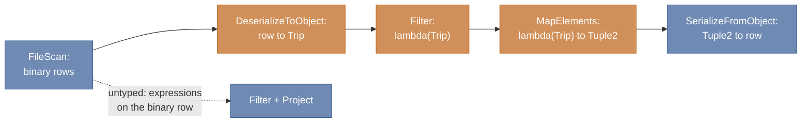

# Chapter 92: Datasets and Encoders in Scala

The book uses Python for most of its code. But the Spark engine is Scala code, and the Scala API has one thing that Python does not have: the typed `Dataset[T]`. Spark 1.6 added the Dataset API, and Spark 2.0 made `DataFrame` a name for `Dataset[Row]` ([Chapter 3](ch03-rdds-to-a-sql-engine.md)). A Scala or Java program can give each row a class, and the compiler then checks the field names and types.

**A typed Dataset is a DataFrame with an Encoder. The Encoder converts each row between Spark's binary format and a JVM object. Typed operations such as `filter(t => ...)` and `map(t => ...)` pay for that conversion on each row, and the optimizer cannot read their lambdas. Use the types at the edges of a program, and use column expressions inside it. An `Aggregator` gives a typed aggregate that also works as a SQL function.**

This chapter makes Encoders, reads the taxi trips as a `Dataset[Trip]`, and compares the plans and the times of typed and untyped code. Then it writes an `Aggregator` and uses it in two ways. The last step runs the typed code over Spark Connect from the Scala Connect REPL.

The code is in [`code/ch92`](https://github.com/lisancao/spark-masterclass/tree/main/code/ch92). `Datasets.scala` runs in the `spark-shell` of the pip package, as in Chapters [3](ch03-rdds-to-a-sql-engine.md) and [4](ch04-one-engine-batch-and-streaming.md). Each output block comes from `code/ch92/output/`.

```bash
cd code
export BOOK_DATA=$HOME/spark-masterclass/data
uv run spark-shell --master 'local[*]' --conf spark.ui.port=4157 -I ch92/Datasets.scala   # (1)!
```

1. `-I` loads the file as one pasted block. With `-i`, which loads the file line by line, the case classes of this file failed to decode in this run (`EXPRESSION_DECODING_FAILED`). The same lines typed into the shell worked.

## Step 1: An Encoder is a schema and a converter

An `Encoder[T]` tells Spark two things about the class `T`. The first is the schema of its rows. The second is the code that converts between a `T` object and a binary row. For a case class, `Encoders.product` derives both from the fields:

```scala
case class Trip(PULocationID: Int, payment_type: Option[Long], passenger_count: Option[Long],   // (1)!
                trip_distance: Double, fare_amount: Double, tip_amount: Double)
val enc = Encoders.product[Trip]
println(enc.schema.treeString.trim)
```

1. `Option[Long]` marks a column that can be null. A plain `Long` or `Double` cannot hold a null.

```text
== 1. an Encoder is a schema plus code that converts objects to rows
root
 |-- PULocationID: integer (nullable = false)
 |-- payment_type: long (nullable = true)
 |-- passenger_count: long (nullable = true)
 |-- trip_distance: double (nullable = false)
 |-- fare_amount: double (nullable = false)
 |-- tip_amount: double (nullable = false)
Encoders.kryo[Trip]: struct<value:binary>
Encoders.scalaInt:   struct<value:int>
Encoders.STRING:     struct<value:string>
```

The schema follows the Scala types. `Int` became `integer` and `Double` became `double`, both with `nullable = false`. The two `Option` fields are `nullable = true`. In a program, `import spark.implicits._` finds these Encoders for you, for case classes, tuples and primitive types.

`Encoders.kryo` is different. It serializes the whole object with Kryo into one `binary` column. Spark cannot read the fields of that column, so it cannot filter, prune or sort on them. Use a Kryo or Java serialization Encoder only for a class that the product Encoder cannot describe.

| Encoder | Schema | Spark can read the fields |
|---|---|---|
| `Encoders.product[T]` (case class), `spark.implicits._` | one column for each field, nested for nested classes | yes |
| `Encoders.scalaInt`, `Encoders.STRING` and other primitives | one column, `value` | yes |
| `Encoders.bean(classOf[T])` (Java beans) | one column for each property | yes |
| `Encoders.kryo[T]`, `Encoders.javaSerialization[T]` | one `binary` column, `value` | no |

## Step 2: as[T], and what it checks

`df.as[Trip]` gives a typed view of a DataFrame. It does not copy or convert data. It checks that the DataFrame has the columns that the Encoder needs:

```scala
val raw = spark.read.parquet(path)
val trips: Dataset[Trip] = raw.as[Trip]
```

```text
== 2. as[Trip] gives a typed view of the same rows
raw.as[Trip]: Dataset[Trip], columns kept: 21
first: Trip(140,Some(1),Some(1),2.9,16.3,6.4)
after a typed map, columns: value
as[Missing]: UNRESOLVED_COLUMN.WITH_SUGGESTION {objectName=`surge_fee`, proposal=`Airport_fee`, `extra`, `mta_tax`, `RatecodeID`, `VendorID`}
as[NoOption] on a null: SparkRuntimeException [NOT_NULL_ASSERT_VIOLATION] NULL value appeared in non-nullable field: 
```

Four facts are in this output:

- **`as[Trip]` keeps all 21 columns.** The Dataset still has the columns that `Trip` does not name. They go away only after a typed operation, such as `map`.
- **A typed `map` names its output `value`.** A `Dataset[Double]` has one column, `value`. A `map` to a tuple gives `_1` and `_2`.
- **A column that is not there fails at once.** `as[Missing]` asks for `surge_fee`, and the analyzer fails with `UNRESOLVED_COLUMN.WITH_SUGGESTION`, before any job.
- **A null in a non-Option field fails at run time.** `NoOption` declares `passenger_count: Long`. The trips with a null passenger count stop the job with `NOT_NULL_ASSERT_VIOLATION`. Use `Option` for each column that can be null.

## Step 3: A typed filter and map, and the plan they make

The typed API takes Scala functions. This code computes the tip share for each trip with a positive fare:

```scala
val typed = trips.filter(t => t.fare_amount > 0).map(t => (t.PULocationID, t.tip_amount / t.fare_amount))
typed.explain("extended")
```

The optimized and physical plans, with the long lines shortened (`datasets.txt` has the full text):

```text
== Optimized Logical Plan ==
SerializeFromObject [invoke(knownnotnull(assertnotnull(input[0, scala.Tuple2, true]))._1()) AS _1#123, ...
+- MapElements $line46.$read$$iw$$Lambda$4812/0x000070cb924bf460@5273da5f, class $line25.$read$$iw$Trip, ...
   +- Filter (isnotnull(obj#117) AND invoke($line46.$read$$iw$$Lambda$4811/0x000070cb924bf098@22731342.apply(obj#117)))
      +- DeserializeToObject newInstance(class $line25.$read$$iw$Trip), obj#117: $line25.$read$$iw$Trip
         +- Project [passenger_count#3L, trip_distance#4, PULocationID#7, payment_type#9L, fare_amount#10, tip_amount#13]
            +- Relation [VendorID#0,tpep_pickup_datetime#1,...] parquet

== Physical Plan ==
*(1) SerializeFromObject [invoke(knownnotnull(assertnotnull(input[0, scala.Tuple2, true]))._1()) AS _1#123, ...
+- *(1) MapElements $line46.$read$$iw$$Lambda$4812/0x000070cb924bf460@5273da5f, obj#120: scala.Tuple2
   +- *(1) Filter (isnotnull(obj#117) AND invoke($line46.$read$$iw$$Lambda$4811/0x000070cb924bf098@22731342.apply(obj#117)))
      +- *(1) DeserializeToObject newInstance(class $line25.$read$$iw$Trip), obj#117: $line25.$read$$iw$Trip
         +- *(1) ColumnarToRow
            +- FileScan parquet [passenger_count#3L,trip_distance#4,PULocationID#7,payment_type#9L,fare_amount#10,tip_amount#13] Batched: true, DataFilters: [], ...
```

Read the plan from the bottom:

- **`FileScan` reads six columns, the fields of `Trip`.** The optimizer pruned the columns that the Encoder does not need. But it cannot know that the lambdas read only three of the six fields.
- **`DataFilters: []`.** The filter is a Scala function, so Spark cannot push it into the Parquet reader.
- **`DeserializeToObject` makes a `Trip` object for each row.** The object is the input of the lambda.
- **`Filter` calls the lambda with `invoke(... .apply(obj))`.** The analyzer turned the `TypedFilter` of the logical plan into a `Filter` on the object.
- **`MapElements` runs the second lambda.** It makes a `scala.Tuple2`.
- **`SerializeFromObject` converts the tuple into a binary row again.**

All of these operators have `*(1)`, so whole-stage codegen fused them into one loop. The conversions are fast code, but they still run on each row.

## Step 4: The same logic, untyped

The same tip share with column expressions:

```scala
val untyped = raw.where($"fare_amount" > 0).select($"PULocationID", $"tip_amount" / $"fare_amount")
```

```text
== 4. the same logic untyped: plain expressions
*(1) Project [PULocationID#7, (tip_amount#13 / fare_amount#10) AS (tip_amount / fare_amount)#130]
+- *(1) Filter (isnotnull(fare_amount#10) AND (fare_amount#10 > 0.0))
   +- *(1) ColumnarToRow
      +- FileScan parquet [PULocationID#7,fare_amount#10,tip_amount#13]
```

<figure markdown>
  
  
  <figcaption>The physical plans of Steps 3 and 4. The typed plan converts each row to a <code>Trip</code> and back. The untyped plan evaluates expressions on the binary row and reads three columns. Nodes from <code>datasets.txt</code>.</figcaption>
</figure>

The untyped plan has no object operators. The scan reads three columns, and the filter is an expression that Spark can read. `datasets.txt` also has a mixed form: a typed `Dataset`, with column expressions inside `where` and `select`, and `.as[Int]` and `.as[Double]` on the columns. Its plan is the same as the untyped plan, and its result is a `Dataset[(Int, Double)]`. Thus you can keep the types of the result and still give the optimizer expressions:

```scala
val mixed = trips.where($"fare_amount" > 0).select($"PULocationID".as[Int], ($"tip_amount" / $"fare_amount").as[Double])
```

<figure markdown>
  <video autoplay loop muted playsinline width="1280" height="720" poster="../../media/clips/ch92-anim-roundtrip.webp">
    <source src="../../media/clips/ch92-anim-roundtrip.mp4" type="video/mp4">
  </video>
  <figcaption>Animation: the typed path builds a <code>Trip</code> from the binary row, runs the lambdas, and encodes the tuple again. The untyped path reads three slots of the binary row. The values are the first trip, and the times are from <code>datasets.txt</code>. The slots are schematic.</figcaption>
</figure>

## Step 5: Typed against untyped, measured

`Datasets.scala` writes each version to the `noop` sink, five times after a warmup. It ran under the benchmark lock:

```text
== 5. typed and untyped, measured (median of 5 after a warmup)
typed filter + map        0.21 s
untyped where + select    0.11 s    1.9x faster than typed
select first, then typed  0.16 s
```

The untyped version was 1.9 times faster. A `select` of the six fields before the typed code changed little. The optimizer had already pruned the scan to the six fields of `Trip`. The rest of the gap is the conversion to objects and back, and the three columns that the lambdas did not need. On wider case classes, or with nested fields, the conversion costs more.



## Step 6: groupByKey and an Aggregator

The typed API also groups. `groupByKey(f)` groups by the result of a function, and `agg` takes a typed aggregate. An `Aggregator[IN, BUF, OUT]` is a typed user-defined aggregate function (UDAF). You write four functions and two Encoders:

```scala
case class SumCount(sum: Double, count: Long)
object TipShare extends Aggregator[Trip, SumCount, Double] {
  def zero: SumCount = SumCount(0.0, 0L)                                   // (1)!
  def reduce(b: SumCount, t: Trip): SumCount =
    if (t.fare_amount > 0) SumCount(b.sum + t.tip_amount / t.fare_amount, b.count + 1) else b
  def merge(a: SumCount, b: SumCount): SumCount = SumCount(a.sum + b.sum, a.count + b.count)
  def finish(r: SumCount): Double = if (r.count == 0) 0.0 else r.sum / r.count
  def bufferEncoder: Encoder[SumCount] = Encoders.product[SumCount]        // (2)!
  def outputEncoder: Encoder[Double] = Encoders.scalaDouble
}
val byZone = trips.groupByKey(_.PULocationID).agg(TipShare.toColumn.name("tip_share"))
```

1. These are the three steps of `aggregateByKey` in [Chapter 90](ch90-rdds-today.md). They are a zero value, a merge of one row into the buffer, and a merge of two buffers. `finish` makes the result from the buffer.
2. The Encoders tell Spark how to store the buffer and the result between the partial and final aggregates.

```text
== 7. groupByKey and an Aggregator as a typed UDAF
132 0.1387 | 138 0.2189 | 161 0.2057
AdaptiveSparkPlan isFinalPlan=false
+- ObjectHashAggregate(keys=[value#494], functions=[tipshare($line65.$read$$iw$TipShare$@38b4d7c7, Some(newIns
   +- Exchange hashpartitioning(value#494, 200), ENSURE_REQUIREMENTS, [plan_id=803]
      +- ObjectHashAggregate(keys=[value#494], functions=[partial_tipshare($line65.$read$$iw$TipShare$@38b4d7c
         +- AppendColumns $line66.$read$$iw$$Lambda$5139/0x000070cb925b7018@3cd42ecc, newInstance(class $line2
            +- FileScan parquet [passenger_count#3L,trip_distance#4,PULocationID#7,payment_type#9L,fare_amount
```

The plan has the same two-phase shape as a built-in aggregate: a partial `ObjectHashAggregate`, an `Exchange`, and a final `ObjectHashAggregate`. Thus an `Aggregator` combines before the shuffle, as `reduceByKey` does. `AppendColumns` runs the key function `_.PULocationID` on a `Trip` object and adds the key as the column `value`. `ObjectHashAggregate` keeps the buffers as JVM objects, not in binary rows.

An `Aggregator` over one column can also be a SQL function. `functions.udaf` makes an untyped function from it, and `spark.udf.register` gives it a name:

```scala
object MeanOf extends Aggregator[Double, SumCount, Double] { ... }
spark.udf.register("mean_of", udaf(MeanOf))
spark.sql("SELECT PULocationID, mean_of(fare_amount) AS m, avg(fare_amount) AS a FROM trips " +
          "WHERE PULocationID IN (132, 138) GROUP BY 1 ORDER BY 1")
```

```text
+------------+------------------+------------------+
|PULocationID|                 m|                 a|
+------------+------------------+------------------+
|         132|60.840966174445704|60.840966174445704|
|         138|  46.0095891606656|  46.0095891606656|
+------------+------------------+------------------+
```

`mean_of` gave the same values as the built-in `avg`, and the same averages as `aggregateByKey` in [Chapter 90](ch90-rdds-today.md) (60.84 and 46.01). `udaf()` is the method for user-defined aggregates since Spark 3.0. Spark 3.0.0 made the older `UserDefinedAggregateFunction` class deprecated (`udaf.scala`).

The same script times the aggregates against their built-in forms, under the benchmark lock:

```text
mean_of (Aggregator via udaf)    0.39 s
avg (built-in)                   0.10 s
groupByKey + TipShare (typed)    0.63 s
groupBy + avg(when(...))         0.12 s   (the same tip share, untyped)
```

<figure markdown>
  
  
  <figcaption>Each typed operation next to its untyped form. The typed <code>groupByKey</code> with an <code>Aggregator</code> was five times slower than <code>groupBy</code> with <code>avg(when(...))</code>. Numbers from <code>datasets.txt</code>.</figcaption>
</figure>

The typed `groupByKey` with `TipShare` took 0.63 s. The same tip share with `groupBy` and `avg(when(...))` took 0.12 s. The typed version makes a `Trip` object for each row, runs the key function, and keeps object buffers. `mean_of` took 0.39 s against 0.10 s for `avg`. Use an `Aggregator` when no built-in function or SQL expression can compute the result. Do not use one to compute an average.

!!! note "A second run of the same Dataset"
    The first version of this script timed `byZone.collect()` five times on the same `Dataset`. It reported 0.05 s. A `Dataset` keeps its query execution, so the second `collect()` read the shuffle files of the first. The script now builds a new `Dataset` for each run. Do the same in your own benchmarks.

## Step 7: Datasets over Spark Connect

The Scala API has a Connect client. In Spark 4.3, `spark-shell --remote` starts a Scala REPL that uses it, as the Connect overview in the docs shows. The REPL needs a terminal, so `connect_repl.sh` runs it under `script` and pastes the lines of `DatasetsConnect.sc`:

```text
CLASS org.apache.spark.sql.connect.Dataset
FIRST Trip(140,Some(1),Some(1),2.9,16.3,6.4)
COUNT 3820433
== Physical Plan ==
*(2) SerializeFromObject [invoke(knownnotnull(assertnotnull(input[0, scala.Tuple2, true]))._1()) AS _1#3780, invoke(knownnotnull(assertnotnull(input[0
+- MapPartitions org.apache.spark.sql.internal.UDFAdaptors$$$Lambda$6088/0x000077cecf9d6da8@92e12fc, obj#3775: scala.Tuple2
   +- Filter (isnotnull(obj#3770) AND invoke(ammonite.$sess.cmd9$Helper$$Lambda$6832/0x000077cece390210@21f91f35.apply(obj#3770)))
      +- DeserializeToObject newInstance(class ammonite.$sess.cmd3$Helper$Trip), obj#3770: ammonite.$sess.cmd3$Helper$Trip
         +- *(1) ColumnarToRow
            +- FileScan parquet [passenger_count#3713L,trip_distance#3714,PULocationID#3717,payment_type#3719L,fare_amount#3720,tip_amount#3723] Batch
GBK_COUNT 258
SHARE failed: org.sparkproject.io.grpc.StatusRuntimeException: UNKNOWN: ammonite/repl/ReplBridge$
```

The class is `org.apache.spark.sql.connect.Dataset`, and the typed code ran. The REPL sent the classes of `Trip` and the lambdas to the server, and the server ran the filter and the map on `Trip` objects. Two differences are in the plan:

- **The `map` became a `MapPartitions`** with a `UDFAdaptors` function, not a `MapElements`. The Connect server runs the lambda as a function on a partition.
- **Codegen stopped at the `MapPartitions`.** Only the `SerializeFromObject` above it has `*(2)`.

`groupByKey(_.PULocationID).count()` also worked. But the `Aggregator` that the REPL defined failed on the server. The error names `ammonite/repl/ReplBridge$`, a class of the REPL that the server does not have. In a compiled program, the Aggregator class goes into a JAR that the client sends with `spark.addArtifact`. This chapter did not test that path. [Chapter 21](ch21-connect-clients.md) runs a compiled Scala Connect program with Scala CLI.

| Feature | Classic `spark-shell` | Connect REPL (`spark-shell --remote`) |
|---|---|---|
| `as[T]`, typed `filter` and `map` | yes | yes (`map` runs as `MapPartitions`) |
| `groupByKey` with a built-in count | yes | yes |
| an `Aggregator` defined in the REPL | yes | no: `ammonite/repl/ReplBridge$` on the server |
| `queryExecution` of a Dataset | yes | no: use `explain()` |

<figure markdown>
  <video autoplay loop muted playsinline controls width="1280" height="720" poster="../../media/clips/ch92-datasets.webp">
    <source src="../../media/clips/ch92-datasets.mp4" type="video/mp4">
  </video>
  <figcaption><code>Datasets.scala</code> in the Classic <code>spark-shell</code>: the Encoder schema, the checks of <code>as[T]</code>, the typed and untyped plans and their times. The film ran without the benchmark lock, so its times are different from the text.</figcaption>
</figure>

## The whole chapter, on one page

- **An Encoder is a schema and a converter.** `Encoders.product` maps each field of a case class to a column. `Option` makes a nullable column. `Encoders.kryo` makes one binary column that Spark cannot read.
- **`as[T]` checks the columns and keeps all of them.** A column that is not there fails at once. A null in a non-`Option` field fails at run time with `NOT_NULL_ASSERT_VIOLATION`.
- **Typed `filter` and `map` add `DeserializeToObject`, `MapElements` and `SerializeFromObject`.** The scan reads all fields of the class, and no filter goes into the reader.
- **Measured:** the untyped version was 1.9 times faster than typed `filter` and `map`. The typed `groupByKey` with an `Aggregator` was five times slower than `groupBy` with built-in functions.
- **Keep the types at the edges.** Use `select($"c".as[T])` and column expressions inside a typed program.
- **An `Aggregator` is a typed UDAF.** It combines before the shuffle, and `udaf()` registers it as a SQL function. Use it only when no built-in function can do the work.
- **Over Spark Connect, typed `filter`, `map` and `groupByKey` work from the Scala REPL.** An `Aggregator` that the REPL defines failed on the server in 4.3.0.

To run the chapter:

```bash
cd code
export BOOK_DATA=$HOME/spark-masterclass/data
flock $BOOK_DATA/.bench.lock uv run spark-shell --master 'local[*]' --conf spark.ui.port=4157 -I ch92/Datasets.scala
ch90/connect_server.sh start
ch92/connect_repl.sh
ch90/connect_server.sh stop
```

## Further reading

- [Spark SQL, DataFrames and Datasets guide](https://spark.apache.org/docs/4.3.0/sql-programming-guide.html), with the Dataset API and Encoders.
- [User-defined aggregate functions](https://spark.apache.org/docs/4.3.0/sql-ref-functions-udf-aggregate.html), with `Aggregator` and `udaf`.
- [`Encoders` API](https://spark.apache.org/docs/4.3.0/api/scala/org/apache/spark/sql/Encoders$.html), every built-in Encoder.
- [Spark Connect overview](https://spark.apache.org/docs/4.3.0/spark-connect-overview.html), with the Scala client and `spark-shell --remote`.
