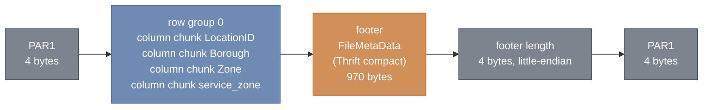
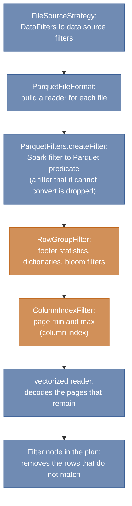

# Chapter 22: Parquet from the inside

Most Spark data lives in Parquet files, and most Spark performance advice is about Parquet in disguise. "Sort before you write" and "do not write small files" are two examples. "Use `TIMESTAMP_MICROS`" and "partition pruning is not the same as row group skipping" are two more. Each of these rules follows from a few bytes at the end of each file. This chapter reads those bytes.

**A Parquet file is a sequence of column chunks with a footer that describes them. The footer holds the schema, and for each row group and each column, the encodings, the offsets and the minimum and maximum values. Spark gives its filters to the Parquet reader. The reader skips data with the footer statistics, the dictionaries, the bloom filters and the page indexes. Each of these mechanisms works only if the layout of the data lets it. The writer decides that layout, so a fast read is a decision that you make at write time.**

The scripts are in [`code/ch22`](https://github.com/lisancao/spark-masterclass/tree/main/code/ch22), and each output block comes from `code/ch22/output/`. `thrift_compact.py` is a reader for the Thrift compact protocol, adapted from SparkTutor. All runs use Spark 4.3.0 in `local[*]` mode on 16 cores. Spark 4.3.0 writes Parquet with parquet-mr (parquet-java) 1.17.0.

## Step 1: The bytes at the two ends of a file

`footer.py` writes the 265-row zone lookup table as one Parquet file and prints its first and last bytes:

```text
<<OUT:ch22/footer.txt|^part-|column data is>>
```



<figure markdown>
  <video autoplay loop muted playsinline controls width="1280" height="720" poster="../../media/clips/ch22-footer.webp">
    <source src="../../media/clips/ch22-footer.mp4" type="video/mp4">
  </video>
  <figcaption><code>footer.py</code> prints the two ends of a Parquet file and decodes the footer with a small Thrift reader.</figcaption>
</figure>

A Parquet file starts and ends with the magic bytes `PAR1` (`50 41 52 31`). The 4 bytes before the last `PAR1` are the length of the footer, as a little-endian integer: `ca 03 00 00` is 0x03ca, which is 970. A reader opens a file at the end. It reads the last 8 bytes, then the footer, and only then the column data that it needs.

This design has two results. A reader can find any column without a scan of the file. And each file costs at least one extra read for the footer. That read is the fixed cost of a file, and it is why many small files are slow ([Chapter 19](ch19-partitions-caching-memory.md), Step 2).

The bytes after the first `PAR1` are already a Thrift structure: the header of the first data page. `15 00` is field 1 (`type`) with the value 0, which is `DATA_PAGE`. `15 d6 10` is field 2 (`uncompressed_page_size`), and `15 de 10` is field 3 (`compressed_page_size`). Step 3 decodes these headers.

## Step 2: The footer, decoded by hand

The footer is a `FileMetaData` struct in the Thrift compact protocol. Each field starts with a byte that holds the difference from the last field ID (high 4 bits) and the type (low 4 bits). Integers are zigzag varints. Strings have a varint length. Lists have a byte with the size and the element type. `thrift_compact.py` decodes this in about 80 lines into dicts of `{field_id: value}`:

```python
def struct(self):
    fields, last = {}, 0
    while True:
        h = self.byte()
        if h == 0:                       # STOP
            return fields
        delta, t = h >> 4, h & 0x0F
        fid = last + delta if delta else self.zigzag()
        fields[fid] = self.value(t)
        last = fid
```

The field IDs come from `parquet.thrift` in the parquet-format project. `footer.py` prints the fields of the zones file:

```text
<<OUT:ch22/footer.txt|FileMetaData, decoded|org.apache.spark.sql.parquet.row.metadata:>>
```

The footer answers these questions without a read of any data:

- **The schema.** `spark_schema` is a group with four children. Each leaf has a physical type: `INT32` for `LocationID` and `BYTE_ARRAY` for the strings. All four columns are `optional`, because CSV columns are nullable.
- **The row groups.** This file has one row group of 265 rows.
- **For each column chunk**: the codec (`SNAPPY`, the Spark default), the encodings, the compressed size, and the minimum and maximum values. `Borough` and `service_zone` use `PLAIN_DICTIONARY`, because they have few distinct values. `Zone` has 260 distinct values in 265 rows, so a dictionary would not make it smaller, and the writer used `PLAIN`.
- **Key-value metadata.** Spark writes its own schema as JSON in `org.apache.spark.sql.parquet.row.metadata`, and its version in `org.apache.spark.version`. When Spark reads the file back, it uses this JSON to restore Spark types that Parquet does not have.
- **`created_by`** names the writer: `parquet-mr version 1.17.0`.

The same footer through PyArrow agrees, and the June trips file shows a footer from a different writer:

```text
<<OUT:ch22/footer.txt|the same footer through pyarrow|compression ZSTD>>
```

The TLC wrote the June file with Arrow's C++ writer, with ZSTD compression and row groups of 1,048,576 rows. Its footer is 12,333 bytes, for 4 row groups of 20 columns. These four row groups are why only four of sixteen tasks did work in [Chapter 1](ch01-how-spark-runs.md).

## Step 3: Pages, dictionaries and encodings

A column chunk is a sequence of pages. Each page has a Thrift `PageHeader`, and then the encoded values. `page_headers()` starts at the offset that the footer gives for each chunk, and reads one header after the other:

```text
<<OUT:ch22/footer.txt|the pages of each column chunk|service_zone data_page_offset>>
```

`Borough` has two pages. The dictionary page holds the 8 distinct names (85 bytes). The data page holds 265 small integer indexes into that dictionary (114 bytes), encoded as runs and bit-packed groups. `Zone` has one data page of 3,212 bytes with the 265 strings in full.

A dictionary has a size limit (1 MiB for each column chunk in parquet-mr). A column can have too many distinct values for the dictionary. Then the writer stops the dictionary in the middle of the chunk, and it writes the rest of the pages as `PLAIN`. Then the chunk has both forms. `skipping.py` writes 200,000 events with the v1 and the v2 page formats (`parquet.writer.version`):

```text
<<OUT:ch22/skipping.txt|the v1 and v2 page formats|amount.*DICTIONARY_PAGE PLAIN$>>
```

- The `ts` column shows the fallback: a dictionary page, data pages with `PLAIN_DICTIONARY`, and then `PLAIN` pages after the dictionary became full.
- The v2 format uses newer encodings. `DELTA_BINARY_PACKED` stores the differences between sorted integers (`id`, `user_id`). `DELTA_BYTE_ARRAY` stores the shared prefix of each string once (`session_id`). The file became 25% smaller.
- Spark reads v2 pages with its vectorized reader. The default of `parquet.writer.version` is still `v1`. Make sure that all the tools that read your files support v2 before you change it.

## Step 4: How a filter skips data

Spark gives filters to the Parquet reader as `PushedFilters` ([Chapter 18](ch18-query-plans.md), Step 3). The path of a filter from the plan to the bytes, in the 4.3.0 source:



The reader skips whole row groups or whole pages. It never removes single rows. The rows that it returns go to the `Filter` node above the scan, which tests each row. Thus, the best measure of skipping is the number of rows that the scan returned. The SQL tab records it as the `number of output rows` metric of the scan node, and `skipping.py` reads it from the REST API.

The test data is 2,000,000 events of 20,000 users. Only 100 users have the rare `refund` event. Each event has a random `session_id`, and a timestamp that grows by 0.432 s for each row. The script writes it in four layouts and runs four queries on each:

```python
LAYOUTS = [
    ("A: as generated, 8 files", events, {}),
    ("B: sorted by user_id, 8 files", events.repartitionByRange(8, "user_id").sortWithinPartitions("user_id"), {}),
    ("C: B + 1 MB row groups", ..., {"parquet.block.size": 1024 * 1024}),
    ("D: C + bloom filter on session_id", ..., {"parquet.block.size": 1024 * 1024,
         "parquet.bloom.filter.enabled#session_id": "true",
         "parquet.bloom.filter.expected.ndv#session_id": "20000"}),
]
```

```text
<<OUT:ch22/skipping.txt|layout                     |layout C, first file>>
```

<figure markdown>
  <video autoplay loop muted playsinline controls width="1280" height="720" poster="../../media/clips/ch22-skipping.webp">
    <source src="../../media/clips/ch22-skipping.mp4" type="video/mp4">
  </video>
  <figcaption><code>skipping.py layouts</code>: the rows that the Parquet reader returned for four queries on four layouts of the same data.</figcaption>
</figure>

Each layout changes what the reader can skip:

- **Layout A** has one row group in each file, with all user IDs, all events and all timestamps. Each row group statistic covers the whole range of its column. The reader skipped nothing for any query and returned all 2,000,000 rows.
- **Layout B** sorts by `user_id` inside range partitions. Each file now holds a narrow range of users. For `user_id = 16073`, the reader skipped seven files with the footer statistics. In the eighth file, the column index let it read only one page. The column index holds the minimum and maximum of each page. The parquet-mr writer ends a page at 20,000 rows, so the result was 20,000 rows. For `refund`, which only 100 users have, the reader skipped seven files and returned the first file, 242,200 rows.
- **Layout C** adds small row groups (`parquet.block.size` of 1 MB, so 135 row groups). For `user_id` and `refund`, the reader now returned one row group of about 15,000 rows.
- **Layout D** adds a bloom filter for `session_id`. A random string has no useful minimum and maximum, so statistics cannot skip it. A bloom filter tells the reader if a value is possibly in a row group. The reader returned one row group of 15,360 rows, where the other layouts returned all rows.
- **The timestamp filter skipped nothing in any layout.** In layout A, the rows in each file are in time sequence, so statistics should help. Step 6 explains why they did not.

The footer of layout C shows the narrow statistics: row group 0 of one file holds only `user_id` 17475 to 17628. The pushed filter `EqualTo(user_id,16073)` is outside that range, so the reader skips the row group without a read of its pages.

## Step 5: Turn off one mechanism at a time

A Parquet reader has four mechanisms for skipping. Each one has a Hadoop setting in parquet-mr, and Spark has one master setting. `skipping.py` reads layout D with one mechanism off at a time. It sets the Hadoop settings on `spark.sparkContext._jsc.hadoopConfiguration()`:

```text
<<OUT:ch22/skipping.txt|layout D with one reader feature off|bloom filter off>>
```

| Mechanism | Setting | Works for | Needs |
|---|---|---|---|
| all of them | `spark.sql.parquet.filterPushdown` (Spark) | everything below | on by default |
| row group statistics | `parquet.filter.stats.enabled` | ranges and equality | sorted or clustered data |
| column index | `parquet.filter.columnindex.enabled` | ranges and equality, for each page | sorted data, pages smaller than row groups |
| dictionary | `parquet.filter.dictionary.enabled` | equality, `IN` | a column chunk that is fully dictionary-encoded |
| bloom filter | `parquet.filter.bloom.enabled` | equality, `IN` | a bloom filter written for the column |

The table of results shows that the mechanisms overlap:

- **For `user_id`, three mechanisms each skip the same data.** With statistics off, with the column index off, and with both off, the result stayed at 15,360. The dictionary of each row group lists its 150 or so user IDs, so the dictionary alone can prove that 16073 is not there. Only with all three off did the reader return all rows.
- **For `refund`, only the dictionary skips.** The event names `buy` to `view` include `refund` alphabetically, so the minimum and maximum of each row group cannot exclude it. The dictionary of a row group without refunds does not list it. With the dictionary off, the reader returned all rows.
- **For `session_id`, only the bloom filter skips.** With the bloom filter off, the reader returned all rows.
- **With `spark.sql.parquet.filterPushdown=false`**, Spark gives no filter to the reader, and all mechanisms stop.

Bloom filters have a cost. The writer sizes a bloom filter from `expected.ndv` and the false-positive rate (`parquet.bloom.filter.fpp`, 0.01 by default). Layout D is 4.2 MB larger than layout C for one bloom filter column. Write bloom filters only for columns that queries look up by exact value, and give `expected.ndv` for one row group, not for the file.

## Step 6: Timestamps: INT96 cannot skip

Spark writes `timestamp` columns as `INT96` by default (`spark.sql.parquet.outputTimestampType`). INT96 is an old 12-byte format from Impala and Hive. parquet-mr writes no statistics for it. `skipping.py` writes the same sorted data with INT96 and with `TIMESTAMP_MICROS`, and runs a filter for one hour:

```text
<<OUT:ch22/skipping.txt|timestamps: the physical type|default spark.sql.parquet.outputTimestampType>>
```

The two plans are the same. Both show the `ts` filter in `PushedFilters`. But the INT96 file has no statistics, so the reader can skip nothing, and it returned all 2,000,000 rows. The `TIMESTAMP_MICROS` file is `INT64` with statistics, and the reader returned 29,232 rows, the row groups that hold that hour.

This is a trap because the plan does not show it. `PushedFilters` is the list of filters that Spark gave to the reader, not the list of filters that the reader could use. Set `spark.sql.parquet.outputTimestampType=TIMESTAMP_MICROS` before you write tables that queries filter by time.

## Step 7: Compression codecs

<<CODECS>>

## Step 8: New in 4.3: nanosecond timestamps in Parquet

Spark 4.3 adds `TIMESTAMP_NTZ(p)` and `TIMESTAMP_LTZ(p)` with 7 to 9 digits of fractions of a second, as a preview behind `spark.sql.timestampNanosTypes.enabled`. The setting is internal, and its documentation says that some operations can still fail. `skipping.py` writes one nanosecond value and reads it back:

```text
<<OUT:ch22/skipping.txt|nanosecond timestamps|read back:>>
```

- Spark writes the column as `INT64` with the logical type `Timestamp(timeUnit=nanoseconds)`. PyArrow reads this logical type, as the output shows.
- Spark reads the value back with all nine digits.
- Classic PySpark 4.3.0 cannot parse the type name: `df.schema` fails with `CANNOT_PARSE_DATATYPE`. The script reads the schema from the JVM and casts the value to a string to show it.

Thus, a nanosecond column is usable from SQL and from the JVM in 4.3.0, but not yet from all of the Python API.

## Step 9: Rules for a Parquet layout

The measurements give these rules:

1. **Sort or cluster by the columns that queries filter on.** Statistics, column indexes and dictionaries all need values of one kind to be close together. Layout A had all three mechanisms, and they skipped nothing.
2. **Make row groups match the query.** A large row group is good for a full scan. A small row group lets a lookup skip more. The default `parquet.block.size` is 128 MB. Layout C used 1 MB for a lookup workload.
3. **Write `TIMESTAMP_MICROS`, not INT96**, if queries filter by time.
4. **Use bloom filters only for exact lookups on high-cardinality columns**, with an `expected.ndv` for one row group.
5. **Use one codec for the whole table.** `snappy` and `lz4_raw` are fast. `zstd` makes files smaller and costs more CPU to write.
6. **Count the rows that the scan returned**, not the run time, to see if a layout works. The SQL tab gives it as `number of output rows` of the scan.

## The whole chapter, on one page

```python
import struct
data = open(path, "rb").read()
assert data[:4] == data[-4:] == b"PAR1"
footer_len = struct.unpack("<I", data[-8:-4])[0]            # little-endian length before the last PAR1
meta = Compact(data[-8 - footer_len:-8]).struct()           # FileMetaData: 2 schema, 3 num_rows, 4 row_groups

import pyarrow.parquet as pq                                 # or let PyArrow do it
md = pq.ParquetFile(path).metadata
md.row_group(0).column(0).statistics                        # min, max, null_count

# A layout that skips.
spark.conf.set("spark.sql.parquet.outputTimestampType", "TIMESTAMP_MICROS")
(df.repartitionByRange(8, "user_id").sortWithinPartitions("user_id")
   .write.option("parquet.block.size", 8 * 1024 * 1024)
   .option("parquet.bloom.filter.enabled#session_id", "true")
   .option("parquet.bloom.filter.expected.ndv#session_id", "100000")
   .parquet(out))
```

- **A Parquet file is `PAR1`, column chunks, a Thrift footer, the footer length and `PAR1`.** A reader reads the footer first.
- **The footer has the schema, the row groups, and for each column chunk the codec, the encodings, the offsets and the statistics.** Spark adds its own schema as JSON.
- **Pages hold the values.** A chunk has a dictionary page and data pages, or plain pages. When a dictionary becomes full, the writer changes to plain pages in the middle of the chunk.
- **The reader skips row groups and pages, never single rows**, with statistics, column indexes, dictionaries and bloom filters. The `Filter` node above the scan removes the rest.
- **Each mechanism needs a layout.** Sorted data for statistics and column indexes, few values in each row group for dictionaries, a bloom filter written for the column.
- **INT96 timestamps cannot skip**, even when the plan lists the filter in `PushedFilters`.

## Further reading

- [The Parquet format specification](https://parquet.apache.org/docs/file-format/) and `parquet.thrift` in the parquet-format repository.
- [Spark's Parquet data source guide](https://spark.apache.org/docs/4.3.0/sql-data-sources-parquet.html), with the Spark settings.
- The 4.3.0 source: `ParquetFilters.scala`, `ParquetFileFormat.scala` and `VectorizedParquetRecordReader.java` in `sql/core/src/main/scala/org/apache/spark/sql/execution/datasources/parquet/`.
- [Chapter 19](ch19-partitions-caching-memory.md) for how row groups set the scan tasks, and [Chapter 15](../roadmap.md) for shredded VARIANT columns in Parquet.
