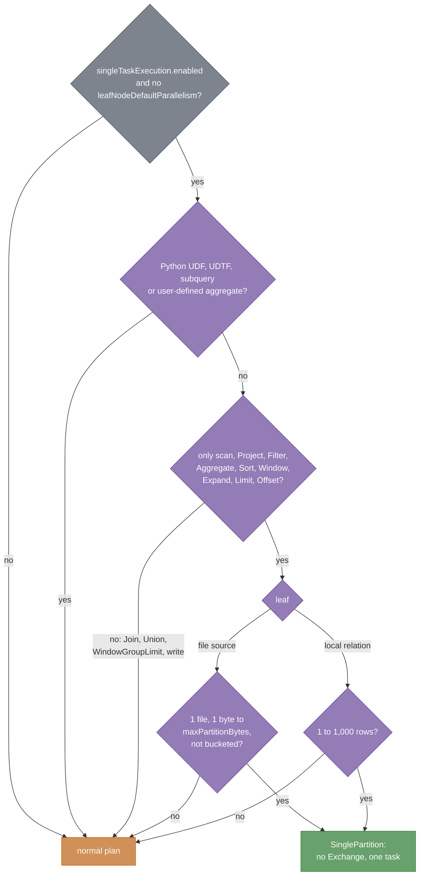
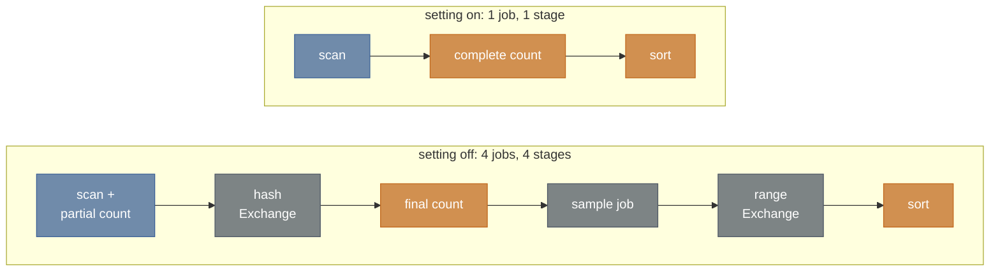
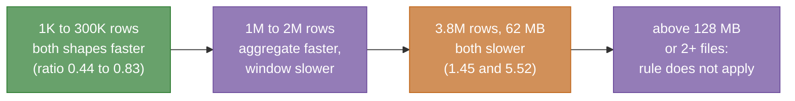

# Chapter 23: Project Feather: small queries without the distributed tax

Spark plans each query as if the data is large. A `groupBy` gets a partial aggregate, a shuffle and a final aggregate. An `orderBy` gets a second shuffle, with a sample job before it. Each shuffle is a stage boundary, and AQE submits each stage as a separate job. On a cluster with terabytes of data, this machinery costs a small part of the run time. On a 12 KB file, the machinery is almost all of the run time.

Project Feather ([SPARK-56978](https://issues.apache.org/jira/browse/SPARK-56978)) is a set of changes for this case: notebooks, test suites, agents and other workloads that send many small queries. Spark 4.3 includes its first two parts. Both are off by default. This chapter is about the main part, **single-task execution** ([SPARK-57851](https://issues.apache.org/jira/browse/SPARK-57851)), and it also measures the second part, an Arrow format for the cache.

**Single-task execution removes the shuffles from a query when the optimizer can prove that the input fits in one task. The rule that decides this is strict and short: one file or one small local relation, and only a fixed list of operators above it. Inside these limits, a small query runs as one job and one task, and the time per query decreases by a large fraction. Outside them, nothing changes. Near the upper size limit, one task is slower than many tasks. Thus, the crossover point is a property of your data, and you must measure it.**

The scripts are in [`code/ch23`](https://github.com/lisancao/spark-masterclass/tree/main/code/ch23), and each output block comes from `code/ch23/output/`. All runs use Spark 4.3.0 in `local[*]` mode on 16 cores, with the session time zone set to UTC. Each timing is a median after warm-up runs, measured while no other benchmark ran on the machine. [Chapter 1](ch01-how-spark-runs.md) gave the first measurement of Feather. This chapter explains the rule, finds its limits, and shows its effect on plans, AQE, the Spark UI and Spark Connect.

## Step 1: Read the rule in the 4.3 source

Single-task execution has two parts. An optimizer rule marks a plan. Then the physical scan decides if the files are small enough.

The rule is `MarkSingleTaskExecution` in `sql/core/src/main/scala/org/apache/spark/sql/execution/datasources/`. `SparkOptimizer` runs it in a batch of its own, as the last batch of the optimizer. A comment in that file gives the reason: no later rule can change the shape of the plan or copy the marked scan nodes. The rule does these checks, in this sequence:

1. If `spark.sql.optimizer.singleTaskExecution.enabled` is `false`, or if `spark.sql.leafNodeDefaultParallelism` is set, stop. The second setting is an explicit request for a number of partitions, and the rule obeys it.
2. If the plan contains a pattern from the `unsupportedPatterns` list, stop. The list is: Python UDFs (`PYTHON_UDF`, `EVAL_PYTHON_UDF`), Python UDTFs, `EXISTS`, `IN` and scalar subqueries, lateral subqueries, table arguments of table functions, and user-defined aggregate functions.
3. Examine each node of the plan, from the root. Each node must be one of these:
    - a leaf: `LogicalRelation` (a file source) or `LocalRelation` (rows that the driver holds),
    - an operator that never adds a shuffle: `Project`, `Filter`, `DeserializeToObject`, `SerializeFromObject`,
    - an operator that adds a shuffle, if its internal setting is on: `Aggregate`, `Expand`, `GlobalLimit`, `LocalLimit`, `Offset`, `Sort`, `Window`.

    Any other node (a `Join`, a `Union`, a `WindowGroupLimit`, a write command) makes the plan ineligible.
4. If the shape passes, clone the plan and set a tag (`__single_task_execution`) on each leaf and on each `Expand`.

The planner then reads the tag. For a `LocalRelation`, `LocalTableScanExec` reports `SinglePartition` for a relation of 1 to 1,000 rows. For a file source, `FileSourceScanExec.useSingleTaskExecution` does the final check:

```scala
numFiles >= minNumFiles && numFiles <= maxNumFiles &&
  numBytes >= minNumBytes && numBytes <= maxPartitionBytes
```

The defaults are one file (`minNumFiles` and `maxNumFiles` are both 1), at least one byte, and at most `spark.sql.files.maxPartitionBytes` (128 MB). Bucketed scans never qualify. If the check passes, the scan reports `SinglePartition` as its output partitioning. `EnsureRequirements` is the rule that adds an `Exchange` where an operator needs a different partitioning. It finds that one partition already satisfies each requirement, so it adds no `Exchange`. The scan also coalesces its input to one partition, so the query stays correct when dynamic pruning changes the file list.



Five internal settings (`singleTaskExecution.aggregation`, `.expand`, `.limitOffset`, `.sort`, `.window`) turn off one operator each. They all fall back to the main setting. The file limits (`maxNumFiles`, `minNumFiles`, `minNumBytes`) and the row limits (`localTableScan.minRows`, `localTableScan.threshold`) are also internal settings. This chapter uses only the main setting.

## Step 2: Which queries qualify

`eligibility.py` runs each query shape two times, with the setting off and then on. For each run, it counts the `Exchange` nodes in the physical plan. It also reads the jobs and tasks of the run from the REST API of the Spark UI:

```python
def measure(build, enabled, label):
    spark.conf.set(FLAG, enabled)
    df = build()
    ...
        exchanges = plan(df, "simple").count("Exchange")
        spark.sparkContext.setJobDescription(label)
        df.collect()
```

```text
<<OUT:ch23/eligibility.txt|^query|Parquet, 6 files>>
```

The table agrees with the rule in Step 1, row by row:

- **The supported operators qualify.** Six shapes over the 12 KB CSV file ran as one job of one task, with no `Exchange`. They are `groupBy`, `distinct`, a window function, `rollup`, `limit` and `offset`. `distinct` qualifies because the optimizer changes it into an `Aggregate` before the rule runs. `rollup` qualifies because it is an `Expand` and an `Aggregate`. `orderBy` with `limit 5` had no `Exchange` in the two runs, because Spark plans it as one `TakeOrderedAndProject` operator.
- **One Parquet file of 62 MB qualifies.** The June file is below `maxPartitionBytes` (128 MB). Its scan went from 16 tasks to 1. Step 4 and Step 5 show what that costs.
- **Local relations qualify up to 1,000 rows.** A pandas DataFrame of 1,000 rows and SQL `VALUES` gave one task. A pandas DataFrame of 1,001 rows did not.
- **A DataFrame from a Python list does not qualify in classic PySpark.** `createDataFrame(rows)` pickles the rows into an RDD, and the leaf of the plan is a `LogicalRDD`, as the last line shows. The rule accepts only `LogicalRelation` and `LocalRelation`. Over Spark Connect, the same call gives a `LocalRelation` (Step 7).
- **The excluded shapes keep their shuffles.** Top 3 per group (the optimizer makes a `WindowGroupLimit`), a self join, a union, a Python UDF and a scalar subquery all ran as before.
- **A Python UDF that the optimizer removes does not count.** In "Python UDF, pruned", the UDF result is not used by the `count()`, so column pruning removes it before the rule runs. The plan has no Python UDF, so it qualifies.
- **Two files are too many.** The zones split into two Parquet files did not qualify, and neither did the six monthly files. Most tables and all partitioned folders have more than one file.
- **Writes do not qualify.** The root of a write plan is a write command, which is not in the list of supported operators. The `groupBy` before a Parquet write and before a `noop` write ran three jobs with the setting off and on.

Two settings turn it off for a query that qualifies:

```text
<<OUT:ch23/eligibility.txt|maxPartitionBytes=32m|flag off>>
```

With `maxPartitionBytes` at 32 MB, the 62 MB June file is above the limit, so the scan made 16 partitions again. With `spark.sql.leafNodeDefaultParallelism` set, the rule does not run, and the scan made the 4 partitions that the setting asked for. With the defaults and the setting on, the June scan is one partition, even with no shuffle in the query. Single-task execution changes the partitions of a plain scan too, so a later `repartition` or `df.rdd.getNumPartitions()` sees one partition.

## Step 3: What single-task execution does to a plan

`plans_aqe.py` prints the plan of one query (the zones by borough, sorted) before and after `collect()`, with the setting off and on. The lines are cut at the scan options:

```text
<<OUT:ch23/plans_aqe.txt|=+ spark.sql.optimizer.singleTaskExecution.enabled=false|duration>>
```

```text
<<OUT:ch23/plans_aqe.txt|=+ spark.sql.optimizer.singleTaskExecution.enabled=true|duration>>
```

Compare the two plans from the bottom to the top:

- **The scan is the same.** `FileScan csv [Borough#...]` reads one column in the two plans. Single-task execution changes how many partitions the scan reports, not what it reads.
- **The two `Exchange` nodes are gone.** With the setting off, the plan has a hash `Exchange` for the `groupBy` and a range `Exchange` for the `orderBy`. With the setting on, the scan reports `SinglePartition`. That partitioning satisfies the hash distribution that the aggregate needs and the ordered distribution that the global sort needs. Thus, `EnsureRequirements` adds neither `Exchange`.
- **The aggregate has one phase.** With the setting off, `HashAggregate` appears two times: `partial_count(1)` in each task, then `count(1)` after the shuffle. With the setting on, there is one `HashAggregate` with `count(1)`. The planner makes the two-phase form only to put a shuffle between the phases. With no shuffle, one complete aggregate is enough. The formatted mode shows it: the `Functions` line of the single aggregate is `[count(1)]`, not `[partial_count(1)]`.
- **The range sort needs no sample job.** A range `Exchange` samples its input to choose the partition boundaries ([Chapter 1](ch01-how-spark-runs.md), Step 2). With no range `Exchange`, there is no sample job.
- **`AdaptiveSparkPlan` is still at the top.** AQE wraps a plan that contains an operator with a required distribution. The aggregate and the sort have one, so AQE still wraps the plan. But the final plan has one query stage, `ResultQueryStage 0`, and AQE has nothing to change in it. [Chapter 18](ch18-query-plans.md) gives the rule.
- **Whole-stage codegen joins all the operators.** With the setting on, the scan, the aggregate and the sort are all in codegen stage `*(1)`. With the setting off, each shuffle starts a new codegen stage, `*(1)` to `*(3)`.



## Step 4: What changes in AQE and in the Spark UI

The plan change has a direct effect on the records of the Spark UI. The end of each block in Step 3 is the record of the run from the REST API:

```text
<<OUT:ch23/plans_aqe.txt|the UI: [0-9]+ jobs, [0-9]+ stages, [0-9]+ tasks; shuffle write [1-9]|SQL tab>>
<<OUT:ch23/plans_aqe.txt|the UI: 1 jobs|SQL tab>>
```

With the setting off, one `collect()` became four jobs with one stage each, and the shuffles wrote 1,172 bytes. With the setting on, the same `collect()` became one job, one stage and one task, and the shuffle wrote nothing. In the **SQL / DataFrame** tab, the query has one job ID instead of four. The plan graph of the query has no `Exchange` boxes, and no `AQEShuffleRead` boxes.

<figure markdown>
  <video autoplay loop muted playsinline controls width="1280" height="720" poster="../../media/clips/ch23-feather.webp">
    <source src="../../media/clips/ch23-feather.mp4" type="video/mp4">
  </video>
  <figcaption><code>demo.py</code>: a small CSV query and the June file, single-task execution off and on. The job count includes the job that reads the CSV header.</figcaption>
</figure>

### What AQE cannot do with one task

AQE works at shuffle boundaries ([Chapter 18](ch18-query-plans.md), Step 6). It coalesces small shuffle partitions, it changes a join to a broadcast join, and it splits a skewed partition. With no shuffle, AQE has no boundary at which to act. Usually this is correct, because the data is small. But the file limit is `maxPartitionBytes`, 128 MB, and a 128 MB Parquet file can hold millions of rows. The June trips file is 62 MB and has 3,837,248 rows, so it qualifies:

```text
<<OUT:ch23/plans_aqe.txt|the June trips|EOF>>
```

With the setting off, the aggregate ran as a scan stage of 16 tasks and a final stage of 1 task. AQE coalesced the shuffle into that one task. With the setting on, the whole aggregate ran in one task. The first stage of each run (1 task) is the job that reads the Parquet footer for the schema. It occurs in the two runs.

The task times are a surprise. The 16 scan tasks together used 7,885 ms of task time. The single task used 821 ms. The file has only four row groups, so 12 of the 16 tasks read a footer and stop ([Chapter 1](ch01-how-spark-runs.md), Step 4). Each task has its own start-up cost.

Thus, on this file, one task does less total work than 16 tasks. But wall time is a different question, because 16 tasks run at the same time. Step 5 measures wall time.

## Step 5: The crossover across data sizes

The file limit is 128 MB, not a number of rows. So a file that qualifies can hold a few rows or millions of rows, and one task must process all of them. With the setting off, Spark splits a large file into 16 scan tasks that run at the same time. Somewhere between these extremes, one task becomes slower than the distributed plan.

`crossover.py` cuts the June trips into single files of 1,000 to 2,000,000 rows. The largest size is the full June file (3,837,248 rows, 62.4 MB). It times two query shapes on each file:

```python
SHAPES = {
    "aggregate": lambda df: (df.groupBy("PULocationID").agg(F.count("*"), F.avg("fare_amount"))
                             .orderBy("PULocationID")),
    "window": lambda df: (df.withColumn("r", F.rank().over(
                              Window.partitionBy("PULocationID").orderBy("fare_amount")))
                          .agg(F.max("r"))),
}
```

Each run builds a new DataFrame, the two settings alternate run by run, and each cell is the median of five runs after a warm-up. The aggregate reduces each task's rows early with a partial aggregate. The window must sort all rows by zone and fare, which is much more work for each row.

```text
<<OUT:ch23/crossover.txt>>
```



Read the ratio column, not the milliseconds. Other jobs ran on the machine during these runs. Thus, the absolute times of the small files are larger than in [Chapter 1](ch01-how-spark-runs.md), and they vary from row to row. The ratio compares the two settings under the same conditions, because the settings alternated run by run.

- **Up to 300,000 rows, single-task execution was faster for both shapes**, by a ratio of 0.44 to 0.83. The work for each row is small. Thus, the stages that the setting removes are most of the cost.
- **The window crossed over first, between 300,000 and 1,000,000 rows.** At 1,000,000 rows, one task took 1.38 times as long. At the full June file, it took 5.52 times as long: one task sorted 3.8 million rows that 16 tasks shared with the setting off.
- **The aggregate crossed over later, between 2,000,000 rows and the full file.** A hash aggregate is cheap for each row, so one task stays competitive for longer. At 3,837,248 rows, it took 1.45 times as long.

The crossover depends on the work for each row, the number of cores, and the shape of the file. The rule cannot see any of these. It sees only the number of files and their bytes. Thus, if you turn the setting on for a session that can also read medium files, consider a lower file limit.

`spark.sql.files.maxPartitionBytes` is the upper limit for the rule, and Step 2 showed that a lower value turns the rule off for larger files. But that setting also changes the split size of all other scans ([Chapter 19](ch19-partitions-caching-memory.md), Step 2). The internal settings `spark.sql.optimizer.singleTaskExecution.maxNumFiles` and `minNumBytes` exist, but 4.3.0 has no separate upper byte limit for the rule.

## Step 6: The first query in a new session

A test suite or a notebook pays a second cost: the first query in a new JVM. The JIT compiler has not compiled any code yet, and each class loads on first use. `cold.py` starts a new Python process and a new JVM for each run, and times the session start and the first query separately. The settings alternate process by process:

```python
spark = session("ch23-cold", spark_sql_optimizer_singleTaskExecution_enabled=sys.argv[1],
                spark_ui_showConsoleProgress="false")
t1 = time.perf_counter()
spark.read.option("header", True).csv(str(ZONES)).groupBy("Borough").count().orderBy("Borough").collect()
```

```text
<<OUT:ch23/cold.txt>>
```

The first query took 2,559 ms with the setting off and 1,881 ms with it on, 678 ms less. On a warm session in Step 5, the smallest aggregate saved 321 ms. The first query in a new JVM saved more. A possible cause is that each stage boundary in a new JVM also loads and compiles the code for shuffle writes and reads, and a query with no shuffle does not need that code yet. This cause is not verified.

The session start did not change in a significant way: 3,504 ms and 3,695 ms. The setting has no effect before the first query. Session start is still the largest single cost of a short script, and Spark Connect is one way to pay it only once ([Chapter 4](ch04-spark-connect.md)).

## Step 7: Single-task execution over Spark Connect

Over Spark Connect, the optimizer runs on the server. Single-task execution is a SQL setting, so each Connect session has its own value, and a client changes it with `spark.conf.set`. `connect.py` opens two sessions on one server, turns the setting on in session `a` only, and runs three small queries in each session. It reads the jobs and tasks of each query from the REST API of the server:

```python
a = SparkSession.builder.remote(URL).getOrCreate()
b = a.newSession()                       # a second session on the same server
a.conf.set(FLAG, "true")
```

```text
<<OUT:ch23/connect.txt>>
```

<figure markdown>
  <video autoplay loop muted playsinline controls width="1280" height="720" poster="../../media/clips/ch23-connect.webp">
    <source src="../../media/clips/ch23-connect.mp4" type="video/mp4">
  </video>
  <figcaption><code>connect.py brief</code>: two sessions on one Connect server. Only session <code>a</code> turned the setting on.</figcaption>
</figure>

- **The setting belongs to the session.** Session `a` ran each query as one job and one task. Session `b`, on the same server and at the same time, kept the default plans. Thus, a shared Connect server can turn on single-task execution for one client without an effect on the other clients.
- **A Python list qualifies over Connect.** In classic PySpark, `createDataFrame(rows)` makes a `LogicalRDD`, which the rule refuses (Step 2). The Connect client sends the rows to the server in the plan, as a local relation, so the 500-row list qualified like the pandas DataFrame. For a test suite that runs over Spark Connect, the usual list fixtures get the benefit without a change.
- **The time saved is visible from the client.** The small CSV query took <<TB>> ms in session `b` and <<TA>> ms in session `a`, measured from the client. The client-side time includes the gRPC round trip, which the setting does not change.

The client sends the same unresolved plan in the two sessions. Only the optimizer on the server reads the setting. [Chapter 46](../roadmap.md) uses this property on a server shared by several agents.

## Step 8: The other part of Feather in 4.3: an Arrow cache

The second part of Feather in 4.3 is an Arrow format for the cache ([SPARK-57268](https://issues.apache.org/jira/browse/SPARK-57268)). The static setting `spark.sql.cache.serializer` selects the class that turns cached partitions into stored batches. The default is `DefaultCachedBatchSerializer`, the columnar format of [Chapter 19](ch19-partitions-caching-memory.md), Step 5. Spark 4.3 adds `org.apache.spark.sql.execution.columnar.ArrowCachedBatchSerializer`. Because the setting is static, `arrow_cache.py` starts a new process for each serializer:

```python
CASES = [("default", {}),
         ("Arrow", {"spark.sql.cache.serializer": ARROW}),
         ("Arrow, zstd", {"spark.sql.cache.serializer": ARROW, "spark.sql.execution.arrow.compression.codec": "zstd"})]
```

```text
<<OUT:ch23/arrow_cache.txt>>
```

- **Without compression, the Arrow cache was larger.** It used 149.5 MiB for six columns of the June trips, and the default cache used 102.1 MiB. The default serializer compresses each column with simple encodings. Arrow stores plain buffers.
- **With `zstd`, the Arrow cache was the smallest**, 35.6 MiB. `spark.sql.execution.arrow.compression.codec` is `none` by default, and it accepts `zstd` and `lz4`.
- **The query times were close.** An aggregate from the cache took between 114 and 157 ms with the three formats.

The Arrow format matters most where data leaves the cache as Arrow anyway, for example to `toArrow()`, to pandas, or to a Python UDF. This chapter did not measure that path. For a cache that only Spark reads, the default format is as fast, and smaller than uncompressed Arrow.

## The whole chapter, on one page

```python
spark.conf.set("spark.sql.optimizer.singleTaskExecution.enabled", "true")   # session setting, off by default

df = spark.read.parquet("one_small_file.parquet")      # 1 file, at most maxPartitionBytes (128 MB)
df.groupBy("k").count().orderBy("k").explain()        # no Exchange, one HashAggregate, one task

# Qualifies: one file or a local relation of 1 to 1,000 rows (pandas, VALUES, Connect lists),
#            with Project, Filter, Aggregate, Sort, Window, Expand, Limit, Offset on top.
# Does not:  2+ files, joins, unions, top-N per group, Python UDFs/UDTFs, subqueries,
#            writes, a Python list in classic PySpark, leafNodeDefaultParallelism set.
```

- **The rule is `MarkSingleTaskExecution`, the last optimizer batch.** It marks the scan. The scan reports `SinglePartition`, and `EnsureRequirements` adds no `Exchange`.
- **Inside its limits, a small query is one job and one task.** The aggregate has one phase, the sort has no sample job, and AQE has one query stage.
- **Single-task execution is faster on small data and slower near the limit.** In this chapter, a window crossed over between 300,000 and 1,000,000 rows. An aggregate crossed over between 2,000,000 and 3.8 million rows.
- **Over Spark Connect, it is a setting of each session**, and a Python list from the client qualifies.
- **The Arrow cache** is a static setting. Compress it with `zstd` to make it smaller than the default cache.
- **To benchmark it, build a new DataFrame for each run.** A second `collect()` on the same DataFrame reuses the shuffle files that single-task execution removes ([Chapter 19](ch19-partitions-caching-memory.md), Step 5).

## Further reading

- [SPARK-56978](https://issues.apache.org/jira/browse/SPARK-56978), the Project Feather umbrella, and [SPARK-57851](https://issues.apache.org/jira/browse/SPARK-57851), single-task execution.
- The 4.3.0 source: `MarkSingleTaskExecution.scala`, `DataSourceScanExec.scala` (`useSingleTaskExecution`), `SparkOptimizer.scala` (the batch), `MarkSingleTaskExecutionSuite.scala` (the tests).
- [The Ultimate Guide to Spark 4.3](https://systemsnull.net/posts/data-engineering-ai/ultimate-guide-spark-43), with the other changes in the release.
- [Chapter 46](../roadmap.md) for Feather on a shared Connect server.
- [Chapter 24](../roadmap.md) for native and GPU engines, the other way to make Spark faster on one machine.
